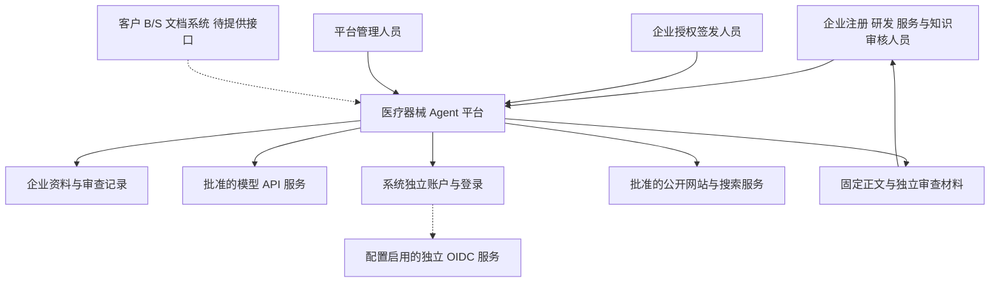
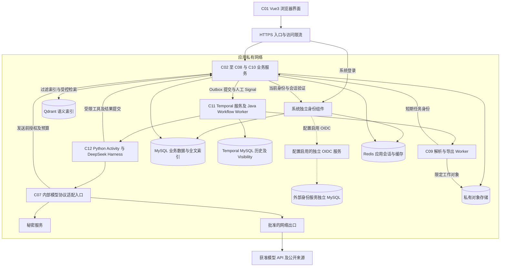
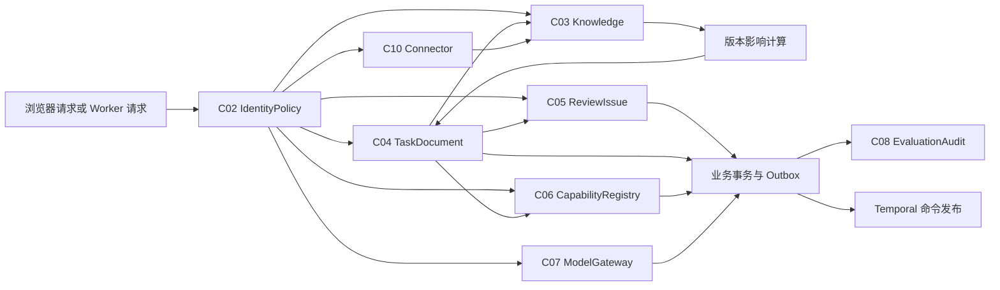
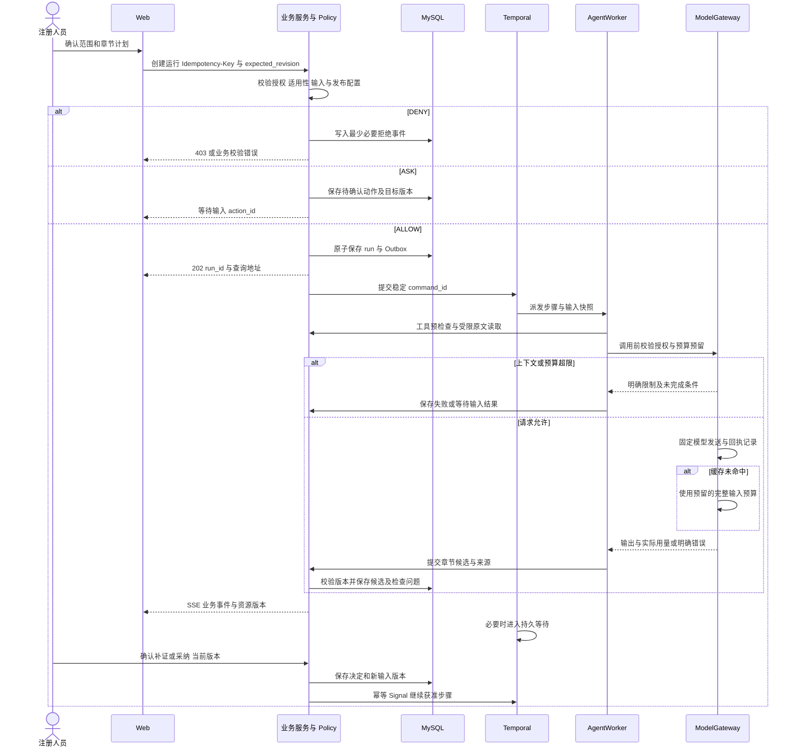
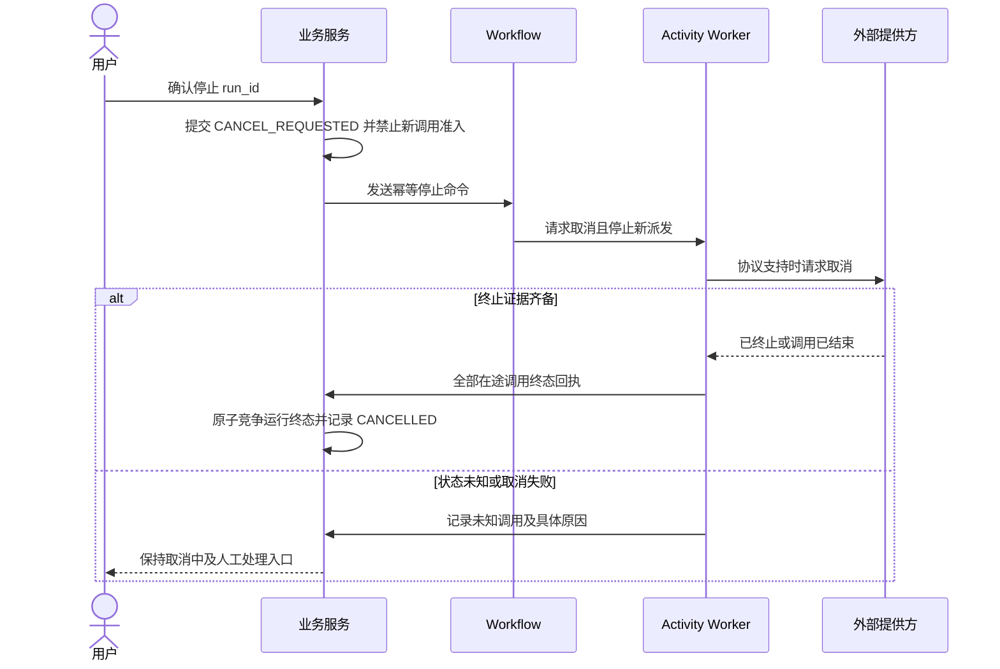

# 医疗器械企业 Agent 平台概要设计与架构决策

版本：V1.2.0；日期：2026-10-02；状态：`DRAFT`；能力类型：`DESIGN`。需求基线：PRD V1.3.0 与用户明确的技术及规模约束。Java 后端、Python 算法、企业用户100～500人、系统独立账户与登录、MySQL优先及模型API接入属于 `CONFIRMED_CONSTRAINT`。本地运行依据 BACK-LOCAL-01，使用系统账户与服务端会话；外部 OIDC 使用独立启用配置。接口与组件职责为 `DEFINED_DESIGN`；实际运行证据读取 IMP-04 和实施任务计划，完整业务验收仍待验证。

## 1. 架构目标与系统约束

### 1.1 输入材料与交接评估

| 依据 | 已核查内容 | 使用边界 |
| --- | --- | --- |
| [PRD](./PRD.md) §2、§5、§8—13 | FR-01—FR-09、BR-01—BR-23、AC-01—AC-57、NFR-01—NFR-17 | 当前产品需求；`INFERRED` 和 `UNKNOWN` 保留原状态 |
| 用户本次架构约束 | Java 后端、Python 算法；企业用户100～500人；系统独立用户和登录，本地运行；MySQL优先；模型通过API接入 | 当前建设范围采用API模型服务；用户规模按企业账户数量设计，同时在线及生成并发单独测量；本地身份定义见接口补充设计 §4.4 |
| [产品方向与商业假设](./产品方向与商业假设.md) D01—D08 | 中小型医疗器械企业、第二类及第三类、SaaS 优先、注册部门签发 | 私有化、服务协作及其他场景保持独立交付条件 |
| [客户需求初次沟通](./客户需求初次沟通.md) §2.1、§7 | 客户口述现有 B/S 使用“若依”；账号、文档接口及部署资料待提供 | 无法据此确认客户版本、数据库、SSO 协议或可复用源码 |
| [交互原型说明](./交互原型说明.md)、[界面规范](./界面规范.md) | 14 个屏幕、Gru、三个文档步骤、资料与管理入口 | 以最新文档阅读规范确定 S09 编辑、S11 只读审查 |
| [文档阅读设计](./ui-delivery/document-reading-design.md)、[字段核对](./ui-delivery/prd-v13-field-check.md) | 13 种文档入口、11 类结构化字段、38 个二级目录、正文与内部材料 | 字段组数量不能代表所有产品字段或业务验收完成 |
| [目标产品设计](./ui-delivery/final-product-design.md)、[组件复用检查](./ui-delivery/component-reuse-audit.md) | HTML 原型、会话数据、若依 Vue3 组件复用要求 | 页面刷新恢复预置内容；正式模型、授权、持久化及文件转换待接入 |
| 当前四份 LLD 与[接口补充设计](./backend-design/接口补充设计.md) | 数据、后端、Agent、前端设计及共享 Schema 可读取；正式工程和部署清单未提供 | 设计输入可用；运行验收仍需正式工程与环境 |
| [基础框架评价](./基础框架评价.md) | 官方说明、许可、统一评价与真实验证条件 | 文献评价与运行结果分别记录 |

业务过程为项目建档、授权、资料接收和处理、核准适用版本、确认任务范围与计划、逐章处理、独立检查、人工审查、企业签发、固定版本导出及资料维护。购买决定者的报表权限不自动包含项目原文权限。平台管理人员管理连接和能力配置，业务资料读取仍需企业授权。

浏览器是当前唯一确认的应用触点。桌面承担长文编辑；移动浏览器承担查询与必要审查。无需引入独立手机客户端、单独移动 BFF 或 WebSocket。企业浏览器经 HTTPS 访问 SaaS；数据库、调度、解析和模型代理位于私有网络；公网搜索和模型服务仅通过获准出口访问。

高影响操作包括资料核准、权限变更、正文采纳、Agent 发布、签发、成果转存及永久删除。模型仅提交建议或候选产物，业务服务校验授权、版本及前置条件后写入。解析进程不能访问秘密服务；Agent 不能使用任意 Shell、SQL、URL 或客户系统写入工具。

### 1.2 范围与未知条件

| 决策项 | 当前设计 | 未知条件及影响 |
| --- | --- | --- |
| 注册范围 | 第二类、第三类；项目属性和适用模板驱动；非 IVD 首次目录与 IVD、变更、延续分别匹配 | 客户真实模板和逐产品适用性未核定；对应正式生成受阻 |
| 管理与运行 | Java 负责业务、授权、事务、Temporal Workflow；Python 负责算法、专业 Activity、模型协议与文档处理 | 团队语言分工已确认；正式工程、前端人员及基础设施维护责任待明确 |
| 用户规模 | 企业用户 100～500 人；容量口径为单企业空间的注册账户，按企业和任务限制资源 | 企业总数、同时在线人数、生成并发、文件体积、页数、Token、预算待测；人数不能直接换算为模型并发 |
| 数据库 | MySQL 8.4 LTS / InnoDB 为业务数据库设计基线；独立 Qdrant 保存可重建向量索引 | 补丁版本、驱动及调度组件兼容组合需验证；用户数不能推定资料和向量体积 |
| 系统身份 | 系统独立账户、成熟密码验证及服务端会话；local/OIDC 显式选择 | 本地账户、首次管理员设置及会话撤销按 BACK-LOCAL-01 实施；启用外部 OIDC 时需要独立批准产品、域名、证书、MFA 和账号策略 |
| 模型连接 | 生成、Embedding、启用时的 Rerank 均通过获准 API 接入 | 供应商、端点、版本、限额、数据条款及预算待提供；API 可达性进入环境验收 |
| 安全条件 | 默认关闭联网；企业授权范围交集；秘密仅在服务端解析 | 区域、模型数据条款、保存期、签发身份核验和岗位分离规则待确认 |
| R07 | 五类场景分别登记规格和版本；材料质量检查使用注册文档检查能力 | 未完成专属输入、规则和样本的场景为规划中，不能发布正式入口 |
| R08 | SaaS 数据边界完整设计；私有化使用相同业务制品，并访问批准的模型 API | B/S 文档接口、部署资源和服务协作责任为 `BLOCKED` / `UNKNOWN`；既有 B/S 连接独立于平台登录 |

模型生成不能补造编号、报告、研究结果、签名或印章。GB/T 42062—2022 的逐条规则需要获授权正文，沿用 PRD E10 的核查范围。本次架构不新增法规适用性结论。

### 1.3 非功能要求与测量

| ID | 架构机制与测量对象 | 阈值、验证及责任 |
| --- | --- | --- |
| NFR-01 | 覆盖 100～500 人账户规模；登录、API 接受、排队、TTFT、检索和全任务历时分别记录 p50/p95/p99 与失败率 | 同时在线、生成并发及响应阈值 `UNKNOWN`；平台负责人用真实任务测量 |
| NFR-02 | 业务事务、Outbox、稳定运行标识、调用回执、恢复核对 | RTO/RPO `UNKNOWN`；后端与运维执行中断及重复提交检查 |
| NFR-03 | 身份、企业、项目、动作和数据分类共同授权，传输与存储加密 | 安全负责人验证允许和拒绝路径，客户确认外发边界 |
| NFR-04 | 组件语义、键盘操作、焦点恢复、错误文字、异步更新不抢占焦点 | 前端负责人按客户设备和适用规范验收；规范未核定 |
| NFR-05 | 文件格式能力目录、浏览器与转换引擎兼容矩阵 | 环境清单待提供；逐格式真实文件 `NOT_RUN` |
| NFR-06 | `task_id/run_id/step_id/invocation_id/trace_id` 贯通日志、指标和审计 | 保存期 `UNKNOWN`；运营可回查原始事件 |
| NFR-07 | 发布清单固定代码、Prompt、Schema、模型及规则；历史任务按原版本解释 | 运维验证新旧运行共存和数据库恢复 |
| NFR-08 | 人工等待记录、章节版本、执行历史及调用台账独立保存 | 恢复正确率及恢复时限待定；保留人工决定 |
| NFR-09 | 文件版本、解析版本、稳定位置和陈述支持关系分别检查 | 跨企业来源返回零条；定位及事实支持阈值待核定 |
| NFR-10 | 调用前原子预留预算、记录在途费用、上限阻断 | 发布配置所有必需上限填写；预算数值待批准 |
| NFR-11 | 工具前后校验、网络限制、内容与执行权限分离 | 用获授权且含指令文本的真实资料检查；样本未提供 |
| NFR-12 | 上传、解析、索引、核准四种状态；不可变处理版本 | 七种格式逐项验证；部分失败禁止整体核准 |
| NFR-13 | 当前授权和版本水位检查覆盖读取、模型发送、缓存、引用与导出 | 撤权提交后新授权判定不得读取；越权返回数量为零 |
| NFR-14 | 取消请求和终止确认分离；正文 CAS；导出清单固定版本 | 每个一致性断言逐项通过；业务运行 `NOT_RUN` |
| NFR-15 | 引用保护、停用、回收、恢复、保存策略和备份删除清单 | 保存期未知时永久清理关闭；安全与数据负责人确认 |
| NFR-16 | 目录节点、条件字段、重复行、附件、指标方法及共享事实关联 | 适用必需内容全部可定位；关键缺项禁止签发 |
| NFR-17 | 固定正文与审查材料、排版检查、成品内容核对 | 关键内容无改变；未知渠道不能标记可提交 |

所有测量状态为 `NOT_RUN`。容量估算采用 `峰值并行步骤 = 活跃运行数 × 每运行获准并发`，`所需执行槽位 ≥ 到达率 × 平均步骤耗时 / 目标利用率`；模型供应商 RPM/TPM、解析内存和数据库连接同时构成限制。储存预算包含原件、处理版本、正文、导出、审计和备份；不能仅以向量数量估算。

### 1.4 功能对应关系

| 功能 | 页面与业务入口 | 责任组件 | 终态与验收入口 |
| --- | --- | --- | --- |
| FR-01 | S02、S03、S17、S18 | C02 IdentityPolicy | 当前授权生效、拒绝可审计；AC-01、AC-02 |
| FR-02 | S13、Gru 连接入口 | C06 CapabilityRegistry、C07 ModelGateway | 已发布依赖清单实际被运行使用；AC-03、AC-04、AC-27、AC-28 |
| FR-03 | S04、S05、S18 | C03 Knowledge、C09 DocumentWorker | 就绪且核准版本、历史引用、使用关系；AC-05、AC-06、AC-29—AC-36、AC-50、AC-57 |
| FR-04 | S01、S06、S07、S18 | C04 TaskDocument | 唯一任务和固定输入版本；AC-07、AC-08、AC-37、AC-38、AC-46 |
| FR-05 | S09、S11 | C04、C05 ReviewIssue、C09 | 已审查且企业签发的不可变文档；AC-09—AC-11、AC-45—AC-57 |
| FR-06 | S15 | C08 EvaluationAudit | 同样本比较与原始记录，缺证据明确标记；AC-12、AC-13 |
| FR-07 | S01 场景目录 | C06、C04 | 独立规格发布或规划中；AC-14、AC-15 |
| FR-08 | S16 | C02、C10 Connector | 企业隔离、可核查连接状态；AC-16、AC-17 |
| FR-09 | S07、S09、S11、Gru | C04、C11 Workflow、C12 AgentWorker | 章节、补证、恢复、取消及固定成果；AC-18—AC-26、AC-39—AC-44 |

逐项 AC 和 BR 的独立审查见[架构审查记录](./架构审查记录.md) §4，全部原始承诺保留。

## 2. 业务上下文与专业角色边界

### 2.1 C4 Context

签发结果属于企业内部批准记录。监管提交、监管批准及第三方电子签章由独立外部状态表达，当前没有相应接口资料。

### 2.2 专业角色与物理承载

| 角色 | 输入与产出 | 工具权限 | 环境与生命周期 |
| --- | --- | --- | --- |
| 主控 C11 | 已确认计划、依赖和预算；产出步骤派发与执行状态 | 读取任务状态、调用受控 Activity；不能核准或签发 | Java Temporal Workflow Worker；等待期间持久化历史并释放执行槽位 |
| 规划 Plan | 项目、模板和范围；产出 `plan_candidate`、研究问题、依赖 DAG、完成条件 | 读取已经准备的输入；没有业务写入工具 | C12 受限步骤；候选计划经 C04 保存、人工确认 |
| 研究 Explore | 限定问题与快照；返回原文定位、支持或冲突证据、缺项 | `search_sources`、`read_source`；联网候选只经批准出口 | C12 隔离任务上下文；严格只读 |
| 技术字段核验 | 权威资料与字段定义；返回原值、单位、型号、条件和比对结果 | 受限读取与确定性规则调用 | C12；提取建议由 C05 核验，不能改权威事实 |
| 章节撰写 | 已确认计划、严格字段、证据及上游版本；返回章节候选 | 模型生成与 `submit_candidate`；不得直接写人工正文 | C12；每章节独立 `step_id`，依赖满足后执行 |
| 来源与规则审查 Verification | 候选正文、独立读取的原文和规则；返回检查问题 | 只读证据、确定性检查和支持关系评估 | C12 独立上下文；没有签发权限；发现关键问题交 C05 阻断 |
| 总稿整理 | 固定章节清单、问题和人工决定；返回成果清单 | 调用 C09 的受控导出；不签署、不自动打包受限原件 | C09 独立进程；每格式独立状态 |

角色共享 C12 程序，以 `role_version`、工具集合、输入快照和执行身份隔离。生产环境不向业务 Agent 提供代码安装或任意命令能力。

### 2.3 组件责任与所有权

| ID / 组件 | 唯一写入责任 | 使用方及边界 |
| --- | --- | --- |
| C01 Web | 页面未提交编辑、浏览位置、会话选择 | Vue3 与 Element Plus；只消费服务端业务状态 |
| C02 IdentityPolicy | 系统账户、配置启用的 OIDC 身份映射、应用会话、企业成员、项目授权、`auth_epoch` | 成熟身份组件管理凭据与认证；C02 对所有 API、检索、模型输入、下载及恢复检查业务权限 |
| C03 Knowledge | 原件与处理版本、资料集、核准记录、模板规则版本、来源关系 | C04 固定快照，C12 检索，C05 读取原文；解析 Worker 仅回传结果 |
| C04 TaskDocument | 任务、计划、正文版本、共享事实、候选采纳、输入变更 | C11 接收已批准执行意图；C05 审查；C09 导出固定清单 |
| C05 ReviewIssue | 检查问题、人工确认、退回、签发记录 | 锁定版本及问题水位；C04 投影文档状态 |
| C06 CapabilityRegistry | Agent、Skill、工具、Prompt、模型配置引用、场景发布版本 | 创建任务时解析依赖，运行读取固定版本并校验当前启用状态 |
| C07 ModelGateway | 调用授权、凭据使用、预算预留、调用回执、费用结算 | C12 仅通过受控调用入口访问模型；不取得密钥 |
| C08 EvaluationAudit | 评测批次、评分及统计读模型、审计归档 | 消费业务事务事件与调用记录；指标查询继承企业授权 |
| C09 DocumentWorker | 隔离工作目录内的解析及格式转换产物 | 通过结果提交接口登记，禁止直接更改资料核准或文稿签发 |
| C10 Connector | 连接配置、映射版本、同步游标及错误记录 | 导入只创建候选资料；没有接口时保持 `BLOCKED` |
| C11 Workflow | Temporal 执行历史、队列、定时等待和取消调度 | 编排事实与业务事实分别保存；业务写入经 C02—C08 API |
| C12 AgentWorker | Python Activity 调用 DeepSeek Harness 官方 Python SDK，专用 medical-agent profile 与 TypeScript 业务插件完成有界专业步骤 | 每步骤独立进程、session、租约；活动结束保存业务产物引用；不能直接修改业务数据库 |

C02—C08、C10 组成一个 Spring Boot 模块化业务服务，共用本服务的事务管理。C11、C12 和 C09 根据语言、执行时长及文件处理风险单独部署。C07 是业务服务中的治理模块，供应商协议调用通过内部 Python 适配入口执行，密钥只在这一入口读取。业务 API 同时承担浏览器聚合，无独立 BFF。

Java 后端团队维护 C02—C08、C10、C11，以及 MySQL 数据访问、SSO 客户端和业务审计；Python 算法团队维护 C12、C09 和 C07 内部模型协议适配，负责证据提取、检索策略、专业检查及真实样本评测。C03 的 Java 受控检索入口访问 MySQL 和 Qdrant；Python 提交版本化索引产物，通过 C03 保存，不能直接读取业务数据库或取得全库检索权限。Keycloak、Temporal Server、MySQL、Qdrant 的部署、备份和升级由基础设施维护人员负责，具体人员待指定。

## 3. 技术选型与架构决策

### 3.1 组件组合

| 领域 | 提议组件 | 采用范围和验收限制 |
| --- | --- | --- |
| 浏览器 | RuoYi-Vue3、Vue3、Element Plus、Vite | 继承当前导航和组件要求；正式源码取得后固定兼容提交，不复制 HTML 演示数据 |
| 业务服务 | RuoYi-Vue 基础管理模块、Spring Boot、Spring Security、MyBatis-Plus | 复用菜单、岗位、日志及用户映射；系统独立登录，企业、项目、资料及动作授权由 C02 执行 |
| 系统身份 | Spring Security formLogin、BCrypt、Spring Session；配置启用 OIDC 时使用 OAuth2 Client 及批准身份服务 | 本地账户保存在平台认证表，服务端会话与业务权限分别管理；外部身份服务独立部署及管理数据库 |
| 长任务调度 | 自部署 Temporal Server；Java SDK 承担 Workflow 与业务 Activity；Python SDK 承担算法 Activity | 持久等待、任务队列、取消和执行历史；跨语言使用版本化 JSON，业务状态由 C04 保存 |
| 专业步骤 | DeepSeek Harness 官方 Python SDK、配套 runtime、TypeScript 业务插件、Pydantic | 固定 SDK/runtime/profile/插件摘要；有类型的输入输出及受控工具；有界 Activity 内运行，生产未验证 |
| 业务存储 | MySQL 8.4 LTS、InnoDB、utf8mb4 | 业务事实、授权、版本、预算和 Outbox；企业范围由服务端授权及成熟租户插件强制检查 |
| 检索存储 | MySQL FULLTEXT ngram 与 Qdrant | MySQL 承担全文检索，Qdrant 承担语义索引；统一来源身份、范围过滤和结果复验 |
| 会话与短期缓存 | Redis、Spring Session | 保存应用会话及可重建缓存；业务授权、预算和运行事实保存在 MySQL |
| 模型 | 获准生成、Embedding 和 Rerank API | C07 统一执行秘密、外发、价格、RPM/TPM、预算和调用回执控制 |
| 文件与秘密 | 私有对象存储、KMS / 企业秘密服务 | 供应商待客户环境确定；对象版本、哈希、访问审计及密钥权限为必需能力 |
| 解析 | Docling 的格式处理组件及 python-docx、openpyxl、pandas、python-pptx、markdown-it-py | 成熟库处理原件；需要模型推理的 OCR 或版面识别经 C07 调用批准 API，禁止运行时自行下载模型 |
| 输出 | python-docx / docxtpl、受控 LibreOffice 转换、PDF 文本检查工具 | DOCX 与 PDF 的模板、字体、页码和关键内容逐项验收；Markdown 仅内部使用 |
| 可观测性 | OpenTelemetry、自部署指标与日志系统 | 任务和调用标识贯通；默认不外发正文与 Prompt |
| 运行部署 | 容器、私有网络、受控出口；数据库和对象存储独立持久卷 | 不依据未知流量强制 Kubernetes；生产高可用取决于批准的 SLO 和故障域 |

业务 MySQL、SSO MySQL、Temporal 历史和 Visibility 数据库分别使用独立账号与迁移责任。业务与 SSO 以 MySQL 8.4 LTS 为基线；Temporal 的 MySQL 具体版本随固定 Server 版本完成官方支持核查、Schema 初始化和恢复验证后批准，当前组合状态为 `COMPATIBILITY_PENDING`。官方公开测试清单列出 MySQL 8.0，不能据此声明已验证 8.4；未经核验不得把同一版本配置复制到所有组件。[Temporal 持久化说明](https://raw.githubusercontent.com/temporalio/documentation/main/docs/encyclopedia/temporal-service/persistence.mdx)

若依数据访问层接入 MyBatis-Plus 租户插件、独立 OIDC 登录和 Redis 会话需要正式工程适配及验证。对象存储和秘密服务的具体产品待环境确定。Redis、JDBC 驱动、Keycloak、Qdrant 及其他依赖按固定版本核查许可和维护周期。

框架事实和许可依据集中在[基础框架评价](./基础框架评价.md) §2—5；以上组合是架构提议，所有依赖版本、镜像摘要和传递许可需要进入发布清单。

### 3.2 ADR-001 上下文与缓存

- `status=PROPOSED`；`owner=Agent 负责人`。
- `context`：长文需要原始来源、人工决定和局部修订；每次传送完整会话增加输入费用且可能超出容量。
- `options`：按任务传送全部历史；按章节提供版本化证据包并按需读取原文。两者都须执行权限校验。
- `decision`：采用章节证据包。固定前缀仅包含已发布 Prompt、角色和工具 Schema；动态输入包含本次目标、范围、严格字段、相关原文、上游章节和未解决问题。摘要保留原始记录位置及未完成事项。
- `tradeoffs`：需要证据包版本、摘要覆盖检查和定向读取。供应商缓存可能降低成本，但不承诺命中或跨角色共享。
- `consequences`：禁止为了容量截去必需证据；超限立即停止相关步骤。缓存未命中仅按同一完整请求及预留预算执行，额度不足停止；不切换模型、不使用旧答案代替。
- `validation`：AC-24、AC-43；校验源版本、删除习惯后的新调用、缓存费用和输入完整性。

### 3.3 ADR-002 调度和生命周期

- `status=PROPOSED`；`owner=后端与 Agent 负责人`。
- `context`：人工核准可能跨会话等待；解析、模型和导出具有独立故障及取消语义。
- `scope`：Temporal 承担持久流程，Python Activity 通过 DeepSeek Harness SDK 承担有界专业步骤；目标内部编排见 LLD-Agent AG-D01。
- `decision`：每个阶段产物经业务 API 保存，Activity 返回产物 ID 和摘要。每步骤使用独立 medical-agent profile 进程，不建立第二套跨请求恢复入口，不在 Activity 内等待人工输入。人工决定通过业务记录和幂等 Signal 推进 Workflow。模型全部经 C07，SDK 与插件不取得供应商秘密。
- `tradeoffs`：需要维护 Temporal 的确定性、历史重放、版本兼容，以及 Harness Python SDK、runtime、TypeScript 插件的配套发布。发布清单固定全部制品摘要、工具 Schema、许可和兼容回执；依赖未核验时禁止发布。
- `consequences`：Activity 的完成记录不能代替企业签发。已保存步骤回执可重复读取；外部调用结果未知时禁止重新派发同一动作。每个模型或工具动作具有单独回执，整章重新调度时复用已完成回执。专业节点使用显式快照，禁止假设进程 Fork 自动继承模型缓存。
- `validation`：AC-21、AC-39—AC-41、AC-44；中断 Worker、重复 Signal、跨版本结果拒绝和取消竞态。

### 3.4 ADR-003 工具治理

- `status=PROPOSED`；`owner=安全与后端负责人`。
- `context`：资料内容不可信，模型可能产生错误参数或越权请求。
- `options`：仅在 Agent 工具包装器校验；包装器与业务 API 执行边界共同校验。
- `decision`：C12 预检查，C02 和实际业务 API 在执行前再次检查。`ALLOW` 执行；`ASK` 保存待确认动作并结束当前 Activity；`DENY` 返回结构化拒绝和安全事件。C07 在模型发送前再次检查授权及预算。结果提交时验证范围、Schema、来源和输出版本。
- `tradeoffs`：增加逐动作授权读取，便于撤权生效及审计。不能依赖 Prompt 声明取代执行权限。
- `consequences`：任何参数修订都创建可查看的新动作，保留确认对象与范围；签发和核准没有 Agent 可调用入口。Schema 错误立即失败，不自动纠正参数后静默执行。连续失败达到发布配置上限即停止。
- `validation`：AC-23、AC-26、AC-28、AC-35；读取合法资料及拒绝跨企业动作分别验证。

### 3.5 ADR-004 业务事务与来源存储

- `status=PROPOSED`；`owner=数据负责人`。
- `context`：租户权限、输入版本、引用保护、正文、审查和预算均需要一致性。
- `options`：MySQL 共享业务库按企业隔离；按企业分别配置 MySQL 业务库。两者都使用受限检索入口和独立可重建向量索引。
- `decision`：采用 MySQL 共享业务库、强制企业条件与项目授权；Qdrant 保存派生向量，原件和大型产物保存在私有对象存储。来源身份和授权以 MySQL 为准。Temporal 与独立 SSO 使用各自数据库和凭据。
- `tradeoffs`：共享库便于管理 100～500 人企业空间，权限检查和数据访问覆盖必须完整；向量索引增加服务维护与异步一致性成本。中文全文、语义召回、索引容量及延迟需要真实文件验证。
- `consequences`：禁止仅按向量库内的 `tenant_id` 过滤就认定全链路隔离；原文、缓存、导出和审计均要授权。禁止把新解析版本替换到旧引用标识。
- `validation`：AC-02、AC-30、AC-32、AC-35、AC-55；数据库策略、旧引用和撤权路径。

### 3.6 ADR-005 正文、结构字段与签发

- `status=PROPOSED`；`owner=文档与注册业务负责人`。
- `context`：连续正文、结构化字段、表格、图片、公式及审查位置需要保持同一版本关系。
- `options`：正文与字段独立编辑并进行双向同步；采用统一 `DocumentRevision`，字段与阅读正文均为该版本的结构节点及投影。
- `decision`：采用统一版本。每个结构节点、表格行、图片和字段具有稳定 ID；C04 通过成熟编辑器文档模型保存结构，生成、人工编辑和字段修改均形成新版本。S11 只读该版本并添加标注。签发固定正文、证据、模板、规则和问题水位。
- `tradeoffs`：需要文档 Schema、字段定位映射和导出适配器；自由正文修改可能使原字段与标注需要重新核验。
- `consequences`：禁止仅检查正文非空就确认字段齐全；不允许模型或转换器生成真实证明、签名、印章。正式正文和内部来源清单分别导出。
- `validation`：AC-45—AC-57；真实模板、重复表格、型号条件、文档格式和固定版本下载。

### 3.7 ADR-006 系统独立身份与业务授权

- `status=CONFIRMED`；`owner=Java 后端与安全负责人`；系统独立用户、登录与本地运行要求来自2026-10-02用户决定 BACK-LOCAL-01。
- `context`：系统需要独立用户与登录，企业用户通过本系统登录进入业务应用，注册与签发权限随企业和项目变化。
- `options`：local 使用本系统账户与成熟密码验证；oidc 使用批准的独立 OIDC 身份服务。运行配置显式选择模式，各自验证身份来源。
- `decision`：本地采用系统独立账户、Spring Security formLogin、BCrypt 和 Spring Session Redis；首次真实管理员通过受控设置入口建立。平台账户及当前会话状态保存于 MySQL，每个请求重新核验。浏览器使用 HttpOnly、适当 SameSite 的会话 Cookie；loopback HTTP 的 Secure 配置受本地范围约束，生产 HTTPS 使用 Secure Cookie。全部浏览器修改执行 CSRF 与完整 Origin 检查。启用 OIDC 时采用 Authorization Code + PKCE、state、nonce、固定回调和服务端令牌保存。
- `tradeoffs`：维护系统账户、密码安全、登录限制、会话持久化、备份及恢复；启用外部 OIDC 时另行维护其证书、密钥轮换和服务可用性。
- `consequences`：local 以真实 user_id 关联平台账户及会话；OIDC 以 issuer/sub/sid 关联身份。企业成员和项目动作权限由业务数据库维护。首次认证不能自动授予企业成员或签发角色；C10 的 B/S 文档连接保持独立。平台注销先提交会话撤销，再清除 Redis；启用 OIDC 时另行处理外部注销与 Back-Channel Logout。账号禁用、权限变更和高影响动作通过 C02 当前状态核验。
- `validation`：AC-01、AC-02、AC-16、AC-35；独立账户登录、密码限制、首次设置、企业切换、禁用、注销、服务重启及恢复；启用 OIDC 时验证重复回调、密钥轮换和身份服务故障。必要状态无法核验时相关操作明确失败。

### 3.8 ADR-007 Java 调度与 Python 算法通过 API 使用模型

- `status=PROPOSED`；`owner=Java 后端与 Python 算法负责人`；语言分工与模型 API 方式为 `CONFIRMED_CONSTRAINT`。
- `context`：后端团队使用 Java，算法团队使用 Python；所有模型推理通过 API 接入，业务过程包含人工等待及收费外部动作。
- `options`：Java Workflow 调度 Python Activity；Python Workflow 与 Activity 配合 Java 业务服务。两种组织方式都需共享业务版本及调用回执。
- `decision`：Java 维护 C11 的持久流程、业务状态协调和取消；Python 维护 C12 的专业步骤及内部模型协议适配。跨语言消息只传稳定对象 ID、Schema 版本、状态及产物引用；JSON 中标识符和十进制金额使用字符串，时间使用带 UTC 标识的 ISO 8601，禁止传递语言对象序列化数据。大文件和正文通过受限业务 API 读取。
- `tradeoffs`：需要 Java/Python SDK、JSON Schema 和错误码一致性验证；业务调度与算法发布可以分别维护。生成、Embedding、Rerank 及模型驱动的文档识别费用都进入 C07，供应商限额直接影响执行吞吐。
- `consequences`：配置明确 `provider/base_url/model_id/model_version/auth_ref/context_limit/output_limit/rpm/tpm/timeout/price_version/data_policy`，缺少必需值不能发布。生产制品仅包含业务与算法程序、解析及转换依赖；资源清单按 CPU、内存、存储和外部 API 限额制定。Embedding 版本和维度固定到索引版本，供应商模型变化需重新评测并建立新索引。
- `validation`：AC-03、AC-04、AC-21、AC-24、AC-28、AC-39、AC-41；真实跨语言任务、供应商超时、429、未知回执、取消、模型版本与向量维度检查。

## 4. 系统逻辑与物理架构

### 4.1 C4 Container

浏览器不访问 Temporal、数据库、模型提供方或对象存储公开地址。大文件上传使用限定对象和容量的上传会话；下载经过业务代理，在读取分段前检查有效授权。对象存储签名地址只能用于隔离 Worker，不能作为长期浏览器下载权限。

### 4.2 C4 Component：业务服务

同服务事务用于正文修订、确认失效、问题更新和业务事件写入；不存在跨模型调用的数据库长事务。Outbox 与业务提交同事务，发布器通过稳定 `command_id` 重复提交，Temporal 启动采用稳定 Workflow ID，Signal 消费记录已处理命令。发布失败保留待发布记录及原因，页面不显示运行已经开始。

## 5. 核心交互、状态与运行治理

### 5.1 创建、执行与人工等待

### 5.2 统一接口边界

以下路径是待详细设计固定的接口类别，属于本 HLD 的服务端语义要求。服务端从已验证身份取得企业，不信任浏览器或模型自填的企业标识。

| 接口类别 | 必要输入与返回 | 写入及失败语义 |
| --- | --- | --- |
| `POST /api/tasks` | 项目、目标、模板、范围、Agent 版本；返回任务与缺项 | 重复键返回同任务；输入不足保存待补资料；越权拒绝 |
| `POST /api/tasks/{id}/plan-decisions` | 计划版本、决定及理由 | 确认计划后允许运行；不隐含资料核准 |
| `POST /api/tasks/{id}/runs` | 输入快照、批准预算、`expected_revision` | 202 表示接收；运行从服务端记录查询 |
| `GET /api/runs/{id}` 与 `/events` | 当前授权与可选事件游标 | 返回快照或 SSE；不泄露无权限对象是否存在 |
| `POST /api/runs/{id}/cancel-requests` | 理由、幂等键 | 停止派发并进入取消中；返回原申请支持重复查询 |
| `POST /api/runs/{id}/continuations` | 原运行、决定、批准输入或预算版本 | 失败运行建立新尝试；已取消运行创建修订任务 |
| `POST /api/source-versions/{id}/approval-decisions` | 来源、处理版本、适用性与意见 | 仅人工有效身份；四项状态满足后核准 |
| `POST /api/documents/{id}/revisions` | `base_revision`、结构化修改和来源变化 | CAS 校验；冲突返回 409 并保留建议，不覆盖正文 |
| `POST /api/documents/{id}/review-decisions` 与 `/signatures` | 固定正文版本、决定、问题与证据水位 | 事务内重查签发角色、所有前置条件及并发变化 |
| `POST /api/documents/{id}/exports` | 正文版本、用途、格式、模板及审查版本 | 202 接收；每格式独立成功或失败；同记录重复下载同一对象 |
| `POST /api/artifacts/{id}/source-submissions` | 源读取、目标写入、共享授权、原始证据 | 幂等创建待核验版本；禁止自身循环证明 |
| `POST /api/agent-versions/{id}/publish` | 全部依赖版本、评测批次、批准范围 | 依赖变更使草稿评测失效，发布版本只读 |
| 内部 `search_sources/read_source/submit_candidate` | 运行、步骤、能力身份、限定来源和目标版本 | 不接收任意 SQL 或文件路径；结果再次校验授权 |

错误结构固定为 `code/message/request_id/resource_revision/allowed_actions`；422 表示字段或业务前置条件不满足，409 表示版本冲突，401 表示身份失效，403 表示访问拒绝，429 表示接收能力或调用限制，503 表示依赖不可用。错误在发生位置终止该动作，异常记录附失败步骤；未知状态不得映射为成功。

### 5.3 业务、运行和章节状态

| 对象 | 稳定枚举及中文显示 | 修改责任 |
| --- | --- | --- |
| `task_status` | `NEEDS_MATERIALS` 待补资料、`PLAN_PENDING` 计划待确认、`READY` 待运行、`RUNNING` 运行中、`REVIEW_PENDING` 待人工审查、`SIGN_PENDING` 待签发、`SIGNED` 已签发、`FAILED` 运行失败、`RETURNED` 已退回、`CANCEL_REQUESTED` 取消中、`CANCELLED` 已取消 | C04 根据业务前置条件更新；流程完成不自动签发 |
| `run_status` / `step_status` | `QUEUED` 排队、`RUNNING` 运行、`WAITING_INPUT` 等待输入、`SUCCEEDED` 成功、`FAILED` 失败、`CANCEL_REQUESTED` 取消中、`CANCELLED` 已取消 | C11 经 C04 状态接口保存；成功包含所有必需产物校验 |
| `section_status` | `PLAN_PENDING` 计划待确认、`EVIDENCE_NEEDED` 证据待补、`EVIDENCE_READY` 证据已备、`DRAFT_CHECK_PENDING` 草稿待检查、`REVIEW_PENDING` 待人工审查、`CONFIRMED` 已确认 | C04 与 C05；来源或正文变化清除相关确认 |
| `field_status` | `EMPTY` 未填写、`EVIDENCE_NEEDED` 待补证、`CONFLICT` 存在冲突、`REVIEW_PENDING` 待审查、`CONFIRMED` 已确认、`NOT_APPLICABLE` 不适用 | 不适用必须有依据、人员及时间；未知条件不能映射为否 |
| `settlement_status` | `PENDING` 待结算、`SETTLED` 已结算、`DISPUTED` 待核对 | C07；执行已取消时费用仍可待结算 |

`WAITING_INPUT` 的 `reason_code` 区分缺证据、待计划决定、预算不足和输入超限。缺证据对应任务 `NEEDS_MATERIALS`，待计划决定对应 `PLAN_PENDING`；预算和输入限制保留任务 `RUNNING`，页面必须同时显示“等待处理”及具体原因，不能显示仍在生成。取消待核对始终保持 `CANCEL_REQUESTED`。全部必需步骤成功后，任务进入 `REVIEW_PENDING`，只有 C05 完成有效人工审查才能进入 `SIGN_PENDING`；签发事务完成后进入 `SIGNED`。单个独立章节等待输入不覆盖其他章节的运行状态，任务汇总同时显示各章节状态与待办。

项目状态独立为 `PENDING/ACTIVE/PAUSED/ARCHIVED`；暂停禁止新运行，归档只允许授权查询。Agent、Skill、模板及资料版本按各自发布或核准状态管理，不能共用一个“可用”字段。

### 5.4 停止、失败与重复执行

取消与自然完成以 C04 的运行版本更新序列判定先后。已经提交成功终态时，后续停止返回原终态；取消先提交时，后续结果只作运行回执或候选留存，不自动采纳。关闭页面不发送取消。无法查询外部状态时保持未知，不通过本地超时宣告外部结束。

每个业务请求使用作用域内唯一 `idempotency_key` 与请求摘要；相同键且不同请求体返回冲突。外部调用使用 `invocation_id` 和供应商请求 ID。先登记调用意图及预算，再发送请求；发送与回执间中断时进入待核对。供应商支持幂等或查询时可核对原结果；缺少该能力时不自动重发。用户批准新尝试时明确显示可能已产生的费用。

Temporal 可能重新执行尚未记录完成的 Activity 动作，因此确定性业务提交使用幂等接口；收费模型调用自动尝试次数设为一次。只读查询或已证实未被受理的传输失败，可按已批准的次数、间隔、总时限重试；权限、Schema、证据不足和上下文超限不得自动重试。所有失败原始信息保留在受限诊断记录。

### 5.5 预算与共享并发

C07 在同一事务内锁定运行预算并检查 `spent + reserved + requested_upper_bound ≤ approved_limit`。预留以最坏输入费用、最大输出、工具费用及供应商价格版本计算；缓存折扣仅在结算时计入。未取得可核查费用上限的连接不能发布有费用上限的正式配置。

全部子任务共享父运行额度，并受企业、模型及任务并发限制。Token、金额、调用数、研究问题数、研究轮数、修订轮数、运行时限分别检查；新增子任务不能增加额度。未知费用继续占用预留，追加预算由授权人员确认形成新版本。配置和调度槽位不能代替数据库预算事务。

研究步骤返回新增有效证据及未完成问题；依据已发布的完成规则判定没有新增有效证据时，停止相关研究派发。达到研究或修订上限后，必须经授权追加预算或调整计划才创建新执行记录，禁止通过创建子任务绕过上限。

## 6. 数据、通信、记忆与生命周期

### 6.1 关键对象、生产者和使用方

| 对象 | 产出方与存储 | 读取时机、版本及终态 |
| --- | --- | --- |
| `ProjectProfile` | 注册人员经 C04；MySQL | 创建任务及变更时读取；器械、IVD、软件、灭菌、人体接触、申请类型、机关及渠道为三态条件 |
| `SourceVersion/ParseVersion/IndexVersion` | C03 接收 C09 结果；对象存储与关系库 | 检索和原文定位固定三种版本；重建不替换历史定位 |
| `CollectionVersion/ScopeSnapshot` | 维护人员及任务确认；MySQL | 创建和继续时固定成员；每次使用仍检查当前授权；空交集停止 |
| `TemplateVersion/RequirementNode` | 知识审核与注册人员；MySQL | 创建计划、字段校验、输出和签发；更新建立新版本及影响清单 |
| `AgentRelease` | C06 发布；MySQL 与受控制品 | 固定角色、Skill、工具、Prompt、模型、模板、规则及预算版本；发布后只读 |
| `PlanRevision/ResearchQuestion` | Plan 候选经人工确认；MySQL | C11 依赖调度，完成条件驱动问题状态；变更形成新输入并计算影响 |
| `Run/Step/Invocation` | C04、C11、C07 按责任写入 | 任务刷新、恢复、取消和统计读取；成功、失败或取消，费用独立结算 |
| `DocumentRevision/SectionRevision` | 人工保存或采纳候选；MySQL 与对象存储 | S09、S11、检查和导出读取同一结构版本；已签发版本不可修改 |
| `SharedFactVersion/FactUsage` | 研发与注册人员核验权威证据；MySQL | 字段应用与跨文件检查；变更生成受影响节点清单，不自动覆盖旧文稿 |
| `EvidenceLink/Issue/Annotation/ReviewDecision` | 提取、独立检查或人工处理；MySQL | 来源阅读、问题定位、重新检查及签发；关联目标文档和节点版本 |
| `SignatureRecord/ExportManifest` | 授权签发者、C09；MySQL 与对象存储 | 重复下载、审计、历史查询；固定哈希和版本；草稿导出也可生成独立记录 |
| `KnowledgeSubmission/LineageEdge` | 授权用户提交成果转存；MySQL | 知识审核读取原始依据；通过核准后成为新来源版本，循环引用拒绝 |
| `UserPreference/TaskSummary` | 用户主动保存习惯、步骤生成摘要；MySQL | 新执行读取当前习惯版本；摘要保留原文 ID；删除习惯不删除必要审计 |
| `IdentityBinding/ApplicationSession` | 系统认证后由 C02 创建；账户与身份映射在 MySQL，会话在 Redis | local 使用 user_id/credential_revision，OIDC 使用 issuer/sub/sid；业务授权每次读取当前版本；注销、禁用及时撤销 |
| `VectorPoint/IndexManifest` | Python 提交索引产物，C03 写入 Qdrant，MySQL 保存清单 | 固定 `source_version/parse_version/embedding_model_version/dimension`；索引就绪后启用，正文始终通过授权读取 |
| `EvaluationBatch/Score/AuditEvent` | C08 与业务事务事件 | S15 按同样本版本比较；分子、分母和排除项可回查；资料不足显示证据不足 |
| `ConnectorConfig/SyncCursor` | 管理人员与 C10；秘密另存 | 验证后导入候选资料；版本、外部记录 ID、重复键和冲突记录可查询 |

所有业务主键和关联都携带企业身份；项目对象另有项目归属。唯一键、外键、缓存及幂等范围均包含企业边界，阻止仅凭对象 ID 连接其他企业数据。公共法规进入企业资料空间时保留独立核准记录，公共原文可共享储存但不共享企业决定。

### 6.2 文件处理与证据定位

每个文件分别记录 `upload_status/parse_status/index_status/approval_status`。原件接收后校验摘要、实际格式、体积、加密、损坏和恶意内容；通过获准解析器处理，错误立即登记对应文件、页或表。部分解析结果允许授权预览，不能核准整个版本。重新处理保存新的 `parse_version`；索引建立完成后通过清单原子切换就绪版本。

上传批次中的每个文件使用独立幂等键和处理记录。同项目、同内容摘要的重复提交返回当前用户有权读取的已有版本；跨企业不能通过重复检测获知文件是否存在。资料集成员是固定版本关系，文件夹移动和标签修改只改变组织信息，不修改成员授权或任务快照。

网络候选另存原始 URL、获取时间、原文快照、内容哈希、发布及生效信息、实施状态和适用性决定；实际发送的检索词与允许网络范围进入受限审计记录。获取失败或实施状态未核定时保持待核验；人工核准后，经新输入版本确认才能用于正式文稿。

| 格式 | 成熟处理组件 | 稳定原文位置与验证 |
| --- | --- | --- |
| PDF | 成熟 PDF 解析组件、获准 OCR API、PDF 阅读器 | 原件页序、印刷页码可选、坐标及坐标系；扫描识别文本与原件并存 |
| DOCX | Docling、python-docx | 标题路径、文本或表格节点 ID、内容哈希；转换页码明确标注为预览位置 |
| XLSX | openpyxl | 工作表 ID、单元格或范围、公式与缓存值、计算来源；缺失计算结果保持待核验 |
| CSV | pandas | 编码与分隔符配置、逻辑表、记录编号与列名；不按物理换行猜测记录 |
| TXT | 标准编码读取及明确编码配置 | 文件哈希、字符范围、行位置；编码错误拒绝，不能替换错误字符后通过 |
| Markdown | markdown-it-py | 标题路径、解析节点和源码位置；模型正文不能执行内嵌脚本 |
| PPTX | python-pptx、Docling | 页序、对象 ID、表格单元格及关系；图示文本缺失保持待补 |

原型附带的 DOC 原件可作为已有研究依据查询；正式上传能力按 PRD 七种格式发布。新增 DOC 导入须另行验证获准转换器及定位关系，不能从历史原件存在推定已支持。

`EvidenceRef` 至少包含 `tenant_id/project_id/source_id/source_version/parse_version/chunk_id/locator_kind/locator/quote_hash/approval_revision`。`locator` 为按格式区分的结构对象；正文保存 `claim_id/document_revision/node_id/field_id/row_id` 与证据的关系。片段得分只表示检索相关度。引用可打开、定位正确、原文支持陈述是三个检查结果。

### 6.3 模板、字段、共享事实和导出

`TemplateVersion` 保存依据、条件表达式、目录节点、字段 Schema、重复表格、证据附件、版式规则及输出用途。条件引擎使用明确三态结果；未知属性保持待确认。不适用决定保存理由、依据、人员、时间和版本。规则表达采用受限声明式规则组件，禁止执行用户填写的代码。

| 文档要求 | 数据与执行责任 |
| --- | --- |
| 非 IVD 首次申报 | 保存 PRD §8.5.2 全部六章与 38 个二级节点；6.1 综述、6.2 章节目录；C04 验证适用节点及责任和附件 |
| 产品技术要求 | PTR-01—PTR-08；型号、软件、指标、方法、术语、附录及拟申请编号规则；指标和方法采用多对多关系并记录型号与条件 |
| 综述资料 | 九组内容、产品配置矩阵、包装、适用范围及上市历史；没有事实保持待补证 |
| 非临床与风险 | 研究方案、执行数据、结论分别保存；基本原则清单五列；风险、控制、实施及有效性证据、剩余风险和警示互相关联 |
| 临床评价 | 路径核准、对比、文献、试验、人员与附件；免评价路径保留目录条目和对比证据；不能由模型选择免责结论 |
| 说明书与标签 | IFU-01—IFU-14、条件性警示、重复使用、进口及标签独立字段；申报样稿与正式上市用途分别检查编号 |
| 质量体系 | 保留所有适用程序及真实记录；产品实现中的设计开发、采购、生产服务、监视测量设备分别有节点 |
| 变更与延续 | 独立路径模板，关联原证及历次变更、差异、风险、验证和继续研究；不得自动套用首次全部目录 |
| 全文与申报资料包 | 13 种入口通过 `document_type/template_version` 配置；11 类字段模型按 PRD 全量表达；资料包引用子文档固定版本 |

`SharedFactVersion` 保存名称、型号、组成、软件版本、适用范围、性能、警示、主体及编号，数值同时保存单位、条件和型号。`FactUsage` 记录实际使用文档和节点。提交新事实时计算直接及依赖影响，清除受影响待审确认，未受影响章节保持原版本；已签发文稿只增加修订提示。

导出以 `ExportManifest` 固定正文、章节、事实、证据、模板、规则、审查状态、转换引擎、字体包和文件哈希。正式正文使用核准格式，内部来源、问题和运行记录另成材料。DOCX 和 PDF 分别记录生成及验证结果；更新目录页码后复核关键文字、表格、公式、单位、符号和交叉引用。失败格式不得提供成功下载。浏览器打印和 HTML 导出不能证明 NFR-17 已满足。

### 6.4 通信与状态同步

普通动作使用 HTTPS JSON；任务和 Gru 使用服务端 SSE。SSE 使用标准 `text/event-stream`，每个 `data` 为完整 JSON，UTF-8 解码交给成熟客户端库。事件包含 `event_id/sequence/event_type/tenant_id/project_id/task_id/run_id/resource_revision/schema_version/occurred_at/payload`。

业务事务产生持久事件；前端按 `event_id` 去重，按资源版本应用状态。重连提供 `Last-Event-ID`，服务端先检查当前权限。游标过期返回明确的 `CURSOR_EXPIRED`，客户端重新读取快照和水位后订阅；这是协议定义的同步过程。版本间出现缺口时停止应用增量并重新查询。历史和实时消息通过同一事件身份合并。

模型文本增量只是候选展示，带 `candidate_id`，不能使正文或审查状态变为成功。网络中断保留未提交编辑，显示未保存；重新提交前读取最新版本及幂等结果。企业切换清除旧企业页面缓存，Gru 会话仍有独立范围；确认业务写入时核对原会话目标及版本。

### 6.5 缓存、变更和保存策略

应用缓存键包含企业、项目、授权水位、输入快照、解析和索引版本、Prompt、工具、模型及规则版本。命中后仍执行当前授权判定。模型缓存只作为供应商已核实能力使用；没有隔离和数据处理证明时关闭包含业务内容的供应商缓存。禁止将项目事实写入个人跨项目记忆。

权限变更在 C02 事务内增加 `auth_epoch` 并记录事件。读取和新模型发送检查主库当前水位，无法验证时拒绝。授权检查与发送准入按同一企业/资源授权序列执行；撤权提交前已开始的外部发送登记为在途，立即请求停止，不能宣称已收回。Worker、SSE、缓存和导出下一次读取拒绝受限内容；后台失效事件负责清理和任务影响提示，不承担唯一权限防线。

资料停用阻止新选择并使关联待审确认失效；权限撤销还限制历史读取与后续发送。成果转存检查来源读取、目标写入和共享授权，并验证来源图不存在循环且能到达原始证据。新资料始终待核验，原成果状态不变。

保存策略分别定义原件、解析、索引、候选、正文、审查、审计、运行历史、导出和备份期限。期限未批准时禁用永久清理。被引用版本仅可停用，未引用版本允许进入回收站，恢复后待核验。删除作业由授权生命周期服务执行，生成逐存储清单；备份到期、法律保留及灾备恢复后的删除重放均可核查。写作习惯删除立即影响新执行，必要审计按企业策略保存。

### 6.6 MySQL 与检索索引的一致性

C03 在 MySQL 事务内保存原件、处理版本、片段定位、索引清单和 Outbox。索引处理运行具有独立 `run_id`、资料范围与批准预算；OCR、文档 Embedding 和查询 Embedding 都通过 C07 计量并受企业额度限制。Qdrant 仅保存向量与最少必要定位 Metadata，包括 `tenant_id/project_id/source_version/parse_version/chunk_id/index_version/embedding_model_version`，正文由 C03 校验权限后从 MySQL 或原件读取。

索引 Worker 依据清单构建不可变索引版本，按稳定 Point ID 幂等写入，核对预期片段数、维度、模型版本、失败项及查询可见性后，C03 才在 MySQL 中将该版本标记就绪。MySQL 和 Qdrant 不使用跨库事务；未全部完成的构建保持处理中或失败，不能被正式任务选取。删除、停用、核准及授权事实以 MySQL 为准，异步索引清理通过 Outbox 执行；旧索引中的条目不能绕过当前授权复验。

全文与语义检索分别为固定能力，混合模式在配置中明确启用。MySQL FULLTEXT ngram 用于中文全文候选召回，型号、编号和标准年代号另有结构化精确查询；ngram 参数和停用词由真实语料验证。Qdrant 查询由 C03 使用成熟客户端生成强制企业、项目及允许来源版本过滤，不能接受浏览器或模型提供的任意过滤对象。返回候选 ID 后再次核对主库当前授权与就绪状态，随后才读取正文。混合模式中的任一必需索引或 Embedding API 失败，明确返回失败；不得静默改变来源或检索模式。

Embedding 模型、版本或维度变化生成新的索引版本；任务和查询使用匹配的查询 Embedding。文稿的 `EvidenceRef` 仍以原件及处理版本定位，索引重建不改变历史证据身份。Qdrant 使用私有网络、独立服务凭据和加密连接；浏览器及 C12 无全库访问凭据。

## 7. 算力、容灾与发布

### 7.1 执行资源和隔离

按企业、模型 API、任务和文档处理类型分配并发；Java Workflow 与 Python Activity 使用独立任务队列，文件解析、OCR API、Embedding API、生成和转换分别配置执行槽位。Python Worker 常驻，解析及转换设置 CPU、内存、文件容量、页数和最长时限。隔离文件处理进程使用非特权容器、只读原件、限定写目录、关闭外网和宏执行；需要模型识别的材料经业务校验和 C07 外发许可后调用 API，结果再进入隔离处理进程。

SaaS 生产提议在不同故障域部署入口、Java 业务服务和 Worker 副本；启用外部 OIDC 时独立部署其身份服务副本。系统独立账户目录由主数据库维护，MySQL、Redis、Qdrant、Temporal 存储及对象存储按其恢复责任配置复制与备份。副本数量、区域和故障切换方式依据实测与批准 SLO 确定。100～500 人规模下采用模块化业务服务及独立算法进程，部署编排方式由现有环境决定。私有化沿用相同制品、版本和权限，并提供访问批准模型 API 的受控网络出口；API 不可达时相应能力不可运行。

### 7.2 故障及恢复条件

| 故障 | 可见业务结果 | 恢复与验证 |
| --- | --- | --- |
| API 或客户端中断 | 写入未确认，用户看到提交状态 | 查询原幂等键；已提交返回原结果，未提交才允许新尝试 |
| Temporal 暂不可用 | 已接收运行处于排队，Outbox 保留 | 命令恢复后幂等提交；不得重复创建运行 |
| Worker 中断 | 已完成步骤保留，当前步骤核对回执 | 无外部不明副作用时恢复；未知调用保持待核对 |
| 模型超时或 429 | 当前步骤失败或等待预算，用量保留 | 按 §5.4 的批准重试条件处理，不自动切换模型 |
| 解析或索引失败 | 分文件显示失败或部分失败 | 保留原件、重新处理新版本；旧引用保持可查 |
| 数据库不可用 | 所有依赖权限及事务的操作停止 | 恢复后检查权限、版本、预算和 Outbox 一致性 |
| Qdrant 或 Embedding API 不可用 | 语义检索及需要该能力的步骤失败，现有正文仍可授权查看 | 恢复后核对索引清单、向量版本和授权，按批准范围重新执行 |
| 账户目录、会话服务或已启用的外部 OIDC 不可用 | 对应登录或无法核验的会话请求失败，人工操作不显示成功 | 恢复后核对身份绑定和会话撤销；后台运行继续受企业授权与当前账号状态检查 |
| 对象存储丢失或摘要不符 | 引用不可用、相关导出或签发阻断 | 恢复同一版本，核对哈希和关联；禁止替换为近似文件 |
| 导出转换失败 | 指定格式失败，正文和其他产物保留 | 相同清单按新尝试生成并重新核查格式 |
| 授权或秘密服务不可用 | 受保护操作或新模型调用拒绝 | 服务恢复后重新验证，不沿用过期授权 |

RTO 为恢复到核心授权业务可用的最长目标时间；RPO 为允许丢失的最长已提交数据时间，均待客户和运维批准。MySQL 完整备份与 binlog、本地账户及撤销记录、对象版本、秘密、Temporal 历史按可核查恢复点配套保存；启用外部 OIDC 时包含对应身份数据及签名密钥。Qdrant 快照标记对应的 MySQL 索引清单水位；可用快照缺失时按原处理版本和固定 Embedding 配置重建，费用与恢复时间计入演练。恢复身份数据后强制用户重新认证，避免恢复已撤销会话。恢复演练使用获授权真实项目，核对签发哈希、历史来源、预算及未完成运行后开放业务入口。

### 7.3 发布和环境

开发、测试、生产分别使用数据库、存储、身份和秘密；客户数据只进入获授权环境。仓库组织提议为同一项目的 `web/business/runtime/document/contracts/deploy`，依赖锁文件分别管理。发布记录包含组件提交与镜像摘要、依赖与许可清单、数据库迁移、Prompt 和 Schema 版本、模型配置、数据策略、目标环境和验证记录。

数据库采用兼容扩展、数据迁移、消费方升级、最后删除过期字段的流程；迁移前完成备份和对账。旧任务由兼容 Worker 继续，工作流代码变更执行历史重放验证，不能用新代码直接解释不兼容历史。发生发布故障时部署已验证的上一制品或人工修正文件；数据恢复依据备份和迁移策略，不使用 Git 恢复业务数据。

### 7.4 指标和成本

监控任务接受、排队、步骤历时、等待输入、失败、取消中持续时间、未结算调用、预算预留、解析完整度、引用错误、越权拒绝、签发阻断、导出失败、Outbox 延迟、数据库和存储容量。日志记录标识及错误类型，正文和密钥不进入普通日志；诊断内容单独授权。

`任务成本 = 模型输入 + 模型输出 + 已核实缓存计费 + 检索/OCR/转换 + 存储和运行分摊`。币种按各计费记录保存，换算必须记录汇率来源、日期及规则。业务采纳、评分和退回由人工结果驱动；系统调用成功不计为业务采用。所有成本基线与告警阈值保持待测。

### 7.5 100～500 人规模的容量验证

企业账户数 `U=100～500` 为已确认规模；企业总数 `T`、峰值同时在线 `A`、每在线用户请求率 `r`、生成提交率和资料体积分别采集。普通接口需求按 `A × r` 估算，SSE 连接数按实际在线工作台和会话订阅数统计；禁止直接将 `U` 用作同时执行的模型调用数。

每个模型连接的持续调用速率满足 `调用数/秒 ≤ min(RPM/60, TPM/(60 × 每调用平均 Token))`，同时受供应商并发限制及企业预算约束。测量输入、输出 Token、处理时间和失败率后确定 Python Activity 槽位；Java 业务请求、SSO 登录和文件处理使用独立连接池及队列。每队列设置批准的最大等待数、最长等待时间和单企业额度，超出时明确拒绝或显示排队状态，不持续占用业务请求线程。

容量验收覆盖账户规模、同时在线、登录与注销、SSE 重连、业务查询、上传解析、检索、生成及导出。真实测试分别记录 MySQL 锁等待与连接数、Redis 会话容量、Qdrant 向量数量和查询历时、Temporal 历史与队列、外部 API 的 429/超时及实际费用。使用获授权真实账号、文件与任务；资料或账号数量不足的容量项保持 `NOT_RUN`。CPU、内存、磁盘、副本和响应阈值由测量及批准 SLO 固定到部署配置。

## 8. 安全、评审与详细设计交接

### 8.1 企业和项目隔离

身份来自服务端有效会话；角色决定动作，项目成员关系和来源授权决定范围。有效资料范围为用户当前权限、项目适用范围、Agent 范围与本次选择的交集。平台管理员不默认拥有原文访问权。RuoYi 部门数据范围和前端按钮权限必须扩展到资料、版本、导出、调用和后台处理。

跨企业拒绝事件分别记录请求主体、目标资源归属与动作。请求方只取得最少必要拒绝信息；目标企业的授权审计人员可查询涉及本企业的安全事件，不能读取另一企业的业务内容或秘密。

MySQL 采用应用层强制企业条件、项目动作授权和数据库关联约束。Java 数据访问统一使用 MyBatis-Plus `TenantLineInnerInterceptor`，企业身份从验证后的服务端上下文取得，缺失即拒绝；异步任务显式恢复并核验同一上下文，执行结束清理。新增和修改的 `tenant_id` 由服务端填充并核对，不能接受调用者覆盖。所有业务表默认受租户规则保护，原生 SQL、关联查询、批量写入、导出和维护作业必须纳入覆盖检查；解析或插件异常立即失败，禁止跳过企业条件继续查询。

企业成员、项目及资料动作权限由 C02 单独核验。复合唯一键与外键包含企业及适用项目身份，查询同时校验企业和项目；租户插件不代替项目权限或数据关联约束。业务账号仅有批准的 DML 权限，SSO、Temporal、迁移和运维账号独立。Qdrant 的过滤由 C03 生成，结果返回前重验 MySQL 当前授权。真实允许及拒绝路径必须覆盖数据库、检索、缓存、来源下载、后台处理和运营统计。

### 8.2 数据分类与外部调用

资料分类至少为公开来源、企业内部资料、受限技术或商业资料、含个人或健康信息资料。公开搜索仅允许批准的词语；模型连接分别配置允许发送类别、区域、用途、保留与训练条款、密钥及有效期。缺少规则的受限资料禁止外发。脱敏由受控处理组件完成并经规则检查；脱敏记录与原文关联，不能通过脱敏改变严格字段后声称内容一致。

模型统一通过批准的 API 接入。生成、Embedding、Rerank 及模型驱动的 OCR 分别登记供应商、模型身份、端点、认证引用、请求及上下文限制、区域、超时、取消/查询能力、价格和数据处理条款。Python 协议适配入口校验证书和目标地址，密钥仅在服务端读取；C07 记录每次实际发送内容的受限清单、供应商请求 ID、用量和结算依据。不同类型 API 分别限制并发与速率；新端点或模型版本必须重新验证外发策略和业务样本。

### 8.3 威胁与执行控制

| 威胁 | 执行控制 | 责任与验证 |
| --- | --- | --- |
| 文件或网页中的越权指令 | 内容与工具指令分离，Schema、权限、目标版本三重校验 | 安全负责人；AC-26、AC-28 |
| 跨企业 ID、缓存或导出泄露 | 强制租户条件、项目授权、企业复合关联、读取代理、授权水位及结果复验 | 数据与后端负责人；AC-02、AC-16、AC-35 |
| SSRF 和任意网络访问 | 域名与目标地址校验，重定向逐次检查；公开抓取禁止私网和元数据地址 | 安全负责人；真实授权 URL 检查 |
| 恶意附件、宏或转换器漏洞 | 成熟解析库、非特权容器、网络禁用、资源限制、制品扫描 | 文档与运维负责人；真实文件和扫描结果 |
| 供应链或 Skill 动态代码 | 受控目录、固定版本、审核后构建；运行时禁止安装 | 平台负责人；AC-27 |
| 候选正文改变已确认事实 | 结构校验、独立原文读取、字段规则、人工采纳和签发 | 注册与研发负责人；AC-19、AC-25、AC-48 |
| 签发与权限变更竞态 | 同事务核对正文、问题、证据和授权水位；幂等签发 | 后端负责人；AC-09、AC-35、AC-55 |

独立 Verification 使用当前证据与规则执行支持关系检查，并把有疑问的事实交人工核验；不能以撰写角色的自评分证明正确。授权的安全验证环境可开展越权和注入检查；本次未执行这些业务安全实验。

### 8.4 签发前的必要条件

签发事务必须检查：企业及项目有效、签发身份有效、正文已保存且版本未变化、计划确认有效、模板及项目路径匹配、适用必需目录和字段完整、条件未知数量为零、不适用决定完整、所有必需真实附件存在且可访问、严格字段无未解决冲突、指标方法覆盖完整、来源可定位且支持陈述、跨文件关键问题已处理、章节及总稿人工审查有效。拟申请允许留空的官方编号按对应模板处理，不能当作普通缺项。

签发固定内部记录及内容哈希，不生成外部电子签名或监管证件。输出格式和提交渠道另有验收状态；企业签发不自动使申报渠道检查通过。

### 8.5 后续设计与验证责任

| 交接 | 必须接收的设计对象 | 完成证据 |
| --- | --- | --- |
| LLD-数据 / T05 | MySQL Schema、企业复合关联、定位联合类型、模板条件、事实使用关系、Qdrant 索引清单、引用与删除传播 | 全部七种真实格式、旧引用、索引重建和跨企业查询验证 |
| LLD-后端 / T06 | 系统独立账户、可选 OIDC、MyBatis-Plus 租户规则、Java Workflow、API Schema、状态、CAS、预算、Outbox、授权及签发 | 登录注销、请求重复、并发、撤权、取消与重读断言 |
| LLD-Agent / T07 | Python Activity、DeepSeek Harness SDK/profile、TypeScript 业务插件、跨语言 Schema、模型 API 适配、逐动作回执、检索、上下文与预算 | 固定真实任务、来源支持、模型限额、中断与未知调用处理 |
| LLD-前端 / T08 | 14 屏幕、Gru 目标上下文、SSE、只读审查、稳定标注和导出记录 | 服务返回状态与页面动作对应，键盘及真实接口检查 |
| 测试与安全 / T09 | AC-01—AC-57、NFR-01—NFR-17、框架验证用例和威胁清单 | 记录真实输入、动作、预期、实际、版本及原始结果 |
| 环境与运维 | 100～500 人企业规模下的在线与运行并发、区域、本地账户及可选 OIDC、MySQL 兼容组合、API 限额、SLO、恢复及保存期 | 指定环境的登录、容量、恢复、发布及关键业务验证 |

设计审查结论及未解决事项见[架构审查记录](./架构审查记录.md)。真实客户样本、正式工程、模型、接口、SLO 和保存策略仍需相应负责人提供；这些条件不以原型状态或公开框架演示代替。
