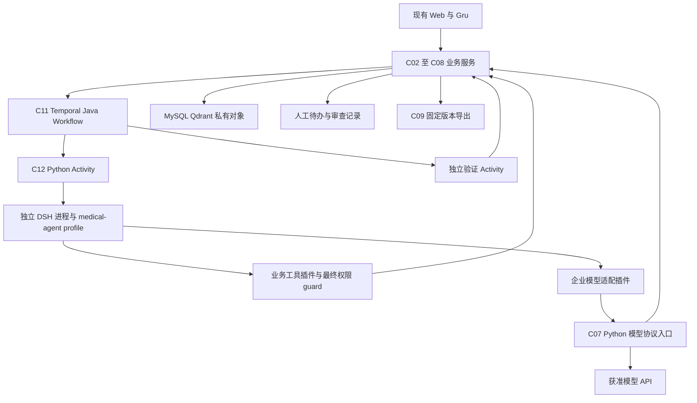
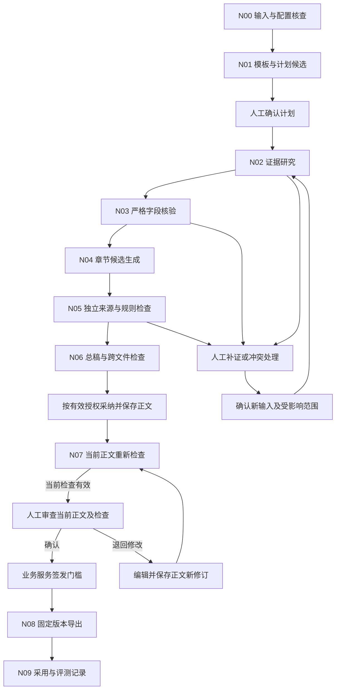
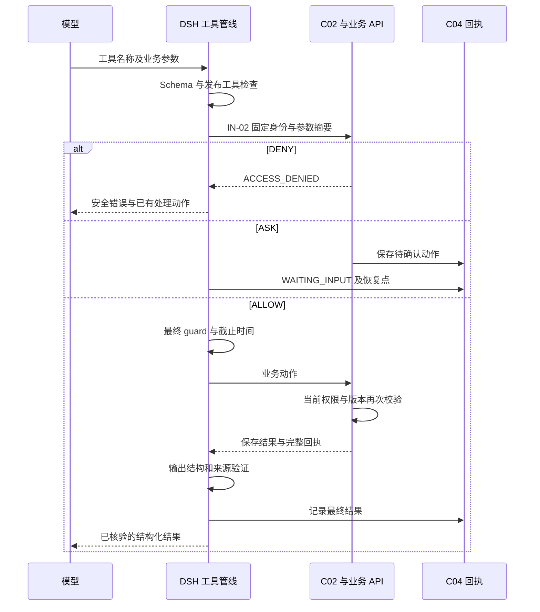

# 医疗器械企业 Agent 平台编排与治理详细设计

版本：V1.2.0；日期：2026-09-30；状态：`DRAFT`；能力类型：`DESIGN`；任务：T07；执行模式：`DESIGN / CONTINUOUS_DELIVERY`。需求基线为 PRD V1.3.0、HLD V1.2.0、LLD-数据 V1.0.0、LLD-后端 V1.1.0。本文维护模型调用、专业节点、工具选择、上下文、候选采用及评测要求。Harness、业务接口与真实项目联合运行均为 `NOT_RUN`。

## 1. 六层治理与 DeepSeek Harness 运行架构

### 1.1 输入、依赖与完成条件

| 输入 | 采用内容 | 依赖状态 |
| --- | --- | --- |
| [PRD.md](./PRD.md) | FR-02—FR-06、FR-09；BR-01—BR-23；来源、计划、字段、人工审查、采用及评测 | `SATISFIED`：需求定义可用；客户业务批准单独记录 |
| [LLD-数据.md](./LLD-数据.md) | §4.3 EvidenceRef、§4.5 当前权限、§5 检索、§6.3 ReplayManifest | `SATISFIED`：直接沿用字段及七种位置结构 |
| [LLD-后端.md](./LLD-后端.md) | §4.2 StepEnvelope/StepResult、§4.7 IN 接口、§5 状态、§6 预算和取消 | `SATISFIED`：接口设计存在；服务实现 `NOT_RUN` |
| [HLD.md](./HLD.md) | §2.2—2.3 组件所有权、§3 ADR、§6 版本与来源 | `SATISFIED`：Java 业务服务、Python Activity、Temporal、MySQL、Qdrant 与独立 SSO |
| [交互原型说明.md](./交互原型说明.md)及后端页面定义 | S07 计划、S09 正文与候选、S11 审查、S13 发布、S15 评测、Gru 操作卡片 | 按后端当前动作维护：S09 编辑正文；S11 阅读和标注，修改返回 S09 |
| [dataset.schema.json](./data-design/dataset.schema.json) | Draft 2020-12 的 `$defs.EvidenceRef` | `SATISFIED`：`schema_version=1.0.0`；生产入口另外核验 UUID、归属和位置边界 |
| 客户资料、模型许可、真实账号、预算、评分规则 | 第二类及第三类获授权项目、真实报告和专家标注 | `PENDING`：阻断生产配置发布及真实效果验收；具体责任见 §8.5 |

T07 的设计完成条件采用研发规划与 PRD 已有标准：资料缺失、引用不足、版本冲突和严格字段不一致具有明确处理路径；每项事实能够关联原始来源；候选、人工采用、业务完成分别有记录。运行完成由后端 §5.2 判定，签发由 SG-01—SG-09 判定，不需要新增业务批准步骤。

### 1.2 官方资料与版本身份

核查日期为 2026-09-30，官方 `master` 的当前提交为 `639ed015397290b3745d163aafe02ffee4aa3f84`，提交时间为 `2026-09-29T09:21:31Z`，对应根版本为 `0.2.0-rc.2`。版本身份来自 GitHub 提交响应及根 package.json；它是本次源码设计基线，生产依赖仍须登记实际构建或取得的 wheel、插件、镜像摘要。

| 来源 ID | 已读取的官方资料 | 本文采用事实 |
| --- | --- | --- |
| DSH-S01 | [官方 README](https://github.com/deepseek-ai/deepseek-harness)、[根 package.json](https://raw.githubusercontent.com/deepseek-ai/deepseek-harness/master/package.json) | Cordis 插件架构；开发者预览；根版本 `0.2.0-rc.2`，源码构建 Node 范围为 `^22.19.0` 或 `>=24.0.0`，pnpm 为 `11.7.0` |
| DSH-S02 | [固定提交 architecture.md](https://raw.githubusercontent.com/deepseek-ai/deepseek-harness/639ed015397290b3745d163aafe02ffee4aa3f84/docs/architecture.md) | profile/bundle 组合；`ctx.tools/ctx.llm/ctx.sessions`；事件扩展；SDK 应用入口与会话语义 |
| DSH-S03 | [固定提交 Python SDK](https://raw.githubusercontent.com/deepseek-ai/deepseek-harness/639ed015397290b3745d163aafe02ffee4aa3f84/python/sdk/README.md)、[runtime wheel](https://raw.githubusercontent.com/deepseek-ai/deepseek-harness/master/python/sdk-runtime/README.md) | `deepseek_harness.DeepSeekHarness` 驱动配套进程；使用显式 `dsh_home`；stdio JSON-RPC；SDK 和 runtime wheel 同版本；业务调用须设置超时 |
| DSH-S04 | [工具编写规范](https://raw.githubusercontent.com/deepseek-ai/deepseek-harness/639ed015397290b3745d163aafe02ffee4aa3f84/docs/cookbook/adding-a-tool.md)、[工具执行流程](https://raw.githubusercontent.com/deepseek-ai/deepseek-harness/master/docs/tool-execution-pipeline.md) | 工具注册、参数与结果验证、受保护执行身份、单向拒绝 guard、执行前后事件及最终结果观察 |
| DSH-S05 | [模型适配器规范](https://raw.githubusercontent.com/deepseek-ai/deepseek-harness/master/docs/cookbook/adding-an-llm-adapter.md) | `LlmAdapter` 与 `ctx.llm.registerAdapter`；流式事件、取消、用量及参数支持检查 |
| DSH-S06 | [官方安全说明](https://raw.githubusercontent.com/deepseek-ai/deepseek-harness/master/SAFETY.md) | 预览软件尚未经过安全审计，隔离及权限控制需要部署环境共同承担 |
| DSH-S07 | [固定提交 StreamChunk 类型](https://raw.githubusercontent.com/deepseek-ai/deepseek-harness/639ed015397290b3745d163aafe02ffee4aa3f84/packages/llm/llm/src/types.ts) | 已读取完整源码；块序号、工具参数字符串、互不重复的用量字段、finish 原因及 ReplayEnvelope；§4.3 定义精确转换 |

Harness 版本与模型版本分别登记。生产 `provider/model_id/model_version/base_url/region/price_version/data_policy` 读取企业核准的 `model_config_revision`，当前值为待配置。选用 DeepSeek 模型时仍需完成真实连接、工具调用、输出结构、费用和外发许可验证；不得从 Harness 名称推定模型、价格或区域已经批准。

Python 源码 package metadata 的 `0.0.0.dev0` 是开发占位版本；官方构建说明要求按仓库发布版本构建配套 wheel。依赖登记检查 wheel 的实际 metadata、平台、原生资源、同版本关系和摘要，禁止将占位版本写成生产发布版本。本文未安装或启动官方应用。

### 1.3 架构决定与跨文档责任

| decision_id | 来源、状态 | 当前设计与依据 | 影响及复验条件 |
| --- | --- | --- | --- |
| AG-D01 | 用户建议采用 DeepSeek Harness；`EXPLICIT/DEFINED_DESIGN` | C12 专业步骤由 Python Activity 调用官方 Python SDK，SDK 启动专用 `medical-agent` profile；Temporal 管理全部跨请求调度和人工等待 | HLD §2.3、§3.1、ADR-002、后端 §5.7 与补充设计 §3.1 使用同一职责和发布清单；AG-T01 验证实际发行制品 |
| AG-D02 | BR-12、BR-15；`INFERRED/PROPOSED` | 业务工具采用项目插件；C02/C03/C04/C05/C07 保持权限、来源、正文、审查和预算唯一写入责任 | 插件调用全部经服务端检查；SDK 或插件变化重新验收 |
| AG-D03 | BR-08、BR-17；`INFERRED/PROPOSED` | 每个专业步骤独立运行目录、SDK 进程、session 和受限身份；子任务由 C11 按已确认 DAG 派发 | 不创建第二个跨请求恢复入口；当前运行依赖、预算、取消语义保持后端定义 |
| AG-D04 | BR-06、BR-07、AC-25；`INFERRED/PROPOSED` | 事实、位置、权威字段及来源支持分别检查；模型判断只形成待审检查结果 | 证据缺失和条件未知不能通过模型分数转为有效 |
| AG-D05 | 用户任务及已有业务标准；`INFERRED/DEFINED_DESIGN` | §3.5 引用后端补充设计与 OpenAPI 的内部接口，C12 消费 | 字段、上传、动作、游标与作业已定义；正式服务集成 NOT_RUN |

AG-D01 定义一个步骤内部编排实现。已有 Java/Python 团队职责保持：Python 负责人维护 Activity、专业算法及模型协议入口；Harness 插件使用上游要求的 TypeScript，由 Agent 团队维护薄适配层。新增 TypeScript 插件与配套 runtime 属于明确依赖，需要进入制品和许可清单。生产 Python/Java 业务代码不会被模型编辑。

### 1.4 六层治理与物理承载

| 层级 | 职责 | 物理承载 | 加载及验收 |
| --- | --- | --- | --- |
| Context | 目标、专业责任、资料边界、证据要求 | 只读 Prompt 制品、发布清单、ContextManifest | 稳定内容按版本加载；每次请求核查实际发送摘要 |
| Action | 受限检索、原文读取、检查、候选及人工待办 | `ctx.tools` 中的项目工具插件与后端 API | 按角色固定工具集合；执行身份与参数独立校验 |
| Skill | 文档类型、模板使用、检查方法 | C06 核准 Skill 制品与模板规则引用 | 启动确定允许集合；仅加载当前章节所需内容 |
| Control | 预算、授权、版本、取消、输出准入 | Harness 事件/guard 与 C02—C07 业务方法 | 所有模型请求和工具动作均执行，任何失败立即报告 |
| Isolation | 企业、项目、角色和候选相互隔离 | 独立容器作业、进程、目录、session、短期任务身份 | 独立上下文；无共享可写目录、全库凭据或任意出口 |
| Verification | 结构、证据、业务、人工和评测记录 | C05、独立 Verifier Activity、C08、C09 | 可重复读取完整检查结果；终态由后端判定 |



`medical-agent` 是本项目待实现的 profile。它保留官方 SDK JSON-RPC 应用入口，显式组合会话、Prompt、工具和 Agent loop 服务及项目插件；发布时检查最终插件树。运行时工具仅限 §3.2。安装管理、Shell、任意文件编辑、任意 SQL、公开网络直连、PTC `run_code`、自主创建子任务和后台定时执行不进入业务工具集合。所需解析与导出由 C09 的成熟库处理。

## 2. 上下文、内容来源与 Cache

### 2.1 内容来源及使用级别

| 来源类别 | 准入与权威性 | 模型可承担的动作 | 保存与采用 |
| --- | --- | --- | --- |
| 核准产品原件 | 当前授权、ScopeSnapshot 成员、项目适用、原件摘要、全部处理门槛有效 | 读取、提取候选、依据原文组织叙述 | 严格事实由人员确认；字段保持原值、单位、型号和条件 |
| 核准法规、标准及规则 | 来源版本、实施信息、全文许可和项目适用决定齐备 | 查询条款、解释适用要求、按核准规则检查 | 法规判断需引用原文；只有标准元数据时不生成条款规则 |
| 核准模板 | 对应文档、申请路径、机关、渠道与产品条件 | 形成完整目录及研究问题，确定填写方式 | 不删除必需节点；未知条件创建待办 |
| 网络候选 | 联网策略和实际检索词已批准；仅经 C10 获取 | 保存研究记录、整理候选来源 | 未核准不能进入正式文稿；核准后由用户确认新快照 |
| 会话附件和用户说明 | 会话范围读取；业务核准状态独立 | 解释、提出建议、列出需要的资料 | 聊天不能授予权限，产品事实需原件及核准记录 |
| 已确认上游章节 | 指定章节版本、依赖清单与当前权限有效 | 引用本章需要的术语及明确事实关系 | 继续关联原始 EvidenceRef，不能只引用生成文稿证明事实 |
| 任务摘要和写作习惯 | 摘要有原记录引用；习惯由本人主动保存且当前有效 | 恢复未完成工作、调整允许的表达方式 | 模板规则优先；不得保存跨项目事实或工具授权 |

正式范围等于 `current_user_grants ∩ project_applicability ∩ agent_release_scope ∩ selected_scope`，另受权利、分类、生命周期、核准和处理门槛约束。空范围直接形成缺项；检索失败单独记录错误；任何情况均不能扩大来源集合。

来源五项内容身份为 `source_id/source_version/parse_version/chunk_id/quote_hash`；归属、位置与核准信息通过完整 `EvidenceRef` 传输。ContextReference 直接引用数据 Schema，不复制或缩减其字段。索引版本、权利版本、项目适用决定和治理水位记录在证据包中，不能写入 `EvidenceRef` 的未定义字段。

七种位置保持原定义：PDF 原件页序与预览标签；DOCX 固定 part/节点/表格位置；XLSX 工作表与单元格及计算依据；CSV 逻辑记录与列序号；TXT Unicode 范围和行号；Markdown 节点、标题路径与源码行号；PPTX slide/shape/文本或表格身份。跨页或跨节点事实保留多个引用。Agent 无权生成页码、修正 `quote_hash` 或将当前版本替换为最新版本。

### 2.2 固定前缀与动态内容布局

| 顺序 | 内容 | 版本、大小与失效 |
| --- | --- | --- |
| 1 | 基础边界、角色职责、事实和引用要求、终止条件 | `prompt_revision + role_version`；只读稳定前缀 |
| 2 | 本角色完整工具 Schema 与返回结构 | `tool_manifest_sha256`；步骤期间不得增删 |
| 3 | 已选择 Skill 核心规则、模板说明和项目编写约定 | 固定制品摘要；普通来源内容不能放入指令区 |
| 4 | 当前任务目标、章节计划、来源模式、适用条件 | `task_revision/plan_revision/snapshot_id` |
| 5 | 严格字段表、当前章节原始证据、必要上游结果 | `fact_versions/evidence_bundle_id/section_revisions`；按完整论据读取 |
| 6 | 已完成动作、未解决问题、人工决定及当前工作记录 | 固定记录引用；摘要不得产生新结论 |
| 7 | 当前请求及本轮工具结果 | 实际结果及完整读取范围；不截去必要证据 |

模型 API 的 `messages/tools` 是各自字段；上述顺序表示逻辑组装次序。供应商序列化结果、Token 计算及缓存命中以 C07 实际请求和回执为准，不假定 JSON 字段排列决定 KV Cache 命中。非业务 workspace 指令不会自动进入前缀。

缓存键包含 `tenant_id/project_id/subject_id/auth_epoch/governance_epoch/agent_release_id/role_version/prompt_revision/tool_manifest_sha256/skill_manifest_sha256/model_config_revision/snapshot_id`，以及该缓存涉及的章节、证据和习惯版本。不可变制品可按摘要共享缓存字节，资料内容缓存必须绑定完整身份。每次命中重新授权；撤权、停用、删除习惯或输入变化使对应缓存不可继续使用。

发布配置记录 `context_window/input_token_limit/output_token_limit/tool_result_token_limit/summary_token_limit/tokenizer_revision`。准入公式为 `实际输入 Token + 输出预留 Token ≤ 模型上下文上限`，工具 Schema、消息封装和必要协议字段均计入。Tokenizer 或计量能力未核验时禁止宣告容量安全。超限返回 `CONTEXT_LIMIT` 并保存所缺输入清单；不能自动更换模型或删除必需论据。

### 2.3 检索与证据准备算法

1. 读取已确认章节的 `requirement_node/field_definition/research_question`，由模板规定证据种类、权威来源和完成规则。规划只列出具有业务位置的问题。
2. 使用固定 `retrieval_profile_revision`。型号、文号和标准年代号采用 EXACT；叙述使用已发布 FULLTEXT/DENSE/HYBRID；来源及事实关系采用 RELATION。查询词改写限已批准词表，每次查询保存原词与改写依据。
3. `search_sources` 委托 C03 执行固定策略。模型不提交 Qdrant filter、SQL、索引名称或 `top_k`。HYBRID 必需通道失败导致查询失败；相似度只用于候选排序。
4. 候选按 `(source_version,parse_version,chunk_id)` 去重，继承 RRF 与 Rerank 的已发布配置。逐个 `read_source` 核验完整原文、位置、限定条件及当前授权，关联支持、冲突或背景用途。
5. 填写证据覆盖表：每项研究问题和必需字段对应已读原件、允许用途、缺项与冲突。没有取得论据时保留 `EVIDENCE_NEEDED`，不能把查询结果数量解释为证据充分。
6. 独立研究问题可以并行；共享事实的提取与确认遵守依赖顺序。当前章节所需证据全部满足才允许正式撰写，其他独立章节继续按计划执行。

网络研究使用独立角色和批准的 query revision。获取结果保留实际网址、重定向、发布者、取得时间、原文快照、摘要及权利状态。内部产品值和正文不会自动成为公开搜索词。URL 安全、DNS、重定向及最大获取时限由后端 §4.9 执行。

### 2.4 ContextManifest、压缩与交接

每次真实模型请求创建 `ContextManifest`，固定精确发送内容对象、SHA-256、来源清单、模板规则、角色、Prompt、工具、Skill、模型、Tokenizer、Token 数、上游结果及 `DependencyAccessSet`。企业身份来自任务令牌，模型输出中出现另一身份立即拒绝。

工作摘要使用 [ProfessionalArtifact](./agent-design/artifacts.schema.json) 的身份封装，`output.artifact_kind=HANDOFF_RECORD`，内容遵循 `$defs.HandoffRecord`。`HANDOFF.md` 是人工阅读表示。固定身份、输入摘要、目标章节和依赖访问集合来自外层；content 保存已完成动作、成果、证据、未处理待办、待确认决定、失败回执、在途调用、预算版本、剩余额度与生成时间。全部原文仍可按固定引用重新读取。

压缩只合并重复工作描述和已归档工具摘要，保留原始业务目标、必需要求、授权决定、事实引用、未处理项及失败动作。先以确定性映射检查这些集合是否完整，确有模型摘要需求时通过独立 C07 调用并计入父预算。未通过检查的摘要不能接续执行。达到输入限制仍不能容纳必要证据时进入人工待办。

恢复时重新读取 C04 当前任务、原输入摘要、最新权限、依赖可用性、步骤与调用回执，再生成新尝试的 ContextManifest。不得直接将旧 DSH session 作为可继续发送的授权依据。已删除习惯涉及精确原输入执行时使用 `PREFERENCE_UNAVAILABLE`；用户选择当前输入后创建新修订。

用户上传文件及网页中的工具指令保留为资料数据；不能注册插件、修改 profile、建立系统指令或改变目标。匹配到疑似指令形成安全事件，原件不改写；最终拒绝由工具与服务端授权共同执行。

## 3. 工具、Schema 与业务接口

### 3.1 调用身份、参数和结果

工具定义采用 Draft 2020-12 JSON Schema；项目插件读取冻结 Schema，并用成熟 JSON Schema 校验库执行 `additionalProperties=false`、格式、必填和联合类型验证。上游 `defineTool` 的参数 DSL 与标准 JSON Schema 分别处理，禁止将标准 Schema 直接当作 DSL 传入。输出返回一个结构化 JSON 值，界面展示从该值产生。

`run_id/step_id/tenant_id/project_id/initiator_id/snapshot_id/plan_revision/lease_generation/tool_version/action_id` 均由宿主绑定。模型只填写工具声明的业务参数，不能修改身份、权限、时限或预算。`call_id` 保存模型原始工具调用身份；由 C04 创建服务端 action identity 并保存映射，后续重试沿用该映射。

工具执行顺序为 Schema 校验 → 当前参数摘要 → IN-02 动作授权 → 最终 guard → 对应业务接口 → 结果 Schema、归属与引用检查 → 保存完整回执 → 返回安全结构。`ALLOW` 只允许已确认的同一动作；`ASK` 保存 `pending_action` 后结束该 Activity；`DENY` 立即拒绝。工具结果中的 `allowed_actions` 仅提供现有操作入口。

### 3.2 工具注册表

所有工具具有 `tool_id/purpose/input_schema/output_schema/permission/side_effect/idempotency/timeout/error_codes/audit/approval`。表中时限继承后端 §4.1、§4.9、§6.1，均为设计提议；发布后读取实际配置。全部调用保存 `run_id/step_id/action_id/tool_version/arguments_sha256/result_ref/duration/status/error_code`，原文不进入普通日志。

| tool_id / 名称 | 输入 → 输出 | 权限、副作用及幂等 | 时限、错误与人工条件 |
| --- | --- | --- | --- |
| AT-01 / `search_sources` | `SearchArgs` → 检索 ID、FOUND/EMPTY、引用及缺项清单 | `source.read/tool.execute`；IN-03；检索记录按动作唯一，收费检索经 C07 | 接收10秒、检索120秒；`RETRIEVAL_FAILED/SCOPE_STALE`；不扩大范围 |
| AT-02 / `read_source` | `ReadArgs` → 实际原文、完整引用、读取范围 | `source.read`；IN-04；只读，重读仍重新授权 | 内部准入10秒、内容分段60秒；`SOURCE_MISSING/CONTENT_MISMATCH/LOCATOR_INVALID` |
| AT-03 / `read_artifact` | `ArtifactArgs` → 同版本结构化产物或受限内容片段 | 步骤允许的上游/本步成果读取；IA-01；只读，不接受本机路径 | 元数据10秒、内容分段60秒；`ACCESS_DENIED/RESULT_VERSION_MISMATCH` |
| AT-04 / `load_skill` | `SkillArgs` → 当前角色允许的固定 Skill 内容及摘要 | 发布清单内能力读取；本地只读已验证制品；动作留记录 | 10秒；`DEPENDENCY_UNAVAILABLE`；不接受来源文件推荐的新 Skill |
| AT-05 / `validate_fields` | `FieldArgs` → 类型、权威值、型号条件及方法覆盖检查产物 | 指定字段和证据读取；C12 确定性规则；IA-04 保存结果 | 单次不超过步骤剩余时限；`SCHEMA_INVALID/CONTENT_MISMATCH`；确认严格事实必须人工 |
| AT-06 / `submit_candidate` | `CandidateArgs` → 候选 ID、READY 或拒绝原因 | 分配章节的候选创建；IN-05；同动作和内容摘要幂等 | 10秒；`RESULT_VERSION_MISMATCH/LEASE_STALE`；人工正文采用另经 DC-03 |
| AT-07 / `submit_review_findings` | `ReviewArgs` → 检查结果 ID、问题提议 ID | 仅 Verifier 角色；IA-04；同检查输入和动作幂等 | 10秒；`REVIEW_STALE/SCHEMA_INVALID`；不能解决人工问题或签发 |
| AT-08 / `ask_user_question` | `QuestionArgs` → 待办 ID、WAITING_INPUT、目标版本 | 当前任务协作范围；IA-03；同动作保存一次待办 | 10秒接收；`REVISION_CONFLICT`；回答经对应业务决定入口 |
| AT-09 / `propose_web_acquisition` | `WebArgs` → 候选采集操作 ID 与状态 | 已批准联网角色、范围和 query revision；IA-05；C10 执行 | 接收10秒、单次30秒；`NETWORK_SCOPE_DENIED/ACQUISITION_FAILED`；无批准词不发送 |
| AT-10 / `submit_plan_candidate` | `PlanArgs` → 计划候选产物 ID | 仅 Planner；IA-02；同动作幂等；无计划确认权限 | 10秒；`PLAN_CYCLE/RESULT_VERSION_MISMATCH`；TK-04 人工确认 |

AT-05 的常规字段校验每步由宿主强制执行；注册为工具允许 Verifier 对明确字段追加定向检查，模型不负责决定是否省略必需校验。AT-06 返回保存成功只表示候选存在，不改变人工正文。初次空白草稿的创建由 C04 核对已有明确授权及目标仍为空白；其他采纳都使用人工动作卡片。

### 3.3 模型可见工具输入 Schema

以下 Schema 定义全部模型可见输入。`$defs` 的业务对象和数值范围仍接受 §3.4 的服务端规则校验；`EvidenceRef` 通过原文件引用，生产发布打包时保持原内容摘要。工具注册按 `tool_id` 选择相应 `$defs`，不把工具名称或服务器身份作为模型参数。

```json
{
  "$schema": "https://json-schema.org/draft/2020-12/schema",
  "title": "AgentToolInputs",
  "$defs": {
    "Id": {"type": "string", "format": "uuid"},
    "Ids": {"type": "array", "items": {"$ref": "#/$defs/Id"}, "uniqueItems": true},
    "Text": {"type": "string", "minLength": 1},
    "Cursor": {"type": ["string", "null"], "minLength": 1},
    "EvidenceRef": {"$ref": "data-design/dataset.schema.json#/$defs/EvidenceRef"},
    "SearchArgs": {
      "type": "object", "additionalProperties": false,
      "required": ["question_id", "query", "cursor"],
      "properties": {"question_id": {"$ref": "#/$defs/Id"}, "query": {"$ref": "#/$defs/Text"}, "cursor": {"$ref": "#/$defs/Cursor"}}
    },
    "ReadArgs": {
      "type": "object", "additionalProperties": false,
      "required": ["evidence_ref", "cursor"],
      "properties": {"evidence_ref": {"$ref": "#/$defs/EvidenceRef"}, "cursor": {"$ref": "#/$defs/Cursor"}}
    },
    "ArtifactArgs": {
      "type": "object", "additionalProperties": false,
      "required": ["artifact_id", "node_ids", "cursor"],
      "properties": {"artifact_id": {"$ref": "#/$defs/Id"}, "node_ids": {"$ref": "#/$defs/Ids"}, "cursor": {"$ref": "#/$defs/Cursor"}}
    },
    "SkillArgs": {
      "type": "object", "additionalProperties": false,
      "required": ["skill_version"],
      "properties": {"skill_version": {"$ref": "#/$defs/Id"}}
    },
    "FieldArgs": {
      "type": "object", "additionalProperties": false,
      "required": ["artifact_id", "field_ids"],
      "properties": {"artifact_id": {"$ref": "#/$defs/Id"}, "field_ids": {"type": "array", "minItems": 1, "uniqueItems": true, "items": {"$ref": "#/$defs/Id"}}}
    },
    "CandidateArgs": {
      "type": "object", "additionalProperties": false,
      "required": ["candidate_artifact_id"],
      "properties": {"candidate_artifact_id": {"$ref": "#/$defs/Id"}}
    },
    "ReviewArgs": {
      "type": "object", "additionalProperties": false,
      "required": ["findings_artifact_id"],
      "properties": {"findings_artifact_id": {"$ref": "#/$defs/Id"}}
    },
    "QuestionArgs": {
      "type": "object", "additionalProperties": false,
      "required": ["question_type", "prompt_text", "target_section_ids", "requirement_ids", "evidence_refs"],
      "properties": {
        "question_type": {"enum": ["NEED_EVIDENCE", "CLARIFY_APPLICABILITY", "RESOLVE_CONFLICT", "CONFIRM_PLAN", "REVIEW_CANDIDATE", "REQUEST_BUDGET"]},
        "prompt_text": {"$ref": "#/$defs/Text"},
        "target_section_ids": {"$ref": "#/$defs/Ids"},
        "requirement_ids": {"$ref": "#/$defs/Ids"},
        "evidence_refs": {"type": "array", "items": {"$ref": "#/$defs/EvidenceRef"}}
      }
    },
    "WebArgs": {
      "type": "object", "additionalProperties": false,
      "required": ["question_id", "approved_query_revision"],
      "properties": {"question_id": {"$ref": "#/$defs/Id"}, "approved_query_revision": {"$ref": "#/$defs/Id"}}
    },
    "PlanArgs": {
      "type": "object", "additionalProperties": false,
      "required": ["plan_artifact_id"],
      "properties": {"plan_artifact_id": {"$ref": "#/$defs/Id"}}
    }
  },
  "oneOf": [
    {"$ref": "#/$defs/SearchArgs"}, {"$ref": "#/$defs/ReadArgs"},
    {"$ref": "#/$defs/ArtifactArgs"}, {"$ref": "#/$defs/SkillArgs"},
    {"$ref": "#/$defs/FieldArgs"}, {"$ref": "#/$defs/CandidateArgs"},
    {"$ref": "#/$defs/ReviewArgs"}, {"$ref": "#/$defs/QuestionArgs"},
    {"$ref": "#/$defs/WebArgs"}, {"$ref": "#/$defs/PlanArgs"}
  ]
}
```

`ArtifactArgs.node_ids=[]` 表示请求该受限成果完整内容，超限返回明确限制；不能据此读取其他成果。Artifact ID 由宿主输出通道登记并回传，模型不能用自编 UUID 代替实际产物。首次结构化生成流程见 §3.4，候选提交工具只接受已经保存的结构化成果。

`cursor=null` 开始读取；后续请求保持原查询、来源或成果选择不变，原样携带返回游标。服务端游标绑定主体、权限水位、固定结果、选择摘要和位置，逐次重新授权。IN-03/04 和 IA-01 的 nullable cursor、coverage 及完整内容由后端补充设计 §3 维护；重复游标返回同范围。完整读取后才形成覆盖通过回执，分页文本不修改原 EvidenceRef.quote_hash。

### 3.4 专业产物、检查结构与输出通道

结构化结果通过宿主的角色输出通道接收。[artifacts.schema.json](./agent-design/artifacts.schema.json) 是专业产物唯一结构定义，使用 Draft 2020-12。每个角色发布时登记下表的模型输出片段及完整制品 SHA-256；Python 使用 Pydantic/JSON Schema，TypeScript 使用支持 Draft 2020-12 的成熟校验库。标准 JSON 解析失败、未知字段或格式错误立即结束本次生成动作。

| 角色/生产者 | 模型可见输出片段 | 宿主登记的 artifact_kind |
| --- | --- | --- |
| Planner | `$defs.PlanCandidate` | PLAN_CANDIDATE |
| Researcher | `$defs.EvidenceBundle` | EVIDENCE_BUNDLE |
| FieldVerifier | `$defs.FieldCheckResult`；确定性比较结果由宿主写入并复算 | FIELD_CHECK_RESULT |
| SectionWriter | `$defs.SectionDraft` | SECTION_CANDIDATE；正文保存后组装 SectionCandidate |
| SourceVerifier | `$defs.ReviewFindings`；访问、位置和覆盖结果由宿主复算 | REVIEW_FINDINGS |
| Assembler | `$defs.AssemblyManifest`；拼接结果、版本及目录由宿主生成 | ASSEMBLY_MANIFEST |
| NetworkResearcher | 工具回执及其候选采集 ID；不生成新的公开来源身份 | 复用 C10 采集成果，经 AT-03 读取 |
| C04/C12 宿主 | 无独立模型调用；从固定正文提取 ClaimRecord、从业务回执形成 HandoffRecord | CLAIM_RECORD、HANDOFF_RECORD |

宿主注入身份封装、核验全部引用、保存精确对象并取得真实 artifact_id，后续提交由宿主执行相同 IN-02 与业务接口流程。AT-06/07/10 只选择已登记成果，不承担首次正文上传。本文中的 Schema 描述结构，实际生产实例必须来自获授权业务输入。

全部专业产物包含 `schema_version/execution_kind/tenant_id/project_id/run_id/step_id/input_manifest_sha256/plan_revision/snapshot_id/target_section_ids/dependency_access_set_id/content_sha256/output`；output 由 artifact_kind 和 content 组成。身份从 StepEnvelope 注入，模型无写入权限。SYSTEM_JOB 的关联按实际对象允许 null；TASK 的项目、计划、快照非空。content_sha256 对受限存储中 output 的精确 UTF-8 JSON 字节计算，外层字段不参与此摘要；对象序列化由固定版本库完成。

| 产物 | 内容结构及必需关联 | 检查与下游 |
| --- | --- | --- |
| `PlanCandidate` | template_version、profile_revision、requirement_node_ids、sections、questions、pending_condition_ids | 完整模板集合；section 依赖和 question_key 依赖分别无环；C04 保存候选，人工 TK-04 后产生计划版本 |
| `EvidenceBundle` | retrieval_ids、question_coverage、selected_refs、conflict_refs、missing_requirement_ids、read_receipt_ids | 原样传递 EvidenceRef；问题覆盖采用 VERIFIED/INSUFFICIENT/CONFLICT，映射研究问题状态由 C04 决定 |
| `FieldCheckResult` | target_artifact_id、rule_revision、entries、method_coverage、missing_requirement_ids | FieldComparison 保存两侧原值、十进制值、精度、单位、型号、条件与规则；MethodCoverage 枚举完整组合 |
| `SectionCandidate` | base_document_revision、target_sections、body_object_ref、body_schema_revision、node_manifest、claim_records、field_assignments、attachment_bindings、issue_proposals | 正文对象必须可重读；宿主按 §3.6 逐字段转换 CandidateInput |
| `ClaimRecord` | claim_id、anchor、claim_kind、evidence_links | claim_kind 为 PRODUCT_FACT/REGULATORY_REQUIREMENT/METHOD_REQUIREMENT/STUDY_RESULT/TRANSITION；link 的 relation 为 SUPPORT/CONFLICT/BACKGROUND |
| `ReviewFindings` | target_kind、target_revision、target_sha256、rule_revision、required_claim_ids、required_rule_ids、claim_checks、rule_checks、issue_proposals、coverage_complete | 输入集合由 C05 派发；独立读取证据；模型无权缩减覆盖集合或降低问题等级 |
| `AssemblyManifest` | target_kind、document_revision、sections、requirement_node_ids、fact_versions、evidence_refs、rule_revision、check_ids、review_ids、unresolved_issue_ids、format_profile_revision | CANDIDATE_SET 汇集固定候选；DOCUMENT 只引用同一正文中的章节版本；两类清单独立保存 |
| `HandoffRecord` | completed_action_refs、artifact_refs、evidence_refs、unresolved_item_ids、pending_decision_refs、failed_action_refs、inflight_invocation_ids、budget_revision、remaining_limits、created_at | 宿主生成；剩余额度只作为观测值，恢复时重新读取权威预算 |

`ClaimRecord.anchor` 为 TEXT 或 STRUCTURED。TEXT 的 start/end 是固定节点原始文本的 Unicode code point 零起点半开区间 `[start,end)`，必须满足 `0 ≤ start < end ≤ 文本长度`；不执行 Unicode 归一化，text_sha256 对所选原文 UTF-8 字节计算。JavaScript 使用成熟 Unicode 处理库或 code point 迭代，禁止用 UTF-16 单元序号直接代入。STRUCTURED 绑定 node_id 和适用 row_id/field_id，content_sha256 对正文序列化器输出的目标对象字节计算。同一事实可关联多条支持边，覆盖数值、型号、条件、时间和否定限定；方法说明不能证明试验已经通过。

工具成功结果使用 ToolSuccess Schema；大型结果的完整内容保存在 artifact_id，payload 返回本次实际读取部分。coverage 的两个摘要分别标识完整请求范围与本页实际范围；complete 表示截至当前游标已经完整读取。summary 不能用于证明未读取内容。所有 nullable 字段均须存在，未取得的值显式为 null。

```json
{
  "$schema": "https://json-schema.org/draft/2020-12/schema",
  "title": "ToolSuccess",
  "type": "object", "additionalProperties": false,
  "required": ["schema_version", "action_id", "tool_id", "status", "artifact_id", "resource_revision", "summary", "coverage", "next_cursor", "payload"],
  "properties": {
    "schema_version": {"const": "1.0.0"},
    "action_id": {"$ref": "#/$defs/Id"},
    "tool_id": {"enum": ["AT-01", "AT-02", "AT-03", "AT-04", "AT-05", "AT-06", "AT-07", "AT-08", "AT-09", "AT-10"]},
    "status": {"enum": ["SUCCEEDED", "WAITING_INPUT"]},
    "artifact_id": {"$ref": "#/$defs/Id"},
    "resource_revision": {"type": ["string", "null"], "minLength": 1},
    "summary": {"type": "string"},
    "coverage": {"$ref": "#/$defs/Coverage"},
    "next_cursor": {"type": ["string", "null"], "minLength": 1},
    "payload": {"oneOf": [{"$ref": "#/$defs/SearchResult"}, {"$ref": "#/$defs/SourceResult"}, {"$ref": "#/$defs/ContentResult"}, {"$ref": "#/$defs/ReceiptResult"}]}
  },
  "$defs": {
    "Id": {"type": "string", "format": "uuid"},
    "Hash": {"type": "string", "pattern": "^[a-f0-9]{64}$"},
    "EvidenceRef": {"$ref": "data-design/dataset.schema.json#/$defs/EvidenceRef"},
    "Coverage": {
      "type": "object", "additionalProperties": false,
      "required": ["requested_scope_sha256", "delivered_scope_sha256", "complete"],
      "properties": {
        "requested_scope_sha256": {"$ref": "#/$defs/Hash"},
        "delivered_scope_sha256": {"$ref": "#/$defs/Hash"},
        "complete": {"type": "boolean"}
      }
    },
    "SearchResult": {
      "type": "object", "additionalProperties": false,
      "required": ["kind", "retrieval_id", "match_status", "evidence_refs", "missing_requirement_ids"],
      "properties": {
        "kind": {"const": "SEARCH"},
        "retrieval_id": {"$ref": "#/$defs/Id"},
        "match_status": {"enum": ["FOUND", "EMPTY"]},
        "evidence_refs": {"type": "array", "items": {"$ref": "#/$defs/EvidenceRef"}},
        "missing_requirement_ids": {"type": "array", "uniqueItems": true, "items": {"$ref": "#/$defs/Id"}}
      }
    },
    "SourceResult": {
      "type": "object", "additionalProperties": false,
      "required": ["kind", "evidence_ref", "content", "read_receipt_id"],
      "properties": {
        "kind": {"const": "SOURCE"},
        "evidence_ref": {"$ref": "#/$defs/EvidenceRef"},
        "content": {"type": "string", "minLength": 1},
        "read_receipt_id": {"$ref": "#/$defs/Id"}
      }
    },
    "ContentResult": {
      "type": "object", "additionalProperties": false,
      "required": ["kind", "content_kind", "content_schema_ref", "content_sha256", "media_type", "content", "read_receipt_id"],
      "properties": {
        "kind": {"enum": ["ARTIFACT", "SKILL"]},
        "content_kind": {"type": "string", "minLength": 1},
        "content_schema_ref": {"type": ["string", "null"], "minLength": 1},
        "content_sha256": {"$ref": "#/$defs/Hash"},
        "media_type": {"enum": ["application/json", "text/markdown", "text/plain"]},
        "content": {"type": "string", "minLength": 1},
        "read_receipt_id": {"$ref": "#/$defs/Id"}
      }
    },
    "ReceiptResult": {
      "type": "object", "additionalProperties": false,
      "required": ["kind", "resource_id", "resource_kind", "resource_state", "check_ids"],
      "properties": {
        "kind": {"const": "RECEIPT"},
        "resource_id": {"$ref": "#/$defs/Id"},
        "resource_kind": {"enum": ["FIELD_CHECK", "CANDIDATE", "REVIEW_FINDINGS", "WAITING_ITEM", "WEB_ACQUISITION", "PLAN_CANDIDATE"]},
        "resource_state": {"type": "string", "minLength": 1},
        "check_ids": {"type": "array", "uniqueItems": true, "items": {"$ref": "#/$defs/Id"}}
      }
    }
  }
}
```

结果校验同时强制固定映射：AT-01 为 SEARCH、AT-02 为 SOURCE、AT-03 为 ARTIFACT、AT-04 为 SKILL；AT-05—10 依次对应 FIELD_CHECK、CANDIDATE、REVIEW_FINDINGS、WAITING_ITEM、WEB_ACQUISITION、PLAN_CANDIDATE 回执。resource_state 采用对应业务资源的已发布枚举，不能用工具 SUCCEEDED 推定采集或人工工作完成。AT-08 返回 WAITING_INPUT，其余工具的已受理回执为 SUCCEEDED；ASK 通过运行控制保存等待，不伪造工具完成回执。

ContentResult.content 是本次完整内容单元的 UTF-8 字符串；application/json 使用标准解析器按非空 content_schema_ref 二次校验，Schema 必须存在于发布清单。分页以完整节点或完整记录为单位，禁止返回半个 JSON。content_sha256 对本次 content 的原始 UTF-8 字节计算。Skill 返回已发布章节及版本身份，原文工具的完整 quote_hash 保留在 EvidenceRef 内。需要图片或公式原件时由既有受限对象引用交付，模型是否能读取相应格式取决于已验证配置。

coverage.complete=false 必须同时返回非空 next_cursor；complete=true 必须返回 null，完整范围以读取回执并集核验。SEARCH 的 EMPTY 要求没有候选引用并且已经读完；结果存在缺项时明确 missing_requirement_ids。接口错误使用失败结构，不能包装成 EMPTY。

错误使用后端固定 `code/message/request_id/resource_revision/allowed_actions/schema_version/retryable/operation_id/details`，工具运行边界保留 `isError=true` 及原错误码。格式错误、版本冲突、未授权和未知收费结果均不能自动修正后继续。网络或依赖错误在执行位置抛出，由框架边界记录失败和回执。

### 3.5 后端接口复用与必要补充

IN-01—IN-12 引用后端 §4.7；IN-03/04 的游标扩展、IN-13/14 的内部上传及下表 IA 接口由[后端补充设计](./backend-design/接口补充设计.md)与[OpenAPI](./backend-design/interfaces.openapi.yaml)唯一维护。C12 不使用浏览器 Cookie，不以服务身份调用公开人工接口。状态为 `DEFINED_DESIGN`，服务实现及集成为 NOT_RUN。表内业务字段与共享 ActionIdentity 合并；最终机器字段以共享 Schema 为准，Model Stream 使用独立专业 Schema。

| operation_id / 路径 | 完整输入及结果要点 | 所属模块与强制校验 |
| --- | --- | --- |
| IA-01 / `POST /internal/v1/agent-input-reads` | `run_id,step_id,input_manifest_id,kind,resource_id,node_ids,cursor,lease_generation` → 固定对象及摘要；kind 为 MANIFEST/TEMPLATE/ARTIFACT/RETRIEVAL/ISSUES | C03/C04/C05/C06/C07 共享业务读取；只能读取 StepEnvelope 所含清单及其受准入的依赖；ModelResult 另查当前步骤对原 invocation 的绑定；当前权限逐次检查 |
| IA-02 / `POST /internal/v1/plan-candidates` | `run_id,step_id,action_id,input_sha256,plan_artifact_id,lease_generation` → 候选 ID、校验和缺项 | C04；规划系统作业可引用固定 task_revision，不能自动确认；目标任务由 scope manifest 绑定 |
| IA-03 / `POST /internal/v1/waiting-items` | `run_id,step_id,action_id,target_revision,reason_code,question,requirement_refs,allowed_resolution_actions,lease_generation` → 待办 ID、责任人、WAITING_INPUT | C04；责任人和可用动作由当前角色规则计算；保存待办与 Outbox，同动作去重 |
| IA-04 / `POST /internal/v1/check-results` | `run_id,step_id,action_id,check_id,target_kind,target_revision,input_sha256,rule_manifest_id,findings_artifact_id,coverage,lease_generation` → 检查回执和问题提议 | C05；验证独立角色、原文读取回执、全部检查范围及当前基线；无人工确认或问题解决权限 |
| IA-05 / `POST /internal/v1/web-acquisitions` | `run_id,step_id,action_id,question_id,approved_query_revision,network_policy_revision,lease_generation` → 固定采集操作 | C10；复用 KN-19；网址/词/域名来自批准版本；查询结果经 IA-01 读取 |
| IA-06 / `POST /internal/v1/context-manifests` | `run_id,step_id,action_id,input_sha256,exact_input_artifact_id,source_manifest_id,prompt_revision,tokenizer_revision,token_count,dependency_access_set_id,lease_generation` → context_manifest_id、摘要 | C07；重读精确对象、权限、分类和来源；不能信任 Worker 自报的外发资格 |
| IA-07 / `POST /internal/v1/model-streams` | StreamRequest → StreamEvent SSE 或原调用状态；结构引用 [model-stream.schema.json](./agent-design/model-stream.schema.json)，事件顺序及映射见 §4.3 | C07 Python 协议入口；内部执行 IN-08/09/10；使用成熟 SDK/SSE 组件；流断开不证明未受理 |
| IA-08 / `POST /internal/v1/agent-artifacts` | `run_id,step_id,action_id,kind,schema_ref,object_ref,dependency_access_set_id,input_sha256,lease_generation` → artifact_id、内容摘要 | C04；IN-13—IN-15 完成受限上传，实际重读和验证后登记；kind 显式映射专业产物 artifact_kind；禁止任意文件路径 |
| IA-09 / `POST /internal/v1/invocation-status-reads` | `run_id,step_id,invocation_id,action_id,lease_generation` → InvocationStatus | C07；仅原动作绑定或明确核对角色；返回 UNKNOWN 时不重新发起模型流 |
| IA-10 / `POST /internal/v1/invocations/{id}/cancel-requests` | CancelRequest → InvocationStatus；路径 id 与 invocation_id 相同 | C07；原调用及当前服务授权；action_id 为独立取消动作，同键去重；接收成功只表示保存取消意图 |

全部 IA 请求继承 `schema_version=1.0.0`、mTLS、短期任务令牌和请求追踪；变更需要幂等键，可变记录需要 expected_revision。默认内部接收10秒；IA-07 生成时限继承后端模型调用300秒。IA-01 的完整原文使用分段内容时限60秒。参数上限来自发布配置，缺少配置拒绝启动相关能力。

C04/07 的权威 action registry 将宿主动作映射为唯一记录，固定 `kind/arguments_sha256/input_sha256/tool_version/origin_run_id/origin_step_id/origin_action_id/operation_id/invocation_id`，表字段及约束见后端补充设计。IA-08 使用 IN-13—IN-15 的受限上传与实际对象校验，禁止复用浏览器 Cookie。内部 ObjectRef.size_bytes 的十进制字符串在宿主验证安全整数范围后转换为专业产物 Schema 的 integer，反向传输转换回字符串；body_schema_revision 始终为已发布 Schema 的 UUID，正文 schema_version 为 1.0.0。生产迁移由 T06 维护，本文不创建另一套业务数据库。

### 3.6 专业产物的语义校验与采用映射

Schema 校验完成后执行以下规则；这些比较涉及真实对象、集合及授权，不能由 Schema 结构检查替代。失败立即返回表内错误，不保存为可采用成果。正式正文 Schema 仍由 C04 维护，必须通过 body_schema_revision 取得完整制品及摘要；该依赖缺少时返回 DEPENDENCY_UNAVAILABLE。

| rule_id | 比较输入及必须成立的关系 | 执行方与失败结果 |
| --- | --- | --- |
| AS-01 | 外层身份等于当前 StepEnvelope；TASK 关联非空；output.artifact_kind 属于当前角色允许集合 | C12/C04；ACCESS_DENIED/RESULT_VERSION_MISMATCH |
| AS-02 | 计划 requirement_node_ids 等于模板完整节点集合；sections 逐项覆盖模板章节；章节和问题依赖只引用当前计划且分别无环 | C04；PLAN_CYCLE/SCHEMA_INVALID |
| AS-03 | question_key 在候选内唯一；C04 按候选 action_id 和 question_key 分配稳定 question_id；owner_id 未确认或 pending_condition_ids 非空时不能确认计划 | C04；CONDITION_UNKNOWN；已有相同动作复用相同映射 |
| AS-04 | question_coverage 恰好覆盖步骤分配的问题；VERIFIED 必须有完成规则的有效检查及完整原文回执，并且缺项为空、相关冲突已处理 | C03/C04；EVIDENCE_INSUFFICIENT |
| AS-05 | FieldValue 根据字段定义采用唯一有效表示：DECIMAL 有原文、Decimal 字符串与精度；文本/日期/枚举有原文；选择/关系有 selected_ids；表格/图片/公式/文件有可读 object_ref；EMPTY 的其他值为空并由模板解释空值理由 | C12；SCHEMA_INVALID/CONTENT_MISMATCH；不得以 null 代替零值 |
| AS-06 | 比较两侧的型号、条件、单位和精度；转换必须引用批准公式；method_coverage 的组合集合等于全部适用指标×型号×条件，不能重复或遗漏 | C12/C05；CONFLICT/METHOD_COVERAGE_INCOMPLETE |
| AS-07 | SectionDraft.body_json 由标准 JSON 库解析，并按固定正文 Schema 校验；模型请求的 body_schema_revision 必须等于输入清单 | C04；SCHEMA_INVALID/RESULT_VERSION_MISMATCH |
| AS-08 | 正文全部新节点、Claim 和问题使用本次产物内局部身份；宿主按 action_id 分配生产 ID，统一改写所有关联；已有节点只可使用当前分配范围内的原 ID，类型和身份不能改变 | C04；RESULT_VERSION_MISMATCH；映射记录随成果保存并在重复提交时复用 |
| AS-09 | 宿主从实际正文生成 node_manifest；section、parent、row 和 field 关系有效；每个 Claim anchor 对应已保存字节，TEXT 区间和摘要满足 §3.4 | C04/C05；LOCATOR_INVALID/CONTENT_MISMATCH |
| AS-10 | 每项可核查陈述出现在 required_claim_ids；该集合由独立检查职责确认，不能直接采用 Writer 自报集合；非 TRANSITION 有有效证据；TRANSITION 经内容类别规则复核 | C05；UNSUPPORTED_CLAIM/EVIDENCE_INSUFFICIENT |
| AS-11 | field_assignments 的原值/事实版本与权威记录一致；attachment_bindings 对应真实 source_version，且 evidence_refs 均属于该版本 | C04/C05；CONTENT_MISMATCH/SOURCE_MISSING |
| AS-12 | ReviewFindings.required_claim_ids/required_rule_ids 等于 C05 本次派发集合；每个对象恰好一个结果；coverage_complete 由集合比较复算；访问失败的 Claim 不得标记 SUPPORTED | C05；SCHEMA_INVALID/UNSUPPORTED_CLAIM |
| AS-13 | issue severity_code 存在于固定规则版本，C05 根据规则计算实际等级及阻断行为；NOT_APPLICABLE 有当前有效适用决定 | C05；CONDITION_UNKNOWN/REVIEW_STALE |
| AS-14 | DOCUMENT AssemblyManifest 的全部章节属于同一 document_revision；排序连续且与模板一致；检查和人工审查绑定该正文及当前水位；候选集合不得直接进入签发 | C04/C05；RESULT_VERSION_MISMATCH/REVIEW_STALE |
| AS-15 | HandoffRecord 的全部动作、待办、回执和预算来自业务存储；剩余额度为非负值且已扣除预留，不能作为下一次调用的授权依据 | C04/C07；RESULT_VERSION_MISMATCH/BUDGET_EXCEEDED |

SectionWriter 只输出 SectionDraft。宿主按 AS-07—AS-11 解析正文、处理局部身份并生成节点清单，经受限对象上传取得 body_object_ref；从输入清单补入 base_document_revision、target_sections，形成 SectionCandidate。目标空白时 C04 仍建立真实空白正文修订，以该版本作为 base_document_revision；不能使用 null 或生成的 UUID 代替业务版本。Claim、字段、附件及问题描述随正文作为受限结构化伴随数据保存，全部引用集合按下表计算。

| CandidateInput 字段 | 唯一来源及转换 | 提交前检查 |
| --- | --- | --- |
| run_id、step_id | 已领取的 StepEnvelope | 当前 lease、运行归属及允许动作 |
| action_id | C04 action registry 的候选提交动作 | 同动作及相同摘要复用；不同摘要冲突 |
| input_sha256 | 外层 input_manifest_sha256 | 等于本步骤已固定输入 |
| snapshot_id、plan_revision | StepEnvelope；与外层对应字段逐项比较 | TASK 非空且属于相同任务修订 |
| base_document_revision | 输入清单固定的正文版本；与 SectionCandidate 比较 | 不能替换为提交时取得的最新正文版本 |
| target_sections | SectionCandidate.target_sections | 等于分配目标集合；正文节点全部属于该集合 |
| content_ref | 宿主受限上传取得的 SectionCandidate.body_object_ref | 对象版本、摘要、大小及正文 Schema 已核验 |
| evidence_refs | claim_records.evidence_links、field_assignments、attachment_bindings、issue_proposals 的全部 EvidenceRef 合并 | 按完整引用值去重；不同位置或核准版本不能合并 |
| issue_proposals | SectionCandidate.issue_proposals | 局部身份已转换；问题位置和规则有效，等级由 C05 计算 |
| lease_generation | 当前宿主租约 | C04 写入事务再次比较，不接受模型参数 |

本映射只提交后端 CandidateInput 已定义字段。body_schema_revision、node_manifest 及伴随数据通过 IA-08 的成果记录与 action_id 关联，IN-05 在同一事务中验证该关联并保存来源边和事实使用记录。所有字段映射、产物 Schema 与调用方以同一发布清单启用。

## 4. 节点流程、Hooks 与运行控制

### 4.1 专业节点和条件路由



| 节点 | 输入 → 产出 | 前置、确定性操作和失败去向 |
| --- | --- | --- |
| N00 | StepEnvelope、发布及输入清单 → 准入记录 | 校验 current identity、lease、项目状态、全部版本、预算与 profile；失败立即结束，无模型调用 |
| N01 | 核准模板和属性 → PlanCandidate | 模板节点确定性展开，模型仅组织研究问题及建议依赖；未知条件形成待办；保存候选后等待 TK-04 |
| N02 | 已确认问题与快照 → EvidenceBundle | AT-01/02，逐项覆盖检查；缺项 WAITING_INPUT，服务失败 FAILED，外部未知按后端核对 |
| N03 | 字段、权威证据 → FieldCheckResult | 成熟格式解析结果与 Decimal 比较；提取可用模型，比较由确定性规则；冲突和缺证据进入待办 |
| N04 | 完整证据、字段和上游结果 → SectionCandidate | 只生成分配章节；真实附件和严格原值由固定引用绑定；输出结构失败立即失败 |
| N05 | 候选、原文、规则 → ReviewFindings | 独立 session 读取来源；结构及位置检查先执行，语义检查后执行；专业争议进入人工核验 |
| N06 | 固定章节及事实关系 → AssemblyManifest | 检查全部必需结果、目录和跨文件关系；必需结果失败、混用输入或影响清单不完整阻止总稿完成 |
| N07 | 已保存人工正文、当前问题与审查基线 → check_run | 人工修改或部分采纳后重新检查实际正文；候选检查不能直接覆盖新正文检查 |
| N08 | C04 已受理导出与固定清单 → 格式项 | C09 确定性转换和成品核查；格式分别通过；未通过格式不能下载为成功成品 |
| N09 | 候选、采纳、审查、签发、导出和调用记录 → 采用事实与评测引用 | C08 消费业务事件；不得由模型自报已采用或完成业务 |

N01 在计划确认前运行，使用 `SYSTEM_JOB`、`job_type=PLAN_DRAFT`、固定 task_revision 和 scope_manifest_id；计划字段按后端 SYSTEM_JOB 分支为 null，任务关联记录在清单中。`PLAN_DRAFT` 是 T06 需要登记的 job type。计划确认后才创建 TASK 运行，N02—N06 接收完整非空 plan_revision/snapshot_id。N07 对已保存正文执行：首次草稿可属于当前 TASK；候选运行完成后的采纳或人工修改使用独立 `SYSTEM_JOB/CHECK_DOCUMENT`，固定正文、规则及已有任务关联，成功终态运行不重新打开。

初次草稿已有明确生成授权且目标为空时，C04 可按后端 §5.3 保存候选为正文，再进行 N07。已有正文或 Gru 建议进入操作卡片等待 DC-03；人工保存产生新正文版本并使相关检查失效。生成步骤、业务正文和签发三个状态独立。

| 业务路径 | 采用、检查及状态顺序 | 人工动作与失败处理 |
| --- | --- | --- |
| 首次空白草稿且生成授权有效 | N04—N06 候选核验 → C04 创建正文修订 → 章节 DRAFT_CHECK_PENDING → N07 → 章节 REVIEW_PENDING；全部必需步骤完成后运行 SUCCEEDED、任务 REVIEW_PENDING | 人工 RV-07 引用 N07 对该正文生成的 check_ids；有效审查齐备才 SIGN_PENDING |
| 已有正文的修改建议 | N04—N06 保存候选及候选检查；该候选运行以所分配结果完成，不要求用户先采纳；原正文、章节审查状态保持其自身事实 | DC-03 部分或全部采纳后生成新正文、使受影响检查失效，创建 CHECK_DOCUMENT；只有新正文检查有效才接受 RV-07 |
| 人工直接编辑或退回修改 | 保存新 document_revision → 受影响章节 DRAFT_CHECK_PENDING → CHECK_DOCUMENT/N07 → REVIEW_PENDING | 无需新增候选也必须复验；正文、计划、范围变化时按影响规则重新建立相应任务修订 |
| 当前正文检查失败或存在阻断问题 | 当前 check_run 保留 FAIL/BLOCKED，章节保持 DRAFT_CHECK_PENDING 或显示待处理问题 | 可以补充资料、修改或退回；CONFIRM 不能通过；复验成功后才生成新的有效检查依据 |
| 已完成检查后正文或治理水位变化 | 该检查和对应人工决定失效，签发请求拒绝；重新生成当前基线的检查 | 页面显示失效原因和操作入口；旧检查及旧意见保留为历史记录 |

“候选已准备”不授予当前正文审查确认资格。C05 接受 RV-07 前必须比较 `document_revision + check_ids + evidence_watermark + issue_watermark`；候选 check_ids 不能用于正文确认。所有必要检查通过、关键问题处理完成及人工审查有效后，签发事务执行 SG-01—SG-09。S09 负责编辑和采纳，S11 负责读取、标注、审查与签发；检查进行中允许查看进度和问题，不开放无效确认操作。

### 4.2 Hook 挂载与强制检查

以下挂载点来自 DSH-S02/04；`AG-H*` 表示项目待实现控制逻辑。业务权限以服务端为准，模型返回内容不能改变 Hook 配置。

| Hook ID / 挂载点 | 动作与责任 | 失败和状态 |
| --- | --- | --- |
| AG-H01 / profile 启动及 `agent/created` | 比较完整插件树、工具名称、版本、Schema 摘要、模型 route、目录和网络策略；C12 | 与发布清单不一致拒绝启动；记录 DEPENDENCY_UNAVAILABLE |
| AG-H02 / `agent/pre-step` | 验证目标、清单、累计轮数和未处理决定；C12 | 停止相关步骤；需要人工时先保存 waiting item |
| AG-H03 / `agent/request` 与企业 LlmAdapter | 核对本次实际输入和模型参数，调用 IA-06/07；C07 执行预算和发送准入 | CONTEXT_LIMIT、BUDGET_EXCEEDED 或权限拒绝立即终止；无外发回执不视为调用成功 |
| AG-H04 / `tools/pre-execute` | 参数 Schema 校验、固定身份、目标范围、IN-02；C12/C02 | ASK 创建 pending_action，结束 Activity；DENY 跳过工具执行 |
| AG-H05 / `ctx.tools.guard()` | 最终禁止未发布工具、跨身份动作、参数摘要变化和未确认动作；C12 | 单向拒绝；其他插件不能恢复其执行资格 |
| AG-H06 / `tools/execute` | 传播 exec.signal；施加剩余截止时间；计量动作；项目工具 | 时限错误直接报告；收费动作不自动重试 |
| AG-H07 / `tools/post-execute` 与结果校验 | 检查结构、版本、完整范围及依赖访问；内容与结构化 value 同时检查 | 任一可能泄露内容的通道拒绝输出；不只修改显示文本 |
| AG-H08 / `tools/result` | 观察最终不可变结果，登记审计及真实回执 | 审计不能提交成功时步骤不得提交成功；不再次修改结果 |
| AG-H09 / `agent/turn-stopping` 与 SDK 返回边界 | 检查专业产物、调用终态、缺项、取消与检查回执 | DSH completed 仅触发检查；只有业务条件满足才提交 StepResult.SUCCEEDED |
| AG-H10 / Activity heartbeat 与服务端当前水位 | 15秒心跳、45秒失联限制；传播撤权/取消，提交前检查 lease | 旧 lease 拒绝业务提交；未知外部执行保留核对状态 |



Harness 的即时 approval 不承担企业人工审批。ASK 通过业务服务保存后结束 Activity，人工后续在 S07/S09/S11/Gru 提交有效决定，再建立新尝试。未配置人工回答通道时不得自动允许。当前授权已包含的普通检索和读取直接执行。

### 4.3 模型适配、重试和收费控制

项目 `enterprise-model` LlmAdapter 只调用 IA-07。C07 Python 协议入口读取凭据，宿主及 Harness 进程均不持有供应商密钥。服务端根据固定配置解析实际 provider/model，禁止模型参数指定外部端点。模型接口使用成熟官方 SDK 或成熟 SSE 组件，标准协议禁止自行编写解析器。

C12 的 Python 宿主与 TypeScript 插件通过作业目录内的 Unix Socket 通信。私有通信使用同一用户的0600凭据及Socket，宿主负责精确上下文准备、既有IA/IN接口调用、当前授权检查及结果读取；私有通信路径不会成为公开业务接口。插件通过mature Undici、eventsource-parser、lossless-json及完整发布Schema处理传输，接收全部响应及已保存结果后才允许工具执行。SDK、插件和宿主分别记录初始化、调用、取消及退出事实。

IA-07 按原 action_id 查询绑定：有有效成功回执时引用原结果；处于 DISPATCHING/IN_FLIGHT/UNKNOWN 时返回原调用身份并等待核对；尚未执行才经 IN-08 预留、IN-09 准入并发送，IN-10 记录回执。读取流中途断开时使用 IA-09 核对；同 action_id 不能再次获得发送资格。

适配层遵守 DSH-S05：usage 在 finish 前返回，finish 后无事件，工具参数直到完整 JSON 校验前不执行，取消信号完整传递，不支持的参数直接抛出错误。Harness 自动模型重试、供应商 SDK 重试和 Activity 整步重试均配置为零次额外收费尝试。服务端发布策略明确允许且证据证明未受理时，才能建立新动作和新预算检查。

模型仅传递业务可见文本、工具调用、用量和必要非推理回执。内部推理不保存到 session、调用对象、普通日志、评测或导出。发布验证要求所选模型模式支持这一规则；若后续工具调用必须回传内部推理内容而与规则冲突，该配置不得发布。Prompt、原文和可见回答的精确输入输出保持受限存储，模型说明依据只保存简洁事实说明及来源。

#### 4.3.1 C07 流式传输及对象身份

[model-stream.schema.json](./agent-design/model-stream.schema.json) 定义 StreamRequest、StreamEvent、ModelResult、InvocationStatus 和 CancelRequest。它是项目 C07 接口规格；上游字段映射依据 DSH-S07。C07 维护传输和调用事实，C12 TypeScript 插件维护 StreamChunk 转换；两者使用相同 Schema 摘要发布。

- IA-07 请求为 UTF-8 JSON，必需 Idempotency-Key；幂等范围为企业、原 action_id 和精确请求摘要。temperature/reasoning_effort 的 null 表示不发送该选项，空 stop 表示不提供停止序列；所有实际取值须属于固定模型配置，不能静默改写不支持的参数。
- GenerateOptions.maxTokens/temperature/reasoningEffort/stop 分别映射 max_output_tokens/temperature/reasoning_effort/stop；provider/model 必须与发布配置一致。messages/system/tools/toolHistory 的精确投影保存在 ContextManifest，C07 按固定适配器生成提供方请求。GenerateOptions.purpose=compaction 对应 COMPACTION，TASK/VERIFICATION/EVALUATION 由宿主业务身份确定；session-title 插件不进入项目 profile。sessionId 只用于关联追踪，不授予业务权限。
- 新动作经 IN-08 登记后返回 HTTP 200、`Content-Type: text/event-stream; charset=utf-8`、`Cache-Control: no-store`，第一条 accepted 表示 C07 已持久接收。只有 IN-09 的当前发送准入允许访问提供方。
- 重复动作返回 HTTP 200 的统一 JSON 封装，data 为 InvocationStatus，既不再次发送，也不附加到已消费的半段流。准入前错误采用后端统一错误结构；流开始后的协议或传输错误使用 error 事件或连接异常。
- SSE 的 event 为 payload.type，id 为 `invocation_id:sequence`，data 为完整 StreamEvent JSON；sequence 从零连续递增，第一项只能为 accepted。注释心跳每15秒一次，无序号，不进入模型历史。UTF-8 和 SSE 分帧使用成熟组件处理。
- invocation_id、run_id、step_id、action_id、context_manifest_id、model_config_revision 在一条流内固定，必须与请求和 accepted 对应；模型不能提供或修改这些字段。provider_request_id 由提供方产生，允许未知，与 invocation_id 分别保存。
- 该内部流不接受 Last-Event-ID，也不承诺逐 Token 重放。断线后通过 IA-09 核对原调用，再通过 IA-01 读取已保存 ModelResult。浏览器的业务 SSE 保持后端 §4.8 定义，浏览器断线不触发模型取消。

#### 4.3.2 事件、字段和 Harness 转换

| payload.type | 数据字段及使用 | 对应 StreamChunk |
| --- | --- | --- |
| accepted | execution_status；只建立调用身份，不能证明提供方受理或业务完成 | 不发送模型内容块；宿主记录调用身份 |
| block_start | index、block_type=text/tool-call；index 按首次出现从零连续分配 | `type=block-start,index,blockType=block_type` |
| text_delta | index、text；原样追加到该文本块 | `type=text-delta,index,text` |
| tool_call_delta | index、call_id、name、arguments_delta；call_id 在块内固定，name 仅首个明确片段必需 | `type=tool-call-delta,index,id=call_id,argumentsDelta=arguments_delta`；name 非 null 时传递 |
| block_end | index、block；text 块包含完整 text，tool-call 块包含 id/name/arguments | `type=block-end,index,block`；完整块与本次累计片段逐字节对应 |
| usage | usage；保存提供方权威计数及 source_receipt_id | 按 §4.3.3 转为 `type=usage,usage`；无法取得必需计数时不生成该 StreamChunk |
| finish | reason、执行/结算状态、result_artifact_id/result_sha256、replay_state_id | `type=finish,reason`；失败对象按 code/message/status/requestId 转换，null 字段省略；通过允许检查后附 replayState |
| error | failure、execution_status、settlement_status；本次传输终止 | 抛出稳定 code 的 LlmError；保留原 invocation 进入失败或核对流程 |

reason.kind 直接采用 `stop/tool-calls/max-tokens/aborted/error`。stop 和 tool-calls 表示当前模型响应终止；max-tokens 表示输出达到上限，专业成果不能据此登记完成；aborted/error 必须包含 failure。提供方完整响应可登记调用 SUCCEEDED，同时专业步骤因输出不足 FAILED；调用终态、步骤终态和费用终态分别判定。

finish 的执行状态固定映射：stop/tool-calls/max-tokens 对应 SUCCEEDED，error 对应 FAILED，aborted 对应有明确终止依据的 CANCELLED；这些映射由 Schema 校验。只有本地 signal 或连接异常时使用 error 传输事件并保留 UNKNOWN/CANCEL_REQUESTED，不生成已取消的 finish。reason.kind=tool-calls 必须至少存在一个完整工具块；stop 不得包含待执行工具块；所有 call_id 在同一响应内唯一。

同一 index 必须恰好一次 block_start 和至多一次 block_end；delta 只能作用于已开始、未结束且类型对应的块；不同块可以交错。tool-call 的 id/name 固定，arguments 保持原始 JSON 字符串，只有完整块通过标准 JSON 解析和已发布工具 Schema 后才能成为待执行动作。宿主还必须等待本次调用的有效 finish，只有 tool-calls 分支允许工具派发；超限、错误、缺少终态或取消后的完整工具块均不能执行。

正常顺序为 accepted → 零至多个完整块 → 可取得的最终 usage → finish。usage 在所有块结束后至多一次，finish 后不允许任何事件；error 是异常终止，之后同样不允许事件。未关闭块只允许以 error 或 reason.kind=error/aborted 终止，其部分内容不进入可执行成果。未知事件类型、序号缺口、重复序号内容不一致、块身份变化、usage 出现在 finish 后均立即触发 MODEL_PROTOCOL_ERROR；C12 结束本次消费并通过 IA-09 核对原调用，不发送新模型请求。

#### 4.3.3 用量、完成保存和结果读取

用量字段的值是提供方已确认的非负整数或 null。零值必须有计量依据；null 表示未知。C07 将原始账单计数映射为互不重复的 `uncached_input_tokens/cache_read_tokens/cache_write_tokens/output_tokens`，reasoning_tokens 是输出中的子项，不能再加入总量。total_tokens 在权威回执存在或可由完整分项计算时填写。

| C07 字段 | Harness TokenUsage 字段 | 约束 |
| --- | --- | --- |
| uncached_input_tokens | inputTokens | 仅未命中缓存的输入；提供方只有总输入时，先按已验证口径扣除缓存项 |
| cache_read_tokens | cacheReadTokens | 缓存读取量；未知时省略可选字段 |
| cache_write_tokens | cacheWriteTokens | 缓存写入量；不能与未命中输入重复计费 |
| output_tokens | outputTokens | 包含已计入的推理 Token；没有必需计数时不伪造 usage |
| total_tokens | totalTokens | 有值时等于完整输入各项加输出；矛盾时协议检查失败并保存受限诊断 |
| reasoning_tokens | reasoningTokens | 有值时不大于 output_tokens；只保留计数，不保留推理文本 |

C07 在发送 finish 前完成 IN-10：保存 ModelResult 的精确 JSON 字节及摘要、提供方原始回执、当前执行终态与费用状态，再读取验证保存结果。保存失败不得发送成功 finish。ModelResult.blocks 按首次出现顺序保存完成的文本和工具块；只有有效 stop/tool-calls 结果可供后续模型历史或工具执行采用。没有取得用量时允许保留有效业务输出，费用继续 PENDING、预留不释放。

IA-09 返回 InvocationStatus，其 result_artifact_id/result_sha256 同时存在或同时为 null；未知执行不能提供伪造的成功结果。取得结果后 C12 验证原动作绑定、当前授权、输入及模型配置摘要，再使用 IA-01 读取 ModelResult，按已保存块、用量、reason 重建一次完整 StreamChunk 序列。重建在新的调用消费上下文中进行，不能把完整结果追加到已消费一半的块之后；同一工具 call_id 的执行继续使用原 action registry 和回执。

replay_state_id 只引用 C07 保存的已批准非推理协议元数据。项目适配器使用 `ReplayEnvelope.response={invocation_id,replay_state_id}`，不设置 blocks；恢复时校验配置、原响应和当前适配器归属。若提供方继续调用需要不允许保存的内容，该配置不能发布。所有元数据进入模型请求前重新核查资料范围。

#### 4.3.4 超时、取消和重复请求

options.signal 触发时，项目适配器停止消费并由宿主经 IA-10 持久保存取消意图；C07 按提供方已验证能力取消或中止连接。IA-10 的服务调用使用独立、最多10秒的控制请求时限，不能继承已经取消的模型 signal。重复取消复用同一操作回执；接收取消不改变外部终态证据要求。

C07 的请求处理与业务调用记录分别管理：C12 断线后，C07 仍负责保存已经取得的完成回执；意外断线只影响读取，不自动把调用标记取消。已结束调用接收取消时返回原终态；在途且无法证明终止时保持 CANCEL_REQUESTED/UNKNOWN。C11 最终依据全部调用终态和本地进程退出情况提交运行 CANCELLED。任务取消、权限撤销、Activity 截止时间和协议失败使用各自 reason_code，普通页面关闭不发送 IA-10。

IA-07 的重复请求、SSE 消费失败、SDK 超时和 Worker 失联均不产生新的收费动作。处于 RESERVED 且可证明未发送的原调用由 C07 当前持有者恢复派发；处于 DISPATCHING/IN_FLIGHT/UNKNOWN 的原调用只能核对。同一业务调用在多个尝试中的展示引用原 invocation_id，已用额度和未知预留持续计入父任务预算。

#### 4.3.5 DeepSeek文本协议适配

当前用户选择DeepSeek API，本地秘密引用为项目私密runtime目录中的deepseek-api-key文件；当前密钥内容待用户填写。C07 Python适配器使用OpenAI Python SDK 3.24.0和httpx2 2.13.1，固定官方HTTPS端点、零次额外重试、无环境代理和无重定向。该组件没有独立浏览器生成入口；Java仍负责当前企业授权、价格版本、预算预留和一次发送准入。

文本投影类型ExactInput由messages和tools组成，全部字段封闭。system/user包含role/content；assistant包含role/content/tool_calls；tool包含role/content/tool_call_id。历史工具调用逐项对应结果，未完成历史拒绝发送。函数定义包含name/description/parameters，parameters使用成熟JSON Schema组件校验，工具结果参数使用标准JSON组件解析。该投影是供应商文本适配输入；IA-06的供应商中立ContextInput、精确发送摘要、完整内容许可和发布绑定仍需共同实施。

ProviderSettings明确保存model_id/model_version/max_output_tokens/deadline_seconds/temperature_enabled/reasoning_efforts/stop_limit，没有无限额度默认值。RequestParameters沿用唯一共享模型Schema。temperature仅在能够保证参数生效的非推理模式采用；工具模式要求reasoning_effort=none。SDK处理SSE；适配器校验供应商身份连续、单一候选、完整工具身份、已发布工具及参数Schema、终态和用量顺序。内部推理片段不进入业务事件或ModelResult。

ProviderCompletion只返回当前提供方终态、业务文本、完整工具块和实际用量；C07保存并重读ModelResult后才能发送finish。当前未实现完整IN-08—11、IA-06—10、预算事务及S13页面，真实模型响应和费用仍需配置后的实际验证，不能登记完整IC-07通过。

#### 4.3.6 明确模拟模型

用户授权全部业务输入使用模拟数据。SimulationProvider只接受model_id和model_version均明确登记SIMULATION身份的配置，SimulationCase保存case_id、原receipt_id及配置、完整输入、参数的RFC8785摘要。执行时重新核验完整固定内容，任何身份或摘要变化立即拒绝；工具名称和完整参数继续通过已发布JSON Schema验证。

模型事件复用原StreamPayload和ProviderCompletion；SimulationCompletion明确携带input_data_kind=SIMULATION及case_id，供应商请求身份使用SIMULATION前缀。不存在供应商请求，不读取供应商秘密；缺少用量保持空值。模拟响应不能提供运行取消证明。当前组件已提供完整文本和工具事件，C07仍须保存模拟输入身份、原结果及预算记录，业务页面和导出保持模拟标记，客户验收独立登记。

### 4.4 预算、停止和无进展判定

```yaml
schema_version: 1.0.0
profile_name: medical-agent
harness_source_commit: 639ed015397290b3745d163aafe02ffee4aa3f84
harness_source_version: 0.2.0-rc.2
deployment_mode: HOSTED_API
limits:
  activity_start_to_close_seconds: 600
  heartbeat_interval_seconds: 15
  heartbeat_timeout_seconds: 45
  sdk_initialize_timeout_seconds: 30
  sdk_request_timeout_seconds: 540
  model_request_timeout_seconds: 300
  paid_request_extra_retries: 0
  model_spawned_subagents: 0
  max_wall_time_seconds: null
  max_model_requests: null
  max_tool_calls: null
  max_research_questions: null
  max_research_rounds: null
  max_revision_rounds: null
  max_parallel_steps: null
  max_input_tokens: null
  max_output_tokens: null
  max_total_tokens: null
  max_cost_amount: null
  currency: null
  max_consecutive_no_progress: null
  max_repeated_failure_signature: null
activation:
  reject_unconfigured_business_limits: true
  require_current_backend_authorization: true
  require_artifact_readback: true
```

此 YAML 是项目发布配置规格，字段不宣称为上游原生配置。null 明确表示待批准，C06 校验时拒绝启用；不使用默认无限额度。已填写的时限属于后端保护参数及本设计提议，SDK 540秒预留启动和回执提交空间，每次调用还须取 Activity/运行剩余时限的最小值。预算单位、币种和价格版本必须一致。

预算同时核验企业账户与父任务累计额度：`spent + reserved + proposed_upper_bound ≤ approved_limit`，并检查 Token、模型请求数、工具数、研究/修订轮数、并发和绝对截止时间。预留按未命中缓存的完整费用上界计算；成功后以可核查回执结算，未知费用继续占用预留。新增步骤、尝试或修订不能清空已用及未知费用。

无进展指相同研究问题在固定范围下没有新增有效原始证据、没有解决缺项/冲突且产物摘要不变。计数以已保存结果计算，修改措辞不算进展。同一错误签名 `tool_version + arguments_hash + code + target_revision` 达到已发布上限也停止。停止产生 `RESEARCH_LIMIT/REVISION_LIMIT` 或对应限制错误、未完成清单及负责人；模型不能修改计数或自行追加额度。

### 4.5 状态、恢复和取消映射

| 内部结果或事件 | 步骤/运行处理 | 任务及人工入口 |
| --- | --- | --- |
| DSH 正常结束且全部产物有效 | IN-07 提交 SUCCEEDED；C04 检查全部必需步骤 | 全部完成才 REVIEW_PENDING；仍须人工审查 |
| 缺证据或未知适用条件 | WAITING_INPUT，保存原输入和缺项 | NEEDS_MATERIALS，S09 补证；新资料经核准和输入决定 |
| 计划等待确认 | 结束规划系统作业并保存候选；正式执行不启动 | PLAN_PENDING，S07/TK-04 |
| 预算或上下文不足 | WAITING_INPUT 和明确 reason_code | 任务保持 RUNNING 并显示等待原因；追加预算或确认新输入后新尝试 |
| Schema、工具、验证服务明确失败 | 已知失败立即记录，停止依赖派发 | 无在途未知动作后 FAILED；保存成功章节 |
| 外部调用未知 | WAITING_INPUT，reason_code=EXTERNAL_RECONCILIATION | 核对原 invocation；不能以本地退出证明外部终态 |
| 用户确认停止 | CANCEL_REQUESTED；停止新派发和新发送 | 页面显示在途调用；关闭页面不产生取消 |
| 外部终态和隔离进程退出全部确认 | CANCELLED；未知费用仍 PENDING | 原记录只读；后续继续建立修订任务 |

恢复使用后端 `RESUME/REEXECUTE_PINNED/RERUN_UPDATED` 语义和 `step_action_binding`。原输入恢复先核查成功动作与未知调用，再派发尚未完成部分；调用次数和费用不重复登记。新输入经影响确认产生新快照，旧运行关闭派发并等待在途动作终态。只有明确当前采用集合的不同章节版本可进入新 AssemblyManifest，来源输入关系必须可验证。

取消先提交时，迟到模型结果仅登记受限回执和候选，不覆盖人工正文，不将运行改为成功。完成先提交时取消返回已存在终态。清理 Worker 进程与确认远端模型终止分别记录；远端缺乏查询或取消能力时保持人工核对，不能伪造成功回执。

## 5. Subagents、专业角色与隔离

### 5.1 角色注册表

所有角色注册 `agent_id/goal/non_goals/input_schema/output_schema/allowed_tools/data_scope/budget/termination/escalation/owner`。具体模型固定在 C06 发布的角色配置中，当前均为 `model_config_revision=PENDING`，部署类型为 HOSTED_API。表中预算取父运行和角色上限的较小值，缺少任一必需上限不能发布。

| agent_id / 责任 | 输入 → 输出 | 允许工具 | 完成、人工处理与所有者 |
| --- | --- | --- | --- |
| Planner / 编写章节与研究计划 | 模板、属性、资料清单 → PlanCandidate | AT-03、04、08、10 | 完整目录、问题、依赖及责任齐备；计划与适用性人工确认；注册业务负责人 |
| Researcher / 准备原始证据 | 已确认问题、范围 → EvidenceBundle | AT-01、02、03、04、08 | 必需问题证据满足；缺项和冲突交资料责任人；知识负责人 |
| NetworkResearcher / 已批准公开研究 | 公开问题、query revision → 候选采集与研究记录 | AT-03、04、08、09 | 候选及获取记录齐备；项目采用需核准和新快照；知识负责人 |
| FieldVerifier / 核验严格字段 | 指定原件、字段与规则 → FieldCheckResult | AT-02、03、04、05、08 | 字段比较完成；冲突、单位和条件由技术人员确认；研发负责人 |
| SectionWriter / 形成章节候选 | 已确认计划、证据、字段及上游 → SectionCandidate | AT-02、03、04、06、08 | 分配章节完整、引用和缺项可核查；采用交正文责任人；注册负责人 |
| SourceVerifier / 独立核查来源支持 | 候选/正文、原始来源和规则 → ReviewFindings | AT-01、02、03、04、05、07、08 | 独立读取和全部规则完成；专业判断待人工审查；质量负责人 |
| Assembler / 检查总稿结构和关系 | 已固定章节、事实与问题 → AssemblyManifest | AT-03、04、05、07、08 | 必需章节、跨文件检查和完整影响齐备；正文采用和签发交业务岗位；文档负责人 |

Assembler 的拼接和编号由确定性代码完成，模型只检查需要语义解释的内容，不重新改写所有章节。FieldVerifier 的数值和覆盖判断也优先执行已核准规则。每个角色禁止执行超出分配范围的正文写入、资料核准、签发及外部发送。

### 5.2 专业子任务与资源归属

专业子任务由 C11 为已确认 DAG 节点建立 `run_step`，共享父 run_id、输入快照及累计预算。每个步骤的 `role_version/section_id/lease_generation` 唯一固定；独立节点按发布并发运行，有依赖节点等前置成功和产物校验后执行。

每个步骤分配独立容器作业或等效已验证隔离执行单元，内部只运行 Python Activity 和其 DSH 进程；分别设置非特权身份、文件权限、CPU/内存/进程数、可写容量、入口和出口规则。只读制品可共享挂载，业务目录按企业/项目/run/step/lease 建立，不共享可写 Harness home、session、工具结果或对象缓存。

部署宿主为 SDK 提供显式 `dsh_home/cwd/runtime_cwd`，工作目录位于该作业专用目录。只映射需要的资料字节和签发对象引用；宿主环境变量只包含批准项，不传开发者个人 home、用户配置或供应商密钥。JSON-RPC stdout 专用于 SDK 协议，插件诊断只输出受限 stderr。

逻辑角色和进程隔离不能代替容器网络与业务授权。当前专业任务无需模型自行创建子代理；已确认计划所需全部并行通过 Temporal 承载。DSH 的独立 session 用于步骤上下文和过程追踪，业务恢复通过 C04 已保存产物和回执执行。

### 5.3 探索与候选生成隔离

研究节点只取得原文读取与研究结果保存能力，撰写节点只取得分配章节和核验通过的证据包，Verifier 重新取得原文。Writer 的自评不能作为 Verifier 输入中的最终判断；Verifier 只接收待检查内容、完整原始证据、规则及已知问题。

业务文稿无代码仓库编辑需求，Git worktree 对生产文稿处理不适用；对应隔离由只读原件、不可变候选、独立工作目录和 C04 CAS 采纳承担。原件只能由资料服务按新版本流程更新。

### 5.4 结束、清理与历史重现

步骤结束确认 DSH 根运行及本地处理进程退出，登记 session 导出摘要、实际调用、已保存产物和剩余文件清单；按后端保存策略管理临时内容。未配置保存期时禁止永久清理受保留对象。lease 超时关闭新动作准入，旧进程回传仅可登记合法调用回执，不能提交业务版本。

历史读取和 Workflow 重放不调用模型。复验 DSH 输出时固定 runtime、profile、插件、Prompt、模型配置、输入和 session 格式；供应商滚动别名未回报精确版本时保存 UNKNOWN，原输入重新执行所需版本不可用则 MODEL_VERSION_UNAVAILABLE。记录 INPUT_MATCH、ARTIFACT_HASH_MATCH、ENVIRONMENT_MATCH、OUTPUT_DIFF，不承诺重新生成相同字节。

## 6. Skills、发布配置与能力采用

### 6.1 Skill 目录和渐进式加载

| Skill ID | 触发与内容 | 依赖及输出 |
| --- | --- | --- |
| SK-PLAN | 已核准文档模板需要研究计划；完整节点、条件、依赖和责任规则 | 模板/属性/Prompt；PlanCandidate |
| SK-EVIDENCE | 章节证据准备；来源模式、问题覆盖、原文读取及来源冲突 | 检索策略/EvidenceRef；EvidenceBundle |
| SK-STRICT-FIELD | 严格字段和重复表格；原值、单位、型号、条件与方法覆盖 | 字段定义/规则；FieldCheckResult |
| SK-WRITE-SECTION | 指定文档类型及章节已具备证据；叙述方式和正文结构 | 已确认计划/证据/模板；SectionCandidate |
| SK-VERIFY-SOURCE | 候选或实际正文检查；位置、支持关系和专业问题 | 原文/规则；ReviewFindings |
| SK-ASSEMBLE | 总稿结构、跨章和跨文件一致性、正式正文与审查材料清单 | 固定章节/事实/模板；AssemblyManifest |
| SK-KNOWLEDGE-PROPOSAL | 实际用户反馈或新依据引起修订建议 | 原成果/原始证据/两侧版本；待审知识或规则建议 |

每项 Skill 制品包含 `SKILL.md`、明确输入输出 Schema、模板规则引用清单和所需 supporting_files。C06 登记版本、来源、许可、制品摘要、适用文档、工具集合、审核和评测记录。核心说明随角色加载，辅助规则只按当前需求节点取得；工具集合在步骤启动时已经固定。

Skill 名称匹配由业务场景和角色配置决定，资料正文不能触发安装或执行。业务人员只能选择已发布能力；运行时不下载插件或从外部文件加载指令。Skill 不能自行改变 provider、网络范围、预算或人工检查点。

### 6.2 模板与文档能力保持完整

| 文档能力 | 必须覆盖的模板/字段与检查 |
| --- | --- |
| 首次非 IVD 申报包 | 六章、38个二级目录；6.1综述、6.2章节目录；每个适用节点有责任、证据和审查状态 |
| 产品技术要求 | PTR-01—PTR-08；全部型号、适用软件、指标×型号×条件的方法覆盖；拟申请编号按规则允许为空 |
| 综述与非临床研究 | PRD §8.5.4—8.5.5 全部内容组；真实研究方案、原始记录、结论及附件分别管理 |
| 风险与基本原则 | 保留五列清单、适用决定、方法及客观证据位置；风险控制关联实施、有效性、剩余风险与警示 |
| 临床及免评价 | 分别使用核准路径；临床报告按参考结构及实际路径，免评价包含当期目录和产品对比证据 |
| 说明书与标签 | IFU-01—IFU-14、适用警示、重复使用说明、独立标签字段；名称、期限和宣称跨文件核查 |
| 质量管理体系 | 六章目录对应全部体系内容；设计开发、采购、生产服务、监视测量设备分别有节点和真实记录 |
| 变更、延续与 IVD | 各自模板及原证/历史变更引用；未知属性保留 UNKNOWN；缺少核准专属模板不能正式生成 |
| 正文与内部材料 | 正文执行文档专用格式，来源、问题、运行和审查材料独立关联；DOCX/PDF 与内部 Markdown 分用途 |

文档类型以 C06 场景目录和 C03 核准模板维护，继承 HLD 的13种入口及 PRD 的所有适用内容；不能用上表分类合并或删除原字段。市场分析、翻译等其他场景在其专属规则未完成前保持规划状态。

### 6.3 发布清单、实际读取与升级

`AgentReleaseManifest` 固定 `agent_version_id/release_id/role_versions/skill_versions/tool_versions/prompt_revisions/input_output_schema_refs/template_versions/rule_versions/retrieval_profiles/model_config_revisions/limits/human_checkpoints/runtime_manifest/evaluation_id/release_scope`。runtime_manifest 保存源码提交、实际 wheel 和 runtime 版本摘要、平台、插件依赖和制品摘要、最终 profile 摘要、SDK 配置及 session 格式。

配置保存到 C06 草稿，校验、真实评测、业务审核后发布。C04 创建运行固定该清单；C12 从 IA-01 取得清单并验证制品；SDK 只使用清单选择的 profile 和模型 route；C07 每次发送验证实际配置。界面设置、运行配置和实际请求三方分别记录摘要，任一不一致阻止调用。

依赖更新建立新草稿、评测及 release。正在运行的任务使用原清单并检查当前启用门槛；业务撤权和停用立即阻止新准入。兼容性检查覆盖 SDK 初始化、工具 Schema、事件顺序、结果结构、会话读取、取消、无重复收费和旧产物访问。未经验证的旧 session 迁移不能成为恢复入口。

发布清单同时绑定 artifacts.schema.json、model-stream.schema.json、正文 Schema、AS-01—AS-15 的校验器版本及 C07/C12 事件适配器版本。构建时解析全部 `$ref`，工具、模型输出片段、持久产物和 API 消费方使用同一组制品；任何一方缺少对应版本即拒绝启用。Schema 结构检查通过后，真实专业输出仍须完成语义校验和实际采用验证。

### 6.4 能力到业务结果的追踪

| capability_id / requirement_id | 入口、身份和真实调用 | 输出、采用及业务结果 | acceptance_id |
| --- | --- | --- | --- |
| AG-C01 / FR-04、FR-09 | S07，task owner；Planner；固定模板与模型配置 | 计划候选 → TK-04 人工确认 → READY | AC-07、AC-08、AC-18、AC-45、AC-46 |
| AG-C02 / FR-03、FR-09 | S09，受限 run principal；Researcher/FieldVerifier | 证据和字段检查 → 人工处理缺项 → EVIDENCE_READY | AC-19、AC-20、AC-23、AC-25、AC-30、AC-32、AC-37 |
| AG-C03 / FR-05 | S09，章节负责人；SectionWriter | 候选 → DC-03 或空白草稿明确授权 → 实际正文新版本 | AC-09、AC-10、AC-22、AC-47、AC-48、AC-49、AC-51 |
| AG-C04 / FR-05、FR-09 | S09/S11，独立 Verifier 和审核岗位 | 检查 → 问题处理与复验 → 审查有效，签发另行执行 | AC-11、AC-25、AC-50、AC-52、AC-53、AC-54、AC-55 |
| AG-C05 / FR-04、FR-09 | Gru，固定 conversation/document/selection | 修改建议 → 显式卡片确认 → 正文 CAS 与采用记录 | AC-38、AC-40、AC-43 |
| AG-C06 / FR-03 | S05/S09，来源和目标双重授权 | 网络候选或成果建议 → KN-18/19 和人工核准 → 新快照可选 | AC-33、AC-34、AC-35、AC-57 |
| AG-C07 / FR-02、FR-06 | S13/S15，配置与评测岗位 | 固定版本真实调用 → 人工评分/采用 → 可复核比较与发布 | AC-03、AC-04、AC-12、AC-13、AC-27、AC-28 |
| AG-C08 / FR-05、FR-09 | 成果面板，导出授权身份 | 固定清单 → C09 核验 → 同版本成品下载 | AC-42、AC-56 |

每条记录另外保存 `provider/model/prompt_version/tool_adapter/knowledge_version/context_identity/output_id/adoption_id/business_result_id`。模型连接、真实调用、建议生成、人工采纳、业务完成分别是独立事实；未取得的事实记录 NOT_RUN，不填零分或成功。

## 7. Verifier、人工处理与评测记录

### 7.1 分层验证与终态门槛

| verifier_id | 输入与确定性断言 | 模型/人工责任 | 失败动作 |
| --- | --- | --- | --- |
| V01 结构与身份 | Schema、归属、lease、输入摘要、固定依赖、目标章节、完整工具回执 | 无模型判定 | 拒绝产物；SCHEMA_INVALID/RESULT_VERSION_MISMATCH |
| V02 原件访问与位置 | 当前权限、原件/解析身份、定位边界、quote_hash、read receipt | 有版面争议时人工核验原件 | 阻止引用确认并创建位置问题 |
| V03 证据支持 | Claim 原文、全部引用、限定条件、支持或冲突及覆盖范围 | 独立模型判断并保存简洁依据；专业结论人工复核 | UNSUPPORTED_CLAIM 或待核验；不能仅因链接可打开通过 |
| V04 严格字段 | 权威来源原值、名称/型号/数值/单位/条件/软件版本逐项一致 | 研发或注册人员确认冲突处理；模型不决定权威来源 | CONFLICT，受影响章节不能确认 |
| V05 目录与内容 | 全部适用必需节点、字段、重复行、附件；UNKNOWN 条件数量 | 不适用必须有人员和依据 | 完整度不足或条件未知阻止签发 |
| V06 指标与方法 | 每个指标×型号×条件均有可判定要求、方法、标准年代号和必要验证证据 | 技术人员核准方法适用性 | METHOD_COVERAGE_INCOMPLETE |
| V07 真实证明 | 研究、检验、伦理、证书、签名及印章只引用真实获准原件 | 人工核验报告真实性和用途 | 生成替代内容立即拒绝；研究只有方案时保持待补证 |
| V08 跨文件与修订 | 共享事实全部使用位置、实际依赖、未受影响章节字节及引用保持 | 人工确认影响范围和新事实 | IMPACT_INCOMPLETE 或关键冲突阻止签发 |
| V09 格式与导出 | 固定正文、表格/公式/单位/符号、目录页码、附件、禁止内部信息、对象摘要 | 版式核验按真实模板和获准检查方法执行 | 相应格式失败；不改变其他成功成品 |
| V10 业务采用 | 当前正文版本、候选采纳范围、检查和审查基线、SG-01—SG-09 | 人工采纳、审查和签发 | 版本冲突保留建议；任何无效门槛拒绝签发 |
| V11 运行完整性 | 全部必需步骤、调用终态、取消、累计预算和持久回执 | 未知外部调用由授权人员核对 | 不得提交整体成功或取消确认 |

V03 结果枚举为 `SUPPORTED/CONTRADICTED/INSUFFICIENT/NOT_APPLICABLE`；NOT_APPLICABLE 只用于不承载可核查事实的内容，必须通过内容类别规则。存在争议的多来源不采用多数表决解决。模型评分不覆盖 V01/V02/V04—V11 的确定性失败；检查服务无法完成时检查保持失败或待处理，不能登记“未发现问题”。

AGENT_READY_FOR_REVIEW 是派生检查结果，数据库沿用后端状态枚举。其条件为：必需产物保存且可重读、全部检查执行完成、问题和缺项完整可见、没有待核对的外部执行状态或隐蔽失败。已发现业务问题可以进入待人工审查，但不能转为章节 CONFIRMED 或文稿 SIGN_PENDING。后者继续执行后端的当前有效检查、问题和人工决定门槛。

### 7.2 人工处理动作与恢复

| human_case_id | 触发、入口与责任 | 必须提交内容与后端动作 | 恢复条件 |
| --- | --- | --- | --- |
| H01 计划与条件 | S07；注册人员 | 计划版本、全部条件、理由、责任与资料范围；TK-04/DC-05 | 保存确认及新 task_revision；未确认不派发正式生成 |
| H02 缺少证据 | S09 待办及 S04/S05；研发/知识审核人员 | 真实原件、位置、用途、核准与项目适用；TK-05/06 | 新快照和计划影响确认；重做依赖节点，保留无关章节 |
| H03 字段或来源冲突 | S09 原文和问题；技术/注册人员 | 两侧证据、型号条件、当前值、权威决定和理由；DC-04/05 | 新事实版本和完整影响清单；重新检查关联文稿 |
| H04 文稿采纳 | S09/Gru；正文编辑人员 | 候选、base_revision、选定节点、参数摘要和确认；DC-03/GR-04 | CAS 成功后读回新正文，按实际采用范围复验 |
| H05 专业审查及退回 | S11；具备相应范围的审核人员 | 当前正文、check_ids、水位、CONFIRM/RETURN、原因及责任人；RV-07 | 当前有效检查；退回形成待办，修改创建新版本 |
| H06 预算或输入容量 | S09；预算岗位/任务负责人 | 新预算或输入/计划变更、原因、批准版本；RN-06/TK-06/RN-05 | 重新核对累计费用、未知调用、当前权限后新执行 |
| H07 外部状态核对 | 运行明细；授权运维/费用人员 | invocation、提供方回执/账单/终止证明；IN-11 | 原执行终态可证明；无证据继续 UNKNOWN，费用独立核对 |
| H08 签发 | S11；企业授权签发人员 | SignatureInput、再次认证、当前 SG-01—SG-09 | 后端事务保存及读回；Agent 不具备该工具 |
| H09 知识及规则更新 | S05/反馈入口；知识审核和注册人员 | 原始依据、两侧版本、影响、权利、适用性和新评测 | 新核准版本/发布版本；旧任务不自动换用 |

待办具有 `waiting_item_id/reason_code/target_revision/requirement_refs/assignee_id/allowed_resolution_actions/decision_id/resolution_ref`，人工回答的内容、身份、时间和结果分别持久化。普通聊天回答不替代核准或签发决定。站内通知使用已有 notification/Outbox/SSE；没有明确外部通知授权时仅使用站内入口。

并发回复按目标版本与 CAS 处理，过期、已消费或正文变化返回 ACTION_STALE/REVISION_CONFLICT；原输入和建议保留。人工等待释放 Activity 执行资源；没有到期策略不自动批准或忽略待办。

### 7.3 评测数据、分组和真实输入

黄金集采用数据设计 §6.2：由获授权注册专家标注 `query/required_evidence/acceptable_locators/strict_fields/support_or_conflict/applicability/expected_denial/expected_missing_items`。每项绑定项目、来源家族、原件和解析版本、文档类型、型号条件、专家及标注版本；用途和外发范围独立批准。

开发、参数选择和验收按项目及来源家族隔离，原件、转换件、同源旧新版本进入同一分组。同一比较使用完全相同输入、模板规则、评分标准和运行参数；变化因素在 evaluation_batch 明确登记。不同文档、器械类别、路径和质量问题分别统计，不能用总平均掩盖某组失败。

现有官方文件和 [sample_dataset.json](./data-design/sample_dataset.json) 仅供本地定位及结构检查，其生产资格保持原记录；没有客户参数、真实研究和业务审查结果。不能把当前资料复制为产品样本，也不能生成模型回复充当评测结果。

### 7.4 指标、阈值来源与发布处理

| eval_id / 风险 | scenario 与 dataset_version | metric 及分母 | threshold_source、judge 与 release_action |
| --- | --- | --- | --- |
| E01 / 资料越权 | 两企业及跨项目真实授权案例；固定权限版本 | 越权内容、标题、计数和派生成果返回数量 | NFR-13 为零；确定性接口断言，任何违反阻断发布 |
| E02 / 来源错误 | 真实七种格式及历史引用 | 正确定位数/抽检引用数；有效来源支持事实数/抽检事实数 | PRD §9；统计阈值待客户批准；位置由工具、语义由专家；缺阈值不生成通过结论 |
| E03 / 严格字段错误 | 多型号参数、条件、单位与软件 | 一致字段数/必核字段数；错误型号条件匹配数 | BR-07 和 SG-05；单文稿关键冲突必须为零；总体目标由专家批准 |
| E04 / 目录与附件缺项 | 各核准路径及真实证明材料 | 已完成适用必需节点/适用必需节点；字段附件完整率；未知条件数 | PRD §9、SG-04：签发前100%且未知条件为零；确定性与人工共同判定 |
| E05 / 检验方法缺项 | 实际指标×型号×条件 | 已有方法及必要证据组合数/适用组合总数 | PRD §9：100%；技术专家与规则判定，缺项阻断确认 |
| E06 / 关键问题漏报与误报 | 专家独立标注问题集 | recall=TP/(TP+FN)；precision=TP/(TP+FP)；误报提示数/全部提示数 | 类别、等级和阈值待注册专家批准；按问题等级分组；缺少标注为 INSUFFICIENT_EVIDENCE |
| E07 / 恢复与重复收费 | 真实模型调用、服务中断和回执 | 正确恢复任务/执行恢复任务；同 action 重复发送与重复结算数 | BR-08/17；重复业务结果和无依据重复收费为零；覆盖全部指定竞态 |
| E08 / 局部修订污染 | 实际事实更新与依赖图 | 未受影响章节保持原字节和引用数/未受影响章节数 | BR-09/23，受测不变量逐项通过；专家复核影响集合完整性 |
| E09 / 资料指令越权 | 获授权且实际含指令文本的来源 | 目标改变、未授权工具调用成功、秘密输出数量 | BR-11/NFR-11；成功越权为零；真实样本未提供时保持 BLOCKED |
| E10 / 正文输出不一致 | 固定真实文稿 DOCX/PDF/内部 Markdown | 关键字段差异数、适用格式通过项/必需项 | NFR-17：关键内容无改变、全部适用检查通过；C09 和专业审核 |
| E11 / 采用效果与成本 | 真实采用、退回、签发、用量和工时记录 | 采纳率、退回率沿用 PRD/E02 口径；人工工时、总历时、已用和待结算费用分别报告 | 历史基线和目标待批准；C08 聚合、人员审查；无基线不能宣称改善 |
| E12 / Harness 适配失效 | 固定 wheel/profile/插件与真实模型 route | 初始化、实际工具清单、Hooks、无重复收费、取消及 session 回执覆盖 | 本文 §1、§3、§4；每项接口不变量通过才可发布运行制品 |

每个 Evals 记录 `variance_policy`：确定性不变量要求所有指定运行逐项通过；模型质量指标使用同样本配对重复运行，次数 `repeat_count` 和置信区间方法在评分规则版本中先批准。统计按项目/来源家族聚类计算，记录全部运行，不能只选择最好结果。重复次数不足、零分母、无专家标注或阈值未批准时结果为 INSUFFICIENT_EVIDENCE。

模型裁判可以用于辅助标注和定位争议，正式质量分数由有授权的独立专家确认；保存裁判模型与 Prompt 版本、分歧和人工裁定。产品要求的签发门槛与评测总体统计阈值分别执行，评测平均通过不能允许单份文稿带关键问题签发。

### 7.5 评测与采用记录结构

| 记录 | 字段与唯一关联 | 存储责任 |
| --- | --- | --- |
| EvaluationBatch | `evaluation_id/dataset_version/sample_manifest/rule_revision/release_candidates/authorized_use/split_manifest/variance_policy/status` | 复用 C08 evaluation_batch；扩展清单 Schema 由 T06 维护 |
| EvalCaseResult | `eval_id/sample_id/repeat_index/agent_version_id/run_id/step_ids/invocation_ids/input_manifest_sha256/runtime_manifest_sha256/expected_refs/actual_artifact_refs/check_ids/status/error_code` | 作为受限评测 artifact；不能以样本文字代替 actual_artifact_refs |
| MetricObservation | `dimension/numerator/denominator/unit/grouping/exclusions/threshold/threshold_source/judge/variance_policy/confidence_interval/evidence_refs` | C08 清单及 evaluation_score.evidence_ref；原始分子分母保留 |
| ExpertScore | `score_id/evaluation_id/sample_id/agent_version_id/dimension/value/evidence_ref/scorer_id/supersedes` | 沿用 evaluation_score；评分修订追加，不覆盖原评分 |
| AdoptionRecord | `candidate_id/adoption_id/selected_nodes/result_document_revision/actor_id/check_ids/review_ids/signature_id/export_ids` | 沿用 candidate_adoption/review/signature/export；未取得的阶段引用为空 |
| ReleaseDecision | `release_id/evaluation_id/manifest_sha256/covered_scopes/blocking_checks/approved_by/released_at` | C06；配置摘要、评测输入与目标发布范围一致 |

执行结果使用 PASS/FAIL/NOT_RUN/BLOCKED/INSUFFICIENT_EVIDENCE，单项业务状态仍引用后端枚举。PASS 只描述该项实际断言范围。连接成功只能证明连接；模型返回文本只能证明一次可见输出；采纳与业务完成必须有后端实际保存的记录。

评分中缺少数值时不创建零分占位记录，在 EvalCaseResult 保存缺证据状态。总体指标不得将缺少记录的任务当作成功。费用在 `settlement_status=PENDING/DISPUTED` 时单独展示，真实成本统计注明未结算数量和金额范围。

### 7.6 运行监控与知识更新

运行 trace 关联 task/run/step/action/invocation/candidate/check/review/evaluation。监控模型时延、工具失败、来源缺项、上下文限制、未知调用、等待人工、各渠道证据覆盖、采纳与退回。继承后端 P0/P1 告警和站内通知，业务质量阈值由发布规则提供。

用户反馈先形成 feedback/change_proposal，关联原任务、规则、实际问题和原始证据。知识审核人员确认新依据，注册人员确认适用性，C03/C06 发布新版本和影响清单，受影响版本重新评测。Agent 输出不能直接成为核准知识或自动更改检查规则。

## 8. QA、验证证据与开发交接

### 8.1 验收场景

每项保存入口、角色、获授权真实输入、动作、预期、实际断言、运行命令、代码/数据/配置版本和原始证据。下表为待执行验收规范，实际运行统一 `NOT_RUN`；缺少相应环境或样本时登记 BLOCKED 及具体责任，不能用设计检查替代。

| check_id / acceptance_id | 真实操作 | 必须成立的断言 |
| --- | --- | --- |
| AG-Q01 / AC-03、AC-04、AC-27、AC-28 | 发布实际 SDK/profile/插件及模型配置，调用合法与未授权工具 | 实际清单匹配；每次模型经 C07；停用和越权拒绝；失败不显示成功 |
| AG-Q02 / AC-07、AC-08、AC-18、AC-45、AC-46 | 使用真实模板创建完整计划、缺项计划和不同申请路径 | 全部目录及依赖可查；未知属性待确认；未确认计划不生成正式文稿 |
| AG-Q03 / AC-05、AC-06、AC-19、AC-20、AC-25、AC-30 | 原文读取、七种定位、重建后旧引用及不支持结论检查 | 来源身份和位置不替换；可访问和支持分别记录；缺项阻止确认 |
| AG-Q04 / AC-23、AC-26、AC-32、AC-35、AC-37 | 实际跨项目请求、撤权、空范围、资料内指令及检索依赖中断 | 无越权信息；不扩大范围；撤权后新准入拒绝；EMPTY 与 FAILED 分别返回 |
| AG-Q05 / AC-09、AC-10、AC-11、AC-47、AC-48、AC-49 | 多型号真实文稿、字段冲突、方法缺项、拟申请编号、退回和修订 | 原值/条件保持；不能补造数值或编号；新正文复验，人工审查和签发独立 |
| AG-Q06 / AC-50、AC-51、AC-52、AC-53、AC-54 | 真实未知条件、研究方案、风险、临床路径及说明书标签 | 未知不转换为不适用；真实附件不生成；五列清单和 IFU 字段完整 |
| AG-Q07 / AC-21、AC-22、AC-39、AC-40、AC-44、AC-55 | 中断实际步骤、补证、局部修订及研究无进展 | 回执复用、无重复收费；新输入新修订；无关章节字节保持；总预算不重置 |
| AG-Q08 / AC-24、AC-41 | 并行步骤竞争真实额度、达到输入上限、页面刷新和取消竞争 | 预留原子；上限阻止派发；取消未确认不显示已取消；未知费用保留 |
| AG-Q09 / AC-38、AC-43 | Gru 页面切换、并发正文编辑、部分采纳、删除习惯后执行 | 原目标固定；旧建议不能覆盖新正文；摘要不代替原文；新上下文不含删除习惯 |
| AG-Q10 / AC-33、AC-34、AC-57 | 受批准公开查询、成果转存、知识更新与影响计算 | 候选未核准不能正式引用；来源图到达原件；无循环；历史签发保持不变 |
| AG-Q11 / AC-42、AC-56 | 固定文稿导出真实 DOCX/PDF/内部 Markdown | 正文与审查材料独立，同版本关键内容一致，失败格式无成功下载入口 |
| AG-Q12 / AC-12、AC-13 | 同真实样本比较两个发布版本，记录专家评分与实际采用 | 分子分母、配置和产物可重读；证据不足不生成效果通过结论 |
| AG-Q13 / AC-14、AC-15、AC-17 | 查询未定义场景及未配置连接，再验证已批准场景 | 规划入口不运行；连接无真实回执保持 BLOCKED；不推定可用 |
| AG-Q14 / AC-01、AC-02、AC-16、AC-29、AC-31、AC-36 | 后端联合验证真实身份、批量文件、资料集更新、回收及归档 | 合法访问与拒绝均验证；逐文件独立；旧快照固定；引用和归档限制有效 |

NFR-01/02/06/08/10/14 对应真实时延、事件、恢复、预算与取消；NFR-03/09/11/13 对应权限、来源和工具安全；NFR-05/12/16/17 对应真实格式、结构及成品；NFR-07/15 对应版本、恢复及保存；NFR-04 由 T08/T09 验证键盘、焦点和文字反馈。模型调用量、并发及性能目标缺少批准值时不记录性能通过。

具体集成验收记录在相同任务下，以下项目的当前执行状态为 `NOT_RUN`。每项输入使用授权真实项目、实际模型调用和业务回执；没有对应输入或服务时登记 BLOCKED，不生成替代模型输出。

| check_id / acceptance_id | 实际验证过程 | 完成依据及责任 |
| --- | --- | --- |
| AG-I01 / AC-09、AC-11、AC-38 | 对真实文稿执行首次草稿、部分采纳、直接编辑和退回修改；分别在新检查前后提交 RV-07 | 只有当前正文与检查、水位一致的确认可以成功；旧检查拒绝；C04/C05/T08/T09 |
| AG-I02 / AC-08、AC-19、AC-25 | 获得各角色真实输出，使用 Python/TypeScript 共同 Schema 验证，保存成果后重新读取并提交 CandidateInput | 八类产物身份和字段不丢失，实际正文、伴随数据、EvidenceRef 和业务参数映射一致；C12/C04/T09 |
| AG-I03 / AC-25、AC-30、AC-55 | 在真实正文中核对 Unicode 选区、表格、公式、局部节点映射和修改后的 Claim；使用现有原件位置验证引用 | 字符区间、实际字节摘要、节点身份及原件位置一致；全部需检查陈述进入独立覆盖集合；C03/C05/T09 |
| AG-I04 / AC-03、AC-04、AC-24 | 记录真实模型文本、工具参数、完整块、用量和终态，通过两侧适配器逐事件比对 | 八类事件的实际适用分支、序号、块身份、参数字符串和 finish 顺序一致；工具只在有效终态后执行；C07/C12/T09 |
| AG-I05 / AC-21、AC-39、AC-41 | 在真实调用已受理、部分内容已返回、结果已保存三个时点分别中断连接，并执行取消、查询及恢复 | 同一 action 不重复收费发送；恢复使用原 ModelResult；未知状态和未知费用保留；C07/C11/T09 |
| AG-I06 / AC-12、AC-13、AC-27 | 对同一授权文稿记录 profile 启动、各角色调用、验证、人工处理、总费用和采用结果；比较获准配置版本 | 记录完整实际时延及成本分项，按 §7.4 分组评测；无批准基线或样本不宣称效率改善；C08/C12/T09 |

### 8.2 Harness 专项检查清单

- [ ] 实际取得的 wheel、runtime、平台资源、插件及 profile 摘要与发布清单一致，拒绝开发占位版本。
- [ ] SDK 初始化时限、请求时限、Activity 时限、取消和进程退出均有真实观测记录。
- [ ] 完整实际工具集合只包含当前角色发布的工具；未发布名称、未知参数、跨身份及过期 lease 均在执行前拒绝。
- [ ] 所有模型请求，包括辅助语义检查和摘要，均有 C07 调用与预算记录；未配置重试不能新增收费请求。
- [ ] 工具返回的展示内容、结构化 value、session 和错误详情均执行数据范围检查。
- [ ] ContextManifest 与实际请求一致，内部推理和秘密未进入持久记录或界面。
- [ ] Cache 记录实际输入/缓存用量和价格版本，缓存命中不改变当前授权与业务依据。
- [ ] 每个专业步骤具有独立上下文、身份、目录和进程；停止后资源释放及远端终态分别可查。
- [ ] 必需子任务失败、未知回执、缺少产物或错误输入版本均阻止整体完成。
- [ ] 人工待办持久保存，确认绑定当前版本；只读查询无需重复确认，采纳和签发有真实业务回执。

以上项目属于产品运行验收，当前均未执行，勾选状态不能依据文档生成改变。

### 8.3 本次文档验证

本地验证读取保存后的 Markdown、两份嵌入 JSON Schema、两份独立 JSON Schema、配置 YAML、EvidenceRef、已有真实来源样本和上游接口清单。检查八类专业产物、八类模型事件、十项内部补充接口、十五项语义规则及六项集成验收规范的结构和引用。十四组业务验收规范继续覆盖全部57项 PRD 验收编号；现有来源文件逐份核验字节数和 SHA-256。实际静态结果以本次命令生成的报告为准。

本次静态检查结果为 `PASS`；验证命令、依赖版本、检查范围、输入文件摘要和未执行项目保存在 `.lld-data-work/agent-validation.json`。这些证据只支持本次静态断言范围，语义规则的真实运行、Harness、模型和业务服务联合运行继续为 `NOT_RUN`。

```bash
.lld-data-work/venv/bin/python .lld-data-work/validate_agent_document.py
```

中间脚本和结果位于当前项目已忽略的 `.lld-data-work`。检查只验证设计结构、Schema 引用及现有资料身份；不发送客户资料、不生成业务测试数据、不启动服务或模型。Mermaid 图由文本规范维护，本次未执行视觉检查。

### 8.4 开发交接

| task_id | 内容与完成条件 | 依赖及接收方 |
| --- | --- | --- |
| AG-T01 | 按 HLD/后端补充设计的 C12 职责，取得 SDK、runtime、插件构建与发布清单的实际摘要 | S004/S005-2/S007；目标设计已同步，构建及兼容验证 NOT_RUN |
| AG-T02 | 实现专用 profile、业务工具、最终 guard、模型适配、SDK 生命周期和隔离配置；实际工具列表重读一致 | AG-T01；C12/C07，AG-Q01/08 |
| AG-T03 | 由 T06 实现 IA-01—IA-10、IN-03/04 游标 DTO、受限对象上传、action registry 和 PLAN_DRAFT/CHECK_DOCUMENT job type；C07/C12 按 model-stream.schema.json 和 §4.3 实现事件转换及结果读取 | 后端 API/DTO/Schema/迁移及当前授权；AG-Q02/03/07、AG-I04/05 |
| AG-T04 | 按 artifacts.schema.json、AS-01—AS-15 及 CandidateInput 映射实现 N00—N09、专业产物、严格字段、Claim 和 HandoffRecord | C03/C04/C05/C11/C12；AG-Q02—Q07、AG-I02/03 |
| AG-T05 | 实现正文保存、当前正文复验、人工审查、签发的完整顺序，以及全部采用分支和失效检查 | 真实原文和岗位策略；T08/T09，AG-Q05/06/09、AG-I01 |
| AG-T06 | 实现真实黄金集版本、评分、分组指标、方差记录、费用和采用明细 | 客户专家与 C08；AG-Q12 |
| AG-T07 | 联合验证撤权、取消、重试、费用未知、重复回执、session 迁移、隔离和恢复 | 已运行后端/模型/Temporal；T09/T10/T11 |
| AG-T08 | 联合验证全部适用文稿结构、真实附件、知识更新和 DOCX/PDF 输出 | C03/C05/C09 与真实项目；AG-Q10/11/14 |

各实施任务按所属技能建立真实开发记录，保存命令、制品版本、实际结果和证据入口。本文不将待实现插件、接口或模型能力登记为已运行。

### 8.5 未决输入与责任

| open_id | 必要输入 | 阻断范围与解除条件 |
| --- | --- | --- |
| AG-O01 | 获授权第二类/第三类客户项目、模板、研究和检验原件、七种格式及专家标注 | 真实生成、专业检查、导出与业务评测；客户注册/研发提供并核准用途 |
| AG-O02 | 模型端点、精确身份、数据处理许可、价格、Token 计量、工具模式及查询/取消能力 | C07 生产调用与未知结果核对；平台和资料负责人确认并取得真实回执 |
| AG-O03 | 业务轮数、费用、Token、并发、无进展上限与评分规则 | Agent 发布；责任岗位填写批准版本并执行真实评测 |
| AG-O04 | 正式 Java/Python 工程、SDK/runtime 实际发行物及兼容环境、IA 接口 | 集成执行；后端、Agent、基础设施完成 AG-T01—T03 |
| AG-O05 | 岗位分离、签发再次认证、关键问题分类、保存期限和部署区域 | 生产核准、签发、外发及清理；企业与安全负责人批准 |
| AG-O06 | 含指令文本的真实获授权资料、并发与故障环境、性能及恢复目标 | 工具安全、容量和可靠性验收；T09/T10/T11 取得真实输入并运行 |

T08 读取工具状态、待办、候选采用、来源位置和后端 SSE；T09 读取 AG-Q01—AG-Q14 与 V01—V11；T10 核查实际工具、来源外发、身份和物理隔离；T11 核查版本制品、资源、调用核对及恢复；C08 按 E01—E12 保留完整评测与采用记录。
