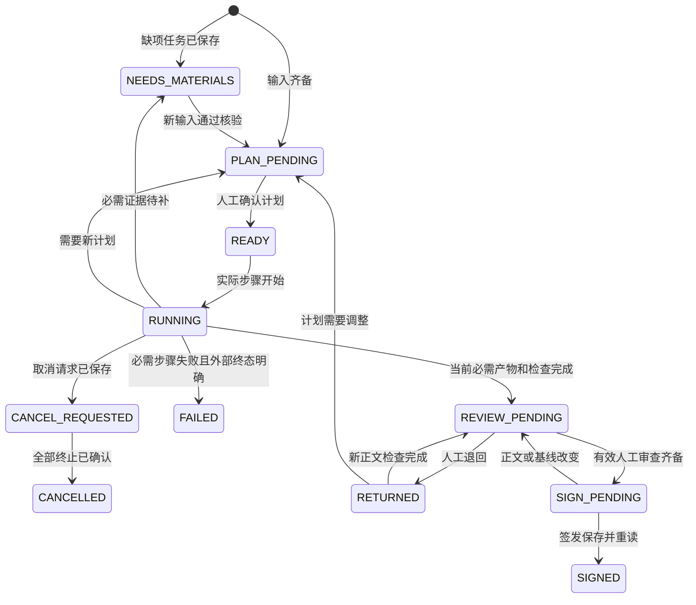
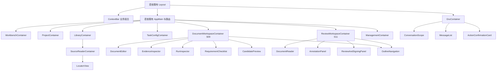
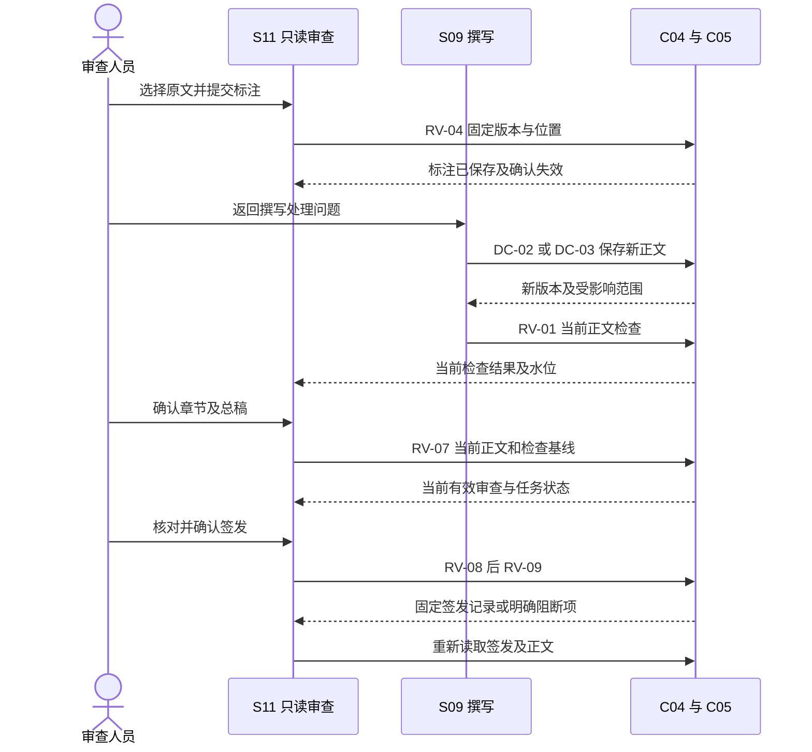
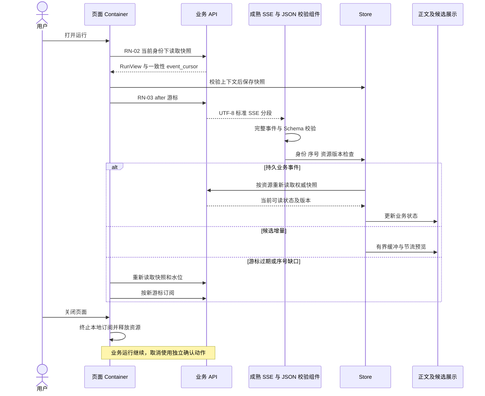

# 医疗器械企业 Agent 平台前端详细设计

版本：V1.1.0；日期：2026-09-30；状态：`DRAFT`；能力类型：`DESIGN`；任务：T08；执行模式：`DESIGN / CONTINUOUS_DELIVERY`。需求基线为 PRD V1.3.0、HLD V1.2.0、LLD-数据 V1.0.0、LLD-后端 V1.1.0、LLD-Agent V1.2.0。用户明确指定基于 RuoYi-Vue3，已有组件直接复用，禁止重复开发通用能力。本文维护页面、组件、状态、请求、来源阅读、人工操作和验收规范。正式 Vue 工程位于`web/`，接口集成与业务验收按同号IMP主记录中的实际证据分别登记。

## 1. 架构上下文与上游资产映射

邀请页面的企业选择保持独立原请求身份：sessionStorage 保存本人、企业、原上下文版本和原请求键，未知结果禁止生成新的选择请求。刷新后重新读取本人候选，用原版本和请求键重放 ID-04，再读取完整会话并比较目标、上下文版本及两个授权水位；通过后清除原请求记录并进入项目中心。选择器仅提供当前 ACTIVE 成员所属企业，原选择未核查时保持原目标。

FRONT-MEMBER-ACCEPT-01（INFERRED，CONFIRMED）依据 FR-01、ID-03/04/08 和完整实施授权，提供 `/member-invitations/acceptances`。当前账户区域提供“接受企业邀请”入口，页面复用 Layout、Element Plus、Cookie/CSRF、Ajv 和既有企业选择服务。入口页面能够显示未登录状态；全部受限读取与接受仍要求实际认证。页面通过 tenant-selection-options 取得本人及 ACTIVE 成员，允许已有企业上下文需要更新时继续接受本人邀请。邀请标识、企业标识、原版本和秘密凭据来自实际邀请；秘密输入使用 password 控件，不进入 URL、Storage、日志或证据。sessionStorage 仅保存原本人、企业、邀请、原版本及请求键；结果未知、刷新及连接中断后重新填写原凭据并用相同键查询原接受结果。回执与重新读取的本人、成员和版本一致后显示成功；邀请接受不自动选择企业，用户明确选择后调用原 ID-04。未保存离开由原弹窗处理，断网、身份失效、页面隐藏及卸载清除受限内存与原生控件。正式成员管理与授权页面继续按 FRTE-02 完整实施。

### 1.1 输入与责任

| 输入 | 继承内容 | 依赖状态与责任 |
| --- | --- | --- |
| [PRD.md](./PRD.md) | FR-01—FR-09、BR-01—BR-23、AC-01—AC-57、NFR-01—NFR-17；十三种文档入口及全部适用字段 | `SATISFIED`：需求可读取；客户决定及业务验收独立记录 |
| [交互原型说明.md](./交互原型说明.md) | 十四个屏幕、三步文稿导航、资料管理、Gru、配置、评测和管理入口 | `SATISFIED`：复用页面身份与操作目标 |
| [界面规范.md](./界面规范.md)、[tokens.json](./ui-delivery/tokens.json) | 语义颜色、字体、尺寸、断点、Element Plus 组件组合及头像资产 | `SATISFIED`：Token 值由 S003-2 维护；本文维护框架映射 |
| [文档阅读设计](./ui-delivery/document-reading-design.md) | S09 连续编辑与折叠证据；S11 全文只读、标注及收起的审查签发区域 | `SATISFIED`：2026-09-28 的阅读布局约束；证据、申请清单和运行区域位于 S09 |
| [组件复用检查](./ui-delivery/component-reuse-audit.md)及2026-09-30用户指令 | RuoYi-Vue3、Element Plus、现有布局、权限、表格、表单及上传组件直接复用 | `EXPLICIT/CONFIRMED`：框架与复用原则已确定；正式工程版本及实际引用待验证 |
| [HLD.md](./HLD.md) | C01 Vue3、Element Plus、Vite；服务端会话；业务 API 聚合；固定版本与授权 | `SATISFIED`：沿用浏览器与 Java 服务边界，不增加独立 BFF |
| [LLD-数据.md](./LLD-数据.md)、[dataset.schema.json](./data-design/dataset.schema.json) | EvidenceRef、七种 locator、正文节点身份、来源检查及当前权限 | `SATISFIED`：类型从唯一 Schema 产生，字段不得缩减 |
| [LLD-后端.md](./LLD-后端.md) | §4 公开接口、类型、SSE、错误；§5 状态与 SG-01—SG-09；§6 恢复 | `SATISFIED`：补充 OpenAPI 和页面聚合字段见 §5.5，实际调用 NOT_RUN |
| [LLD-Agent.md](./LLD-Agent.md) | §4.1 候选采纳及当前正文复验、§4.5 运行状态、§7.2 人工待办 | `SATISFIED`：浏览器只消费业务服务输出；内部模型流保持内部使用 |
| [项目研发规划.md](./项目研发规划.md) T08 | 页面动作逐项对应业务状态，失败与待人工状态可处理 | 本文为当前设计交付；开发、联调及业务验收分别安排 |
| 正式工程、生成客户端、账号、服务与真实项目 | 可运行入口及实际结果 | `PARTIAL`：`web/package.json`、正式Vue工程、共享TypeScript类型及当前本地服务已提供；每项接口和页面按实际代码验证，完整业务验收继续由同号IMP维护 |

页面业务目标包括：定位任务等待原因和责任人、查看固定原件位置、完成当前正文检查与人工决定、按版本取得成果。来源打开率、审查历时、采用率和退回率读取真实记录；前端不设置新的模型置信度阈值，不根据链接数量推断质量。

### 1.2 前端决定与工程组织

| decision_id | 来源与状态 | 决定及采用范围 | 验证条件 |
| --- | --- | --- | --- |
| FRONT-D01 | 用户指令、HLD §3.1、界面规范；`EXPLICIT/CONFIRMED` | 基于 RuoYi-Vue3，沿用 Vue3、Vue Router、Element Plus、Vite、既有目录、构建配置及组件；已有能力直接使用 | 取得正式工程后固定提交与锁文件，逐项记录实际 import；脚本语言沿用工程，不要求全项目迁移 |
| FRONT-D02 | RuoYi-Vue3 状态机制、用户复用原则；`EXPLICIT/CONFIRMED` | 沿用现有 Pinia 实例及 user、permission、app、settings 等模块；在现有 store/modules 中补充任务、文稿等业务状态 | SessionStore 为会话职责名称，接入既有 user/permission；不重复维护登录态或创建第二个 Store 实例 |
| FRONT-D03 | 组件复用原则、HLD ADR-005；`INFERRED/PROPOSED` | 正文通过现有 Editor 及成熟扩展承载；S09/S11 共用正文 Schema 和节点映射，审查只读。专用编辑依赖的采用条件见§1.4 | 固定 body_schema_revision，以真实正文验证稳定节点、表格、引用、标注及保存再读；不能省略结构要求 |
| FRONT-D04 | 组件复用原则、后端 §4.8；`INFERRED/PROPOSED` | 普通 API 沿用现有 Axios request；SSE 和 Markdown 使用工程已有成熟能力，缺项时接入 eventsource-parser、markdown-it；Fetch 仅用于需要流式读取的传输适配 | 共用身份、错误与上下文校验；不得新增平行的普通请求体系；固定依赖并验证分段与恢复 |
| FRONT-D05 | 文档阅读设计；`EXPLICIT/CONFIRMED` | S09 为唯一正文编辑入口；S11 保留全文、标注、审查与签发，核验详情导航到 S09/S05 | 返回后恢复文稿版本、章节、标注及阅读位置 |
| FRONT-D06 | 后端 §4、Agent §4.1；`INFERRED/PROPOSED` | 业务状态来自服务端；候选准备、正文保存、当前正文复验、人工审查与签发分别呈现 | 当前正文和 check_ids、水位匹配后才可确认 |

2026-09-30 查阅的官方资料支持以下组件用途：Pinia 提供跨组件状态与 TypeScript 支持；Tiptap 支持 JSON 持久化；eventsource-parser 接收分段数据并产生完整 SSE 事件；markdown-it 提供 CommonMark 解析。它们的项目使用方式及安全限制由本文定义，依赖兼容与业务效果仍须运行验证。来源：[Pinia](https://pinia.vuejs.org/introduction.html)、[Tiptap Persistence](https://tiptap.dev/docs/editor/core-concepts/persistence)、[eventsource-parser README](https://raw.githubusercontent.com/rexxars/eventsource-parser/main/README.md)、[markdown-it README](https://raw.githubusercontent.com/markdown-it/markdown-it/master/README.md)。

正式工程保留现有 `src/layout`、`src/router`、`src/views`、`src/api`、`src/store/modules`、`src/components`、`src/utils`、`src/directive`、`src/plugins`、`src/assets/styles` 和 Vite 配置。业务页面进入 `src/views` 下对应业务目录，接口进入 `src/api`，业务状态进入 `src/store/modules`；专用组件置于所属页面或既有共享组件目录。生成类型使用工程既有入口，缺少该入口时新增 `src/generated`；TypeScript 片段用于字段规范，实际脚本与类型检查沿用当前工程支持方式。业务 Composable 负责请求编排，既有 request 入口负责传输适配，展示组件接收 props 并发送事件。不得为组织形式迁移既有管理页面、建立第二套路由或重新创建全局布局。

### 1.3 路由、角色与需求追踪

FRONT-MEMBER-MANAGEMENT-01 来源 INFERRED，状态 CONFIRMED，继承完整实施授权及 S02/FR-01。当前 `/enterprises/members` 在原 Layout 提供成员、授权和邀请读取，通过 MEMBER-READ-01—03 重读实际状态、规范 U64 版本和完整固定范围。项目中心入口依据当前 member.manage 或 project.grant 摘要显示，实际列表及对象仍由服务器完整委派筛选；项目授权人员进入授权记录，成员和邀请操作单独核查。ElForm、ElInput、ElTable、ElEmpty、ElDescriptions 与原 SessionPanel、Router、Pinia、Axios 和 Ajv 直接复用。独立记录详情保留完整条件、依据和固定岗位版本，长内容换行；游标分页使用已提交查询及原 dataset_watermark，不消费尚未提交的筛选输入。未授权数量不返回，旧分页与上下文明确拒绝。刷新重读实际记录，断网、页面隐藏或身份失效清除受限内容；视觉未执行。邀请创建、权限决定、停用和原请求恢复继续同一完整页面任务，不由查询通过登记全部管理完成。

FRONT-MEMBER-MANAGEMENT-01 的写入操作在同一管理页面组合 ElForm、ElInput、ElSelect、ElCheckbox、ElDialog 和 ElDescriptions。邀请明确填写完整认证绑定、固定岗位引用、范围、截止时间和依据；独立授予明确填写主体、范围、动作、完整条件、起止、依据与原因。撤销与停用从已读取的完整记录取得主体、目标和原版本，决定依据与原因由管理人员填写。结构输入通过现有 project-json 和唯一 Schema 校验，身份、范围和授权不可从按钮推导。原请求元数据只保存主体、企业、原上下文、动作、键、目标和完整请求摘要，业务输入与邀请秘密只保存在内存。ID-07/09 在未知响应以后核查原 operation-lookups；FOUND 仍需按原参数恢复确定回执并重新读取目标，NOT_FOUND 保留原键，EXPIRED 禁止重发。保存后重新读取当前会话、原操作及实际目标，范围、水位、版本与回执一致后显示完成；不能以 HTTP 成功代替重读。断网、隐藏和身份变化清除受限输入及秘密，刷新后重新核验原请求并要求填写相同原参数。通知渠道仍由明确授权决定，页面不自动发送邀请消息。

以下为前端路径设计；`projectId/taskId/documentId` 等是授权对象标识，不能充当授权依据。所有页面都有 `loading/empty/ready/partial/error/denied` 读取状态及长内容、窄屏状态。表内角色表示岗位用途，动作还需 ID-03 与对象 `allowed_actions` 共同检查。

S02的`/system/:module`表示设计中的模块导航身份；工程接入保留已有system、monitor、tool等模块的真实路由和页面引用，在菜单中建立对应关系，不要求改写既有URL。其余新增业务路由注册到同一个Router，并使用现有权限与菜单机制。

| route_id / screen_id | path | roles / guards | FR / AC | api_refs / layout / 业务状态 |
| --- | --- | --- | --- | --- |
| FRTE-01 / S01 | `/workbench` | 已认证企业成员；受限待办 | FR-01、FR-04、FR-07；AC-01、AC-07、AC-14、AC-15 | PJ-06、CP-07、OP-02；AppLayout；待处理、等待他人、运行、待签发 |
| FRTE-02 / S02 | `/system/:module` | 企业或平台管理人员；受控 module 与环境菜单 | FR-01、FR-08；AC-01、AC-02、AC-16 | ID-07、ID-09、EV-05、FRONT-I09；ManagementLayout；未配置、拒绝、验证失败 |
| FRTE-03 / S03 | `/projects` | 项目读取或创建动作 | FR-01、FR-04；AC-01、AC-07、AC-08 | PJ-01、PJ-02；ListLayout；PENDING、ACTIVE、PAUSED、ARCHIVED |
| FRTE-04 / S04 | `/library` | 资料读取；维护动作另判 | FR-03；AC-29、AC-31、AC-32、AC-33、AC-34、AC-36 | KN-01—KN-05、KN-11—KN-15、KN-19—KN-22；LibraryLayout；四类处理状态、空范围 |
| FRTE-05 / S05 | `/library/versions/:sourceVersion` | 固定来源及使用项目读取；核准另判 | FR-03、FR-05；AC-05、AC-06、AC-30、AC-33、AC-35 | KN-06—KN-10、KN-16—KN-18；SourceReaderLayout；历史版本、无法定位、待核准 |
| FRTE-06 / S06 | `/projects/:projectId/tasks` | 项目任务读取 | FR-04、FR-09；AC-07、AC-08、AC-21、AC-41 | FRONT-I01、TK-02；ListLayout；全部 TaskStatus |
| FRTE-07 / S07 | `/projects/:projectId/tasks/new`；`/projects/:projectId/tasks/:taskId/config` | task.create、计划维护/确认；有效项目 | FR-04、FR-09；AC-07、AC-08、AC-18、AC-37、AC-45、AC-46 | TP-05、TK-01—TK-04、RN-01；TaskLayout；待补、计划待确认、待运行 |
| FRTE-09 / S09 | `/projects/:projectId/tasks/:taskId/documents/:documentId/write` | 文稿读取；document.edit、candidate.adopt 分别判定 | FR-03、FR-05、FR-09；AC-19—AC-26、AC-38—AC-44、AC-47—AC-57 | TK、RN、DC、RV、EX；DocumentLayout；正文保存、检查、候选与运行状态 |
| FRTE-11 / S11 | `/projects/:projectId/tasks/:taskId/documents/:documentId/review` | 文稿读取；review.decide、document.sign 分别判定 | FR-05、FR-09；AC-09、AC-10、AC-11、AC-20、AC-25、AC-55、AC-56 | DC-01、RV-02—RV-09、EX-05；ReviewLayout；待审、退回、待签发、已签发 |
| FRTE-13 / S13 | `/agents` | 配置、能力、模型、发布动作分别授权 | FR-02；AC-03、AC-04、AC-27、AC-28 | CP-01—CP-11、FRONT-I08；ManagementLayout；草稿、验证、评测、发布、停用 |
| FRTE-15 / S15 | `/evaluation` | 评测、报表、审计分别授权 | FR-06；AC-12、AC-13 | EV-01—EV-07、FRONT-I10；ManagementLayout；缺样本、未评分、证据不足 |
| FRTE-16 / S16 | `/connections` | 企业连接管理；不隐含项目原文读取 | FR-08；AC-16、AC-17 | CT-01—CT-03、FRONT-I08；ManagementLayout；未配置、BLOCKED、验证、同步失败 |
| FRTE-17 / S17 | `/access` | 公开安全说明；无受限对象预读 | FR-01—FR-09；AC-02、AC-16、AC-23 | ID-01、ID-03；AccessLayout；未登录、会话失效、权限不足 |
| FRTE-18 / S18 | `/projects/:projectId` | 项目读取；成员与属性动作另判 | FR-01、FR-03、FR-04；AC-01、AC-07、AC-08、AC-31、AC-45、AC-50 | PJ-03—PJ-05、KN-10、TP-05；ProjectLayout；资料、任务及申请节点进度 |

`/agents` 的 section 区分 Agent 与模型 API；Agent 内部使用七个标签：默认配置、专业角色、Skill 与工具、模型预算、研究上限、评测发布、任务记录。`/library` 的 view 区分资料库、资料集、处理队列、检索验证、网络候选、任务成果。查询参数只允许安全 ID、枚举、页码与排序；全文查询词、正文选区、摘录和凭据留在受控内存，不进入 URL。

FRONT-BUDGET-MANAGEMENT-01为S13模型预算提供/agents/budgets列表、/agents/budgets/new创建、/agents/budgets/{budgetId}详情和/agents/budgets/{budgetId}/decisions追加批准，来源INFERRED，关联后端接口补充设计§4.16的BD-01—04。列表仅使用获授权账户及项目标识筛选、10/20/50/100分页；详情完整显示固定批准定义、依据、批准主体、授权版本、金额/Token/调用的已用及预留、六项限制和账户版本。创建和批准使用ElForm/ElDialog及§2.3字段错误与首个错误焦点；金额和U64直接字符串编辑，截止时间使用明确UTC原值，不提供无限默认值。企业、项目及BUDGET范围按当前动作摘要精确判断，服务端逐次核验。追加批准保持账户币种及项目归属，提交账户版本和原批准版本。原请求恢复沿用BX-31/OP-01，NOT_FOUND保持原参数和请求键、EXPIRED禁止重发、PROCESSING等待查询，COMPLETED重新读取实际操作及获授权账户；关闭页面不取消批准，不释放未知预留，不重新启动运行。页面内存及原生控件按§2.1清理；原请求技术元数据允许保留，客户输入不进入浏览器持久存储。

BACK-BUDGET-HISTORY-01为S13增加/agents/budgets/{budgetId}/revisions列表和/agents/budgets/{budgetId}/revisions/{budgetRevision}指定批准阅读，继承BD-05/06与独立budget-history.schema.json。列表按版本标识升序、10/20/50/100分页，完整展示当前账户版本、当前批准版本、原批准身份与摘要；版本标识排序不表示批准时间排序。指定版本页面完整保留原六项限制、依据、原因、授权及批准身份，并允许导航到based_on_budget_revision重新核验。当前预算详情提供历史入口。前端逐项核验企业/项目/账户/指定版本及is_current、批准定义、U64、游标和当前范围许可；身份或目标变化立即清除列表与原内容，取消原读取，旧异步响应不能覆盖当前页面。客户内容不进入浏览器持久存储；历史查询不生成批准、释放预留或重新执行运行。完整模型配置与费用准入继续由IMP-07实施。

FRONT-TASK-LIST-01为S06提供/projects/:projectId/tasks，只按当前企业及project.task.read许可读取BX-01。原Pagination、ElForm、ElTable和ElDialog负责分页、过滤、列表和完整任务信息；原Axios实例处理Cookie及接口请求。TaskPage的Item组合共享TaskDetail、固定输入goal/document_type和任务头updated_at，后端以UTC输出时间，前端保留真实UUID和全部缺项、文稿、运行及待办标识。十一项状态、责任人员及更新时间过滤绑定原Schema，第二页携带原授权水位与过滤摘要，筛选或页大小变化重新读取第一页。数量超出原分页组件或接口范围时明确失败。路由、当前身份、页面隐藏或卸载清除过滤、完整信息及旧结果，并取消原读取；过期异步结果不能显示。项目详情动作及任务数量采用相同获授权范围，内部项目治理依赖保持完整集合。后端Spring MVC提供同源页面及刷新入口；无企业或许可的真实账户不会预读任务。

FRONT-RUN-READ-01在任务详情的获授权活动运行区域连接run-detail.vue，使用runs.ts及RN-02。完整输出采用run-view.schema.json，保留运行和任务固定版本、步骤、待办、活动及未结算调用、开始结束时间、记录修订与持久事件游标。budget明确显示预算账户spent/reserved、本次budget_revision批准limit及currency；单次调用settled_amount和total_tokens为空时显示尚未确定，保留原精度。当前身份、任务、运行、页面隐藏或读取失败清除原响应并终止原请求；运行操作和持久事件继续原完整要求。

系统管理保留十八个功能：用户、角色、菜单、部门、岗位、字典、参数、通知公告；在线用户、定时任务、操作日志、登录日志、服务监控、缓存监控、连接池监视；代码生成、系统接口、表单构建器。后端环境清单决定可访问菜单，开发工具不得从生产菜单取得执行权限。场景目录从 CP-07 读取，正式入口取决于发布状态，页面不写入固定场景数量。

FRTE-17的本地独立登录复用原views/login.vue和user.login；/access及medical构建的/login连接同一原页面。原表单执行必需字段校验，Cookie模式由既有Spring Security、原RuoYi账户认证及医疗会话读取处理；本地模式采用后端§4.4的准入规则。浏览器不保存密码，秘密输入在操作结束和页面离开时清除。redirect必须指向当前业务页面，非法目标在认证提交以前拒绝；成功以后读取当前身份、候选和原框架权限。会话失效及注销继续回到同一原页面。

FRONT-RUOYI-LOGIN-01通过Spring MVC在后端/auth/login提供同一正式Vue构建，Router将该路径关联原登录组件。Spring MVC的页面入口采用当前medicalRoutes，完整JS、CSS及静态文件由Maven资源处理器复制到应用static目录；没有index.html时应用启动明确拒绝。HTML入口不提供企业授权，所有/api请求继续验证当前Cookie、CSRF、主体及业务许可。构建命令包含严格类型检查和medical生产构建；来源、构建字节和实际HTTP/Chrome检查单独保存。后端与前端同源运行时原本人账户可以直接刷新，开发代理与正式资源发布分别验证。

FRONT-RUOYI-PASSWORD-01的本人密码操作使用原system/user/profile/resetPwd.vue、usePasswordRule及api/system/user.updateUserPwd；医疗账户元数据向原组件提供经过当前会话核验的OwnAccount及revision。原Element Plus表单执行必需字段、原密码确认规则及医疗UTF-8长度规则，操作期间限制重复提交。医疗模式由已有LOCAL-06执行原SysProfileController和账户版本、幂等、审计及会话撤销；原JWT模式继续使用原updatePwd接口。秘密在请求结束、身份变化、隐藏及组件销毁时清除，未知结果只保留既有请求元数据。原个人信息资料、头像和全部管理页面继续保持完整实施与验收要求。

FRONT-RUOYI-PROFILE-01的/account直接使用原system/user/profile/index.vue及userInfo、userAvatar、resetPwd，昵称、手机、邮箱、性别、部门、岗位、原角色与创建时间保持原页面定义；业务UUID、当前版本、会话及原请求提示作为医疗扩展。getUserProfile读取原Controller的实际资料并核对本人UUID、原用户名及账户版本，updateUserProfile通过LOCAL-07保存；原表单和校验直接复用，空手机或邮箱采用原服务允许语义。读取被新会话替换、页面隐藏或者组件销毁时清除资料并取消旧读取，旧响应不能覆盖当前身份。未知资料请求跨刷新保持原键、版本和摘要，成功后重新读取会话与资料。原头像组件继续显示当前资料；头像上传尚未接入时明确禁用操作，完整上传与全部管理模块继续原验收范围。

FRONT-TASK-CREATE-01的/projects/:projectId/tasks/new提供受控责任人员、资料与资料集选择。责任人员仅从task-creation-owners响应选择；本人取得当前资格后可作为默认值。资料与资料集分别通过task-creation-sources和task-creation-collections明确查询，ElSelect保存实际固定版本，下一页由用户明确请求；SourceScope的四种模式、独立清空及关闭网络操作保持完整。task-scope-selection.ts核验当前企业、项目、上下文、完整类型、查询摘要、同一水位及版本升序，资料集source_scope_sha256包含当前正式成员的完整版本资格。原创建输入恢复保留所有固定版本；保存时服务端重新核验。当前身份、路由或页面可见性改变时清理查询内容并取消读取。已发布默认配置继续需要对应服务提供完整内容，页面不构造默认范围。当前代码、验证与剩余内容由唯一IMP-12维护。

### 1.4 既有框架与组件复用要求

已有功能通过原组件的 props、slots、事件、主题和扩展点接入。禁止复制源码后改名形成同功能组件，禁止重新编写按钮、表格、分页、表单校验、弹窗、抽屉、上传控件或导航。业务组件只组合既有控件并维护本产品的字段、状态、权限、版本与调用；不存在业务职责的通用包装不新增。HTML 原型用于确认交互，不将其共享渲染函数移植为正式组件库。

2026-09-30读取官方源码：[组件注册](https://raw.githubusercontent.com/yangzongzhuan/RuoYi-Vue3/master/src/main.js)列出 Pagination、RightToolbar、DictTag、FileUpload、ImageUpload、ImagePreview、Editor、SvgIcon；[布局](https://raw.githubusercontent.com/yangzongzhuan/RuoYi-Vue3/master/src/layout/index.vue)包含 Sidebar、Navbar、TagsView、AppMain；[依赖清单](https://raw.githubusercontent.com/yangzongzhuan/RuoYi-Vue3/master/package.json)和[Store入口](https://raw.githubusercontent.com/yangzongzhuan/RuoYi-Vue3/master/src/store/index.js)确认 Pinia、Axios 等已有能力。以上为公开工程核查，正式工程仍需固定对应提交和实际组件路径。

| reuse_id | 页面或能力 | 必须复用的组件或入口 | 本产品允许增加的内容 |
| --- | --- | --- | --- |
| FRONT-R01 | 全局布局、导航和页面区域 | 若依 Layout、Sidebar、Navbar、TagsView、AppMain、已有菜单与主题设置 | 三组导航配置、企业/项目选择区、Gru入口及工作区内容；业务 Layout 名称仅表示内容区组合 |
| FRONT-R02 | 路由与权限展示 | 既有 router、permission、权限指令和权限工具 | 公共 API 返回的企业、项目、对象动作判定及失效刷新；服务端保持最终授权 |
| FRONT-R03 | S02系统管理 | 正式工程已有用户、角色、菜单、部门、岗位、字典、参数、通知、监控及工具页面 | 接入现有页面，配置环境菜单与业务授权；不重写同功能管理页面 |
| FRONT-R04 | 全部筛选与编辑表单 | ElForm、ElFormItem、ElInput、ElSelect、ElInputNumber、ElDatePicker、ElCheckbox、ElRadio、ElButton | Schema、业务字段、条件、校验规则及提交动作；精度字符串按§2.3处理 |
| FRONT-R05 | 列表、分页、搜索显隐和列设置 | ElTable、ElTableColumn、若依 Pagination、RightToolbar | 授权查询、列配置、分页状态及行操作；不另写分页和表格内核 |
| FRONT-R06 | 状态、空态与反馈 | DictTag、ElTag、ElEmpty、ElSkeleton、ElAlert、现有 modal/message 入口 | 服务状态到文案的映射、原因及可执行动作；不另建基础状态或通知控件 |
| FRONT-R07 | 分区、确认、详情及侧边区域 | ElTabs、ElCollapse、ElDialog、ElDrawer、ElMessageBox | 业务内容、打开条件、影响说明和提交；焦点管理沿用组件并验证 |
| FRONT-R08 | 文件夹、申请目录与来源范围 | ElTree、ElSelect、ElCheckbox及工程已有树形选择组件 | 稳定节点、资料范围、适用性和授权数据；不另写树形交互 |
| FRONT-R09 | 文件、图片上传与预览 | 既有 FileUpload、ImageUpload、ImagePreview；底层沿用 ElUpload | 固定文件版本、上传协议、处理队列及授权下载适配；复用控件的选择、进度、限制和事件 |
| FRONT-R10 | 任务进度与运营图表 | ElSteps、ElTimeline、ElProgress、既有 ECharts 依赖或项目图表组件 | 真实步骤、事件、统计维度和选项；不开发绘图引擎 |
| FRONT-R11 | 正文编辑与只读审查 | 现有 Editor、成熟编辑器扩展和同一正文适配层 | 稳定节点、字段、证据、版本与人工标注；保留成熟编辑器的选区、撤销、输入法及排版能力 |
| FRONT-R12 | API、会话、状态及工具 | 现有 Axios request、Pinia、权限模块、下载与日期工具、SvgIcon及图标库 | 业务 DTO、Cookie会话、CSRF、幂等、资源版本、清理与错误适配；时区和数字规则保持§4.1要求 |
| FRONT-R13 | SSE、Markdown与原件阅读 | 工程已安装的成熟解析与阅读组件；缺少能力时接入成熟库 | 业务事件、EvidenceRef和节点映射；禁止手写协议解析器、文件格式解析器或阅读内核 |

通用 Editor 的官方实现使用 Quill 和 HTML 内容接口，并提供 readOnly；以[Editor源码](https://raw.githubusercontent.com/yangzongzhuan/RuoYi-Vue3/master/src/components/Editor/index.vue)及正式工程版本为核查依据。普通富文本直接复用。结构化文稿对稳定 node_id、表格身份、证据关联、字符选区和固定版本的要求全部保留。正式 Editor 已满足要求时直接使用；需要扩展时采用其成熟插件与业务节点适配。只有正式组件与成熟扩展经实际核查仍缺少必要能力，才登记具体需求、组件路径、验证结果及调用页面，并为该专用能力接入成熟组件；Tiptap/ProseMirror 属于此条件下的候选，不能视为默认替换现有 Editor 的决定。任何路径均禁止自行开发编辑器内核。

复用同时遵守已确认的 API 和安全设计。在既有 request、会话、上传及下载入口完成 Cookie、CSRF、X-Context-Revision、幂等、统一响应和日志适配；业务请求及正文保持受控内存，不写入浏览器持久存储。文件上传继续复用既有控件，通过其扩展点接入 KN-01—KN-04。核查依据为[request源码](https://raw.githubusercontent.com/yangzongzhuan/RuoYi-Vue3/master/src/utils/request.js)、[FileUpload源码](https://raw.githubusercontent.com/yangzongzhuan/RuoYi-Vue3/master/src/components/FileUpload/index.vue)和[权限指令](https://raw.githubusercontent.com/yangzongzhuan/RuoYi-Vue3/master/src/directive/permission/hasPermi.js)。这些适配只处理实际协议与业务差异，保持共用入口和既有控件。

每项业务开发登记 `reuse_id、正式工程commit、原组件路径、实际import、props/slots/events、必要适配、调用页面、验证结果`。新增组件说明其特有业务职责；新增基础依赖提供正式工程中能力缺项的核查记录。当前设计要求为 `CONFIRMED`，官方源码读取为 `SOURCE_READ`，正式工程组件引用、运行与回归为 `NOT_RUN`。

## 2. 前端边界与安全防线

### 2.1 身份和对象连续性

启动读取 ID-03，取得真实主体、企业、`context_revision/auth_epoch`、CSRF 和可用动作，再解析受保护路由。对象响应中的企业、项目、任务与文档归属必须与路由及已验证上下文相符。页面标题、项目选择器和请求作用域取同一有效 Context，禁止名称来自旧请求而对象 ID 来自新路由。

| 事件 | 清理和恢复 | 请求与界面约束 |
| --- | --- | --- |
| 同一文稿在 S09/S11 往返 | 保存当前章节、滚动锚点、标注筛选、证据展开及来源入口；未提交正文由 DocumentStore 内存持有 | S11 只读取服务端保存版本；显示存在未保存修改，提供返回撰写；不得把未保存内容送入审查确认 |
| 切换项目或任务 | 有未保存内容时提供保存后切换、放弃修改并切换、继续编辑；完成选择后清理旧工作区 | 递增 requestGeneration，AbortController 中止旧读取；旧写入查询归入原对象操作记录 |
| 用户切换企业 | 未保存处理完成后 ID-04；成功后清理旧企业内容、候选、来源 Blob、表单、会话可见内容和订阅 | 新上下文从 ID-03 重读；旧 Gru 会话仍在服务端原企业，当前企业不能显示其消息；切回原企业后重新授权读取 |
| 同企业切换页面或项目，Gru 已打开 | 会话保持原目标，面板明确显示原项目、文稿版本与选区 | 页面上下文变化给出“围绕当前页面新建对话”；原会话建议只能作用于原目标 |
| 其他标签页完成企业切换 | BroadcastChannel 只传失效信号；当前页停止受保护读取并重新取得 ID-03 | 消息不含正文、名称或凭据；缺少该通知时 API 的 CONTEXT_CHANGED 与返回页授权检查仍生效 |
| 权限撤销、账号停用或会话失效 | 停止订阅、销毁受限编辑器与内存内容、撤销 Blob URL，转安全说明 | 不继续显示缓存原文；普通断网保留的编辑与已确认撤权分别处理；禁止自动提交 |
| 页面刷新或重新登录 | 恢复已保存正文、运行及业务记录；浏览器离开提示说明未保存内容风险 | 未提交正文不写入 localStorage、sessionStorage、IndexedDB、Service Worker Cache；刷新不承诺恢复未提交正文 |

页面失去可见性时停止不必要内容订阅；重新可见先验证会话与目标授权，验证期间遮盖受限内容。已有数据的历史查看也需要当前读取权限。客户端无法收回已经授权下载的文件，界面不得宣称撤权已经删除用户设备副本。

### 2.2 内容、凭据与错误

- 访问和刷新令牌仅在服务端；浏览器采用 HttpOnly 会话 Cookie。API client 对变更统一发送 CSRF、`X-Context-Revision`、Schema 版本、幂等键和版本字段；验证 status_url 属于同源已登记 API 范围。
- API Key 不进入正文、Gru、Store 持久记录或监控。正式 CP-11 接收秘密服务凭据引用；密钥设置入口依赖 FRONT-I08 定义的受控流程，普通配置表单不提交原始密钥。
- 编辑器接受固定 Schema 节点；Markdown 禁用原始 HTML，输出再经成熟清洗组件统一过滤。链接只允许批准的协议和服务端返回的安全目标；外链新窗口使用安全关系属性。远端图片通过授权内容入口读取，不直接加载用户或模型提供的远端 URL。
- PDF、Office、表格和文本原件使用成熟阅读组件及 C09 解析产物。浏览器不执行宏、附件脚本或格式内链接动作，不自行解析 Office 容器或 CSV。原文源码以转义文本展示。
- 失败在发生位置报告；页面错误边界显示安全原因、请求编号与可执行动作。拒绝无效响应、未知枚举及摘要不符，不转换为默认成功、空搜索或替代模型回答。
- 前端日志采用允许字段：screen_id、operation_id、request_id、耗时、结果类别、错误码。控制台、日志和错误追踪统一经过过滤器，未登记字段拒绝发送；业务 ID 使用遥测服务提供的受控伪名，原始值不能进入控制台。禁止记录正文、查询词、选区、完整 URL、请求体、模型回复和密钥。生产关闭包含内容的会话回放和 Store 调试导出。
- Vue 的点击权限只控制展示，服务端逐次核验才产生业务结果。签发、资料核准、预算批准和发布不能通过浏览器修改角色、checkbox 或本地状态取得权限。

### 2.3 动作提交和表单规范

表单使用 ElForm、字段说明和行内错误。必填、枚举、数值精度与条件规则读取已发布 Schema；未知产品属性使用 `UNKNOWN`，不得填为否。重复表格保留 row_id，金额与测量原值使用字符串编辑，不通过 Number 舍入。校验失败聚焦第一个可见错误字段，保留其他输入。

每个业务意图创建一个16～128字符的 Idempotency-Key；提交后冻结该请求的目标、参数和基准版本。连续点击复用该键和相同请求，按钮显示提交中。用户修改提交内容表示新的业务意图，须先明确原操作状态。成功以资源重读一致为准；202 只显示请求已接收。关闭表单不能撤销已经提交的业务动作，弹窗显示原操作入口。

普通未提交编辑允许编辑器撤销；保存后撤销通过新修订表达。正文保存、候选采纳、审查与签发采用串行的文稿写入队列。保存期间可以继续编辑，但后续编辑属于新 editGeneration；前一请求成功不能把新编辑标记为已保存。离开、采纳、审查及签发前处理当前 dirty 状态。

## 3. 设计系统与 Token 映射

### 3.1 唯一变量来源

`ui-delivery/tokens.json` 为颜色、尺寸与字体的值来源。在若依现有样式入口、主题变量及 Element Plus CSS variables 中配置映射，沿用项目已有 Token 转换工具；业务组件只引用语义变量，不为应用主题重新编写控件或创建第二套样式系统。当前仅有浅色主题，Dark Theme 记为 `NOT_DEFINED`，不开放切换入口。

| Semantic Token | tokens.json 路径 | Light Theme | Dark Theme | 组件映射 |
| --- | --- | --- | --- | --- |
| `--color-primary` | `color.action.primary` | `#1768C4` | NOT_DEFINED | `--el-color-primary`、主要操作 |
| `--color-primary-hover` | `color.action.hover` | `#1256A4` | NOT_DEFINED | 按钮悬停 |
| `--color-primary-active` | `color.action.active` | `#104A8B` | NOT_DEFINED | 按钮按下 |
| `--color-link` | `color.action.link` | `#175FAE` | NOT_DEFINED | 引用、项目与版本链接 |
| `--color-navigation` | `color.brand.nav` | `#293B51` | NOT_DEFINED | 左侧导航 |
| `--color-success` | `color.feedback.success` | `#287044` | NOT_DEFINED | 已确认、已签发标签 |
| `--color-warning` | `color.feedback.warning` | `#8B570F` | NOT_DEFINED | 待核验、等待处理 |
| `--color-error` | `color.feedback.error` | `#B23E46` | NOT_DEFINED | 失败、阻断、冲突 |
| `--color-info` | `color.feedback.info` | `#175FAE` | NOT_DEFINED | 运行与信息提示 |
| `--color-surface-ai` | `color.feedbackSurface.info` | `#EDF4FF` | NOT_DEFINED | Gru、候选说明 |
| `--color-surface-base` | `color.surface.base` | `#F4F6FA` | NOT_DEFINED | 页面背景 |
| `--color-surface-raised` | `color.surface.raised` | `#FFFFFF` | NOT_DEFINED | 卡片和正文 |
| `--color-surface-subtle` | `color.surface.subtle` | `#F8FAFC` | NOT_DEFINED | 证据与辅助区域 |
| `--color-text-primary` | `color.text.primary` | `#243247` | NOT_DEFINED | 主文字 |
| `--color-text-secondary` | `color.text.secondary` | `#526279` | NOT_DEFINED | 辅助文字 |
| `--color-border` | `color.border.default` | `#DCE3EC` | NOT_DEFINED | 区域边界 |
| `--spacing-base` | `space.1` | `4px` | NOT_DEFINED | 空间基准 |
| `--radius-control` | `radius.control` | `6px` | NOT_DEFINED | 输入与按钮 |
| `--radius-card` | `radius.card` | `8px` | NOT_DEFINED | 卡片 |
| `--radius-dialog` | `radius.dialog` | `12px` | NOT_DEFINED | 对话框 |
| `--motion-normal` | `motion.normal` | `140ms` | NOT_DEFINED | 颜色、背景、边框及阴影 |
| `--type-document` | `coreWorkspace.type.document` | `16px/2` | NOT_DEFINED | 正文与只读阅读器 |
| `--type-message` | `coreWorkspace.type.message` | `14px/1.9` | NOT_DEFINED | Gru 消息 |
| `--size-inspector` | `coreWorkspace.layout.inspector` | `290px` | NOT_DEFINED | 正文辅助区域 |

反馈背景使用 `color.feedbackSurface` 对应项；聚焦边框使用 `color.border.focus`，宽度2px、外距3px。字体继承系统字体、PingFang SC、Microsoft YaHei、Noto Sans CJK SC、sans-serif。标题24px，分区17px，正文14px，表格13px，说明至少12px；状态同时显示名称与颜色。数字采用表格数字特性，完整原值可查看和复制。

### 3.2 布局与可访问性

| 区域 | 桌面规则 | 空间变化与键盘行为 |
| --- | --- | --- |
| AppLayout | 侧栏220px、顶栏最小68px、内容最大1480px、左右28px | 视口低于900px切换顶部导航；低于650px内距16px；主区域保持视口宽度 |
| S09 | 连续正文、每章证据初始收起；右侧目录、申请清单、本章核验、收起的任务与运行 | 依据最新阅读设计，窄屏按正文、辅助区域顺序排列，目录保留辅助区域归属；长表格内部横向滚动 |
| S11 | 同版本全文与正文图片只读；右侧目录、标注、收起的审查签发区域 | 没有正文编辑器工具栏；文字、图片和表格可选择；Escape 取消选择 |
| S04/S05 | 资料导航208px、属性245px；列表与多个阅读标签 | 容器620px以下单栏；阅读器和表格各自滚动；关闭阅读标签恢复原列表位置 |
| Gru | 常规440px、展开最大740px；超过1500px预留空间 | 较窄桌面使用浮层，移动使用全屏；关闭恢复触发焦点；桌面非模态面板不锁定整个页面焦点 |
| 表单与对话框 | 桌面控件至少38px，核心对话框最大780px、正文不超过66vh | 低于650px触控区至少44px；Dialog 管理焦点，错误出现后可定位，关闭回到触发控件 |
| 项目、任务创建、配置 | 容器860px以下纵向排列，620px以下单栏 | 长名称换行；分页和操作不被固定顶栏或 Gru 遮挡 |

正文定位预留100px顶栏空间。图片保持原始比例，图注写明来源版本和预览性质；使用现有 Gru PNG 资产，不创建新的图像。`prefers-reduced-motion` 时关闭非必要动效。读取进度使用 `aria-live=polite`，错误使用可聚焦的告警说明；候选每次字符更新不逐字播报，阶段变化和完成时播报摘要。

Tab 可遍历任务创建、资料选择、引用入口、目录、标注、问题与签发操作。Tabs 使用方向键、Home/End；表单 label 与错误说明关联；模态对话框恢复焦点。文本与图片标注均提供按钮入口，不能只依赖鼠标拖选。常规文字对比度目标4.5:1、大字3:1，继承界面规范；本次没有执行视觉检查或宣称完整可访问性通过。

## 4. 类型、状态与字段传播

### 4.1 类型来源和前端视图模型

业务 DTO 保持 snake_case。正式类型由 T06 发布的 OpenAPI 和数据 Schema 生成，解析使用成熟 JSON Schema 校验组件；示例 import 指向目标生成目录，当前不宣称文件已经存在。界面补充状态使用独立 `*VM` 类型，不写回业务状态字段。

```typescript
import type { EvidenceRef, Locator } from '@/generated/evidence';
import type { TaskView, RunView, DocumentView, ApiError } from '@/generated/api';

export type Id = string;
export type Revision = string;
export type DecimalString = string;
export type TaskStatus = 'NEEDS_MATERIALS' | 'PLAN_PENDING' | 'READY' |
  'RUNNING' | 'REVIEW_PENDING' | 'SIGN_PENDING' | 'SIGNED' | 'FAILED' |
  'RETURNED' | 'CANCEL_REQUESTED' | 'CANCELLED';
export type RunStatus = 'QUEUED' | 'RUNNING' | 'WAITING_INPUT' |
  'SUCCEEDED' | 'FAILED' | 'CANCEL_REQUESTED' | 'CANCELLED';
export type SectionStatus = 'PLAN_PENDING' | 'EVIDENCE_NEEDED' |
  'EVIDENCE_READY' | 'DRAFT_CHECK_PENDING' | 'REVIEW_PENDING' | 'CONFIRMED';
export type FieldStatus = 'EMPTY' | 'EVIDENCE_NEEDED' | 'CONFLICT' |
  'REVIEW_PENDING' | 'CONFIRMED' | 'NOT_APPLICABLE';
export type SettlementStatus = 'PENDING' | 'SETTLED' | 'DISPUTED';
export type LoadState = 'idle' | 'loading' | 'ready' | 'empty' | 'partial' | 'error' | 'denied';
export type SaveState = 'clean' | 'dirty' | 'validating' | 'submitting' |
  'unconfirmed' | 'conflict' | 'error';
export type StreamState = 'idle' | 'connecting' | 'live' | 'reconnecting' |
  'resyncing' | 'disconnected' | 'denied' | 'error' | 'closed';

export interface RequestContext {
  readonly subjectId: Id;
  readonly tenantId: Id;
  readonly contextRevision: Revision;
  readonly authEpoch: Revision;
  readonly projectId: Id | null;
  readonly taskId: Id | null;
  readonly documentId: Id | null;
  readonly documentRevision: Id | null;
  readonly requestGeneration: number;
}

export interface DocumentDraftVM {
  readonly context: RequestContext;
  readonly baseRevision: Id;
  readonly expectedRevision: Revision;
  readonly bodySchemaRevision: string;
  editGeneration: number;
  submittedGeneration: number | null;
  saveState: SaveState;
  operationId: Id | null;
  error: ApiError | null;
}

export interface SourceViewVM {
  readonly evidence: EvidenceRef;
  readonly locator: Locator;
  readonly sourceOwnerProjectId: Id | null;
  readonly returnDocumentRevision: Id;
  readonly returnNodeId: Id;
  loadState: LoadState;
  accessLabel: string;
  locatorLabel: string;
  supportLabel: string;
}

export interface TaskWorkspaceVM {
  readonly context: RequestContext;
  task: Readonly<TaskView> | null;
  run: Readonly<RunView> | null;
  document: Readonly<DocumentView> | null;
  loadState: LoadState;
  streamState: StreamState;
  draft: DocumentDraftVM | null;
}

export interface WorkspaceActions {
  load(context: RequestContext): Promise<void>;
  save(context: RequestContext, editGeneration: number): Promise<void>;
  applyRunSnapshot(context: RequestContext, snapshot: RunView): void;
  invalidateDocument(context: RequestContext, reasonCode: string): void;
  dispose(context: RequestContext): void;
}
```

`DocumentView` 从 FRONT-I02 的 DocumentSnapshot、DocumentBody 及固定字段/引用产物构建，保留全部审查、水位、失效原因和权限字段。`Revision`、水位和 sequence 为十进制字符串，比较时可使用 BigInt，传输保持原字符串；禁止 Number 转换。Id 与 Revision 不能互相代用。金额计算交给成熟 Decimal 库或服务端，展示保留币种、未知状态及精度。UTC 时间按用户设置展示，当前默认 Asia/Shanghai；法规日期直接显示日期，不附加时间。

### 4.2 状态所有者与生命周期

| 状态 | 来源 / 所有者 | 转换入口 | 保存、恢复及失效 |
| --- | --- | --- | --- |
| 身份、企业、动作 | ID-03 / SessionStore | sessionLoaded、tenantSelected、permissionInvalidated | 仅内存；登录、回到页面和高影响动作重新验证 |
| 项目、任务、运行快照 | PJ/TK/RN / TaskStore | API response、已验证业务事件 | 按完整身份和版本保存；刷新重读；旧请求不得覆盖新上下文 |
| 已保存正文、字段、证据 | DC-01 / DocumentStore | loadDocument、revisionReadBack | 不可变版本；不从候选或编辑 DOM 推导服务端状态 |
| 未提交正文与表单 | 用户输入 / DocumentStore、FormStore | edit、save、discard、resolveConflict | 同一会话内存；用户跨对象选择后清理；授权失效立即停止展示 |
| 问题、标注与审查基线 | RV / ReviewStore | load、decisionReadBack、reviewInvalidated | 按 document_revision 和水位；未保存表单不改变业务记录 |
| 来源阅读 | KN / SourceStore | openFixedReference、readContent、close | 内存及有界 Blob；企业、权限、标签关闭时清理 |
| URL 与返回位置 | Router / NavigationStore | navigate、back、forward、focusTarget | URL 保存安全筛选与对象 ID；内存保存选区、阅读锚点和查询词 |
| Gru 会话与候选 | GR、DC / ConversationStore | open、send、scopeNotice、confirmAction | 服务端保存消息；关闭面板保留会话；变更企业清理可见内容 |
| SSE 游标与连接 | RN-03 / StreamCoordinator | subscribe、disconnect、resync、dispose | 内存中按 stream 标识保存；持久与候选游标分开 |
| 个人界面设置 | 用户明确选择 / PreferenceStore | 修改字号、导航展开 | 仅非敏感界面设置可持久；写作习惯使用 GR-05—GR-07 |

### 4.3 任务状态与动作矩阵

按钮可用条件为“当前对象动作许可、项目状态、版本、页面本地前置、服务端门槛均满足”。服务器允许动作和拒绝原因共同展示；未知状态停止相应动作并报告 Schema 不兼容。

| TaskStatus | 中文状态与必要信息 | 页面操作 / API | 进入后续状态的依据 |
| --- | --- | --- | --- |
| NEEDS_MATERIALS | 待补资料；具体字段、附件、责任人及原因 | S04/S05 补资料和核准；S09 TK-05、TK-06 | 服务端确认新输入后读取 PLAN_PENDING；部分独立章节状态仍单独展示 |
| PLAN_PENDING | 计划待确认；目录、研究问题、来源、依赖与负责人 | S07 TK-03、TK-04 | 确认返回新的 task_revision、plan_revision 与 READY |
| READY | 待运行；当前计划和预算 | S07/S09 RN-01 | 202 展示运行已排队；RN-02 显示 QUEUED；首次实际派发后任务 RUNNING |
| RUNNING | 运行中；活动步骤、等待原因、已完成章节、费用 | S09 查看结果、TK-05 登记要求、RN-04 取消、获准时 RN-06 | 预算或输入限制时显示“等待处理”，停用生成动画；当前快照决定后续状态 |
| REVIEW_PENDING | 待人工审查；正文版本、检查、问题及失效意见 | S09 核验与修订，S11 标注、RV-07 | 当前正文有效人工审查齐备后 SIGN_PENDING；退回为 RETURNED |
| SIGN_PENDING | 待签发；版本、责任人、门槛与核验时间 | S11 RV-08、RV-09 | 签发记录保存并重新读取后 SIGNED；正文或依据变化返回待审 |
| SIGNED | 已签发；签发人、用途、时间、固定版本 | 只读、历史、导出；TK-01 基于签发版本创建修订任务 | 原记录保持只读，新任务独立完成检查与签发 |
| FAILED | 运行失败；失败步骤、最近成果、实际费用 | S09 RN-05；查看原错误与原调用状态 | 新尝试或修订返回独立 run_id；不得在本地把原终态改为运行 |
| RETURNED | 已退回；章节、理由、接收人和原意见 | S09 修改、保存、复验；影响计划时重新确认 | 服务端新修订达到 PLAN_PENDING 或 REVIEW_PENDING |
| CANCEL_REQUESTED | 取消中；已停止派发、在途调用、终止待核对 | 查看 RN-02；重复 RN-04 读取原请求；核对入口依赖 FRONT-I11 | 只有全部在途执行终止证据齐备才 CANCELLED |
| CANCELLED | 已取消；最后成果、原因与费用状态 | 原记录只读，RN-05 创建继续处理的修订任务 | 新任务/运行独立；费用 PENDING 继续显示待结算 |



此图表示主路径；排队和等待运行同样允许按后端规则申请取消，无在途执行时可以直接取得 CANCELLED。没有 run_id 的任务不显示运行取消按钮。步骤和运行终态 SUCCEEDED、FAILED、CANCELLED 不被后续事件重新打开。

运行与步骤统一展示 QUEUED 排队、RUNNING 运行、WAITING_INPUT 等待输入、SUCCEEDED 成功、FAILED 失败、CANCEL_REQUESTED 取消中、CANCELLED 已取消。`reason_code=EXTERNAL_RECONCILIATION` 显示外部执行待核对；预算、上下文和研究上限分别显示实际原因。总任务、单章和子步骤同时可见，成功步骤数量不能代替正文或审查完成度。

### 4.4 资料、字段、审查和候选状态

| 对象 | 英文枚举 → 中文显示 | 显示与动作限制 |
| --- | --- | --- |
| 上传 | PENDING 待上传；UPLOADING 上传中；RECEIVED 已接收；FAILED 上传失败 | 每文件独立；接收完成不显示已核准 |
| 解析 | QUEUED 排队；PROCESSING 处理中；COMPLETE 完成；PARTIAL_FAILED 部分失败；FAILED 失败 | 部分可读保留失败范围，禁止整体核准 |
| 索引 | NOT_BUILT 未建立；BUILDING 处理中；READY 就绪；FAILED 失败；WITHDRAWN 已撤除 | 检索失败与查询无结果分别呈现 |
| 资料核准 | PENDING 待核验；APPROVED 已核准；DISABLED 已停用 | 当前授权、权利及项目适用性另判；历史批准记录不表示当前可用 |
| 生命周期 | ACTIVE 使用中；RECYCLED 回收站；PURGE_PENDING 清理中；PURGED 已清理 | 引用保护、项目归档和保存策略控制入口 |
| 章节 | PLAN_PENDING、EVIDENCE_NEEDED、EVIDENCE_READY、DRAFT_CHECK_PENDING、REVIEW_PENDING、CONFIRMED | 依次为计划待确认、证据待补、证据已备、草稿待检查、待人工审查、已确认 |
| 字段 | EMPTY、EVIDENCE_NEEDED、CONFLICT、REVIEW_PENDING、CONFIRMED、NOT_APPLICABLE | 未填写、待补证、存在冲突、待审查、已确认、不适用；保留批准的空值理由 |
| 问题 | OPEN、IN_PROGRESS、RESOLVED、REOPENED | 待处理、处理中、已解决、重新处理；回复不改变问题状态 |
| 标注 | OPEN、RESOLVED、REANCHOR_REQUIRED | 待处理、已解决、待重新定位；位置失效不能自动挂到相似文字 |
| 候选 | READY、ADOPTED、REJECTED、STALE | 可审阅、已采纳、已拒绝、版本已变化；流式预览另标“生成中，尚未保存” |
| 确认卡片 | PENDING、CONFIRMED、REJECTED、EXPIRED、STALE | 等待确认、已确认、已拒绝、已过期、目标已变化；确认成功后查询实际业务操作 |
| 费用 | PENDING、SETTLED、DISPUTED | 待结算、已结算、待核对；未知金额不显示零元 |
| 导出格式 | QUEUED、RUNNING、VERIFYING、SUCCEEDED、FAILED、CANCEL_REQUESTED、CANCELLED | 排队、生成中、核验中、可下载、失败、取消中、已取消；只有 SUCCEEDED 可下载 |

资料中心的四类状态始终可定位。任务进度以计划内适用章节和必要步骤为分母；未知分母使用步骤列表和已完成数量，不显示推测百分比或预计完成时间。WAITING_INPUT 时显示等待时长与责任人，运行耗时采用服务端 started_at/ended_at；前端时钟只辅助显示。

### 4.5 字段传播检查表

| 字段 | 数据实体 / 后端 DTO | 前端采用 | 转换规则与验收断言 |
| --- | --- | --- | --- |
| tenant_id、project_id | tenant/project、会话、TaskView | SessionStore、标题、所有请求上下文 | 企业来自会话；EvidenceRef.project_id 为使用项目，sourceOwnerProjectId 单独展示；FRONT-Q01 |
| context_revision、auth_epoch | 会话、授权水位 | 请求头、查询键、异步版本检查 | 十进制字符串；企业切换拒绝旧响应；FRONT-Q02 |
| task_revision、plan_revision、snapshot_id | task_revision/plan_revision、TaskView/RunCreate | S07 确认、S09 继续、Gru 目标 | 从服务返回关联读取；新输入不修改旧快照；FRONT-Q03、Q10 |
| document_revision、revision | document_revision/document_head、DC-01/RevisionInput | base_revision、expected_revision、保存状态 | 不可变 ID 与头记录计数分别提交；CAS 冲突保留草稿；FRONT-Q06 |
| EvidenceRef 全部字段 | evidence_link、数据 Schema | 引用卡、来源阅读、Gru、导出清单 | 原样传递十一个必需字段，locator.kind 一致；FRONT-Q04、Q05 |
| raw_value、value、unit、model_ids、condition_id | field_value/shared_fact_version、DC-04/05 | 原值比较、重复表格、指标方法 | Decimal 字符串、型号和条件不合并；FRONT-Q14、Q15 |
| node_id、row_ids、column_ids、cell_ids、start_cp/end_cp、quote_sha256 | document_node/annotation、Selection.segments | 选区、高亮、跳转和重新定位 | Unicode code point 半开区间；来源 EvidenceRef 仍使用原 quote_hash/locator 字段；FRONT-Q07 |
| check_ids、evidence_watermark、issue_watermark | check_run/review_decision、ReviewInput | 审查按钮及提交基线 | 当前正文检查与候选检查分开；缺少有效检查阻止确认；FRONT-Q08 |
| auth_epoch、governance_epoch、review_ids | signature_record、SignatureInput | 签发确认表单 | 预检查返回版本原样提交，服务端再次核验；FRONT-Q09 |
| run_id、step_id、candidate_id、resource_revision | task_run/run_step/candidate、SSE | 运行面板、候选队列、事件路由 | 按资源身份分别比较版本；旧候选不写正文；FRONT-Q11 |
| spent、reserved、limit、currency | budget、RunView | 费用及限制说明 | 等待结算保持未知，不能用调用成功推定费用完整；FRONT-Q10 |
| export_id、export_item_id、document_revision | export_manifest/export_item、EX-02 | 下载历史及重复下载 | 固定格式项对象；新正文不改变旧文件；FRONT-Q13 |

数据库字段和业务语义的唯一维护者分别为 T05/T06；本表维护浏览器采用路径。尚未发布的聚合 DTO 字段进入 FRONT-I02—FRONT-I12，不以页面计算代替服务端业务事实。

## 5. 组件拓扑、接口及人工交互

### 5.1 组件拓扑与职责



Container 订阅既有 Pinia 中的业务模块、验证当前上下文并调用 Composable；展示组件不发请求、不修改全局状态。以下名称表达业务职责，按表内既有组件组合；只有实际需要独立状态或多处复用时创建业务组件文件，不能据此重新开发基础控件。AppLayout、ListLayout、DocumentLayout等均在若依 AppMain 内组织内容；S02由既有管理页面承载。编辑器和阅读器的 DOM/编辑器生命周期由适配组件管理，数据来源仍为父级 props。

| component / 类型 | inputs → outputs | owned_state / side_effects | a11y / 使用页面与检查 | 既有组件及业务组合 |
| --- | --- | --- | --- | --- |
| ContextBar / 展示 | context、项目选项 → requestSwitch | 展开状态；无业务副作用 | 选择器真实名称；全部页面；Q01、Q02 | ElSelect、ElTag，置于既有布局；R01、R04 |
| TaskStatusBadge / 展示 | status、reason → openDetails | 无 | 状态文字；S01/S06/S09/S18；Q03、Q10 | DictTag或ElTag配置状态映射；R06 |
| TaskConfigContainer / Container | projectId、taskId → created/confirmed | FormStore；TP/TK/RN | 必填与错误位置；S07；Q03 | ElForm、ElSteps、现有上传组件；R04、R09、R10 |
| SourceScopePicker / 展示 | 范围模式、固定版本、不可用项 → change/clear/reset | 展开和临时勾选 | 清空、关闭联网、恢复默认为独立按钮；S07/Gru；Q05 | ElTree、ElSelect、ElCheckbox；R08 |
| SourceReaderContainer / Container | EvidenceRef、returnAnchor → located/failed | SourceStore；KN-06/07 | 正文区域、原件/解析标签；S05及S09辅助查看；Q04 | ElTabs、ElDrawer及成熟阅读组件；R07、R13 |
| DocumentEditor / 适配 | 正文 Schema、节点、readonly、版本 → edited/selectionChanged | 编辑器实例、selection；维护监听与销毁 | 可编辑区域 label，键盘选择图片；S09；Q06、Q07 | 现有Editor及§1.4专用扩展；R11 |
| DocumentReader / 适配 | 同一正文、标注、版本 → select/openAnnotation | 只读实例与视口；无写入 API | 不暴露正文编辑动作；S11；Q07、Q08 | 同一Editor只读能力及节点映射；R11 |
| EvidenceInspector / 展示 | 引用、三项检查、门槛 → openSource/requestCheck | 折叠状态 | 引用按钮名称含来源与位置；S09；Q04、Q05 | ElCollapse、ElTag、ElLink；R06、R07 |
| RequirementChecklist / 展示 | 模板节点、适用条件、字段与附件状态 → locate/decide | 筛选 | 树节点名称及状态；S18/S09；Q14、Q15 | ElTree、ElTag；R06、R08 |
| RunInspector / 展示 | RunView、步骤、待办、预算 → cancel/continue/openArtifact | 当前分区 | 阶段变化播报；S09；Q10、Q11 | ElSteps、ElTimeline、ElCollapse；R07、R10 |
| CandidatePreview / 展示 | baseRevision、候选、节点比较、引用变化 → select/adopt/reject | 本次选择节点 | 修改前后标题、可读差异；S09/Gru；Q06、Q12 | ElTabs、ElCheckbox及成熟差异组件；R07、R11、R13 |
| AnnotationPanel / 展示 | 意见、回复、定位状态 → reply/resolve/reopen/reanchor | 过滤及未提交回复 | 高亮与意见双向定位；S09/S11；Q07 | ElForm、ElInput、ElTimeline和编辑器标注扩展；R04、R10、R11 |
| ReviewAndSigningPanel / 展示 | 当前基线、缺项、动作、readiness → review/return/sign | 折叠与确认表单 | 禁用原因常驻；S11；Q08、Q09 | ElCollapse、ElForm、ElMessageBox；R04、R07 |
| IssueResolutionDialog / 展示 | 问题、两侧来源、责任人、检查结果 → submit | 处理说明 | 对话框焦点、错误关联；S09及S11审查操作；Q08 | ElDialog、ElForm及业务来源视图；R04、R07 |
| ExportPanel / Container | documentRevision → downloaded/submittedAsSource | 导出查询；EX、KN-18 | 用途、格式和失败说明；S09成果；Q13 | ElForm、ElTable、ElTag及现有下载工具；R04—R06、R12 |
| GruContainer / Container | 当前页面只读上下文 → navigationRequest | ConversationStore；GR、运行订阅 | Cmd/Ctrl+J、输入法保护、关闭恢复焦点；全部授权页面；Q12 | ElDrawer、ElInput、ElButton和成熟Markdown组件；固定区域使用布局组合；R04、R07、R13 |
| ActionConfirmationCard / 展示 | pending_action、对象、版本、影响 → confirm/reject | 提交状态由父级传入 | 明确动作、原因及对象；Gru；Q12 | ElCard、ElDescriptions、ElButton；R04、R06 |
| SafeFeedback / 展示 | 业务错误、安全消息、动作 → retry/navigate | 无 | 行内错误与持久结果区；全部页面；Q18 | ElAlert、ElEmpty及既有message入口；R06 |

共享组件更改覆盖表中全部使用页面；需同时检查长标题、零条记录、表格横向滚动、来源打开后宽度、Gru 打开、意见增加、弹窗错误、窄屏和键盘焦点。模板节点、来源卡、字段与标注都使用稳定 ID 作为 key。

### 5.2 来源查看交互

1. S09 每章末尾展示“引用证据”和当前文稿固定引用数量，默认收起。展开读取当前版本的 EvidenceLink；每项显示文件名、来源版本、解析版本、定位、核准状态、用途和三项检查结果。支持、冲突、背景分别标识。
2. 点击引用冻结 document_revision、node_id、EvidenceRef 和返回位置；SourceReaderContainer 通过 KN-06/07 取得当前授权的固定原件及解析内容。服务端核对原件、解析、定位及 quote_hash；展示“读取中”“已定位”或明确失败。点击次数不写入已核验状态。
3. S09 可在辅助区域阅读来源，保持正文编辑和当前选区；进入 S05 完整原件时带固定 source_version、parse_version 与受控定位身份。历史引用常驻显示原版本，查看最新资料使用独立入口，不替换本次引用。
4. S11 的正文引用或签发缺项提供导航动作：跳转 S09 对应章节的证据位置，或直接进入 S05 固定原件。S11 不增加证据面板。返回恢复原 document_revision、标注、章节和焦点；文稿已更新时显示版本变化并要求重新审查。
5. 检索结果为空显示本次范围与条件；检索失败显示错误；权限拒绝清理敏感名称、摘录和预览。来源缺失、内容摘要不符或证据不支持分别展示，不以新原件替代。申请补证使用 TK-05；现有问题通过 RV-03 处理，浏览器不自动创建未定义的检查结果。

| locator_kind | 使用字段和显示转换 | 阅读断言 |
| --- | --- | --- |
| PDF | page_index 从零开始，页面显示加一；page_basis 区分原件和转换预览；printed_label 独立显示 | BOX 采用记录的 CropBox 坐标和 rotation；WHOLE_PAGE 只提示整页，不宣称精确选区 |
| DOCX | part 与 address 的 PARAGRAPH/CELL/NODE；节点身份与固定解析清单 | 原件没有稳定页码时显示章节或节点；转换页码明确注明预览 |
| XLSX | sheet_id、sheet_name、cell_range、value_basis、calculation_artifact_id | 公式、缓存值及经核验结果分别展示；不在浏览器自行重算产品结论 |
| CSV | table_id、dialect_version、record_index、column_indices、header_record_count | 记录和列显示序号加一，保留原字段名；逻辑记录与物理换行分别处理 |
| TXT | encoding、newline_policy、char_start/end、line_start/end | Unicode code point 半开区间；原换行保留；不替换错误字符 |
| MARKDOWN | node_index、heading_path、line_start/end | 原源码位置与格式化阅读对应，行号按原值；内容不能执行脚本 |
| PPTX | slide_id、slide_index、shape_id、paragraph_index、table_cell | 页面显示 slide_index 加一，shape 结合 slide 身份；无可读内容保持待补 |

完整 EvidenceRef 始终保留 schema_version、tenant_id、project_id、source_id、source_version、parse_version、chunk_id、locator_kind、locator、quote_hash、approval_revision。`access_check/locator_check/support_check` 和显示标题放在其外层视图，不能新增到原 Schema。一个陈述跨页或跨节点时展示全部引用。

来源核验分为原件可访问、位置准确、支持当前陈述。人工逐引用确认须绑定当前正文和引用身份、三项检查及当前治理水位，持久接口依赖 FRONT-I04。该接口明确之前，页面提供阅读和问题处理，逐引用确认不能通过本地 checkbox 形成已核验事实。检查失败或正文 dirty 时不提交来源确认。

### 5.3 正文、标注与人工审查

正文 JSON、字段投影、图表和证据同属一个 DocumentRevision。所有十三种文档共用阅读与编辑组件；产品技术要求、注册文档目录、综述、说明书、标签、基本原则、风险、研究、临床评价、质量体系、变更、延续和注册资料总稿的目录由核准模板返回。六章38个节点、十一类字段模型、PTR-01—PTR-08、IFU-01—IFU-14 及全部条件性字段作为完整结构处理，不能按固定字段组数量截断。

| 人工操作 | 入口与必要输入 | 请求、成功依据与冲突行为 |
| --- | --- | --- |
| 保存正文 | S09；合法节点、证据、base_revision、expected_revision、原因 | 受限正文上传后 DC-02；重读 DC-01 确认新版本与字段投影；409 保留本地内容与最新服务端版本，人工比较后形成新提交 |
| 采用候选 | S09/Gru；修改前后正文、节点选择、引用变化、影响、原正文版本 | DC-03 或 GR-04 的对应一次业务动作；成功后读回新正文、检查失效及采用记录；不再以 DC-02 重复保存同一采纳结果 |
| 添加文字标注 | S11 选区或键盘入口；固定 node_id、原文、quote_hash、字符区间、意见 | RV-04；同版本持久标注可重新读取后显示；新增未解决意见使总稿确认失效 |
| 添加图片/表格标注 | S11 选择节点；图片对象版本、图注，或稳定 row_id/column_id | RV-04 的 Selection 联合类型；图片可键盘选择；目标必须属于当前文稿 |
| 定位与回复 | 选择高亮或意见；固定文稿版本和 annotation_id | 定位完整原文；RV-05 保存回复，重读后显示人员与时间；回复不自动解决 |
| 解决、重开、重新定位 | 标注操作；处理说明、当前版本、新位置证据 | RV-06；只有人工确认新位置后退出 REANCHOR_REQUIRED；历史意见与引用文字保留 |
| 核验字段或不适用 | S09 关联原文；原值、单位、型号、条件、依据、理由 | DC-04/05；不适用需要有效条件与人工依据；PRE_REGISTRATION_ALLOWED 只用于对应模板允许编号 |
| 处理检查问题 | S09 或 S11 审查区域；问题位置、两侧依据、责任人、理由及复验结果 | RV-03；RESOLVE 要求对应新检查证据；未解决关键问题持续阻断确认 |
| 请求补证 | S09；问题、章节、所需文件及责任；S11 通过缺项导航进入 | TK-05 登记输入，KN 核准后 TK-06 确认新快照及完整影响；当前运行不自动吸收 |
| 退回章节或总稿 | S11；目标章节或总稿、接收人、原因、正文与检查基线 | RV-07 decision=RETURN；重读 RETURNED 和待办，原意见保留；单次章节提交限定一个 section_revision，多目标能力见 FRONT-I05 |
| 确认章节与总稿 | S11；当前已保存文稿、section_revision、理由、check_ids、水位 | RV-07 decision=CONFIRM；检查当前有效、阻断问题已处理；总稿确认引用完整章节决定，读回 SIGN_PENDING 才显示待签发 |
| 局部重新处理 | S09；直接及依赖章节、原输入或新输入、费用和影响确认 | TK-05/06 与 RN-05；保留未受影响章节；S11 通过返回撰写进入；影响不完整时禁用继续 |
| 正式签发 | S11 收起区域；用途、当前版本、门槛、身份核验与明确确认 | RV-08 预检查后 RV-09；重读固定签发记录、正文哈希、人员与时间；唯一结果由服务端保证 |
| 反馈知识或规则 | S11 审查区域；目标版本、意见和原始依据 | EV-06；返回待审反馈，不能直接核准知识 |

正文编辑位置由成熟编辑器映射到稳定 node_id；跨节点选区按真实节点分段保存，不能拼为不存在的单节点位置。Selection 的字符区间与 Agent ClaimRecord 均采用 Unicode code point，前端用 code point 迭代或成熟 Unicode 库处理，DOM 的 UTF-16 位置不能直接发送。emoji、组合字符与原换行保持原样，不执行 Unicode 归一化；摘要使用固定原文 UTF-8 字节，最终由服务端验证。

用户编辑后即时显示“尚未保存”，隐藏当前本地内容的已确认提示；已保存版本的历史意见仍能查看。保存或采纳成功后，受影响章节为 DRAFT_CHECK_PENDING，界面调用 RV-01 并查询对应检查，只有当前正文复验完成才开放人工确认。已完成运行保持原终态，新的 CHECK_DOCUMENT 状态独立展示。检查已完成且发现问题时可以进入待人工处理，存在阻断问题仍不能确认或签发。



签发区域逐项呈现 SG-01 身份与岗位、SG-02 已保存当前正文、SG-03 计划模板适用、SG-04 目录字段附件、SG-05 严格字段和方法覆盖、SG-06 来源三项检查与治理、SG-07 独立及跨文件检查、SG-08 当前人工审查、SG-09 固定清单与摘要。失败项定位对应操作页；readiness 取得时间和正文版本常驻。预检查后任何正文、问题、来源或授权变化使页面门槛过期并重新读取；最终判断在签发事务完成。

签发再次认证和岗位策略未配置时显示 SIGNING_POLICY_UNCONFIGURED。前端不生成 reauthentication_ref；只能使用 FRONT-I06 指定的真实认证回执。签发结果显示企业内部批准状态；外部电子签章、监管提交及监管批准使用独立状态。公开参考文稿与未获授权资料不能签发。已签发内容修订通过 TK-01 的 based_on_document_revision 创建新任务。

### 5.4 已定义 API 挂载

所有变更继承 schema_version、幂等键、CSRF、上下文版本；可变对象带 expected_revision。查询经相同身份验证。表内 ID、方法、路径逐项引用后端，状态查询与读取接口分别核对业务完成。

| operation_id | 方法与路径 | 前端调用及结果使用 |
| --- | --- | --- |
| ID-03 | `GET /api/session` | SessionStore 初始化与恢复 |
| ID-04 | `POST /api/session/tenant-selections` | 企业切换后清理旧内容并重读上下文 |
| PJ-06 | `GET /api/work-items` | 工作台责任队列和同范围数量 |
| KN-06 | `GET /api/source-versions/{id}` | 固定来源属性与处理状态 |
| KN-07 | `GET /api/source-versions/{id}/content` | 原件、解析与固定 locator 阅读 |
| KN-09 | `POST /api/source-versions/{id}/approval-decisions` | 人工核准、退回或停用；重读门槛 |
| KN-14 | `POST /api/retrievals` | 固定 snapshot_id 检索；取得 Operation |
| KN-15 | `GET /api/retrievals/{id}` | FOUND/EMPTY 或失败；保留原范围 |
| KN-18 | `POST /api/artifacts/{id}/source-submissions` | 成果转存并返回待核验版本 |
| TP-05 | `GET /api/projects/{id}/applicable-templates` | 按项目属性查询适用模板及未知条件 |
| TK-01 | `POST /api/tasks` | 创建缺项/计划任务或已签发内容修订任务 |
| TK-02 | `GET /api/tasks/{id}` | 任务快照、文稿和运行引用 |
| TK-03 | `POST /api/tasks/{id}/plan-revisions` | 保存章节、研究问题和依赖草稿 |
| TK-PLAN-CURRENT / TK-PLAN-FIXED | `GET /api/tasks/{id}/plan-revisions`；`GET /api/tasks/{id}/plan-revisions/{planRevision}` | 当前维护计划与原固定计划，保存后核验完整内容 |
| TK-PLAN-EDIT-BASIS | `GET /api/tasks/{id}/plan-edit-basis` | 当前固定任务、完整核准目录、全部适用条件和完成规则；首次计划由完整目录建立章节 |
| TK-PLAN-ORIGINAL-RESULT | `GET /api/tasks/{id}/plan-operations` | 根据本人原幂等身份恢复保存结果，刷新后保留原请求元数据；页面不轮询 |
| TK-04 | `POST /api/tasks/{id}/plan-decisions` | 人工确认计划；使用返回的新修订 |
| TK-05 | `POST /api/tasks/{id}/input-proposals` | 运行中要求或补充资料登记为待处理输入 |
| TK-06 | `POST /api/tasks/{id}/input-decisions` | 确认新输入、计划和完整影响 |
| RN-01 | `POST /api/tasks/{id}/runs` | 接收运行；读取 run_id，显示排队 |
| RN-02 | `GET /api/runs/{id}` | 状态、步骤、待办、预算与 event_cursor |
| RN-03 | `GET /api/runs/{id}/events` | 业务 SSE；不承载内部模型协议 |
| RN-04 | `POST /api/runs/{id}/cancel-requests` | 取消确认；独立于流 AbortController |
| RN-05 | `POST /api/runs/{id}/continuations` | RESUME、REEXECUTE_PINNED、RERUN_UPDATED |
| RN-06 | `POST /api/runs/{id}/budget-decisions` | 授权追加预算；不自动重启 |
| DC-01 | `GET /api/documents/{id}` | 固定正文及目录、字段和动作 |
| DC-02 | `POST /api/documents/{id}/revisions` | 人工正文保存、CAS 与确认失效 |
| DC-03 | `POST /api/candidates/{id}/adoptions` | 明确选择范围采纳；一次保存新正文 |
| DC-04 | `POST /api/projects/{id}/shared-fact-revisions` | 原始值、型号条件、权威证据与影响 |
| DC-05 | `POST /api/documents/{id}/field-decisions` | 确认、不适用或请求补证 |
| RV-01 | `POST /api/documents/{id}/checks` | 当前正文复验与跨文件检查 |
| RV-02 | `GET /api/documents/{id}/issues` | 当前版本问题和定位 |
| RV-03 | `POST /api/issues/{id}/decisions` | 分配、解决、重新处理 |
| RV-04 | `POST /api/documents/{id}/annotations` | 固定选区新增标注 |
| RV-05 | `POST /api/annotations/{id}/replies` | 保存回复，保留问题状态 |
| RV-06 | `POST /api/annotations/{id}/decisions` | 解决、重新处理或人工重新定位 |
| RV-07 | `POST /api/documents/{id}/review-decisions` | 当前正文审查确认或退回 |
| RV-08 | `GET /api/documents/{id}/signing-readiness` | 签发门槛预检查 |
| RV-09 | `POST /api/documents/{id}/signatures` | 保存不可变签发记录 |
| EX-01 | `POST /api/documents/{id}/exports` | 按固定版本、用途和格式接收导出 |
| EX-02 | `GET /api/exports/{id}` | 格式项状态及下载资格 |
| EX-03 | `GET /api/export-items/{id}/content` | 同一格式项重复取得同一文件 |
| EX-04 | `POST /api/export-items/{id}/attempts` | 失败格式产生新尝试 |
| EX-05 | `GET /api/documents/{id}/revisions` | 历史正文、审查与签发引用 |
| GR-01 | `POST /api/conversations` | 固定项目、文稿版本与范围创建会话 |
| GR-02 | `POST /api/conversations/{id}/messages` | QUERY/RETRIEVE/CHECK/PROPOSE_EDIT |
| GR-03 | `GET /api/conversations/{id}/messages` | 当前授权下读取固定目标的历史消息 |
| GR-04 | `POST /api/pending-actions/{id}/decisions` | 一次确认或拒绝，查询实际操作 ID |
| GR-05 | `GET /api/user-preferences` | 读取主动保存的写作习惯 |
| GR-06 | `POST /api/user-preferences` | 主动保存习惯，不含项目事实授权 |
| GR-07 | `POST /api/user-preferences/{id}/deletions` | 删除后重读；新执行不能使用 |
| GR-08 | `POST /api/conversations/{id}/exports` | 导出固定授权消息清单 |
| OP-01 | `GET /api/operations/{id}` | 查询已接收操作及安全结果引用 |

API adapter 在传输边界校验 Schema，再验证 RequestContext 和资源归属后写入 Store。查询取消只中止当前读取；变更请求的网络取消不说明服务器未保存。写入完成失效文稿、问题、readiness、历史、待办及受影响列表；返回仍属于旧页面时只登记原操作结果，不覆盖当前页面。

### 5.5 必需接口补充与实施依赖

以下项目为 `DEFINED_DESIGN`，正式路径、operation_id、DTO、权限、持久化与错误规则由[接口补充设计](./backend-design/接口补充设计.md)、[OpenAPI](./backend-design/interfaces.openapi.yaml)及[共享 Schema](./backend-design/interfaces.schema.yaml)维护。接口实现及真实联调为 NOT_RUN；若依实际模块绑定另有 BLOCKED_INPUT 条件。

| dependency_id | 已定义接口与类型 | 页面与交付要求 |
| --- | --- | --- |
| FRONT-I01 | BX-01；任务过滤、分页、授权计数与固定水位 | S06/S18；全部任务与待办分别读取 |
| FRONT-I02 | DC-01/02、BX-02—BX-06、BX-37；DocumentSnapshot、DocumentBody、RevisionInput | S09/S11；受限上传后使用 body_artifact_id；全文、字段、证据、检查和失效原因完整重读 |
| FRONT-I03 | BX-07/08；CandidateView、Comparison | S09/Gru；固定原基准、目标节点、引用变化、状态；重连后读取完整产物 |
| FRONT-I04 | BX-09/10；EvidenceDecisionBatch 与历史读取 | S09；三项核验、正文、检查与水位固定；整批原子提交 |
| FRONT-I05 | BX-11—BX-13、RV-04；Selection、ReviewBatch | S11；固定跨节点选区、回复、定位状态；多目标整批检查与提交 |
| FRONT-I06 | BX-14—BX-16；ReauthChallenge、ReauthReceipt 与签发读取 | S11；服务端验证 SSO 回执，固定目标和有效期，签发事务一次消费 |
| FRONT-I07 | BX-17—BX-20；ConversationSnapshot、StreamCursor、消息取消 | Gru；目录、固定上下文、公开 SSE、取消和完整候选读取 |
| FRONT-I08 | BX-21—BX-24；配置目录/详情、write-only 秘密设置、验证回执 | S13/S16；使用当前配置和秘密版本，浏览器不保留秘密值 |
| FRONT-I09 | BX-25；十八模块 ManagementBindings、逐操作权限和 Schema 清单 | S02；复用 RuoYi；实际源码和环境绑定 BLOCKED_INPUT，禁止任意路径代理 |
| FRONT-I10 | BX-26—BX-30；评测、评分、反馈、ReportExport | S15；列表、统计及导出固定过滤摘要、数据水位和指标版本 |
| FRONT-I11 | BX-31/32；OperationLookup 与授权调用核对 | 全部写入、S09；原主体查原幂等请求；UNKNOWN 保留预留且不重发 |
| FRONT-I12 | BX-33—BX-36；目录、模板、决定、影响及 SourceScope | S04/S05/S07/S09/S18；完整集合与未知条件保留；范围不自动扩大 |
| FRONT-I13 | RN-03、BX-19；PublicEvent、CandidateDelta、StreamCursor | 逐类 payload、资源身份和快照范围；delta 不占持久序号 |
| FRONT-I14 | 共享 Selection 与 DocumentBody；TEXT/IMAGE/TABLE 联合类型 | S09/S11；code point、原始 UTF-8 摘要、节点顺序与图表身份验证 |

内部 IA-01—IA-10、IN-01—IN-12 由服务端与 Worker 使用，浏览器不持有其任务身份。DeepSeek Harness 的 SDK、插件和内部模型事件版本由 Agent 设计维护；前端通过后端公开资源观察结果，不与其进程通信。

## 6. 流式交互、缓存与恢复

### 6.1 SSE 管线与异步完成



单个 StreamCoordinator 按会话管理订阅，遵守后端每会话最多四条连接的提议。相同 run 的多个组件共享连接；页面只订阅当前运行和实际打开的会话，其他运行显示可查询摘要，不为每张卡建立 SSE。正式连接总额与跨标签页限制从发布策略读取，达到上限明确提示，不能无限增加连接。

1. 读取 RN-02 的一致性快照和 event_cursor，随后 RN-03 以 after 订阅；重连使用 Last-Event-ID。两者同时发送必须相同。Cookie 与 X-Context-Revision 由传输适配器携带，不把身份令牌写入 URL。
2. UTF-8 解码采用流式 TextDecoder，编码错误立即报告；SSE 边界由 eventsource-parser 处理。注释心跳只更新连接存活时间。每项 data 经标准 JSON.parse 及事件 Schema 验证，不拼接半个 JSON，不自行按换行编写协议解析器。
3. envelope 固定 event_id、sequence、event_type、tenant_id、project_id、task_id、run_id、resource_revision、schema_version、occurred_at、payload。未知版本或事件停止应用并提示客户端升级，不能映射成功。持久 payload 明确资源身份后按对应资源版本验证。
4. event_id 去重；同一事件身份但内容不同立即报告协议错误。sequence 以 BigInt 比较，stream 内连续；资源版本按 `(resource_kind,resource_id)` 分别维护。读取快照已包含的旧事件可略过状态应用，仍按已确认同步规则推进游标。
5. 发现序号或资源版本缺口时停止应用增量，保留最后确认的业务状态，显示同步中并读取新快照；同步期间关闭确认、采纳和签发入口。本地未提交编辑保留，不用新正文覆盖。
6. 持久事件只在成功校验且完成应用或对应权威快照重读后推进恢复游标。业务队列使用有界内存，不能丢弃中间业务事件后继续宣称同步完成；超限中止连接并按快照恢复。
7. candidate.delta 以 candidate_id 和 delta_sequence 独立处理，durable=false；不推进持久业务游标，不改变正文或审查状态。目标 task/run/step、输入和正文基准通过候选元数据校验。缺少片段时停止该候选预览，取得 FRONT-I03 的完整已保存候选后替换预览，不能把完整文本追加到半段之后。
8. 网络断线显示连接状态，不修改 TaskStatus。只对传输中断进行有界重连，建议1、2、4、8、16秒间隔、最多五次，遵守服务器 Retry-After；达到上限由用户重新连接。401/403、Schema 错误和上下文变化不自动重连。心跳15秒、45秒无数据可判定本地连接中断，均为提议参数，不说明远端任务失败。
9. 页面离开、企业切换、目标切换、权限失效时 dispose：AbortController、订阅、重连计时器、观察器、编辑器实例与 Blob 全部释放。只有用户确认 RN-04 才产生取消意图；超时或本地 abort 不能显示已取消。

| event_type | 页面采用方式 |
| --- | --- |
| run.updated、step.updated | 读取相应 RN-02 快照；更新当前步骤、原因、在途调用及费用 |
| waiting_input.created | 更新待办及责任人，突出所需资料/决定；已有编辑不清空 |
| candidate.updated | 查询固定候选及检查结果；READY 才提供采用预览，正文状态保持服务事实 |
| document.revised | clean 时读取新头版本；dirty 时显示版本冲突入口，保留本地编辑；签发门槛失效 |
| review.invalidated | 更新受影响决定和原因，禁止继续使用旧确认 |
| source.governance_changed | 按当前授权清理来源或刷新治理状态；所有受影响确认重新读取 |
| export.updated | EX-02 刷新格式项，只有实际核验成功的格式可下载 |
| notification.created | 更新本人站内通知；打开对象重新授权 |
| candidate.delta | 仅更新未保存候选预览；完整持久结果另行读取 |

公开流遵守后端 §4.8；Agent 内部 accepted、block_start、usage、finish 等事件不直接传给浏览器。工具成功只显示该步骤回执和可读结果摘要，不能产生“文稿已审核”提示；不展示内部推理、秘密、原始工具参数或内部诊断。

### 6.2 缓存键与失效

| 查询或本地状态 | key 必需部分 | 失效与刷新 |
| --- | --- | --- |
| 所有受限查询 | subjectId、tenantId、contextRevision、authEpoch、projectId、resourceKind | 会话、企业、授权变化立即清理；缓存命中也需当前准入 |
| 任务和列表 | 上述身份、taskId/task_revision、过滤、分页、排序 | 创建、计划、运行或负责人变化后更新详情并刷新受影响列表 |
| 正文与审查 | documentId、document_revision、revision、问题及证据水位 | 保存、采纳、标注、问题或治理变化，失效 check/readiness/review；原版本只读缓存仍重新授权 |
| 来源 | source_version、parse_version、chunk_id、locator、quote_hash、approval_revision、governance_epoch | 新解析不替换旧引用；当前权限失效立即清理；停用刷新可用性 |
| 检索 | snapshot_id、retrieval_profile_revision、query 的内存键 | 条件、范围、索引/模型策略变化产生新检索；空范围不发起请求 |
| Gru | conversation_id、message_id、scope_snapshot_id、document_revision | 新消息沿固定目标；页面切换只产生范围提示；确认前重读目标 |
| 导出 | export_id、export_item_id、document_revision | 格式状态变更刷新元数据；重复下载不新建导出 |

页面内请求通过既有 Pinia 业务模块按完全相同键合并，避免重复并行读取；沿用项目请求工具，使用 Axios 支持的取消能力及既有有界内存缓存。缺少缓存能力时采用成熟库，不额外建立普通 API client。受限 API 和文件使用 no-store，不建立离线业务缓存。返回页面时重读身份及当前资源，再显示历史位置。数据失效不能仅以固定 TTL 判断；服务器当前授权与水位检查是每次读取前提。

### 6.3 Gru、输入法与候选采用

Gru 在全部屏幕提供入口；未选择获授权项目时显示选择上下文的空态，不发起项目业务会话。QUERY、RETRIEVE、CHECK、PROPOSE_EDIT 对应 GR-02 固定枚举。每条消息展示本次项目、正文版本、章节、选区、资料模式和实际文件范围；未保存选区明确标记，不用于核准或签发。

Enter 发送、Shift+Enter 换行；compositionstart 至 compositionend 期间禁止 Enter 触发发送，同时检查 KeyboardEvent.isComposing，防止组合输入结束的 Enter 重复提交。按钮发送和快捷键共用相同表单校验及幂等记录。发送过程中允许输入下一条内容，旧请求完成不清空新的输入。

关闭面板保留会话及运行；重新打开读取服务端消息。候选预览展示原文和拟采用内容、引用变化、直接及依赖章节、原正文版本及最新版本差异。采用前处理 dirty 正文；GR-04 成功取得业务 operation_id 后只查询该操作及 DC-01，不再主动重复 DC-03。目标变化返回 ACTION_STALE/CANDIDATE_STALE，保留建议供重新比较，禁止自动调整目标版本继续写入。

运行中新增要求通过 TK-05 登记待处理输入，返回同一任务工作记录入口；当前执行不自动吸收。核准、停用和签发建议导航到对应业务记录及确认操作，聊天回答不产生相关决定。写作习惯由用户主动保存、查看和删除，GR-07 完成后重读确认，新执行不得使用已删除习惯。

### 6.4 导出与其他表单

导出表单固定文稿版本、审查状态、用途、格式、模板与渠道。FORMAL_BODY、REVIEW_PACKAGE、INTERNAL_EXCHANGE 分别采用后端 ExportInput；Markdown 只用于内部交换。EX-01 的202显示已接收，EX-02 的每格式 SUCCEEDED 与核验结果同时成立才开放 EX-03。转换失败仅标记对应格式，EX-04 重试产生新项身份。正文和审查材料分别保存，重复下载取得原文件；浏览器 HTML 或打印不充当 DOCX/PDF 格式验证。

批量上传复用现有 FileUpload/ImageUpload及底层ElUpload，通过受控上传适配按文件调用 KN-01—KN-04，显示各自接收、解析、索引和核准状态；只重试失败项。同内容指向有权读取的既有版本，同名不同内容要求明确版本意图。ElUpload 不自动把 HTTP 成功标为正式资料可用。成果转存 KN-18 返回 PENDING 来源及原始证据关系，原成果状态保持。

项目状态、来源停用、Agent 发布、模型凭据清除、连接同步等表单显示对象、范围、当前版本、影响及必填理由；关闭确认框不提交动作。配置变化需重新验证及评测；模型连接验证只有真实回执可显示已验证。S15 同一样本、规则和过滤范围用于统计、列表与导出；零分母和没有真实记录显示 INSUFFICIENT_EVIDENCE。

### 6.5 错误与恢复矩阵

| condition / severity | user_message | preserved_state | primary_action / secondary_action | telemetry |
| --- | --- | --- | --- | --- |
| 断网、接收超时 / warning | 提交结果尚未确认 | 原目标、请求键、参数与未提交编辑 | OP-01 查询；无 operation_id 时 FRONT-I11；返回原表单 | request_id、operation_id、错误类别 |
| REVISION_CONFLICT / warning | 文稿版本已变化 | 本地草稿和原基准 | 读取最新版本并比较；继续编辑 | 当前与基准版本身份 |
| CONTEXT_CHANGED、SCOPE_STALE / warning | 当前企业或资料范围已变化 | 当前仍有权保留的输入 | ID-03 及范围重读；返回安全入口 | 上下文版本 |
| ACCESS_DENIED / error | 当前权限无法执行此操作 | 仅安全请求编号 | 清理受限内容；返回 S17 | 安全错误码 |
| SOURCE_MISSING、LOCATOR_INVALID、CONTENT_MISMATCH / error | 来源位置无法核验 | 固定引用身份和可授权正文 | 补证或重新核查原件；查看问题 | 来源身份、错误码；不含摘录 |
| UNSUPPORTED_CLAIM / warning | 原文尚不能支持当前陈述 | 陈述、引用和问题的授权视图 | 处理问题或修改正文；返回撰写 | check_id、issue_id |
| BLOCKING_ISSUES、REVIEW_STALE / warning | 当前审查条件尚未完成 | 原意见及当前版本 | 定位阻断项并重新检查；返回审查 | 检查与问题水位 |
| BUDGET_EXCEEDED、CONTEXT_LIMIT、RESEARCH_LIMIT、REVISION_LIMIT / warning | 本次执行需要授权处理 | 成果、已用及在途用量 | RN-06 或 TK-06；获准后 RN-05 | run_id、reason_code |
| INVOCATION_UNKNOWN、CANCELLATION_UNCONFIRMED / warning | 外部执行状态仍待核对 | 原调用、最后成果、预留费用 | FRONT-I11 核对；查询原运行 | invocation_id、安全错误码 |
| RATE_LIMITED / warning | 请求暂时无法接收 | 输入及已有 operation_id | 遵守 Retry-After；已有操作继续查询 | 接收状态、等待时间 |
| FORMAL 格式未批准或转换失败 / error | 当前格式尚不可下载 | 原正文与其他成功格式 | 定位格式问题或 EX-04；查看原成果 | export_item_id、校验结果 |
| SCHEMA_UNSUPPORTED、事件身份不符 / error | 当前页面无法读取此版本 | 最后确认的授权快照，停止应用增量 | 升级客户端或联系维护人员；返回安全入口 | Schema、事件身份、诊断编号 |

异步资源查询返回 HTTP 200 时仍必须检查 data.status。模型失败不引起页面空白，界面保留已保存成果和当前问题，显示既有的补证、修订、核对或获准继续入口。恢复动作全部受现有权限与后端 allowed_actions 限制。

### 6.6 性能与资源预算

性能配置为 `PROPOSED`，真实客户浏览器、文档规模及并发测量为 `NOT_RUN`。不将企业100～500账户数量直接换算为浏览器同时在线或模型并发。

| 控制项 | 提议值或规则 | 测量与超限处理 |
| --- | --- | --- |
| 名称/筛选输入防抖 | 300ms；Enter 立即提交，输入法组合期间不发送 | 请求绑定 queryGeneration，旧结果不得覆盖新条件 |
| 候选文本展示节流 | 每100ms至多更新一次；完成时刷新末段 | 持久事件不被节流丢弃；单次渲染主线程任务目标低于50ms |
| Markdown 处理 | 成熟 parser 在 Worker 解析；仅重新解析变化消息，完成后处理完整文本 | 未闭合语法按 Markdown 文本安全显示；不补造业务文字 |
| 事件缓冲 | 提议未完成事件的原始缓冲上限为1MiB，解析器字符缓冲上限为1,048,576个字符；任一达到上限即终止当前接收 | 超限停止流并重新同步；保留错误，不持续增长 |
| 列表分页 | 后端默认20，最多100；界面使用10/20/50 | 条件改变回第一页；计数与列表同授权范围 |
| 文稿与来源 | 路由按需加载，阅读器按实际章节/页读取；活动编辑与标注范围保持挂载 | 不卸载正在输入、选择或定位的节点；浏览器查找和目录覆盖完整已保存文稿 |
| Vue 更新 | 大正文和编辑器实例使用浅层引用；按稳定 ID 更新受影响章节 | 光标、选区、IME 不因运行状态刷新重建；只读全文保持连续阅读 |
| 页面响应 | 记录 LCP、INP、CLS、首次正文可读时间、候选首字及交互延迟 | 数值目标由客户环境与 NFR-01 批准，当前不得填写性能通过 |
| 清理 | 页面卸载释放 listener、observer、timer、stream、Worker、editor、Blob URL | 使用真实长文反复切换，记录内存与连接数量，不以关闭面板等同停止任务 |

## 7. 验收检查与开发交接

### 7.1 可执行业务验收规范

每项记录 `check_id/route_id/role/environment_ref/code_revision/data_revision/input/action/expected/actual/command/evidence/status`。输入使用获授权真实项目、账号、文件和服务。以下全部业务执行为 `NOT_RUN`；当前前端工程和服务缺少时记录 `BLOCKED`。控件名称是设计语义，运行时先核查实际 DOM，再按 role、accessible name 及业务容器定位，不猜测选择器。

| check_id / AC | 入口、身份、真实输入与动作 | 页面及重新读取的完成断言 |
| --- | --- | --- |
| FRONT-Q01 / AC-01、AC-02、AC-16、AC-23 | S03/S18/S17；真实授权与无权限账号；登录、项目读取、跨企业深链及下载 | 合法项目可用；拒绝无正文、名称或数量泄露；当前权限重新读取；浏览器无 internal 请求 |
| FRONT-Q02 / AC-35、AC-38 | S09/Gru；真实两个项目；切换对象、企业、标签页及运行中撤权 | requestGeneration 拒绝旧响应；旧企业内容清理；Gru 原会话目标保持；撤权不继续呈现来源 |
| FRONT-Q03 / AC-07、AC-08、AC-18、AC-37、AC-45、AC-46 | S07；核准模板及缺项项目；选择文档、清空资料、确认计划、启动 | 唯一任务；缺项可定位；全部适用目录；无兼容模板拒绝；计划确认前无法启动；202显示排队 |
| FRONT-Q04 / AC-05、AC-06、AC-19、AC-25、AC-30 | S09/S05；七种获授权文件；逐项打开固定引用、处理版本更新后再读 | 原件与解析固定；位置、原文摘要一致；访问、定位、支持分别显示；来源不足阻止确认 |
| FRONT-Q05 / AC-29、AC-31、AC-32、AC-33、AC-34、AC-36 | S04/S05；真实批次、资料集、网络候选及成果；上传、查询、转存、回收与恢复 | 每文件状态独立；不扩大范围；旧成员快照不变；转存待核验；引用保护与归档限制有效 |
| FRONT-Q06 / AC-09、AC-22、AC-38、AC-55 | S09；真实多章节文稿；连续编辑、保存期间再编辑、并发保存、部分候选采纳 | CAS冲突保留本地输入；前次保存不清除后续dirty；重读新正文；未受影响章节和引用不变；当前正文复验 |
| FRONT-Q07 / AC-09、AC-11、AC-30 | S11；真实含中文、emoji、组合字符、图片及表格的文稿；选择、标注、回复、改文后重新定位 | S11只读；Unicode区间及摘要准确；返回恢复焦点；回复不自动解决；位置改变须人工重新定位 |
| FRONT-Q08 / AC-10、AC-11、AC-20、AC-25、AC-51 | S11/S09；真实冲突、缺证据、研究只有方案；退回、补证、修订、复验、确认 | 目标、原因和责任可重读；未保存或旧check_ids无法确认；方案不显示研究完成；当前问题解决后才采用新审查 |
| FRONT-Q09 / AC-09、AC-35、AC-49、AC-55 | S11；真实签发身份和策略；门槛检查、同时新增问题/撤权、重复签发 | SG-01—SG-09当前有效；竞态拒绝旧基线；重读同一签发记录；允许留空编号按模板；原签发只读 |
| FRONT-Q10 / AC-04、AC-21、AC-24、AC-39、AC-40、AC-41、AC-44 | S09；实际运行及在途调用；达到上限、补证、刷新、关闭页面、重复停止、继续 | 等待原因、责任、成果与费用完整；关闭页面不取消；外部未终止保持取消中；继续为新运行，预算不重置 |
| FRONT-Q11 / AC-21、AC-39、AC-41 | S09/Gru；真实运行事件；通过获准网络控制分段/中断连接，重连及游标过期 | 无重复业务应用；跨目标事件拒绝；快照与游标连续；候选增量不改变正文；重连读取完整候选 |
| FRONT-Q12 / AC-26、AC-28、AC-38、AC-40、AC-43 | Gru；实际资料、消息和候选；中文输入、范围变化、确认卡片、删除习惯 | composition期间Enter不发送；旧建议不写新目标；只执行一个业务动作；资料内指令不扩大权限；新执行不使用已删习惯 |
| FRONT-Q13 / AC-42、AC-56 | S09成果；固定真实图文；导出各用途、DOCX/PDF/内部Markdown、失败格式重试与重复下载 | 正文与审查材料分别保存；只有核验成功可下载；哈希和版本固定；关键内容、表格、公式、单位及页码由成品核验 |
| FRONT-Q14 / AC-45、AC-46、AC-47、AC-48、AC-49、AC-50 | S07/S09/S18；真实多型号、软件、未知属性和各路径模板；字段编辑与决定 | 六章38节点、PTR字段与方法覆盖完整；不适用有依据；未知不当作否；拟申请编号不填任务编号 |
| FRONT-Q15 / AC-51、AC-52、AC-53、AC-54、AC-55、AC-57 | S09/S05；实际风险、临床路径、说明书标签及依据更新；查看证据、影响和修订 | 五列清单、风险控制证据、临床/免评价路径、IFU-01—14完整；全部实际受影响位置可查；旧签发保持 |
| FRONT-Q16 / AC-03、AC-27、AC-28 | S13；真实配置与模型连接；配置修改、验证、评测、发布、停用 | 密钥不可见；真实回执才已验证；依赖变化需新评测；新任务固定新发布，旧任务保持原版本 |
| FRONT-Q17 / AC-12、AC-13、AC-14、AC-15、AC-17 | S01/S15/S16；真实评测与系统接口；比较、筛选、导出、连接验证 | 同样本和规则；分子分母可查；缺证据无改善结论；未定义场景不能运行；缺接口保持BLOCKED |
| FRONT-Q18 / AC-08、AC-11、AC-41 | 全部页面；真实长内容和获准故障环境；键盘、窄屏、离开、超时、取消与恢复 | 文字错误可定位；输入保留正确；无横向页面溢出；焦点恢复；监听和连接释放；实际业务结果重新读取 |

真实接口集成验证覆盖请求 Schema、统一错误、CSRF、幂等、CAS、公开 SSE 和跨语言字段。组件验证使用获授权实际响应与文件；不创建模拟服务、合成业务记录或替代模型输出。故障测试在获准环境控制真实连接、真实依赖和版本变更，不能通过伪造成功响应取得通过。

### 7.2 NFR 与检查层次

| NFR | 前端检查与证据 |
| --- | --- |
| NFR-01、NFR-10 | 真实浏览器、长文、在线并发、请求/渲染时延、费用和限制展示；参数未批准则性能结论NOT_RUN |
| NFR-02、NFR-08、NFR-14 | Q06/Q10/Q11：写入不明、刷新、候选重连、取消和终态，资源重新读取 |
| NFR-03、NFR-11、NFR-13 | Q01/Q02/Q12：会话、CSRF、范围、内容渲染、撤权和工具安全；拒绝路径零泄露 |
| NFR-04 | Q07/Q18：键盘、IME、焦点、状态播报、字体及计算样式对比度；视觉验收单独记录 |
| NFR-05、NFR-12 | Q04/Q05/Q13：客户浏览器矩阵及七种真实格式；原件、解析、导出分别核验 |
| NFR-06 | 全部动作贯通request_id及受限业务身份，日志无正文和凭据；不使用点击埋点替代审查记录 |
| NFR-07、NFR-15 | Q02/Q05/Q16：版本升级、历史读取、停用、回收及恢复；永久清理依赖保存策略 |
| NFR-09、NFR-16、NFR-17 | Q04/Q09/Q13/Q14/Q15：完整引用、字段关系、签发基线与正式成品内容 |

实现后执行 TypeScript、Vue 构建、真实接口、DOM 组件、浏览器业务、安全和性能检查；按变更影响选择对应检查范围。Mermaid 本次维护文本结构，不进行图像检查。没有正式工程时不编造 npm test 命令或测试通过数。

组件复用验收覆盖 FRONT-R01—R13：逐页检查实际 import、模板标签、依赖和组件目录；基础控件指向 Element Plus 或既有若依组件；全部管理页面沿用原入口；只有一个全局布局、Router和Pinia实例；普通 API 使用既有request。新增业务组件必须能对应§5.1的职责，基础能力新增须具备§1.4要求的组件核查证据。检查共享组件的全部调用页面，验证权限失效、上传、分页、弹窗焦点、表单校验和未保存离开行为。当前源码由`web/`提供，适用运行结果和未完成范围按各项开发记录登记。

### 7.3 本次文件核查

静态检查读取保存后的 Markdown、Token JSON、数据 Schema 及后端接口表，核查七个主体章节、十四个屏幕、接口ID与方法路径、Token 值、EvidenceRef 必需字段、任务枚举、全部57项AC和17项NFR的引用，以及本地链接。使用成熟 Markdown 与 JSON Schema 库，不执行页面视觉功能。

检查命令为 `.lld-data-work/venv/bin/python .lld-data-work/validate_frontend_document.py`，结果保存在已由 gitignore 忽略的 `.lld-data-work/frontend-validation.json`。报告记录文件摘要、依赖版本、运行时间、检查数量和未运行项。静态检查只证明其列出的结构与引用断言；业务、接口、TypeScript生成物、浏览器与性能验证继续为 `NOT_RUN`。

2026-09-30静态检查结果为 `PASS`：7个主体章节、14个屏幕、50项公开接口映射、24项Token、11个EvidenceRef必需字段、7类来源定位、11项任务状态、18组验收场景、57项AC、17项NFR及12个本地链接通过检查。13项组件复用要求与18项业务组件映射完整；14项接口依赖与8项开发交接任务均具有唯一编号；4个Mermaid文本块存在，图形渲染为 `NOT_RUN`。该结果不证明正式工程已经使用这些组件。

### 7.4 实施交接与必要输入

| task_id | 实施内容与完成条件 | 依赖与验收 |
| --- | --- | --- |
| FRONT-T01 | 固定正式RuoYi-Vue3工程及依赖，登记R01—R13现有组件路径和调用；在既有布局、路由、Pinia与request中接入十四屏幕、Token及会话上下文 | FRONT-D01—D04；SSO与实际浏览器；Q01、Q02、Q18；新增能力符合§1.4，复用验收符合§7.2 |
| FRONT-T02 | 按补充设计、OpenAPI 和共享 Schema 实现 FRONT-I01—FRONT-I14，生成并验证客户端 | 每项提供允许、拒绝、冲突、重复及重读证据；十八模块实际绑定依赖正式工程 |
| FRONT-T03 | 项目、资料、范围、模板与任务创建，完整文档节点及处理状态 | C02/C03/C04；Q03—Q05、Q14、Q15 |
| FRONT-T04 | 按R11核查并复用现有Editor和成熟扩展，完成稳定节点、固定来源、候选比较、保存与当前正文复验 | FRONT-I02—I05、I14；真实原件；Q04、Q06—Q08；正式Editor能力核查及必要专用依赖记录 |
| FRONT-T05 | 人工决定、签发门槛、再次认证、版本历史及固定导出 | 企业岗位与真实策略、C05/C09；Q09、Q13 |
| FRONT-T06 | SSE协调、待办、预算、取消和恢复；Gru上下文及确认动作 | FRONT-I03、I07、I11、I13；C04/C07；Q10—Q12 |
| FRONT-T07 | 组合既有控件完成Agent/模型管理、评测运营、反馈及企业连接；系统管理直接接入正式工程已有页面 | FRONT-I08—I10；真实发布与系统接口；Q16、Q17；R03—R10 |
| FRONT-T08 | 真实业务联合验证、键盘/IME、DOM适配、安全、性能与资源清理 | T09/T10/T11；Q01—Q18，按实际结果登记证据 |

必要输入为正式Vue工程及固定依赖、公开API与Schema、真实SSO账号、企业岗位和签发认证策略、获授权第二类/第三类项目及七种格式、核准模板、模型连接与预算、浏览器与文件规模、SLO、保存规则及客户系统接口。尚未提供的内容只阻断相应实施或验收，不改变本文已定义的页面、状态、来源及人工审查要求。

T08设计文件完成与客户批准、正式实现、业务验收分别记录。S007接收组件与接口依赖；S009接收路由、控件语义、真实输入和异步完成断言；S010接收浏览器内容、身份、凭据与下载边界；T06/T07共同核查候选采用、当前正文复验及状态返回。

## 9. 模板人工审查入口

FRONT-TEMPLATE-APPROVAL-01复用原Layout、Router、Pinia、Axios request、SessionPanel及Element Plus。`/templates`提供固定模板版本入口，`/templates/:templateId/approval`调用现有approval-baseline和TP-02；访问需要当前企业的template.approve，公开入口不能自行授予权限。当前入口只承担知识模板的人工决定，项目条件判断和BX-35完整Artifact消费保持各自原职责。

审查Preview与其正文分别通过原人工决定Schema和完整templates Content Schema；RFC8785采用json-canonicalize3.0.1，Web Crypto计算固定内容摘要。完整目录、字段、重复行、附件、条件输入、跨文档规则、版式/编号/字体、全部依据与依赖均可展开读取，数组使用固定领域ID且不截断集合。规则尚未在项目属性执行时明确显示待判断，不能将条件规则转换为已确认不适用。

人工决定采用原APPROVE/RETURN/DISABLE状态转换，需要理由及完整审查确认，服务器重新核验固定Baseline、治理revision和当前依赖权限。窗口关闭、路由离开及页面关闭核查未保存理由；身份、企业或页面可见性变化按现有全局失效机制清除受限内容。原API Header、Cookie、CSRF、错误和请求身份均由现有适配器维护。

sessionStorage仅保存actor、tenant_id、template_version、TP-02、原key、context、expected_revision、decision、body_sha256及content_sha256，正文、理由、清单和秘密不保存。响应中断使用原BX-31/BX-32查询与确认操作，原参数摘要一致才允许使用原key再次提交；模板或审查上下文变化时停止再次提交并保留原查询入口。提交成功后重新读取当前会话、原操作及完整模板，原决定回执与当前模板状态分别展示。客户核准、响应丢失、并发、撤权、来源更新与项目采用继续使用原完整业务验收。

## 10. 模板草稿创建入口

FRONT-TEMPLATE-CREATE-01使用原Layout及`/templates/new`，审查入口按当前template.write提供创建按钮。维护动作仅来自当前企业ENTERPRISE授权，平台角色和模板核准动作不能自行授予创建权限。原ElForm、ElSelect、ElRadioGroup、ElInput、ElCheckbox、ElUpload、ElButton、ElDescriptions、ElCollapse和ElDialog直接承担基础交互，没有新增通用表单、上传或校验组件。

维护人员选择十三类文档、三类申请路径、IVD类别及目录规范，明确独立建立或根据原固定版本修订，填写实际版本和原摘要及创建理由。目录、字段、重复表格、附件要求及跨文档规则由`template-definition-editor.vue`组合Element Plus表格和表单提供结构化修改；全部原字段、十一类ValueType、稳定标识、条件、依据、证据规则及输出位置完整保留。数值限制和U64数量使用原字符串，修改采用以前逐项核验原Schema；取消保留原内容，移除需要明确确认当前对象，原输入或上下文变化清理编辑。条件Schema、全部依据及版式继续提供完整JSON输入。原jsonc-parser检查语法和重复字段，标准JSON及原精确数值检查处理内容，原Ajv核验完整VersionInput。企业获授权完整定义通过ElUpload导入当前内存，不能自动保存、核准、登记许可或删除已有目录。模板合法保存、人工核准、条件执行及项目采用仍按原完整要求联调。

TP-01使用既有Axios适配器、Cookie、CSRF、当前上下文和原幂等标识；发送前sessionStorage只保存actor、tenant_id、TP-01、key、context、body_sha256和content_sha256。完整参数摘要及全部上下文相等才可使用原key；查询过期、操作执行中、操作失败或上下文变化时停止再次提交。原操作查询继续使用BX-31/BX-32，查无记录不能证明原请求未发送。刷新以后重新输入完整原定义取得固定创建回执，禁止创建新key代替未确认操作。

响应必须为201、DRAFT和修订1，完整正文、原版本、理由、主体、企业、依赖集合及RFC8785摘要均与请求一致。提交以后重新读取当前会话，使用完整原参数和原key取得固定创建回执，由服务器重新核查当前完整依赖许可；两个回执完全一致并重新读取原完成操作以后，才清除原请求。原接口重放不创建模板、审计或事件。撤销维护权限、上下文变化或依赖许可失效时不能显示受限创建正文。原创建回执保持固定内容和创建状态，后续模板治理需独立读取，不推定已经核准或者可被项目使用。身份、企业及页面可见性变化按原全局清理机制处理；离开与关闭页面保留原操作身份并确认未保存内容。实际客户保存、重放、中断恢复、撤权、并发和后续采用仍需获授权客户输入及完整业务验收。

## 11. 企业登记申请入口

FRONT-ENTERPRISE-REGISTRATION-01在原Router与Layout提供`/enterprises/registrations`，项目中心按当前平台管理员身份显示入口。普通控件直接使用原ElForm、ElInput、ElSelect、ElCheckbox、ElButton、ElTable、ElEmpty、ElSkeleton、ElAlert、ElDescriptions、ElCollapse与ElDialog；会话和错误使用原user模块、SessionPanel、Axios request及Ajv。没有新增通用控件、账户服务、Router或状态容器。

当前LOCAL-REG-01—03限定独立本地平台管理员，平台身份不授予企业正文权限。表单包含企业法定名称、登记地区、企业登记标识、实际有效账户中的首位管理员、授权依据及人工授权声明。输入不预设企业、管理员或者批准。全部文本按原长度、NFC、Unicode编码、空白、控制及格式字符规范核验；真实账户候选逐页读取并检查版本、重复身份及游标。本人申请列表明确区分已读取部分和后续记录，详情保留全部原申请字段、固定管理员绑定及版本、操作、提交人员、时间和RFC8785内容摘要。

沿用原登记请求身份格式和存储键，sessionStorage只保存原key和digest。固定字段顺序与既有静态入口相同，企业正文及授权依据保持内存。存在未知结果时必须完整原参数一致才可使用原key，不能自动清除或者另建请求。明确清除操作使用原ElDialog说明影响，人员确认已经核查原申请及结果以后重新核验当前平台身份和原journal；清除只影响浏览器身份，不撤回服务器申请。POST返回201和修订1以后核查完整参数、主体、管理员关联和内容摘要，实际重读原申请与固定回执完全一致，再重读本人列表并核查原journal，才能清除原请求身份。撤权、身份及可见性变化清除输入和受限数据；读取使用AbortController，迟到响应不能写入后续会话。离开及关闭页面处理未保存内容，不取消已经发送的服务器操作。

登记时PENDING_REVIEW是原申请的固定状态。当前审查及治理许可通过LOCAL-REG-04—06读取和处理，不使用固定原申请状态推断当前已批准或已拒绝。正式审查入口遵循§12；拒绝以后修订重提、真实客户申请/批准/权限配置及项目业务继续按完整要求实施和验收；DOM检查与视觉验收分别登记。

## 12. 企业申请人工审查入口

FRONT-ENTERPRISE-REVIEW-01使用原Router、Layout、Pinia、SessionPanel、Axios和Ajv，在`/enterprises/registration-reviews`提供三种审查状态和UUID游标分页，在`/enterprises/registration-reviews/:registrationId`读取固定申请、当前审查状态和完整决定。原ElForm、ElInput、ElSelect、ElRadioGroup、ElCheckboxGroup、ElDatePicker、ElTable、ElDescriptions、ElCollapse、ElEmpty、ElSkeleton、ElAlert和ElDialog直接处理基础交互。LOCAL-REG-04—06沿用唯一后端Schema和平台准入，不增加账户、权限、请求、解析、布局或者通用控件实现。

每项明确选择的member.manage、role.manage、project.create独立填写完整Condition和有效期限。Condition包括local/oidc身份、明确用途集合或者null、全部可委派动作、岗位UUID、十四种资源类型、项目及资源UUID集合或者null；空集合与null保持原语义。APPROVE必须包含member.manage，各项条件必须包含local及对应管理用途，动作不能重复。身份、动作、全部范围、期限及人工声明不预选。实际人员可以生成待批准的岗位UUID用于本次委派范围，生成标识不发布岗位或登记批准。ElDatePicker使用本机时区，标准Date输出UTC；当前新请求期限必须晚于提交时刻。REJECT提交空治理集合及人工理由。页面展示原申请全部字段、管理员绑定和版本、原操作、人员、时间和摘要；完整固定审查回执与全部治理条件可以展开读取，没有集合截断。

沿用原静态入口`medical.enterprise.review:<actor>:<registration>`及封闭key/digest格式和完整字段顺序，sessionStorage不保存理由、申请或者治理正文。发送前核查当前平台身份和原journal，正文摘要一致才使用原key。响应必须为HTTP200/revision2，核验完整人工请求、原申请ID及摘要、当前决定人员、企业/成员/basis空值语义、治理授权唯一ID、全部原条件及期限、固定批准依据和完整回执RFC8785摘要；实际重读原申请及决定须完全一致，并重新读取当前状态列表，才能清除journal。服务器仍保持原版本和完整许可核验。

已经决定的申请存在journal时，提供明确恢复入口，核验当前身份、实际回执人员及原请求摘要以后恢复完整参数，人工声明保持未选。人员再次确认，使用原key及相同完整请求POST核查原结果；仅GET详情不能证明原key对应的操作。原恢复期限保留完整UTC表示和小数精度，原key重放由服务器重新核验当前成员及治理许可，不自动恢复被撤销或到期的授权。无法匹配原请求时保留journal并明确报告。人员确认已核查原申请与结果后可以明确清除浏览器身份，不撤销服务器决定。

路由离开、同一组件更换申请、显式重读及页面关闭处理未保存输入；发送期间阻止离开和重复动作。身份及可见性变化清除完整输入、详情、列表和声明，终止读取，迟到响应不能写入其他会话。当前平台身份只管理申请元数据；企业选择、岗位配置和项目操作继续通过既有明确授权入口。合法申请批准/拒绝、完整条件、原请求恢复、并发、撤权和后续企业使用需要获授权真实客户输入验收，工程拒绝检查和DOM结果分别记录。

## 13. 资料集创建及固定版本入口

### 当前原件与正文阅读实现

2026-10-13，S05完整原件阅读由`source-original-reader.vue`和`source-file-preview.vue`提供。固定范围、逐段摘要和完整摘要由`readCompleteSourceOriginal`及`VerifiedByteAssembly`核验；DOCX、PPTX、XLSX、CSV、Markdown、TXT使用成熟格式库，PDF使用固定原件Blob。Office转换结果经DOMPurify处理后进入带内容安全策略的独立sandbox iframe。原件、预览和Object URL在当前身份、版本及页面变化后清理。

S09通过`document-evidence-panel.vue`打开EvidenceLink固定来源，读取原source_version、parse_version、chunk_id及Locator摘要，重新核验原始文字摘要与完整位置。`document-node-editor.vue`以KaTeX呈现原LaTeX；编辑输入变化清理原预览，明确操作后呈现新公式。导出下载在完整长度和SHA-256核验后取得Blob；页面分别显示文件内容、渠道及版面检查状态。实现和实际验证分别由IMP-08、IMP-16、IMP-26及IMP-39维护，完整业务验收保留各项原条件。

当前KN-14-S04、KN-RIGHTS-01、KN-EXACT-PUBLISH、KN-14-EXACT、EX-01及EX-04使用`request-metadata.ts`及封闭本地Schema保存安全人员、企业、目标、资源、范围、原上下文、幂等键和规范请求摘要。NOT_FOUND保留原参数及原键；EXPIRED要求明确开始新的请求；PROCESSING提供原操作查询。完成结果重新读取Operation与对应固定资源后清除元数据。查询和理由保留在受控内存，检索历史只通过retrieval_id及页码恢复。资料目录、处理队列、成果目录、检索和来源权利使用`useMedicalRouteRead`检查当前页面，原输入及异步结果在会话变化后清理；实现和验证由IMP-04、IMP-05、IMP-09、IMP-10及IMP-26维护。

资料目录、处理队列及成果目录的watch与查询动作返回完整读取Promise，交给Vue已有的异步生命周期管理。服务拒绝和Schema错误从原位置立即传播；身份失效清理受限内容，页面变化取消原请求，任意读取失败不产生业务成功结果。资料目录的文件夹及条目读取通过同一Promise.all执行，旧请求的generation、会话和AbortSignal要求保持完整。

2026-10-14，S05权利审查入口为`/library/versions/:sourceVersion/rights`。来源审批许可齐备后，APPROVE填写完整Proposal；RETURN和REVOKE明确使用null。PreviewInput读取当前来源及原权利Basis、完整Proposal、授权Artifact元数据、revision和reviewed_manifest_sha256；决定绑定上述固定值及完整理由。任意输入变化使原审查及确认失效。DecisionInput采用KN-RIGHTS-01及原context和key；完成后读取当前会话、COMPLETED原Operation和当前SourceGovernance，核查source_version、rights_revision及rights_status。未知结果使用原请求查询，完整原参数摘要一致后同key恢复；正文及许可保持内存，过期请求只能明确结束。

上传队列逐项读取GET /api/uploads/{id}完整原声明及分段，再读取GET /api/uploads/{id}/status。两份结果的upload_id、upload_revision、received_size、upload_status及transfer_state必须相同。固定完成结果与source_id、source_version及原件摘要一致，REGISTERED关联原parse_version、attempt_id及run_id；DUPLICATE没有新处理尝试。当前权利Basis独立显示，保留登记权利版本。全部解析版本分别呈现解析、索引和人工核准；处理失败清单完整读取，原完成Operation重新核查后才呈现结果。查询期间版本变化立即拒绝并要求重新查询，身份、企业和页面变化清理内容。

S05索引构建记录使用GET /api/source-versions/{id}/index-builds及明确project_id。SourceIndexListing完整核查source_id、source_version、project_id、total、listing_sha256及全部Build；每项保留event_id、parse_version、index_version、构建/索引/投递状态、完整数量、三个UTC时间、修订及实际Result。BUILDING结果保持null，WITHDRAWN独立于原构建结果。使用原Temporal保持微秒顺序及原RFC8785摘要，项目输入、身份或路由改变清理原结果，原会话、generation和AbortSignal阻止迟到响应。

S05的`/library/versions/:sourceVersion/exact-fields`完整消费五类Field、PublicationInput、Manifest和PublicationReceipt。选择已批准权利、适用项目、核准解析及READY索引，从当前读取的ParsedContentItem标记Unicode范围，原值通过实际原文字符取得，chunk_id、quote_hash和locator_sha256全部固定。人工别名与独立理由成对保存，完整清单拒绝重复位置和别名身份。首次expected_revision为明确输入0，后续采用实际读取清单的修订。保存后重新读取会话、原Operation、来源和固定字段版本，完整输入及RFC8785摘要一致以后清除原请求。

S04的`/library/search/exact`消费SearchInput、Hit、FieldMatch及Page，明确项目、五类field_kind、原查询和VERIFICATION用途。原值保留空白、大小写及Unicode表示；全部匹配字段、审核理由、字段版本和摘要、来源/解析/索引/核准/权利/适用版本、原文及Locator完整显示。分页核查同一retrieval_id、项目、字段、查询、时间、总数和selection_sha256，位置读取沿用固定片段及Locator摘要；查询只保留当前内存，历史URL仅包含结果编号和页码。

医疗路由读取失败后进入`/session-recovery`，保留实际错误、请求编号及当前内存中的原页面，清理受限内容。主动重新读取完整会话、企业候选和权限成功后才能继续原医疗页面；原业务请求继续查询既有操作，恢复入口不自动重试。

`document-body-reader.vue`在当前正文与固定历史正文提供全文目录和选区，使用实际DocumentBody的父子关系及ordinal定位全部目录、段落、表格、图片及公式。目录采用稳定节点，定位以后将焦点交给对应只读正文区域。原生DOM Range与键盘字符范围共同调用`document-selection.ts`；DOM的UTF-16位置严格转换为Unicode code point，emoji代理对、组合字符和换行保持原值。文字摘要来自当前完整Node及实际UTF-8摘录；图片固定artifact_id及sha256；表格通过实际合并跨度取得完整row_ids、column_ids和cell_ids。全部Selection逐项通过原共享Schema，原文不进入URL或浏览器持久存储。正文、版本、编辑状态或身份变化清除范围、键盘输入和单元格选择；未保存内容明确标记，仅供提问与修订建议。Gru及审查的公开消费者仍需提供固定目标和完整请求定义，当前组件不自行提交专业决定。唯一实现与验证由IMP-16维护。

全文阅读按原TextContent.marks呈现BOLD、ITALIC、UNDERLINE、SUPERSCRIPT及SUBSCRIPT，同行文字节点保持连续。文字原值、Unicode位置和完整Node内容不因呈现标记而变化，样式只作用于当前只读DOM，正文编辑继续使用原Quill组件。文字标记与跨节点选区共同验证，不执行截图或视觉比较。

FRONT-COLLECTION-VERSIONS-01在原Layout提供`/library?view=collections`、`/library/collections/new`及`/library/collections/:collectionId`，连接KN-11—13。资料集编号和路由仅保存安全标识；名称、用途、理由、成员及原件内容不进入URL。基础交互直接使用ElForm、ElRadioGroup、ElInput、ElCheckbox、ElUpload、ElTable、ElDescriptions、ElCollapse、ElPagination、ElAlert、ElEmpty及ElDialog；身份、错误、HTTP和结构检查继续复用原user模块、SessionPanel、Axios和Ajv。

创建明确选择企业公共或指定项目归属，全部成员显式填写source_version和parse_version；空成员保存为空集合，同一来源版本不得重复。用途沿用已批准资料权利及授权规定；服务器重新核查当前维护/读取许可、原件、解析和全部上游。修订读取当前完整成员，保留每项固定版本，携带head expected_revision、base_version及原内容摘要；旧版本保持独立且不被改写。历史提供每个版本的维护人员、时间、理由、用途、归属、原件/解析摘要和权利版本；读取按原PageHelper的page/page_size/dataset_watermark及filter_sha256保持同一范围，前端直接使用ElPagination。并发版本变化明确停止原查询，不把新结果冒充旧水位。

collection-view.schema.json封闭登记actor、tenant_id、collection_id、owner_project_id、KN-11/12、key、context、expected_revision、base_version和body_sha256。sessionStorage只保留这些安全标识及摘要，成员、名称、用途、理由及权利正文保持页面内存。原请求未核查时禁止生成新的key；中断和刷新通过BX-31/BX-32查询，完整原参数及上下文一致才可用原key取得固定回执。过期、执行中、失败及上下文改变时停止再次提交并保留查询入口。实际人员通过ElUpload导入获授权的完整原请求，原jsonc-parser、JSON、Ajv及原精确数值组件处理格式，输入不能声明批准和企业身份。

保存回执必须为201，完整清单、所有成员顺序、归属、理由、维护人员、原版本、修订及RFC8785摘要分别与本次请求一致。前端计算原三份Schema文件的摘要，核查服务器专业Schema身份，不接受调用方声明的摘要。共享定义使用原Ajv分别登记URN及Catalogue固定URI，全部引用通过原校验器解析。保存后重新读取当前会话，使用原完整参数和原key取得固定回执，服务器重新核查完整依赖许可；原操作达到COMPLETED且固定版本相同后清除请求身份。原请求重放不重复创建、审计或事件，当前历史需要独立读取。

身份、企业、权限或页面可见性变化通过既有机制清除受限内容，AbortController终止读取，迟到响应必须具有当前读取身份才能呈现。未保存编辑离开由ElDialog确认，关闭页面使用标准beforeunload；离开不取消已发送操作。当前接入范围仅为完整资料集版本操作；资料库、处理队列、检索验证、网络候选、任务成果、BX-33及全部来源生命周期保留原要求。客户正向保存、并发、撤权、来源变化、中断恢复及任务固定引用分别使用真实获授权资料验收。
