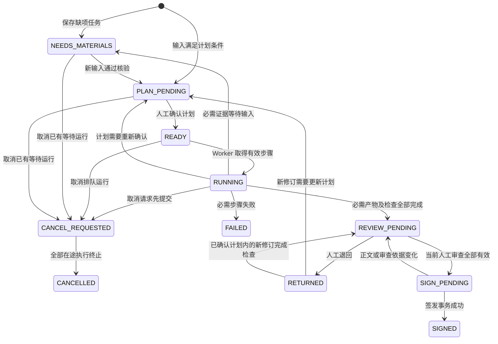
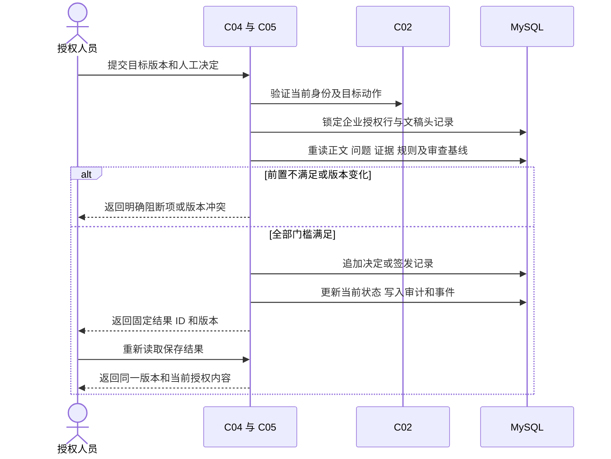
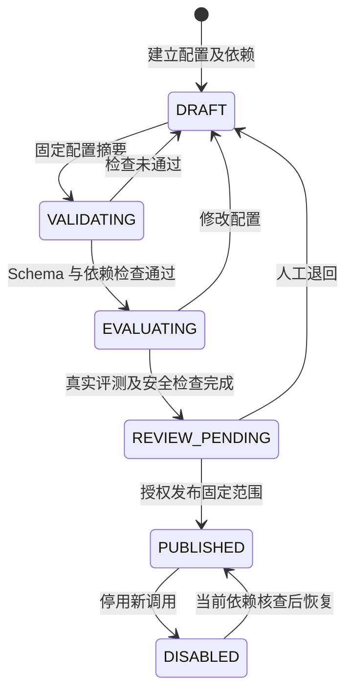
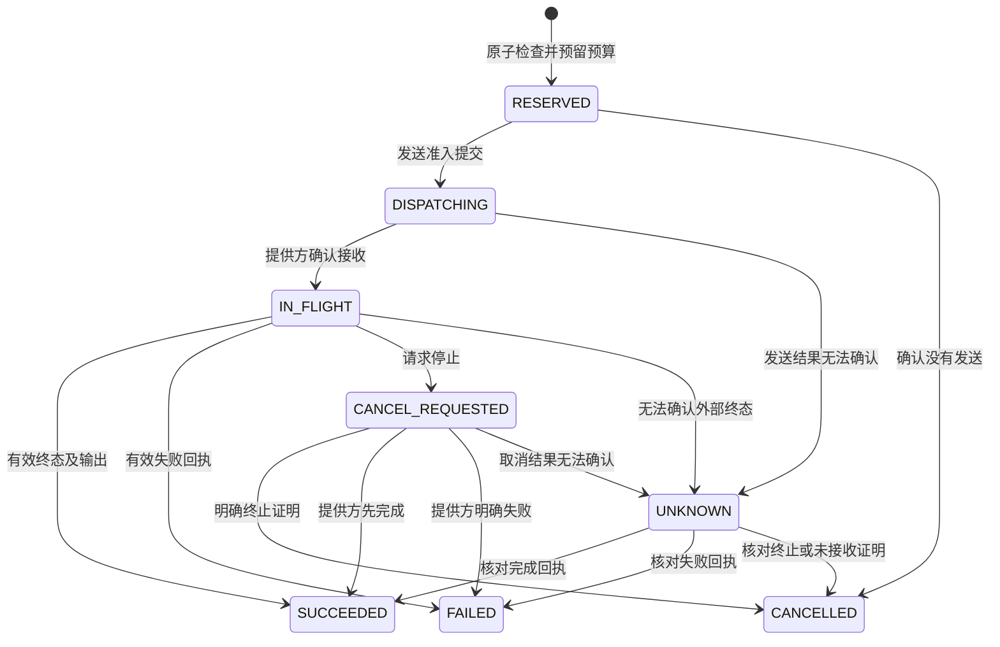

# 医疗器械企业 Agent 平台后端详细设计

版本：V1.1.0；日期：2026-09-30；状态：`DRAFT`；能力类型：`DESIGN`；任务：T06。需求基线为 PRD V1.3.0、HLD V1.2.0、LLD-数据 V1.0.0。本文及[接口补充设计](./backend-design/接口补充设计.md)共同维护 API、序列化、业务状态、权限检查、持久化、超时、失败处理和通知规范。正式服务、数据库事务、模型调用及业务验收均为 `NOT_RUN`。

## 1. 架构上下文与资产映射

### 1.1 依据与依赖

| 输入 | 本次承接内容 | 依赖状态与使用边界 |
| --- | --- | --- |
| [PRD.md](./PRD.md) | FR-01—FR-09、BR-01—BR-23、AC-01—AC-57、NFR-01—NFR-17 | `SATISFIED`：需求定义可用；业务批准和真实验收独立记录 |
| [HLD.md](./HLD.md) | C02—C12 职责、ADR-001—ADR-007、独立 SSO、Java/Python、Temporal、MySQL/Qdrant | `SATISFIED`：沿用架构提议及已确认语言、规模约束；兼容组合仍待运行验证 |
| [LLD-数据.md](./LLD-数据.md) | 企业复合身份、版本、来源定位、引用保护、治理水位和数据生命周期 | `SATISFIED`：数据语义由该文件维护；本文补充后端物理映射和事务 |
| [core.sql](./data-design/core.sql)、[dataset.schema.json](./data-design/dataset.schema.json) | 18 张核心表；`EvidenceRef` 与七种定位结构 | `SATISFIED`：原列名、类型、空值和枚举保持；生产迁移尚未执行 |
| [交互原型说明.md](./交互原型说明.md)、[文档阅读设计](./ui-delivery/document-reading-design.md)、[目标产品设计](./ui-delivery/final-product-design.md) | 页面动作、资料管理、Gru、正文、标注和审查 | `SATISFIED`：S09 编辑、S11 只读；页面展示状态不构成服务执行证据 |
| [LLD-Agent](./LLD-Agent.md) | Python Activity、DeepSeek Harness、工具选择、条件路由、上下文组织 | `SATISFIED`：专业设计可用；内部算法由 T07 维护，业务接口由本文及补充设计维护；运行验证 NOT_RUN |
| 正式工程、身份服务、模型和客户资料 | 框架版本、服务身份、真实业务输入及运行环境 | `PENDING`：仅阻断集成、性能和业务验收；具体条件见 §8.4 |

来源法规的适用边界继承 PRD，不增加法规有效性及逐产品适用性结论。企业账户规模为 100～500 人；同时在线、模型并发和 QPS 分别测量。

### 1.2 模块所有权与调用方向

| 模块 | 维护内容 | 调用方与限制 |
| --- | --- | --- |
| C02 IdentityPolicy | 身份映射、企业成员、项目动作授权、运行身份、授权水位 | 所有入口执行；SSO 负责认证，应用负责业务授权 |
| C03 Knowledge | 上传、来源、解析清单、索引、资料集、模板、规则、核准及来源关系 | 浏览器与受限 Worker；Qdrant 访问只经 C03 |
| C04 TaskDocument | 项目属性、任务修订、计划、运行、步骤、正文、共享事实、Gru 与候选 | C11/C12 通过内部接口提交；人工正文通过显式采纳更新 |
| C05 ReviewIssue | 问题、标注、独立检查、人工决定、签发 | 有效人工身份执行确认和签发；Agent 无签发入口 |
| C06 CapabilityRegistry | Agent、角色、Skill、工具、Prompt、场景及模型配置版本 | 管理人员发布；新运行固定依赖清单 |
| C07 ModelGateway | 发送准入、费用预留、调用回执与结算 | Python 模型适配入口读取秘密；浏览器及专业 Worker 不取得密钥 |
| C08 EvaluationAudit | 评测、评分、运营读模型和审计 | 报表权限独立于原文权限；统计保留分母及证据 |
| C09 DocumentWorker | 解析及转换过程、处理产物 | 受限对象读取及提交结果；无业务库写入权限 |
| C10 Connector | 外部连接、映射、验证、游标和同步结果 | 只产生候选资料；客户 B/S 接口未提供时保持 `BLOCKED` |
| C11 Workflow | Temporal Java Workflow、派发、等待、取消和历史 | 业务事实经 C04 保存；不在 Workflow 中直接访问数据库或模型 |
| C12 AgentWorker | Python Activity 中的专业处理 | 只接收本步骤的任务身份、固定清单和受限工具 |

C02—C08、C10 为一个 Spring Boot 模块化业务服务，使用同一业务事务管理器。C11、C12、C09 分别部署。入口使用现有 HLD 的 HTTPS 接入和 Spring Security，不新增独立业务网关产品。Redis 保存会话及可重建缓存；MySQL 为权限、版本、预算及状态的依据。

### 1.3 需求与页面对应

| 后端承诺 | 页面 | 接口组 | 需求与验收 |
| --- | --- | --- | --- |
| BACK-01 身份、企业和项目授权 | S02/S03/S16/S17/S18 | ID、PJ | FR-01、FR-08；AC-01、AC-02、AC-16、AC-17 |
| BACK-02 资料处理、核准、检索和生命周期 | S04/S05/S18 | KN、TP | FR-03；AC-05、AC-06、AC-29—AC-36、AC-50、AC-57 |
| BACK-03 任务、计划、运行、补证、恢复和取消 | S01/S06/S07/S09 | TK、RN、IN | FR-04、FR-09；AC-07、AC-08、AC-18—AC-24、AC-37—AC-41、AC-44 |
| BACK-04 正文、事实、检查、审查、签发和导出 | S09/S11 | DC、RV、EX | FR-05；AC-09—AC-11、AC-25、AC-42、AC-45—AC-56 |
| BACK-05 配置发布、逐动作授权、预算和调用 | S13、内部 Worker | CP、MD、IN | FR-02、FR-07；AC-03、AC-04、AC-14、AC-15、AC-26—AC-28 |
| BACK-06 会话、建议和习惯 | Gru | GR | BR-18；AC-34、AC-38、AC-40、AC-43 |
| BACK-07 评测、运营、反馈与审计 | S15 | EV | FR-06；AC-12、AC-13；NFR-06 |

### 1.4 当前设计决定

| decision_id | 来源与状态 | 决定、理由及影响 | 重新核查条件 |
| --- | --- | --- | --- |
| BACK-D01 | HLD ADR-004/006/007；语言、系统独立用户和登录为已确认约束；本地身份决定 BACK-LOCAL-01 为 CONFIRMED | 保持模块化 Java 业务服务、Python Activity、MySQL、Qdrant、Temporal；权限及事务集中执行；本地配置使用系统账户与服务端会话 | 正式工程、身份模式及依赖版本变化时完成兼容验证 |
| BACK-D02 | BR-02、BR-08、BR-17，`INFERRED/PROPOSED` | MySQL 唯一键、CAS、事务内 Outbox 和逐动作回执处理重复；所有有副作用的外部发送按调用身份核对 | 供应商幂等、查询或取消能力发生变化 |
| BACK-D03 | 数据设计 §4.5，`INFERRED/PROPOSED` | 企业授权行协调撤权、准入与签发；大文件按分段准入读取 | 真实并发测量显示企业授权行等待影响批准 SLO |
| BACK-D04 | 本文设计，`INFERRED/PROPOSED` | §4.1、§6.1 给出明确的服务时限与有限重试提议；业务预算及容量上限必须由发布配置提供 | 模型、文件、网络及环境测量改变参数依据 |

## 2. 身份、权限与写入控制

### 2.1 登录、会话和工作身份

本地运行采用系统独立用户和登录，具体账户、密码、首次管理员、会话绑定及状态要求由接口补充设计 §4.4 / BACK-LOCAL-01 维护。medical.identity.mode 显式选择 local/oidc，local 不依赖外部 SSO 配置。启用 OIDC 时使用 HLD 指定的 Authorization Code + PKCE、state、nonce 与固定回调；Spring Security 验证发行者、签名、受众、有效期及回调关联，C02 用 issuer/sub 查找身份。企业管理员通过已批准成员邀请授予企业角色，项目负责人授予项目及动作。邀请接受核对预绑定身份或经身份组件验证的收件身份，不能仅依据请求中的邮箱加入企业。

应用会话 Cookie 设置 HttpOnly 和适配登录模式的 SameSite；生产 HTTPS 使用 Secure，本地 loopback HTTP 的配置见补充设计 §4.4。OIDC 访问及刷新令牌仅在服务端受保护会话保存。所有浏览器变更请求核验 CSRF 与 Origin。企业切换创建新的 context_revision，后续请求携带 X-Context-Revision，与会话绑定企业不符时返回 CONTEXT_CHANGED。旧页面及 SSE 不得继续输出原企业内容；不同标签页必须重新取得当前上下文。

注销立即在主数据库撤销应用会话，再清除服务端会话。启用 OIDC 时独立记录外部注销结果；外部注销未确认时不能显示 SSO 全局注销成功，Back-Channel Logout 校验事件、签名及 sid/sub，并撤销关联会话和保存去重回执。账号禁用及企业成员停用更新主库当前授权；后台运行每次重新检查发起人有效状态。

内部调用采用私有网络、mTLS 服务身份和短期任务令牌。令牌由 C02 签发，默认有效期提议为 5 分钟；包含 `tenant_id/project_id/initiator_id/run_id/step_id/action_scope/audience/jti/auth_epoch`。续期须重新核查当前授权。服务身份可提交原调用终态回执；提交回执不授予已撤权用户读取内容的权限。没有合法运行归属的回执拒绝。

#### 当前服务信任配置

BACK-CURRENT-SERVICE-TRUST-01为已授权C02常规实施选择，INFERRED/CONFIRMED，关联IMP-04/08/13/38。ServiceCertificateTrustStore在启动及每次认证时读取明确操作系统所有者、0700目录、固定trust.json与0600文件；最大配置字节数由部署明确提供，没有默认容量。JNR POSIX 3.2.4、JNR FFI 2.3.3及系统原生openat/fstat负责文件操作和成熟文件属性读取，缺少原生功能立即拒绝。通过已打开目录执行O_NOFOLLOW/O_CLOEXEC相对文件读取，O_NONBLOCK保证特殊文件立即进入类型拒绝；核验路径、设备及inode、UID、权限、单一文件链接、容量及读取前后的纳秒mtime/ctime，并重新打开当前文件名核验身份。配置变化或读取失败立即报告，不采用缓存内容。

封闭字段由business/medical-identity/src/main/resources/service-certificate-trust.schema.json唯一维护：schema_version=1.0.0、UUID revision、authorities和revocations的完整Base64 DER、registered_certificates的绝对URI到证书SHA-256集合、TLSv1.3 protocols及批准的TLSv1.3 ciphers。Jackson/networknt拒绝重复字段、未知字段、尾随JSON、非法类型与弱协议；JDK CertificateFactory读取DER，校验完整编码、CA资格与有效期、CRL签名/签发方/有效期及全部CA的CRL覆盖，登记摘要继续由ServiceCertificateIdentity逐次核查。每个CA使用唯一签发方身份及一份当前CRL；发布多个CA时分别提供完整覆盖。部署工具在同目录创建0600文件并执行ATOMIC_MOVE一次替换完整配置；必须同时发布CA、CRL、登记与修订，禁止分别更新。

ServiceCertificateIdentity.TrustSource明确传播IOException和GeneralSecurityException，返回的Verified仅证明服务证书身份。完整运行归属、当前发起人员授权、签名运行令牌、服务端配置管理、内部业务HTTP及Temporal消费者继续使用本节原要求。配置读取与真实Servlet的验证入口和当前结果由唯一docs/development/IMP-04.md维护，浏览器会话不能提供服务身份。

#### 当前签名运行令牌

BACK-RUN-TOKEN-SIGNATURE-01为已授权C02常规实施选择，INFERRED/CONFIRMED，唯一开发记录为docs/development/IMP-04.md。RunTokenSignature使用固定Nimbus9.37.4、Jackson和JDK，服务器Policy明确发行者、唯一受众、当前RSA公钥、最大原生命周期及最大UTF-8字节数；这些参数必须由完整发布配置提供。发行者使用绝对URI，RSA密钥至少2048位，期限必须是正整数秒，不采用提议期限作为生产默认值。JOSE头仅允许alg=RS256、typ=medical-run+jwt及kid，kid使用实际公钥SPKI的SHA-256；请求提供的密钥或网络地址不参与选择。

签名Claims必须完整包含iss/iat/exp/aud/jti/tenant_id/project_id/initiator_id/run_id/step_id/action_scope/auth_epoch。project_id/step_id允许002物理表定义的显式null，但字段不得省略；aud为唯一字符串，iat/exp为非负整数秒，UUID保持标准小写形式，auth_epoch为完整U64十进制字符串。action_scope为非空、无重复的明确动作名称，不允许通配符、控制字符或空白。Jackson拒绝重复字段、未知字段、尾随JSON与非法类型；实际RS256签名、当前密钥、明确发行者/受众和原期限共同验证，未来签发、已到期及超出原生命周期立即拒绝。Verified构造器私有，只保存不可修改的原Claims及原令牌SHA-256，返回身份前重新核查实际到期时间。

该组件只证明原签名和封闭字段。实际消费者必须继续读取当前受保护配置、核对持久principal_token/run_principal/execution_registry和服务身份，按照本节逐动作检查当前发起人授权；续期、合法终态回执和完整Temporal/Worker业务保持原要求。签名成功不能单独提供业务许可。

BACK-CURRENT-RUN-TOKEN-POLICY-01采用RunTokenPolicyStore与共享ProtectedConfigurationFile读取当前服务器配置。明确操作系统所有者、0700目录、固定run-token-policy.json、0600单一链接文件及配置字节容量共同提供，容量和令牌期限没有默认值。原openat/fstat、O_NOFOLLOW/O_NONBLOCK、设备/inode、权限、UID、容量及纳秒时间校验由ServiceCertificateTrustStore和RunTokenPolicyStore共同复用；格式或读取失败立即报告。

run-token-policy.schema.json唯一维护schema_version=1.0.0、UUID revision、绝对URI issuer、唯一非空audience、public_key_der_base64、正整数maximum_lifetime_seconds和maximum_token_bytes。Jackson/networknt处理封闭JSON与重复字段，JDK KeyFactory/X509EncodedKeySpec读取实际RSA公钥SPKI，完整DER与标准Base64必须往返一致。该公钥配置保持独立定义。read返回私有构造的Current，保存实际配置修订、原字节摘要与明确Policy；verify在原签名验证前后分别读取当前配置，任何修订或字节变化均拒绝，并在返回前核查原到期时间。发布通过同目录0600文件及ATOMIC_MOVE一次替换全部内容。该组件不授予mTLS服务身份、持久运行归属或业务授权，原终态回执和完整Worker要求继续保持。

RUN-TOKEN-SIGNING-KEY-01由RunTokenSigningKeyStore读取独立run-token-signing-key.json。封闭定义包含schema_version、配置revision、policy_revision、policy_sha256和private_key_der_base64；明确所有者、0700目录、0600单一链接文件及完整配置容量共同核查。成熟JDK KeyFactory/PKCS8EncodedKeySpec读取至少2048位的RSA CRT私钥，标准Base64及完整DER往返一致；从实际modulus/publicExponent生成公钥并与当前Policy完整SPKI比较。读取前后分别核查公钥Policy和私钥配置字节，修订、内容、权限或文件身份变化立即拒绝。

sign固定完整JSON快照，复用RunTokenSignature的封闭Claims、发行者、受众、U64、动作及时间验证，再由Nimbus生成RS256、medical-run+jwt和当前kid。原签名与当前Policy核验通过后重新读取全部配置并检查原到期时间，任何变化拒绝返回。私钥不通过公开Current访问器或toString输出。该密码组件不登记客户运行、principal_token或业务许可；C02生产签发必须继续在当前授权事务绑定真实run_principal/execution_registry、jti、租约、mTLS与完整动作准入，合法成功及续期由相应业务验收核查。

### 2.2 权限动作及数据范围

RUN-TOKEN-AUTHORITY-01在C02提供RunTokenAuthority及受保护配置绑定。唯一运行定义为run-token-authority.schema.json：ScopeManifest固定schema_version、tenant_id、project_id、initiator_id、run_id、execution_kind及明确resources；PrincipalManifest固定同一身份、principal_id、完整scope_sha256、services和permissions。每项Permission包含完整资源Scope、action和purpose；Service包含服务绝对URI和唯一audience。企业作业的project_id=null仍逐项限定真实资源；TASK必须绑定项目。RoleScope保存明确permissions，运行主体的全部许可需要同时包含于当前PUBLISHED的ROLE版本、原范围及当前人员授权。所有定义封闭，重复、未知字段、尾随JSON和非标准身份立即拒绝。

053为run_step追加lease_owner与lease_expires_at，为principal_token追加token_sha256、service_uri、policy_revision、policy_sha256和lease_generation。历史记录的新增字段保持null；新动作准入要求完整绑定。claimStep锁定原企业、人员、运行与步骤，核查有效角色及完整许可，按expectedRevision领取READY步骤或取得已到期RUNNING步骤的新代际。renewStep要求原签名令牌和当前租约，只延长同一代际。期限必须明确提供且不超过当前Policy允许的生命周期，没有默认值。领取和续租保存原审计与Outbox并重新读取。

issue依据登记mTLS服务、当前发起人员身份、成员、项目、运行、发布角色及明确动作许可签发，期限同时受当前Policy和步骤租约限制。原jti、Claims字段、原令牌摘要、当前完整Policy摘要、服务URI及租约代际共同保存到principal_token并重读。renew从原令牌读取固定身份与动作范围，重新核查全部当前许可，在同一事务保存新jti并撤销原jti；续期不能扩大范围。

execute核验真实Servlet服务证书、当前签名、持久令牌与运行清单、原角色、人员及当前资源/动作/用途许可、步骤租约和step_action_binding的输入/参数摘要、kind、tool_version及代际，然后在同一短事务调用业务模块。业务模块仍需核查实际对象、固定依赖和自己的状态转换；外部发送使用另行提交的发送准入与原回执流程。返回前再次核验当前配置、服务证书及期限。该入口服务新动作，合法终态回执使用原独立准入要求。

medical.run-authority.enabled=true时必须明确configuration-directory、configuration-owner和maximum-configuration-bytes，并在受保护目录提供trust.json、run-token-policy.json和run-token-signing-key.json。内部HTTP和正式RunActivities由BE-13及实际业务消费者连接，当前工程验证与未验收范围读取docs/development/RUN-TOKEN-AUTHORITY-01.md。

每次判定输入为 `subject,resource,action,scope,condition`，判定点为 C02 和对象所属业务模块。身份、动作、企业、项目、会话、资料分类、来源权利及派生内容依赖全部满足才 `ALLOW`；需要用户确认的操作返回 `ASK` 对应 `pending_action`；权限不足返回 `DENY`。用户确认不能扩大其已有权限。

| 动作 | 合法主体与前置 | 资源范围及条件 | 判定与审计 |
| --- | --- | --- | --- |
| `member.manage/project.grant` | 企业管理员；项目授权者必须具有授权范围 | 同企业；不得授予超出委派范围的角色 | C02；原授权、新授权、依据、操作者、`auth_epoch` |
| `project.create/profile.confirm` | 具有项目管理动作的注册或企业人员 | 真实企业；未知属性保留 `UNKNOWN` | C02/C04；属性版本及依据 |
| `source.read/source.write` | 获授权注册、研发或服务人员 | 企业公共、项目或会话归属；会话附件额外检查会话成员 | C02/C03；对象、读取目的和结果 |
| `source.approve/template.approve/rule.approve` | 有效人工知识审核岗位 | 完整处理、权利、生效和适用资料；按企业岗位分离策略核验 | C03；审核清单摘要、决定、理由和身份 |
| `task.create/task.run/plan.confirm` | 项目注册人员或明确获准服务人员 | 有效项目、当前发布能力、固定资料范围 | C04；计划、快照、预算和版本 |
| `document.edit/candidate.adopt` | 目标文档编辑人员 | 指定文档及章节；当前正文版本匹配；人工确认卡片有效 | C04；前后版本、候选及采纳范围 |
| `field.confirm/review.decide` | 指定技术核验或审查人员 | 本项目及所负责字段、章节；检查结果有效 | C05；事实、来源、问题和审查基线 |
| `document.sign` | 企业授权签发人员，真实会话身份 | 企业签发策略、再次身份核验、当前签发门槛全部满足 | C05；签发用途、正文哈希、策略及水位 |
| `artifact.export/artifact.read` | 文档导出及读取授权 | 当前原文授权及完整 `DependencyAccessSet` | C04/C09；清单、格式及下载范围 |
| `artifact.submit/source.share` | 源读取、目标写入、显式共享授权 | 同企业跨项目；上游限制保留，来源图可达原始证据 | C03；共享决定及来源边 |
| `model.configure/agent.publish` | 平台配置人员且企业已授予配置管理范围 | 仅配置元数据、秘密引用与获准评测；不自动获得项目原文 | C06/C07；依赖及评测摘要 |
| `model.send/tool.execute` | 绑定发起人的任务身份 | 用户授权、项目适用、能力范围、本次选择的交集；另查外发许可 | C02/C07；输入清单、目标、实际发送与调用身份 |
| `audit.read/report.read` | 授权审计或报表人员 | 企业或项目范围；原始证据入口另行授权 | C08；查询范围和导出记录 |
| `source.purge` | 生命周期专门岗位 | 无引用保护、期限届满、无保留指令、所有存储清单已登记 | C03；删除项及逐项回执 |

项目 `PAUSED` 期间业务写入和新运行拒绝，允许授权查询、取消、调用核对及安全撤权；`ARCHIVED` 只允许授权查询和治理处理。项目恢复为 `ACTIVE` 要求当前授权、资料及配置重新核验。企业和平台管理权限均不隐含正文读取权限。

拒绝响应统一返回 `ACCESS_DENIED`，不提供目标名称、归属、数量或是否存在。请求者企业与资源所属企业的审计视图分别保存最少必要信息；目标企业的授权审计人员可见针对本企业的拒绝动作。日志不得写入请求正文、密钥或受保护摘录。

### 2.3 授权变化、治理变化与并发顺序

1. 撤权、停用用户和影响授权的成员变更在同一事务中锁定 `tenant` 行，修改授权并增加 `auth_epoch`。资料停用、权利变化和核准失效增加 `governance_epoch`。
2. 业务准入、读取受保护内容、正文采纳和签发在主库读取当前水位；需要与撤权确定先后时，对同一 `tenant` 行取得事务锁。固定顺序为企业、项目、运行、文档、预算、来源保护，多个同类对象按 UUID 排序。
3. 读取在准入时固定具体对象和读取范围；检索先取得允许 ID，返回前重新核验当前水位。水位变化返回 `SCOPE_STALE`，不发送已取得内容。下载分段、SSE 每次发送及缓存每次读取均重新准入。
4. 模型适配器在即将发送时调用 `begin-send`，原子核对取消、权限、依赖和预算并写入 `DISPATCHING`。此事务提交是发送准入顺序点。撤权后不得新增准入；此前准入的动作计为在途，尚未发送则请求终止，已发送则记录实际范围并请求供应商取消。
5. 异步失效事件处理缓存清理及影响提示；签发和受保护读取始终直接检查主库，不能等待事件消费才拒绝。不能保证收回撤权提交前已准入的网络发送。

数据访问统一使用 MyBatis-Plus `TenantLineInnerInterceptor` 和模块内项目/动作校验。企业来自已验证上下文；原生 SQL、关联、批处理及后台维护同样必须包含企业条件。上下文缺失、插件失败或授权服务不可验证时立即终止。API 不允许调用者覆盖资源真实归属。

### 2.4 幂等、CAS 和事务边界

所有变更接口要求 `Idempotency-Key`，长度 16～128 个 ASCII 字符；对可变对象还要求 `expected_revision`。正文 API 使用 `base_revision` 表示不可变正文 ID，并同时提交 `expected_revision` 表示当前头记录版本。幂等作用域为 `(tenant_id,subject_id,operation_id,key)`，上传每文件和批处理每项分别使用键。

请求摘要由固定序列化规范产生，包含路径、查询、Schema 版本、目标及请求体；正文对象使用其保存字节摘要。相同键、相同摘要返回原操作 ID 和原响应，不重复执行业务；当前权限仍需重新验证，已撤权时拒绝读取原响应。相同键、不同摘要返回 `IDEMPOTENCY_CONFLICT`。原请求处理中返回 202、同一操作 ID 和查询入口。

纯数据库变更将幂等记录、业务对象、引用保护、审计和 Outbox 一起提交。耗时操作先保存操作记录及命令，返回 202；Worker 分阶段保存回执。提交结果未知时客户端查询原操作，不创建新键重复提交。幂等记录按业务保存策略保留；有效业务记录仍存在时至少保留唯一请求身份和目标引用。

CAS 更新影响行数必须为一；零行返回 `REVISION_CONFLICT`，不覆盖正文。不可变修订先写受限对象并核对摘要，再在数据库事务中登记对象版本、正文、来源关系及当前指针。对象写入后数据库提交失败时对象处于未引用状态，只有批准的保存策略允许清理。事务内禁止等待模型、Qdrant、文件转换或用户输入。

## 3. 持久化与字段规范

### 3.1 既有 Schema 与跨语言映射

`data-design/core.sql` 是 18 张既有表的唯一 DDL 来源。本文不复制其定义。新增物理对象引用已有 `tenant/project/source_version/parse_version/scope_snapshot/document_revision/version_registry/outbox_event`，复合外键保留企业和适用项目身份，禁止级联删除历史资料。

| 数据字段 | MySQL | Java / Python | API 与消费方 | 映射和检查 |
| --- | --- | --- | --- | --- |
| 生产 ID | `CHAR(36) CHARACTER SET ascii` | UUID / UUID | 小写 UUID 字符串；所有模块 | 严格验证；`EvidenceRef` 原 Schema 保持，生产入口另检 UUID |
| `revision/auth_epoch/governance_epoch/sequence` | `BIGINT UNSIGNED` | BigInteger / int | 非负十进制字符串；前端不得转 Number | 不允许超出 MySQL 范围，不允许小数 |
| `source_version/parse_version/index_version` | 既有同名列与复合键 | 明确命名的 DTO 字段 | 同名字符串；C03/C12 | 不得将来源版本号、解析 ID 和对象版本互相替换 |
| `document_revision` | 既有 `CHAR(36)` | UUID / UUID | `document_revision`；S09/S11 | 与头记录计数 `revision` 分别使用 |
| 金额 | `DECIMAL(24,8)` | BigDecimal / Decimal | 十进制字符串和币种；C07/C08 | 固定价格版本；禁止浮点运算 |
| 测量值 | `DECIMAL(38,12)`，原字符串另存 | BigDecimal / Decimal | `raw_value/value/unit/model_ids/condition_id` | 超出精度立即拒绝；原精度与单位保留 |
| 时间 / 日期 | UTC `DATETIME(6)` / `DATE` | Instant / 带时区 datetime；LocalDate / date | UTC ISO 8601 / `YYYY-MM-DD` | 日期不补造时间；展示时区由前端转换 |
| 状态 | `VARCHAR(24)`，较长错误码为 `VARCHAR(64)` | 明确枚举 | 原英文枚举；前端映射中文 | 未知枚举返回 `SCHEMA_UNSUPPORTED`，禁止默认成功 |
| `EvidenceRef` | `evidence_link` 加来源定位关联 | JSON Schema 校验后的对象 | 数据 Schema `$defs.EvidenceRef`；来源阅读、Agent、导出 | 原字段及 `schema_version=1.0.0` 原样传输；七种定位用成熟库验证 |
| 大内容和清单 | 不可变对象版本、SHA-256，关系库保存引用 | ObjectRef | 授权 API 返回内容；无长期公开 URL | 哈希基于保存字节；跨语言不得重新序列化后猜测摘要 |

下列表定义使用类型缩写：`ID=CHAR(36) ascii`、`H=CHAR(64) ascii`、`U=BIGINT UNSIGNED`、`T=DATETIME(6)`、`J=JSON`、`S(n)=VARCHAR(n)`、`M=DECIMAL(24,8)`、`V=DECIMAL(38,12)`。这些仅为表格记法，生产迁移必须展开为 MySQL 类型。未标 `?` 的列均为 `NOT NULL`。新增企业业务表共同包含 `tenant_id:ID/created_by:ID/created_at:T/classification:S(24)`；可变表增加 `revision:U/updated_at:T`，版本表增加 `content_sha256:H`。JSON 列必须绑定 `schema_version` 及发布清单中的 Schema 摘要，禁止未经校验写入。平台认证目录按 §3.2 的独立身份范围维护。

所有新增企业业务表主键均包含 `tenant_id`；项目表包含 `project_id` 并引用 `project`。跨表业务版本引用必须关联 `version_registry` 及具体实体；登记行和实体在同事务产生。企业业务表格中的唯一键和索引自动包含企业，项目实体另含项目。`ObjectRef` 固定 `object_key:S(1024),object_version:S(256),sha256:H,size_bytes:U,media_type:S(128)`。

### 3.2 身份、控制与资料补充表

平台身份目录对应 HLD ADR-006 的首次认证及 `issuer + sub` 映射，保存于 `platform_identity`：`identity_id:ID` 为主键，另有 `issuer:S(512),subject:S(255),user_id:ID,status:S(24),created_by:ID,created_at:T,classification:S(24),revision:U,updated_at:T`。`(issuer,subject)` 全局唯一，原值使用 `utf8mb4_0900_bin` 保留大小写、字符及结尾空格；状态为 `ACTIVE/DISABLED`。首次真实认证生成平台身份和用户 UUID，初始 revision 为1，created_by 为对应用户；重复认证保留原 UUID、状态和版本。分类由批准配置提供。C02 只按已经验证的 OIDC 身份查询或登记本人记录，读取当前主数据库状态；企业成员、项目、权限及来源由后续企业业务表维护。平台目录使用专用身份查询入口，133张企业业务表的租户插件与授权规则保持完整；身份目录的数据库权利、账户停用和恢复需真实环境验收。

| 物理表与业务实体 | 主键之外的列 | 唯一键、索引、关联及责任 |
| --- | --- | --- |
| `identity_binding` | `identity_id:ID,issuer:S(512),subject:S(255),user_id:ID,status:S(24)` | 企业内 `(issuer,subject)` 唯一；平台身份目录另以同一组合唯一；C02，用户可有多个企业成员身份 |
| `tenant_member` | `member_id:ID,user_id:ID,status:S(24),valid_from:T,valid_to:T?` | `user_id` 唯一；状态索引；邀请、有效、停用分别为 `INVITED/ACTIVE/DISABLED` |
| `permission_grant` | `grant_id:ID,subject_id:ID,project_id:ID?,resource_kind:S(32),resource_id:ID?,action:S(64),condition:J,status:S(24),valid_from:T,valid_to:T?,basis_version:ID` | 主体/项目/状态索引；通配范围只可由批准授权记录表达；C02 |
| `run_principal` | `principal_id:ID,project_id:ID?,initiator_id:ID,run_id:ID,capability_manifest:J,status:S(24)` | 运行唯一；项目运行的项目 ID 必填，企业作业范围显式固定；令牌 `jti` 和撤销记录另存 `principal_token`；C02 |
| `operation_record` | `operation_id:ID,subject_id:ID,operation_name:S(64),idempotency_key:S(128),request_sha256:H,state:S(24),http_status:SMALLINT?,response_ref:J?,target_id:ID?,error_code:S(64)?` | `(subject_id,operation_name,idempotency_key)` 唯一；`PROCESSING/COMPLETED/FAILED`；响应范围重新授权 |
| `upload_item` | `upload_id:ID,batch_id:ID,project_id:ID,session_id:ID?,ownership:S(24),file_name:S(512),expected_size:U,received_size:U,expected_sha256:H?,actual_sha256:H?,object_ref:J?,status:S(24),expires_at:T` | 批次/状态索引；C03；最终哈希由服务端计算 |
| `source_upload_request` | `project_id:ID,upload_id:ID,operation_id:ID,source_id:ID?,version_intent:S(24),maintainer_id:ID,request_json:J,request_sha256:H,schema_ref:S(256),schema_document_sha256:H,authority_grant:ID,authority_revision:U,context_revision:U,auth_epoch:U,governance_epoch:U` | C03保存逐文件完整UploadCreate及声明；同企业上传、原操作、维护人员与授权外键；NEW_SOURCE无source_id，NEW_VERSION绑定原来源；声明保持待核验，不产生专业核准 |
| `upload_part` | `upload_id:ID,part_no:INT UNSIGNED,size_bytes:U,sha256:H,storage_receipt:J` | `(upload_id,part_no)` 唯一；同序号不同摘要拒绝；关联上传记录 |
| `processing_attempt` | `attempt_id:ID,project_id:ID,source_version:ID,parse_version:ID?,job_type:S(32),config_revision:ID,status:S(24),failure_manifest:J,run_id:ID` | 来源/阶段/时间索引；每次重新处理使用新解析身份 |
| `rights_revision` | `rights_revision:ID,source_version:ID,purpose:S(128),allowed_actions:J,providers:J,regions:J,valid_from:T?,valid_to:T?,status:S(24),evidence_manifest:J` | 引用来源；期限和状态索引；C03；补充既有来源权利列的关联约束 |
| `content_node` / `chunk_node` | 节点：`source_version:ID,parse_version:ID,node_id:ID,parent_id:ID?,ordinal:U,node_kind:S(32),locator:J,content_ref:J,node_hash:H`；关系：`chunk_id:ID,node_id:ID,range:J` | 节点主键含来源和解析；关系引用完整片段/节点复合键；C03 |
| `index_item` | `source_version:ID,parse_version:ID,index_version:ID,chunk_id:ID,point_id:ID,vector_sha256:H?,embedding_invocation_id:ID?,verified_at:T?,status:S(24)` | `(index_version,chunk_id)`、`point_id` 唯一；关联既有索引清单和片段 |
| `collection_head` / `collection_version` / `collection_member` | 头：`collection_id:ID,owner_project_id:ID?,title:S(256),current_version:ID`；版本：`collection_version:ID,collection_id:ID,purpose:S(512),manifest:J`；成员：`collection_version:ID,source_version:ID,parse_version:ID` | 头 CAS；版本只读；成员唯一并引用来源/解析；成员变化创建新版本 |
| `source_organization` / `source_folder` | 组织：`source_id:ID,folder_id:ID?,labels:J,maintainer_id:ID`；文件夹：`folder_id:ID,parent_id:ID?,owner_project_id:ID?,category:S(32),name:S(256)` | 同归属目录禁止循环；来源唯一；移动只改变组织位置 |
| `user_source_bookmark` / `source_read_history` | `user_id:ID,source_version:ID`；阅读记录另有 `last_read_at:T,locator:J` | 用户/来源唯一；受当前权限限制；C03 |
| `change_proposal` / `impact_manifest` | 提议：`proposal_id:ID,old_version:ID,new_version:ID,reason:TEXT,reviewer_id:ID,status:S(24)`；影响：`impact_id:ID,proposal_id:ID,governance_epoch:U,result_ref:J,complete:BOOLEAN` | 版本反向索引；超限时 `complete=false`；C03/C04 |

`source` 的会话归属补充 `source_session_binding(tenant_id,source_id,session_id)`，同事务验证项目与会话。去重使用 `source_dedup(tenant_id,ownership_scope_id,original_sha256,source_version)` 唯一键；`ownership_scope_id` 对应企业、项目或会话授权归属。命中对象仍须检查读取权限，不得通过摘要查询暴露受限对象。

### 3.3 项目、模板、任务与文档补充表

| 物理表 | 关键列 | 约束、查询及写入责任 |
| --- | --- | --- |
| `project_profile_revision` / `applicability_decision` | 属性：`project_id:ID,profile_revision:ID,attributes:J,authority_refs:J`；决定：`decision_id:ID,profile_revision:ID,target_version:ID,result:S(24),reason:TEXT,evidence_refs:J,actor_id:ID,decided_at:T` | 三态条件；项目/目标索引；C04；记录未知与不适用的完整理由 |
| `template_version` / `requirement_node` | 模板：`template_version:ID,document_type:S(64),application_path:S(32),status:S(24),basis_manifest:J,format_profile:J,condition_schema:J`；节点：`node_id:ID,template_version:ID,parent_id:ID?,official_number:S(64),title:S(512),ordinal:U,condition:J,required:BOOLEAN,content_mode:S(32),evidence_rule:J` | 模板内节点及官方编号唯一；父节点同模板；C03；十三种入口各有模板 |
| `field_definition` / `repeat_definition` / `rule_version` | 字段：`field_id:ID,template_version:ID,node_id:ID,value_type:S(32),constraints:J,condition:J,evidence_rule:J,output_mapping:J`；重复对象：`repeat_id:ID,template_version:ID,row_schema:J,min_count:U,max_count:U?`；规则：`rule_version:ID,engine_revision:S(128),expression:J,basis_manifest:J,status:S(24)` | 版本内唯一；规则引擎受限；未知产品数值不得设置默认值 |
| `task_head` / `task_revision` | 头：`project_id:ID,task_id:ID,status:S(24),current_revision:ID,owner_id:ID`；修订：`task_revision:ID,task_id:ID,profile_revision:ID,snapshot_id:ID,template_version:ID,agent_release_id:ID,plan_revision:ID?,parent_revision:ID?,reason:TEXT` | 头 CAS；修订固定依赖；项目/状态/更新时间索引；C04 |
| `plan_revision` / `plan_section` / `plan_dependency` | 计划：`plan_revision:ID,task_id:ID,snapshot_id:ID,status:S(24),decision_id:ID?`；章节：`section_id:ID,owner_id:ID?,goal:LONGTEXT,requirements:J,evidence_scope:J,method:S(24),position:U32`；依赖：`section_id:ID,depends_on:ID,position:U32` | plan_section_node保存每章全部节点，计划内节点唯一；依赖同计划且无环；`DRAFT/CONFIRMED/SUPERSEDED` |
| `research_question` / `pending_input` | 问题：`question_id:ID,plan_revision:ID,section_id:ID,question:TEXT,completion_rule:J,status:S(24),evidence_manifest:J`；输入：`input_id:ID,run_id:ID,target_revision:ID,content_ref:J,impact_id:ID?,decision_id:ID?,status:S(24)` | 问题为 `OPEN/WAITING_INPUT/ANSWERED/VERIFIED`；回答不自动成为核准事实；C04 |
| `execution_registry` / `system_job_run` | 登记：`run_id:ID,execution_kind:S(24),project_id:ID?,scope_manifest:J`；系统作业：`run_id:ID,job_type:S(32),initiator_id:ID,input_manifest:J,config_revision:ID,budget_revision:ID?,status:S(24),workflow_id:S(255),started_at:T?,ended_at:T?` | `TASK/SYSTEM_JOB` 明确区分；运行登记与具体运行同事务创建；收费作业预算必填；C04 与作业所属模块 |
| `task_run` / `run_step` | 运行：`run_id:ID,task_id:ID,task_revision:ID,attempt_no:U,parent_run_id:ID?,superseded_by_run_id:ID?,dispatch_closed_at:T?,workflow_id:S(255),status:S(24),reason_code:S(64)?,replay_manifest:J,budget_revision:ID,started_at:T?,ended_at:T?`；步骤：`step_id:ID,run_id:ID,role_version:ID,section_id:ID?,input_sha256:H,output_ref:J?,status:S(24),lease_generation:U` | 任务修订/尝试唯一；Workflow ID 企业内唯一；运行及步骤引用 execution_registry；步骤结果按输入和动作去重；C04 |
| `step_action_binding` | `run_id:ID,step_id:ID,action_id:ID,input_sha256:H,origin_run_id:ID,origin_step_id:ID,invocation_id:ID?,result_ref:J?` | 当前运行/步骤/动作唯一；跨尝试引用原动作及真实回执；复用前检查输入摘要和全部依赖；不重复结算 |
| `document_head` / `document_revision_meta` | 头：`project_id:ID,document_id:ID,current_document_revision:ID?,task_id:ID,status:S(24)`；元数据：`document_revision:ID,based_on_document_revision:ID?,body_object_version:S(256),schema_revision:S(64),plan_revision:ID,template_version:ID,issue_watermark:U,dependency_access_set_id:ID` | 既有 `document_revision` 保存正文；头 CAS；元数据一对一关联；C04 |
| `section_revision` / `document_section` | 章节：`section_revision:ID,section_id:ID,body_ref:J,evidence_manifest:J,status:S(24)`；文档映射：`document_revision:ID,section_id:ID,section_revision:ID,ordinal:U` | 不变章节复用原章节版本；固定文档映射；C04 |
| `document_node` / `field_value` | 节点：`document_revision:ID,node_id:ID,node_kind:S(32),parent_id:ID?,ordinal:U,node_sha256:H`；字段：`document_revision:ID,field_id:ID,row_id:ID?,node_id:ID,value_json:J,raw_value:TEXT?,status:S(24),source_refs:J,fact_version:ID?,model_ids:J,condition_id:ID?,empty_reason:S(64)?` | 正文为统一主记录，字段为同版本投影；字段/重复行非空规范键唯一；C04 |
| `shared_fact_version` / `fact_usage` | 事实：`fact_version:ID,fact_key:S(128),raw_value:TEXT,value:V?,unit:S(64)?,model_ids:J,condition_id:ID?,evidence_manifest:J,verifier_id:ID,status:S(24)`；使用：`usage_id:ID,fact_version:ID,document_revision:ID,node_id:ID,field_id:ID?,row_id:ID?` | 项目事实/版本唯一；事实与文稿双向索引；新事实产生完整影响清单 |
| `metric` / `method` / `metric_method_coverage` | 指标：`metric_id:ID,document_revision:ID,number:S(64),requirement:J`；方法：`method_id:ID,document_revision:ID,number:S(64),procedure_ref:J,basis_refs:J`；覆盖：`metric_id:ID,model_id:ID,condition_id:ID,method_id:ID,evidence_refs:J` | 文稿内指标×型号×条件×方法唯一；全部身份同项目/文稿；C04/C05 |
| `attachment_binding` / `artifact` | 附件：`binding_id:ID,document_revision:ID,node_id:ID,source_version:ID,evidence_kind:S(32),verification_revision:ID?`；成果：`artifact_id:ID,run_id:ID?,document_revision:ID?,artifact_kind:S(32),object_ref:J,dependency_access_set_id:ID` | 真实证明只关联原件；格式和引用保护逐项检查；C03/C04 |

### 3.4 审查、能力、调用与治理补充表

| 物理表 | 关键列 | 约束、查询及责任 |
| --- | --- | --- |
| `candidate` / `candidate_adoption` | 候选：`candidate_id:ID,run_id:ID,step_id:ID,base_document_revision:ID,input_sha256:H,content_ref:J,evidence_refs:J,status:S(24)`；采纳：`adoption_id:ID,candidate_id:ID,selected_nodes:J,result_document_revision:ID,actor_id:ID` | `READY/ADOPTED/REJECTED/STALE`；相同采纳请求唯一；C04 |
| `check_run` / `issue` | 检查：`check_id:ID,document_revision:ID,rule_manifest:J,input_watermarks:J,status:S(24),result_ref:J?`；问题：`issue_id:ID,check_id:ID?,document_revision:ID,position:J,severity:S(24),code:S(64),status:S(24),assignee_id:ID?,resolution_ref:J?` | `OPEN/IN_PROGRESS/RESOLVED/REOPENED`；解决需复核依据；文稿/状态/等级索引；C05 |
| `annotation` / `annotation_reply` | 标注：`annotation_id:ID,document_revision:ID,node_id:ID,selection:J,quoted_sha256:H,status:S(24),content:TEXT`；回复：`reply_id:ID,annotation_id:ID,content:TEXT,actor_id:ID` | `OPEN/RESOLVED/REANCHOR_REQUIRED`；文本改变不自动迁移确认；C05 |
| `review_decision` / `review_invalidation` | 决定：`review_id:ID,document_revision:ID,section_revision:ID?,decision:S(24),baseline_manifest:J,actor_id:ID,reason:TEXT,decided_at:T`；失效：`invalidation_id:ID,review_id:ID,trigger_version:ID,reason_code:S(64)` | 决定追加；当前有效性由基线及失效记录判定；C05 |
| `signature_record` | `signature_id:ID,document_revision:ID,purpose:S(64),signer_id:ID,policy_revision:ID,manifest:J,manifest_sha256:H,auth_epoch:U,governance_epoch:U,signed_at:T` | `(project_id,document_revision,purpose)` 唯一；固定正文和全部审查依据；C05 |
| `export_manifest` / `export_item` | 清单：`export_id:ID,document_revision:ID,purpose:S(32),manifest:J,status:S(24)`；格式：`export_item_id:ID,export_id:ID,format:S(16),attempt_no:U,status:S(24),object_ref:J?,validation_ref:J?,converter_revision:S(128),font_manifest_sha256:H` | 格式/尝试唯一；成功对象不可覆盖；C09 经 C04 保存 |
| `agent_version` / `capability_version` / `model_config_revision` | Agent：`agent_version_id:ID,agent_id:ID,name:S(100),status:S(24),dependency_manifest:J,limits:J,evaluation_id:ID?`；能力：`capability_version:ID,kind:S(24),input_schema_ref:J,output_schema_ref:J,tool_scope:J,artifact_digest:H,status:S(24)`；模型：`model_config_revision:ID,provider:S(128),base_url:S(2048),model_id:S(256),model_version:S(256),auth_ref:S(512),limits:J,price_version:ID,data_policy:J,status:S(24)` | Agent 名称企业内唯一；能力类型 `ROLE/SKILL/TOOL/PROMPT/SCENARIO`；秘密只保存引用；C06/C07 |
| `release_record` / `release_scope` / `connection_verification` | 发布：`release_id:ID,agent_version_id:ID,manifest_sha256:H,approved_by:ID,released_at:T`；范围：`release_id:ID,project_id:ID?,audience_manifest:J,status:S(24)`；验证：`verification_id:ID,config_revision:ID,credential_revision:S(128),status:S(24),receipt_ref:J?,verified_at:T?` | 发布版本只读；范围更改形成新记录；真实连接回执必需；C06 |
| `budget_account` / `budget_revision` / `budget_reservation` | 账户：`budget_id:ID,project_id:ID?,currency:CHAR(3),spent:M,reserved:M`；批准：`budget_revision:ID,budget_id:ID,limits:J,approver_id:ID,reason:TEXT`；预留：`reservation_id:ID,invocation_id:ID,budget_id:ID,upper_amount:M,upper_tokens:U,status:S(24)` | 调用/账户唯一；`RESERVED/SETTLED/RELEASED/DISPUTED`；企业和父运行预算同事务；C07 |
| `invocation` / `invocation_receipt` | 调用：`invocation_id:ID,run_id:ID,step_id:ID,action_id:ID,config_revision:ID,context_manifest_id:ID,status:S(24),settlement_status:S(24),provider_request_id:S(256)?,dispatch_generation:U`；回执：`receipt_id:ID,invocation_id:ID,kind:S(32),receipt_ref:J,received_at:T` | `(run_id,step_id,action_id)` 唯一；引用 execution_registry 及对应步骤；回执追加；供应商无请求 ID 时保持空值；C07 |
| `context_manifest` / `dependency_access_set` / `dependency_access_member` | 内容：`context_manifest_id:ID,exact_input_ref:J,source_manifest:J,prompt_revision:ID,tokenizer_revision:S(128),token_count:U`；依赖：`access_set_id:ID,manifest_sha256:H`；成员：`access_set_id:ID,upstream_version_id:ID,rights_revision:ID` | 所有候选、摘要、正文、导出均关联依赖集合；没有清单拒绝输出 |
| `conversation` / `conversation_message` / `pending_action` | 会话：`conversation_id:ID,project_id:ID,owner_id:ID,document_id:ID?,status:S(24)`；消息：`message_id:ID,conversation_id:ID,scope_snapshot_id:ID,document_revision:ID?,selection:J?,content_ref:J,run_id:ID?`；动作：`action_id:ID,target:J,arguments_sha256:H,expected_revision:U,status:S(24),expires_at:T,decision_id:ID?` | 消息身份唯一；动作 `PENDING/CONFIRMED/REJECTED/EXPIRED/STALE`；C04 |
| `user_preference` / `task_summary` | 习惯：`preference_id:ID,user_id:ID,content:TEXT,status:S(24),disabled_at:T?`；摘要：`summary_id:ID,run_id:ID,source_message_ids:J,source_refs:J,content_ref:J,unresolved_items:J` | 个人习惯默认关闭自动学习；新执行不得读取已删除习惯；摘要不产生新事实 |
| `knowledge_submission` / `reference_hold` | 提交：`submission_id:ID,artifact_id:ID,target_source_version:ID,sharing_decision:ID,original_evidence:J,status:S(24)`；保护：`hold_id:ID,consumer_version_id:ID,upstream_version_id:ID,retain_until:T?,legal_hold:BOOLEAN` | 来源图检查与保护同事务；消费者/上游唯一；C03 |
| `deletion_job` / `deletion_item` | 作业：`deletion_id:ID,target_version:ID,policy_revision:ID,status:S(24)`；存储项：`item_id:ID,deletion_id:ID,store_kind:S(32),target_ref:J,status:S(24),receipt_ref:J?,backup_expiry:T?` | 作业/存储/目标摘要唯一；逐项重新查询；备份未处理时保持未完成 |
| `outbox_delivery` / `consumer_receipt` / `stream_event` | 投递：`event_id:ID,consumer_id:S(64),status:S(24),attempt_no:U,next_attempt_at:T,lease_owner:S(128)?,lease_until:T?,lease_generation:U,last_error:S(64)?`；回执：`event_id:ID,consumer_id:S(64),result_ref:J`；流：`event_id:ID,stream_id:ID,sequence:U,resource_revision:U,payload:J` | 投递和回执按事件/消费者唯一；流按流 ID/序号唯一；保留原 `outbox_event` |
| `audit_event` / `notification` | 审计：`audit_id:ID,subject_id:ID,action:S(64),resource_ref:J,result:S(24),reason_code:S(64)?,request_id:ID,trace_id:S(64)`；通知：`notification_id:ID,event_id:ID,recipient_id:ID,resource_ref:J,read_at:T?` | 事件/收件人唯一；通知只含安全摘要，打开对象再授权；C08 |
| `evaluation_batch` / `evaluation_score` / `feedback` | 批次：`evaluation_id:ID,sample_manifest:J,rule_revision:ID,release_candidates:J,status:S(24)`；评分：`score_id:ID,evaluation_id:ID,sample_id:ID,agent_version_id:ID,dimension:S(64),value:DECIMAL(7,4),evidence_ref:J,scorer_id:ID,supersedes:ID?`；反馈：`feedback_id:ID,target_version:ID,reason:TEXT,status:S(24),proposal_id:ID?` | 固定真实样本与规则；评分修订追加；没有样本显示 `INSUFFICIENT_EVIDENCE`；C08 |
| `connector_config` / `connector_cursor` / `sync_item` | 连接：`connector_id:ID,config_revision:ID,endpoint:S(2048),auth_ref:S(512),mapping_revision:ID,status:S(24)`；游标：`connector_id:ID,cursor_ref:J,last_receipt:J?`；同步项：`sync_id:ID,external_id:S(512),external_version:S(256),source_version:ID?,status:S(24),error_code:S(64)?` | 外部系统/外部 ID/版本唯一；成功保存资料后更新游标；C10 |

### 3.5 关键数据库操作

以下 SQL 定义事务内操作形态，命名参数由 MyBatis 参数绑定。`document_head` 是 §3.3 的新增头记录；正式迁移必须先创建它及对应复合外键。业务版本对象和头指针循环关联时，先创建允许空指针的头记录，再在同一事务建立修订并更新指针。

```sql
SELECT auth_epoch, governance_epoch
FROM tenant
WHERE tenant_id = :tenant_id
FOR UPDATE;

UPDATE document_head
SET current_document_revision = :new_document_revision,
    revision = revision + 1,
    updated_at = :now_utc
WHERE tenant_id = :tenant_id
  AND project_id = :project_id
  AND document_id = :document_id
  AND revision = :expected_revision
  AND current_document_revision = :base_revision
  AND status <> 'SIGNED';

SELECT budget_id, currency, spent, reserved
FROM budget_account
WHERE tenant_id = :tenant_id AND budget_id = :budget_id
FOR UPDATE;

UPDATE budget_account
SET reserved = reserved + :requested_upper_bound,
    revision = revision + 1,
    updated_at = :now_utc
WHERE tenant_id = :tenant_id AND budget_id = :budget_id
  AND currency = :currency
  AND spent + reserved + :requested_upper_bound <= :approved_limit;
```

授权行锁与预算锁只覆盖短事务。调用预算同时检查金额、Token、调用数、研究/修订轮数和截止时间；金额更新成功不代表其他限制通过。企业总预算和父运行预算都必须满足，子步骤不能创建独立额度绕过父预算。

索引采用实际查询条件：任务列表 `(tenant_id,project_id,status,updated_at,task_id)`；问题列表 `(tenant_id,project_id,document_revision,status,severity,issue_id)`；运行步骤 `(tenant_id,project_id,run_id,status,step_id)`；来源影响沿既有反向索引；投递扫描 `(status,next_attempt_at,lease_until)` 仅由专门系统派发账号执行。正式索引审批需要真实数据的查询计划、选择性、排序和写入成本；当前不增加业务表分区或读写分离。超过批准容量时优先按企业归档及固定范围查询，涉及物理分库须保持企业路由与历史引用身份并完成迁移验证。

### 3.6 向量、全文、对象和缓存

Qdrant 的 collection 按环境、Embedding 模型版本、维度及距离度量配置，维度由真实模型配置固定；HNSW 参数进入索引配置并经真实语料评测，未填写时禁止发布 DENSE/HYBRID 能力。Point ID 沿用 UUIDv5，Payload 沿用数据设计 §5.2 的 `tenant_id/source_owner_project_id/visibility_scope/source_id/source_version/parse_version/chunk_id/index_version/embedding_config_revision`。数据库列 `model_config_revision` 映射到 Payload `embedding_config_revision`，两者必须引用同一模型配置。

C03 用固定快照生成过滤条件，只取得候选 ID；主库再次核查权限、版本、治理状态后读取正文。MySQL FULLTEXT ngram、精确查询、Qdrant、关系查询各有指定模式。HYBRID 的任一必需通道失败即返回错误。向量全部逐项读取核对身份、维度和摘要后才发布 `READY`；清理失败不恢复使用权限。

SOURCE-EXACT-01提供独立审核入口，字段为MODEL、PTR_NUMBER、DOCUMENT_NUMBER、STANDARD_NUMBER和STANDARD_YEAR。SourceExactController/Service/Schema/Policy/Mapper核查当前人员、source.approve、来源与项目读取、ENTERPRISE_USE、解析/索引/人工核准/权利/适用版本；完整字段按原文Unicode位置、quote_hash和Locator摘要逐项核验。原值保持原字节，别名具有独立审查理由；同一原值的多个别名分别保存。source_exact_revision及item不可变，head使用原修订CAS；版本、来源关系、治理水位、会话上下文、原操作、审计和事件同事务保存后重读。

`POST /api/retrievals/exact`按明确字段、原查询摘要和CAST AS BINARY执行等值查询。候选使用当前字段head及实际READY索引，同片段的全部匹配字段合并保存。source_exact_query/hit固定请求、完整命中、字段版本、引用位置、原人员及数量/摘要；EXACT_RETRIEVAL和SOURCE_EXACT_REVISION具有实际领域资源映射，查询依赖登记来源关系和ReferenceHold。`GET /api/retrievals/exact/{id}`每次核验完整集合、全部字段投影、原文与位置、当前来源和适用许可，再返回指定页；超限拒绝完整响应。旧字段版本和原FULLTEXT查询保持独立身份。该入口purpose限定VERIFICATION；正式任务快照、固定检索策略、内部步骤身份和DENSE/HYBRID继续执行原要求。

FULLTEXT消费者由SourceIndexWorker、Access、Manifest、Policy、Configuration及Mapper承载。原source.index.requested事件及成功的PARSE_AND_INDEX作业固定来源、解析、原内容摘要、处理配置、索引配置、项目和发起人员；每个短事务复用SourceProcessingAccess核查当前账号、成员、来源/项目/配置许可、权利、生命周期及完整发布定义。source-index.schema.json限定原八项命令、完整逐片段清单、ToolScope及终态Receipt；该定义独立于原解析和上传Schema。索引发布配置必须明确FULLTEXT、MySQL ngram、实际ngram_token_size、SOURCE-NODE-CHUNKS-1、完整容量与执行期限，且输入/输出Schema、运行class及Mapper摘要共同匹配。

source_index_build固定原事件、SOURCE_INDEX_FULLTEXT消费者、原解析作业、权利、独立index_version、完整清单及摘要、开始时间、截止时间和回执；outbox_delivery维护owner、generation及revision。第一次领取创建BUILDING清单和INDEX_VERSION登记，后续领取继续原身份与期限，最多三次领取。实际S3固定解析对象、完整字节、原命令与回执、全部节点和片段、Locator、范围、原文/搜索文本摘要及物化记录逐项比较。完整IndexItem逐项保存并重新读取后，索引READY、构建结果、投递终态、consumer_receipt、治理水位、审计及事件共同提交。到期或领取达到上限保存FAILED及INDEX_LIMIT；旧代际拒绝提交。消费者不修改原解析、片段、人工核准或旧索引，没有Embedding发送。DENSE/HYBRID仍遵循完整向量及C07要求。LOCAL消费者默认关闭，合法客户许可及实际发布绑定缺少时不创建替代业务结果。

原件、解析包、正文、调用输入输出及导出均保存对象版本和 SHA-256。浏览器经业务代理上传下载，Worker 的短期对象权限限定对象、操作、容量及有效期。Redis 缓存键包含企业、主体、项目、授权和治理水位、输入及配置版本；命中后重新授权。来源图保存在 MySQL 的 `lineage_edge/fact_usage/evidence_link`，循环检查在同企业治理事务顺序内完成。

### 3.7 迁移与持久化验收

正式工程采用有版本和校验和的迁移工具维护：既有核心 DDL → 新增实体及索引 → 复合外键和状态约束 → 必要历史映射 → 消费方启用。具体 Flyway/Liquibase 选择随正式工程确认，禁止由 ORM 自动修改生产 Schema。迁移先检查源数据、对象版本、引用保护和备份；出现不匹配立即终止该批次。

每类写入完成后从新请求重新读取，核对正文与字段、来源、状态、审查失效、事件和查询可见性。已有记录迁移逐主键核对 ID、空值、枚举、精度、时间和摘要；不能把空表建表成功记为历史迁移通过。数据库恢复同时恢复对象、SSO、Temporal 及删除/撤权清单，重放治理事件并验证预算和历史签发后开放受保护入口。RTO/RPO 待批准。

## 4. 接口、流式协议与外部交互

### 4.1 统一传输、限流和错误结构

公开业务路径沿用 HLD `/api`，内部路径为 `/internal/v1`；Schema 版本为 1.0.0。既有 JSON 请求/响应携带 schema_version，GET 和二进制请求使用 X-Schema-Version；§4.11 补充接口严格采用 OpenAPI 指定的 Header 和正文字段，内部直接响应通过 Header 返回版本和追踪身份。需要不兼容结构时发布新主版本路径并保留旧运行的读取适配。所有接口具有表内固定 `operation_id`。请求使用 UTF-8 JSON，Jackson 与 Bean Validation 执行 Java 校验，Python 使用 Pydantic；拒绝未知请求字段。JSON Schema 和 DTO 必须验证数值、空值、枚举及七种定位。响应新增字段仅在消费者已声明可以忽略可选字段时允许；不能静默增加状态枚举。

成功响应为 `schema_version/request_id/data/resource_revision`；查询集合的 `data` 为 `items/page_info`。异步响应使用 HTTP 202，`data` 包含 `operation_id/resource_id/status/status_url`；只说明请求已被接收。创建实体返回 201，提交决定或更新完成返回 200。删除习惯等动作返回已持久化的停用结果，保留审计。

错误响应固定包含 HLD 的 `code/message/request_id/resource_revision/allowed_actions`，补充 `schema_version/retryable/operation_id/details`。`resource_revision` 只在对象可读时返回，其他情况为 null。`details` 仅包含安全的字段位置、阻断项和已有操作引用；内部错误保留独立受限诊断 ID。`allowed_actions` 是当前可用动作代码数组，不授予新权限。失败在发生位置抛出，框架边界仅负责错误映射和审计，不吞掉错误或提供替代成功内容。

服务入口按身份、企业及动作配置限流；请求上限提议：JSON 2 MiB，列表 `page_size=20`、范围 1～100；正文、文件和完整产物通过受限对象上传，API 仅提交对象引用。身份配置、文件大小、页数、解压后大小、单节点长度、检索 `top_k`、队列容量、RPM/TPM 和预算是必填发布配置，未知时阻止相关能力启用。跨域只允许登记的 Web Origin，内部接口拒绝浏览器 Cookie，浏览器路径拒绝内部任务令牌。

| 接口配置 | 超时提议 | 速率与并发提议 | 幂等与失败约定 |
| --- | --- | --- | --- |
| `Q` 普通读取 | 总计 10 秒 | 每用户 20 次/秒，突发 40；企业总额另配 | 无业务变更；客户端显式重试；当前权限每次检查 |
| `W` 同步变更 | 总计 10 秒，事务 3 秒、锁等待 2 秒 | 每用户 5 次/秒，突发 10 | 必需幂等键；更新必需 CAS；超时查询原操作 |
| `A` 长任务接收 | 接收 10 秒；执行按 §6.1 | 每用户每分钟 10 次接收；企业队列和预算另配 | 202；幂等创建操作和持久命令，禁止接收请求内执行模型 |
| `S` SSE | 心跳每 15 秒；无业务总时限 | 每会话最多 4 条连接；每连接有界输出缓冲 | 当前权限逐次检查；断线从游标恢复 |
| `B` 文件分段 | 每段 60 秒；最大 8 MiB | 每用户最多 2 个传输；企业带宽另配 | 上传序号与摘要去重；下载每段重新准入 |
| `I` 内部提交/读取 | 总计 10 秒；事务 3 秒 | 每运行和服务身份按发布并发配置 | 任务身份、操作回执和 lease generation 必需 |

这些数值为 `PROPOSED` 服务保护参数，尚无性能测量通过结论。业务配置可在有版本的运行策略中调整；必需业务上限不能用这些接入参数代替。统一错误 `RATE_LIMITED` 返回 429 和 `Retry-After`；已经持久接收的任务继续查询原 ID。

列表支持两种显式模式：`paging=PAGE&page&page_size` 返回同一授权范围的 `total`，供页面翻页；`paging=CURSOR&cursor&page_size` 返回 `next_cursor/has_more`，供事件及大集合。禁止同请求混用。游标由服务端成熟签名组件封装企业、主体、过滤摘要、排序末键和水位；过滤或权限改变返回 `CURSOR_INVALID`。排序字段使用固定允许清单并追加 ID，查询与计数采用同一授权条件。没有权限的对象不进入数量和聚合结果。

### 4.2 请求和响应类型

任务计划同路径GET返回当前维护计划与当前任务头修订，没有维护计划时data=null。GET plan-edit-basis需要当前plan.write，返回封闭Basis：当前企业/项目/任务与固定task_revision、snapshot_id、template_version、profile_revision、完整template_content、conditions和completion_rule_ids。编辑依据只读取当前核准模板、完整适用条件、正式来源及核准规则，记录不发生写入；初次人工计划可以据此建立全部目录章节，并保留未知条件。GET plan-operations使用原Idempotency-Key，仅查询本人同企业TK-03操作，重新读取原固定计划、当前权限及责任人员，再返回原完整响应；未登记返回data=null与当前任务修订。维护计划和原操作读取均无自动重试或状态轮询。页面保存后使用固定版本GET核验原内容，历史读取和当前编辑依据分别按各自许可和状态执行。

计划关系由`036-task-plan-relations.xml`追加八张表。plan_section_node、plan_section_rule、plan_question、plan_question_node、plan_question_rule和plan_question_dependency保存完整版本关系及顺序；research_question登记同一任务的稳定问题身份，完整question_key与UUID逐项比较。plan_question_node同时引用同一计划的问题章节和章节节点，问题依赖两端属于同一计划。TaskPlanProjection从全部关系恢复完整PlanCandidate并比较原内容；TaskPlanRelationStore核查Schema、任务归属、版本摘要、固定快照及创建元数据，保存与重读均使用当前主体授权。草稿维护使用TK-03的`plan.write`，确认使用`plan.confirm`，读取使用`task.read`；TenantScope登记两份新增Mapper的主体参数核查。

task_plan_head保存当前维护计划及CAS修订。TaskPlanWriteMapper要求任务头expected_revision与原计划base_version同时有效；确认在同一事务内建立新的task_revision和CONFIRMED plan_revision，完整复制固定输入和已检查的计划内容。task_plan_decision保存目标草稿及摘要、原任务修订、结果任务和计划、实际决定人、当前授权、原操作、请求及回执。CONFIRM建立新确认版本，RETURN保留原任务修订且不产生确认计划；旧输入与旧计划保持固定。计划只能引用自身的确认决定。版本引用必须保持无环：新确认计划引用目标草稿及固定输入，新任务修订可以引用该确认计划。公开Controller、完整准入、操作查询、事务审计和Outbox继续按TK-01—06及IMP-12贯通验收。

RETURN由TaskPlanReturnService使用EnterpriseAccess同一事务处理。task-plan-decision.schema.json封闭定义当前退回请求、21字段Baseline及Receipt，元数据身份绑定本Schema摘要、TaskInput和Permission身份；共享Catalogue保持原字节。Baseline固定企业、项目、任务输入修订、目标草稿及摘要、模板/属性/快照、输入/范围/缺项摘要、任务及计划头修订、当前上下文与授权水位，以及本次读取权限证明摘要。退回要求当前task.read及plan.confirm、同一当前DRAFT计划和NEEDS_MATERIALS或PLAN_PENDING状态；保持原任务输入、计划与任务状态，任务头CAS增加修订。完整决定、原操作、审计和Outbox在同一事务保存并重读；当前撤权阻止原回执读取。公开GET plan-decision-basis读取当前依据，GET plan-decision-operations以原Idempotency-Key读取本人原决定，没有记录时返回data=null。页面理由及完整依据只存在内存，原键与摘要保存在sessionStorage；恢复由用户明确触发，保存后重新读取原决定。CONFIRM继续建立新确认版本及完整发布准入，当前退回入口不产生确认或运行许可。

CONFIRM由TaskPlanConfirmationStore参加同一TK-04事务。GET plan-decision-basis使用X-Plan-Decision指定RETURN或CONFIRM，缺少Header时保持RETURN用途；非法值返回SCHEMA_INVALID。确认仅接受PLAN_PENDING、完整任务缺项集合、当前核准模板和全部适用条件、正式来源、当前任务/章节负责人及完整完成规则。TaskPlanReleaseAdmission由C06提供实际发布决定、当前启用、全部依赖、范围交集、检索和网络批准及模型连接资格；缺少消费者时返回DEPENDENCY_UNAVAILABLE，不创建业务记录。确认Baseline额外固定这些准入证明。确认在原任务基础上保存新task_revision和完整复制输入，创建CONFIRMED计划及全部关系，绑定实际决定和新任务；新计划lineage引用原固定输入，新任务lineage引用新确认计划。任务状态进入READY，两项头修订使用CAS更新。原键恢复核查原输入、结果任务摘要、实际确认计划和决定引用、审计及事件；历史恢复不授予新执行许可。页面保存后读取原决定及完整确认计划。

任务完整输入与计划内容按`032-task-plan-content.sql`追加版本保存。task_input_revision绑定原任务修订，保存完整规范Create、独立SourceScope、各自摘要、目标文档、原操作、真实负责人、权限依据和水位。plan_content_revision保存完整PlanCandidate及Schema身份；内容摘要与原plan_revision的企业、项目、任务、修订、模板和快照组成完整外键。base_version与base_version_sha256必须同时为空或同时具有值，非空基准绑定同一任务的原计划及摘要，禁止引用自身。计划原内容包含全部章节和问题依赖、question_key、负责人空值和待确认条件；草稿保存不能丢弃缺项。共享Schema与当前授权继续由原领域服务检查；数据库引用及结构不产生核准。公开保存、人工决定和后续运行按TK-01—06完整连接和验收。

任务创建与计划草稿输入的完整封闭定义维护在 [tasks.schema.json](./business/medical-persistence/src/main/resources/tasks.schema.json)，发布身份 `urn:medical:tasks:1.0.0`，文件摘要由共享 Catalogue 登记。Create 直接引用唯一 SourceScope 和模板 DocumentType；PlanVersionInput 直接引用唯一 PlanCandidate，携带任务头 expected_revision、固定 base_version、Schema 身份及理由。服务端使用现有 Jackson/networknt 和 TypedSchemaBindings 验证，不能由请求声明企业身份、任务状态或批准人员。TaskPlanPolicy 对固定模板完整集合、章节覆盖、研究问题归属、当前计划依赖与完成规则引用执行检查；JGraphT 分别判定章节和研究问题无环。负责人、待确认条件或完成规则缺项阻止确认；当前权限、正式来源、规则批准和负责人资格由实际领域服务继续核查。对应公开保存、决定和页面行为按 TK-01—06 及 IMP-12 完整实施与验收。

TK-01公开POST由TaskCreateService连接。创建使用当前task.create及task.read许可、ACTIVE项目、固定核准模板和完整适用条件、四种显式来源选择、实际PUBLISHED发布及当前发布范围。TaskCreateReleaseAdmission必须提供C06实际发布决定、全部当前依赖、来源交集、检索及网络批准、模型资格和完整输入缺项；缺少消费者时明确返回DEPENDENCY_UNAVAILABLE。原签发文稿继续修订的文稿保存未完成时同样明确拒绝，不建立部分任务。准入通过后，同一EnterpriseAccess事务保存ScopeSnapshotStore的完整快照、新任务头及修订、task_input_revision、lineage、原operation_record、task.created审计和Outbox，并重新读取验证。任务修订摘要绑定完整输入、范围、缺项、初始状态和固定版本；NEEDS_MATERIALS保留具体缺项，资料完整时为PLAN_PENDING。原操作GET `/api/projects/{projectId}/task-create-operations`由本人显式请求，相同请求POST或GET重读原201及TaskDetail；不存在返回200及data=null。历史恢复检查固定任务修订、原输入、快照、当前来源HISTORY许可、原审计及Outbox，不建立新的任务或执行许可。当前代码、验证范围及剩余功能由唯一[IMP-12](docs/development/IMP-12.md)维护。

TK-03的公开POST使用PlanVersionInput，返回201与完整固定PlanView；相同原操作返回原响应及原状态码。固定版本GET `/api/tasks/{id}/plan-revisions/{planRevision}`重新读取原内容和关系。PlanView由task-plan-view.schema.json的封闭View定义发布，保存tenant_id/project_id/task_id/task_revision/plan_revision/snapshot_id/template_version/profile_revision/status/content/content_sha256/current_plan_revision/current_plan_head_revision；content直接引用唯一PlanCandidate。任务头CAS修订使用Envelope.resource_revision，维护计划头单独使用current_plan_head_revision，两者不混用。任务当前修订、原草稿和全部请求参与幂等摘要；新草稿同步增加任务头与计划头修订。旧内容保持固定，固定版本读取按当前许可使用HISTORY读取正式来源的原快照，不因模板DISABLED而修改原计划内容；新草稿保存继续要求当前APPROVED模板、APPROVED规则和FORMAL来源。责任人员必须具有当前成员/身份资格及实际任务读取许可，尚未分配责任人员的空值可以保存到草稿。人工确认/退回、任务完整创建及页面写入由IMP-12继续实施。

接口表的 `{id}` 始终表示路径对应资源的生产 UUID。`Id`、`Revision`、`Money`、`Timestamp` 使用 §3.1 定义；`?` 表示可选，其他字段必填。既有变更请求继承 `schema_version`，可变对象继承 `expected_revision`；§4.11 补充接口按 OpenAPI 使用 X-Schema-Version 与其关闭额外属性的 DTO，内部响应封装规则见补充设计 §1。公开查询响应继承统一封装。`VersionInput` 是 `{base_version:Id?,schema_ref:固定Schema身份,content:该Schema限定对象,reason:非空文本}`，不接受自由结构。`DecisionInput` 是 `{target_revision:Id,decision:接口限定枚举,reason:非空文本,baseline_manifest:固定检查清单}`。业务对象输出只包含调用者有权限的定义字段和 `allowed_actions`。

任务创建的受控查询使用GET `/api/projects/{projectId}/task-creation-owners`、`task-creation-sources`和`task-creation-collections`。三项查询均要求当前项目读取、任务创建许可及ACTIVE项目，参数仅允许limit、after和dataset_watermark；limit为1—100，after必须携带原水位。责任人员复用当前成员、有效身份和项目任务读取许可；平台账号状态在原身份组件的同一事务核验，不修改企业Mapper保护。资料查询复用ScopeSelectionAuthority的当前完整正式候选，资料集查询核验固定内容、完整成员及当前正式来源资格。资料和资料集查询在当前依赖容量内计算完整授权集合摘要，超限明确拒绝；资料集source_scope_sha256绑定成员当前权利、解析、索引、核准、项目绑定及Gate修订。当前候选、身份或范围变化拒绝原水位，原集合以外的after返回CURSOR_INVALID。响应使用各自封闭Schema与原Envelope，resource_revision=null，保持no-store；任务保存时重新核验全部选择。

| 类型 | 完整业务字段及规则 |
| --- | --- |
| `TaskCreate` | `project_id,profile_revision,document_type,template_version,agent_release_id,scope_selection,owner_id,goal,based_on_document_revision?`；scope_selection 使用补充 Schema 的 SourceScope，网络开关及批准字段显式传输；空范围登记缺项，不能自动选择全部资料 |
| `TaskView` | `task_id,task_revision,project_id,status,plan_revision?,snapshot_id?,document_ids,owner_id,missing_requirements,waiting_reasons,active_run_ids,revision`；缺项含节点、字段、原因及可授权处理入口 |
| `RunCreate` | `task_revision,plan_revision,snapshot_id,budget_revision,expected_revision`；所有版本必须属于同一已确认任务修订 |
| `RunView` | `run_id,task_id,task_revision,status,reason_code?,steps,waiting_items,inflight_invocations,budget,started_at?,ended_at?,revision,event_cursor`；`budget` 分别表示已用、预留、批准限额及币种；未结算不填零费用 |
| `ContinuationInput` | `mode=RESUME/REEXECUTE_PINNED/RERUN_UPDATED,task_revision,plan_revision,snapshot_id,budget_revision,impact_confirmation_id?,reason`；返回新尝试或修订任务及原运行关联 |
| `RevisionInput` | `base_revision,expected_revision,body_artifact_id,body_sha256,body_schema_revision,reason`；节点、字段、EvidenceLink、FactUsage 从校验通过的 DocumentBody 读取；公开入口不接收对象存储地址；BX-03/04 完成受限上传 |
| `CandidateInput` | `run_id,step_id,action_id,input_sha256,snapshot_id,plan_revision,base_document_revision,target_sections,content_ref,evidence_refs,issue_proposals,lease_generation`；每项输出均有版本归属 |
| `Selection` | `document_revision,segments`；每项为 TEXT/IMAGE/TABLE 联合类型；TEXT 使用 node_id/node_sha256/start_cp/end_cp/quote_sha256；IMAGE 固定 artifact/hash；TABLE 固定行列单元格 ID/hash；完整结构与跨节点规则见共享 Schema |
| `ReviewInput` | `document_revision,section_revision?,decision=CONFIRM/RETURN,reason,check_ids,evidence_watermark,issue_watermark,assignee_id?`；退回要求责任人和位置；确认要求所有对应检查当前有效 |
| `SignatureInput` | `document_revision,expected_revision,purpose,plan_revision,review_ids,check_ids,issue_watermark,dependency_manifest_sha256,auth_epoch,governance_epoch,signing_policy_revision,reauthentication_ref`；客户端水位用于冲突检测，服务器重新计算门槛 |
| `ExportInput` | `document_revision,purpose=FORMAL_BODY/REVIEW_PACKAGE/INTERNAL_EXCHANGE,formats,template_version,review_manifest_sha256,format_profile_revision,channel_profile_revision?`；格式为 DOCX/PDF/MARKDOWN，Markdown 仅内部交换；正式正文和审查材料分别建立清单 |
| `SearchInput` | `query,snapshot_id,retrieval_profile_revision,purpose,cursor`；cursor 显式可空，后续页固定原查询及结果集合；模式从固定策略读取；结果为 `retrieval_id/status=FOUND/EMPTY/items/missing_requirements/manifest_sha256/coverage`，完整集合规则见补充设计 §3 |
| `SourceApprovalInput` | `parse_version,index_version,rights_revision,binding_revision?,reviewed_manifest_sha256,decision=APPROVE/RETURN/DISABLE,reason,expected_revision`；人工身份及适用门槛独立检查 |
| `UploadCreate` | `batch_id,project_id,ownership,session_id?,file_name,media_type,size_bytes,sha256?,source_id?,version_intent=NEW_SOURCE/NEW_VERSION,provenance,classification,rights_declaration`；同名不同内容必须明确意图 |
| `ObjectRef` | `object_key,object_version,sha256,size_bytes,media_type`；浏览器提交由上传服务签发的 `artifact_id`，服务端解析 ObjectRef；Worker 仅使用本任务签发的对象引用 |
| `StepEnvelope` | `schema_version,execution_kind,tenant_id,project_id,initiator_id,task_id,task_revision,run_id,step_id,role_version,snapshot_id,plan_revision,input_manifest_id,budget_revision,action_scope,lease_generation,deadline_at,trace_id`；TASK 的项目/任务/计划/快照必填；SYSTEM_JOB 没有对应对象时显式 null，另必填 `job_type/scope_manifest_id/config_revision`，收费作业预算必填；没有秘密、全文或语言对象序列化数据 |
| `StepResult` | `run_id,step_id,input_manifest_sha256,lease_generation,outcome=SUCCEEDED/WAITING_INPUT/FAILED/CANCELLED,artifact_ids,candidate_ids,invocation_ids,missing_requirements,error_code?`；取消须另有外部终止证明 |

RN-02的完整封闭输出由[run-view.schema.json](./business/medical-persistence/src/main/resources/run-view.schema.json)定义。Step保留step_id/role_version/section_id/status/lease_generation/revision；Waiting保留waiting_item_id/step_id/action_id/target_revision/reason_code/question/requirement_refs/allowed_resolution_actions/assignee_id/status/resolution_id/revision；Invocation保留invocation_id/step_id/action_id/status/settlement_status/currency/settled_amount/total_tokens/revision。Budget固定budget_id/budget_revision，spent/reserved读取该预算账户当前累计值，limit读取本次原批准，currency核验账户和批准相同。活动或尚未结算调用始终保留，未知金额和Token数量显式null。RunReadService在同一EnterpriseAccess事务按运行、任务、步骤、待办、调用、预算和stream读取；所有运行子资源写入参加原运行锁协调。event_cursor为当前持久事件ID，无事件时显式null；不以实时通知代替持久游标。当前实现和实际HTTP证据由[IMP-13](docs/development/IMP-13.md)维护。

`RunCreate` 的可校验 JSON Schema 如下；路径中的任务 ID、Schema 和数据库复合归属由业务校验补充。它是设计结构，未包含业务样本。

```json
{
  "$schema": "https://json-schema.org/draft/2020-12/schema",
  "title": "RunCreate",
  "type": "object",
  "additionalProperties": false,
  "required": ["schema_version", "task_revision", "plan_revision", "snapshot_id", "budget_revision", "expected_revision"],
  "properties": {
    "schema_version": {"const": "1.0.0"},
    "task_revision": {"type": "string", "format": "uuid"},
    "plan_revision": {"type": "string", "format": "uuid"},
    "snapshot_id": {"type": "string", "format": "uuid"},
    "budget_revision": {"type": "string", "format": "uuid"},
    "expected_revision": {"type": "string", "pattern": "^(0|[1-9][0-9]{0,19})$"}
  }
}
```

### 4.3 身份与项目接口

表内权限引用 §2.2，接口配置引用 §4.1；全部接口适用 §4.10 公共错误，表内补充业务错误。查询配置为 Q，同步变更 W，异步接收 A；内部接口 I。所有接口版本为 1.0.0。返回 `Operation` 表示 §4.1 的异步响应，后续通过操作和资源接口重新读取。

| operation_id / 调用方 | 方法与路径 | 输入 → 输出 | 权限、配置和特有错误 |
| --- | --- | --- | --- |
| ID-01 / 登录页面 | `GET /auth/login` | 固定已登记 return target → OIDC 重定向 | 无会话；Q；`IDENTITY_UNAVAILABLE` |
| ID-02 / OIDC | `GET /auth/callback` | code/state → 应用会话与受限返回路径 | Spring Security 校验；Q；`AUTHENTICATION_FAILED`；重复 code 不创建重复身份 |
| ID-03 / Web | `GET /api/session` | 无业务正文 → 用户、企业成员、当前上下文、CSRF、动作摘要 | 有效会话；Q；未加入企业时返回可接受邀请入口 |
| ID-04 / 企业选择器 | `POST /api/session/tenant-selections` | `tenant_id,expected_context_revision` → 新上下文和水位 | 有效企业成员；W；`CONTEXT_CHANGED` |
| ID-05 / Web | `POST /auth/logout` | CSRF → 本地撤销与外部注销状态 | 有效会话；W；会话撤销后同请求确认安全状态 |
| ID-06 / SSO | `POST /auth/backchannel-logout` | 标准 logout token → 协议应答 | 验证 token；按 token 身份去重；无浏览器 CSRF |
| ID-07 / 管理页 | `POST /api/member-invitations` | `identity_binding,roles,scope,expires_at,basis` → 邀请记录 | `member.manage`；W；重复成员 409；发送通知须部署批准的通知连接 |
| ID-08 / 被邀请人 | `POST /api/member-invitations/{id}/acceptances` | 已认证身份、邀请凭据 → 成员身份 | 身份与邀请匹配；W；过期或不匹配拒绝 |
| ID-09 / 管理页 | `POST /api/permission-decisions` | 主体、资源、动作、范围、`GRANT/REVOKE/DISABLE_MEMBER`、依据、版本 → 当前授权 | `project.grant/member.manage`；W；增加授权水位 |
| PJ-01 / S03 | `GET /api/projects` | 过滤及分页 → 项目列表 | 项目读取；Q |
| PJ-02 / S03 | `POST /api/projects` | 名称、负责人、属性和已有依据 → `PENDING` 项目 | `project.create`；W；不能推定未知产品属性 |
| PJ-03 / S18 | `GET /api/projects/{id}` | ID → 项目、阶段、待办、成员动作 | 项目读取；Q；子资源分别授权 |
| PJ-04 / S18 | `POST /api/projects/{id}/profile-revisions` | `VersionInput`，产品属性和证据 → 新属性及影响清单 | `profile.confirm`；W；`APPLICABILITY_UNKNOWN` |
| PJ-05 / S18 | `POST /api/projects/{id}/state-decisions` | `ACTIVATE/PAUSE/ARCHIVE/RESTORE`、理由、版本 → 当前项目 | 项目管理；W；运行影响明确返回 |
| PJ-06 / 工作台 | `GET /api/work-items` | 项目、责任人、状态及分页 → 待办列表 | 当前主体获准事项；Q；数量来自相同范围 |

### 4.4 资料、模板与检索接口

| operation_id / 调用方 | 方法与路径 | 输入 → 输出 | 权限、配置和特有错误 |
| --- | --- | --- | --- |
| KN-01 / S04、Gru | `POST /api/uploads` | `UploadCreate` → 上传 ID、分段限制及过期时间 | `source.write`；W；`FILE_TYPE_UNSUPPORTED/FILE_TOO_LARGE` |
| KN-02 / 上传器 | `PUT /api/uploads/{id}/parts/{part_no}` | 二进制、长度与摘要 → 分段回执 | 上传归属；B；`CONTENT_MISMATCH` |
| KN-03 / 上传器 | `POST /api/uploads/{id}/completions` | 分段清单及版本意图 → 接收结果、处理操作或可读重复版本 | `source.write`；A；空文件、扫描失败或格式错误分别拒绝 |
| KN-04 / 上传器 | `GET /api/uploads/{id}` | ID → 已接收分段、四类状态和失败项 | 上传归属；Q；支持断线后查询 |
| KN-04-STATUS / 上传器 | `GET /api/uploads/{uploadId}/status` | 原上传ID → 接收、传输、原操作结果、解析、索引、核准、当前权利及原作业失败信息 | 原上传当前授权、来源读取及固定身份；Q；完整集合超限拒绝 |
| KN-INDEX-STATUS / S04 | `GET /api/source-versions/{id}/index-builds?project_id={projectId}` | 固定来源及项目 → 全文构建、真实索引/投递状态、预期及核验数量、终态失败、开始及截止时间 | 当前来源元数据读取和项目读取；Q；完整集合容量明确，超限拒绝；不返回内部清单、对象位置或Worker身份 |
| KN-05 / S04 | `GET /api/source-versions` | 范围、状态、类别、标签、资料集及分页 → 来源列表 | `source.read`；Q；列表不隐含任务选择 |
| KN-06 / S05 | `GET /api/source-versions/{id}` | ID → 属性、处理版本、核准、权利和项目适用状态 | `source.read`；Q |
| KN-07 / S05 | `GET /api/source-versions/{id}/content` | 固定解析、locator、读取目的及范围 → 受限原文或分段内容 | `source.read`；B；`SOURCE_MISSING/CONTENT_MISMATCH/LOCATOR_INVALID` |
| KN-08 / S05 | `POST /api/source-versions/{id}/processing-attempts` | 处理配置、阶段和原因 → 新处理记录 | `source.write`；A；费用另经 C07；新解析 ID |
| KN-09 / S05 | `POST /api/source-versions/{id}/approval-decisions` | `SourceApprovalInput` → 决定与当前门槛 | `source.approve`；W；`SOURCE_NOT_READY/RIGHTS_PENDING` |
| KN-RIGHTS-PREVIEW / 审核人员 | `POST /api/source-versions/{id}/rights-reviews` | 完整决定及条件proposal → 当前权利、授权文件元数据及审查摘要 | 当前source.read/source.approve及适用project.read；SOURCE_RIGHTS_REVIEW；明确服务器政策 |
| KN-RIGHTS-01 / 审核人员 | `POST /api/source-versions/{id}/rights-decisions` | 原权利、expected_revision、审查摘要、理由和APPROVE/RETURN/REVOKE → 固定决定及权利版本 | 当前审批许可及真实授权文件完整字节；W/B；CAS及原响应重放 |
| KN-10 / S18 | `POST /api/projects/{id}/source-bindings` | 来源版本、适用决定、依据和属性版本 → 绑定版本 | 项目适用确认；W；未知条件保持待确认 |
| KN-11 / S04 | `POST /api/collections` | 归属、标题、用途和成员版本 → 集合及首个版本 | 资料集写入；W；每个成员检查来源读取 |
| KN-12 / S04 | `POST /api/collections/{id}/versions` | `VersionInput`，完整成员 → 新版本 | 资料集写入；W；旧任务成员不改变 |
| KN-13 / S04 | `GET /api/collections/{id}/versions` | 分页 → 历史成员及清单 | 资料集读取；Q；成员逐项授权 |
| KN-14 / S04、Worker | `POST /api/retrievals` | `SearchInput` → `Operation` | 正式或审核检索权限按 purpose；A；`SCOPE_STALE/RETRIEVAL_FAILED` |
| KN-15 / S04、Worker | `GET /api/retrievals/{id}` | ID → 固定证据包、结果或失败 | 检索归属与当前来源权限；Q |
| KN-16 / S05 | `GET /api/source-versions/{id}/usages` | 过滤及分页 → 可见使用关系和影响状态 | 来源维护及使用方读取；Q；无权对象不显示标题 |
| KN-17 / S05 | `POST /api/source-versions/{id}/lifecycle-decisions` | `DISABLE/RECYCLE/RESTORE/PURGE`、理由、策略、版本 → 当前状态或作业 | 对应维护/删除动作；W 或 PURGE=A；`REFERENCE_HELD/RETENTION_UNCONFIGURED` |
| KN-18 / S09、Gru | `POST /api/artifacts/{id}/source-submissions` | 目标归属、类别、标题、上游证据、共享依据、维护人 → 待核验来源 | 源读取、目标写入、共享；W；`LINEAGE_CYCLE/LINEAGE_REVIEW_REQUIRED` |
| KN-19 / 联网研究 | `POST /api/web-acquisitions` | 批准网址/域名、检索词版本、范围和用途 → 候选采集操作 | 联网及外发授权；A；`NETWORK_SCOPE_DENIED` |
| KN-20 / S04 | `POST /api/source-organization-decisions` | 逐项版本和 `MOVE/LABEL/BOOKMARK/UNBOOKMARK` → 逐项结果 | 对应维护或个人动作；W；批项独立幂等与事务 |
| KN-21 / S04 | `POST /api/source-folders` | 归属、父目录、类别、名称 → 文件夹 | 资料组织维护；W；相同范围、无环 |
| KN-22 / S04 | `POST /api/source-folders/{id}/decisions` | `RENAME/MOVE/DELETE`、目标、版本 → 当前结果 | 资料组织维护；W；非空文件夹删除返回 `FOLDER_NOT_EMPTY` |
| TP-01 / 模板中心 | `POST /api/template-versions` | `VersionInput`，目录、字段、重复行、条件、附件、版式和依据 → 草稿 | 模板维护；W；完整 Schema 校验 |
| TP-02 / 模板中心 | `POST /api/template-versions/{id}/approval-decisions` | `DecisionInput`，`APPROVE/RETURN/DISABLE` → 决定及状态 | `template.approve`；W；目录、证据和格式门槛 |
| TP-03 / 规则中心 | `POST /api/rule-versions` | `VersionInput`，受限表达式及依据 → 规则草稿 | 规则维护；W；禁止可执行代码 |
| TP-04 / 规则中心 | `POST /api/rule-versions/{id}/approval-decisions` | `DecisionInput` → 核准状态 | `rule.approve`；W；标准正文无授权时拒绝相应条款规则 |
| TP-05 / S07、S18 | `GET /api/projects/{id}/applicable-templates` | 文档类型、属性版本 → 核准且适用的模板和待确认条件 | 项目读取；Q；没有兼容模板明确返回缺项 |
| TP-06 / 法规影响 | `POST /api/change-proposals/{id}/decisions` | 决定、版本、影响清单摘要和理由 → 决定及修订入口 | 对应知识及项目动作；W；`IMPACT_INCOMPLETE` |

多文件操作返回每项 `item_id/operation_id/status/resource_id/error`，成功项不重新执行。来源核准前审核人员可读取未核准原件；正式检索与生成要求处理、核准、适用、权利和当前授权全部满足。`KN-14` 的 purpose 决定入口门槛，不允许通过填写审核用途取得新的权限。

### 4.5 任务、正文、审查与成果接口

| operation_id / 调用方 | 方法与路径 | 输入 → 输出 | 权限、配置和特有错误 |
| --- | --- | --- | --- |
| TK-01 / S07 | `POST /api/tasks` | `TaskCreate` → `TaskView` | `task.create`；W；缺资料可保存 `NEEDS_MATERIALS`，不兼容模板拒绝 |
| TK-02 / S06、S09 | `GET /api/tasks/{id}` | ID → `TaskView`、当前文档和运行引用 | 任务读取；Q |
| TK-03 / S07 | `POST /api/tasks/{id}/plan-revisions` | `VersionInput`，章节、问题、依赖和完成条件 → 计划草稿 | 计划维护；W；`PLAN_CYCLE` |
| TK-04 / S07 | `POST /api/tasks/{id}/plan-decisions` | 计划版本、`CONFIRM/RETURN`、理由 → 决定与任务状态 | `plan.confirm`；W；`PLAN_STALE` |
| TK-05 / S09 | `POST /api/tasks/{id}/input-proposals` | 新材料/要求、目标版本、理由 → 待处理输入和影响清单 | 任务协作；W；当前运行不自动吸收 |
| TK-06 / S09 | `POST /api/tasks/{id}/input-decisions` | 输入 ID、新快照、计划、影响确认、理由 → 新任务修订 | `plan.confirm`；W；`IMPACT_INCOMPLETE` |
| RN-01 / S07、S09 | `POST /api/tasks/{id}/runs` | `RunCreate` → `Operation`、`run_id` | `task.run`；A；`PLAN_UNCONFIRMED/BUDGET_EXCEEDED` |
| RN-02 / S09 | `GET /api/runs/{id}` | ID → `RunView` | 运行读取；Q |
| RN-03 / S09、Gru | `GET /api/runs/{id}/events` | 事件游标 → SSE | 运行读取；S；`CURSOR_EXPIRED` |
| RN-04 / S09 | `POST /api/runs/{id}/cancel-requests` | 原版本、理由、人工确认 → 取消申请与当前运行 | `task.run`；W；已终态返回原状态 |
| RN-05 / S09 | `POST /api/runs/{id}/continuations` | `ContinuationInput` → 新运行或修订任务 | `task.run`；A；`INVOCATION_UNKNOWN/MODEL_VERSION_UNAVAILABLE` |
| RN-06 / 授权预算人员 | `POST /api/runs/{id}/budget-decisions` | 新上限、币种、原因和版本 → 预算新批准版本 | 预算批准；W；不自动重启运行 |
| DC-01 / S09、S11 | `GET /api/documents/{id}` | `document_revision?` → 同版本正文、目录、字段状态及动作 | 文档及全部上游读取；Q/B；S11 无正文写入动作 |
| DC-02 / S09 | `POST /api/documents/{id}/revisions` | `RevisionInput` → 新修订、头记录版本、失效确认及影响 | `document.edit`；W；`REVISION_CONFLICT/DOCUMENT_SIGNED` |
| DC-03 / S09、Gru | `POST /api/candidates/{id}/adoptions` | 目标、基准版本、选择节点、用户确认、版本 → 新文稿及采纳记录 | `candidate.adopt`；W；`CANDIDATE_STALE` |
| DC-04 / S09 | `POST /api/projects/{id}/shared-fact-revisions` | 原始值、单位、型号、条件、权威来源和核验决定 → 新事实及影响 | 技术字段核验；W；不直接替换全部文稿 |
| DC-05 / S09 | `POST /api/documents/{id}/field-decisions` | 字段/行、`CONFIRM/NOT_APPLICABLE/REQUEST_EVIDENCE`、依据、当前版本 → 决定与字段状态 | `field.confirm`；W；`CONDITION_UNKNOWN/METHOD_COVERAGE_INCOMPLETE` |
| RV-01 / S09 | `POST /api/documents/{id}/checks` | 正文、规则、快照及检查范围 → 检查操作 | 检查动作；A；必需范围不可删减 |
| RV-02 / S09、S11 | `GET /api/documents/{id}/issues` | 正文版本、等级、状态、分页 → 问题及位置 | 文稿审查读取；Q |
| RV-03 / S09、S11 | `POST /api/issues/{id}/decisions` | `ASSIGN/RESOLVE/REOPEN`、责任人、处理依据、版本 → 问题状态 | 问题处理；W；解决需对应新检查证据 |
| RV-04 / S09、S11 | `POST /api/documents/{id}/annotations` | `Selection`、意见、正文版本 → 标注 | 文稿标注；W；新增未解决意见使总稿确认失效 |
| RV-05 / S11 | `POST /api/annotations/{id}/replies` | 意见和当前版本 → 回复 | 文稿标注；W；保留作者及时间 |
| RV-06 / S11 | `POST /api/annotations/{id}/decisions` | `RESOLVE/REOPEN/REANCHOR`、理由、位置证据、版本 → 标注状态 | 文稿审查；W；重新定位须人工确认 |
| RV-07 / S09、S11 | `POST /api/documents/{id}/review-decisions` | `ReviewInput` → 人工决定及任务状态 | `review.decide`；W；`REVIEW_STALE/BLOCKING_ISSUES` |
| RV-08 / S11 | `GET /api/documents/{id}/signing-readiness` | 正文版本 → 门槛明细、水位、策略及缺项 | 签发读取；Q；预检查不代替签发事务 |
| RV-09 / S11 | `POST /api/documents/{id}/signatures` | `SignatureInput` → 不可变签发记录 | `document.sign`；W；`SIGNING_POLICY_UNCONFIGURED/REVIEW_STALE` |
| EX-01 / 成果面板 | `POST /api/documents/{id}/exports` | `ExportInput` → 导出操作、清单和格式项 | `artifact.export`；A；`FORMAT_PROFILE_UNAPPROVED` |
| EX-02 / 成果面板 | `GET /api/exports/{id}` | ID → 清单、格式状态、核验结果及可下载项 | 成果及依赖读取；Q |
| EX-03 / 下载器 | `GET /api/export-items/{id}/content` | 固定项 ID、Range → 同一对象字节 | 导出下载；B；失败或未核验格式拒绝 |
| EX-04 / 成果面板 | `POST /api/export-items/{id}/attempts` | 原清单、理由 → 新尝试和新对象身份 | `artifact.export`；A；原成功记录不改变 |
| EX-05 / 历史视图 | `GET /api/documents/{id}/revisions` | 分页 → 历史版本、审查与签发引用 | 当前文档及来源读取；Q |

### 4.6 能力、Gru、评测与管理接口

| operation_id / 调用方 | 方法与路径 | 输入 → 输出 | 权限、配置和特有错误 |
| --- | --- | --- | --- |
| CP-01 / S13 | `POST /api/agent-versions` | `VersionInput`，角色、Skill、工具、模型、模板、规则、范围及上限 → 草稿 | `agent.configure`；W |
| CP-02 / S13 | `POST /api/agent-versions/{id}/evaluations` | 固定真实样本和评分规则 → 评测操作 | 配置评测和样本读取；A；`EVIDENCE_INSUFFICIENT` |
| CP-03 / S13 | `POST /api/agent-versions/{id}/publish` | 依赖摘要、评测 ID、发布范围、版本 → 发布记录 | `agent.publish`；W；`DEPENDENCY_UNAVAILABLE/EVALUATION_STALE` |
| CP-04 / S13 | `POST /api/agent-versions/{id}/state-decisions` | `DISABLE/RESTORE`、理由和当前验证依据 → 启用状态 | `agent.publish`；W；恢复重新检查依赖 |
| CP-05 / S13 | `POST /api/capability-versions` | 类型、来源制品、输入输出 Schema、允许动作 → 待审能力 | 能力维护；W；禁止运行时安装 |
| CP-06 / S13 | `POST /api/capability-versions/{id}/approval-decisions` | 评测与审核决定 → 核准或退回 | 能力审核；W；角色、Skill、工具分别验证 |
| CP-07 / 工作台 | `GET /api/scenarios` | 项目、文档类型 → 场景、状态与可用版本 | 当前企业授权；Q；规划场景没有正式运行入口 |
| CP-08 / S13 | `POST /api/model-config-revisions` | 提供方、端点、模型及版本、限制、价格、许可、`auth_ref` → 待验证配置 | `model.configure`；W；`MODEL_POLICY_INCOMPLETE` |
| CP-09 / S13 | `POST /api/model-config-revisions/{id}/verifications` | 验证目的、获准输入、预算 → 验证操作及真实回执 | 连接验证及外发授权；A；验证费用计入 C07 |
| CP-10 / S13 | `POST /api/model-config-revisions/{id}/state-decisions` | `ENABLE/DISABLE/CLEAR_CREDENTIAL/DELETE`、理由及版本 → 当前状态 | `model.configure`；W；存在引用时禁止删除 |
| CP-11 / S13 | `POST /api/model-config-revisions/{id}/credential-references` | 秘密服务已建立的凭据引用与版本 → 新配置修订 | 秘密管理及配置权限；W；凭据不进入日志和历史响应 |
| GR-01 / Gru | `POST /api/conversations` | 项目、目标文稿版本和范围 → 会话 | 目标读取及会话创建；W |
| GR-02 / Gru | `POST /api/conversations/{id}/messages` | 文本、固定范围、选区、`QUERY/RETRIEVE/CHECK/PROPOSE_EDIT` → 消息和处理操作 | 会话及目标权限；A；未保存选区标记未提交 |
| GR-03 / Gru | `GET /api/conversations/{id}/messages` | 分页 → 消息、引用和建议 | 当前会话及上游权限；Q；历史消息保持原目标 |
| GR-04 / Gru | `POST /api/pending-actions/{id}/decisions` | `CONFIRM/REJECT`、目标版本及参数摘要 → 决定和实际业务操作 ID | 对应业务动作；W；`ACTION_STALE`；确认事务消费一次 |
| GR-05 / Gru | `GET /api/user-preferences` | 当前用户 → 当前习惯和版本 | 本人；Q |
| GR-06 / Gru | `POST /api/user-preferences` | 主动保存的内容、用途 → 习惯版本 | 本人；W；不得含项目事实授权 |
| GR-07 / Gru | `POST /api/user-preferences/{id}/deletions` | 理由、版本 → 停用结果 | 本人；W；立即影响新上下文 |
| GR-08 / Gru | `POST /api/conversations/{id}/exports` | 固定消息清单和用途 → 导出操作 | 会话导出和所有来源读取；A |
| EV-01 / S15 | `POST /api/evaluation-batches` | 样本、任务输入、知识版本、Agent 版本和评分规则 → 批次 | 评测创建及真实样本授权；W |
| EV-02 / S15 | `POST /api/evaluation-batches/{id}/scores` | 样本、维度、版本、分数、评分依据、前次评分 ID? → 新评分 | 评分岗位；W；评分范围由固定规则约束 |
| EV-03 / S15 | `GET /api/evaluation-batches/{id}/comparison` | 比较版本 → 同样本分数、分母、原始证据与缺项 | 评测读取；Q；不同样本不生成改善结论 |
| EV-04 / S15 | `GET /api/reports/usage` | 项目、周期、类别、文档类型 → 用量、费用、采纳/退回及数据水位 | `report.read`；Q；零分母返回 `INSUFFICIENT_EVIDENCE` |
| EV-05 / 审计页 | `GET /api/audit-events` | 动作、资源、人员、时间及分页 → 审计记录 | `audit.read`；Q；无正文或秘密 |
| EV-06 / 反馈页 | `POST /api/feedback` | 文稿/规则/模板版本、意见、依据 → 待审反馈 | 对应对象读取及反馈动作；W |
| EV-07 / 反馈页 | `POST /api/feedback/{id}/decisions` | 审核、关联修订/评测/发布及理由 → 当前反馈状态 | 反馈审核；W；没有相应证据不能推进完成 |
| CT-01 / S16 | `POST /api/connector-configs` | 已批准系统、端点、映射、归属、秘密引用 → 待验证连接 | 企业连接管理；W；资料缺少保持 `BLOCKED` |
| CT-02 / S16 | `POST /api/connector-configs/{id}/verifications` | 接口规格版本和批准范围 → 真实验证操作 | 连接管理；A；`CONNECTOR_SPEC_MISSING` |
| CT-03 / S16 | `POST /api/connector-configs/{id}/sync-runs` | 固定映射、游标和范围 → 同步操作及逐项结果 | 连接同步及目标资料写入；A |
| OP-01 / 所有页面 | `GET /api/operations/{id}` | ID → 原请求状态与安全结果引用 | 原主体或明确管理授权；Q |
| OP-02 / 通知区域 | `GET /api/notifications` | 过滤及分页 → 当前收件人通知 | 本人；Q；打开资源重新授权 |
| OP-03 / 通知区域 | `POST /api/notifications/{id}/read-decisions` | 版本 → 已读记录 | 本人；W |

系统管理的用户、角色、菜单、部门、岗位、字典和参数使用business/ruoyi-*正式工程的成熟接口，具体/api/system/**、/api/monitor/**路径与当前验证范围由docs/development/IMP-06.md维护；C02企业及动作检查与完整合法管理业务继续各自验收。在线用户、登录/操作日志、服务/缓存/连接池监视仅开放授权诊断数据。定时任务只允许登记的业务 job type，拒绝任意类名或表达式执行。代码生成、接口文档、表单构建属于开发环境能力，不得获得生产 Shell、SQL 或业务资料读取权限；其启用清单由环境发布明确配置。

### 4.7 Java 与 Python 内部接口

| operation_id / 调用方 | 方法与路径 | 输入 → 输出 | 权限、状态及失败 |
| --- | --- | --- | --- |
| IN-01 / C11 | `POST /internal/v1/runs/{id}/step-claims` | `step_id,input_manifest,expected_revision` → `StepEnvelope` 与 lease generation | I；运行身份、依赖、取消和当前授权；`STEP_NOT_READY` |
| IN-02 / C12/C09 | `POST /internal/v1/tools/authorizations` | `run_id,step_id,tool_version,action_id,arguments_hash,target_refs` → `ALLOW/ASK/DENY` 与动作记录 | I；工具范围；修改参数必须新动作及重新确认 |
| IN-03 / C12 | `POST /internal/v1/retrievals` | `SearchInput`、步骤身份 → 检索操作 | I/A；C03 执行，与 KN-14 共用业务方法 |
| IN-04 / C12/C09 | `POST /internal/v1/source-reads` | 固定来源身份、locator、目的和步骤 → 受限原文 | I/B；复用来源读取及哈希校验 |
| IN-05 / C12 | `POST /internal/v1/candidates` | `CandidateInput` → 保存的候选 ID | I；只保存分配范围，不写人工正文；`RESULT_VERSION_MISMATCH` |
| IN-06 / C09 | `POST /internal/v1/processing-results` | 尝试 ID、完整输入摘要、产物清单、失败范围、lease generation → 处理回执 | I；实际对象重读；全部项检查后更新解析/索引/导出状态 |
| IN-07 / C12/C09 | `POST /internal/v1/steps/{id}/results` | `StepResult` → 已保存回执与状态 | I；旧 lease 不能改变步骤状态；回执按输入去重 |
| IN-08 / 模型适配器 | `POST /internal/v1/invocations` | `run_id,step_id,action_id,model_config_revision,context_manifest_id,request_parameters` → 调用 ID 及预留 | I；C07 原子预算、外发和版本校验 |
| IN-09 / 模型适配器 | `POST /internal/v1/invocations/{id}/begin-send` | 当前配置、内容摘要、dispatch generation → 一次发送准入 | I；CAS `RESERVED→DISPATCHING`；重复返回现有状态，不能再次授权发送 |
| IN-10 / 模型适配器 | `POST /internal/v1/invocations/{id}/receipts` | 供应商回执、执行终态、用量、实际发送清单和原始响应引用 → 保存结果 | I；验证服务身份及调用归属；不受用户读权限恢复影响 |
| IN-11 / 模型适配器、授权核对人员 | `POST /internal/v1/invocations/{id}/reconciliations` | 可验证查询/账单/终止依据 → 执行状态和结算状态 | I；无证据保持未知；人工意见不能伪造供应商回执 |
| IN-12 / C11 | `POST /internal/v1/runs/{id}/state-decisions` | 预期版本、必需步骤回执及终态原因 → 运行状态 | I；C04 重新计算终态门槛 |

内部身份不能调用资料核准、正文人工确认或签发接口。没有正式业务任务的索引、连接验证和查询 Embedding 使用相应系统作业运行记录，关联真实发起人、项目或企业授权、预算和用途；费用不会绕过 C07。

企业系统作业的 `project_id=null` 只表示登记清单中的企业资源范围，不能表示全部项目。执行前校验 `execution_registry.execution_kind` 与具体运行表一致，解析其固定 scope manifest；涉及项目资源时仍逐项校验真实项目归属。所有调用共享 execution_registry 身份，不为系统验证建立虚构业务任务。TASK 与 SYSTEM_JOB 使用各自 Schema 分支，字段缺失或分支混用立即拒绝。

### 4.8 SSE、快照与消息恢复

持久事件类型包含 `run.updated/step.updated/waiting_input.created/candidate.updated/document.revised/review.invalidated/source.governance_changed/export.updated/notification.created`，具体业务事件保留 PRD §12.1 原始名称作为 `payload.business_event_type`。统一事件包含 `event_id/stream/sequence/event_type/tenant_id/project_id/task_id/run_id/resource_kind/resource_id/resource_revision/schema_version/occurred_at/payload`，每类载荷由共享 PublicEvent Schema 限定。标识符和序号按 §3.1 序列化；无对应任务的通知允许任务和运行字段为 null。

SSE 返回 `Content-Type: text/event-stream`、`Cache-Control: no-store`，入口关闭缓冲。每条事件使用标准 `id/event/data` 字段，`data` 是一个完整 JSON，事件以空行结束；心跳使用注释帧 `: heartbeat\n\n`，不占用业务序号。客户端使用成熟 SSE 解析库处理 UTF-8、跨网络分段及多行字段，不能把一次网络读取当作一条事件。

事件在业务提交事务中写入 Outbox 和 `stream_event`；每个运行或会话的 stream 有独立序号。快照查询在同一数据库一致性读取中返回内容与 `event_cursor`。客户端取得快照后订阅该游标之后的事件；提交发生在两者之间时事件仍可重放。服务端按序号扫描持久记录，实时唤醒只提示扫描，不作为唯一事件来源。

重连使用 `Last-Event-ID`；首次基于快照可以提交 `after` 游标，两者同时存在必须一致。建立连接前验证权限和游标归属；过期返回 409 `CURSOR_EXPIRED`，前端重新读取快照及其水位。事件 ID 用于去重，资源版本用于应用顺序；版本缺口时停止应用增量并读取快照，不能猜测中间状态。权限失效在发送下一帧前终止连接，错误帧不包含受保护对象内容。

持久业务事件保留期属于企业运行历史策略；未配置时不能自动清除。实时文本仅用于候选展示，使用 `candidate.delta`、`candidate_id`、`delta_sequence` 和 `durable=false`，不影响正文或审查状态，也不承诺逐 Token 重放。重连查询已经保存的候选全文；当前未保存增量以明确的流状态提示。候选完成事件只能在产物保存及校验后发送。

每连接输出缓冲提议为 1 MiB；慢客户端超过容量终止连接并要求按游标恢复，不能阻塞业务事务。候选文本可以合并后发送，持久业务事件不得丢弃。SSE 断开、关闭面板或离开页面都不触发业务取消。

### 4.9 外部依赖与明确失败

全部时限为本设计提议，供应商能力及客户参数确定后固化配置版本。重试次数表示首次请求之外的额外尝试。所有调用都记录 `dependency/owner/data_shared/auth/timeout/retry/circuit_breaker/slo/monitoring`；业务 SLO 为 `UNKNOWN`，时限是保护参数。熔断只阻止新请求，返回统一错误体，不返回缓存答案或替代模型结果。

| 依赖与责任 | 数据、身份和网络 | 超时 / 重试 / 熔断 | 失败响应与恢复 |
| --- | --- | --- | --- |
| OIDC / C02 | 标准认证信息；服务端 client 身份；HTTPS、固定发行者及回调 | 连接 3 秒，总计 10 秒；code 交换额外重试 0，公开配置/JWKS 读取最多 2 次；连续 5 次传输失败打开 30 秒 | `IDENTITY_UNAVAILABLE` 503；新登录失败；无法核验会话的请求拒绝；健康探测成功后恢复 |
| 模型生成 / C07 | 固定输入清单、批准类别及区域；秘密引用、受控出口 | 连接 5 秒、首响应 60 秒、读取空闲 60 秒、总计 300 秒；收费请求额外重试 0；连续 5 次 5xx/传输失败打开 60 秒 | `MODEL_TIMEOUT/MODEL_UNAVAILABLE`；已发送但无终态为 `UNKNOWN`；禁止自动更换模型 |
| Embedding/Rerank / C07 | 获准检索词和片段；独立配置及预算 | 连接 5 秒、总计 60 秒；额外重试 0；同模型连接熔断规则 | `RETRIEVAL_FAILED`；必需通道失败则查询失败；核对调用后创建授权新尝试 |
| OCR API / C07/C09 | 获准图像/页面，禁止发送无许可字段 | 连接 5 秒、总计 180 秒；额外重试 0；同模型连接熔断规则 | `PROCESSING_FAILED`；保留失败范围；未知费用继续预留 |
| 模型状态查询/取消 / C07 | 原调用 ID 和供应商请求 ID；同一身份 | 总计 10 秒；查询最多 2 次，取消仅供应商确认幂等时最多 2 次；间隔 1、2 秒 | `CANCELLATION_UNCONFIRMED`；保持取消中；能力不支持时不得发送猜测接口 |
| 公开获取/搜索 / C10 | 仅批准网址和公开检索词；授权 API 或获准网站 | 连接 5 秒、总计 30 秒；只读最多 2 次，间隔 1、2 秒，总预算 95 秒；连续 5 次失败打开 60 秒 | `ACQUISITION_FAILED`；保留候选获取失败，不扩大域名或搜索词 |
| 客户 B/S / C10 | 按批准映射的资料；独立服务身份、网络及签名规格 | 提议总计 30 秒；已确认只读最多 2 次；写入额外重试 0；连续 5 次失败打开 60 秒 | `CONNECTOR_SPEC_MISSING` 422 或 `CONNECTOR_UNAVAILABLE` 503；缺少接口规格为 `BLOCKED` |
| 对象存储 / C03/C09 | 精确对象及版本；服务身份、KMS、私有网络 | 分段 60 秒；读取最多 2 次；写入按对象身份先查询回执，确认不存在才重新发送；连续 5 次失败打开 30 秒 | `OBJECT_UNAVAILABLE/CONTENT_MISMATCH`；不使用近似文件替换 |
| Qdrant / C03 | 最少 Payload 与向量；私有 TLS、专用凭据 | 查询 5 秒，构建批次 30 秒；查询最多 1 次；稳定 Point 写入最多 2 次并重读；连续 5 次失败打开 30 秒 | `RETRIEVAL_FAILED/INDEX_BUILD_FAILED`；固定模式不改变 |
| 秘密服务 / 模型适配器 | 仅秘密引用和服务身份 | 总计 5 秒，额外重试 1 次；连续 3 次失败打开 30 秒 | `SECRET_UNAVAILABLE`；停止新调用，不使用过期凭据 |
| Temporal / C11 | 稳定命令及输入引用；私有网络和服务身份 | RPC 5 秒；业务请求不等待重试；Outbox 按 §6.1 有限投递 | `QUEUED` 和投递错误可见；不声称已开始执行 |

熔断状态按依赖端点和凭据版本维护，租户独立连接分别计数。认证、Schema、权限及业务前置错误不计入可重试故障。429 遵循供应商 `Retry-After` 和共享限额；收费动作只有证据确认未被受理、发布策略明确允许且剩余预算足够时，才建立受控新尝试。半开探测最多一次；没有免费探测能力的模型连接只使用获授权且有预算的验证请求。

公开访问逐次核验 DNS 结果和重定向，禁止私网、环回、元数据地址及用户信息 URL；最多 3 次重定向，每次保持允许域名和总时间预算。客户 B/S 私有地址仅在批准企业专属连接范围允许，使用单独出口。Webhook 仅在对方协议明确时配置签名、时间窗口、nonce 和请求体摘要验证；未知协议不开放接收。TLS 版本、mTLS 和算法由部署安全配置确定并验证，不自行实现签名或证书解析。

### 4.10 错误码、日志与调用方恢复

| code | HTTP / 可重试 | 用户安全消息 | 日志与恢复动作 |
| --- | --- | --- | --- |
| `AUTHENTICATION_REQUIRED/AUTHENTICATION_FAILED` | 401 / 否 | 登录状态无效 | WARN；重新认证；保持未提交编辑 |
| `ACCESS_DENIED/NETWORK_SCOPE_DENIED` | 403 / 否 | 当前身份没有执行权限 | WARN 审计；由授权人员处理；不泄露对象信息 |
| `CONTEXT_CHANGED/SCOPE_STALE` | 409 / 否 | 当前范围已变化 | INFO；重新读取上下文或范围后创建新请求 |
| `REVISION_CONFLICT/PLAN_STALE/REVIEW_STALE/CANDIDATE_STALE/ACTION_STALE` | 409 / 否 | 目标版本已变化 | INFO；重读版本、保留建议并由用户重新确认 |
| `IDEMPOTENCY_CONFLICT` | 409 / 否 | 相同请求标识对应不同内容 | WARN；查询原操作；新的业务意图使用新键 |
| `CURSOR_EXPIRED/CURSOR_INVALID` | 409 / 否 | 同步位置需要更新 | INFO；重新取得授权快照和游标 |
| `SCHEMA_INVALID/SCHEMA_UNSUPPORTED/LOCATOR_INVALID` | 422 / 否 | 输入结构或位置无效 | WARN；定位安全字段错误；修正输入后新请求 |
| `SOURCE_NOT_READY/RIGHTS_PENDING/APPLICABILITY_UNKNOWN/CONDITION_UNKNOWN` | 422 / 否 | 资料或适用条件尚未满足 | INFO；补充处理、核准或人工决定 |
| `PLAN_UNCONFIRMED/PLAN_CYCLE/STEP_NOT_READY` | 422 / 否 | 执行计划或前置步骤尚未满足 | INFO；修订计划或处理依赖；禁止强制运行 |
| `BLOCKING_ISSUES/METHOD_COVERAGE_INCOMPLETE/IMPACT_INCOMPLETE` | 422 / 否 | 必需检查尚未完成 | INFO；逐项处理问题并重新检查 |
| `DOCUMENT_SIGNED/REFERENCE_HELD/FOLDER_NOT_EMPTY` | 409 / 否 | 当前对象状态不允许此操作 | INFO；创建修订、停用资料或处理目录成员 |
| `RETENTION_UNCONFIGURED/SIGNING_POLICY_UNCONFIGURED/FORMAT_PROFILE_UNAPPROVED` | 422 / 否 | 必需业务策略尚未核准 | INFO；具有相应职责人员建立并核准配置 |
| `LINEAGE_CYCLE/LINEAGE_REVIEW_REQUIRED` | 422 / 否 | 来源关系未满足核验条件 | WARN；处理循环或完整检查资源限制 |
| `BUDGET_EXCEEDED/CONTEXT_LIMIT/RESEARCH_LIMIT/REVISION_LIMIT` | 422 / 否 | 本次执行已达到批准限制 | INFO；保留产物，授权追加预算或确认新输入 |
| `INVOCATION_UNKNOWN/CANCELLATION_UNCONFIRMED` | 409 / 否 | 外部执行结果尚待核对 | WARN；核对原调用，不重新派发相同动作 |
| `RESULT_VERSION_MISMATCH/LEASE_STALE` | 409 / 否 | 返回结果不属于当前执行版本 | WARN；保留受限诊断；旧 Worker 禁止提交业务状态 |
| `FILE_TYPE_UNSUPPORTED/FILE_TOO_LARGE` | 415/413 / 否 | 文件格式或大小不符合已发布限制 | INFO；提供符合能力目录的实际文件 |
| `SOURCE_MISSING/CONTENT_MISMATCH/UNSUPPORTED_CLAIM` | 422 / 否 | 来源缺失、内容核验失败或证据不支持结论 | ERROR/WARN/WARN；阻止引用确认、相关导出和签发 |
| `EVIDENCE_INSUFFICIENT/EVALUATION_STALE/DEPENDENCY_UNAVAILABLE` | 422 / 否 | 发布依据或依赖尚未满足 | INFO；完成真实样本评测和依赖核验 |
| `MODEL_VERSION_UNAVAILABLE/PREFERENCE_UNAVAILABLE` | 422 / 否 | 原输入依赖不可用于新执行 | INFO；历史可按权限读取，采用新依赖需新修订 |
| `MODEL_POLICY_INCOMPLETE/CONNECTOR_SPEC_MISSING` | 422 / 否 | 连接规格或授权资料不完整 | INFO；补全真实配置和批准资料 |
| `RATE_LIMITED/QUEUE_FULL` | 429 / 有条件 | 当前接收能力已达上限 | WARN；未接收请求按 Retry-After 提交，已接收查询原 ID |
| `IDENTITY_UNAVAILABLE/SECRET_UNAVAILABLE/OBJECT_UNAVAILABLE/CONNECTOR_UNAVAILABLE` | 503 / 按 §4.9 | 依赖暂时不可用 | ERROR；停止对应动作，恢复后重新授权 |
| `MODEL_TIMEOUT/MODEL_UNAVAILABLE/RETRIEVAL_FAILED/ACQUISITION_FAILED/PROCESSING_FAILED/INDEX_BUILD_FAILED` | 504/503 / 按 §4.9 | 相应处理未完成 | ERROR；异步保存失败及原调用状态，核对后按规则继续 |
| `INTERNAL_ERROR` | 500 / 否 | 操作未能完成，可查询请求状态 | ERROR；受限诊断记录原始错误，客户端先查询原操作 |

异步作业失败通过资源查询返回当前状态和相同错误结构，查询本身仍可 HTTP 200；不能以 HTTP 200 推导异步执行成功。所有公共变更都可能返回身份、权限、Schema、幂等、版本、限流及依赖错误。错误集合进入正式工程的跨语言枚举时须逐项生成并校验；设计制品不等同已经运行的客户端。

### 4.11 页面与 Agent 补充接口

[接口补充设计](./backend-design/接口补充设计.md)、[OpenAPI](./backend-design/interfaces.openapi.yaml)和[共享 JSON Schema](./backend-design/interfaces.schema.yaml)是本文规范组成部分。BX-01—BX-37 覆盖 FRONT-I01—FRONT-I14；IA-01—IA-10 由本服务维护；IN-13—IN-15 提供内部受限上传。DC-01/02、RV-04、RN-03 使用该制品的完整类型。内部普通响应与模型流的封装区别、IN-03/04 游标、ActionRegistry、PLAN_DRAFT/CHECK_DOCUMENT、表字段和事务规则均在补充设计中定义，生产迁移须同时实现 §3 与这些扩展。十八项若依功能的绑定规则已定义，真实源码与环境绑定保持 BLOCKED_INPUT。

## 5. 业务状态、Agent 管理与执行承载

### 5.1 资料状态与核准事务

上传完成由SourceCompletionWorker、Access、Execution、CheckpointStore、Registration及Mapper消费原KN-03命令。固定上传、操作、事件和消费者身份，每次短事务重查原发起人员的账号、成员、权限、归属、会话和发布配置。完整分段重组后执行固定扫描发布及成熟格式核验，扫描回执具有固定format和format_verified。检查点先保存原扫描命令、回执及对象write_intent，再写入并核验固定原件；恢复只查询原write_id。首次数据库期限与发布清单保存于outbox_delivery，恢复不重置期限。

登记事务保存来源版本、PENDING_REVIEW权利版本、归属关系、固定解析配置和QUEUED处理作业；同归属去重核查完整字节、声明、来源和项目读取许可、会话关联、当前权利与生命周期。终态结果由source-completion-result.schema.json核验，保存source_upload_result和consumer_receipt，并共同推进上传、会话、操作、投递、治理水位、审计及事件。过期、总执行期限、领取次数或实际扫描命令失败保存原操作失败结果；原202响应继续按原字节重放。关闭配置不创建执行Worker，开启时必须提供明确的企业、项目与获准发布绑定。

持久解析使用 SourceProcessingWorker、SourceProcessingAccess、SourceProcessingResult 与 SourceProcessingMapper。Worker 按服务器批准的企业集合领取原 processing_attempt，每个短事务重新核查实际账号、成员、当前授权、来源及权利、项目和发布配置。原 owner、generation、revision、数据库期限及执行截止时间共同约束续期和提交。完整 input/output Schema、tool_scope、制品摘要、扫描发布、Python 运行文件和全部 Python 源文件摘要属于固定配置。PARSE_AND_INDEX 使用独立 index_config_revision，并重新核查当前发布及读取许可。

C09 在私有目录读取固定原件，完成 ClamAV 扫描后执行成熟格式组件；完整输出包含节点、原文、Locator、quote_hash、片段、扫描原始输出及签名、实际处理身份和规范摘要。处理进程使用独立环境、固定时限和周期续期。外部对象写入前保存原 command_ref、result_ref 和 write_intent；恢复仅查询并重新读取原固定 write_id 对象。完整对象版本、字节数、摘要和元数据通过后，节点及片段、解析版本、版本登记、来源与配置关系、作业终态、治理水位、同步审计及事件共享企业事务，最终重新读取完整保存内容。核准继续保持 PENDING。

SourceCompletionObjects 对 KN-03 的完整分段清单执行封闭 Schema、标准范围、序号、write_id、revision、归属前缀、对象版本及摘要核验。SourceUploadService 在保存及重放原完成命令时核查该清单；SourceUploadTransport.assembleSourceJob 使用服务器确定的企业和上传范围、现有有限传输名额及当前准入，复用 UploadObjectAssembly 连续读取。每份原对象重新核查固定 write_id、AES256、元数据、对象版本及完整字节，完整原件重读后清理私有文件。浏览器不能选择存储范围或客户端。

当前处理 Worker 负责已登记来源的确定性重新解析。SourceRightsService提供独立人工权利审查及决定入口，核查完整当前权限、固定审查摘要、实际授权Artifact及全部来源关系、S3固定版本和完整字节；新权利、指针及状态CAS、原操作、审计、事件和回执同事务保存。source-rights-decisions.schema.json维护封闭输入、公开清单及内部读取证明；source-rights.schema.json继续限定原不可变权利载荷。source_rights_state保存当前修订，source_rights_decision保存完整人工决定和实际读取证明；明确启用政策及合法审批材料缺少时保持关闭。合法客户权利审批、索引消费者、图片、公式、复杂表格和适用 OCR，以及完整客户上传、非空记录的中断恢复与旧代际拒绝继续按照完整资料流程实施和验收。LOCAL_PARSER_CHECK 的扫描、解析、原件重组与对象读取结果不创建客户来源或人工决定。

KN-01使用服务器确定的SOURCE_UPLOAD目的核查当前source.write，完整声明与upload_item、SOURCE传输会话、原操作响应、同步审计及Outbox共享EnterpriseAccess事务。上传期限采用数据库时间和明确服务器限制，并受当前授权截止时间约束。原操作响应采用RFC8785规范表示；重放重新核查当前授权和原上传身份，保持原上传ID、期限及响应字节。当前本地配置为104857600字节和3600秒，仅适用于LOCAL开发检查，生产限制须依批准环境提供。source-uploads.schema.json维护封闭Create、Created及当前登记读取Registration；Registration提供原声明、上传/传输状态和分段分页。完整KN-04仍需消费实际解析、索引、核准及失败范围，不能使用固定状态代替处理结果。

KN-02的SOURCE接收采用已有Content-SHA256、明确Content-Length、X-Schema-Version和X-Context-Revision；服务端根据原上传总量确定8MiB分段范围，公开输入不能选择对象地址、目录、并发名额、线程或期限。原SOURCE声明和当前source.write在消费、周期准入、发送和保存时重新核查；保存分段与upload_item进度共享企业事务。重复序号与摘要使用固定对象版本，异参拒绝；完整Idempotency-Key绑定、原操作/审计/Outbox、WRITING未知响应恢复、公开并发/中断及传输中撤权仍属于KN-02必需范围。LOCAL接收使用明确四项企业名额、两项用户名额、60秒总期限、8192字节接收缓冲、demand=2及100ms准入周期；并发政策版本cc6f27c4-70c1-4e97-bed0-bcaa31d9aa16，生产配置继续按批准环境提供。

KN-02请求身份复用原operation_record及其企业、主体、operation_name、idempotency_key唯一范围。消费二进制前保存PROCESSING，request_sha256采用RFC8785核查PUT路径、无查询、Schema版本及摘要、目标上传、分段序号、服务端范围长度和Content-SHA256；target_id引用原上传。分段实际保存时，来源进度、原操作COMPLETED/200、完整原响应、source.upload.part.stored同步审计及Outbox共享企业事务；重复相同键与完整请求返回相同原响应字节，相同键的目标、序号、大小或摘要变化明确拒绝。重放重新核查当前授权、主体及物理分段。

同一企业、上传及序号的实际接收使用Redis单项有期限名额；已有接收者时，重复提交重新核查当前来源授权与请求身份，返回202及原Operation定义的操作ID、资源、当前状态与查询入口。操作查询不生成完成审计或提前增加进度。名额保持原有界期限，周期核查不延长期限；原名额与企业/用户容量均在完成或终止后释放。接收与检查采用两个共享有界ExecutorService，使用Spring安全上下文ExecutorService和Reactor ExecutorService调度保留实际Future取消；线程池由组件统一关闭。接收中断后保留原请求身份，相同键继续消费原请求；传输期间撤权终止输入并明确拒绝，没有完成的分段不登记为STORED。WRITING未知结果恢复、全部公开并发/中断条件及DOCUMENT_BODY共享消费继续必需验收，不能通过删除原操作或重新创建键替代恢复。

每次实际HTTP接收订阅具有独立Reactor Sinks.Empty取消信号，SOURCE及DOCUMENT_BODY消费方在处理订阅取消时终止实际输入订阅；IncomingUploadPart在原总期限、周期准入及该取消信号中处理首个终态，使等待输入的SubscriberInputStream结束并执行私有文件和原容量资源清理。取消保持原PROCESSING操作及请求参数，相同键继续原请求；关闭应用时接收、期限及准入线程共同关闭。取消不产生已保存分段、完成事件或专业核准。

SOURCE物理分段保持WRITING且原操作PROCESSING时，同键重放仍校验原请求身份、当前授权、原服务端长度及完整Content-SHA256；实际输入完成后沿用当前接收Lease和期限，仅核查原write_id对应的固定S3对象。对象原版本、元数据、AES256、长度、摘要及全部字节通过后，原物理分段保存为STORED，来源进度、原操作完整响应、同步审计和Outbox共同提交。原对象不存在、不可访问或字节不符时明确报告错误并保持原身份，不创建另一对象、write_id或操作键。局部恢复检查使用原实际S3服务与固定本地Toxiproxy2.12.0控制测试连接响应，独立0700配置目录与0600秘密副本只属于该检查；常驻服务和原秘密保持原值。DOCUMENT_BODY完整共享消费、对象不存在的全部处理条件、全部公开名额和期限继续按原需求验收。

接收名额占用时按原操作的实际状态决定重放响应：PROCESSING返回202及原操作查询定义；COMPLETED重新验证当前授权、原请求、原分段与保存响应，返回200及完全相同的原响应字节。操作已完成后的实际重复接收不改变该规则，不产生额外分段、完成审计或Outbox。

SOURCE的原操作登记、同分段名额及企业/用户名额检查由共享有界准入ExecutorService执行，文件输入和S3消费由原接收ExecutorService执行。接收线程全部占用时，新的独立分段仍执行当前授权和容量检查，明确返回429/RATE_LIMITED；原PROCESSING请求身份保留，容量释放后同键继续。名额的原租期从实际取得开始，包括等待接收调度的时间；取消、失败和完成使用Mono.using释放本次原Lease。独立HTTP检查采用明确tenantPermits=1、userPermits=2和20秒期限核验接收池占用边界，配置仅属于该检查，原LOCAL四项企业、两项用户及60秒配置保持。

公开用户名额检查保持原LOCAL四项企业/两项用户/60秒配置，在独立应用、S3连接和Redis命名空间中使用同一实际人员的两份登记原件同时接收。企业尚有名额且用户已经耗尽时，另一独立上传返回429/RATE_LIMITED，拒绝操作保持PROCESSING；两份输入完成并释放原名额后，相同原键和原操作ID继续。企业容量与用户容量分别验证实际输入、固定对象全部字节、唯一完成审计/Outbox、私有文件与生成业务记录清理。

公开接收总期限检查使用独立应用、Redis命名空间和原S3服务，四项企业/两项用户名额与30秒总期限只属于该检查。登记官方DOCX的前16384字节进入私有目录后，客户端保持连接并停止输入；原期限终止接收并清理私有文件，HTTP返回409/LEASE_STALE，原操作身份和PROCESSING状态保留，零物理分段、进度和完成事件，原对象不存在。相同原键和完整原请求可取得新的接收Lease并继续原操作，固定对象字节、原响应和唯一完成事件重新核验。LOCAL原60秒保持；持续输入不延长期限、排队期限与取消继续各自验收。

四种处理状态沿用核心 DDL：上传 `PENDING/UPLOADING/RECEIVED/FAILED`；解析 `QUEUED/PROCESSING/COMPLETE/PARTIAL_FAILED/FAILED`；索引 `NOT_BUILT/BUILDING/READY/FAILED/WITHDRAWN`；核准 `PENDING/APPROVED/DISABLED`。生命周期独立为 `ACTIVE/RECYCLED/PURGE_PENDING/PURGED`。前端同时显示四类状态，任何单项成功均不能解释为正式可用。

| 当前对象与事件 | 前置与角色 | 下一状态及写入 | 重复、失败和使用方 |
| --- | --- | --- | --- |
| 上传完成 | 原件字节完整、摘要、格式和扫描通过 | `RECEIVED`；固定对象、来源版本及处理命令 | 重复返回当前可读版本；任一检查失败保留逐文件错误；S04 |
| 解析提交 | 同原件、配置、尝试及 lease；全部清单可重读 | `COMPLETE` 或按实际范围为 `PARTIAL_FAILED/FAILED` | 相同回执去重；不同摘要不能覆盖同解析 ID；C03 |
| 索引完成 | 必需全文/向量项逐项重读一致，查询可见性通过 | CAS `READY` 并保存核验清单 | 部分成功保持 `BUILDING/FAILED`；不选择未完成索引；检索入口 |
| 人工核准 | 原件可定位、解析完整、索引就绪、权利、生效及适用资料齐备 | 追加 `APPROVE` 决定，当前门槛 `APPROVED`，增加治理水位 | 事务重查版本及清单；拒绝审核保留 `PENDING`；正式选择器 |
| 停用 | 知识审核动作、当前版本及理由 | `DISABLED`；同步治理门槛，影响事件和待审失效 | 阻断新任务选择；合法历史可按权限查看；签发重新核查 |
| 回收和恢复 | 无有效引用、项目允许、具有维护权限 | `RECYCLED`；恢复到 `ACTIVE` 且核准 `PENDING` | 不能因恢复继承原核准；对象哈希不符则拒绝 |
| 永久删除 | 策略批准、无引用及保留指令、专门权限 | `PURGE_PENDING`；逐存储作业，全部包括备份确认后 `PURGED` | 部分失败保持未完成；不得清除审计证明 |

核准事务锁定企业治理行、来源门槛和对应引用保护，检查原件/解析/索引/许可/影响清单摘要，追加审核决定、更新 `source_use_gate`、记录版本关系、审计和 Outbox。项目适用决定由注册人员独立登记；企业资料已核准不自动获得全部项目适用性。

### 5.2 任务与运行状态

任务枚举完整继承 HLD：`NEEDS_MATERIALS/PLAN_PENDING/READY/RUNNING/REVIEW_PENDING/SIGN_PENDING/SIGNED/FAILED/RETURNED/CANCEL_REQUESTED/CANCELLED`。运行和步骤均为 `QUEUED/RUNNING/WAITING_INPUT/SUCCEEDED/FAILED/CANCEL_REQUESTED/CANCELLED`。任务状态、运行状态、章节状态和费用状态分别持久化。



| 操作 | 前置、转换及持久化 | 结果使用与拒绝条件 |
| --- | --- | --- |
| 建立任务 | 权限及模板兼容通过；资料缺项保存 `NEEDS_MATERIALS`，齐备保存 `PLAN_PENDING` | 保存输入意图与缺项；正式快照只包含经过校验的固定版本；无兼容模板拒绝正式任务 |
| 确认计划 | 校验任务/计划/快照、章节依赖无环、研究完成规则与责任人；保存人工决定并建立引用该计划和快照的新 task_revision，更新当前头记录，任务 `READY` | `READY` 表示允许发起运行，尚未表示模型执行；既有 task_revision 不修改 |
| 接收运行 | 同事务保存 `QUEUED` 运行、ReplayManifest、预算关联、RunPrincipal 和 Outbox；同任务活动运行互斥 | 202 后详情可重新读取；Workflow 未启动保持排队 |
| 派发步骤 | C11 通过 IN-01 取得有效授权、未取消状态和全部前置产物 | 第一次合法步骤准入令运行和任务进入 `RUNNING` |
| 等待人工 | 步骤保存 `WAITING_INPUT`、原因、缺项、责任人、固定恢复点；Activity 结束释放执行槽位 | 证据缺少映射任务 `NEEDS_MATERIALS`，计划决定映射 `PLAN_PENDING`；预算/上下文等待仍为 `RUNNING` 且显示等待原因 |
| 多章节并行 | 独立步骤可继续；每个步骤保留自身状态，任务同时返回活动步骤与待办 | 个别等待不得将其他章节显示为完成或取消；依赖未满足的步骤禁止派发 |
| 完成运行 | 全部必需结果属于同一有效输入、检查齐备、无未知动作及待办；CAS 运行 `SUCCEEDED`、任务 `REVIEW_PENDING` | 运行完成不产生人工审查或签发决定 |
| 执行失败 | 必需步骤失败，停止后续派发，保存已有成果、错误和实际用量；全部在途动作已确认终态后运行 `FAILED`，任务 `FAILED` | 外部执行仍未知时运行保持 `WAITING_INPUT` 且 reason_code=`EXTERNAL_RECONCILIATION`，任务显示等待核对；独立已完成结果保留 |
| 补证后继续 | 人工核准新资料、确认新计划/范围和影响；形成任务修订及新运行，复用不受影响的章节版本 | 老运行保存结束原因和 successor 引用；旧输入不被修改 |
| 原输入恢复 | `RESUME` 创建新尝试并关联原运行，复用已保存成功回执；当前权限、资料及配置仍有效 | 未知收费动作先核对；旧运行必须停止派发，禁止新旧尝试同时执行同动作 |
| 重新执行 | `REEXECUTE_PINNED/RERUN_UPDATED` 都产生任务修订和新运行，明确固定旧输入或选择新依据 | 原模型版本不可用则拒绝原输入执行；不得自动替换依赖 |
| 取消已确认 | 原运行和已取消任务保持只读；继续操作建立修订任务 | 取消后的迟到产物只作受限回执，不自动采纳 |

同一任务同时只允许一个可派发运行，由 `task_active_run(tenant_id,project_id,task_id,run_id)` 唯一行控制。更新输入前通过相同控制行停止旧运行新派发，等待其在途动作明确终态，再建立 successor；等待期间显示原运行状态和待处理新输入。已成功结果的引用跨尝试保留，原预算的已用及未知预留仍计入任务累计预算，不能通过新尝试重置额度。

运行 `QUEUED/RUNNING/WAITING_INPUT` 均接受取消；无在途调用时可在核验后直接提交 `CANCELLED`。仅有任务草稿且没有运行 ID 时，运行取消接口返回 `STEP_NOT_READY`，不编造执行记录。步骤 `QUEUED→RUNNING→SUCCEEDED/FAILED/WAITING_INPUT` 的转换均由回执驱动；等待输入后需要继续时建立新尝试，原步骤的等待原因和人工决定保留。`SUCCEEDED/FAILED/CANCELLED` 为不可逆运行终态。

新尝试建立 `step_action_binding`，先查原动作身份、输入摘要、依赖和回执；已完成动作直接引用原结果和原 invocation_id，尚未知动作继续核对原身份，只有未执行或已明确允许重新执行的动作才创建新 invocation。复用不增加费用记录，当前尝试显示继承结果与本次新增结果。原步骤处于 `WAITING_INPUT` 时，通过原运行的 `superseded_by_run_id/dispatch_closed_at` 记录后继关系及关闭派发时间，原等待原因保持可查。

### 5.3 章节、字段、问题与人工决定

章节状态为 `PLAN_PENDING/EVIDENCE_NEEDED/EVIDENCE_READY/DRAFT_CHECK_PENDING/REVIEW_PENDING/CONFIRMED`。满足证据要求后进入 `EVIDENCE_READY`；生成的候选经过人工采纳或已明确授权的首次草稿创建动作后保存正文，章节进入 `DRAFT_CHECK_PENDING`；独立来源和规则检查完成才 `REVIEW_PENDING`；当前负责人员确认后才 `CONFIRMED`。首次草稿创建授权仅适用于空白目标及已确认计划，不能覆盖已有人工正文。

字段状态为 `EMPTY/EVIDENCE_NEEDED/CONFLICT/REVIEW_PENDING/CONFIRMED/NOT_APPLICABLE`。空值理由 `PRE_REGISTRATION_ALLOWED` 需对应核准模板和阶段，不能通用于缺失真实报告。`NOT_APPLICABLE` 需要条件输入、理由、依据和人工决定；未知条件保持 `UNKNOWN` 并阻断有关确认。

正文、字段、重复行、图表和证据在同一 `DocumentRevision` 中保存。修改构成新修订，保留未受影响章节的原版本及引用；重新计算实际事实使用和依赖，受影响确认追加失效记录。字段投影或指标方法覆盖失败时不提交新头指针。性能指标按“指标×型号×条件”逐项校验方法及真实验证证据，不能用全文非空判定完整。

问题 `OPEN→IN_PROGRESS→RESOLVED` 需要处理说明及对应检查证据；重新出现为 `REOPENED`。人工回复不自动解决问题。未解决标注、来源未核验、严格字段冲突及待补真实附件进入相应阻断项。标注绑定固定节点和选区摘要；正文改变后无法保持准确位置时进入 `REANCHOR_REQUIRED`，由人工确认新位置。

### 5.4 正文采纳、审查和签发事务



候选采纳原子执行：检查 `pending_action` 未过期且摘要未变 → 检查候选范围、输入快照及正文基准 → 校验新内容结构和证据 → 创建正文修订、字段投影、事实使用、来源边与引用保护 → 追加审查失效 → CAS 更新当前指针 → 消费动作确认并保存审计和事件。任何一步失败不改变当前正文。仅采纳部分建议时保留选择节点和对应证据，其余候选仍可按版本审查。

签发前检查清单由 C05 维护，每项保留状态、规则和证据：

| 门槛 ID | 必须成立的业务事实 |
| --- | --- |
| SG-01 | 当前企业、项目、发起人、签发岗位、代理及岗位分离策略有效；再次身份核验符合已批准策略 |
| SG-02 | 请求正文正是当前已保存版本；所有节点和正文对象摘要一致；不存在未提交正文可以进入签发的入口 |
| SG-03 | 计划确认及项目属性当前有效；模板适用申请路径、文档用途和产品条件 |
| SG-04 | 适用必需目录、字段和附件全部完成，条件未知数量为零，不适用决定完整 |
| SG-05 | 严格字段有核准权威证据；指标方法覆盖全部适用型号及条件；拟申请编号按专用规则处理 |
| SG-06 | 每项应引用事实的访问、定位及支持检查均有效；原件和处理版本可核验；所有上游权限与治理门槛当前满足 |
| SG-07 | 独立章节检查、跨章和跨文件检查通过；无未解决关键问题或阻断标注；影响计算完整 |
| SG-08 | 章节与总稿人工审查对应本次版本及问题水位；责任人和意见齐备；没有受影响失效决定 |
| SG-09 | 签发固定正文、章节、计划、事实、证据、模板、规则、审查和问题水位及所有内容摘要 |

昂贵内容检查在事务前生成绑定摘要和水位的 `check_run`。签发事务重新验证当前版本及全部治理水位与检查基线一致；变化立即拒绝，不能沿用旧通过结果。知识停用或撤权与签发争用同一授权顺序，最终以先提交的有效事实决定后续准入。签发事务不调用模型、转换器或远程证明服务。

签发唯一键为企业、项目、文稿版本和用途；重复签发返回原记录。企业签发属于内部批准事实，外部电子签章、监管提交、监管批准分别保存独立对象和回执；当前无外部接口时保持 `NOT_CONFIGURED`。签发身份核验和岗位分离未配置时返回 `SIGNING_POLICY_UNCONFIGURED`，不能从页面角色推定权限。

已签发文稿继续修订时通过 TK-01 提交 `based_on_document_revision`，重新检查源读取、目标项目及模板适用性，建立新的任务和可编辑文档头记录，并登记原签发版本关系。原文档、签发及导出保持只读；新文稿经过完整的检查、人工审查和签发流程。

### 5.5 导出与知识复用

导出清单 `QUEUED/RUNNING/PARTIAL_FAILED/SUCCEEDED/FAILED/CANCEL_REQUESTED/CANCELLED`，每个格式项 `QUEUED/RUNNING/VERIFYING/SUCCEEDED/FAILED/CANCEL_REQUESTED/CANCELLED`。格式完成须同时满足文件生成、非空字节、固定清单匹配、正文关键内容比对和适用版式检查。只有全部请求格式通过时清单 `SUCCEEDED`；部分失败显示具体格式，已通过格式可按授权下载。

清单固定 `document_revision/section_revisions/fact_versions/evidence_refs/template_version/rule_versions/review_manifest/converter_revision/font_manifest/channel_profile/object_refs`。更新目录页码后重新核查型号、数值、单位、公式、表格、图号及交叉引用。产品技术要求按其核准格式输出，内部来源及问题清单独立保存。申报渠道未核准时 `channel_check=PENDING_REVIEW`，不能显示可直接提交。相同导出项下载不触发新转换，重试产生新尝试和对象身份。

成果转为资料时检查源成果与全部上游读取、目标写入、显式共享及来源图。原成果、签发与导出状态保持；新资料为 `PENDING`。来源边与引用保护在同事务建立，新增图边必须确认不会形成循环并可到达原始证据。超过批准遍历限制时 `LINEAGE_REVIEW_REQUIRED`，不能只检查已取得的部分关系后核准。

### 5.6 Agent、Skill、工具及配置生命周期



界面将校验、评测和审核映射到“草稿/待发布”，保留具体检查状态。发布必须包含角色职责、Skill 来源和制品、工具动作、Prompt、模型精确配置、模板规则、输入输出 Schema、资料范围、人工检查点、各项研究及修订限制、Token/金额/时限/并发上限和真实样本评测摘要。任一依赖变化形成新草稿和新评测，不修改已发布清单。

限定发布通过 `release_scope` 固定企业、项目和目标人群；扩大范围需要对应范围的验证和新的发布决定。恢复旧发布版本通过新路由决定选择已验证版本，历史任务仍保留创建时清单。运行前、每个工具调用和模型发送前检查当前启用状态；停用连接、撤销权限或秘密失效立即阻止新准入。配置保存、连接验证、发布、运行执行和人工采纳分别记录，不能相互代替。

AgentReleaseStore读取release_record、原agent_version和evaluation_batch的完整固定元数据，清单使用AgentReleaseManifestSchema绑定。发布记录Schema身份为RFC8785的schema_version、agent-release.schema.json原SHA和permission_manifest元数据摘要，C06发布写入与固定读取使用同一身份。版本登记、发布制品、原Agent/评测引用和当前configuration.read/evaluation.read/artifact.read逐项核对，返回结果只能由读取组件构造；requireUnchanged重新核验全部记录及许可。固定读取可以保留DISABLED历史Agent和原评测状态；实际新任务采用另外核验当前启用、发布范围、完整依赖和实际评测决定。evaluation_batch的COMPLETED状态不直接产生评测通过或运行许可。

AgentReleaseScopeAuthority核对同一发布清单的完整ReleaseScope及当前ACTIVE release_scope。Scope的audience_manifest使用原ReleaseScope定义，Schema身份沿用原发布身份，content_sha256保存完整Scope的RFC8785摘要；停用状态为DISABLED，停用不得修改原范围内容。ENTERPRISE对应project_id为空，PROJECTS对应获准项目自己的Scope记录；每项当前Scope完整内容必须等于原已批准发布范围。MEMBERS、ROLES、MEMBERS_OR_ROLES分别使用当前主体及真实岗位来源；岗位来源由已接受邀请、原有效岗位定义和当前对应动作许可共同证明，当前业务动作仍另外取得许可。Scope更新和扩大范围继续通过新的发布决定，不通过增改audience_manifest扩展原批准范围。task.create使用PROJECT目标，plan.confirm/task.run使用TASK目标；项目、分类、企业、人群、容量及当前许可核验失败立即拒绝，完整运行准入继续检查当前启用、实际评测及全部依赖。

| 配置 | 读取者与时机 | 生效和缓存处理 | 效果验证 |
| --- | --- | --- | --- |
| Agent/角色/Skill/Prompt/工具版本 | C04 创建运行；C12 每步骤取得固定发布清单 | 新任务选择当前允许版本；缓存按制品摘要；旧运行仍检查启用门槛 | 调用回执中的版本与清单一致 |
| 模型端点、参数、区域、许可和价格 | C07 准入、适配器实际发送 | 新配置版本；凭据更新使连接验证失效；秘密服务按明确凭据版本读取 | 实际端点/模型回报身份、发送摘要、用量和价格版本 |
| 模板、规则及条件 | C04 创建计划、编辑；C05 检查；C09 导出 | 文档固定版本；新版本生成影响清单；停用通过主库立即约束 | 目录/字段/检查和导出记录引用相同版本 |
| 预算与队列上限 | C07 每调用；C11 每派发 | 批准版本固定到运行；追加有批准人和原因；Redis 不保存唯一预算事实 | 并发请求额度检查及原始调用费用核对 |
| 个人习惯 | C04 构建新上下文 | 主动保存；停用立即禁止新使用；没有跨企业事实记忆 | ContextManifest 不含已删除习惯，原证据仍可定位 |
| 权限、资料权利和治理 | 所有读取、采纳、发送、签发 | 主库当前水位；事件清理缓存；不可依赖 TTL 生效 | 撤权后各读取和新调用均拒绝 |

### 5.7 Temporal 与 Agent 的责任接口

Java Workflow 读取已保存计划中的步骤依赖，按 C04 当前状态调度。Workflow 输入只含稳定 ID、版本和 Schema；活动结果只返回产物引用与摘要。人工等待通过持久状态及 Signal 推进，每个 Signal 以 `command_id` 去重；不存在 Activity 内持续等待用户的执行线程。

LLD-Agent 维护规划、资料研究、技术字段核验、章节撰写、独立验证和总稿整理的内部节点与条件路由。Python Activity 调用 DeepSeek Harness 官方 Python SDK，启动独立 medical-agent profile 与受限 TypeScript 业务插件。各角色通过 `StepEnvelope` 接收输入，使用 IN/IA 受控接口，通过 `CandidateInput/StepResult` 返回结果；Temporal 维护全部跨请求恢复及人工等待。SDK/runtime/profile/插件摘要和生命周期按补充设计 §3.1 固定，C07 独占供应商秘密。

ContextManifest 固定本次发送的任务目标、章节计划、严格字段、原始证据、必要上游结果及未解决问题；摘要引用原消息和证据，不能代替事实依据。Token 超过固定模型限制时返回 `CONTEXT_LIMIT`，由用户确认新计划或输入。角色内部工具选择、证据筛选及摘要规则属于 T07；后端仍校验全部出入范围和来源关系。

## 6. 并发、异步任务与失败恢复

### 6.1 持久作业、租约和投递

Temporal 持久化等待及执行历史，MySQL 保存业务作业及回执。只读查询 Activity 可以配置首次之外 2 次重试；收费发送 Activity `maximum_attempts=1`。确定性写入即使再次执行也只调用同一幂等业务操作。文件和解析重试使用原固定尝试输入；重新处理业务动作产生新尝试，不能混合两个解析版本。

| job_type | 执行和超时提议 | 租约、取消与重试 | 完成依据及通知 |
| --- | --- | --- | --- |
| `PARSE` | Schedule-to-start 300 秒；Start-to-close 900 秒；Schedule-to-close 1800 秒 | Heartbeat 15 秒、超时 45 秒；确定性本地处理额外重试 1；涉及 OCR 收费动作单独核对 | 完整节点和失败清单重读，原件摘要一致；S04/S05 事件 |
| `INDEX_BUILD` | 排队 300 秒；单批 300 秒；整个作业 1800 秒 | 每批固定 Point 清单；Qdrant 写入额外重试 2；Embedding 发送额外重试 0 | 逐 Point 身份、维度、摘要、过滤查询核验；MySQL CAS `READY` |
| `RETRIEVAL` | 排队 30 秒；执行 120 秒 | 只读存储查询按 §4.9；涉及 Embedding/Rerank 调用禁止整作业盲目重复 | 保存固定证据包、查询范围和回执；检索状态事件 |
| `AGENT_STEP` | 排队 300 秒；执行 600 秒；全运行截止时间从发布配置读取 | Heartbeat 15 秒、超时 45 秒；整个含收费步骤额外重试 0；内部成功动作凭回执复用 | 输入摘要、候选、独立检查及 StepResult 全部通过；运行 SSE |
| `EXPORT` | 排队 300 秒；执行 600 秒；总计 1500 秒 | Heartbeat 同上；无外部副作用的确定性转换额外重试 1；终止隔离进程并核验退出 | 指定格式产物及内容检查通过；逐格式完成通知 |
| `CONNECTOR_SYNC/WEB_ACQUIRE` | 排队 300 秒；单页/项 30 秒；批次 900 秒 | 有限读取重试；按记录去重；取消只停止新项，不撤销已保存候选 | 已保存逐项结果及游标提交；S16/候选资料事件 |
| `IMPACT/DELETE` | 排队 300 秒；每批 120 秒 | 每批最多 2 次幂等重试；超出图限制立即失败；备份到期使用持久计时等待 | 完整影响或每存储删除回执；等待备份不占 Worker |
| `OUTBOX_DELIVERY` | 单次 RPC 5 秒；claim lease 30 秒，每 10 秒续租 | 最多 6 次尝试；间隔 1、2、4、8、16 秒；达到上限 `FAILED` 并进入失败查询队列 | 目标明确接受和消费者回执；不能仅凭本地发送标记消费成功 |

文件规模必须在发布上限内；超时保持具体失败和范围，不能静默减少页数。企业批准作业策略可修改这些参数并记录版本；运行已固定截止时间不因重试延长。人工等待没有 Activity 占用，其业务到期动作由模板/企业策略明确定义；策略未配置时保留等待并提示，不能擅自签发、取消或继续。

MySQL 投递器领取 `outbox_delivery` 时递增 `lease_generation`，续租和结果提交必须匹配 owner 与 generation；Worker 中断后 lease 到期允许重新领取。旧 Worker 即使继续运行也不能提交状态。外部调用的未知状态不会因为 lease 到期转为可重发。失败队列复用同一表的 `FAILED` 状态，授权人员修复原因后重新激活原命令 ID；消费者去重身份不变。

Temporal 启动使用稳定 `workflow_id=tenant_id/run_id`，拒绝重复创建同一运行；重复 Signal 由业务 `command_id` 和消费回执去重。投递器收到目标“已存在/已接收”时仍核对目标输入摘要，摘要不一致立即报错。一个 Outbox 事件可有多个消费者，`published_at` 表示发布器的交付记录，各消费者完成状态由独立 `outbox_delivery/consumer_receipt` 判断。

### 6.2 模型发送、未知回执与结算



`DISPATCHING` 提交后适配器中断时，接替者只核对原调用；不能再次执行 `begin-send` 后发送。供应商明确支持幂等时可使用同一供应商幂等键查询或取得原回执；具体能力必须在连接验证中证明。供应商不支持幂等或查询时保留 `UNKNOWN`，由授权人员核对。允许新尝试必须有显式新动作和预算批准，原未知预留仍占用任务累计额度。

结算独立为 `PENDING/SETTLED/DISPUTED`。执行终止证据和费用证据分别检查。已取消调用费用未知时保持 `PENDING`；有可核查用量但账单不一致时 `DISPUTED`。按照已固定价格、币种及可核实缓存折扣计算实际费用；保存原始用量和供应商账单，原子减少预留、增加已用。同一回执重复提交不重复结算。实际费用超过预留时完整登记实际金额和异常，阻断新调用并告警，不能截去超出部分。

### 6.3 取消、完成和恢复竞态

取消请求在 C04 事务中锁定运行和活动运行控制行，CAS 写入 `CANCEL_REQUESTED`、审计和取消 Outbox。同事务开始后后续步骤/模型发送准入必须重读取消状态。已经完成终态先提交时，取消返回原终态；取消先提交时，后续成功产物只保存为候选或回执，不能把运行更新为 `SUCCEEDED`。

RN-04公开输入复用共享CancelMessage：expected_revision和reason，理由必须非空且不超过2048个Unicode字符。输出由run-control.schema.json封闭定义operation、command_id和当前运行控制状态；operation的COMPLETED表示取消请求事务已经保存，运行状态独立保留CANCEL_REQUESTED或原终态。输出仅包含run_id、task_id、status、reason_code、revision、dispatch_closed_at和ended_at。当前task.run使用RUN_CANCELLATION用途；ACTIVE及PAUSED项目允许该动作。原请求哈希绑定RN-04、目标运行及完整输入，同键异参拒绝，同键同参重新核查当前权限并返回原回执。

新取消命令保存独立run.cancel.requested Outbox，包含原command_id、REQUEST_CANCEL、decision_receipt_id、原请求、授权版本、水位及当前制品摘要。command_sha256绑定添加自身摘要字段之前的完整command和decision对象。业务状态另保存连续run.updated PublicEvent；事件载荷为RUN_CANCEL_REQUESTED、CANCEL_REQUESTED、USER_CANCELLED及RN-02读取入口。关闭派发时间与状态CAS在同一事务完成；重复请求不新增命令或事件。旧运行已有后继且已停止派发时，取消保持当前后继任务状态。外部终态、进程退出及消费者回执继续由C04/C11完整核验。

只有全部已准入调用有外部终态、隔离处理进程已退出且无继续派发能力时，C04 才把运行记为 `CANCELLED`。本地超时、连接断开、取消 RPC 被接收均不足以证明终止。提供方已完成但任务先取消时，调用可为 `SUCCEEDED`，任务最终为 `CANCELLED`，费用按实际回执结算。

恢复检查顺序为当前授权 → 原快照及对象摘要 → 计划和配置有效性 → 已完成步骤/动作回执 → 未知调用核对 → 累计预算 → 允许继续的步骤。原输入不可用时明确阻断，用户可确认采用新依据的修订任务。旧任务的人工决定、版本和费用保留；历史读取不调用模型。

### 6.4 缓存与容量隔离

L1 仅缓存不可变 Schema、制品和格式配置，键为版本及摘要；L2 Redis 保存会话和有授权范围的短期查询，建议 TTL 为 60 秒并加入 0～10 秒抖动；不存在对象的负缓存最多 5 秒且包含主体和范围。L3 MySQL 负责当前业务事实。缓存故障涉及会话则拒绝认证请求；可选内容缓存故障直接报告该请求失败，不自动采用过期内容。

SQL-PARSE-CACHE-01：Java业务持久化另外使用MyBatis-Plus原生JdkSerialCaffeineJsqlParseCache和Caffeine缓存SQL解析结构，键包含原生单语句或多语句入口及精确SQL文本，同步保存企业条件处理之前的序列化AST，每次命中由成熟序列化组件恢复独立对象。当前单进程最大权重32MiB，按键字符的两字节权重与序列化结果字节数量共同计算，写入后5秒到期；重启清空。缓存不保存业务查询结果、身份、权限、水位或准入决定。ProtectedTenantInterceptor在beforeQuery、beforePrepare及解析入口继续执行原当前主体、事务和企业检查，每次处理当前企业条件。缓存序列化或读取错误立即传播；实际未命中执行原解析。该常规实施决定由当前完整开发授权采用，依据官方多企业插件的解析缓存能力和原上传容量JFR记录，性能效果及完整消费者安全继续通过原验收核验。

缓存并发构建使用成熟缓存组件的同键合并能力，禁止以分布式缓存锁承担签发、预算或唯一任务保证。数据源、模板、权限和习惯变更均增加对应版本并发送失效事件，命中时仍检查当前授权水位。

Java HTTP、JDBC、SSE、Workflow、Python 专业处理和文档转换各有独立有界执行资源。每企业限制排队和执行数量，模型连接按 RPM、TPM、并发及预算共同准入；每父运行限制并行步骤，避免单任务占满企业能力。超出队列返回 `QUEUE_FULL`；不建立无上限内存队列。

容量测试记录真实企业数、账户数、在线数、每用户请求率、文件页数/大小、片段数、模型 Token、供应商限额和历史版本增长。测量创建、检索、TTFT、总运行、数据库锁等待、SSE 重连和导出 p50/p95/p99。未经测量不将 500 个账户推导为 500 个并行模型调用，也不填写虚构 QPS/SLO。

## 7. 服务治理、监控与发布

### 7.1 启动检查和健康状态

启动必须验证：固定 Schema 版本、迁移校验和、MySQL 及租户插件、Redis 会话、OIDC 发行者/回调、内部信任和签名配置、Temporal namespace/队列、Qdrant 模型/维度、对象存储/KMS、秘密引用权限、允许出口、文件处理目录及资源上限。缺少必需参数立即启动失败，不能启用测试连接或占位结果。

`/health/live` 只表示进程响应；`/health/ready` 检查本组件服务所必需依赖；`/health/capabilities` 向授权运维列出登录、读取、生成、索引、导出等可用能力及真实检查时间。模型或 Qdrant 故障使相关能力不可用，已经保存的正文仍可在权限和存储正常时读取。健康探测不自动发送收费模型请求；真实模型验证使用有授权和预算的 CP-09。

### 7.2 日志、指标和告警

每次入口产生或验证 `request_id/trace_id`，贯穿 `tenant_id/project_id/task_id/run_id/step_id/invocation_id/command_id`。OpenTelemetry 关联 API、Temporal Activity、检索、对象和模型适配器。指标标签只用有限状态、能力、依赖和错误类别；任务及企业 ID 存受限日志，避免高基数指标。普通日志不包含正文、Prompt、选区、模型返回内容或秘密。

| 指标 | 计算来源 | 告警提议与恢复条件 |
| --- | --- | --- |
| `api_request_duration/api_error_rate` | 入口及实际错误码 | P1：5 分钟内请求≥100 且 5xx>5%；连续 10 分钟低于 1% 后恢复 |
| `authz_violation_confirmed` | 实际越权验证或安全事件核查 | P0：确认一项越权内容输出立即阻断相关入口；授权修复且真实拒绝验证通过后关闭事件 |
| `outbox_oldest_pending/failed_delivery_count` | 主库投递记录 | P1：待投递超过 60 秒持续 5 分钟，或存在达到重试上限的命令；全部处理且积压<10 秒持续 10 分钟恢复 |
| `run_queue_age/step_duration/waiting_input_age` | 运行、步骤及持久等待 | P1：超过发布队列时限；业务人工等待按批准期限通知责任人，不视为进程故障 |
| `invocation_unknown/cancel_pending_age` | 调用回执和取消记录 | P1：未知执行超过 5 分钟或取消中超过 5 分钟；全部终态核实后恢复，费用待结算单独显示 |
| `budget_reserved/spent/settlement_disputed` | 预算事务及账单 | P1：实际费用超预留或已用超过批准金额；停止新准入，核对并获得有效预算决定后恢复 |
| `model_ttft/model_duration/provider_429` | 真实 API 时间和回执 | 按连接时限与批准限额报警；连续 10 分钟恢复正常且熔断关闭后恢复 |
| `source_integrity_error/signing_invariant_failure` | 原件哈希、签发门槛 | P0：已签发内容摘要不符或签发绕过阻断；停止受影响读取/签发并核查原件 |
| `index_verification_failure/export_validation_failure` | 逐项重读和格式检查 | P1：相同配置连续 3 次失败；真实同配置处理通过并处理失败作业后恢复 |
| `db_lock_wait/db_pool_usage/storage_capacity` | 数据库及存储实际指标 | 按事务时限告警；容量阈值由部署配置提供，未配置禁止生产启用 |

告警参数为 `PROPOSED`，需要运维按真实流量校验。P0/P1 通道、值守责任及通知接收人通过批准运维配置启用；本文没有发送外部通知。业务通知通过站内 `notification` 和 SSE 交付，外部通知必须有已批准连接和真实送达回执；本地通知记录不能证明外部送达。

### 7.3 安全、保存和发布管理

开发、测试、生产各自使用数据库、SSO、秘密、对象及模型连接，获授权客户资料仅进入批准环境。文档处理进程关闭外网、宏和任意命令，使用非特权容器、只读原件和受限工作目录；工作目录按作业归属管理。Agent 不接受任意 Shell、SQL 或 URL 工具参数。

发布清单固定 Java/Python/前端制品摘要、SDK 与依赖、数据库迁移、Schema、模板规则、Prompt、模型配置、Temporal Worker 兼容版本、对象格式和安全策略。正式工程取得后锁定工具版本并执行许可、兼容和安全检查。Temporal MySQL 版本沿用 HLD 的兼容待核验状态，不能根据业务 MySQL 8.4 推定其历史库兼容。

Workflow 升级先对真实获授权历史执行重放校验，旧运行由兼容 Worker 处理。API 兼容窗口覆盖尚未结束运行及受保存策略保护的历史读取；不兼容消费者升级完成之前不删除字段。恢复发布使用已验证制品及相应兼容 Schema，数据恢复核对原 ID、引用、授权、预算和对象哈希；不使用 Git 恢复业务数据。

删除作业覆盖原件全部对象版本、解析、全文、Qdrant、Redis、候选、可清理诊断及备份。被引用版本受到 `reference_hold` 保护；备份到期前不得标记全部物理删除。灾备恢复在开放业务前重放删除、撤权、停用和账号禁用清单，撤销旧会话并逐项检查历史签发与在途调用。

## 8. 验收、检查结果与交接

### 8.1 真实业务验收规范

每项记录 `check_id/入口/角色/真实输入/操作/预期/实际断言/运行命令/代码版本/数据版本/原始结果/状态/消费方`。运行命令在正式工程及测试入口确定后填写；当前统一 `command=NOT_RUN`、`actual=NOT_RUN`。文件结构或 Schema 通过只证明设计文件可解析，不能代替业务验收。

| check_id / AC | 真实前置、入口与动作 | 必须重新读取的断言 | 当前限制与接收方 |
| --- | --- | --- | --- |
| BACK-Q01 / AC-01、AC-02、AC-16 | 两企业真实身份、项目及资料；ID/PJ 授权后执行合法读取及跨企业请求 | 合法人员取得相应动作，跨企业内容/标题/计数零返回，审计可授权查询 | `BLOCKED`：SSO、账号和服务；T09/T10 |
| BACK-Q02 / AC-03、AC-04、AC-27、AC-28 | 真实模型连接、发布配置和预算；CP 发布后运行；执行超时、限额及越权工具请求 | 任务固定完整依赖；调用记录有实际模型、费用和输入；拒绝无业务写入；超时不变成功 | `BLOCKED`：模型、预算和服务；T07/T09 |
| BACK-Q03 / AC-05、AC-06、AC-29、AC-30 | 获授权七种实际文件及真实格式异常；KN 上传、重试、核准、处理新版本 | 每文件独立状态；重复返回同版本；全部定位重读及哈希一致；旧引用保持原解析 | `BLOCKED`：客户样本、七种格式和服务；C03/C09 |
| BACK-Q04 / AC-31、AC-32、AC-37 | 真实资料集与受限范围；变更成员、清空选择、执行各检索模式及必需依赖中断 | 新资料集版本存在；旧快照不变；空结果、拒绝、失败分别记录；不扩大来源范围 | `BLOCKED`：MySQL/Qdrant/Embedding；T07/T09 |
| BACK-Q05 / AC-33、AC-34 | 获授权官网和实际成果；KN-19 采集、KN-18 转存和人工核准 | 候选有取得时间、原件及来源图；未核准不可用于正式文稿；重复转存同记录、原成果不变 | `BLOCKED`：外发授权、服务和实际成果；C03/C10 |
| BACK-Q06 / AC-35、AC-36 | 运行中真实项目、被引用来源、保存策略；撤权、停用、回收、恢复和归档 | 新检索/模型准入/缓存/SSE/历史/导出均检查当前权限；已签发哈希不变；引用阻止回收；无策略不能永久清理 | `BLOCKED`：授权服务和保存策略；T09/T10 |
| BACK-Q07 / AC-07、AC-08、AC-18、AC-46 | 核准真实模板及不同产品路径；TK 建立任务、缺项补充、计划确认、RN 运行 | 唯一任务、固定快照、完整计划；不兼容模板拒绝；未确认计划不得派发 | `BLOCKED`：项目、模板和服务；C04/T09 |
| BACK-Q08 / AC-19、AC-20、AC-25、AC-26 | 真实章节证据、专家标注及包含指令文本的获授权资料；执行检索/生成/独立检查 | 权威原值一致；缺证据和不支持结论阻止确认；资料指令不改变目标或权限 | `BLOCKED`：真实样本、专家和运行；T07/T10 |
| BACK-Q09 / AC-21、AC-22、AC-39、AC-40 | 多章节真实运行；中断 Worker、变更事实、补证并确认影响后继续 | 已完成动作及费用不重复；未受影响章节字节和引用不变；必需子任务失败或输入不符阻止完成 | `BLOCKED`：Temporal/模型及真实任务；C11/T09 |
| BACK-Q10 / AC-23、AC-24、AC-44 | 已授权父运行与限额；并发步骤竞争最后额度、达到研究/修订/上下文限制 | 预留和已用不超批准准入；无权限调用拒绝；新子任务/尝试不能重置累计额度 | `BLOCKED`：真实连接及预算；C07/T09 |
| BACK-Q11 / AC-38、AC-43 | Gru 关联旧文稿；页面切换、同时人工编辑、采纳旧建议、删除习惯后继续 | 409 保留建议不覆盖人工正文；原会话目标不变；新 ContextManifest 排除已删除习惯 | `BLOCKED`：真实会话、服务和任务；T08/T09 |
| BACK-Q12 / AC-41 | 实际在途调用；关闭页面、重连、重复取消，并让完成/取消同时竞争 | 页面关闭不取消；只有一项有效终态；未确认外部终止保持取消中；未知费用不填零 | `BLOCKED`：可核对真实提供方；C07/C11/T09 |
| BACK-Q13 / AC-09、AC-10、AC-11 | 第二类/第三类真实文稿、技术冲突和无依据结论；检查、退回、修订、审查、签发 | 问题和责任可读；旧意见保留；关键问题阻断；授权签发后重读正文及记录一致 | `BLOCKED`：客户资料、岗位策略；C05/T09 |
| BACK-Q14 / AC-45、AC-47、AC-48、AC-49、AC-50 | 多型号真实模板、软件资料和拟申请阶段；生成目录、字段和方法覆盖检查 | 六章38节点、PTR字段和全部型号条件完整；编号按阶段允许空；未知条件不能不适用；方法缺项阻止确认 | `BLOCKED`：核准客户模板及资料；C04/C05 |
| BACK-Q15 / AC-51、AC-52、AC-53、AC-54 | 实际研究、风险、基本原则、临床路径、说明书和标签证据 | 方案与已完成研究分别记录；五列清单、控制证据、临床路径和 IFU-01—IFU-14 可逐项核查 | `BLOCKED`：真实证明和专业核验；C05/T09 |
| BACK-Q16 / AC-55、AC-57 | 已使用权威事实、模板及依据更新；执行影响与新修订 | 所有实际受影响位置可查；待审确认失效；历史签发与导出不改变；影响未完成不得签发 | `BLOCKED`：真实版本及服务；C03/C04/C05 |
| BACK-Q17 / AC-42、AC-56 | 固定真实文稿及复杂表格公式；DOCX/PDF/内部 Markdown 导出、失败格式重试、重复下载 | 清单和格式对象固定；来源/审查材料独立；关键内容及目录页码一致；失败格式无成功入口 | `BLOCKED`：转换服务、字体及真实文稿；C09/T09 |
| BACK-Q18 / AC-12、AC-13 | 同一真实样本、两个 Agent 版本、评分规则；记录采用/退回并查询 EV | 分数、分母、评分人员和业务采用可追溯；无样本/零分母明确证据不足 | `BLOCKED`：客户样本和实际运行记录；C08 |
| BACK-Q19 / AC-14、AC-15、AC-17 | 独立场景规格或未定义场景；真实 B/S 接口和映射批准后验证同步 | 正式入口仅开放满足发布门槛的版本；连接有真实回执、游标和候选资料；缺规格保持 BLOCKED | `BLOCKED`：场景规格和客户接口；C06/C10 |
| BACK-Q20 / NFR-02、NFR-07、NFR-14 | 真实数据库/对象/Temporal；在提交、Outbox、结果保存处中断并重复请求 | 幂等只产生同业务对象，重复投递去重，旧 lease 拒绝，未知收费动作不再次发送 | `BLOCKED`：集成环境；T09/T11 |
| BACK-Q21 / NFR-01、NFR-06、NFR-08 | 已批准在线/运行并发与真实资料；容量、SSE 游标和慢客户端检查 | 时延与错误率有分母；事件不丢失业务结果；慢连接不阻塞事务；追踪可贯通 | `BLOCKED`：规模、SLO及运行；T09/T11 |
| BACK-Q22 / NFR-03、NFR-09—NFR-13 | 实际检索、缓存、秘密和 Worker；允许及拒绝路径、原文定位和发送授权检查 | 越权零返回，摘要与原件一致，秘密未进入上下文/日志，配置在实际调用生效 | `BLOCKED`：安全环境及授权资料；T10 |
| BACK-Q23 / NFR-15 | 真实保存策略及备份；删除、部分存储失败、恢复并重放治理清单 | 所有存储和备份有回执；已删除/撤权内容不重新进入查询；引用保护有效 | `BLOCKED`：策略、备份及恢复环境；T11 |

NFR-04 由 T08/T09 验证键盘、焦点和错误文字；后端提供稳定位置、可授权动作和安全错误。NFR-05 的浏览器及文件兼容随客户环境验证；NFR-16/17 由 BACK-Q14—Q17 覆盖。当前没有执行视觉检查。

### 8.2 关键并发与故障断言

| 场景 | 允许的唯一结果 | 不得出现的结果 |
| --- | --- | --- |
| 同键并发创建任务 | 一项任务及相同操作结果 | 两项可运行任务 |
| 两人同时保存同一正文基准 | 一项 CAS 成功，另一项 409 并保留未提交内容 | 后提交覆盖先提交内容 |
| 同时签发与新增阻断问题 | 按同一文档及治理事务顺序，签发基线有效或明确冲突 | 新问题先提交仍沿用旧审查通过 |
| 撤权与模型准入竞争 | 撤权后新准入拒绝；此前准入记录在途和停止请求 | 仅依赖旧缓存授权继续新准入 |
| 多步骤竞争预算 | 所有预留原子检查企业及父运行上限 | 子任务增加可用总额度 |
| 外部已接收但本地无回执 | `UNKNOWN`，保留预留并核对 | lease 到期自动再次收费发送 |
| 完成与取消同时提交 | 完成先提交返回成功终态；取消先提交保持取消流程 | 同一运行同时成功和取消，或迟到候选自动覆盖正文 |
| 影响事件投递尚未完成 | 签发依据主库当前治理水位拒绝旧基线 | 因异步事件未到达而继续签发 |
| SSE 快照与订阅之间提交 | 持久事件按快照游标之后返回 | 只订阅进程内消息导致状态缺失 |
| 解析升级、模板升级及重复导出 | 历史引用/正文/成品继续使用固定对象版本 | 旧 ID 指向最新解析或重新转换文件 |
| 删除与建立新引用竞争 | 同一治理及引用保护顺序，建立引用或删除准入仅一方有效 | 已进入清理的对象取得新引用 |

### 8.3 本次文档核查与交付状态

本次范围为 BACK-01—BACK-07 的设计交付。字段映射、状态、接口及验收规范已写入本文件；正式迁移脚本、OpenAPI 制品、Java/Python 服务与业务测试由后续实施任务按本文生成并执行。文档中的 SQL 是事务规范，JSON Schema 是接口结构定义，均未冒充已部署服务。

| 检查 | 实际执行结果 | 证明范围 |
| --- | --- | --- |
| 上游输入与职责检查 | 已读取 PRD、HLD、LLD-数据、核心 DDL、定位 Schema 和适用交互说明 | 设计基线、字段语义及后端/Agent 责任 |
| Markdown、本地链接、SQL 和 JSON Schema 静态校验 | `PASS`：8 个主体章节、8 项本地链接、118 个唯一接口及路径、4 条 MySQL 语句、1 项 JSON Schema；23 组验收规范涵盖全部 57 个 AC；重新解析上游 18 张核心表 | 仅设计文件结构、编号覆盖、SQL 静态解析及 Schema 有效性；不证明接口执行及业务规则通过 |
| API、事务、外部调用及真实业务 | `NOT_RUN` | 缺少正式服务和授权业务输入；没有业务通过声明 |

本地检查命令为 `.lld-data-work/venv/bin/python .lld-data-work/validate_backend_document.py`；检查脚本及 `backend-validation.json` 保存于已由 `.gitignore` 忽略的 `.lld-data-work`。收据记录输入摘要、运行环境、依赖版本、接口清单和实际检查结果。检查采用成熟 Markdown、SQL 和 JSON Schema 库，读取保存后的文件；未创建业务样本、未调用生产服务。

### 8.4 未决条件与交接

| ID | 当前必要未知 | 受影响动作与解除条件 | 责任 |
| --- | --- | --- | --- |
| BACK-O01 | 正式若依/Spring Boot 工程、Java/Python 版本、各组件固定版本 | 完整 OpenAPI、DTO、迁移、SSO适配与集成；提供正式工程并完成兼容验证 | 后端与基础设施 |
| BACK-O02 | SSO 域名、MFA、签发再次认证、代理与岗位分离 | 生产登录配置、资料核准和签发策略发布；由企业批准策略并实际验证 | 企业、安全、注册部门 |
| BACK-O03 | 获授权第二类/第三类产品、全部格式、模板、研究和检验原件 | 解析、生成、检查、导出和真实验收；提供真实文件及专家标注 | 客户注册与研发 |
| BACK-O04 | 模型提供方、端点、模型版本、查询/取消/幂等能力、价格、区域和数据条款 | 配置发布、外发、预算、未知调用核对；真实连接验证通过 | 平台、客户资料负责人 |
| BACK-O05 | LLD-Agent 与补充设计已定义内部节点、工具、上下文、IA 接口和结果选择 | 按当前设计实现专业 Activity、配套发布制品及真实集成验证；NOT_RUN | Agent 与后端负责人 |
| BACK-O06 | 对象存储、秘密服务、监控和告警通道、维护人员 | 环境配置、可靠性、通知送达与诊断；部署清单及真实回执 | 基础设施与运维 |
| BACK-O07 | 文件容量、企业总数、在线/运行并发、预算数值、SLO、RTO/RPO | 生产容量和恢复批准；真实负载测量并固定配置 | 客户与运维 |
| BACK-O08 | 保存期、保留指令及备份清理责任 | 永久删除及自动清理；批准策略和逐存储验证 | 数据与安全负责人 |
| BACK-O09 | B/S 接口、网络、身份映射、文档归属；其他场景规格 | C10 正式同步及五类场景发布；取得规格并完成实际验证 | 客户系统负责人、产品负责人 |

T07 接收 IN 接口、StepEnvelope、调用身份、预算、取消及固定 EvidenceRef；T08 接收全部公开 API、字段类型、页面动作、SSE 和错误恢复；T09/T10 接收 BACK-Q01—Q23、SG-01—SG-09 及并发断言；T11 接收组件职责、时限、失败队列、秘密、发布及恢复条件。数据语义继续由 LLD-数据维护，Agent 内部节点由 T07 维护；接口或字段变化须同时核查实际序列化映射及全部消费者。
