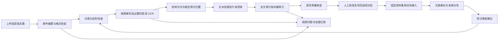
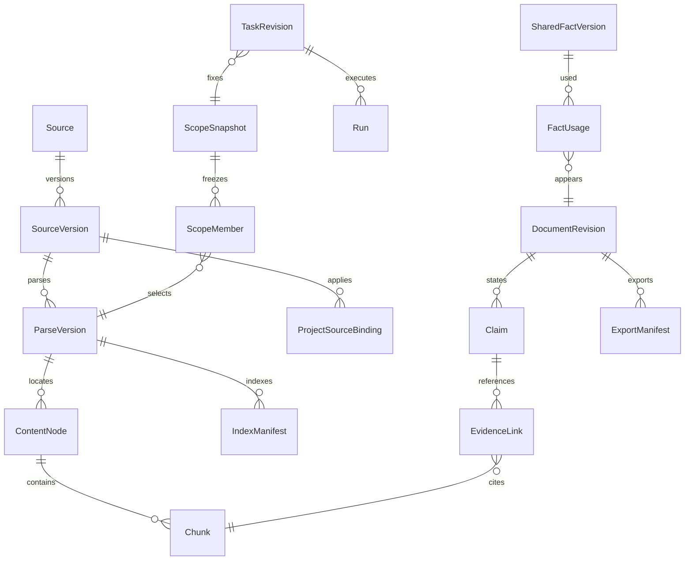
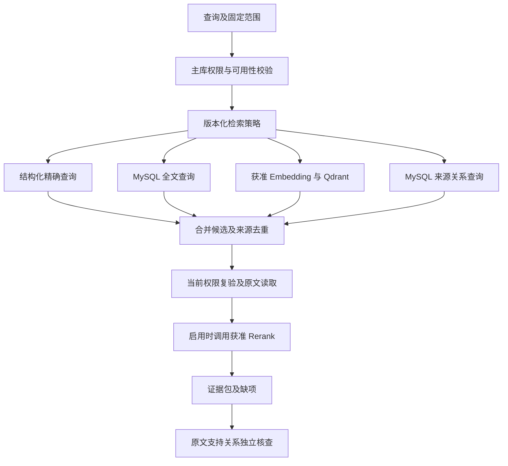

# 医疗器械企业 Agent 平台数据详细设计

版本：V1.0.0；日期：2026-09-28；状态：`DRAFT`；能力：`DESIGN`；需求基线：PRD V1.3.0、HLD V1.1.0。本次交付范围为 T05 数据设计、已有真实资料检查、样本及结构校验。生产数据库、检索服务、模型 API 和客户业务验收保持 `NOT_RUN`。

## 1. 架构上下文与需求对应

### 1.1 输入与决定

| 输入 | 本次读取范围 | 本设计采用的约束 |
| --- | --- | --- |
| [PRD.md](./PRD.md) | 全文；重点为 §5、§8.3—8.5、§8.9、§9—13 | 来源范围交集、四项处理状态、人工核准、七种文件定位、完整目录与字段、历史版本、撤权与删除 |
| [HLD.md](./HLD.md) | 全文；重点为 §2.3、§3、§6、§8 | Java 业务服务与 MySQL 8.4 LTS；Python 解析与专业处理；Qdrant；MySQL FULLTEXT ngram；私有对象存储；独立 SSO 与 Temporal |
| 官方文件与原文转换资料 | `ui-delivery/assets/public-evidence` 与 `ui-delivery/research/official` 的实际文件；原件摘要、DOCX 文本及表格、PDF 文本、TXT 内容 | 原件与转换结果分别登记；没有客户项目参数、报告及签发记录 |
| [真实样本](./data-design/sample_dataset.json) | 官方资料的原文片段与项目 PRD 标题；每项具有可重新读取的位置 | 本地设计核查用途；不标记为已核准生产知识或客户业务样本 |

HLD 的存储与语言约束保持原值。关系数据、全文数据及来源关系图由 MySQL 承载；Qdrant 承载向量。关系图的正式执行语言采用 SQL，Cypher 不属于当前部署接口。解析采用 HLD 的 Docling 及各格式成熟库；需要模型推理的 OCR、Embedding、Rerank 均通过 C07 获准 API，发布制品不能自行下载模型。

当前后端扩展见[接口补充设计](./backend-design/接口补充设计.md) §4：受限上传、正文 AST、人工引用核验、批量审查、再次认证、公开流、动作记录、人工待办、系统检查、管理绑定及报表导出。18 张核心表继续作为数据基础，完整生产迁移同时实现后端既有表与这些扩展。EvidenceRef 与七种来源位置保持本文件及 dataset.schema.json 的唯一语义；正文 Selection 为独立结构，原文摘要不因选区转换而改变。

### 1.2 需求与数据交接

| 承诺 ID | 数据对象与行为 | PRD / HLD | 本文位置 |
| --- | --- | --- | --- |
| DATA-01 | 来源登记、原件与解析定位、引用支持检查 | BR-06、BR-07、AC-05、AC-06、AC-19、AC-25、AC-30；HLD §6.2 | §2、§3、§4.3 |
| DATA-02 | 不可变版本、固定范围、索引与配置版本 | BR-01、BR-12、AC-07、AC-27、AC-31、AC-37；HLD §6.1、§6.6 | §4、§5.1、§6.3 |
| DATA-03 | 当前权限、项目适用性、派生内容授权 | AC-02、AC-16、AC-23、AC-28、AC-32、AC-35；NFR-13 | §4.5、§5 |
| DATA-04 | 更新建议、人工核准、生效、影响计算、转存 | BR-13、BR-14、BR-16、AC-33、AC-34、AC-50、AC-55、AC-57 | §4.4、§4.6 |
| DATA-05 | 历史审查、继续处理、重新执行与导出复核 | BR-08、BR-09、BR-17、BR-18、AC-21、AC-22、AC-38—AC-44 | §6.3、§6.4 |
| DATA-06 | 目录、字段、真实附件、事实与方法覆盖 | BR-19—BR-23、AC-45—AC-57；HLD §6.3 | §4.2、§4.7 |
| DATA-07 | 保存、回收、删除传播、迁移与恢复 | AC-36、NFR-07、NFR-15；HLD §6.5、§7.2 | §6.5、§6.6 |
| DATA-08 | 样本、Schema、导入核查与 QA | AC-12、AC-13、AC-29、AC-30；NFR-12 | §6.1、§6.2、§7 |

本设计交给 C03、C04、C05 的字段与状态属于 `PROPOSED`。PRD 中客户待定的角色分离、保存期、质量阈值、产品适用性、模型数据处理许可继续保持待确认；本地样本检查不能代替这些决定。

## 2. 来源登记、采集与真实样本

### 2.1 来源矩阵

| 来源 ID | 内容、所有者和取得方式 | 格式与版本 | 当前使用与更新规则 |
| --- | --- | --- | --- |
| SRC-01 | 国家药监局 2021 年第 121 号附件 4；已有官方 DOC 及 TXT 转换文件 | DOC 研究原件、TXT；申报资料格式 | 本地核查；知识维护人按批准频率核查原文，正式采用需要企业核准及项目适用决定 |
| SRC-02 | 同公告附件 5；已有官方 DOC 及 TXT | DOC、TXT；非 IVD 首次申报目录 | 保存六章、38 个二级节点的原始编号；变更、延续及 IVD 路径使用各自核准模板 |
| SRC-03 | 同公告附件 9；已有官方 DOC 与 PDF 转换预览 | DOC、PDF；基本原则清单 | 检查表头、条款及跨页关系；转换页序只用于预览定位 |
| SRC-04 | 国家药监局 2022 年第 8 号附件；已有官方 DOC 与 TXT | DOC、TXT；产品技术要求编写依据 | 保存条款与格式依据；具体产品数值由项目真实资料提供 |
| SRC-05 | 国家药监局 2021 年第 73 号附件 4；已有官方 DOCX 与 PDF 转换预览 | DOCX、PDF；临床评价报告指导原则 | 检查正文、表格与文本续接；项目临床路径由注册人员确认 |
| SRC-06 | 客户产品资料、模板、检验与研究记录、历史成果 | 目标为 PDF、DOCX、XLSX、CSV、TXT、Markdown、PPTX | `BLOCKED`：未提供获授权客户项目样本；禁止生成参数或报告填补 |
| SRC-07 | 客户获授权标准正文和产品专用依据 | 版本、全文许可、适用产品待提供 | E10 只继承 PRD 已有元数据边界；没有标准正文的条款规则禁止发布 |
| SRC-08 | 项目自身 PRD | Markdown，V1.3.0 | 本地 Markdown 定位样本；用途为需求审查，不能提供法规或产品事实证明 |

2026-09-28 已读取[第 121 号公告页面](https://www.beijing.gov.cn/zhengce/zhengcefagui/qtwj/202307/t20230721_3204148.html)、[第 73 号通告页面](https://www.beijing.gov.cn/zhengce/zhengcefagui/qtwj/202204/t20220408_2669595.html)、[第 8 号通告页面](https://mpa.hunan.gov.cn/mpa/yszx/jssp/jsbzx/202202/t20220215_22482327.html)。网页载明的发布信息与附件目录作为来源记录；企业生产使用、外部模型处理、分发及批量采集授权尚未取得，不能因网页公开而填写开放许可。当前文件使用限于用户授权的本地资料审查和样本检查。

网站栏目日期、文件署发日期、实施日期和平台获取日期分别保存。SRC-05 页面发布日期为 2021-09-28，通告署发日期为 2021-09-18；SRC-04 页面发布时间为 2022-02-15，通告署发日期为 2022-02-08。保留差异及各自来源标签，不将网站栏目日期当作文件生效日期。

### 2.2 SourceRegister 必需字段

| 字段 | 类型与空值规则 | 约束、来源与用途 |
| --- | --- | --- |
| `source_id/owner/publisher/maintainer_id` | ID / 文本；必填；发布方未知时记录核验问题 | `owner` 指资料责任主体；不能用文件上传者替代发布机关 |
| `location/original_url/final_url` | 对象引用 / URL；上传资料可无 URL | URL 保存原值、重定向及获取证据；用户浏览使用授权代理 |
| `purpose/license/allowed_use/rights_revision` | 目的与权利记录；必填；允许 `PENDING_REVIEW` | 分别记录保存、企业使用、分发、外部处理、期限与地域；原始授权文件作为受限附件 |
| `sensitivity` | `PUBLIC/INTERNAL/RESTRICTED/PERSONAL_HEALTH` | 分类不产生读取授权；派生内容继承全部上游限制 |
| `publisher_version/source_version/checksum` | 发布版本可未知；内部 ID 与 SHA-256 必填 | 文号与年代号完整保存；相同 URL 可对应多个内容版本 |
| `published_at/issued_on/effective_from/effective_to` | 时间或日期可空，空值表示未知 | 业务有效区间与系统记录时间分开；日期无依据时禁止推定 |
| `observed_status/verified_at/status_evidence` | 官方显示状态、核查时间、证据引用 | 网站状态属于观测；企业核准与具体项目适用性另行记录 |
| `acquired_at/acquired_by/acquisition_method` | 必填；旧文件取得时间未知时标记缺项 | 本次检查时间不能冒充首次下载时间 |
| `update_frequency/next_check_at` | 配置版本与时间；正式来源必填 | 按来源登记的负责人及周期执行；官方变更通知触发额外检查 |
| `retention_policy_id/legal_hold/status` | 保存策略、保留指令、状态 | 策略未批准时关闭永久清理；保留指令有责任人、范围及解除依据 |

采集请求唯一键为 `tenant_id + acquisition_request_id`，文件去重键为 `tenant_id + authorized_ownership_scope + original_sha256`。去重仅返回当前主体有权读取的对象；名称相同且内容不同由用户确认新增资料或新版本。跨企业不查询可见重复结果。相同文件可承载不同核准用途，不能合并企业决定。

### 2.3 本地资料检查结果

| 文件 | 实际观测 | 对设计的要求 |
| --- | --- | --- |
| `clinical-evaluation-2021.docx` | 37,870 字节；156 个非空文本节点；5 个表格 | 保存空文本节点造成的原始序号；表格使用独立节点与单元格位置 |
| 同名 PDF | 18 页；原有来源清单明确标记转换预览 | 原文定位指向 DOCX；PDF 页序记录为 `CONVERTED_PREVIEW` |
| `safety-principles-2021.doc` 及 PDF | 原件 120,832 字节；转换 PDF 11 页 | 原件 DOC 不属于已承诺七种正式上传格式；保留研究来源身份 |
| 临床 DOCX 原始文本序号 159、160 | 一句正文在两个文本节点中续接 | 解析可创建组合阅读节点，同时保留两个来源节点及映射；不可删除其中一个节点 |
| 临床 DOCX 第二个表格的第五列表头 | 单元格包含多行文本 | 保存换行及单元格身份，不能通过物理换行推断表格记录数 |
| 2021 年第 121 号附件 5 TXT | `6.1综述`、`6.2章节目录` 可独立定位 | 保留原编号顺序；目录排序使用模板序号 |
| 2022 年第 8 号附件 TXT | 正文以外存在 Word 字段指令文本 | 页眉、页脚与转换噪声标记为处理问题；原始文本保留，检索正文按审核过的处理规则排除 |

文件完整 SHA-256、片段 SHA-256、版本和位置保存在样本文件；已有 `provenance.json` 的两份原件与两份 PDF 摘要已经重新核对一致，三份 TXT 与原始 DOC 本次转换输出逐字节一致。检查采用文本与结构读取，未执行视觉核验、OCR、完整表格版面复核或官方文件适用性审批。

## 3. 采集、解析、清洗与发布

### 3.1 数据流程



### 3.2 阶段输入、幂等与失败

050-source-rights-decisions.sql提供source_rights_state及source_rights_decision。状态固定当前RightsRevision、最后人工决定及连续revision；决定固定来源、前后权利、原操作、完整请求、审查清单及摘要、实际对象字节证明、理由、回执及Schema身份。八项同企业复合外键及八项CHECK保护完整关联和决定状态。初始化只复制当前实际来源的原权利、人员、时间和分类，不创建批准决定。APPROVE写入完整新权利载荷及摘要，CAS替换当前指针；RETURN保留待审权利，REVOKE撤销批准状态，审计及Outbox共享原企业事务。当前实际286项登记、172张企业表及209张物理表；原283项checksum、来源指针和完整权利记录保持。

048-source-completion-checkpoint.sql保存上传完成检查点和来源登记结果。source_completion_checkpoint固定tenant/event/consumer/upload/operation关联、完整原命令摘要、扫描命令及回执、原对象write_intent、固定ObjectRef和WRITING/ORIGINAL_VERIFIED状态；source_upload_result固定来源、权利、解析及处理作业、原件对象、结果与Schema身份。同企业复合外键及唯一约束保护完整关联。outbox_delivery保存首次开始时间、执行期限和运行发布清单；执行恢复沿用原期限。领取、续期与最终事务继续核查owner、generation、revision及数据库时间。

完整扫描与成熟格式核验通过后登记SourceVersion和PENDING_REVIEW权利版本；上传声明中的证据身份保留在provenance，批准证据及正式权利审批继续独立核验。来源登记、处理作业、上传及操作终态、消费回执、治理水位、审计与事件共享企业事务。过期、总执行期限、领取次数及扫描命令失败保存封闭失败结果；原202响应保持原字节，操作查询显示真实终态。去重只允许相同企业、项目或会话范围，重新核查完整原件、声明、来源及项目读取许可、权利和生命周期。

049-source-audit-metadata.sql提供retrieval_hit、retention_policy_revision、source_lifecycle_decision、source_lifecycle_state和outbox_delivery的十三项审计及Schema字段。既有字段从同企业的原查询及操作、原人员和时间、SourceVersion及Source分类、原事件载荷复制；未知身份立即阻止迁移。全部新增字段非空，人员具有同企业关联；消费者保存及重读原Schema版本和发布摘要。当前实际数据库283项登记，原270项checksum及生命周期状态保持，170张企业表及207张物理表由完整迁移检查维护。

047-source-processing-worker.sql 为 processing_attempt 追加 lease_owner、lease_generation、lease_expires_at、execution_deadline、command_ref、result_ref 和 write_intent，并约束租约与终态关系；parse_version 追加 artifact_version 和 artifact_size_bytes，历史未知对象版本保持空值。failure_manifest 使用包含 schema_version 和 issues 的对象，原问题数组完整保存于 issues。领取、续期及最终提交同时核查当前 owner、generation、revision 与数据库期限。

053-run-token-authority.sql为run_step追加lease_owner VARCHAR(512)、lease_expires_at DATETIME(6)、按企业/状态/期限的索引，以及完整租约关联CHECK；principal_token追加原签名token_sha256、服务service_uri、policy_revision、完整policy_sha256和lease_generation。历史新增字段全部保持null；完整新令牌绑定要求非空摘要、服务、Policy、正代际和step_id。原主键、企业外键、数据和既有迁移保持。当前来源为RUN-TOKEN-AUTHORITY-01，许可清单由run-token-authority.schema.json核验；C02逐动作重新读取当前人员及权限，租约和令牌写入保存审计与Outbox。

解析包完整保存 ContentNode、原文、Locator、quote_hash、Chunk 和 chunk_node 范围，并记录固定扫描结果与签名、处理及配置身份。外部写入前保存固定命令、结果及对象写入意图；恢复读取原 write_id 的固定对象版本。对象完整核验后，版本登记、来源及配置关系、解析对象版本与字节数、完整节点及片段、处理终态、治理水位、审计与事件共同提交，保存内容逐项重新读取核查。专业核准保持独立人工决定。

| 阶段 | 输入 → 输出 | 校验和幂等范围 | 失败状态与责任 |
| --- | --- | --- | --- |
| 接收 | 上传会话 → 私有隔离对象、`UploadItem` | 逐文件请求 ID、预期大小、服务端 SHA-256、格式探查、恶意内容扫描 | `UPLOAD_FAILED`；C03；未完整接收不能创建可引用版本 |
| 归属与权利 | 原件、声明 → `SourceVersion/RightsRevision` | 企业、项目、会话限制、用途、许可、分类；同范围去重 | `RIGHTS_PENDING/ACCESS_DENIED`；资料维护人与 C02 |
| 解析 | 固定原件 → `ParseVersion/ContentNode/ParseIssue` | 原件摘要、解析器与配置摘要、语言、OCR 调用版本、页表完整清单 | `FAILED/PARTIAL_FAILED`；C09；保留已处理范围，全部核准阻断 |
| 清洗 | 原始节点 → 搜索文本、转换映射 | 原文和搜索文本分别保存；单位、符号、型号、否定语及条件不可自动替换 | `QUALITY_BLOCKED`；数据负责人；更正创建新处理版本 |
| 提取 | 固定节点 → 候选事实、要求、关系 | 每项关联原文；确定性字段校验；模型输出执行 JSON Schema 校验 | `EXTRACTION_FAILED/REVIEW_PENDING`；C12 提交，C03/C04 保存 |
| 索引 | 完整解析与分块清单 → `IndexManifest` | 原件、解析、分块、Embedding、维度与全文配置均固定；稳定 Point ID | `BUILDING/FAILED`；C03；清单全部通过才 `READY` |
| 核准 | 处理结果及权利证据 → 人工决定 | 核查对象摘要、当前版本、权限、来源、生效及适用范围 | 拒绝意见保留，资料仍 `PENDING`；C03 与知识审核人员 |
| 使用 | 核准资料与项目决定 → 范围快照及证据包 | 每次使用重新核验当前权限；新来源必须形成新输入快照 | 空范围、过期授权或输入冲突立即停止对应步骤 |

阶段幂等键由服务器生成：`tenant_id + operation + input_manifest_hash + config_revision + request_id`。重复业务请求返回已有记录；用户明确要求重新处理时使用新请求和新解析 ID。相同解析版本内的节点编号、片段及定位只写入一次，重试禁止混合两次解析产物。

任何错误在对应动作终止并形成受限诊断记录。只读下载或已确认未被受理的请求可按发布配置中的次数、间隔和总时限重试；收费 OCR/Embedding 的未知回执进入待核对，不自动重复发送。不存在任意异常后切换解析器、模型或来源的路径。

### 3.3 隐私、规范化和多模态

原件只进入获授权环境，Worker 关闭宏和外网，按单次任务限定对象、工作目录、时间、内存及文件大小。个人或健康信息经过成熟识别组件与规则检查，必要时人工核验；假名对应记录使用独立秘密与权限。发现漏识别立即阻断外发。公开资料本次未执行完整隐私扫描，不能登记“零残留”结论。

脱敏副本保存 `redaction_revision/mapping_manifest/source_version`，原文访问与副本访问分别授权。姓名、联系方式等处理不得影响型号、计量单位及业务严格字段；若必需字段不能获准外发，该步骤停止并说明缺少的授权条件。提取、OCR、Embedding、Rerank 与生成均逐次检查允许发送类别。

文本处理保留 `raw_text/search_text/transform_version/position_map`。Unicode 规范化、空白整理、去除页眉页脚只影响搜索文本，片段引用和摘要以固定原文提取内容计算。金额和测量值保存原始字符串、十进制值、原单位、显示精度、比较运算符、上下限、型号和试验条件；单位换算保存公式与版本、输入值及核验决定，不覆盖原值。

表格保存网格、合并范围、表头路径、单元格节点、脚注和跨页续表关系；行列错配、缺失表头、未识别图示、未知公式或空白扫描页进入质量问题。图片与公式分别保存原件对象和有来源的提取结果；没有位置映射的模型描述不能成为正式证据。当前真实资料未覆盖扫描 PDF、复杂公式及全部七种格式，相关能力验收保持 `NOT_RUN`。

## 4. 数据结构、版本、权限与治理

### 4.1 四类存储职责与物理约定

| 访问模式 | 一致性 | 规模与增长 | 目标存储及索引 | 验收限制 |
| --- | --- | --- | --- | --- |
| 身份范围、核准、任务、正文、签发、预算 | 业务事务内强一致 | 企业数、项目数与运行数待测 | MySQL 8.4 / InnoDB；企业复合键、状态与时间索引 | 企业账户 100～500；账户数不代表文档数或并发量 |
| 中文名称、正文与精确编号 | 同一 MySQL 事务；独立检索版本清单 | 片段数、全文大小待测 | FULLTEXT ngram；型号、文号、标准年代号采用结构化 B-tree 索引 | 中文短词、数字、符号、停用词以真实语料测量 |
| 语义相似候选 | 异步构建，MySQL 控制可用性 | `chunk_count × dimension × bytes_per_component` 加索引开销 | Qdrant；按模型版本、维度及处理环境配置 collection；Payload 过滤索引 | 未提供 Embedding 连接，真实检索 `NOT_RUN` |
| 来源、事实使用、依赖及影响关系 | 与业务写入同事务 | 边数量和最大引用深度待测 | MySQL `lineage_edge/fact_usage/evidence_link`；正向与反向索引 | 图遍历超出批准资源限制时中止，不能返回不完整影响并标记成功 |
| 原件、解析包、正文、导出、诊断 | 不可变对象，登记前校验摘要 | 全部历史版本与备份纳入容量 | 私有对象存储；精确对象版本及 SHA-256 | 对象服务及 KMS 产品待环境确认 |
| 授权会话与短期结果 | 主库为权限依据 | 有效会话与候选结果数待测 | Redis；企业、主体、项目、授权水位和输入版本构成键 | 命中后仍执行当前授权；TTL 不承担撤权正确性 |

MySQL ngram 支持中文，`ngram_token_size` 是启动配置，全文索引采用 `WITH PARSER ngram`；分词长度、停用词与搜索模式须写入索引配置版本。此处机制依据已完整读取的 [MySQL 8.4 ngram 文档](https://dev.mysql.com/doc/refman/8.4/en/fulltext-search-ngram.html)，产品参数仍待真实语料评测。

ID 使用服务端生成 UUID，数据库表示为 `CHAR(36) CHARACTER SET ascii`，API 全部使用字符串；业务编号另存。内容摘要使用 SHA-256，小写十六进制。时间使用 UTC `DATETIME(6)`，API 使用带 `Z` 或 UTC 时区的 ISO 8601；法规只有日期时保存 `DATE` 与来源时区，不补造时分秒。计费金额使用 `DECIMAL(24,8)` 并保存币种、价格版本；测量数值使用 `DECIMAL(38,12)`，超出精度时拒绝转换并保留原始字符串及问题，不能截断后通过。

所有业务唯一键及外键包含 `tenant_id`；项目数据另包含 `project_id`。企业公共资料通过显式项目绑定使用，引用中 `project_id` 表示使用项目，来源所有权另存 `owner_project_id`。企业身份和项目身份不能由模型、URL 参数或请求正文覆盖。关联表禁止级联删除审查与历史引用。主数据采用完整复合外键；审计归档容量另测，当前不对外键主表增加分区设计。

### 4.2 实体与字段规范

关系主链如下；箭头仅表示数据关联，读取仍检查权限。



以下每个表继承 `tenant_id`、创建者、UTC 时间与数据分类；可修改的当前状态行另有 `revision BIGINT UNSIGNED`，不可变版本对象另有内容摘要。ID 外键不可空，表中标注 `?` 的业务字段允许空值；枚举中的 `UNKNOWN` 与空值分别表示待确认判断和没有取得字段。内容、状态、保留策略及授权均由所属组件维护。

| 实体与主键 | 必需业务字段及类型 | 唯一键、关联与查询索引 | 创建、读取、生效及失效 |
| --- | --- | --- | --- |
| `Source/SourceVersion`：来源 ID / 版本 ID | 归属、标题、格式、字节数、原件对象版本与摘要、发布版本?、来源 JSON、权利版本 | `(tenant,source,version_no)` 唯一；摘要索引只供范围内去重 | C03 接收；C04/C05/C12 读取；通过处理、核准及适用门槛后正式使用 |
| `RightsRevision`：权利版本 ID | 所有者、用途、允许操作集合、环境/区域/提供方、起止时间?、授权证据、状态 | 企业及来源复合关联；到期时间索引 | 人工核准；读取与发送均检查；到期或撤销立即停止相关动作 |
| `UploadItem/ProcessingAttempt`：请求 ID / 尝试 ID | 批次、单文件状态、阶段、输入哈希、处理配置、错误范围、调用记录 | 请求键与请求摘要唯一；来源、阶段、状态索引 | C03/C09；页面显示逐文件结果；失败记录不覆盖原件 |
| `ParseVersion/ContentNode`：解析 ID / 节点 ID | 解析器配置、完整度、节点类型、父节点?、顺序、原始内容、格式定位、节点摘要 | `(tenant,source_version,parse_version,node_id)`；原件与解析复合关联 | C09 提交、C03 保存；版本内只读；重新处理生成新 ID |
| `Chunk/ChunkNode`：片段 ID / 片段节点关系 | 原文、搜索文本、Token 数、标题路径、片段次序、节点范围、重叠关系 | 解析与片段复合键；全文索引；节点引用不得跨解析版本 | C03 发布检索清单；正文按授权读取；原文引用不随索引重建变化 |
| `IndexManifest/IndexItem`：索引 ID / Point ID | 模式、模型配置与维度?、距离度量?、分块配置、片段清单、预期和核验数量、向量摘要、状态 | `(tenant,source_version,parse_version,index_version)`；每片段与 Point ID 唯一 | C03 构建；任务固定索引；全部核查通过后 `READY` |
| `ApprovalDecision/SourceUseGate`：决定 ID / 解析版本 | 决定、审核人、意见、审核清单摘要、状态、许可版本、核查时间、当前治理水位 | 审核决定追加；当前门槛行 CAS 更新；审核 ID 必须关联同一原件和解析 | 人工核准；重核、停用使当前使用状态改变，旧决定保留 |
| `ProjectProfileRevision/ApplicabilityDecision`：项目属性 ID / 决定 ID | 属性键、原值、判断三态、型号与时间范围、条件规则版本、理由、依据、确认人 | 项目及属性版本唯一；每项决定关联其原始证据 | C04 保存；模板选择与签发读取；属性变更使相应决定需重核 |
| `ProjectSourceBinding`：绑定版本 ID | 项目、来源版本、适用状态、依据、决定人、有效区间? | 绑定包含同企业项目与来源；项目/来源反向索引 | 注册人员核准；资料可用与项目适用分别判断 |
| `CollectionVersion/CollectionMember`：资料集版本 / 成员 ID | 归属、用途、成员原件版本、解析版本、维护人、清单摘要 | 版本内成员唯一；来源反向索引 | C03 保存；任务固定成员；标签或文件夹变化不改成员与授权 |
| `ScopeSnapshot/ScopeMember`：快照 ID / 成员 | 项目属性、资料集、逐文件原件/解析/索引/核准/适用版本、联网模式、允许域名与网址、检索词批准、授权水位 | 来源明细用关联表约束；内容清单 JSON 与 SHA-256 同存 | C04 创建；C11/C12 读取；范围改变创建新快照 |
| `TemplateVersion/RequirementNode`：模板版本 / 节点 ID | 文档类型、申请路径、官方编号标题、父节点?、顺序、必需条件、填写方式、证据类型、依据、版式及渠道版本 | 模板内节点 ID 与官方编号各自唯一；父节点限同模板 | C03 核准，C04 生成文档；版本停用阻断新选用并计算影响 |
| `FieldDefinition/RepeatDefinition`：字段 / 重复对象 ID | 类型、条件、基数、枚举/精度/范围依据?、单位规则?、行字段、证据规则、导出位置 | 字段限同模板；重复行必须有稳定 `row_id` | 模板核准；C04、C05、C09 使用；模板升级不重写既有文档 |
| `SharedFactVersion/FactUsage`：事实版本 / 使用 ID | 权威原值、数值与单位?、型号集合、条件、证据、核验人；使用文档版本、节点、字段、行 | 项目与事实版本关联；按事实及文档双向索引 | 研发/注册人员确认；C04 消费；改变后计算实际使用位置及依赖 |
| `Metric/Method/MetricMethodCoverage`：指标 / 方法 / 覆盖 ID | 指标要求、单位、条件与型号；方法步骤、依据和验证证据；适用组合 | 唯一组合 `(project,document_revision,metric,model,condition,method)` | C04 创建，C05 检查；每项适用型号及条件均有方法和证据 |
| `TaskRevision/PlanRevision/Run/Step`：各自 ID | 父任务、修订原因、快照、计划依赖、Worker 版本、状态、输入/输出摘要、恢复点 | 业务幂等键、父运行、步骤标识、完成回执；计划依赖禁止循环 | C04/C11；详情与恢复读取；新输入形成新版本，终态不覆盖 |
| `Invocation/ContextManifest`：调用 ID / 内容清单 ID | 准入水位、精确发送内容对象及摘要、模型配置、请求参数、供应商回执、使用量、预算与结算 | `(tenant,run,step,action_id)` 唯一；供应商请求 ID 可空且不可编造 | C07；重放及审计读取；未知调用禁止自动重发 |
| `DocumentRevision/SectionRevision/Claim`：文档版本 / 章节版本 / 陈述 ID | 成熟编辑器结构、文本及节点摘要、章节依赖、字段投影、陈述范围 | 项目与文档复合关联；节点稳定 ID；当前文档 CAS | C04 写入；S09/S11 同版本读取；签发后只读 |
| `EvidenceLink`：引用 ID | 目标陈述、来源五项身份、定位、引用哈希、支持/冲突/背景、三项核验结果 | 文档/陈述复合关联；原件/解析/片段复合关联；来源反向索引 | C03/C04 保存；C05 独立核查；来源变更不替换旧引用 |
| `Issue/Annotation/ReviewDecision`：问题 / 标注 / 决定 ID | 问题等级、文档和节点版本、位置、规则及证据、处理者、意见、确认基线与失效原因 | 文档版本及目标节点索引；审查决定追加 | C05；签发前查询当前有效性；正文或依据改变使受影响确认失效 |
| `SignatureRecord/ExportManifest`：签发 / 导出 ID | 正文、章节、事实、证据、问题水位、审核、模板、规则、转换器、字体、对象版本和哈希 | 文档版本与签发用途唯一；格式分别有状态 | C05 签发，C09 导出；同导出 ID 重复下载同对象 |
| `KnowledgeSubmission/LineageEdge`：提交 / 关系 ID | 来源成果、目标资料、全部原始证据、动作、提交人、关系种类 | 同企业复合外键，跨项目共享权限；正反向索引；禁止循环 | C03 提交人工审核；采纳产生待核验来源，原成果不变 |
| `ReferenceHold/DeletionJob/DeletionItem`：引用保护 / 作业 / 存储项 ID | 引用方版本、受保护对象、保存期、保留指令、各存储回执与校验 | 所有真实引用同事务建立保护；删除项唯一 | 生命周期服务；无引用且保存策略允许才进入永久处理 |
| `AuditEvent/OutboxEvent/ConsumerReceipt`：事件 / 回执 ID | 主体、目标、动作、企业、资源版本、业务时间、结果、投递次数 | `(tenant,event_id,consumer_id)` 去重；按资源版本有序应用 | 业务事务产生；C08 及 Worker 消费；重复事件不重复改变状态 |
| `IdentityBinding/PermissionGrant/RunPrincipal`：身份 / 授权 / 运行身份 | SSO issuer/sub、有效成员、资源动作、起止、当前水位；发起人和有效服务范围 | SSO 身份唯一；企业授权可撤销；任务身份不能扩大权限 | C02；每次读取和调用前核验；离职、禁用及撤权使授权失效 |
| `UserPreference/TaskSummary`：习惯版本 / 摘要版本 | 用户主动保存内容、用途、来源记录、缺项与原文位置、停用时间 | 用户与企业隔离；摘要不生成事实授权 | 用户及 C04；删除习惯后新执行禁止使用；必要历史审计另存 |
| `EvaluationBatch/Score/ConnectorCursor`：批次 / 评分 / 同步游标 | 样本与标注版本、分子分母、原始结果；外部系统 ID、映射、游标、同步结果 | 同输入比较；外部记录幂等；连接记录按企业独立 | C08/C10；缺少真实数据不生成质量通过结论 |

[core.sql](./data-design/core.sql) 提供来源、解析、索引、核准、快照、引用、关系图及事件的核心 DDL。上表同时定义其余业务实体，完整生产迁移由 T06 按本表及所属模块补齐，不能只执行核心 DDL 就声明数据功能完整。`version_registry` 的版本 ID 必须与具体实体版本 ID 相同，具体实体与登记行在同事务创建，登记表不能独立创建不存在的业务版本。引用保护、当前权限和业务状态约束不能由外键代替。

任务完整输入与计划内容由`032-task-plan-content.sql`追加。task_input_revision以企业、项目和task_revision为主键，完整创建输入、SourceScope及摘要分别保存，固定原任务、操作、负责人、目标文档和权限依据。plan_content_revision以企业、项目和plan_revision为主键，保存完整PlanCandidate、基准计划及原摘要、理由、请求版本、Schema和水位；完整复合外键同时绑定任务修订、模板、快照和内容摘要。计划的章节、问题、question_key、全部依赖、待确认条件和负责人空值均保留在原JSON内容中，关系投影逐项比较完整候选。内容和范围使用共享Schema及RFC8785规范字节计算摘要，保存后完整重读并重新核查当前授权。旧输入与旧计划保持固定内容，新输入或确认生成新版本；原任务、计划和快照保持完整归属，结构验证不能替代业务成功验收。

`036-task-plan-relations.xml`以238—249编号追加计划关系。plan_section_node保存每章全部节点，plan_section_rule保存全部完成规则；plan_question按计划保存完整问题文本及章节，plan_question_node和plan_question_rule保存节点与规则，plan_question_dependency保存问题依赖。全部有序集合保存position及对应唯一约束，关联外键包含企业、项目和完整计划身份。research_question保存首次登记依据与稳定问题UUID，question_key保留完整ASCII大小写，SHA-256索引用于同一任务内唯一检查，服务继续比较完整键值。问题节点同时引用本计划的问题章节和章节节点，依赖两端属于同一计划。

task_plan_head保存同一任务当前维护计划与CAS修订；task_plan_decision保存原目标计划和摘要、依据任务修订、结果任务修订、结果确认计划、原操作、请求、实际授权和回执。CONFIRM生成同属新任务修订的新确认计划，RETURN保留原任务修订且结果计划为空；plan_revision.decision_id的完整外键只允许引用该计划自身的确认决定。新增方法、顺序及问题身份没有历史输入时不能推断，迁移在原章节、依赖或问题表非空时立即终止。当前定义已进入公共master.xml；实际数据库执行与业务验收由IMP-12记录。

`033-task-missing-requirements.xml`追加task_input_revision.missing_requirements及requirements_sha256。前者为非空JSON数组，逐项使用原ResourceBindings.REQUIREMENT保存requirement_id、node_id、field_id、reason_code和allowed_actions；后者为完整数组的RFC8785 SHA-256。空数组必须来自实际缺项计算并保存摘要，读取不补充默认值。既有任务输入存在时迁移立即终止，必须另行提供可核查的原缺项记录，不能自行填充。TK-02核查固定输入、快照和已确认计划及摘要；当前可见文稿、运行、待办和处理动作分别通过当前授权检查。

### 4.3 来源定位与 EvidenceRef

051-source-index-build.sql追加source_index_build，原迁移保持既有字节。新记录按企业、原事件及SOURCE_INDEX_FULLTEXT消费者唯一关联outbox_delivery，固定项目、成功解析作业、来源/解析/索引完整身份、配置、当前权利、原输入与清单摘要、执行期限及终态回执。七项同企业外键和六项CHECK核查完整归属、Schema、状态、期限及回执。IndexManifest及INDEX_VERSION登记在同事务建立，逐IndexItem核验后发布READY；consumer_receipt与投递终态共同保存。清单不修改原source_chunk，重建使用独立索引身份，历史引用继续固定原来源与解析位置。

`EvidenceRef` 的传输结构位于 [dataset.schema.json](./data-design/dataset.schema.json) 的 `$defs.EvidenceRef`；`ContextReference` 在后续 Agent 设计中直接引用此结构。正式引用须包含 `tenant_id/project_id/source_id/source_version/parse_version/chunk_id/locator_kind/locator/quote_hash/approval_revision`。`source_version` 等字段在生产环境使用稳定 ID；本地样本在准入前使用文件 SHA-256 作为版本指纹，导入后保存指纹到生产 ID 的映射，不能把样本伪装成企业核准记录。

| 格式 | 稳定位置与读取规则 | 必须验证的边界 |
| --- | --- | --- |
| PDF | 原件 SHA-256、从零开始的 `page_index`、原件或转换预览标签；页码显示为序号加一；印刷页码另存 | 区域坐标使用旋转后 CropBox、左上原点、归一化范围 `[0,1]`，另存旋转角；坐标满足 `x0<x1/y0<y1`；无坐标时只显示整页，不声称精确区域定位 |
| DOCX | 固定 `parse_version` 内 `word/document.xml` 或实际 part、节点 ID、标题路径、文本序号；表格节点、行列、合并范围 | 序号依据固定解析器和遍历规则；页码只有经转换且存在映射时显示为预览位置；嵌套表格、页眉与脚注使用独立 part 和路径 |
| XLSX | 工作表稳定 ID 与名称、单元格范围、公式、缓存值及计算来源 | 原件公式与数值分别保存；无缓存或未经验证的计算结果保持待核验；合并单元格指向其主单元格 |
| CSV | 编码、分隔符及引号配置版本、逻辑表、从零开始的数据记录序号、列序号及原列名 | 使用 pandas 成熟解析器；换行可能位于带引号字段内；重复列名通过列序号区分；表头记录数明确保存 |
| TXT | 固定解码配置、原始换行保留、Unicode code point 区间 `[start,end)`、从一开始的行号 | UTF-8 是本次样本编码；其他编码必须显式登记；禁止解码替换；字符区间不能按 UTF-16 单元计算 |
| Markdown | markdown-it-py 节点 ID、标题路径及源码行号，范围含起止行 | 原文源码与展示文本分别保存；内嵌 HTML 采用成熟清洗组件；引用不执行脚本 |
| PPTX | slide ID 与当前页序、shape ID、文本节点、表格单元格或图示关系 | shape ID 只在所属页内唯一；组合对象保存路径；图示内容提取失败不能自动认为没有内容 |

Schema 校验结构后，业务校验器另查 `locator_kind = locator.kind`、区间和坐标有序、页数/表数/列数边界、源文件摘要、节点是否属于所选解析版本、XLSX 计算证明、PPTX 文本或表格位置是否存在。DOCX 复杂节点采用 `address.kind=NODE`，保存固定解析树的 `node_id/node_hash/structural_path`；读取路径由成熟解析器产生的节点映射解释，不接受调用者提供可执行表达式。跨节点或跨页证据使用多个 `EvidenceRef`，同一陈述可以建立多条 `EvidenceLink`，不能只保存第一个位置。正文稳定位置采用 `document_revision/node_id/field_id/row_id`；文本选区另加 Unicode 范围与选区摘要，文本改变后标注进入待重新定位，不根据相近文字自动移动确认。

引用读取顺序：验证当前主体与派生内容授权 → 读取固定原件及处理清单 → 核对原件/解析摘要 → 验证定位边界 → 重新读取引用内容 → 比较 `quote_hash` → 返回受限原文入口和实际位置。数据缺失、哈希不符、原文不支持陈述分别记录 `SOURCE_MISSING/CONTENT_MISMATCH/UNSUPPORTED_CLAIM`。三个独立检查为 `access_check/locator_check/support_check`；链接可访问或文本相似度高均不能代替支持关系核验。

解析升级或人工修正建立新 `ParseVersion`、新节点和新片段。旧引用继续使用原版本；若需要迁移引用，创建候选 `LocatorMapping`，保存两侧位置、内容差异与人工决定，并形成新文档修订。原件恢复只接受相同对象版本及摘要；不能用新官网页面替换历史快照。

### 4.4 版本与生效规则

| 变化 | 新建对象 | 允许保留的内容 | 生效条件 |
| --- | --- | --- | --- |
| 文件字节或来源正文变化 | `SourceVersion` | 旧原件、核准和引用 | 新原件完整处理、权利核验、人工核准、项目适用确认 |
| 来源权利、发布状态、适用范围变化 | 新权利/状态观测/适用决定版本；内容身份不变时仍保留新审核版本 | 原决定及其证据 | 影响评估与当前门槛更新；撤销和禁止使用立即生效 |
| OCR、解析器、人工更正或位置变化 | `ParseVersion` | 原始文件与全部旧定位 | 全量完整性核查、新核准；旧引用不改 |
| Embedding 模型、维度、分块或全文配置变化 | 新 `IndexManifest`；分块改变时另建片段处理版本 | 原件与旧证据身份 | 新索引完成并通过匹配模型查询；已有任务保持原索引 |
| 标签、文件夹、显示名称变化 | 组织记录 `revision` | 内容与资料集快照 | 当前维护权限及 CAS；不改变来源授权 |
| 资料集成员、任务范围或计划变化 | 新集合、输入快照、计划与任务修订 | 未受影响章节及旧运行记录 | 用户确认影响范围，执行前重查权限 |
| 模板、规则、Agent、Prompt 或模型配置变化 | 新发布版本和新评测批次 | 已发布版本及原任务依赖 | 配置检查、真实样本评测及人工发布 |
| 文稿、严格事实或审核意见变化 | 文稿/事实/审核新版本 | 原文稿与原决定 | 重新执行受影响检查；签发版本不修改 |

业务有效时间使用 `valid_from/valid_to`，系统认知时间使用 `recorded_at/superseded_at`；两个区间分别处理。用户查看某历史时刻时明确指定业务日期与认知截止时间；普通历史任务直接读取已固定的快照。未知生效日期不得作为当前有效依据自动选择。

同一来源可有多个适用不同型号、用途或期间的版本；不以最大版本号推定唯一有效版本。服务端从当前已核准且项目适用的版本集合中呈现选择，并要求解决互相冲突的范围。未来生效版本可提前核准，`effective_from` 前不能作为当前生效依据；停用、期满或撤销由当前门槛阻止新使用。

### 4.5 权限判定与撤权

有效范围计算为：`current_user_grants ∩ project_applicability ∩ agent_release_scope ∩ selected_scope`，同时满足来源权利、生命周期、核准、处理就绪和文件分类规则。会话附件还要满足会话授权；服务人员还要满足有效服务项目授权。没有任何来源时返回空范围和缺项，禁止扩大到企业全部资料或公开网络。

| 动作 | 所需当前授权 | 额外门槛 |
| --- | --- | --- |
| 管理页读取待核验原件 | 来源读取及项目/会话范围 | 分类和用途允许；不能因未核准阻止授权人员审核 |
| 正式检索和生成 | 任务执行、项目来源读取、能力授权 | 核准、处理完成、索引就绪、项目适用、范围成员匹配 |
| 来源核准 | 知识审核动作及目标范围 | 非 Agent 身份；岗位分离按批准企业策略校验 |
| 历史正文、引用与下载 | 当前文档授权及所有相关来源内容授权 | 停用提示与撤权分别处理；没有权限不返回摘录、标题或存在性线索 |
| 模型发送 | 运行身份、来源读取与外部处理授权 | 提供方、区域、用途、分类、权利期限、预算及连接当前有效 |
| 成果跨项目转存 | 源成果及上游读取、目标写入、显式共享 | 保留全部上游限制；新来源待核验；不能通过转存获得更宽权限 |
| 永久删除 | 生命周期专门权限 | 无有效引用、保存期满足、无保留指令、全部存储清单明确 |
| 企业报表及平台运维 | 对应统计或运维权限 | 报表权限不包含原文；运行诊断使用独立受限入口 |

派生正文、摘要、候选、图关系、Embedding、导出及缓存登记 `DependencyAccessSet`，列出全部可能携带内容的上游版本。读取派生成果时检查这些版本的当前读取权限；统计用途可使用经批准且不能恢复内容的独立聚合结果。缺少依赖清单即拒绝受保护输出。授权恢复不会自动恢复既往人工确认。

C02 在企业授权序列中更新权限并增加 `auth_epoch`；资料停用、权利变化、核准失效增加 `governance_epoch`。来源读取、检索提交、模型发送准入、正文采纳和签发检查主库当前水位。工作身份显式携带企业、项目、发起人、步骤及能力范围，后台运行不能继续依赖已停用用户的旧权限。

读取准入和撤权提交通过同一企业/资源顺序协调；对外发送在准入事务中记录完整输入、目标提供方和水位，事务提交后进入受控发送。撤权前已经准入的动作登记为在途，撤权后取消尚未发送的动作，已发送动作请求终止并记录范围；无法撤回的内容保留实际回执。撤权提交之后的新准入必须拒绝。大文件在每次分段读取时重查；SSE 下一次发送、缓存读取和导出下载同样执行。数据库或授权依赖不可核验时立即失败。

Java 使用 `TenantLineInnerInterceptor` 加上项目与动作检查；原生 SQL、关联、批处理、维护作业和导出均纳入同一规则。Qdrant 只返回候选 ID，不能承担唯一授权判断。查询服务不向调用者暴露跨企业分数、计数或全文排名统计；共享全文索引的统计隔离要求由安全负责人结合真实检索验证，不能由 `WHERE tenant_id` 独立证明所有侧信道已经通过。

### 4.6 更新建议、审核与影响传播

更新事件包括原文变化、官方状态观测、用户纠正、许可变化、解析更正、事实更新及模板规则更新。每项形成 `ChangeProposal`，保存提出人、原因、两侧版本、内容差异、条件差异、质量问题、候选影响集合与审核负责人。自动采集、模型和连接器只创建候选。

1. C03 固定候选原件、来源证据、权利版本、解析清单及内容差异，执行全量质量检查。新网络候选还保存实际 URL、获取时间、内容哈希和快照；无法合法保存或稳定核查时保持待核验。
2. 计算 `SourceVersion → TemplateVersion/RuleVersion/CollectionVersion/AgentRelease → ScopeSnapshot → DocumentRevision/Claim/FactUsage → ExportManifest` 的反向关系，记录直接影响、依赖影响、当前状态和对应位置。影响计算输入及图水位固定，结果有清单摘要。
3. 知识审核人员核准来源真实性、取得权利、实施信息、定位及质量；注册人员核准项目适用性和事实使用。签发身份不自动拥有知识核准动作。岗位分离策略未配置时相关生产核准配置不可发布。
4. 核准事务重查 `expected_revision`、原件/解析/许可/影响清单摘要、当前角色及治理水位，追加决定、更新当前门槛、增加治理水位并写入 Outbox。不同请求体复用同一幂等键返回冲突。部分解析失败、未核定实施状态及来源不完整均禁止核准。
5. 投递器按事件 ID 幂等发布索引、缓存和任务影响事件。消费者保存回执及资源版本；旧事件不得重新启用较新版本已经停用的资料。异步任务尚未完成时，主库门槛仍立即约束读取与签发。
6. 对受影响待审文档追加审查失效记录，保留历史决定；对已签发文档增加修订提示，保持正文、签发和导出哈希不变。用户选择补证、核验或创建修订任务，输入快照不会被自动替换。

新版本仅发布且旧版仍合法适用时，已有运行可在重新核查后继续使用原版。旧版被停用或原决定失效时，依赖该版的待审确认立即失效，新读取与调用按当前规则停止；不能等待异步影响清单完成才阻断签发。C05 在签发事务中同步检查证据、事实、规则与授权水位，影响记录尚未完成时保持待核验。

成果转存使用 `KnowledgeSubmission`，同时记录原任务、运行、文稿版本、目标资料、共享授权及全部原始来源。模型结论和原始证据以不同 `entity_kind` 登记。沿来源边必须到达符合用途的原始资料；汇总结果中的事实必须继续关联原始证据。原成果状态不变，提交不会继承签发为知识核准。

关系图的新增边在同企业治理锁内检查闭环及节点归属，写入边、引用保护、业务对象和 Outbox 采用同一事务。自引用、相互引用和经多级成果返回自身均拒绝；普通有共同来源的两份成果可以并存。引用范围超过批准深度或数量时进入 `LINEAGE_REVIEW_REQUIRED` 并阻断自动核准，不能截断后宣告无循环。

### 4.7 模板、字段、共享事实与真实附件

模板草稿的封闭输入、十三种文档类型、十一类字段、稳定重复身份、真实附件要求和固定条件引用由[接口补充设计§4.17](./backend-design/接口补充设计.md)及templates.schema.json维护；原表保存与核准发布继续采用本节全部要求，输入声明不能代替实际依据、许可和人工决定。

模板内容按 PRD §8.5 完整保存：非 IVD 首次注册六章及 38 个二级节点、PTR-01—PTR-08、综述九组、非临床研究及风险关联、临床评价和免评价独立路径、IFU-01—IFU-14、独立标签字段、质量体系节点、变更与延续模板、正式正文和审查材料。文档类型目录继承 HLD 的 13 种入口；每种入口由独立模板版本确定，不能用通用正文类型吞并字段。

字段支持文本、长文、日期、数值、枚举、多选、关系、表格、图片、公式、文件。类型定义还包含允许空值的业务理由、条件必填、最少/最多重复次数、证据种类、提取或计算方式、验证规则版本与输出位置；长度、精度和允许范围没有依据时保持未配置，不能填写默认产品值。

条件由已批准的声明式规则引擎执行，保存表达式原文、引擎版本及输入属性版本，禁止执行任意代码。判断采用 `TRUE/FALSE/UNKNOWN`；未知属性不得转换为 `FALSE`。`NOT_APPLICABLE` 必须关联理由、条件输入、法规或产品证据、人员和时间。必需节点始终保留；仅在已核准的排版规则要求下控制正文显示。

`FieldValue` 保存 `value_json/raw_value/field_status/source_refs/fact_version/model_ids/condition_id`。`EMPTY/EVIDENCE_NEEDED/CONFLICT/REVIEW_PENDING/CONFIRMED/NOT_APPLICABLE` 为独立状态。真实报告、注册证明、伦理、签名及印章只关联获授权原件和核验结果，模型提交此类内容时返回禁止生成问题。

指标方法覆盖以“指标 × 适用型号 × 条件”为基本判定对象，可关联多个方法；一项方法可覆盖多个明确组合。数值相同但条件不同不能直接认为一致；定性要求必须具有客观判定描述。严格事实比较保留各文档原值、单位、型号、条件和来源，允许经核准公式取得可比较值。拟申请时允许为空的编号保存 `empty_reason=PRE_REGISTRATION_ALLOWED` 和规则依据，平台任务编号不能填入官方编号。

`DocumentRevision` 是正文与结构化字段的共同版本，编辑器节点为唯一正文来源；字段投影与文字不建立相互覆盖的两套主记录。任何编辑形成新修订并执行影响核查。图片、表格、公式和重复行具有稳定节点 ID；导出必须记录这些节点到成品位置的映射。

## 5. 授权检索与来源关系查询

### 5.1 查询准入与执行



正式入口接收 `query/snapshot_id/retrieval_profile_revision/purpose`，企业和项目从服务端身份及快照取得。C03 计算允许成员和当前门槛，结果为空时不调用外部搜索或 Embedding。查询内容是否可以发送 Embedding API 必须独立检查，检索词可能包含企业产品信息。

策略固定 `mode/required_channels/exact_fields/top_k_per_channel/fusion_parameters/rerank_config/max_graph_depth/context_token_budget`。模式为 `EXACT/FULLTEXT/DENSE/HYBRID/RELATION`，混合模式中的必需通道失败返回明确错误；用户主动选择另一模式时创建新查询记录。查询无结果返回 `EMPTY`；权限无效返回 `DENIED`；必需服务失败返回 `FAILED`，三者分别记录。

型号、产品技术要求编号、文号、标准编号及年代号采用结构化字段等值查询；中文叙述使用全文与语义渠道；来源追踪、事实影响及方法覆盖使用关系查询。原始编号完整保存，规范化别名必须有审核记录。法规术语扩展只能使用当前批准词表，扩展记录进入查询清单。

052新增source_exact_revision/head/item和source_exact_query/hit。字段版本固定原来源、解析、索引、人工核准及权利，清单保存明确项目适用依据、完整字段、原值、别名与审查理由、原文字段范围和Locator摘要；item按字段种类及原值/别名UTF8 SHA-256建立企业索引。实际比较继续核对完整二进制值，不依赖字符排序规则进行等值推断。修改产生新字段版本和CAS后的head，旧版本及固定查询保持原内容。

EXACT审核查询按相同片段合并全部匹配字段，固定完整请求、原查询主体、每项来源/解析/索引/核准/权利/适用/字段版本、原位置、数量及集合摘要。原请求返回原Operation；分页先核查完整集合和全部当前来源许可，随后读取指定范围。来源关系和ReferenceHold保护查询采用的版本，保存期限仍由批准治理策略决定。正式任务内部检索继续绑定原ScopeSnapshot和retrieval_profile_revision；审核入口不产生这些批准身份。

人工核准的approval_revision与项目适用的binding_revision分别在原决定事务登记APPROVAL_DECISION和SOURCE_BINDING，完整决定使用RFC8785 UTF8 SHA-256。核准登记继承来源项目归属，适用登记属于作出决定的项目；source、parse、index、rights及字段版本沿用各自既有登记。全部来源关系与ReferenceHold引用已登记的同企业固定版本，完整字段和固定查询继续重读每项实际依据与当前许可。

### 5.2 分块与 Qdrant 清单

分块先保留标题、条款、表格、公式和正文节点边界，再按已发布 Tokenizer 的 Token 数组合。配置保存 `target_tokens/max_tokens/overlap_tokens/tokenizer_revision`；参数待真实语料评测，不将示例数值当作已验证阈值。条款编号与约束条件共同保留，完整句子和引用限定词不得只取部分后使用。

表格按完整行组形成子片段，每组继承表头和单位并保存原始单元格关系；跨页续表合并需要验证列映射。超大单元格或图片公式超过单次 API 容量时登记待处理，不删除必要内容。重叠部分标记其原始节点范围，评测计数与正文引用避免重复。

Qdrant Payload 必填 `tenant_id/source_owner_project_id/visibility_scope/source_id/source_version/parse_version/chunk_id/index_version/embedding_config_revision`。企业公共资料使用明确的企业范围标记，查询仅允许本项目来源及快照中的企业公共来源；不得把空 `project_id` 解释为任意企业可用。Payload 不保存原文、密钥、可长期访问 URL 或人工审查意见。

Point ID 采用固定 UUIDv5 命名空间，由企业、来源版本、解析版本、片段和索引版本生成；同清单重试得到相同 Point ID，不同版本不能覆盖。模型 ID、供应商明确版本、向量维度、距离度量、向量数值校验、完整片段集合和 API 回执保存在 `IndexManifest/IndexItem`。实际发送的 Embedding 文本摘要另存，不能仅记录模型名称。

构建步骤为读取固定解析 → 生成清单 → 调用获准 Embedding → 幂等写入 Qdrant → 逐项读取 Point 并比较身份、维度、向量摘要与清单 → 核查过滤查询可见性 → MySQL CAS 发布 `READY`。只比较向量条数不能通过验收。共享 collection 上的新增版本使用独立 Point；旧任务通过固定版本过滤查询，不使用全局 alias 切换改变任务语义。

### 5.3 合并、重排与证据包

候选身份为 `(source_version,parse_version,chunk_id)`；重复片段合并召回渠道及原始排序。融合使用配置化 RRF：`score = Σ weight_channel / (rank_constant + rank_channel)`，权重、常量、各通道数量与截断上限从同一真实标注集评测后发布。不同模型得分不直接相加；精确命中、语义相关与支持关系分别呈现。

Rerank 启用时使用获准 API，记录提供方、模型版本、输入片段摘要、分数语义和返回顺序；外发及预算在调用前检查。未配置 Rerank 的策略明确标记未启用；已配置的必需 Rerank 调用失败时该查询失败。任何分数都不能独立决定事实正确、临床路径或文稿签发。

证据包保存 `retrieval_id/profile_revision/query_hash/snapshot_id/auth_epoch/governance_epoch/candidate_ids/channel_ranks/rerank_receipt/selected_refs/context_manifest_hash/missing_requirements`。来源内容只有在主库复验后才能进入重排、日志或上下文。上下文超限停止相关步骤，不删除必需证据后继续。Prompt 注入文字作为原文数据保存，不能改变工具允许动作。

### 5.4 具体查询与事务边界

查询 Q1：按固定范围读取中文全文候选。以下参数由 C03 已核验的授权上下文产生，查询前后均执行当前权限检查；返回的原文只在最终复验后传给调用者。

```sql
SELECT c.chunk_id, c.source_version, c.parse_version,
       MATCH(c.search_text) AGAINST (:query IN NATURAL LANGUAGE MODE) AS relevance
FROM scope_member AS m
JOIN source_chunk AS c
  ON c.tenant_id = m.tenant_id AND c.source_version = m.source_version
 AND c.parse_version = m.parse_version
JOIN source_use_gate AS g
  ON g.tenant_id = m.tenant_id AND g.source_version = m.source_version
 AND g.parse_version = m.parse_version
JOIN index_manifest AS i
  ON i.tenant_id = m.tenant_id AND i.source_version = m.source_version
 AND i.parse_version = m.parse_version AND i.index_version = m.index_version
WHERE m.tenant_id = :tenant_id AND m.project_id = :project_id
  AND m.snapshot_id = :snapshot_id
  AND g.approval_status = 'APPROVED' AND g.lifecycle = 'ACTIVE'
  AND g.upload_status = 'RECEIVED' AND i.status = 'READY'
  AND g.approval_revision = m.approval_revision
  AND MATCH(c.search_text) AGAINST (:query IN NATURAL LANGUAGE MODE)
ORDER BY relevance DESC, c.chunk_id
LIMIT :limit;
```

Q1 还要求同一准入中的项目绑定、当前角色、权利及快照成员均有效；解析状态必须为 `COMPLETE`，策略必须包含全文能力。有效成员清单及水位验证记录与查询一起保存，SQL 条件不能代替 C02。查询过程中水位改变时丢弃结果并返回明确的 `SCOPE_STALE`，授权用户可创建新查询。

查询 Q2：查看某来源影响的实际正文位置。

```sql
SELECT e.document_revision, e.claim_id, c.node_id, c.field_id, c.row_id
FROM evidence_link AS e
JOIN claim AS c
  ON c.tenant_id = e.tenant_id AND c.project_id = e.project_id
 AND c.document_revision = e.document_revision AND c.claim_id = e.claim_id
WHERE e.tenant_id = :tenant_id AND e.project_id = :project_id
  AND e.source_version = :source_version
ORDER BY e.document_revision, e.claim_id;
```

查询 Q3：沿 `lineage_edge` 以 `(tenant_id,upstream_version_id)` 反向索引遍历全部使用方，得到模板、资料集、任务与导出的影响；遍历在固定治理水位上执行。数据库递归 CTE 或成熟图处理库维护已访问集合；前端只取得已授权节点，服务端的删除与循环检查仍覆盖所有同企业引用。超限中止并登记未完成原因。插入边前查询待加入上游是否已经能到达当前使用方，事务中防止并发互相加入形成循环。

查询 Q4：历史引用按 `evidence_id` 查出完整复合身份，关联 `source_chunk/parse_version/source_version/approval_decision`，逐项核对摘要，再经受控对象读取定位；禁止追加“最新版本”条件。查询 Q5：创建/更新文稿时使用 `WHERE tenant_id/project_id/document_id/revision = expected_revision` 的 CAS 更新，受影响行数必须为一；同事务追加修订、事实使用、证据、引用保护、审查失效与事件，冲突返回 409。

## 6. 数据集、任务复现与生命周期

### 6.1 交付文件与导入规范

| 文件 | 内容与用途 |
| --- | --- |
| [dataset.schema.json](./data-design/dataset.schema.json) | Draft 2020-12；来源登记、样本封装、七种定位联合类型及 EvidenceRef |
| [sample_dataset.json](./data-design/sample_dataset.json) | 从已有真实文件提取的来源、文本、位置、版本及校验标签；全部生产核准状态为待核验 |
| [core.sql](./data-design/core.sql) | MySQL 核心关系与复合外键、状态约束、全文索引 |
| [inspect_samples.py](./data-design/inspect_samples.py) | 原件解析、摘要与结构检查；输出当前目录的中间结果 |
| [build_samples.py](./data-design/build_samples.py) | 根据明确的真实位置生成样本，不生成产品或研究事实 |
| [validate_delivery.py](./data-design/validate_delivery.py) | Schema、原件与引用重新读取、来源清单及文档链接检查 |
| [validation-report.json](./data-design/validation-report.json) | 实际校验结果、环境依赖、输入摘要与未执行项 |
| [requirements.txt](./data-design/requirements.txt) | 本地验证依赖；生产依赖由正式工程发布清单管理 |

样本文件的 `sources` 登记原件与转换件，`parent_source_id` 明确派生关系；`records` 引用来源 ID、文件指纹、解析器版本、片段 ID、原文与 SHA-256、稳定定位、检查标签及正式证据准入状态。完整集合的 Schema 校验之后，还需要验证来源 ID 唯一、引用存在、派生图无循环、哈希与原文件一致、位置可重读和许可用途满足。`additionalProperties=false` 拒绝未定义字段。

生产导入由 C03 接收同类标准数据包，通过企业、项目、来源权利、Schema 与哈希核验，建立真实 ID 映射和 `ImportBatch/ImportItem`。每项分别返回 `CREATED/DUPLICATE/REJECTED/QUARANTINED`、真实对象 ID、问题与责任人；重复包按批次请求键和内容摘要重读同一结果。失败记录不进入 `READY/APPROVED`，没有匹配来源的条目列入未匹配清单。导入事务不接受样本自报的核准人员或生产许可。

当前样本只进入本地 JSON 校验器；生产 MySQL/Qdrant 导入与业务读取未运行。DOC 通过系统 `textutil` 仅用于研究原件检查，不能计为正式 DOC 上传能力。Markdown 样本为项目 PRD；TXT 和 PDF 为原件转换材料，各自不能计为新增独立法规依据。

### 6.2 黄金集与质量测量

真实黄金集由授权注册专家按来源版本标注 `query/required_evidence/acceptable_locators/strict_fields/support_or_conflict/applicability/expected_denial/expected_missing_items`，每次评分固定专家、标注版本、模型与索引配置及实际结果。训练、调参和验收按来源家族及项目隔离，原件、转换件、旧新版本不能分别进入调参与验收造成重复证据。

| 分层 | 本次可用输入 | 正式验收所需补充 |
| --- | --- | --- |
| 原文定位 | 官方 DOCX、转换 PDF、TXT、项目 Markdown | 原生 PDF、XLSX、CSV、PPTX、扫描文件与复杂表格 |
| 真实格式边界 | DOCX 跨节点续接、多行表头、DOC 转 TXT 字段指令、预览页序 | 损坏/加密文件、真实批量重复上传、合并单元格及公式缓存 |
| 来源适用 | 官方指导原则及目录的已知片段 | 第二类及第三类具体产品、IVD/非 IVD、变更/延续及不同受理路径 |
| 业务事实与检查 | 未提供 | 获授权多型号产品资料、参数、研究报告、专家冲突标注、历史签发结果 |
| 权限、恢复与删除 | 未提供真实服务与账号 | 两个企业、不同项目及角色、可撤销授权、历史任务、真实存储与保存策略 |

检索测量记录必要证据覆盖率、引用定位准确率、越权返回数、支持关系正确率、错误来源数、各渠道历时与费用。分母为实际标注对象；零分母标记 `INSUFFICIENT_EVIDENCE`。严格字段一致、目录完整、指标方法覆盖、未受影响章节保持原版本按 PRD 门槛判定，其他质量与性能阈值待客户批准，不能由本次公开资料自行确定。

### 6.3 历史任务复现规则

| 操作 | 固定内容与行为 | 当前授权及限制 | 产出 |
| --- | --- | --- | --- |
| `VIEW_HISTORY` 历史记录查看 | 读取既有输入、正文、证据、调用及人工决定；不调用模型 | 当前读取与来源权限有效；停用仅显示提示，撤权限制内容 | 原版本及其摘要，无新运行 |
| `VERIFY_ARTIFACT` 历史成品核验 | 重新读取同一导出对象、正文及成品清单，核对哈希与位置 | 当前导出及上游权限；缺失对象立即报告 | 验证记录，不改变原成品 |
| `RESUME` 中断后继续 | 原计划、快照和配置；复用已完成步骤及回执；只处理未完成部分 | 当前授权、配置与来源仍可用；未知收费调用先核对；被取消任务不可恢复写入 | 新尝试记录，原成功产物与人工决定保留 |
| `REEXECUTE_PINNED` 原输入重新执行 | 使用完整旧快照、查询结果或指定固定检索配置、Prompt、模型及代码版本 | 原输入仍满足新执行准入；模型提供方能提供原版本；用户已授权预算 | 新任务修订与新运行，关联 `reproduces_run_id`，保留比较结果 |
| `RERUN_UPDATED` 采用新依据执行 | 明确选择新资料、计划、模板、规则或配置，确认影响清单 | 全部新输入核准且当前有效 | 新任务修订及输入快照；旧任务只读 |
| `REPLAY_WORKFLOW` 调度历史重放 | 使用兼容 Workflow 代码验证 Temporal 历史，复用已经记录的 Activity 结果 | 运维授权；不重新产生外部调用 | 独立兼容性验证记录，不能代替模型输出复现 |

`ReplayManifest` 在每个运行接受时保存：企业/项目/发起人、任务和计划修订、项目属性与适用决定、ScopeSnapshot、资料集与成员、原件/解析/分块/索引/核准/权利版本、模板/字段/规则、Agent/角色/Skill/工具/Prompt、模型配置与供应商版本、Tokenizer、生成参数、代码提交或制品摘要、Schema、语言/时区、预算版本、查询与证据包、依赖章节、写作约定、已采用习惯版本、输入输出内容摘要及调用回执。

大内容保存在受限对象，清单存精确对象版本、字节摘要及序列化配置。JSON 的字节表示由固定序列化版本产生并直接保存；读取验证保存字节的摘要，不由不同语言重新序列化后猜测等价哈希。文件原件始终按原始字节计算。每个清单项都有 `ReferenceHold`，引用覆盖保存期内不得单独清理。

外部模型即使使用相同参数也可能产生不同输出。原文稿与原始模型回执可以按已保存字节核验；重新调用只能记录相同输入和可用版本下的新结果。报告分别给出 `INPUT_MATCH/ARTIFACT_HASH_MATCH/ENVIRONMENT_MATCH/OUTPUT_DIFF`，禁止承诺重新生成逐字相同。供应商只提供滚动模型别名时保存其回报版本或 `UNKNOWN`；无法取得原版本则 `MODEL_VERSION_UNAVAILABLE`，原输入重新执行受阻，用户可创建明确采用新模型的任务修订。

恢复前逐项验证快照完整性、当前权限、来源状态、对象摘要、配置版本、预算与未知调用。资料被停用后允许获授权的历史查看，但正式新执行要求有效依据；被撤权资料即使存在快照也不可读取。删除的写作习惯不能进入新发送内容；涉及该习惯的原输入重新执行标记 `PREFERENCE_UNAVAILABLE`，采用当前习惯的执行使用新快照。恢复过程中不得通过重建默认配置扩大原范围。

索引原版本仍存在时查询使用对应模型和索引；原索引丢失时只有原模型、原分块及配置可用并经过完整重建验收，才登记 `rebuild_of_index_version`。重建结果可能影响候选顺序，保留原候选清单才能核验当时证据选择；缺少原查询结果时标记该部分不可完全复核。全文索引重建同样记录参数、排序规则和语料集合。

### 6.4 文稿、签发与导出

签发事务固定正文、章节、计划、事实、模板、规则、证据、人工决定及问题水位，同时核验当前签发身份、项目状态、目录字段及附件、指标方法覆盖、未知条件数量、来源有效性和跨文件关键冲突。相关治理水位改变时重新核验，不能直接使用旧通过结果。签发身份、声明与哈希由业务服务写入，模型没有该接口。

`ExportManifest` 固定用途 `FORMAL_BODY/REVIEW_PACKAGE/INTERNAL_EXCHANGE` 与格式 `DOCX/PDF/MARKDOWN`，以及转换器、字体包、模板与成品对象摘要。正式正文与内部来源、问题、运行记录分别生成；受限原件不随成果自动打包。格式分别保存生成状态、字段比对、表格/公式/图示/单位/符号/目录页码及附件核验结果；任一必需格式检查失败不提供其成功下载入口。

重复下载同一导出记录使用同一对象版本，不重新调用转换器。重新转换建立新尝试及新导出对象，保存与原清单的关联和内容核验；不能借重新下载引入最新资料。企业签发与外部签章、监管提交、监管批准状态分别保存。

### 6.5 回收、删除及备份传播

| 对象类别 | 保存依据 | 删除与恢复规则 |
| --- | --- | --- |
| 原件、解析、片段、核准与来源关系 | 企业资料策略及所有引用保护 | 被任务、成果、资料集或配置引用时仅允许停用；旧处理版本受引用保护 |
| 正文、签发、证据、人工决定与导出 | 企业文档及审计策略 | 已签发不可编辑；到期清理必须先满足引用及保留要求 |
| 候选、上下文、调用及运行历史 | 用量核对、复现与审计策略 | 需要历史复核的完整输入输出在受限存储保存；普通日志不得保存正文或秘密 |
| 索引与缓存 | 对应资料及配置策略 | 主库先阻止使用，再异步清理；Qdrant、全文、Redis 及临时派生对象分别有回执 |
| 个人写作习惯 | 用户决定与企业审计策略 | 删除立即影响新执行，必要审计另存且不可作为新上下文读取 |
| 备份与灾备副本 | 批准的备份保存及保留策略 | 删除作业登记备份到期时间与待清理副本；备份尚可恢复时不能声称全部物理删除 |

保存策略字段为 `category/retention_duration/start_event/hold_override/approver/effective_from/purge_method/backup_expiry`，当前具体期限为 `UNKNOWN`。没有批准期限或原件权利要求不清楚时，永久删除及自动清理关闭。

删除流程：专门权限检查 → 同事务锁定目标及引用保护，复查无有效引用和保留指令 → 标记 `PURGE_PENDING` 并禁止新引用 → 建立逐存储 `DeletionItem` 与 Outbox → 删除原件和全部对象版本、解析、全文、向量、缓存和可清理诊断 → 按各系统重新查询确认 → 等待备份到期及对应回执 → 记录 `PURGED`。每项具有稳定幂等键、目标摘要及完成证据；部分失败保持作业未完成，不重新开放资料。

`046-source-deletion-worker.sql`为 deletion_item 增加 lease_owner、lease_generation、lease_expires_at、execution_evidence、worker_receipt 及领取索引和租约约束。SourceDeletionWorker 使用原批准主体、当前身份与企业事务领取，全部外部删除和查询重新验证权限、策略、引用、租约代际及修订。原件清理包含实际上传分段，诊断清理包含解析、处理失败与阅读定位。恢复时复查原存储；最终完成前重新核查全部已确认目标，已保存的查询证据不能替代当前查询。

内部备份目录使用封闭 source-deletion.schema.json，固定 inventory_revision、tenant_id、source_version、store_id、captured_through、完整副本及签名。签名按去除 signature 后的 RFC8785 字节执行 HMAC-SHA256；备份到期且实际版本不存在才确认。共享副本由批准备份治理流程处理，完整目录或期限未知时保持 PURGE_PENDING。当前真实存储、迁移与隔离数据库恢复证据由 docs/development/IMP-36.md 维护；客户保存、全组件恢复及永久删除仍需独立验收。

未引用且项目有效的版本可以进入回收站；恢复校验原归属、授权、对象及哈希，恢复为待核验。停用和回收均不改变旧版本字节。公共原件物理去重时，每个企业具有独立引用与加密/权限记录，只有所有合法保留引用释放后才清理共享对象；不得通过企业删除影响其他企业合法持有资料。

灾备恢复在开放业务前重放删除、撤权、禁用和停用清单，核验恢复点之后的事件来源；检查索引与主库的水位。不能让已删除数据从备份恢复后进入搜索。若依法必须清除仍被引用的内容，由专门保留决定记录无法继续复现的对象与最少必要审计；删除与保留责任未核定前保持受限并阻断永久处理。

### 6.6 迁移、恢复与容量

迁移清单固定源/目标数据库身份、Schema 版本、代码与依赖、对象存储位置、逐表键映射、保留策略和备份恢复点。过程采用兼容增加字段、迁移历史、校验消费者、启用新读写、确认旧版本引用完整后处理废弃结构。ID 不更换；必须更名时提供一对一映射和原引用读取适配。迁移失败立即停止该批次，保留失败键及受影响功能。

验证包括逐主键内容摘要、空值语义、状态枚举、复合外键、引用链、权利与授权、严格字段、对象摘要、业务接口重新读取及固定导出哈希。原系统无真实数据库时不执行虚构迁移，也不把空表检查计为历史数据通过。当前只有设计文件和公开资料，生产迁移状态为 `NOT_RUN`。

恢复集合包括 MySQL 完整备份与 binlog、不可变对象版本、密钥可用性、SSO 恢复及会话撤销、Temporal 历史、Qdrant 清单与快照、删除清单。恢复后使用真实任务核验签发、来源、在途预算和未完成步骤；RPO/RTO 由客户及运维批准。容量分别计算原件及各派生版本、正文、索引、上下文、审计与备份，采集文件数、页数、片段数、维度、版本增长、同时检索及并行处理量；响应与容量阈值保持待测。

## 7. QA、实际验证与交接

### 7.1 质量规则

| 规则 | 观测与断言 | 门槛来源 | 失败处理与负责人 |
| --- | --- | --- | --- |
| DQ-01 原件身份 | 重新读取字节，SHA-256 与登记一致 | HLD §6.2；全部引用原件 | 阻断引用、核准及导出；C03 |
| DQ-02 解析完整性 | 所有页、文本、表格、图片、公式与失败范围有清单 | AC-30、NFR-12 | 部分失败不能核准；C09 |
| DQ-03 定位 | 位置边界有效且引用哈希重读一致 | BR-06、AC-30 | 原引用保持，建立问题；C03/C05 |
| DQ-04 当前授权 | 同企业项目、动作、来源和派生内容授权有效 | NFR-13：越权内容返回零条 | 拒绝并审计；C02 |
| DQ-05 版本关联 | 所有复合身份一致，不混合原件、解析、索引或快照 | BR-01、AC-39 | 拒绝提交；C03/C04 |
| DQ-06 审核与许可 | 权利、实施信息、核准及项目适用决定齐备 | BR-13、BR-19 | 保持待核验；知识审核与注册人员 |
| DQ-07 事实支持 | 来源可访问、位置准确、支持陈述分别成立 | AC-25 | 形成待核验问题，阻止确认；C05 |
| DQ-08 模板内容 | 适用必需目录字段完整、未知条件为零、附件真实 | NFR-16、AC-45—AC-54 | 阻断签发；C04/C05 |
| DQ-09 指标方法 | 每项适用型号和条件组合有要求、方法及必要证据 | PRD §9：覆盖率 100% | 定位缺项并阻断确认；C05 |
| DQ-10 关系与删除 | 无循环；有效引用全部受保护；各存储删除回执齐全 | AC-34、AC-36、NFR-15 | 阻断核准或永久删除；C03 |
| DQ-11 复现 | 固定清单完整、成品摘要一致、未知调用未重复 | AC-21、AC-41—AC-43 | 明确无法复核对象，不切换配置；C04/C07 |
| DQ-12 格式与输出 | 型号、数值、符号、表格公式及对应关系无改变 | NFR-17、AC-56 | 指定格式失败；C09 |

### 7.2 当前执行证据与验收边界

实际验证命令及环境记录见 [validation-report.json](./data-design/validation-report.json)。本次本地验证为 `PASS`：11 项来源摘要、12 条样本位置与引用摘要、2 组原件及预览摘要、3 组 DOC 到 TXT 的字节一致性、JSON Schema、18 张核心表及文内两条 SQL 的静态解析均通过。表内其余业务检查仍须在真实服务执行。

| 验收范围 | 入口、真实输入与动作 | 预期与当前状态 | 消费方 |
| --- | --- | --- | --- |
| Schema 与样本 | 运行 `build_samples.py`、`validate_delivery.py`；读取现有官方文件和 PRD | `PASS`：JSON Schema 通过，11 项来源哈希一致，12 条样本位置及内容重读一致 | T06/T07 |
| MySQL 核心 DDL | SQLGlot 按 MySQL 方言解析 `core.sql` | 仅证明静态解析；MySQL 8.4 建表、外键拒绝、事务与执行计划 `NOT_RUN` | T06 |
| 七种格式 | 已有 DOCX、转换 PDF/TXT、Markdown | 全部七种真实业务格式验收 `BLOCKED`；缺少 XLSX/CSV/PPTX 等适用样本 | C09/T09 |
| 来源定位与重建 | 同一真实来源创建新解析/索引，打开旧引用 | 旧原件及旧位置保持；真实服务 `NOT_RUN` | C03/T09 |
| 核准与变更 | 审核者核准真实文件，修改来源或适用范围 | 新版本、影响清单、待审确认失效、旧签发只读；`NOT_RUN` | C03/C05 |
| 正常权限与拒绝 | 两企业真实账号及项目，检索、下载、模型输入、导出、统计 | 合法内容可读，越权零返回，撤权后新准入拒绝；`BLOCKED` | C02/T09 |
| 混合检索 | 固定真实专家标注及获准 API、MySQL/Qdrant | 各渠道与范围一致；必需通道失败明确终止；`BLOCKED` | C03/C12 |
| 历史任务 | 真实多章节任务、人工决定、收费回执，执行中断/恢复/重放 | 已完成内容与回执不重复，新执行记录可追踪；`BLOCKED` | C04/C07/C11 |
| 删除与灾备 | 真实保存策略、引用关系和备份，执行回收/拒绝/恢复 | 引用保护及全部存储可核查；`BLOCKED` | 生命周期与运维 |
| 真实文稿与导出 | 第二类、第三类客户产品和多型号真实报告 | 完整字段、来源、签发与成品核验；`BLOCKED` | 注册专家/T09 |

执行方式：在项目目录使用 `data-design/requirements.txt` 安装依赖到专用环境，将 `TMPDIR` 与依赖缓存指向已忽略的 `.lld-data-work`，运行以下命令。校验器重新读取原件及输出文件，不连接生产数据库，不调用模型。

```bash
.lld-data-work/venv/bin/python data-design/inspect_samples.py
.lld-data-work/venv/bin/python data-design/build_samples.py
.lld-data-work/venv/bin/python data-design/validate_delivery.py
```

### 7.3 未决条件与责任

| ID | 必要输入 | 受影响能力 | 责任与解除条件 |
| --- | --- | --- | --- |
| OPEN-D01 | 第二类及第三类获授权真实项目、模板、报告、专家历史问题 | 事实提取、生成、检查、黄金集与业务验收 | 客户注册和研发提供样本及用途授权 |
| OPEN-D02 | XLSX、CSV、PPTX、原生/扫描 PDF、复杂表格与公式 | 七种格式生产发布和定位完整性 | 数据及文档负责人提供真实文件并逐项通过 |
| OPEN-D03 | 来源许可、标准全文、企业岗位分离、保存期限及数据区域 | 生产知识核准、外发、永久删除 | 客户资料负责人及相应专业人员批准规则 |
| OPEN-D04 | MySQL/Qdrant/对象存储、SSO、模型 API、正式工程 | 数据导入、授权、检索、撤权、恢复及容量 | 平台和后端负责人提供真实环境与发布版本 |
| OPEN-D05 | Tokenizer、分块、检索与重排参数、性能目标及预算 | 检索策略发布和资源控制 | Agent 与数据负责人用真实标注评测并批准配置 |
| OPEN-D06 | 企业数、文档体积、版本增长、并发及 RTO/RPO | 容量、高可用、备份和恢复验收 | 运维与客户共同核定并完成演练 |

T06 接收企业复合关联、核心 DDL、实体规范、权限水位、状态、CAS、Outbox、引用保护及删除规则；T07 接收 `EvidenceRef`、检索范围、证据包、调用内容清单及复现限制；T08 接收七种定位、可用状态、当前权限与历史查看提示、逐文件失败及固定导出信息；T09 按 DATA-01—DATA-08、DQ-01—DQ-12 和 PRD AC 编号建立真实验收记录。任何后续字段变更须发布 Schema 新版本、记录兼容性、迁移与消费者核验，不改变已保存历史身份。
