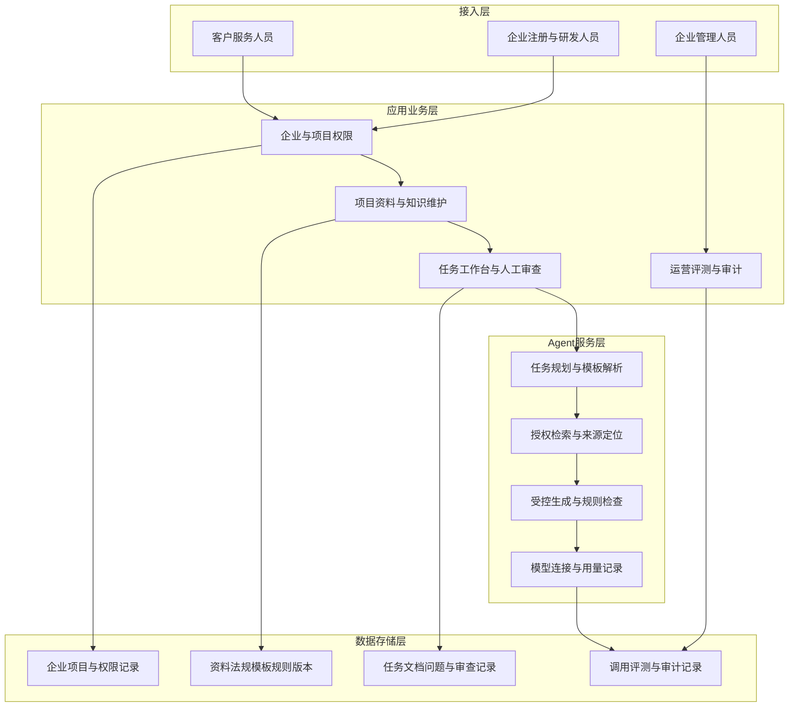
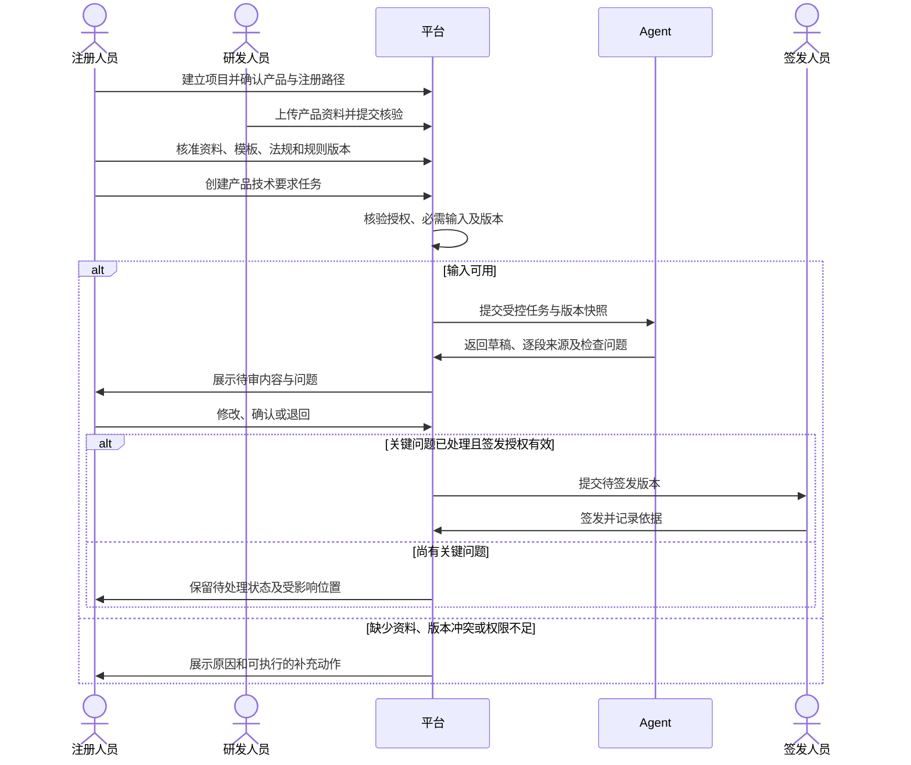
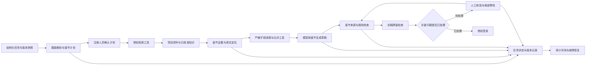
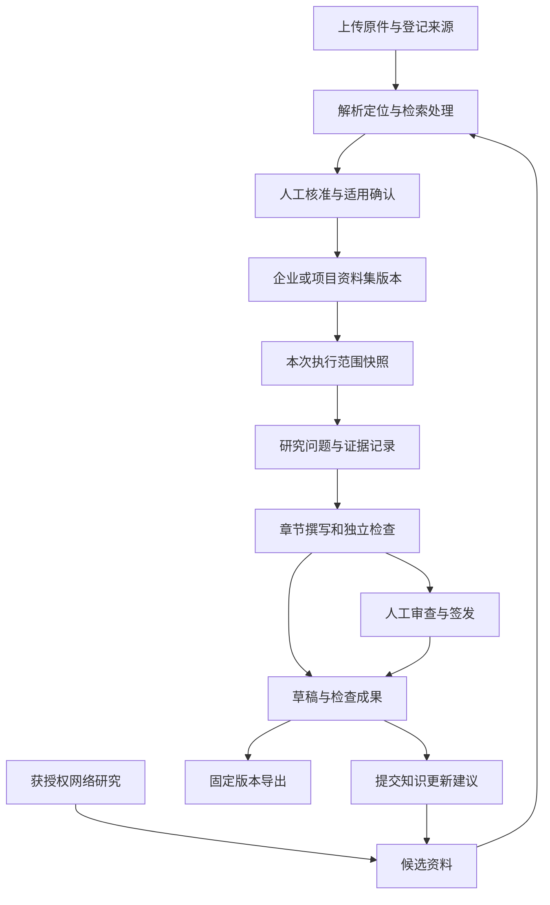

# 医疗器械企业 Agent 平台产品需求规格说明书

## 1. 版本记录与修订

| 日期 | 版本 | 文档状态 | 说明 | 编写责任 |
| --- | --- | --- | --- | --- |
| 2026-09-23 | V1.0.0 | `DRAFT` | 依据现有沟通、产品决定和 R01 至 R08 编写待评审需求 | 产品需求编写 |
| 2026-09-24 | V1.1.0 | `DRAFT` | 增加开源 Agent 调研、复杂文稿任务规则和验收场景 | 产品需求编写 |
| 2026-09-27 | V1.2.0 | `DRAFT` | 参考 GPT Researcher 与 DeerFlow，明确 Agent 能力配置、资料范围、资料生命周期和成果复用 | 产品需求编写 |
| 2026-09-28 | V1.3.0 | `DRAFT` | 依据官方申报资料要求与文档格式，补充文档目录、字段、适用条件、证据要求、导出规则及验收场景 | 产品需求编写 |

本文件定义目标行为和验收场景。功能实现、客户批准、真实业务验收状态均为 `NOT_RUN`。`EXPLICIT` 表示客户表达或已经记录的产品决定，`INFERRED` 表示待确认的产品设计，`UNKNOWN` 表示缺少决定或证据。后续调整保留 `FR`、`BR`、`AC`、`NFR` 和 `RISK` 编号。

## 2. 文档说明

### 2.1 依据与范围

| 来源 ID | 材料 | 用途 |
| --- | --- | --- |
| E01 | [客户需求初次沟通.md](./客户需求初次沟通.md)，2026-09-23 整理 | 客户表达、注册文档示例、平台能力和待确认事项 |
| E02 | [产品方向与商业假设.md](./产品方向与商业假设.md)，2026-09-23 | D01 至 D08、G01、O01、O02、C01 至 C03 和价值指标 |
| E03 | [项目研发规划.md](./项目研发规划.md)，第二节与 T02 | R01 至 R08 的范围编号和交付条件 |
| E04 | 第 6.1 节列出的开源项目官方仓库，2026-09-24 查阅 | Agent 编排、长文研究与生成方式的参考；不代表框架选型或医疗器械业务验证 |
| E05 | 第 6.3 节 GPT Researcher 与 DeerFlow 官方资料，2026-09-27 查阅；用户指定参考这两个项目 | Agent 与资料管理的设计依据；具体产品规则标记为 `INFERRED` |
| E06 | 第 2.3 节《医疗器械注册申报资料要求和批准证明文件格式》，2021 年第 121 号公告 | 非 IVD 注册资料目录、首次注册、变更、延续及资料格式 |
| E07 | 第 2.3 节《医疗器械产品技术要求编写指导原则》，2022 年第 8 号通告 | 产品技术要求的正式结构、性能指标、检验方法和格式 |
| E08 | 第 2.3 节《医疗器械说明书和标签管理规定》，原总局令第 6 号 | 说明书与标签应有内容、警示及一致性要求 |
| E09 | 第 2.3 节临床评价相关指导原则，2021 年第 73 号通告附件 4《医疗器械注册申报临床评价报告技术指导原则》、附件 5《列入免于临床评价医疗器械目录产品对比说明技术指导原则》 | 临床评价报告参考格式及免于临床评价的对比说明 |
| E10 | 第 2.3 节 GB/T 42062—2022 官方元数据 | 风险管理标准编号与实施状态；未取得标准正文 |

**名词**：租户指一个使用平台的企业数据空间；项目指某一医疗器械产品及其注册路径对应的资料与任务集合；严格字段指需要从指定权威资料取得并逐项核验的名称、型号、参数、编号等内容；来源记录指内容与原始文件、版本、页码或法规条款的关联；签发指企业注册部门授权人员依企业流程批准对外使用的文件版本。

### 2.2 首个场景与边界

首个验证场景为**第二类、第三类医疗器械项目全流程的注册资料与知识维护**，产品类型不限，优先面向中小型医疗器械企业，以 SaaS 方式设计〔E02，D01、D02、D07，`EXPLICIT`〕。全流程在产品中表现为项目阶段、资料清单、适用知识和任务的持续维护；具体项目的分类、境内或进口属性、注册类型、环节及资料清单由授权注册人员确认〔`INFERRED`〕。

第二类医疗器械的“产品技术要求”是首个可描述完整操作与验收的**贯通示例**〔E01，`EXPLICIT`〕。该示例涵盖建档、资料与模板选择、文档草稿、来源与质量检查、人工审查和签发控制；第三类项目使用同一产品能力，但须分别核定适用要求和真实样本。现有客户资料仍待整理，模拟内容仅可用于明确标记的设计演示，不能用于正式签发或效果判断〔E02，D03，`EXPLICIT`〕。

法规版本、适用范围及具体申报要求由客户授权人员按项目核验。官方查询入口包括[《医疗器械注册与备案管理办法》](https://www.samr.gov.cn/zw/zfxxgk/fdzdgknr/fgs/art/2023/art_568880e3ee344c45b38d073bba1c53ad.html)、[国家药监局政务服务窗口](https://www.nmpa.gov.cn/zwfwqjd/index.html)、[医疗器械标准目录](https://app.nidc.org.cn/biaogzx/qxqwk.do)与[全国标准信息公共服务平台](https://std.samr.gov.cn/gb/gbQuery.National)。检索结果只提供候选依据，不能自动决定项目适用性。

### 2.3 官方文档依据与适用边界

核查日期：2026-09-28。下表记录已经阅读的官方网页及附件；通用要求、指导原则提供的参考格式、产品设计分别标明。具体产品的专用指导原则、适用标准、受理机关和申报渠道要求由注册人员核准后进入项目模板版本。不能用通用目录证明具体产品已经满足全部注册要求。

| 来源 | 官方文件与已核查内容 | 适用性及使用方法 |
| --- | --- | --- |
| E06 | [2021 年第 121 号公告及附件](https://www.beijing.gov.cn/zhengce/zhengcefagui/qtwj/202307/t20230721_3204148.html)：完整阅读附件 4 资料格式、附件 5 注册资料、附件 6 延续注册、附件 7 变更、附件 9 安全和性能基本原则清单 | 公告自 2022-01-01 实施，官方页面标记现行有效。第 8.5.2 节采用附件 5 的六章目录；延续及变更采用各自附件。IVD 使用对应专属法规和模板，不套用此非 IVD 目录 |
| E07 | [2022 年第 8 号通告及指导原则全文附件](https://mpa.hunan.gov.cn/mpa/yszx/jssp/jsbzx/202202/t20220215_22482327.html) | 适用于注册、备案的医疗器械，包含 IVD；明确一般内容与格式。具体指标数值、方法及产品专属要求仍须有项目证据与适用依据 |
| E08 | [《医疗器械说明书和标签管理规定》全文](https://www.samr.gov.cn/zw/zfxxgk/fdzdgknr/bgt/art/2023/art_0b21c1f7edae42d1a1653a98d28ea99b.html)，第 4、10 至 16 条 | 自 2014-10-01 实施。说明书第 10 条列明 14 组内容；警示、重复使用说明及标签内容按产品属性适用。申报样稿与获准上市后的正式内容分别管理 |
| E09 | [2021 年第 73 号通告及附件](https://www.beijing.gov.cn/zhengce/zhengcefagui/qtwj/202204/t20220408_2669595.html)：完整阅读附件 4 临床评价报告指导原则、附件 5 免于临床评价的临床评价相关资料要求 | 页面标记现行有效。附件 4 提供报告参考格式，适用于需要临床评价的第二类、第三类器械，IVD 除外；免于临床评价时仍需目录比对及产品对比资料，具体目录版本须核准 |
| E10 | [GB/T 42062—2022 官方标准信息](https://openstd.samr.gov.cn/bzgk/std/newGbInfo?hcno=1148CB082527B776560903948B22DAB0) | 页面标记现行、推荐性国家标准，2023-11-01 实施。官方页面因版权不提供正文；本次未核验标准正文条款。风险管理资料要求依据 E06，标准逐条规则须取得获授权全文后建立 |

文档目录和法规明确规定的内容标记为“官方要求”；指导原则提供的组织方式标记为“官方参考格式”；平台增加的字段类型、关系、状态、检查门槛及页面交互均为 `INFERRED`。产品型号、性能数值、试验结果、检验结论、证书编号、伦理批准、签名与印章属于真实业务数据，不能由模型补造。

## 3. 项目背景与目标

现有注册资料主要依靠人员查找项目文件、核对法规、编写文档和逐段审查。客户希望维持项目资料、法规、模板及检查规则的版本关系，让不同经验水平的使用者按照任务流程产出可核查内容〔E01〕。

| 用户结果 | 对应目标行为 | 衡量口径与现状 |
| --- | --- | --- |
| O01 | 注册、研发及获授权服务人员可维护资料、定位依据、处理缺项和冲突、完成人工审查 | 项目资料完整率、来源可核验率、严格字段一致率、问题处理记录；真实基线 `NOT_RUN` |
| O02 | 企业购买决定者可查看同类项目的质量、工时、采用情况与成本 | 同类项目分组报表与可追溯原始记录；真实基线 `NOT_RUN` |

**北极星指标建议 `INFERRED`**：观察期内，经过注册部门授权人员审查并完成所选注册环节资料任务的真实项目数。每个项目、环节和文档类型分别计数，演示任务排除。业务指标包含资料完整率、关键问题检出率、检查误报率、来源可核验率、单份文档处理工时、首次审查通过率和实际采用率；公式沿用 E02 第五节，按器械类别、产品类型、注册类型及环节分组。历史基线、目标数值、样本量和统计周期为 `UNKNOWN`。录音提到的“两周”与“两小时”仅是期望示例，不能作为验收阈值。

**范围内**：R01 至 R06 的平台与首个场景能力；R07 的场景登记和逐场景需求约束；R08 中 SaaS 的企业数据隔离及部署要求。**后续交付条件**：R07 其他领域场景的完整任务流程，R08 的私有化部署、配套服务和现有 B/S 系统连接，须取得各自输入、责任与环境决定后安排版本；需求记录仍保留。收费单位、具体模型、技术框架和交付日期为 `UNKNOWN`。

## 4. 应用与数据架构图

图示为产品能力边界〔`INFERRED`〕，具体组件、数据库、部署和模型选择交由后续设计决定。所有检索、生成、导出、统计和日志查询继承企业及项目授权范围。

## 5. 业务流程与状态流转

### 5.1 跨角色业务流程

### 5.2 核心对象和状态

| 对象 | 状态与触发 | 校验与可观察结果 |
| --- | --- | --- |
| 项目 | `待配置 → 使用中 → 暂停 → 归档`；授权人员建立、启用、暂停或归档 | 保留历史任务和版本；暂停期间禁止新任务；归档后仅允许授权查询。恢复须重新校验权限及资料状态，删除按保存策略执行 |
| 资料、模板、法规、规则 | `待核验 → 已核准 → 已停用`；有权限人员提交、核准、停用 | 核准时记录版本、来源、适用范围、核准人；更新生成新版本，历史任务保留原关联；停用触发受影响任务提示 |
| 任务 | `待补资料 → 计划待确认 → 待运行 → 运行中 → 待人工审查 → 待签发 → 已签发` | 输入齐备才形成章节计划；授权人员确认计划后进入待运行；生成和检查结束后显示草稿与问题；关键问题清零及授权核验后才进入待签发 |
| 任务异常 | `运行中 → 运行失败`、`待人工审查 → 已退回`、`运行中 → 取消中 → 已取消`；无在途调用时可直接取消 | 失败保留已完成结果和失败原因，继续处理生成新的尝试记录；退回附原因并返回指定处理人；取消按 BR-17 确认执行状态，继续处理创建修订任务 |

**BR-01**：任务提交时固定所用项目资料、模板、法规、标准、规则、Agent 与模型配置版本；后续更新不改变已有结果，重新运行产生新任务版本。**BR-02**：同一用户重复提交同一请求只产生一项任务；并发编辑时提示版本冲突并要求重新读取。**BR-03**：导出的待审草稿在下载记录与独立审查材料中明确标记状态；正文状态标识遵循对应文档格式。仅已签发版本可显示企业签发标识，且不改变官方正文格式。**BR-04**：关键问题类别和签发门槛采用 E02 的建议作为 `INFERRED` 待评审规则，企业授权人员须确认具体字段及责任。

**BR-05**：长文任务先形成章节计划，列出每章目标、模板要求、所需证据、严格字段、依赖章节和负责人；授权注册人员确认后执行，计划变更产生新版本。**BR-06**：每项可核查事实关联授权证据及原始定位；来源缺失、定位不可访问或证据与结论不符时形成待核验问题。**BR-07**：严格字段从指定权威资料读取并逐项比对，模型生成结果不得替代原始字段。**BR-08**：任务保存章节产物、证据集合、检查结果和人工决定；恢复时核对版本快照与已完成步骤，外部调用不得因重复执行产生重复业务结果。**BR-09**：局部修改仅重新处理受影响章节及其依赖章节，保留未受影响章节的原文和引用记录；跨章一致性重新检查。**BR-10**：每项研究、生成和检查步骤设定调用次数、费用及停止条件；预算或次数耗尽、来源质量不足时显示具体状态，由授权人员决定继续方式。**BR-11**：检索到的网页和项目文件内容只作为资料；其中要求更改任务目标、调用其他工具或读取其他项目的文字不产生执行权限，相关尝试记录为安全事件。

以下规则属于 E05 引出的产品设计，状态为 `INFERRED`：

- **BR-12 资料范围**：每次执行保存资料集、文件版本、指定网址及是否允许联网的范围快照。有效范围为用户当前授权、项目适用范围、Agent 可用范围与本次选择范围的交集。空选择、检索失败或来源不可用均不得扩大范围。
- **BR-13 资料可用条件**：上传完成、解析完成、检索就绪、业务核准分别记录。正式任务依据须同时满足原文可定位、处理就绪、版本已核准、项目适用及当前授权；自动提取结果只能作为核准建议。
- **BR-14 成果转为资料**：会话附件、网络候选资料和任务成果保存到项目或企业公共资料时，形成待核验资料版本并保留来源关系；生成结论关联原始证据，不允许通过再次导入自身输出证明自身结论。
- **BR-15 能力与职责**：Agent 配置固定专业角色、Skill、工具、模型、模板、规则与预算版本。专业 Agent 只能返回分配章节的候选结果；流程控制、资料核准和人工签发动作由业务服务按授权执行。
- **BR-16 变更影响**：资料正文、适用范围、来源或解析定位变化后建立新版本并展示受影响任务。权限撤销立即限制后续读取与调用；待审结果进入重新核验，历史证据保留但访问仍受当前权限控制。
- **BR-17 执行与停止**：每次执行具有独立运行记录，子任务关联同一父任务、输入快照与预算。停止请求进入“取消中”，停止新派发并等待在途调用结算；确认所有在途调用终止后才能显示“已取消”。已取消任务可创建继续处理的修订任务，原记录只读。
- **BR-18 记忆与业务知识**：任务摘要、用户写作习惯、项目事实与核准资料分别管理。写作习惯可由用户查看和删除；项目事实只能从授权原文取得，聊天内容不能自动改变知识核准状态或授予后续操作权限。

以下规则将 E06 至 E10 转为产品行为，规则设计状态为 `INFERRED`：

- **BR-19 文档适用性**：模板按器械属性、境内或进口、申请类型、受理机关、申报渠道和依据版本匹配；注册人员确认每项适用结论。未知属性显示待确认，不能解释为不适用；没有核准模板的路径不能创建正式生成任务。已发布模板更新建立新版本和影响清单。
- **BR-20 字段及证据**：每个目录节点保留内容要求、必填条件、证据类型、填写方式及校验规则。字段状态区分未填写、待补证、存在冲突、待审查、已确认、不适用；不适用须有理由、依据、确认人员与时间。必需目录不能通过删除节点或空文本绕过检查。
- **BR-21 指标与方法**：性能指标逐项关联适用型号、可判定要求、单位和条件、依据及检验方法；方法按指标编号对应，覆盖全部适用型号与条件。缺少明确要求、方法或必要验证证据时阻止确认，不能用通用描述补足产品性能结论。
- **BR-22 正文与审查资料**：正式正文采用对应文档的官方格式和核准模板；内部来源清单、检查问题、Agent 运行记录作为独立审查材料关联正文版本。企业签发不表示监管注册批准，平台不能生成监管证件、监管批准编号、签名或印章。正式申报格式按受理渠道核准，草稿状态必须在工作台、下载记录及独立审查材料中明确展示。
- **BR-23 跨文件一致性**：同一产品名称、型号、结构组成、软件版本、适用范围、性能要求和警示等字段建立共享事实记录及各文档使用位置；每个数值同时保存单位、条件和适用型号。变更显示全部受影响文档，待审版本重新检查；已签发版本保持原内容并提示是否需要发起修订。

### 5.3 长文任务的章节状态

| 状态 | 进入条件 | 可执行动作 | 退出条件与异常处理 |
| --- | --- | --- | --- |
| 计划待确认 | 模板目录与项目输入通过校验 | 查看章节要求、调整证据范围与负责人 | 授权注册人员确认计划后进入证据准备；计划未确认时不生成正式草稿 |
| 证据待补 | 章节缺少必需资料、引用定位或适用性核准 | 上传资料、选择已核准来源、提交人工核验 | 相关输入齐备后重新检查；其他满足条件的章节可继续 |
| 证据已备 | 章节所需来源、严格字段及版本已经记录 | 启动章节生成 | 生成失败保留证据记录与失败原因 |
| 草稿待检查 | 章节草稿及引用已保存 | 执行章节检查、查看原文 | 检查完成进入待人工审查；检查失败保持草稿待检查 |
| 待人工审查 | 章节检查完成，问题清单可见 | 确认、修改、退回、请求补充证据 | 章节通过后进入已确认；退回形成新章节版本 |
| 已确认 | 授权人员确认内容与来源 | 查询历史、发起变更 | 证据或上游章节变化时标记需重新检查，原版本保留 |

## 6. 竞品分析

以下内容依据 2026-09-23 查阅的供应商公开页面，只记录页面明确展示的能力。目标产品的机会是自身设计选择，未将竞品页面未提及的功能判为缺失。

| 竞品 | 公开定位与功能 | 可参考的能力 | 本产品的设计重点 | 参考 |
| --- | --- | --- | --- | --- |
| Greenlight Guru | 医疗器械 eQMS，含文件控制、版本与批准、设计控制、风险管理，以及与质量数据相关的 AI 功能 | 文件版本、审批记录与研发质量记录的关联 | 中国医疗器械项目的注册路径、法规版本、逐段来源和人工签发 | [官方产品页](https://www.greenlight.guru/quality-management-software) |
| Qualio | 医疗器械 QMS，公开展示文件管理、模板、批准流程、审计记录、AI 差距分析与法规监测 | 模板工作流、审计与资料关联 | 把项目适用知识与注册文档任务、问题处理连接 | [官方产品页](https://www.qualio.com/solutions/medical-device-qms) |
| MasterControl | 医疗器械质量管理方案，公开展示文件控制、变更控制、签署、审计及研发和生产相关模块 | 文件与变更控制、跨业务记录追踪 | 面向中小型企业的项目资料维护和注册文档审查流程 | [官方产品页](https://www.mastercontrol.com/industries/medical-device/) |

上述公开页面无法验证各产品在中国注册资料上的适用性、定价或实际效果；采购比较须取得演示、报价和目标项目验证记录。

### 6.1 Agent 开源框架与复杂文稿项目

查阅日期：2026-09-24。下表记录官方仓库明确展示的方式，以及对本产品需求的启发。开源项目的公开能力不能替代企业权限、资料适用性和医疗器械注册专业审查。

| 项目与类型 | 官方资料显示的能力 | 本产品可借鉴的需求 | 产品边界 |
| --- | --- | --- | --- |
| [LangGraph](https://github.com/langchain-ai/langgraph)，编排框架 | 长时间运行的有状态工作流、持久执行、人工介入和状态恢复 | 章节状态、人工暂停、故障恢复、任务版本快照 | 需自行定义医疗器械业务规则与企业授权 |
| [Dify](https://github.com/langgenius/dify)，应用平台 | 可视化工作流、知识检索、模型与工具接入、运行记录；官方许可包含附加条件 | Agent 配置发布、知识检索与运行观测 | SaaS 使用前核对许可条款及所需版本的权限能力 |
| [CrewAI](https://github.com/crewAIInc/crewAI)，编排框架 | Crews 的角色协作与 Flows 的条件流程和状态管理 | 专项研究、编写、检查职责及可控制的流程分支 | 多角色输出仍须统一来源、权限及审查规则 |
| [STORM / Co-STORM](https://github.com/stanford-oval/storm)，长文项目 | 先研究与构建目录，再依据来源撰写带引用长文；Co-STORM 支持人员参与知识整理 | 目录确认、章节证据准备、带来源撰写 | 项目自述产物仍需大量编辑；本产品签发由授权人员负责 |
| [GPT Researcher](https://github.com/assafelovic/gpt-researcher)，研究报告项目 | 规划研究问题、收集网络与本地资料、记录来源并汇成报告 | 章节研究问题、证据筛选和来源记录 | 开放网络结果只能作为候选来源，适用性需核准 |
| [DeerFlow 2.0](https://github.com/bytedance/deer-flow)，长任务平台 | 技能、工具、上下文管理、持久任务和受控执行；官方提供报告生成能力 | 长任务进度、上下文管理和受限工具调用 | 其高权限工具需单独验证隔离与授权，不直接接入企业资料 |

### 6.2 选型验证条件

技术选型状态为 `UNKNOWN`。后续以同一组获授权真实任务检查候选方案：① 章节计划和依赖关系能否保留；② 中断后能否恢复原任务版本与人工处理点；③ 检索、工具调用和生成能否执行企业及项目授权；④ 文件版本、页码、条款与输出内容能否逐项核查；⑤ 严格字段与跨章检查能否独立于模型输出；⑥ 调用费用、失败及审计记录能否查询；⑦ SaaS 和后续部署方式是否满足许可、数据处理与运行要求。每项保存运行结果与不能满足的条件，不以公开演示代替验证。

### 6.3 GPT Researcher 与 DeerFlow 的专项参考

查阅日期：2026-09-27。依据当日官方文档与仓库 `main` 内容，未运行这些项目，未确认用于本产品的发布版本。来源事实与本产品设计分别记录；所有新增功能继续接受 R01 至 R08 的业务与权限约束。

| 来源 | 已核查的公开机制 | 本产品需求推导 `INFERRED` |
| --- | --- | --- |
| [GPT Researcher：Tailored Research](https://docs.gptr.dev/docs/gpt-researcher/context/tailored-research) | 支持本地、网络、混合来源；指定 URL 可控制是否追加其他来源 | 任务选择资料范围和联网策略，显示实际生效范围，固定到执行版本；参见 8.4.1 |
| [GPT Researcher：Deep Research](https://docs.gptr.dev/docs/gpt-researcher/gptr/deep_research) | 研究问题按深度、广度与并发参数推进，并返回进度 | 每章维护问题、证据与未解决事项，配置研究和修订上限；参见 8.9.1 |
| [DeerFlow：Projects](https://github.com/bytedance/deer-flow#projects) | 项目组织共享资料，支持会话文件保存到项目及项目资料附加到会话 | 增加项目资料集、会话附件与成果转存的完整路径；参见 8.3.1、8.3.4 |
| [DeerFlow：Private Knowledge Retrieval](https://github.com/bytedance/deer-flow#private-knowledge-retrieval-ragflow) | 检索范围按消息保存，引用保留检索时片段；知识管理依赖外部 RAGFlow | 本产品统一提供资料管理入口，保存来源、解析与检索版本；参见 8.3.2、8.3.3 |
| [DeerFlow：Skills & Tools](https://github.com/bytedance/deer-flow#skills--tools)、[Sub-Agents](https://github.com/bytedance/deer-flow#sub-agents) | 按需加载能力，专业子任务具有各自上下文和工具范围 | Agent 提供可发布的能力清单、职责和产出要求；企业授权独立校验；参见 8.2.1、10.3 |

本产品的设计决定：采用“明确任务目标—确认研究与文稿计划—限定资料范围—执行专业步骤—核验来源—人工审查—管理成果”的业务流程。资料核准、项目适用性、签发和成果复用均有独立状态；框架选型继续执行第 6.2 节验证条件。公开项目的默认参数、时长与费用不作为本产品承诺。

## 7. 功能说明概览

| 功能 ID | 对应范围 | 入口与核心功能 | 使用者 | 业务结果 | 优先级与状态 |
| --- | --- | --- | --- | --- | --- |
| FR-01 | R01 | 企业与项目管理：用户、角色、权限及资料访问范围 | 企业管理人员 | 授权范围可执行并有审计记录 | P0，`EXPLICIT` |
| FR-02 | R02 | Agent 管理：创建、分类、能力配置、专业角色、发布、模型连接和成本 | 平台管理人员 | 可调用已发布版本并追溯能力与调用 | P0，范围 `EXPLICIT`；能力规则 `INFERRED` |
| FR-03 | R03 | 知识与资料中心：资料集、上传解析、检索、版本核准、引用关系及成果复用 | 注册、研发、知识审核人员 | 已核准且可定位的版本可供任务选用 | P0，范围 `EXPLICIT`；管理规则 `INFERRED` |
| FR-04 | R04 | 项目工作台：结构化创建任务、查看状态与待办 | 注册、服务人员 | 任务保留输入和版本快照 | P0，`EXPLICIT` |
| FR-05 | R05 | 文档工作区：受控生成、来源、检查、人工审查与签发 | 注册、研发、签发人员 | 文档及问题有完整处理记录 | P0，`EXPLICIT`，部分门槛 `INFERRED` |
| FR-06 | R06 | 评测运营：版本比较、采纳、退回、评分、成本和审计 | 管理、评测人员 | 指标可复核到任务版本 | P1，`EXPLICIT`；阈值 `UNKNOWN` |
| FR-07 | R07 | 场景目录：法规比较、报告、翻译、市场分析、多模态问答 | 对应授权人员 | 每个场景具备独立任务定义 | P1，方向 `EXPLICIT`；输入规则 `UNKNOWN` |
| FR-08 | R08 | 服务与连接：SaaS 企业空间、部署与现有系统连接 | 企业及平台管理人员 | 数据边界与连接状态可核验 | SaaS P0；其他模式待决定 |
| FR-09 | R02、R04、R05 | 长文 Agent 工作台：章节计划、证据准备、生成检查与恢复 | 注册、研发、知识审核人员 | 可核查且可继续处理的多章节草稿 | P0，设计规则 `INFERRED` |

## 8. 详细功能描述与 BDD 验收

### 8.1 FR-01 企业与项目权限

| 维度 | 规则 |
| --- | --- |
| 业务逻辑 | 企业管理人员邀请、停用用户并授予企业角色；项目负责人授予项目成员的资料与任务权限。授权按“主体—资源—动作—企业/项目范围—有效条件”记录。全部读写、导出和 Agent 检索都在服务端校验。 |
| 交互 | 无权限入口隐藏或禁用；直接访问返回明确拒绝信息；授权变化后重新读取显示生效权限。 |
| 异常 | 断网不显示授权成功；并发授权以最新有效版本校验；重复邀请提示已有身份；越权访问拒绝并审计；身份服务异常停止受保护操作。 |

| 页面元素 | 控件 | 数据与规则 | 必填 | 默认值 |
| --- | --- | --- | --- | --- |
| 企业用户 | 选择与邀请 | 企业内身份，不能跨企业选择 | 是 | 空 |
| 项目角色 | 单选 | 注册、研发、服务、审核、签发等角色由客户确认 | 是 | 无权限 |
| 授权范围 | 项目与动作选择 | 展示项目、资料读写、任务、导出等独立动作 | 是 | 最小权限 |

- **AC-01 正常**：Given 企业管理人员在本企业建立项目并授予注册人员指定项目的资料读取与任务创建权限；When 该人员重新进入项目；Then 可查看该项目资料并创建任务，授权记录可查询。
- **AC-02 拒绝**：Given 用户仅属于企业甲；When 请求企业乙的资料、任务、导出或 Agent 检索；Then 不返回企业乙内容，记录拒绝事件，企业乙管理员可在其授权范围内查询对应审计记录。

### 8.2 FR-02 Agent、模型与调用管理

| 维度 | 规则 |
| --- | --- |
| 业务逻辑 | 平台管理人员登记 Agent 类别、用途、输入输出说明、可用企业及版本；模型连接记录服务类型、许可范围、调用预算及状态。草稿通过评测和授权发布后才进入任务选择列表。每次调用记录 Agent、提示词或规则、模型配置版本、Token 用量与成本口径。 |
| 交互 | 显示草稿、待发布、已发布、已停用状态；调用中展示进度和费用提示。预算阈值、审批人和模型清单为 `UNKNOWN`。 |
| 异常 | 断网、模型超时或服务不可用时记录失败和已产生的用量；重复发布同版本不产生重复版本；并发发布校验版本；越权修改拒绝；预算超限时停止新调用并说明原因。 |

| 页面元素 | 控件 | 数据与规则 | 必填 | 默认值 |
| --- | --- | --- | --- | --- |
| Agent 名称与类别 | 文本与选择 | 企业内唯一名称；类别由管理人员维护 | 是 | 空 |
| 模型连接 | 受控选择 | 仅显示已授权且连接已验证的配置 | 是 | 空 |
| 发布版本 | 只读标识与操作 | 保存评测结果、批准人、发布时间 | 发布时必填 | 草稿 |

- **AC-03 正常**：Given 管理人员拥有发布权限且模型连接验证成功；When 发布 Agent 新版本并运行授权任务；Then 任务固定该版本，调用记录含模型配置、用量和费用计算依据，停用后新任务无法选择旧版本。
- **AC-04 异常**：Given 外部模型请求超时或预算不足；When 任务调用该模型；Then 任务进入可处理的失败或待补预算状态，保留已完成部分、调用尝试与实际用量，不标记为成功。

#### 8.2.1 Agent 能力与发布配置

设计状态：`INFERRED`。Agent 是面向业务的可复用配置；Skill 描述一项处理能力；工具执行检索、解析、检查或导出等操作；模型连接承担生成与判断。四类对象分别维护版本和状态，任务记录实际使用的组合。

| 配置区域 | 字段、默认行为与校验 | 使用者与页面反馈 |
| --- | --- | --- |
| 流程与默认配置 | 业务目标、支持文档、输入要求、输出清单、必需章节、模板规则、人工检查点、默认资料集；注册文档默认使用已核准资料，联网关闭 | 平台管理人员编辑配置；注册人员参与业务评审；普通使用者查看用途、输入和输出要求 |
| 能力与专业角色 | 规划、资料研究、技术字段核验、章节撰写、来源审查、总稿整理；每个角色配置输入、产出、可用 Skill、工具与模型连接 | 同一配置页面展示职责列表；独立问题允许并行，共用字段或同一章节的写入按依赖顺序执行 |
| Skill 清单 | 标识、名称、用途、版本、来源、所需工具、适用文档、状态及批准记录；支持从已核准能力目录选用和提交新能力审核 | 配置草稿可替换版本；未审核能力不可发布；资料文件中出现 Skill 名称不会触发安装或执行 |
| 工具清单 | 工具用途、读取或写入动作、允许的数据类别、目标系统、连接状态和授权范围；默认仅启用资料读取、检索、检查与生成草稿 | 启用后仍按每次业务请求校验权限；外部发送、资料删除、核准与签发不因选中工具获得授权 |
| 模型与预算 | 按角色选取已验证连接；配置研究问题数、追加研究轮数、并发数、修订轮数、总调用数、时限、Token 与费用上限 | 数值由发布配置明确填写，必填上限缺失时不能发布；任务显示配置上限、已用及在途用量，未知费用显示待结算 |
| 评测与发布 | 固定输入资料、角色职责、Skill、工具、模型、模板与规则版本；验证正常路径、来源缺项、权限拒绝、停止恢复及导出 | 任一配置变化使对应草稿评测失效；发布时记录通过项和阻断项；保存草稿不改变运行中的配置 |
| 任务记录 | 任务、运行、步骤、子任务、输入输出版本、使用能力、实际费用、人工决定与停止原因 | 普通用户查看业务步骤和结果摘要；运维按授权查看诊断；不展示密钥或模型内部推理 |

默认能力清单提供注册资料检索、模板目录生成、严格字段核验、章节撰写、引用检查、文档导出。能力安装、代码执行环境与连接服务由管理人员维护；业务人员仅在已发布能力内选择。模型连接停用或授权撤销立即阻止新调用；历史配置快照继续可查。

- **AC-27 能力配置发布**：Given 配置草稿包含已核准 Skill、已验证工具与模型、明确研究上限和通过的固定样本评测；When 授权管理人员发布并创建任务；Then 任务记录完整配置版本及能力清单；修改任一依赖后，新草稿需重新评测，已有任务继续显示原配置。
- **AC-28 工具授权**：Given Agent 选中了资料读取工具但用户没有目标项目权限，或者 Skill 请求了未授权外部写入；When 工具执行；Then 服务端拒绝动作，记录目标步骤和原因，能力配置不能扩大用户权限，密钥不进入模型上下文及导出。

### 8.3 FR-03 项目资料与知识版本

| 维度 | 规则 |
| --- | --- |
| 业务逻辑 | 上传内容记录企业、项目、文件类型、来源、版本、上传者、权限和内容状态；法规与标准另记录发布机关、原文地址、编号、发布日期、实施日期、核对日期、适用范围及条款。模板记录目录与资料来源、编写方式的映射；规则记录适用范围和核准人。更新保留历史版本。 |
| 交互 | 列表显示待核验、已核准、已停用及受影响任务；打开引用可定位文件和页码或法规条款。 |
| 异常 | 空文件、损坏文件、对应格式的原文位置无法确定时标明不可引用位置；来源失效或版本冲突进入待核验；断网保留本地输入并明确未提交；重复上传提示版本关系；越权读取拒绝；解析服务异常不发布该资料。 |

| 页面元素 | 控件 | 数据与规则 | 必填 | 默认值 |
| --- | --- | --- | --- | --- |
| 资料文件与类型 | 上传与选择 | 类型、容量和格式上限待环境决定；解析失败明确显示 | 是 | 空 |
| 来源与版本 | 文本、链接、日期 | 法规需要可核查原文和实施状态；项目文件需要上传来源 | 是 | 待核验 |
| 适用范围 | 项目、产品、环节选择 | 由授权注册人员确认 | 是 | 未确认 |
| 内容属性 | 标识 | 演示内容必须标记模拟，正式任务不可选 | 是 | 真实待核验 |

- **AC-05 正常**：Given 注册人员上传项目资料并由授权人员核准版本和适用范围；When 在任务中选取该资料并打开来源；Then 显示对应文件版本和可核查位置，历史任务仍指向原版本。
- **AC-06 异常**：Given 法规链接无原文、实施状态未核定或项目文件缺少对应格式的稳定原文位置；When 尝试将其作为正式任务的依据；Then 阻止相关引用，显示缺失项和受影响位置，要求授权人员补充或核准。

#### 8.3.1 资料归属、资料集与访问范围

设计状态：`INFERRED`。资料中心继续采用范围、文件夹、列表和阅读标签。增加“资料集”常用视图：将多份资料组织为可命名、可复用的任务输入集合，资料集记录成员版本及适用条件；文件夹用于整理位置，标签用于筛选，两者均不授予访问权限。

| 归属 | 典型内容与管理责任 | 使用规则 |
| --- | --- | --- |
| 企业公共资料 | 核准的法规、标准、通用模板、规则；知识审核人员维护 | 所属企业内按授权共享，并经项目适用性确认；不会自动加入全部任务 |
| 项目资料 | 产品说明、检验材料、项目采用的法规及模板；研发上传、注册人员组织、授权审核人员核准 | 项目成员按动作授权使用；公共资料以指定版本加入项目资料集，保留原始归属和版本关系 |
| 会话附件 | Gru 会话或任务中本次补充的文件；上传者维护 | 继承当前企业、项目和会话访问限制；默认仅本会话可读取，标记待核验；需保存到项目并核准后才能作为正式任务依据 |
| 任务成果 | 研究记录、章节草稿、总稿、问题清单与来源清单；任务负责人管理 | 固定生成任务、运行和版本；草稿与已签发成果分别显示；“保存到项目资料”创建待核验版本 |

资料集包含名称、维护人、归属、用途、产品类型、注册环节、成员版本和版本记录。可在项目详情创建“本项目注册资料”等自定义资料集，逐项补充模板要求的资料；资料完整度以已确认清单为分母，缺项不得由文件数量代替。成员更新形成资料集新版本，任务使用已有版本不自动切换。企业公共资料进入项目时新增引用关系，跨项目转存须同时具备源读取、目标写入及共享授权，不能仅靠移动文件夹完成。

#### 8.3.2 上传、解析、索引与业务核准

| 阶段与状态 | 必需行为 | 异常与恢复 |
| --- | --- | --- |
| 上传：待上传、上传中、已接收、上传失败 | 支持多文件队列、逐文件进度、大小和格式提示；选择归属、类别、版本与来源；每个文件单独确认服务端接收结果 | 部分失败只重试失败文件；断网重连查询原上传记录；超容量、空文件、损坏或加密文件明确报错；不显示整批成功 |
| 解析：排队、处理中、完成、部分失败、失败 | 保留原文件、校验摘要、解析版本、目录、正文、表格与原文位置；扫描内容需要 OCR 时明确显示处理来源 | 逐页或逐表显示无法读取范围；用户提交可读原件或重新处理；部分失败可预览已解析内容，但不能通过整个资料版本核准 |
| 检索：未建立、处理中、就绪、失败、已撤除 | 由解析版本形成可检索记录，保存检索版本和完成时间；原文阅读可早于检索就绪 | 检索失败保留原件和解析结果；重建仅影响指定处理版本；旧任务已有证据定位不被新处理结果替换 |
| 核准：待核验、已核准、已停用 | 人工核验来源、适用范围、实施信息、原文定位及必要字段，保存核准意见；就绪与核准分别显示 | 未就绪或来源不完整时列出阻断项；核准拒绝保持待核验并记录意见；停用须显示引用影响及理由 |

支持格式作为明确能力目标：PDF、DOCX、XLSX、CSV、TXT、Markdown、PPTX；各格式上线前必须通过真实文件的解析、定位和导出验证。PDF 使用原件页码；DOCX、Markdown、TXT 使用标题路径与内容位置；XLSX、CSV 使用工作表或表名及行列；PPTX 使用页序与文本对象。法规额外保存条款编号。显示页码与文档印刷页码不一致时同时列明；无稳定页码的文件不得编造页码。原始内容、OCR 或格式转换结果并列核查，人工更正产生新解析版本。

同一授权归属内按文件内容摘要识别重复：相同内容返回已有版本及加入资料集入口；名称相同但内容不同要求选择“新增资料”或“新增版本”，不得覆盖原件。跨企业不显示重复检测结果。批量变更按文件分别返回结果，部分失败时保留已成功操作及失败清单。

#### 8.3.3 检索、证据阅读与网络候选资料

| 页面元素 | 数据与交互 | 约束与默认值 |
| --- | --- | --- |
| 范围和资料集选择 | 企业授权资料、当前项目、我的上传；选择资料集、指定文件及版本；显示文件数量与不可用项 | 默认当前项目；“全部授权资料”仅改变浏览范围，不自动加入 Agent 输入 |
| 查询与筛选 | 名称、全文与语义查询；按类别、标签、资料集、核准状态、日期、适用环节和维护人筛选 | 正式任务选择器默认只展示适用且已核准的就绪版本；管理页可查看其他状态 |
| 检索结果 | 文件名、版本、摘录、位置、核准状态、适用范围；显示名称匹配或正文匹配依据 | 空结果显示本次范围与查询条件，允许用户修改；不自动搜索其他项目或联网；相似度不能表示事实可信程度 |
| 原文与解析内容 | 阅读标签中查看原件、解析内容、目录、表格、解析问题和属性；从命中位置进入原文 | 打开历史引用始终使用原任务版本；大文件按目录与内容位置读取，截取内容显示范围 |
| 检索验证 | 资料维护人输入业务问题，查看命中文件和位置，反馈遗漏或错误 | 不生成业务核准结论；检索连接不可用与查询无结果分别提示 |
| 网络资料收集 | 在已授权联网任务中登记指定网址、允许域名、检索时间；保存标题、发布方、原文地址、获取时间、内容摘要与原文快照 | 新建待核验候选资料；未核准前仅用于研究记录，不能作为注册文稿正式依据 |

网络来源获取失败、网页变更或原文与摘要不一致时，保留获取状态并显示缺项；有合法保存条件时保留原文快照。只有链接而不能保存或稳定核查原文的来源保持待核验。联网查询只发送经批准的检索词，页面预览实际发送内容；产品内部参数、企业文档和检验结果默认不得发送给公开搜索服务。第三方模型的数据发送规则由模型连接授权单独控制。

#### 8.3.4 引用关系、成果转存与生命周期

资料详情新增“使用关系”：列出引用该版本的资料集、Agent 配置、任务、章节、成果与核准记录，并显示源文件、派生产物和最终成果之间的关系。维护人员提交新版本时预览受影响任务；注册人员选择继续保留历史结果、补充核验或创建修订任务，旧签发记录保持只读。

成果转存表单包含目标归属、资料类别、标题、来源任务与运行版本、原始证据、维护人、适用范围和核准责任人。保存成功后返回新资料版本及待核验状态，原会话附件或成果保持原状态。普通收藏、下载、复制引用、保存到项目、提交核准分别使用独立动作；Agent 可提出知识更新建议，授权用户提交后进入人工核准队列。

停用资料立即停止新任务选择；已有待审任务显示受影响章节并清除相关审查确认。权限撤销后，检索、缓存、原文、历史引用和导出均重新校验权限；含受限内容的运行停止后续调用，相关成果限制为具备相应来源权限的用户访问。已传给外部服务的内容无法通过权限变更收回，记录实际发送范围供授权人员处理。

未被引用的资料可移入回收站；被任务、成果、资料集或配置引用的版本只允许停用。恢复须校验原归属、权限与内容状态，恢复后进入待核验。归档项目仅提供授权查询，禁止上传、转存、修改和新运行；重新处理需由授权人员恢复项目使用状态。永久删除须满足企业保存策略、无有效引用及专门删除权限；保存期限未确定时禁用永久删除及自动清理。

- **AC-29 批量上传与重复**：Given 同一授权项目中上传多份实际文件，其中存在重复内容和无法解析文件；When 查看队列并重试失败项；Then 每个文件显示独立结果，重复内容指向已有版本，失败文件不进入就绪及核准状态，成功文件不重复创建。
- **AC-30 原文位置与处理版本**：Given 已授权的 PDF、DOCX、XLSX、CSV、TXT、Markdown、PPTX 文件；When 分别解析、核查正文与表格并重新处理其中一个版本；Then 每种格式按对应位置规则打开原文，旧任务引用仍指向原处理版本；缺失内容和 OCR 错误阻止资料核准。
- **AC-31 资料集版本**：Given 项目资料集已被任务使用；When 维护人员增加文件或替换成员版本；Then 创建资料集新版本，既有任务仍显示原成员清单，文件夹移动和标签修改不改变成员授权或任务输入。
- **AC-32 检索范围**：Given 用户限定一个资料集及文件版本；When 全文或语义查询没有结果、索引失败或文件权限被撤销；Then 分别显示空结果、处理失败或访问拒绝，均不扩大查询范围；可见结果可定位对应原件。
- **AC-33 网络候选核准**：Given 联网研究获取了法规候选资料；When 保存到项目并尝试用于正式注册文稿；Then 获取时间、原文及版本可查，核准前不可作为正式依据；适用性与实施状态经授权人员核准后才可选用，失效原文保持待核验。
- **AC-34 成果复用**：Given Gru 会话附件或任务成果具有明确来源；When 授权人员保存到项目并提交核准；Then 形成待核验资料版本，记录原会话或任务及上游证据；重复提交返回相同结果，原成果状态不变，生成结论不能把自身作为原始证据。
- **AC-35 权限与停用影响**：Given 运行和待审文稿引用某资料；When 撤销读取权限或停用版本；Then 新检索和选择被拒绝，相关待审确认失效；权限撤销时停止使用受限内容的后续调用，历史、缓存与导出不泄露内容，已有签发记录保持原版本。
- **AC-36 回收站与归档**：Given 资料被任务引用或所属项目已经归档；When 删除、转存、修改或创建新运行；Then 按引用和项目状态拒绝相应动作；未引用资料在有效项目中可移入回收站并按授权恢复为待核验，未配置保存策略时不能永久删除。

#### 8.3.5 文档模板与字段定义

模板管理对象为“目录节点、内容要求、结构化字段、重复表格、证据附件和版式规则”的完整版本〔`INFERRED`〕。知识审核人员核准依据，注册人员确认项目适用性；模板发布前逐项核查第 8.5 节对应目录，保留官方编号和标题。企业补充内容标明来源及性质。

| 模板配置 | 必需内容 | 校验与界面行为 |
| --- | --- | --- |
| 适用条件 | 文档类型、器械类别、IVD 属性、有源属性、软件、接触人体、灭菌与重复使用属性、境内或进口、申请类型、受理机关及渠道 | 条件采用是、否、待确认；条件冲突或未知时显示需要注册人员确认的节点 |
| 依据记录 | 发布机关、文件或标准名称、编号及年代号、发布与实施日期、现行状态、条款或附件位置、原文版本 | 只读取已经核准依据；无法取得标准全文时显示核验范围，不能发布未经核验的条款规则 |
| 目录节点 | 稳定节点 ID、官方编号、标题、父节点、适用条件、必需内容、排列顺序、附件要求 | 支持多层章节；不适用节点保留判定记录，正文显示方式遵循对应申报要求 |
| 字段定义 | 稳定字段 ID、名称、说明、类型、长度或枚举、条件必填、重复次数、单位、精度与允许范围的依据 | 支持文本、长文、日期、数值、枚举、多选、关系、表格、图片、公式、文件；数值范围没有依据时不得生成默认值 |
| 取值与证据 | 直接引用、核准规则计算、依据资料生成叙述、仅接收真实附件；权威来源、原文位置、核验人 | 计算字段保存输入与公式版本；真实报告、证书、伦理文件、签名和原始数据仅接收获授权文件 |
| 重复对象 | 产品型号列表、配置矩阵、指标、方法、研究、风险、文献、附件及变更项目 | 每行有稳定 ID；不能把多型号压缩成一个无适用范围的文本值；增删行触发关联检查 |
| 输出与检查 | 正文显示位置、内部字段标识、版式、编号、表头、附件顺序、跨文件关系及检查问题等级 | 内部字段不自动进入正式正文；模板核准前验证目录、字段、条件、附件与导出要求均可追溯 |

项目资料除文件级归属外，增加“对应文档、章节、字段或表格行、证明内容、适用型号、证据日期、来源状态”的关联。单个来源可支持多个内容位置，同一字段可关联支持与冲突资料；来源摘要不得替代原件。资料被更新时按这些关联产生文档影响清单。

### 8.4 FR-04 项目工作台与任务配置

| 维度 | 规则 |
| --- | --- |
| 业务逻辑 | 注册人员先确认项目产品信息、器械类别、注册属性及环节，再选择任务类型、目标文档、模板、资料、法规、标准和规则版本；提交前校验权限、适用范围、必需输入与预算。任务建立后保存全部版本快照和创建人。 |
| 交互 | 工作台展示任务状态、负责人、最近操作和待人工核验事项；创建页面显示缺项与可补充入口；运行中展示进度。 |
| 异常 | 重复提交保持同一任务编号；并发修改需重新读取；断网显示未提交；任务服务失败保存输入草稿；资料或版本冲突转入待补资料；越权创建拒绝。 |

| 页面元素 | 控件 | 数据与规则 | 必填 | 默认值 |
| --- | --- | --- | --- | --- |
| 项目和注册属性 | 选择 | 仅显示授权项目；类别、注册类型及环节由注册人员确认 | 是 | 当前项目 |
| 目标文档与模板 | 选择 | 仅显示该项目适用且已核准的版本 | 是 | 空 |
| 资料与知识版本 | 多选 | 记录逐项版本与适用性核验结果 | 是 | 空 |
| 任务说明 | 结构化表单 | 目标、输入范围和责任人 | 是 | 空 |

任务继承项目中的第二类或第三类、IVD、有源或无源、软件及网络连接、人体接触部位和时间、无菌交付、重复使用、境内或进口、首次注册或变更或延续、受理机关及渠道等属性。注册人员确认未知或变化项，系统依据 BR-19 展示适用文档目录、条件性研究与缺少的模板。项目没有证据的属性保持待确认，不自动填写为否。IVD 路径须具备核准的专属申报模板和依据；产品技术要求仍可引用 E07 中适用规定。

- **AC-07 正常**：Given 已核准项目资料、模板及适用知识；When 注册人员创建“产品技术要求”任务；Then 生成唯一任务编号、完整输入清单与版本快照，工作台显示计划待确认状态。
- **AC-08 异常**：Given 必需资料缺少或所选法规版本存在冲突；When 提交任务；Then 任务停留待补资料，列出具体缺项和需要核准的版本，补齐并重新校验后可以继续。

#### 8.4.1 任务和 Gru 的资料选择

设计状态：`INFERRED`。创建任务时自动带出 Agent 已发布配置中的模板、资料集及人员；注册人员确认本次资料范围和计划。Gru 每次消息显示并保存项目、文档版本、章节、选区及资料范围；进入其他页面后保留原会话范围并提示上下文变化，用户明确新建会话后才切换。

| 来源模式 | 使用场景 | 选择与运行条件 |
| --- | --- | --- |
| 指定核准资料 | 注册文档生成、严格字段检查，默认模式 | 选择项目资料集及适用公共资料版本；只读已授权原文；不联网 |
| 指定网络来源 | 调研已知官网、核查某项知识的更新 | 选择具体网址或允许域名；批准公开检索词；不自动扩展其他来源，结果进入候选资料 |
| 资料与网络共同研究 | 需同时整理项目证据与外部公开信息的研究任务 | 分别显示内部文件与公开来源；内部事实与外部信息分栏，外部结果核准后创建新输入版本，才能进入正式文稿 |
| 仅对话或选区处理 | Gru 解释当前页面、整理用户输入、建议修改 | 明确显示“未检索资料”；生成建议不写入正式正文，不产生资料核准或签发结果 |

关闭联网、清空选择、恢复默认使用独立操作，空选择不会解释为“全部资料”。默认配置变化只影响后续新任务；继续执行和重新生成保留原范围快照；用户主动修改范围时创建新执行版本并重新校验计划与受影响章节。

Gru 提交任务、写入文稿、保存项目资料均显示操作卡片：对象、目标版本、影响范围和所需动作。用户确认业务动作后才提交；提交前再次检查版本与授权。普通查询可以直接运行；未保存的正文选区标记为未提交内容，不能用于签发。运行中补充新要求保存到待处理输入，显示是否影响资料、计划或正文；当前执行不静默吸收新输入。

- **AC-37 来源模式与空选择**：Given 注册文稿使用指定核准资料模式；When 资料不足、用户清空选择或关闭联网；Then 不调用公开搜索或改用全部资料，缺少必要资料时显示待补资料，资料齐备时可继续原任务；明确授权的混合研究分别保存内部和网络来源及实际发送的检索词。
- **AC-38 会话与正文版本**：Given Gru 会话关联文稿旧版本且页面切换到其他项目或正文已更新；When 用户确认写入建议；Then 校验原目标和当前版本，冲突时停止写入并保留建议；新会话与原会话范围分别保存，重试不重复写入。

### 8.5 FR-05 文档生成、检查与人工签发

| 维度 | 规则 |
| --- | --- |
| 业务逻辑 | 模板每部分指定“直接引用、按已核准规则填写、在授权资料内生成叙述、严格字段核验”之一。生成内容逐段记录来源；严格字段逐项记录权威资料、单位、条件及比对结论。检查覆盖模板完整性、资料覆盖、引用可核查性、字段冲突与规则问题。人工可以修改、确认、退回并记录原因；签发权限属于企业注册部门授权岗位。 |
| 交互 | 文档与来源并列查看；问题显示级别、位置、依据、处理人和状态；草稿保存过程可见；长内容按章节导航并保留当前位置。关键问题未处理时禁用签发动作。 |
| 异常 | 来源不足时对应章节标为待核验；数字或型号冲突不能自动确认；断网不保存人工修改；并发编辑提示冲突并保留双方版本；重复签发只返回原签发结果；越权签发拒绝；生成或检查服务失败保留已完成部分并显示原因。 |

| 页面元素 | 控件 | 数据与规则 | 必填 | 默认值 |
| --- | --- | --- | --- | --- |
| 章节正文 | 编辑区 | 显示作者、版本、修改记录与来源状态 | 是 | 待生成 |
| 来源定位 | 引用面板 | 文件名、版本、页码或法规名称、版本、条款 | 应附来源时是 | 空 |
| 检查问题 | 问题列表 | 分类、级别、位置、依据、负责人、处理结论 | 有问题时是 | 待处理 |
| 审查意见 | 输入与动作 | 确认、修改、退回需记录人、时间及原因 | 是 | 未审查 |
| 签发动作 | 受控操作 | 校验岗位授权与未处理关键问题 | 是 | 禁用 |

- **AC-09 正常**：Given 第二类项目拥有已核准模板、资料及适用知识；When 运行文档任务并完成检查；Then 每个需引用的章节内容可以打开来源，检查问题可定位，授权注册人员处理后提交签发，签发版本及操作记录可重新读取。
- **AC-10 内容异常**：Given 型号、参数或关键法规引用与已核准来源不一致；When 检查和审查任务；Then 标示冲突位置、两侧来源及受影响章节，禁止该内容进入待签发，人工处理后再次检查。
- **AC-11 退回**：Given 审查者发现无证据的结论；When 选择退回并填写原因；Then 任务进入已退回，责任人看到目标章节和原因；修改后形成新版本，旧版本及意见可查询。

#### 8.5.1 文档对象、产出方式与责任

生成目标同时包含申报资料包与其中的单份文档。以下字段设计为 `INFERRED`，内容依据见各节；目录完整、文字完整、证据完整、人工审查完成分别计算状态。

| 对象 | 核心内容 | 产出方式及责任 |
| --- | --- | --- |
| 申报资料包 | 申请类型、全部适用目录、文档版本、附件清单、目录页码、签署要求、提交格式和检查结果 | 注册人员确认清单；Agent 组织目录和内容引用；签发人员批准固定版本 |
| 结构化文档 | 内容字段、重复表格、正文、图表公式、引用关系、附件、适用结论和版式 | Agent 依据核准证据填写；研发核验技术内容，注册人员审查文档 |
| 研究与评价文档 | 目标、研究方案、执行记录、结果分析、结论及支持附件 | 可以整理真实资料和形成待审方案；研究完成状态、试验数据与结论必须具有原始证据 |
| 真实证明附件 | 检验报告、注册或生产资质、伦理文件、授权文件、临床原始数据库、签署记录等 | 接收获授权原件并提取核验信息；不得使用模型生成替代件 |
| 内部审查材料 | 字段来源、未解决问题、适用性决定、审查记录、版本变化及检查结果 | 与正式正文分别保存和导出，通过文档 ID 与版本建立关系 |

#### 8.5.2 首次注册申报资料的完整目录

官方要求：E06 附件 5，适用于对应非 IVD 注册路径。每章目录列明该章各级标题及页码；系统完整保存以下目录，再按产品属性核定条件性内容。下表编号沿用附件原顺序，质量管理体系的“综述”为 6.1，“章节目录”为 6.2。

| 一级章节 | 二级目录 |
| --- | --- |
| 1 监管信息 | 1.1 章节目录；1.2 申请表；1.3 术语、缩写词列表；1.4 产品列表；1.5 关联文件；1.6 申报前与监管机构的联系情况和沟通记录；1.7 符合性声明 |
| 2 综述资料 | 2.1 章节目录；2.2 概述；2.3 产品描述；2.4 适用范围和禁忌证；2.5 申报产品上市历史；2.6 其他需说明的内容 |
| 3 非临床资料 | 3.1 章节目录；3.2 产品风险管理资料；3.3 医疗器械安全和性能基本原则清单；3.4 产品技术要求及检验报告；3.5 研究资料；3.6 非临床文献；3.7 稳定性研究；3.8 其他资料 |
| 4 临床评价资料 | 4.1 章节目录；4.2 临床评价资料；4.3 其他资料 |
| 5 产品说明书和标签样稿 | 5.1 章节目录；5.2 产品说明书；5.3 标签样稿；5.4 其他资料 |
| 6 质量管理体系文件 | 6.1 综述；6.2 章节目录；6.3 生产制造信息；6.4 质量管理体系程序；6.5 管理职责程序；6.6 资源管理程序；6.7 产品实现程序；6.8 质量管理体系的测量、分析和改进程序；6.9 其他质量体系程序信息；6.10 质量管理体系核查文件 |

监管信息的结构化内容至少包括：

| 内容 | 字段和附件 | 校验 |
| --- | --- | --- |
| 申请表 | 对应机关当前表单字段、申请人及代理信息、申请事项、产品属性与受理资料 | 以核准表单定义为准；未知表单不能由 Agent 推测字段 |
| 产品列表 | 产品名称、逐项型号规格、结构组成、附件、型号或部件标识及适用时的 UDI、尺寸与材质说明 | 与综述、技术要求、检验覆盖及说明书逐项关联 |
| 关联文件 | 境内或进口资质、委托生产、创新或应急、主文档授权等适用文件；名称、编号、主体、有效期及原件 | 按实际情形启用，过期、主体不符或缺少原件形成问题 |
| 监管沟通 | 时间、机关、事项、问题、回复、解决内容与申报资料位置，或者不适用说明 | 回复结论和附件均可核查，不能编造沟通记录 |
| 声明与术语 | 法规符合性、分类依据、采用标准清单、真实性声明、签署主体；术语及缩写定义 | 声明待授权人员确认及签署，模型不代签；术语在各文件中一致 |

#### 8.5.3 产品技术要求的文档结构与字段

官方要求：E07。文档依次为“医疗器械产品技术要求编号”“产品名称”“1 产品型号/规格及其划分说明”“2 性能指标”“3 检验方法”“4 术语（如适用）”“附录（如适用）”。型号规格的划分说明按实际适用；拟注册、备案阶段技术要求编号可以留空。平台内部项目编号、任务编号不能填入该位置。

| 字段组 | 正文内容与结构化字段 | 必填条件、证据和检查 |
| --- | --- | --- |
| PTR-01 编号与名称 | 技术要求编号；中文产品名称 | 名称与申请一致；已有注册或备案编号从真实证明取得；拟申请时编号留空并记录阶段，不作为缺项阻断 |
| PTR-02 型号规格 | 型号、规格、划分依据、结构或配置差异、功能差异、关键尺寸或参数、图表说明 | 覆盖全部申报型号；多型号以可重复表格表达，不允许默认各型号完全相同 |
| PTR-03 软件信息 | 软件发布版本、完整版本命名规则、所对应型号和组件 | 含软件时填写；与软件研究、产品描述和说明书一致 |
| PTR-04 性能指标 | 指标编号与名称、适用型号、成品功能或安全要求、数值或判定描述、单位、范围或容差、条件、适用标准编号及年代号 | 每项要求可客观判定；不使用“见随附资料”“按供货合同”替代明确要求；参数来自产品证据，适用强制性标准须核验 |
| PTR-05 检验方法 | 方法编号、对应指标、适用型号、采用方法及标准、试验步骤、结果表述或计算方法；必要时原理、样品制备与保存、设备、环境条件 | 编号原则上与指标对应，例如 2.1 与 3.1；每项指标都有方法，条件和判定标准相容；必要的方法学验证资料关联保存 |
| PTR-06 IVD 方法内容 | 参考品或标准品、样本制备、试验次数、计算方法等 | IVD 产品按 E07 和该产品适用要求启用；不能用非 IVD 检验表代替 |
| PTR-07 术语 | 术语名称、定义、对应使用位置 | 特殊术语按需定义；标准已有通用定义不要求重复编写 |
| PTR-08 附录 | 附录编号、标题、关联正文、适用内容、图表及来源 | 按需分页编排；第三类 IVD 按 E07 在附录明确主要原材料和生产工艺要求 |

PTR-04、PTR-05 的来源版本、核验人和检查状态属于内部字段；正式正文按官方格式表达适用内容。性能指标侧重成品可客观判定的功能和安全要求；有效期、灭菌验证、生物相容性等研究保存在对应研究资料中，并建立必要关联，不将研究标题自动当作性能指标。

指标与方法采用关联表：一项指标可有不同型号或条件对应的方法；共用方法须明确全部对应指标。数值指标按实际需要检查单位、比较符号、上下限和条件，定性指标检查可客观判定的描述；方法覆盖不足分别提示，原件与提取值冲突时保持待核验。检验方法优先采用适用的已建立标准方法，必要时关联方法学验证证据。强制性标准判定不适用时保留产品结构、预期用途或使用方式等依据及支持资料。不得未经确认换算数值精度或合并型号。

格式遵循 E07：产品名称宋体小二号加粗；技术要求编号和一级标题宋体小四号加粗；正文宋体小四号，西文可使用 Times New Roman；附录分页，页码可采用 x/y。正式正文不增加通用封面、企业名称或标志、文末署名及平台内部来源附录。审查状态与证据清单在独立材料和下载界面呈现；批准状态不明的文稿不能显示已批准。

#### 8.5.4 综述资料的内容结构

内容依据 E06 附件 5；以下为字段组织方式 `INFERRED`，各组支持长文、关系表与证据附件。

| 内容组 | 至少需要表达的内容 | 适用条件及关联 |
| --- | --- | --- |
| 产品概述 | 通用名称及依据、管理类别、分类目录各级信息与分类编码、适用范围、申请背景 | 依据核准分类与申请信息，不由模型自行判定注册路径 |
| 产品描述 | 工作原理或作用机理、组成或材料、关键组件、软件、图示、接口和联用关系、交付状态 | 有源与无源采用各自适用内容；组成关联产品列表和技术要求 |
| 型号对照 | 型号规格、组成配置、功能、运行模式、技术参数及差异说明 | 每个申报型号分别记录；图表说明关联真实设计资料 |
| 包装说明 | 各级包装、包装材料、无菌屏障与完整性、图示 | 无菌属性与灭菌研究、运输及稳定性研究一致 |
| 研发背景 | 研发目的、前代或同类产品、技术比较、差异及其依据 | 引用可核查资料，企业研发结论由授权人员确认 |
| 适用范围 | 诊疗功能、疾病或状态、使用阶段、目标人群、部位、用户技能、使用环境、一次或重复使用、联合使用条件 | 与临床证据、风险控制、说明书同步检查 |
| 禁忌与警示 | 禁忌证、限制、适用人群条件、必要注意事项及证据 | 不把缺少信息理解为“无禁忌证” |
| 上市历史 | 国家或地区、上市日期、销售情况、不良事件、召回原因、影响和措施 | 按适用要求提供对应期间数据；附件要求近五年数据的项目保留期间与计算口径；未上市记录真实状态 |
| 配合使用与其他说明 | 配合产品或附件名称、型号、接口及注册证明，其他需要解释的事项 | 真实证件与相容性证据关联，不自动沿用其他项目编号 |

#### 8.5.5 非临床资料、风险与质量管理体系

**非临床资料内容**依据 E06 附件 5。研究目录通过产品属性、适用标准和专用指导原则共同确定；每项条件结论由注册人员确认。缺少研究报告时可以形成资料需求和待审研究方案，文档状态显示待补证。

| 文档或内容 | 必需结构与字段 | 条件和证据 |
| --- | --- | --- |
| 风险管理资料 | 产品及生命周期范围、风险管理依据、危害及情形、可预见事件过程、损害、风险分析与评价、风险控制措施、实施和有效性证据、剩余风险、总体剩余风险与受益评价、结论和责任人员 | E06 要求提供分析、评价、控制与剩余风险等资料。逐项风险 ID、控制 ID、证据及说明书警示的关联为产品设计；不得声称已经逐条核验 E10 标准正文 |
| 安全和性能基本原则清单 | 保留官方五列：条款号、要求、适用、证明符合性采用的方法、为符合性提供客观证据的文件 | E06 附件 9；适用项目列明方法和文件位置；不适用说明理由。证据在申报资料中应可定位，其他证据注明质量体系文件名称及编号；不能只有“符合”结论 |
| 产品技术要求及检验报告 | 适用标准清单、技术要求固定版本、真实检验报告及附件、检验主体、样品型号、指标覆盖、日期和结论 | 报告由申请人自检或有资质机构出具的真实材料核验；Agent 可提取与比较，不生成检验结果或机构证明 |
| 非临床研究综述 | 研究项目、研究方法、结果与结论、适用型号、方案及报告位置 | 逐项对应研究文件；报告未取得时不得写已验证有效 |
| 化学物理及材料研究 | 材料表征、性能指标制定依据、设计输入、临床意义、研究方法、结果与支持资料 | 按产品材料、作用方式及性能要求选择；联用接口、药物相容、量效与能量安全按条件启用 |
| 电气、机械、环境、EMC 与辐射 | 各适用安全要求、方法、条件、型号覆盖、验证报告、结论和限制 | 根据有源属性、能量及辐射等实际特点判定，缺少适用标准不能默认通过 |
| 软件与网络安全研究 | 基本信息、实现过程、核心功能与结论；需求、风险、验证、追溯、缺陷、版本；网络安全实现、漏洞评估和结论 | 含软件及相应连接能力时判定；现成软件、AI 算法的数据收集训练评估、互操作、移动和云功能按实际属性补充专用要求 |
| 生物学与生物源研究 | 接触材料、部位、时间、残留、评价策略、现有数据、试验或豁免依据；生物源来源、处理、灭活验证和免疫风险 | 接触人体及生物源材料按条件启用，引用真实评价与研究材料 |
| 清洁、消毒与灭菌研究 | 方法、参数、过程验证、残留、材料耐受、重复次数限制、包装关系及结果 | 无菌交付、使用前处理或重复使用时判定；与说明书处理方法对应 |
| 动物及其他研究 | 研究必要性判定、依据、方案、执行与结果、限制 | 不能因模板存在项目而自动要求动物试验；必要性由适用依据与专业评价决定 |
| 非临床文献 | 检索范围、文献清单、全文或译文、支持内容；必要的无检索结果说明 | 保存检索过程和实际结果，不能在未检索时生成“无相关文献”声明 |
| 稳定性研究 | 货架有效期、使用稳定性、运输稳定性及包装：试验方案、条件、时间点、样本、评价指标、结果和结论 | 与日期、期限、储运条件和包装说明一致；产品宣称必须在证据支持范围内 |
| 其他资料 | 免于临床评价对比资料、一次性使用不可重复使用的支持资料等 | 依据产品属性和临床路径启用，保留不适用判定 |

**研究文档通用结构**为 `INFERRED`，供各研究模板复用，不能声称是全部研究统一的法定格式：研究标识与版本、目的和范围、依据及接受准则、样本型号规格与批次及代表性、研究方案、设备和条件、执行方法与时间、原始数据及附件、结果和计算或统计方法、执行与方案的差异及处理、结论和局限、责任人员及签署日期。专用指导原则有规定时采用其章节、字段和附件；未执行研究的方案文档不得包含编造的结果与完成结论。

**质量管理体系内容**按第 8.5.2 节六章目录组织。程序文件保留适用范围、职责、流程、文件版本及实际记录引用；生产制造信息保留场所、工艺、关键控制点、委托关系和来源。核查文件按实际适用提供企业基本信息、组织机构、厂房布局、净化环境检测、工艺流程及控制、材料来源、设备目录、自查报告与既往核查情况及变化。Agent 可汇编核准文件并定位缺项，不能把生成的制度草稿作为已经执行的生产或质量记录。

| 质量体系内容组 | 文件与字段要求 |
| --- | --- |
| 综述与生产制造 | 体系建立及接受核查的真实承诺；器械原理、总体工艺；器械及部件全部生产地址和联系方式；外包、关键材料或组件、关键工艺及灭菌等重要供应商名称地址 |
| 体系程序 | 质量手册、质量方针、质量目标、文件控制和记录控制程序，各自记录编号、版本、批准状态与关联记录 |
| 管理职责与资源 | 策划、职责权限、沟通、管理评审；人力资源、基础设施、工作环境及对应程序和记录 |
| 产品实现 | 策划与客户相关过程；设计开发至设计转换；采购质量要求；生产服务中的清洁污染控制、安装、过程确认、标识追溯；监视测量设备控制 |
| 测量分析改进及其他 | 产品与体系符合性、有效性的监视、测量、分析、改进程序；与本次申报相关的其他体系信息 |
| 核查附件 | 企业基本情况表、组织图、总平面及区域分布图；有净化要求时的有资质机构环境检测报告和布局图；工艺控制点、原材料和采购件来源及质量控制方法；生产、各阶段检验及适用环境监测设备目录；体系自查报告；适用时与既往核查产品的生产条件和工艺对比 |

第 6.7 节产品实现下的设计开发、采购、生产服务、监视测量设备四项分别建立子节点，避免合并文本遗漏要求。每份程序和记录分别关联真实文件，管理人员可定位缺少文件、未批准版本、过期记录和与本项目不相符的内容。

#### 8.5.6 临床评价资料

E06 定义申报位置，E09 附件 4 提供报告参考格式。注册人员选择适用的等同器械数据、可比器械数据、临床试验或组合路径，并确认依据；“免于临床评价”另有资料要求。具体器械是否进入现行免于临床评价目录，须核验当期目录和对应条目。

| 结构 | 内容要求 | 证据与检查 |
| --- | --- | --- |
| 报告封面 | 产品名称、型号规格、临床评价人员签名、报告完成时间 | 与产品及人员记录一致，签名使用真实授权流程 |
| 一 产品描述和研发背景 | 基本信息、适用范围及人群部位、接触方式与时间、疾病阶段、条件、重复使用、禁忌警示、研发背景、原理、既有方法及预期效果 | 宣称对应证据，不自行扩大适用范围 |
| 二 临床评价范围 | 本次评价范围、相关组件、可以不评价的内容及其不影响联合使用的依据 | 排除内容需说明依据并由注册人员确认 |
| 三 临床评价路径 | 采用路径、理由、产品特点、已有证据、需要的补充证据 | 与第 4.2 项资料及实际研究一致 |
| 四 评价主体 | 官方参考标题为“通过同品种临床数据进行分析评价”；按实际路径填写等同器械、可比器械、临床试验及适用范围、说明书和标签的证据支持内容 | 保留参考格式各适用子项；组合路径分别记录论证和资料，不因标题省略临床试验子项 |
| 五 结论 | 基本原则符合性、产品宣称证据、安全与临床性能、受益与风险、必要的上市后研究 | 未解决证据缺项和限制必须可见，不能以叙述完整代替评价完成 |
| 六 评价人员 | 资质、经验与评价职责 | 关联真实证明及评价记录 |
| 七 其他 | 适用的补充说明与附件 | 与正文和申报目录关联 |

评价主体支持以下重复表格和附件：

- **产品对比表**：比较项目、申报产品、对比产品、相同或差异、支持资料；覆盖适用的技术特征、生物学特性及适用范围，差异对应安全和有效性影响论证。
- **临床数据与文献表**：来源、合法获取依据、检索方案与报告、纳入排除、重复资料处理、全文、相关性、贡献、分析方法及理由、安全与性能结果和限制。
- **临床试验资料**：设计依据、机构、时间、评价指标、入选排除、样本量、随访、结果；关联伦理、方案、知情同意书样本、试验报告、原始数据库及分析说明和代码等适用资料。真实数据和批准文件仅接收原件。
- **免于临床评价资料**：依 E09 附件 5 保留目录条目比对，以及与目录中已获准境内注册器械的对比。对比表包含对比项目、目录中医疗器械、申报产品、差异性、支持性资料概述、分析研究资料概述；项目覆盖原理、结构组成、材料、性能、灭菌或消毒、适用范围和使用方法等适用内容。差异关联对安全有效性影响的分析研究；不能证明与目录产品基本等同性时，需要开展临床评价。判定记录、目录版本或对比证据缺失时保持待补证。

#### 8.5.7 产品说明书与标签样稿

说明书依据 E08 第 10 条组织下列 14 组内容。字段按法规与产品属性条件填写；平台另外记录每项来源和确认状态。首次注册阶段尚未取得的证号在样稿中按核准要求留待取得，正式上市使用版本须完成对应检查，不能使用生成编号。

| 字段组 | 官方要求内容 | 条件及关联检查 |
| --- | --- | --- |
| IFU-01 | 产品名称、型号、规格 | 与申请、产品列表及技术要求一致 |
| IFU-02 | 注册人或备案人名称、住所、联系方式、售后服务单位；进口产品代理人信息 | 主体和联系方式来自真实材料 |
| IFU-03 | 生产企业名称、住所、生产地址、联系方式、生产许可或备案凭证编号；委托生产的受托企业信息 | 境内生产及委托等条件按规定填写 |
| IFU-04 | 注册证编号或备案凭证编号 | 区分拟申请样稿与获准正式版本，关联真实证明 |
| IFU-05 | 产品技术要求编号 | 与对应核准技术要求一致，拟申请阶段按规则留待取得 |
| IFU-06 | 产品性能、主要结构组成或成分、适用范围 | 与技术要求、综述、研究和临床证据一致 |
| IFU-07 | 禁忌证、注意事项及需要警示或提示的内容 | 按风险控制、已知危险及证据填写，不能默认“无” |
| IFU-08 | 安装和使用说明或图示；个人自行使用时的特别安全使用说明 | 覆盖产品配置、必要步骤及实际操作限制 |
| IFU-09 | 产品维护和保养方法、特殊储存和运输条件及方法 | 与稳定性、包装和维护验证资料一致 |
| IFU-10 | 生产日期、使用期限或者失效日期 | 样稿表达格式与期限依据关联；实际批次日期不得编造 |
| IFU-11 | 配件、附属品、损耗品的更换周期和方法 | 按实际产品适用，并关联维护资料 |
| IFU-12 | 标签所用图形、符号、缩写等内容的解释 | 与标签逐项核对 |
| IFU-13 | 说明书编制或者修订日期 | 来自真实文档版本记录 |
| IFU-14 | 其他应当标注的内容 | 根据该产品适用规定与专用要求补充 |

E08 第 11 条的警示内容按适用条件覆盖：使用对象，潜在安全危害与使用限制，意外事故处理，对监测、评估和控制的说明，一次性及灭菌产品的处理和包装破损提示，联合使用要求，相互干扰，不良事件有关成分，废弃处理及其他警示。第 12 条要求重复使用器械说明清洗、消毒、包装、灭菌方法和重复使用次数或限制等。每项形成可核验条件，不能合并为一条空泛的“注意安全”。

标签依据第 13 条建立独立字段及版面：产品名称型号规格，注册人或备案人及进口代理信息，注册或备案编号，生产企业及适用的生产许可或备案编号，生产日期和期限或失效日期，电源连接条件和输入功率，图形符号，警示或注意事项，特殊储存操作条件，对环境的危害或负面影响警示，以及辐射警示。具体适用范围按条文核定；空间受限时保留规定最低内容并标示详见说明书，不能自动任意删减。标签信息与说明书、包装和产品版本关联核查。

首次注册按 E06 提交最小销售单元标签样稿，境外申请人同时提供产品原文说明书；原文、中文版本和核验记录关联保存。说明书和标签的性能、用途及限制须与获准内容一致；申报样稿、获准版本和后续修订版本分别保存。生成内容不能包含未经证据支持的保证、夸大或超出核准范围的宣称。

#### 8.5.8 变更、延续与申报格式

官方要求：E06 附件 4、6、7。每种申请类型建立独立模板版本，并关联原注册证、历次变更及当前有效资料。

| 申请或输出类型 | 目录与内容 | 产品行为 |
| --- | --- | --- |
| 延续注册 | 附件 6 的监管信息、非临床资料、临床评价资料；监管信息含目录、申请表、关联文件、沟通记录及声明；其他章节按变更后技术要求、原证要求继续完成事项等条件提供 | 核验原证及历次变更、适用强制性标准更新和继续研究完成情况，不自动复制首次注册全部六章 |
| 变更备案 | 附件 7 对应的监管信息、综述资料及适用材料 | 由注册人员确认事项和路径；以当前受理要求核验，不能通过名称推断所有变更均可备案 |
| 变更注册 | 附件 7 的监管信息、综述资料、非临床资料、临床评价资料、产品说明书、质量管理体系文件；说明书章节包含适用的其他产品信息文件 | 逐项记录变更前、变更后、原因、涉及型号、风险及影响、验证证据、临床影响、关联说明书、标签及质量体系文件；适用时提供变更前后文件及对比表 |
| 电子申报 | 按实际受理机关和电子系统的格式要求准备资料 | 模板记录渠道及版本；文件类型、命名、目录、大小、签章等要求核准后检查，未知要求不能标记可直接申报 |
| 非电子方式资料 | E06 附件 4 对应的目录、二级标题独立页码、A4 清晰内容、中文及适用的原文译文、签章等要求 | 仅在对应方式启用；需要可编辑文件的内容提供适用格式，不将纸质要求泛化到所有电子渠道 |
| 内部审查和正式正文 | 正式正文按文档类型排版；内部材料保存来源、问题、审查与执行记录 | DOCX、PDF 为产品支持的文稿输出；Markdown 用于内部阅读或交换，不默认认定为受理格式。外部签章和系统提交状态独立记录 |

跨文件检查至少覆盖：名称和型号、结构组成、软件版本、适用范围和禁忌、性能指标和检验覆盖、无菌或重复使用属性、期限与储运条件、注册人及生产主体、注册证明及技术要求编号。每项比较保留各文件的原值、单位、条件、来源版本和判定；条件不同的数值不能直接判为矛盾，也不能忽略真实冲突。

#### 8.5.9 页面交互与文档验收

页面内容为 `INFERRED`，由资料中心、创建任务、文档工作台和审查页面共同承载。

| 页面元素 | 控件与内容 | 必填或默认状态 | 操作结果与异常 |
| --- | --- | --- | --- |
| 文档类型与申请路径 | 选择器、继承的项目属性、依据版本与目录预览 | 创建时必填；未知属性待确认 | 修改路径显示模板及内容影响，保留原版本；不兼容模板禁止提交 |
| 文档目录 | 多层章节导航、适用状态、字段和证据完成情况、责任人 | 保留全部要求节点 | 点击定位字段或附件；不适用提交理由及依据，不能直接删除必需节点 |
| 字段和表格编辑 | 条件字段、重复行、单位、范围、型号关系、图片及公式 | 不预填产品事实 | 保存后核验类型、条件与关系；冲突并列显示原值和来源 |
| 指标与方法 | 指标列表、方法编号、适用型号和条件、缺项提示 | 每项适用指标必须有关联方法 | 定位缺少的方法、条件及证据；未解决时禁止对应内容确认 |
| 证据与附件 | 来源正文定位、文件版本、支持对象、证明主体、签署状态 | 真实证明原件必需时不可空 | 资料更新显示所有受影响文档；缺原件不得显示证明已完成 |
| 正文和审查材料 | 正文、来源清单、检查报告分别预览；显示固定版本 | 默认待审 | 下载选择用途和格式；不符合模板的正式正文导出失败并显示具体问题 |
| 跨文件检查 | 共享字段、各文档原值、上下文条件、冲突和处理记录 | 签发前必需 | 修改事实后重新检查关联文档，未解决关键冲突阻止签发 |

- **AC-45 完整目录**：Given 已核准的非 IVD 首次注册项目与 E06 模板；When 创建申报资料任务；Then 出现第 8.5.2 节全部一级、二级节点及条件性内容，6.1 为综述、6.2 为章节目录，每项有责任、适用状态和资料状态，不能以六个空正文代替完整资料。
- **AC-46 路径匹配**：Given 项目为 IVD、延续注册或变更注册；When 选择首次非 IVD 全套模板；Then 阻止不兼容选择并显示对应适用依据；已核准的延续或变更模板生成对应目录及关联原证和历次变更资料要求，未知路径保持待确认。
- **AC-47 技术要求完整性**：Given 获授权真实产品资料覆盖多个型号及适用的软件版本；When 生成产品技术要求；Then 产品名称、型号划分、软件信息、指标和方法及适用术语附录逐项出现，各型号和条件均可追溯；导出使用 E07 版式，正文没有额外通用封面、企业标志或内部来源附录。
- **AC-48 指标与方法缺项**：Given 一项性能指标缺少可判定要求、适用标准年代号或对应检验方法；When 检查草稿；Then 分别定位缺项及受影响型号，保持待补证并阻止确认；不能使用“见随附资料”或模型生成数值补全。
- **AC-49 拟申请编号**：Given 项目处于首次拟注册阶段且尚无注册证；When 生成技术要求与说明书样稿；Then 技术要求编号可以留空，说明书相关编号按样稿规则处理，任务编号不填入官方编号位置；切换正式上市版本时按真实获准材料检查必需编号。
- **AC-50 条件与不适用**：Given 软件、灭菌或人体接触属性尚未确认；When 生成研究清单或尝试选择不适用；Then 展示待确认条件，只有具备理由、依据及授权确认的项目才可记录不适用；原节点和判定记录保留，其他必要研究不会被删除。
- **AC-51 真实研究证据**：Given 某研究只有方案且尚无原始数据或真实报告；When Agent 汇编非临床资料或评价结论；Then 方案与资料需求可以保存，结果和完成结论保持待补证，不能生成检验机构证明、伦理批准、试验数值或签名。
- **AC-52 基本原则与风险追溯**：Given 项目具备核准风险资料和基本原则清单；When 执行检查；Then 清单保留五列，每项适用要求有方法和客观证据位置，不适用项有理由；风险控制关联实施与有效性证据、剩余风险以及适用说明书警示，缺证据不能只写符合。
- **AC-53 临床路径**：Given 注册人员选择需要临床评价或免于临床评价的路径；When 生成资料计划；Then 前者按 E09 参考格式和实际路径组织评价及附件，后者保留核准目录条目比对和境内已注册产品对比及差异证据；缺少目录依据不能判定免于评价。
- **AC-54 说明书与标签**：Given 真实项目存在重复使用、电源连接或辐射等适用属性；When 生成说明书及标签样稿；Then 说明书覆盖 14 组内容和适用警示，标签按条件填写，清洁处理、次数限制、电源或辐射警示具有依据；期限、名称、型号与对应文档一致。
- **AC-55 跨文件修订**：Given 适用范围或某型号性能的权威资料变更；When 提交新事实版本；Then 列出综述、技术要求、研究、临床评价及说明书标签中的实际受影响位置，保留原版本并触发重新核验；存在未解决关键冲突的版本不能签发。
- **AC-56 输出用途与格式**：Given 文稿与内部来源、问题清单已保存；When 分别导出正式正文和审查材料；Then 正文采用对应格式，内部材料独立关联同一版本；表格、公式、图号、单位、符号、型号、附件和交叉引用正确，目录页码按成品更新；未经核准的申报渠道要求显示待核验，不能宣称已经完成申报。
- **AC-57 模板依据更新**：Given 模板采用的官方要求或产品标准发布新版本；When 知识审核人员维护依据；Then 新版本保留生效信息和适用判断，显示受影响模板、项目与待审文件；历史签发文稿保持原内容，未经授权确认不替换当前任务的依据。

### 8.6 FR-06 效果评测、运营与审计

| 维度 | 规则 |
| --- | --- |
| 业务逻辑 | 评测按同一真实样本、任务输入、知识版本和预定义评分规则比较 Agent 版本；记录评分人及维度。运营指标关联任务版本、审查记录、用量和成本。采纳率、退回率、质量与工时按 E02 口径计算；审计可按企业、项目、人员和时间查询。 |
| 交互 | 展示统计分母、时间区间、筛选条件与原始任务入口；样本不足显示 `INSUFFICIENT_EVIDENCE`。 |
| 异常 | 缺少真实样本或评分规则时不生成通过结论；重复评分保留修订记录；统计服务失败提示数据时间；越权报表和审计查询拒绝；并发规则修改形成新版本。 |

| 页面元素 | 控件 | 数据与规则 | 必填 | 默认值 |
| --- | --- | --- | --- | --- |
| 评测版本与样本 | 选择 | 固定 Agent、输入和知识版本；演示样本单独标记 | 评测时是 | 空 |
| 指标筛选 | 日期与条件 | 器械类别、产品类型、环节、文档类型及角色 | 是 | 无筛选 |
| 原始记录 | 明细入口 | 展示分子、分母、任务和评分依据 | 是 | 只读 |

- **AC-12 正常**：Given 两个 Agent 版本使用同一组获授权真实任务与相同评分规则；When 评测人员比较结果；Then 各维度分数、样本范围、退回与采纳记录均可追溯到任务和评分人。
- **AC-13 异常**：Given 只有模拟样本或无历史审查记录；When 查看质量改善报表；Then 显示样本性质及 `INSUFFICIENT_EVIDENCE`，不能显示业务验收通过。

### 8.7 FR-07 其他领域场景目录

| 维度 | 规则 |
| --- | --- |
| 业务逻辑 | 保留法规版本比较与变化解读、报告生成、翻译、市场分析和多模态问答五类场景。每类发布前分别登记使用角色、输入、适用知识、任务规则、输出、人工审核、失败状态和验收样本。未经定义的场景显示规划状态，不进入正式任务列表。 |
| 交互 | 场景目录展示用途、状态和适用范围；授权用户只能选择已发布的场景。 |
| 异常 | 资料不足、引用失效、模型异常和越权时沿用 FR-01、FR-03、FR-04 的拒绝与任务状态；场景特有的处理规则保持 `UNKNOWN`，发布前须确认。 |

| 页面元素 | 控件 | 数据与规则 | 必填 | 默认值 |
| --- | --- | --- | --- | --- |
| 场景名称与状态 | 目录 | 五类需求分别保留；未定义项标记待定义 | 是 | 规划中 |
| 场景规格 | 表单 | 角色、输入、规则、输出、人工责任和验收样本 | 发布时是 | 空 |

- **AC-14 正常**：Given 某场景完成独立规格、评审并获授权发布；When 目标用户进入目录；Then 仅看到适用范围内的正式入口，任务固定该场景版本。
- **AC-15 未定义**：Given 翻译等场景尚无输入和审核规则；When 用户查看目录；Then 显示待定义状态，不能把通用聊天结果作为正式业务产物。

### 8.8 FR-08 SaaS 服务与系统连接

| 维度 | 规则 |
| --- | --- |
| 业务逻辑 | SaaS 按企业分配独立数据访问范围，并记录企业管理员、数据归属、模型连接授权和导出权限。私有化部署及配套服务保留相同业务对象与权限要求；目标环境、维护责任、现有 B/S 账号及文档系统连接在方案确认后形成可执行规格。 |
| 交互 | 管理入口显示企业状态、连接状态、最近验证时间和同步错误；连接尚未批准时不显示可用。 |
| 异常 | 身份或文档连接超时、数据映射冲突、断网及重复同步时记录来源、影响和重试条件；跨企业读取拒绝；连接失败不修改已确认资料。 |

| 页面元素 | 控件 | 数据与规则 | 必填 | 默认值 |
| --- | --- | --- | --- | --- |
| 企业空间 | 管理列表 | 企业身份、管理员和服务状态 | 是 | 待启用 |
| 外部连接 | 状态与配置 | 系统、授权范围、验证结果、同步时间 | 接入时是 | 未配置 |
| 数据导出 | 受控操作 | 仅授权角色可导出本企业指定项目 | 是 | 禁用 |

- **AC-16 SaaS 正常与拒绝**：Given 企业甲和企业乙各有项目与资料；When 各自授权用户查询、生成、统计和导出；Then 仅返回本企业授权内容；跨企业请求被拒绝并可查询审计记录。
- **AC-17 连接条件**：Given 客户提供 B/S 系统接口、账号映射和文档归属规则且完成批准；When 连接人员配置并验证；Then 显示实际验证结果、同步范围和错误记录。输入尚未提供时状态为 `BLOCKED`，不得显示连接成功。

### 8.9 FR-09 长文 Agent 工作台

**User Story**：作为企业注册人员，我希望按已确认的目录逐章准备证据、生成与审核复杂注册文稿，以便定位缺项、控制修改范围，并在中断后继续任务。

| 维度 | 规则 |
| --- | --- |
| 业务逻辑 | 以已核准模板建立章节计划，记录章节目标、必需内容、依赖、证据、严格字段及审查责任。授权人员确认计划后，允许互不依赖的章节分别处理；每章按“证据准备、生成、来源核验、规则检查、人工审查”运行。总稿形成前检查目录覆盖、术语与型号一致性、跨章引用及问题状态。章节、来源、检查及人工决定分别保存版本。 |
| 交互 | 工作台按目录展示章节状态、缺失证据、来源数量、检查问题、费用及最近完成步骤；选择章节可打开原始证据位置。长文内容支持章节定位、保存状态、版本比较与局部重写范围预览。 |
| 异常 | 断网时未获服务端确认的修改显示未保存；并发改动要求重新读取；相同任务重试复用已有检查记录并显示新尝试；越权检索和工具调用拒绝；外部检索或模型超时保留已完成章节；上下文超过模型限制时停止相关步骤并标明缺少的输入，不以无来源摘要替代证据；预算耗尽保留当前产物并等待授权决定。 |

| 页面元素 | 控件 | 数据与规则 | 必填 | 默认值 |
| --- | --- | --- | --- | --- |
| 章节计划 | 树形列表与编辑 | 模板章节、目标、依赖、处理方式、责任人及版本 | 是 | 待确认 |
| 证据清单 | 受控选择与原文入口 | 仅可选当前范围内适用的已核准项目资料及企业公共资料；展示文件版本、原文位置及可用状态 | 每章按模板要求 | 待补 |
| 严格字段清单 | 只读取值与核验操作 | 字段、权威来源、值、单位、条件、冲突与确认人 | 适用章节是 | 待核验 |
| 运行进度 | 状态与费用 | 当前步骤、已完成章节、失败原因、实际用量 | 是 | 未运行 |
| 局部重写范围 | 章节选择与影响预览 | 展示直接修改章节及依赖章节，保留原版本 | 重写时是 | 空 |
| 章节审查 | 确认、修改、退回 | 记录审查人、意见、问题处理与版本 | 提交总稿前是 | 待人工审查 |

- **AC-18 计划确认**：Given 注册人员进入已核准模板的“产品技术要求”任务；When 查看章节计划、调整证据范围并确认；Then 每章显示模板要求、来源需求、严格字段和依赖关系，保存计划版本；未确认时正式生成不可启动。
- **AC-19 章节证据**：Given 一章所需项目资料、法规条款和严格字段来源已经核准；When Agent 处理该章；Then 草稿中的可核查事实可打开对应原文及版本，严格字段与指定来源逐项一致，章节检查结果可重新读取。
- **AC-20 证据不足**：Given 某章缺少必要检验报告或引用定位失效；When Agent 准备证据；Then 该章进入证据待补，列出缺项和受影响内容，相关内容不能进入已确认状态；其他独立章节的已确认结果保留。
- **AC-21 故障恢复**：Given 多章节任务已有章节通过检查且当前章节调用模型超时；When 授权用户从工作台继续；Then 显示失败步骤、实际费用和已保存产物，重新执行必要步骤，历史章节及人工决定保持原版本。
- **AC-22 局部修改**：Given 注册人员修改一项产品型号的权威来源；When 请求重新处理受影响内容；Then 工作台列出相关章节及跨章检查范围，更新这些章节的新版本，未受影响章节正文和引用保持原版本，旧版仍可查询。
- **AC-23 权限拒绝**：Given Agent 正在处理企业甲项目；When 工具试图读取企业乙资料或未经本项目授权的文件；Then 调用被拒绝，结果不包含相关内容，章节进入可处理的问题状态并记录审计事件。
- **AC-24 预算与上下文限制**：Given 任务达到已批准调用预算或某章输入超过模型可处理范围；When 下一生成步骤启动；Then 停止该步骤，显示费用或输入限制、已完成内容与可选处理动作；未经授权不更换模型、不删减必需证据。
- **AC-25 证据支持检查**：Given 草稿中的一项事实引用了可打开的资料，但原文不支持该事实；When 执行章节检查；Then 标出该事实和引用位置，形成待人工核验问题，该章节不能进入已确认状态。
- **AC-26 资料内指令**：Given 获授权资料包含要求 Agent 读取其他企业文件或改变任务目标的文字；When Agent 检索并处理该资料；Then 文字只作为资料内容处理，跨企业调用被拒绝，任务目标和授权范围保持原值，安全事件可查询。

#### 8.9.1 研究计划、执行记录与文稿成果

设计状态：`INFERRED`。研究计划作为章节计划的内容，在 S07 预览和确认，在 S09 持续查看。面向“产品技术要求”的问题由实际模板和资料生成，每项问题说明需要确认的事实、指定来源、关联章节、完成条件和责任人；不得用通用提问替代产品资料。

| 页面区域 | 内容与操作 | 完成条件及异常 |
| --- | --- | --- |
| 研究问题与证据 | 问题列表、资料范围、已检索来源、支持或冲突证据、缺项；可查看研究结果并补充来源 | 问题满足已确认完成条件才能标记完成；检索失败与没有证据分别记录，未解决问题进入补证待办 |
| 执行步骤 | 规划、检索、提取、撰写、检查、人工等待、整理成果；每项显示执行角色、状态、输入输出及耗时 | 状态为排队、运行、等待输入、成功、失败、取消中、已取消；各子任务结果必须关联本次输入版本 |
| 子任务卡片 | 专业角色、处理问题、目标章节、所用能力、调用费用和可查看产物 | 仅对互不依赖的问题并行；没有全部必需结果时不得宣告总稿完成；失败项明确要求处理 |
| 人工补充 | 缺少什么、为什么需要、受影响章节、接收人；动作包含选择资料、核准候选、回答问题、修改计划 | 人工回答形成工作记录；产品事实仍需要原始证据；输入影响快照时创建新版本并确认受影响范围 |
| 修订预览 | 本次意见、目标正文版本、修改前后内容、引用变化、受影响章节 | 用户采纳后形成新版本并重新检查；仅采纳部分建议时逐项记录；并发修改不覆盖人工保存内容 |
| 成果面板 | 研究记录、草稿或已签发文稿、来源清单、检查问题、变更记录；支持阅读、下载、版本比较和保存到项目 | 页面刷新恢复服务端已有成果；格式生成失败只标记相应导出失败，不能将空文件标记成功 |

文稿支持 DOCX、PDF 输出，Markdown 用于内部阅读或交换。正式正文按第 8.5 节对应文档模板组织目录、正文、表格和适用附件；来源清单、检查报告、研究过程与审查记录作为独立材料导出并关联同一正文版本。内部来源清单记录文件或网页标题、版本、原文位置、获取或上传时间、核准状态；受限原件不随文稿自动打包。每次导出固定文档、资料及审查状态版本，下载界面和独立审查材料明确显示状态；正式正文是否呈现状态标记按对应核准格式执行。重复下载同一记录取得同一版本；使用最新版本须重新导出。格式转换不得改变型号、参数、单位、表格、公式、图示和对应引用关系；具体申报渠道格式另按第 8.5.8 节校验。

运行中关闭面板或离开页面不取消任务，重新打开按运行编号读取状态；停止操作必须有明确确认。远端取消失败或响应超时时，保留取消中并显示失败原因、在途调用及人工处理入口；外部执行结果未知时不得重复派发同一业务动作。调用终止确认后可进入已取消，未知费用继续显示待结算。达到研究轮数、修订轮数、时间或预算上限时停止新派发并说明未完成条件；全部子任务共享总预算，不能通过新增子任务扩大上限。继续执行要重新校验权限、资料与配置可用性；授权追加预算记录批准人和原因。

- **AC-39 专业任务协同**：Given 已确认计划包含独立研究问题与有依赖的章节；When Agent 执行任务；Then 独立问题可并行，有依赖的步骤按顺序处理，子任务分别返回证据和状态；任一必需结果失败或来自其他输入版本时，总稿不能显示完成。
- **AC-40 人工补证继续**：Given 研究问题因缺少必要资料等待输入；When 责任人补充并核准资料或调整计划；Then 记录新的输入与计划版本，预览并确认受影响章节后继续，其他章节保留原版本，聊天回答不会自动成为核准事实。
- **AC-41 停止与刷新**：Given 多个专业子任务正在执行；When 用户关闭页面后重新进入并确认停止；Then 显示同一运行进度，停止新派发并进入取消中，保留已完成成果；在途调用终止确认后显示已取消，未知费用继续待结算；远端取消失败显示原因和人工处理入口，重复停止不产生新执行。
- **AC-42 成果与导出**：Given 文稿和来源清单已保存；When 授权人员按用途导出 DOCX、PDF 或内部 Markdown 并重新下载同一记录；Then 文档版本、关键字段、表格及引用关系一致，独立审查材料和下载记录显示对应审查状态，正式正文符合该文档模板；新资料或正文变化不改变旧导出，失败格式显示失败并保留其他已成功成果。
- **AC-43 上下文与记忆**：Given 长会话经过摘要整理且用户已保存写作习惯；When 继续研究并读取原始证据或删除该习惯；Then 资料依据仍可定位原文，摘要不替代原始证据，删除的习惯不再用于新执行，其他企业与项目不读取当前项目事实。
- **AC-44 研究与修订上限**：Given 研究没有新增有效证据或修订已经达到发布配置上限；When Agent 请求继续或创建子任务；Then 停止相关派发并显示未完成问题、已用及在途预算；获授权追加预算或调整计划后才生成新执行记录。

### 8.10 共通异常覆盖

| 异常类别 | 适用功能 | 产品要求 |
| --- | --- | --- |
| 断网或服务超时 | FR-01 至 FR-09 | 操作展示提交状态；服务端未确认的写入不可显示成功；重试前查询原操作结果 |
| 并发与重复操作 | FR-01 至 FR-09 | 用对象版本提示冲突；同一请求的重复提交不制造重复业务结果；保留历史记录 |
| 越权 | FR-01 至 FR-09 | 在资料读取、检索、生成、导出、统计和审计查询时校验并拒绝；资料内指令不能扩大工具权限；记录最少必要的审计信息 |
| 上游资料或模型失败 | FR-02 至 FR-07、FR-09 | 标识受影响章节、任务和已产生费用；停止相关发布或签发，允许授权人员补充后重新运行 |
| 来源与版本变化 | FR-03 至 FR-07、FR-09 | 历史任务保留原版本；新任务使用已核准版本；受影响待审任务显示重新检查提示 |
| 长文上下文与预算限制 | FR-09 | 保留章节产物和原始证据；中止受影响步骤并显示费用、输入限制与人工处理入口 |
| 文档类型与依据不匹配 | FR-03 至 FR-05、FR-09 | 保留输入，标出属性、申请类型及模板冲突；未确认适用性时不生成正式文稿 |
| 条件字段与证据缺项 | FR-03 至 FR-05、FR-09 | 保留官方目录及状态，显示具体字段、附件、所需证明和负责人；不适用须有依据，不能以空值或生成结果通过检查 |
| 正文与导出格式不符 | FR-05、FR-09 | 定位不符合规则的编号、表格、公式、页码、附件或内部信息；对应导出标记失败，保留已保存正文与其他成功成果 |

## 9. AI 与算法模型规格

| 评估维度 | 定义与数据来源 | 验收状态 |
| --- | --- | --- |
| 真实样本 | 分别覆盖第二类与第三类项目，记录产品类型、注册环节、原始资料、专家问题清单和历史结果；须取得使用授权 | 样本待提供，`NOT_RUN` |
| 来源可核验率 | 按 E02 第五节逐段抽检文件版本与页码、法规版本与条款 | 目标阈值 `UNKNOWN` |
| 严格字段一致率 | 抽检型号、参数、数字、单位和条件，与指定权威资料逐项核验 | 目标阈值 `UNKNOWN` |
| 关键问题检出与误报 | 专家标注问题为分母，记录检出、漏报与无需处理提示 | 类别及阈值待客户专家确认 |
| 低可信结果处理 | 无来源、版本冲突、严格字段不一致或检查服务不可用时生成待人工核验问题并阻止签发 | 无统一置信度数值决定；规则为 `INFERRED` |
| 目录覆盖率 | 已产生可审查内容的必需章节数 ÷ 适用模板的必需章节数；另记授权人员确认的不适用章节 | 签发前适用必需章节覆盖率为 100%，属于产品门槛 `INFERRED`，业务执行 `NOT_RUN` |
| 事实证据支持率 | 专家抽检的事实陈述中，原始来源能够支持陈述的数量 ÷ 抽检事实陈述总数；与“链接可打开”分别统计 | 真实项目和专家判断 `NOT_RUN` |
| 引用定位准确率 | 抽检引用中，文件版本、页码或法规条款定位正确的数量 ÷ 抽检引用总数 | 真实资料抽检 `NOT_RUN` |
| 跨章一致率 | 对应章节中的产品名称、型号、参数、单位与术语经权威资料核对一致的项目数 ÷ 应一致项目总数 | 字段清单和目标值 `UNKNOWN` |
| 局部修改保留率 | 局部修改后，未受影响章节正文和引用保持原版本的数量 ÷ 未受影响章节总数 | 实际任务记录 `NOT_RUN` |
| 中断恢复正确率 | 故障恢复后，已完成章节、人工决定和费用记录与中断前一致的任务数 ÷ 已执行恢复任务数 | 恢复目标 `UNKNOWN`，运行 `NOT_RUN` |
| 资料处理完整率 | 按文件格式分组，原文中的目录、正文、表格及引用位置全部正确保留的文件数 ÷ 已核查文件数；部分解析失败单独计数 | 使用获授权真实文件逐项复核，`NOT_RUN` |
| 检索证据覆盖率 | 专家为研究问题标注的必要证据中，被检索结果覆盖的数量 ÷ 必要证据总数；另计错误来源和越权结果 | 分资料范围、格式和查询类型统计，质量阈值 `UNKNOWN` |
| 研究完成度 | 满足计划完成条件的必需问题数 ÷ 已确认计划中的必需问题数；失败、证据不足与取消分别列出 | 不以调用成功或来源数量替代问题完成，`NOT_RUN` |
| 成果复用质量 | 转存资料经人工核准的数量、退回数量及原因；抽查成果到原始证据的完整关系 | 原始来源缺失和循环引用均须阻断核准，`NOT_RUN` |
| 文档字段与附件完整性 | 按文档类型统计已确认必需字段及真实附件数量 ÷ 适用必需字段及附件总数；待确认条件、不适用及待补证分别统计 | 签发前适用必需内容全部完成，条件未知数量为零；拟申请允许留空编号单独计数，`INFERRED`、`NOT_RUN` |
| 指标方法覆盖率 | 已有适用方法及必要证据的性能指标数 ÷ 适用性能指标总数，同时核对型号和条件覆盖 | 产品技术要求签发前为 100%；不适用指标有核准依据，`INFERRED`、`NOT_RUN` |
| 正文格式与资料一致性 | 按固定文档版本比较 DOCX、PDF 及独立审查材料的内容、表格、公式、单位、符号、目录页码、附件与交叉引用 | 关键内容无改变，正式正文不含模板禁止的内部信息；适用格式检查全部通过，`INFERRED`、`NOT_RUN` |

评测须分别记录“模型连接成功、任务实际运行、建议已生成、人工采纳、业务结果完成”。演示资料只能证明演示流程，不能证明真实注册资料质量。

## 10. 核心算法逻辑与 Agent 搭建思路

### 10.1 Agent 任务处理步骤

1. **任务接收与校验**：读取企业、项目、产品属性、模板、知识、规则、Agent 与模型配置，验证权限、适用范围、必要输入与预算；输出版本快照或明确缺项。任务计划与全部后续步骤引用同一快照。
2. **章节规划与人工确认**：根据申请路径和核准模板读取官方目录节点、字段定义、条件必填、重复表格、附件与版式要求，形成各章目标、资料来源、严格字段、依赖章节和检查规则；授权注册人员确认适用性及计划。未知条件形成待办，不省略章节。变更计划形成新版本并计算受影响章节。
3. **章节证据准备**：针对章节需要解决的问题检索获授权的项目文件与已核准知识，建立原文定位和版本记录；区分项目事实、法规条款、待核实信息及资料空缺。检索结果不足时停止相关章节的正式撰写。
4. **严格字段读取**：从指定权威来源提取名称、型号、参数、单位和条件，与项目资料及模板逐项核对；冲突交给授权人员确认，模型仅整理检查结果。
5. **受控章节撰写**：按已确认章节计划、证据范围和模板格式生成草稿；每项可核查事实关联原始来源。先处理依赖章节，再处理引用它的章节；独立章节可以分别运行。各章结果、所用输入与调用费用独立保存。
6. **分层检查与修订**：检查章节内的证据支持、来源定位、字段类型与条件、重复表格、真实附件、指标与方法、模板要求；组装文档及资料包后检查目录覆盖、跨文件共享字段、型号与条件、引用关系及输出格式。先采用明确的字段与关系规则，再由模型辅助检查叙述支持关系，人工核验专业结论；自动检查不能签署真实性声明。问题保留类别、位置、证据、处理人和状态；修订处理受影响章节、文档及依赖内容。
7. **人工审查与签发**：注册人员审查章节，研发人员核对指定技术字段，知识审核人员处理适用知识问题，签发人员批准最终版本。人工修改和退回保留原版本；反馈进入待审核的知识或规则更新流程。
8. **中断恢复与业务记录**：每步完成后保存任务状态、章节产物、证据集合、检查结果及人工决定。发生超时、预算耗尽或服务中断时，工作台展示最近完成步骤与费用；继续处理时验证版本快照和授权，防止重复业务结果。

### 10.2 Agent 工作流程

模型仅在任务授权和版本范围内使用上下文。每次调用提供本章必需资料、已确认的上游章节及所需格式；长度限制由工作台明确报告，压缩后的工作上下文仍保留原始来源引用。项目知识更新采用 BR-14 的提交与人工核准流程。

### 10.3 专业角色、上下文与资料流转

以下是产品要求，具体运行组件由后续 HLD 与 Agent 设计确定。一个角色可以由模型步骤或确定性工具承担，不要求每个角色都使用独立模型进程。

| 角色 | 接收内容 | 必须返回的内容 | 权限范围 |
| --- | --- | --- | --- |
| 任务规划 | 目标、模板、资料清单、预算和项目约束 | 章节计划、研究问题、依赖与完成条件 | 提出计划，等待人工确认 |
| 资料研究 | 本次范围、研究问题及指定来源 | 已检索记录、支持或冲突证据、原文位置、缺项 | 只读取授权来源；网络结果进入候选资料 |
| 技术字段核验 | 字段清单、指定权威资料、适用条件 | 原始取值、单位、条件、比对结果和问题 | 不能猜测缺失字段或自动改变权威来源 |
| 章节撰写 | 已确认计划、证据、严格字段、上游章节 | 指定章节候选正文、逐项引用和未解决问题 | 只返回分配章节候选版本，不直接覆盖人工正文 |
| 来源与规则审查 | 候选正文、原始证据、规则及模板 | 支持关系、引用错误、字段冲突和跨章问题 | 复核原文，不能仅依据撰写者的自评；不能签发 |
| 总稿整理 | 已核验章节、问题处理、人工意见、对应文档格式 | 固定版本正文、独立来源清单、检查记录和导出清单 | 按业务状态和文档类型生成草稿或已签发版本的导出 |

任务开始固定输入清单和项目编写约定；运行目录中的工作文件与用户上传原件分别管理，Agent 不覆盖原件。上下文按“任务目标与限制、章节计划、严格字段表、相关证据、已确认上游结果、当前问题”组织；摘要必须保留原始来源标识与待解决问题。需要全文核验时按原文位置读取；超过可处理容量时显示限制并停止相应步骤，不截去必需证据。

个人写作习惯默认不启用自动学习，用户主动保存、查看、修改或删除；已发布模板和项目编写约定优先于个人习惯。项目事实、资料核准决定、工具授权不能作为个人通用记忆复用。任务工作记录按企业保存策略管理，用户清理习惯不删除依法或依企业策略需要保留的审查和审计记录。

## 11. 用户角色与权限矩阵

`EXPLICIT` 的岗位包括企业注册、研发、客户服务人员及企业注册部门最终签发人员；以下细分权限为 `INFERRED`，须由客户确认。购买决定者可由企业授权为报表查看者，不自动获得项目资料读取权限。

| 资源与动作 | 企业管理人员 | 注册人员 | 研发人员 | 服务人员 | 知识审核人员 | 签发人员 | 平台管理人员 | 数据范围 |
| --- | --- | --- | --- | --- | --- | --- | --- | --- |
| 企业用户与项目授权 | 管理 | 查看 | 无 | 无 | 无 | 无 | 平台身份维护 | 本企业；平台人员不可读取业务资料 |
| 项目资料上传与查看 | 授权查看 | 上传、查看、维护 | 上传、查看 | 按项目授权查看 | 核准知识版本 | 按项目查看 | 无 | 本企业及授权项目 |
| 模板、法规、规则核准 | 无 | 提交、查看 | 提交资料 | 按授权查看 | 核准、停用 | 查看 | 无 | 指定适用范围 |
| 任务创建与运行 | 无 | 创建、运行 | 按授权协作 | 按授权创建 | 无 | 查看 | 无 | 授权项目 |
| 长文计划与章节处理 | 无 | 确认计划、审查章节 | 核对指定技术章节 | 按授权提供意见 | 核验知识来源 | 查看待签发总稿 | 无 | 授权项目、章节及动作 |
| 文档审查与签发 | 无 | 修改、确认、退回 | 处理指定字段 | 按授权提出意见 | 核对引用 | 最终签发 | 无 | 授权项目与岗位 |
| Agent 与模型发布 | 无 | 使用 | 使用 | 使用 | 参与评测 | 无 | 创建、发布、停用 | 企业授权的配置 |
| 资料集与成果转存 | 授权管理 | 维护、提交核准 | 项目内维护与提交 | 按项目授权提交 | 核准、停用 | 查看 | 无 | 同时校验来源读取与目标写入权限 |
| 联网研究与范围变更 | 配置企业允许范围 | 获授权后确认 | 按项目授权 | 按项目授权 | 核准候选来源 | 无 | 维护已批准连接 | 公开检索词及批准的来源范围 |
| 运营与审计 | 企业汇总报表 | 本项目任务 | 本人相关任务 | 授权服务项目 | 知识变更记录 | 签发记录 | 平台运行记录 | 企业和项目隔离 |

同一人员可以拥有多个角色，实际动作取各项有效授权并接受项目范围限制。签发岗位的身份核验、代理签发及岗位分离规则为 `UNKNOWN`。

## 12. 数据埋点与非功能需求

### 12.1 业务对象和事件

核心对象：企业、用户与授权、项目及注册属性、项目资料、法规与标准、模板、检查规则、Agent 与模型配置、任务、文档章节、来源、检查问题、人工审查、签发、调用、评测与审计事件。所有业务对象保留企业归属、创建人与时间、版本和状态；任务与文档保留所用资料及配置快照。

| 事件 | 触发点与必要属性 | 用途 |
| --- | --- | --- |
| `task_submitted`、`task_completed`、`task_failed` | 任务编号、企业、项目、场景、版本、状态及时间 | 运行成功率与处理历时 |
| `source_opened`、`issue_resolved` | 文档章节、来源版本、问题类别、处理人和时间 | 来源核验与问题处理 |
| `review_submitted`、`review_returned`、`document_signed` | 文档版本、岗位、结果、原因、时间 | 采纳、退回和签发追溯 |
| `model_invoked` | Agent 与模型配置版本、Token、费用口径、结果 | 用量与成本核算 |
| `outline_approved`、`section_evidence_checked` | 计划版本、章节、证据版本、来源定位及确认人 | 目录与证据核验 |
| `section_generated`、`section_reviewed`、`section_revised` | 章节版本、依赖章节、引用、问题及处理结果 | 长文进度与局部修改追溯 |
| `agent_step_failed`、`agent_step_resumed` | 任务步骤、失败原因、最近完成步骤、费用与继续结果 | 故障恢复与预算管理 |
| `access_denied`、`permission_changed` | 主体、资源、动作、企业或项目范围、结果 | 权限审计 |
| `document_received`、`document_processed`、`document_search_ready` | 资料、文件版本、处理阶段、解析及检索版本、完整度、失败原因 | 区分上传、解析、就绪与业务核准 |
| `collection_version_created`、`source_scope_confirmed` | 资料集版本、成员版本、本次资料范围、联网模式、批准人 | 检索范围与输入快照追溯 |
| `research_question_updated`、`subtask_completed` | 父任务、运行、问题、章节、结果状态、证据清单与费用 | 研究完成度和专业任务协作 |
| `run_cancel_requested`、`run_cancel_confirmed` | 运行、申请人、在途调用、最后成功步骤、结算状态 | 停止操作及费用核对 |
| `artifact_exported`、`artifact_submitted_as_source` | 成果版本、导出格式、审查状态、目标资料版本与上游证据 | 固定版本导出与成果复用 |
| `template_applicability_confirmed`、`document_requirement_checked` | 模板与依据版本、产品属性、申请类型、节点或字段、不适用理由及确认人、结果 | 文档路径、条件字段及官方要求追溯 |
| `shared_fact_changed`、`document_consistency_checked` | 事实版本、原始证据、适用型号和条件、受影响文档位置、冲突及处理结果 | 跨文件一致性和版本影响追踪 |

费用、工时和采用指标只对有完整原始记录的任务计算；统计页面显示分子、分母及排除项。敏感信息在日志中按最少必要原则记录；数据保存期限、删除要求、模型数据处理边界及客户合同责任为 `UNKNOWN`，由客户与相应专业人员确认。

### 12.2 非功能需求

| ID | 类别 | 需求与验收方法 | 阈值及状态 |
| --- | --- | --- | --- |
| NFR-01 | 性能 | 在真实项目资料与规定并发下测量任务创建、资料检索、文档生成和检查的响应时间；分别报告分位值与失败率 | 目标数值 `UNKNOWN`，测试 `NOT_RUN` |
| NFR-02 | 可靠性 | 网络与模型故障后查询任务状态、已保存章节、调用费用和重复提交结果；恢复后按授权继续 | 恢复目标 `UNKNOWN`，测试 `NOT_RUN` |
| NFR-03 | 安全与隐私 | 验证企业和项目隔离、传输保护、资料访问授权、日志保护及模型数据发送范围；覆盖成功与拒绝路径 | 客户安全要求待确认，测试 `NOT_RUN` |
| NFR-04 | 可访问性 | 键盘可完成任务创建、问题查看与审查；状态和错误以文字说明，重要操作具有明确焦点与反馈 | 适用规范与验收阈值 `UNKNOWN` |
| NFR-05 | 兼容性 | 依据客户确定的浏览器、文件类型及文档系统执行真实文件导入、定位和导出 | 环境清单 `UNKNOWN` |
| NFR-06 | 可观测性 | 通过任务编号关联模型调用、检查、人工处理、错误及审计；授权人员可查询原始事件 | 保存期 `UNKNOWN`，测试 `NOT_RUN` |
| NFR-07 | 变更与恢复 | 发布新版本后旧任务仍可按原版本复核；服务恢复需验证任务状态、权限及资料版本 | 发布窗口与恢复目标 `UNKNOWN` |
| NFR-08 | 长文可恢复性 | 在章节生成、检查及人工等待点中断并继续，核对原任务版本、已完成章节、人工决定和实际费用 | 成功阈值 `UNKNOWN`，测试 `NOT_RUN` |
| NFR-09 | 来源完整性 | 对每项应有来源的事实核验原文版本、位置、可访问权限与陈述支持关系；跨企业来源必须拒绝 | 目标阈值 `UNKNOWN`，测试 `NOT_RUN` |
| NFR-10 | 资源控制 | 按任务与步骤记录调用次数、Token、费用及停止原因；达到批准预算后停止新调用并保留可查询结果 | 预算数值 `UNKNOWN`，测试 `NOT_RUN` |
| NFR-11 | 工具调用安全 | 使用获授权资料中的指令文本验证工具、企业和项目权限仍按任务授权执行；检查任务目标和来源记录 | 真实资料样本待提供，测试 `NOT_RUN` |
| NFR-12 | 资料处理一致性 | 用各支持格式的真实文件验证原件、解析、索引、核准状态和稳定定位；重建后旧引用保持可查；部分失败不得显示全部就绪 | 所有声明支持的格式必须逐项通过；容量上限按环境发布配置，`NOT_RUN` |
| NFR-13 | 范围与撤权 | 运行期间撤销资料权限，检查后续检索、模型输入、缓存、历史来源和导出；无可用来源时不扩大范围 | 越权返回数量为零，测试 `NOT_RUN` |
| NFR-14 | 执行与成果一致性 | 刷新、重复停止、并发修订、子任务失败后核查运行状态、预算、正文及导出版本；未确认停止时不得显示已取消 | 固定版本一致性须逐项通过，测试 `NOT_RUN` |
| NFR-15 | 资料生命周期 | 验证成果转存、引用保护、停用、归档和恢复；全文、解析产物、索引、引用缓存及备份按同一保存策略管理 | 保存期限及依法处理要求 `UNKNOWN`；策略未配置时禁用永久清理，`NOT_RUN` |
| NFR-16 | 文档结构与关系完整性 | 使用获授权真实模板及资料核查全部适用目录、字段、表格行、证据附件、指标方法、跨文件关系与不适用决定；模板升级不改变历史文稿 | 每项适用必需要求均可定位，未解决关键缺项阻止签发；`INFERRED`、`NOT_RUN` |
| NFR-17 | 文稿输出准确性 | 对真实文档的 DOCX 与 PDF 检查字体、编号、目录页码、跨页表格、公式、图示、单位及符号；正文与独立审查材料保持同一版本关系 | 关键内容无改变，适用格式规则逐项通过；受理渠道未经核准时不能标记可直接提交，`INFERRED`、`NOT_RUN` |

## 13. 发布、验收、风险与追溯

### 13.1 实施与发布条件

设计、接口、集成测试、用户验收和发布的日期均为 `UNKNOWN`。SaaS 首个场景交付应依次完成：真实资料授权与项目适用清单确认、权限与资料版本设计、任务与 Agent 流程、人工审查、评测口径、真实样本业务验收。每个条件完成后记录文档版本、人员与证据。发布时监控任务失败、来源定位失败、越权拒绝、签发阻断和模型费用；恢复操作须验证已有任务与数据版本的实际状态。具体告警阈值和恢复时限待运行环境确定。

### 13.2 未决事项与风险

| ID | 内容 | 影响与处理 | 状态 |
| --- | --- | --- | --- |
| RISK-01 | 客户模板、产品资料、历史文档与问题记录尚未整理 | 真实生成、检查及业务指标需要获授权样本；演示内容单独标记 | `BLOCKED` |
| RISK-02 | 逐产品注册路径、适用资料及法规版本需核定 | 授权注册人员在项目中确认，不依据通用清单自动签发 | `UNKNOWN` |
| RISK-03 | 严格字段清单、关键问题等级和签发岗位未确定 | FR-05 的阻断规则需客户注册部门评审 | `UNKNOWN` |
| RISK-04 | 真实基线、可接受阈值与统计周期缺失 | 指标保留公式，效果验收 `NOT_RUN` | `UNKNOWN` |
| RISK-05 | 模型、预算、SaaS 价格、私有化环境与系统接口未确定 | 各项接入和商业判断按独立证据推进 | `UNKNOWN` |
| RISK-06 | 客户现有界面方案尚待内部评审 | 后续交互规范读取客户资料并核对岗位动作 | `UNKNOWN` |
| RISK-07 | 长文目录、章节依赖及跨章字段因产品类型变化而不同 | 由真实模板与项目资料核对章节计划，必要时经注册人员修改确认 | `UNKNOWN` |
| RISK-08 | 框架公开能力与 SaaS 权限、许可及部署需求之间缺少实际验证 | 使用第 6.2 节统一条件验证候选方案并记录许可核查结果 | `NOT_RUN` |
| RISK-09 | 长文研究可能引入来源不足、事实缺乏支持或上下文遗漏 | 逐章核查原文与事实支持关系，记录输入限制与人工处理结果 | `NOT_RUN` |
| RISK-10 | 检索内容可能包含要求 Agent 更改任务或越权读取的指令 | 工具执行前核验任务授权，保留拒绝与安全事件 | `NOT_RUN` |
| RISK-11 | OCR、复杂表格和格式转换可能改变关键参数或位置 | 对真实文件核查原件、解析与导出；未完整处理资料不核准 | `NOT_RUN` |
| RISK-12 | 网络查询、外部模型及索引服务的数据处理范围需明确 | 发布前填写允许来源、允许发送内容、连接权限和保存策略 | `UNKNOWN` |
| RISK-13 | 生成成果反复复用可能失去原始依据 | 保留成果到原文的来源关系，循环引用和无原始证据阻止核准 | `NOT_RUN` |
| RISK-14 | 通用官方目录无法覆盖每个产品的专用要求 | 按器械属性、申请类型、机关及渠道核准专用指导原则、标准和模板；IVD 申报专属目录待核定，范围仍保留 | `UNKNOWN` |
| RISK-15 | 标准全文、方法验证或真实研究证明未齐备 | E10 目前仅核验官方元数据；取得获授权全文和真实报告后建立条款规则及证据，未知参数和结论保持待补证 | `UNKNOWN` |
| RISK-16 | 排版转换和跨文件修订可能造成内容不一致 | 按文档类型检查正文格式、指标方法、图表公式和共享字段；生成固定版本正文及独立审查材料后逐项核验 | `NOT_RUN` |

### 13.3 验收场景与追溯矩阵

各 `AC` 是待执行的业务验收规范。运行时记录入口、角色、实际输入、操作、预期、实际结果、代码与数据版本及原始证据；当前实际结果均为 `NOT_RUN`。

| 范围 | 功能 | 业务规则与验收 | 关联质量要求及风险 | 核心失败路径 | 后续设计重点 |
| --- | --- | --- | --- | --- | --- |
| R01 | FR-01 | BR-02；AC-01、AC-02 | NFR-03、NFR-06；RISK-03 | 跨企业访问、越权导出 | 身份、企业与项目权限 |
| R02 | FR-02 | BR-01、BR-15；AC-03、AC-04、AC-27、AC-28 | NFR-01、NFR-02、NFR-06、NFR-11；RISK-05、RISK-10 | 配置依赖未核准、越权工具、模型超时 | 能力版本、专业职责、模型与预算 |
| R03 | FR-03 | BR-01、BR-12 至 BR-14、BR-16、BR-19、BR-20；AC-05、AC-06、AC-29 至 AC-36、AC-50、AC-57 | NFR-03、NFR-05、NFR-07、NFR-12、NFR-13、NFR-15、NFR-16；RISK-01、RISK-02、RISK-11 至 RISK-15 | 部分解析失败、范围扩大、撤权、无原始依据、模板条件未核准 | 资料集、处理状态、模板字段和证据关联 |
| R04 | FR-04 | BR-01、BR-02、BR-12、BR-19；AC-07、AC-08、AC-37、AC-38、AC-46 | NFR-01、NFR-02、NFR-13、NFR-16；RISK-02、RISK-12、RISK-14 | 缺少资料、空范围、版本冲突、申请路径不符 | 资料选择、产品属性与适用模板 |
| R05 | FR-05 | BR-03、BR-04、BR-19 至 BR-23；AC-09 至 AC-11、AC-45 至 AC-57 | NFR-02、NFR-03、NFR-04、NFR-16、NFR-17；RISK-01、RISK-03、RISK-14 至 RISK-16 | 目录缺项、条件未知、指标方法不完整、无真实证据、跨文件冲突、格式不符 | 官方目录、完整字段、真实附件、正文与审查材料、人工签发 |
| R06 | FR-06 | BR-01；AC-12、AC-13 | NFR-06；RISK-01、RISK-04 | 样本不足、越权统计 | 评测口径与原始记录 |
| R07 | FR-07 | BR-01；AC-14、AC-15 | NFR-03、NFR-07；RISK-01、RISK-02 | 场景规则未定义 | 分场景规格与发布门槛 |
| R08 | FR-08 | BR-02；AC-16、AC-17 | NFR-02、NFR-03、NFR-05；RISK-05 | 跨企业读取、连接失败 | SaaS 数据边界与外部连接 |
| R02、R04、R05 | FR-09 | BR-05 至 BR-11、BR-15、BR-17、BR-18、BR-20 至 BR-23；AC-18 至 AC-26、AC-39 至 AC-44、AC-51、AC-55、AC-56 | NFR-08 至 NFR-11、NFR-14、NFR-16、NFR-17；RISK-07 至 RISK-11、RISK-13、RISK-16 | 必需子任务失败、补证、停止未确认、文稿结构与导出失败 | 研究计划、专业协作、字段与证据、跨文件检查和成果版本 |

文档批准状态：`DRAFT`。客户评审须确认 RISK-01 至 RISK-16 中影响其项目的事项，并由注册部门核定正式业务资料、文档适用性、章节计划和签发规则。真实业务验收须在获授权的第二类及第三类项目上分别执行；没有真实样本的场景保持 `NOT_RUN`。V1.3.0 定义完整文档结构与字段要求；交互说明、界面规范及 HTML 的对应实现状态须分别核验，不能依据 PRD 更新认定功能已经完成。
