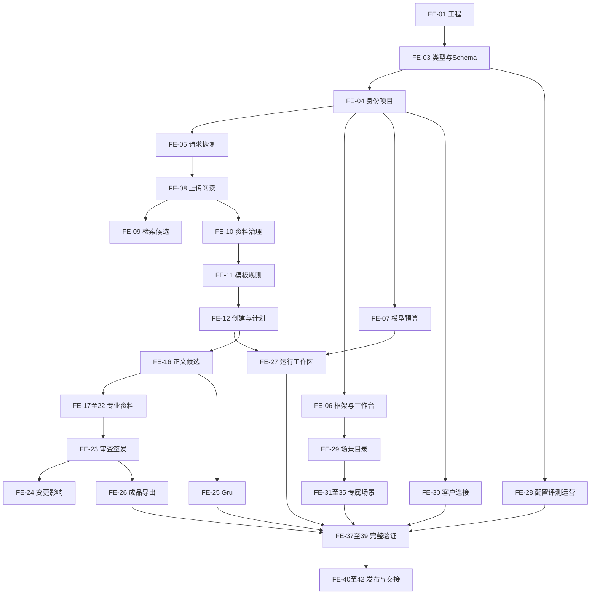

# 前端实施计划

## 1. 范围、依据与记录

2026-10-16接手入口为[前端开发交接](前端开发交接.md)，包含当前代码、证据适用性、完整待办与复验条件。文档核查日期和实际业务检查日期分别维护，功能任务状态继续读取原唯一来源。

编制日期：2026-10-13；依据当前 `main`、提交 `2fb17df`及全部未提交内容。计划覆盖原42项工单中的前端责任，保留14个设计页面、18项系统管理入口、全部注册文档及五类扩展场景。

2026-10-14当前执行增量为FE-04显式会话恢复、FE-08完整逐文件处理结果、FE-09固定索引构建记录与EXACT字段核准/等值查询、FE-10来源权利审查和原请求恢复，分别读取[IMP-04](development/IMP-04.md)的FRONT-SESSION-RECOVERY-01、[IMP-08](development/IMP-08.md)的FRONT-UPLOAD-RESULT-01、[IMP-09](development/IMP-09.md)的FRONT-INDEX-VIEW-01及FRONT-EXACT-FIELDS-01、[IMP-10](development/IMP-10.md)的FRONT-SOURCE-RIGHTS-01。接口、完整字段、实际运行及未完成验证记录于同号主文档；正式业务和全部系统验收条件保持原要求。

当前EXACT-RECOVERY-10完整制品与BROWSER-31真实原生、开发及生产五十项组合已通过，输入和产物字节重新核验一致。已验证范围覆盖来源权利、实际上传分段/完成请求/状态、空索引列表、五类EXACT核准与别名、固定原文展开、完整修订、历史、原请求恢复及撤权。完整七格式Worker、非空索引、实际多页命中以及其他专业流程继续依据[当前接口交接条件](frontend-integration-gaps.md)推进，同号父工单保持原完整范围。

`FE-xx`表示`IMP-xx`中的前端执行项，不增加原业务工单数量。任务状态继续由[实施任务计划](../实施任务计划.md)§4.2维护；原57项AC、17项NFR、18项EDGE、30项SEC和12项EVAL保持完整。本文安排剩余开发与验证，没有登记新的完成状态。后端责任见[后端实施计划](后端实施计划.md)。

每项`development_record`为`docs/development/IMP-xx.md`，同号前后端共同引用这份主记录；尚不存在的记录在开始该项实施时建立。记录维护当前实现、运行命令、实际断言、版本、未完成内容和证据；[开发记录索引](development/index.md)只维护入口。共享记录及共享文件由当前指定维护人员顺序更新。

全部执行项继承以下上下文与完成条件，再读取各项指定章节：

- 需求：[PRD](../PRD.md)§8—13、[实施任务计划](../实施任务计划.md)§3—6、[需求完整性核对](requirements-completeness-review.md)、对应已有开发记录。
- 设计：[HLD](../HLD.md)、[LLD-前端](../LLD-前端.md)§1—7、[LLD-后端](../LLD-后端.md)相关接口、[接口补充设计](../backend-design/接口补充设计.md)、[LLD-数据](../LLD-数据.md)相关对象、[LLD-Agent](../LLD-Agent.md)相关公开结果。
- 界面：[交互原型说明](../交互原型说明.md)、[界面规范](../界面规范.md)、`ui-delivery/tokens.json`、`ui-delivery/design-system.md`、`ui-delivery/component-reuse-audit.md`、`ui-delivery/final-product-design.md`、`设计稿.html`。以文字规范、HTML源码和Token确认交互，不主动执行截图或视觉比较。
- 工程：`web/package.json`、锁文件、当前Router、Pinia、Axios、Layout、Editor、FileUpload、Pagination、RightToolbar及Element Plus组件。保留当前代码和有效组件，补齐各项明确缺口。
- 验证：[测试与评测方案](../测试与评测方案.md)、[安全检查方案](../安全检查方案.md)、`tests/browser/`与当前公开接口。2026-10-13用户明确授权本轮全部使用模拟资料和业务输入，相关输入及证据标记为`SIMULATION`。数据库、对象存储、解析器、转换器和公开接口使用实际服务；业务状态来自实际保存及重新读取。正式客户验收继续单独登记。

## 2. 前后端责任与交接

前端负责页面、字段与状态呈现、明确用户操作、接口消费、来源定位、选区、未保存内容保护、请求恢复、键盘操作和浏览器验证。数据库、最终授权、处理结果、生成结果、费用、签发门槛及合法终态由后端提供。

| 执行项 | 允许修改范围 |
| --- | --- |
| FE-01 | `web/`工程配置和锁文件、前端构建检查、同号文档 |
| FE-03 | `contracts/typescript/`消费绑定、`web/src/api/medical/`、类型检查及同号文档；Schema定义由后端维护 |
| FE-04—FE-35 | 对应业务的`web/src/views/medical/`、`web/src/api/medical/`、既有Router/Pinia/Layout/组件扩展、真实浏览器检查及同号文档 |
| FE-36、FE-40—FE-42 | 前端环境及制品配置、对应运行检查、使用维护说明及同号文档；实际服务部署由后端维护 |
| FE-37—FE-39 | `tests/browser/`、对应`scripts/check_*`、测试报告和同号文档 |

所有共享文件修改按实际影响核查消费者，保留当前未提交内容；无需变更的模块直接复用。具体文件和identifier在开始同号任务时按当前代码登记。

| 交接内容 | 后端交付条件 | 前端消费与检查 |
| --- | --- | --- |
| 接口定义 | HTTP方法、路径、权限、请求及响应Schema、错误码、版本、允许动作已明确 | 使用共享类型和成熟Schema库，逐字段核查真实响应 |
| 写入结果 | 原操作身份、CAS结果、资源修订、影响清单及查询入口 | 保存后查询原操作并重读实际对象；未知结果保留原请求 |
| 异步业务 | QUEUED到实际终态、失败原因、逐项结果和恢复动作可读取 | 接收成功展示为已受理，处理完成根据持久结果展示 |
| 事件 | 标准SSE、固定游标、序号、恢复快照、逐次授权 | 成熟SSE解析器消费事件，重读权威快照，防止旧响应覆盖当前对象 |
| 来源与候选 | 固定版本、Locator、原文摘要、范围及当前访问许可 | 原件、证据、候选和正文使用正确身份，选区变更后重新核验 |
| 正式业务 | 固定发布配置、真实权限和资料、实际运行结果 | 完成合法成功、拒绝、冲突、撤权及刷新恢复的实际操作验证 |

接口语义已经明确时，页面、类型和交互可以独立实施；必要字段与状态未知时，只暂停依赖它的内容。独立开发使用现有真实接口和获授权输入。缺少后端运行结果时保留待联调状态，不显示自行生成的业务成功结果。

## 3. 执行顺序与完成节点

| 顺序 | 执行项 | 可观察完成结果 |
| --- | --- | --- |
| 1 | FE-01、FE-03、FE-04、FE-05、FE-06 | 真实会话、企业及项目上下文、现有入口和请求恢复具备可重复验证 |
| 2 | FE-08、FE-09、FE-10、FE-11、FE-12 | 上传资料、阅读、核准、资料集及模板选择、创建任务与确认计划可操作 |
| 3 | FE-07、FE-27 | 模型配置、预算、运行启动、步骤、人工等待、继续和取消可操作 |
| 4 | FE-16、FE-17—FE-22、FE-23、FE-24、FE-26 | 专业文稿编辑、来源核验、问题处理、审查签发与固定成品交付可操作 |
| 5 | FE-25、FE-28、FE-29 | Gru、能力管理、评测运营和正式场景采用可操作 |
| 6 | FE-30—FE-35 | 客户连接及五类场景按各自完整规格完成独立流程 |
| 7 | FE-36—FE-42 | 完成适用监控、全范围验证、制品、发布与使用交接 |

顺序表示依赖与业务优先级。后续任务已有必要产物时可提前进行；条件场景保留完整范围，按其独立输入安排。FE-36的环境与制品准备随相关业务进行，FE-37—39的相关检查随每项业务进行，完整报告在组合流程具备后完成。



图中合并节点用于阅读，逐项`depends_on`及后端交接条件以第4节为准。依赖要求具体产物，父工单整体未验收不会自动阻止使用已验证的产物。

## 4. 前端执行项

每项来源为同号IMP及其原始FR、AC、IC和NFR责任。每项验收同时执行第6节共同检查，保存到同号主记录。下列`depends_on`只列前端实现依赖；“后端交接”列运行及集成需要的具体产物。

### FE-01 工程、依赖与构建

- 依据：IMP-01、IC-01；`docs/development/IMP-01.md`、当前锁文件与正式前端源码。`depends_on`：无。
- 实施：核查当前依赖安装、医疗模式、开发代理、生产构建及正式同源入口；保留既有依赖和RuoYi组件，补齐工程兼容问题与命令登记。
- 后端交接：BE-01提供实际静态资源发布方式、入口路径和制品身份；BE-36提供目标环境配置。
- 验收：严格类型和生产构建通过；实际浏览器进入及刷新正式入口，加载正确资源；依赖、源码、制品及HTTP字节关联到当前版本。

### FE-03 共享类型、Schema与接口消费

- 依据：IMP-03、IC-03、FR-01—09、NFR-07；`contracts/typescript/`、`web/src/api/medical/`、`protocol.ts`、LLD-前端§4。`depends_on`：FE-01。
- 实施：补齐新增接口的完整字段、资源版本、精确数字、枚举、错误和Schema引用；每次字段变化核查列表、详情、表单、事件及后续使用方。
- 后端交接：BE-03发布唯一Schema与跨语言表示，BE-05提供统一操作及错误结构；当前各业务接口按其真实代码确认。
- 验收：真实响应可以校验和消费；未知字段、无效版本与精度变化明确失败；Java/Python/TypeScript表示及实际业务字段一致。

### FE-04 身份、企业成员与项目授权

- 依据：IMP-04；AC-01、AC-02、AC-16、IC-04；PRD§8.1、LLD-前端§1.3/2、接口补充设计§4.4—4.15。`depends_on`：FE-03。
- 当前与实施：复用登录、企业申请与审查、岗位、成员、邀请、授权和项目页面；完成本人资料及头像、全部治理操作、企业切换后的内容清理、深链拒绝和权限变更后的动作刷新。
- 后端交接：BE-04提供当前会话、成员及岗位版本、ID/LOCAL/PJ接口；对象权限始终以服务端实际响应核验。
- 验收：获授权人员邀请、接受、选择企业、创建并重读项目；权限撤销后新读取与操作被拒绝；跨企业页面不保留受限内容；未知写入按原操作恢复。

### FE-05 原操作查询、上传下载与事件基础消费

- 依据：IMP-05；IC-05、AC-29、AC-34、AC-42、NFR-02/06；LLD-前端§2.3/6、BX-31及OP-01—03。`depends_on`：FE-03、FE-04。
- 实施：统一原请求元数据、幂等键、CAS、FOUND/NOT_FOUND/EXPIRED/PROCESSING处理、固定对象下载与通知读取；正文和秘密保留在受控内存。
- 后端交接：BE-05提供原操作、固定对象、通知、审计及业务事件的公开接口。
- 验收：刷新和连接中断后核查同一原操作；NOT_FOUND保留原键，EXPIRED禁止原操作重发；下载核查原文件身份；打开通知重新检查目标许可。

### FE-06 页面框架、18项管理入口与工作台

- 依据：IMP-06；IC-06、AC-01/02/16、NFR-04/05；LLD-前端§1.3/1.4、S01/S02/S03/S17/S18、FRONT-WORKBENCH-01。`depends_on`：FE-04、FE-05。
- 实施：保留Layout和现有Router；完成工作台待办与持续更新、项目资料及任务汇总、十八管理模块的范围和动作、异常处理及安全返回入口。
- 后端交接：BE-06提供实际管理绑定清单和环境菜单；PJ-01/03/06及CP-07提供获授权集合与数量。
- 验收：十八入口逐项验证实际查询及允许操作；开发工具按环境清单限制；项目和待办数量使用相同授权范围；窄屏、键盘、焦点和中文输入法完成适用操作。

### FE-07 模型配置、预算与结算视图

- 依据：IMP-07；AC-03/04/24/28、IC-07、NFR-10；S13、CP-08—11、BD-01—06、RN-06。`depends_on`：FE-03、FE-04、FE-05。
- 当前与实施：保留已有预算及历史页面；增加完整模型配置、价格与秘密引用、实际验证、启用停用、研究上限、运行追加批准及调用账单读取。
- 后端交接：BE-07提供配置保存及生效版本、实际调用状态、预算预留和结算；秘密值只由受控秘密服务处理。
- 验收：配置验证结果可重读且被指定调用采用；金额、Token、预留与未知费用准确显示；批准预算后运行仍需明确继续；凭据不进入URL、日志或浏览器持久存储。

### FE-08 批量上传、处理队列与七格式阅读

- 依据：IMP-08；AC-05/06/29/30、IC-08、NFR-05/12；S04/S05、KN-01—08、LLD-前端§5.2/6.4。`depends_on`：FE-05、FE-06。
- 当前与实施：复用上传及处理队列；完成逐文件处理终态、断线查询及恢复、失败项重试、重复文件结果、七格式原件及转换预览、OCR问题和固定位置阅读。
- 后端交接：BE-08交付实际处理Worker、四项独立状态、持久解析结果及固定Locator；读取及再次处理使用当前许可。
- 验收：真实七格式分别上传、处理、阅读和定位；单项失败不重新执行成功文件；刷新读回同一上传；预览与原件使用正确身份；无法定位时明确阻止正式引用。

### FE-09 授权检索、历史位置与网络候选

- 依据：IMP-09；AC-05/30/32/33、IC-09；PRD§8.3.3、S04/S05、KN-14/15/19。`depends_on`：FE-08。
- 当前与实施：保留FULLTEXT页面；接入正式任务范围、各批准检索通道、固定检索配置、证据包、历史位置、空范围及失败原因、网络候选获取和待核准阅读。
- 后端交接：BE-09提供Qdrant及索引Worker、固定结果和历史定位、网络采集及时间证明；BE-10提供候选核准结果。
- 验收：同一检索集合分页身份一致；打开真实原件对应位置；撤权后读取被拒绝；网络候选核准前不得进入正式生成范围；查询文字不进入URL。

### FE-10 资料核准、资料集、组织与生命周期

- 依据：IMP-10；AC-05/06/31/34/36/57、IC-10、NFR-15；S04/S05、KN-05—13/16—22、LLD-前端§13。`depends_on`：FE-08、FE-05。
- 当前与实施：保留资料目录、治理和资料集页面；补齐完整成员及历史选择、项目适用、核准与退回、来源关系、文件夹标签收藏、引用影响、回收恢复和逐存储清理结果的实际交互。
- 后端交接：BE-10提供六类存储执行器、Worker状态和备份确认；处理结果来自BE-08，索引结果来自BE-09，成果身份来自BE-26。
- 验收：修改资料集后旧任务成员保持原版本；引用保护和保存策略生效；永久清理只按实际全部删除回执展示PURGED；获授权人员完成原件核验、人工决定、关系查询与恢复。

### FE-11 完整模板、字段及规则管理

- 依据：IMP-11；AC-18/45/46/50/57、IC-11；PRD§8.3.5/8.5、TP-01—06、接口补充设计§4.17—4.20。`depends_on`：FE-10。
- 当前与实施：复用模板创建及核准；补齐十三文档入口、十一字段类型、重复行、附件、版式、完整条件、规则草稿和核准、目录适用决定、模板及规则更新影响。
- 后端交接：BE-11提供固定模板、受限规则、三态适用性和审核清单；BE-24提供完整变更影响。
- 验收：完整模板字段可编辑、保存重读并人工核准；UNKNOWN保持待确认；不适用具备依据；未核准或不兼容版本无法进入正式任务。

### FE-12 创建任务、四种来源范围与计划决定

- 依据：IMP-12；AC-07/08/18/31/37、IC-12；S06/S07/S18、TK-01—06、FRONT-I01。`depends_on`：FE-05、FE-06、FE-11。
- 当前与实施：复用创建、输入草稿、来源选择及计划编辑；补齐发布配置读取、全部章节和研究问题、人工计划与Agent候选、责任及证据要求、输入修订和完整影响确认。
- 后端交接：BE-12提供输入快照、计划与人工决定；BE-15提供计划候选，BE-28提供正式发布版本；保存草稿和人工计划不等待生成流程完整验收。
- 验收：四种来源模式、明确清空及关闭网络均在真实请求生效；创建后重读唯一任务；保存、确认和退回保持原版本；未确认计划不可启动；无资料的缺项有具体位置及责任。

### FE-16 同版正文、来源面板与候选采用

- 依据：IMP-16；AC-22/38、IC-16；S09、DC-01—03、BX-05/07/08、FRONT-I02/I03/I14、LLD-前端§5.2/5.3。`depends_on`：FE-05、FE-06、FE-12。
- 当前与实施：保留稳定节点、表格、字段、草稿及版本比较；完成图片和公式呈现、全文选区、章节及历史目录、原文来源面板、服务器候选比较与部分采用、补证及局部修订入口。
- 后端交接：BE-16提供同版正文和候选采用；BE-15提供实际候选，BE-09提供依据，BE-24提供影响集合。
- 验收：真实文字、表格、图片和公式保存重读一致；中文、emoji和组合字符选区准确；保存期间继续输入不被旧响应清除；并发冲突保留输入；只采用明确选定节点。

### FE-17 产品技术要求与指标方法

- 依据：IMP-17；AC-09/10/47/48/49、IC-17；PRD§8.5.3、PTR-01—08、DC-04/05。`depends_on`：FE-11、FE-16。
- 实施：在同一正文能力内提供八组内容、多型号及软件版本、指标×型号×条件、方法覆盖、标准年代号、单位精度、术语及字段确认；问题定位至实际字段和行。
- 后端交接：BE-17提供确定性检查与原始证据，BE-23提供问题；申请阶段与正式编号来自固定任务及模板。
- 验收：真实多型号资料逐项显示并重读；缺方法、年代号、证据或条件时无法确认；申请编号保持批准阶段语义；数值不被前端转换改变。

### FE-18 注册目录、监管综述与质量体系

- 依据：IMP-18；AC-45、IC-18；PRD§8.5.2/8.5.4/8.5.5、S18/S09。`depends_on`：FE-11、FE-16。
- 实施：六章38节点及条件子节点、责任、证据和附件；监管目录、综述、质量体系及总稿四种入口；完整显示设计开发、采购、生产服务、监视测量设备等资料状态。
- 后端交接：BE-18提供目录内容、核准声明及实际附件，BE-12提供计划责任。
- 验收：所有适用节点可定位；6.1/6.2及父子身份正确；缺项和UNKNOWN分别显示；通用目录资源不会显示为已经完成的专业资料。

### FE-19 非临床研究、基本原则与风险

- 依据：IMP-19；AC-50/51/52、IC-19；PRD§8.5.5。`depends_on`：FE-11、FE-16。
- 实施：研究方案、原始数据和结果分别阅读；五列基本原则、风险控制及有效性证据、剩余风险、警示、条件适用和待补证位置。
- 后端交接：BE-19提供实际研究身份、完整关系与检查；BE-23提供当前问题。
- 验收：仅有方案不会显示研究完成；每项控制和基本原则对应获授权真实证据；UNKNOWN、不适用及缺少标准全文保持正确含义。

### FE-20 临床评价与免评价

- 依据：IMP-20；AC-53、IC-20；PRD§8.5.6。`depends_on`：FE-11、FE-16。
- 实施：分别提供临床评价与免评价资料入口、路径依据、目录、产品比较、文献与临床附件、资质及缺项定位。
- 后端交接：BE-20提供核准路径、比较证据、完整目录和检查。
- 验收：两种路径分别使用获授权项目完成计划、候选阅读、人工采用及重读；缺少路径依据或附件时无法确认。

### FE-21 说明书与独立标签

- 依据：IMP-21；AC-49/54、IC-21；PRD§8.5.7、IFU-01—14。`depends_on`：FE-11、FE-16。
- 实施：说明书十四组与独立标签入口、条件警示、重复使用、销售单元、进口原文与中文、编号阶段及跨文件问题定位。
- 后端交接：BE-21提供核准字段、真实警示依据和一致性检查。
- 验收：真实适用字段及独立标签保存重读；型号、用途、期限、警示等跨文件问题可处理；任务编号不会显示为官方编号。

### FE-22 IVD、变更与延续

- 依据：IMP-22；AC-46、IC-22；PRD§8.5.8、BR-19/20、S07/S09。`depends_on`：FE-11、FE-16。
- 实施：分别提供路径匹配、兼容模板、原证与历次变更、前后差异、风险验证、临床及继续研究资料入口。
- 后端交接：BE-22提供各路径独立规则与模板，BE-12提供输入及计划。
- 验收：三种路径分别验证；不兼容模板被拒绝；缺少专属模板、原证或历史资料显示具体缺项；保留全部原始申请要求。

### FE-23 当前正文检查、批注、人工审查与签发

- 依据：IMP-23；AC-09/10/11/19/25/48、IC-23；S11、RV-01—09、SG-01—09、FRONT-I04/I05。`depends_on`：FE-16。
- 实施：正式只读审查页面、当前正文检查、文字图片表格批注、回复及重新定位、问题分派与解决、批次决定、退回、审查确认、再次认证和固定版本签发。
- 后端交接：BE-23提供完整门槛、一次性认证回执、实际签发记录及历史；专业字段检查来自BE-17—22。
- 验收：真实文稿按检查、核验、审查、再次认证和签发完成；回复不自动解决问题；旧检查、关键问题、过期选区、撤权及竞争修改不能签发；重新登录读回同一签发版本。

### FE-24 共享事实、依据变更与撤权影响

- 依据：IMP-24；AC-35/40/54/55/57、IC-24、NFR-13；DC-04/05、TP-06、TK-05/06。`depends_on`：FE-10、FE-11、FE-16、FE-23。
- 实施：提供共享事实修订、完整使用位置、依据变化建议、影响确认和重新核验入口；来源、模板、正文、候选、历史及导出在权限或治理变化后更新。
- 后端交接：BE-24提供完整影响集合、水位和当前准入；BE-12/13提供确认后继续。
- 验收：真实事实变化列出全部位置；未影响正文保持原内容；旧签发仍为原版；撤权后新读取或操作被拒绝；影响不完整无法确认继续。

### FE-25 Gru、明确采纳、摘要与习惯

- 依据：IMP-25；AC-37/38/43、IC-25；PRD§8.4.1/10.3、GR-01—08、FRONT-I03/I07/I14。`depends_on`：FE-07、FE-09、FE-12、FE-16、FE-23。
- 实施：全局Gru、历史会话、四种资料范围、选区提问与修订建议、确认卡片、部分采纳、消息取消、原件摘要、个人习惯维护删除及会话导出。
- 后端交接：BE-25提供持久会话、固定目标、建议及一次决定、摘要来源和习惯生效版本。
- 验收：切换页面或项目后旧建议仍指向原目标；版本冲突保留建议；一次明确采纳生成唯一修订；删除习惯后的实际新上下文不包含它；中文输入法及消息恢复有效。

### FE-26 固定成品导出与成果转存

- 依据：IMP-26；AC-34/42/47/56、IC-26、NFR-17；EX-01—05、KN-18、S09/S11。`depends_on`：FE-08、FE-10、FE-23。
- 当前与实施：保留成果目录和导出页面；完成签发创建入口、固定版本记录、目录页码与附件顺序核验呈现、格式独立状态、恢复续办、授权下载及完整成果转存交互。
- 后端交接：BE-26提供同版文件、逐格式尝试及实际核验，BE-23提供签发，BE-10提供转存关系。
- 验收：真实DOCX/PDF及内部Markdown下载重读；重复下载字节一致；单格式失败保持其他成功项；正式正文绑定签发版本；渠道状态明确；转存得到唯一待核验来源。

### FE-27 运行工作区、人工操作、公开事件与协作

- 依据：IMP-27；AC-04/08/20/21/39/40/41/44、IC-27；消费IMP-13的运行控制产物，S01/S06/S09/S18、RN-01—06、LLD-前端§4.3/6.1。`depends_on`：FE-06、FE-07、FE-12、FE-16。
- 当前与实施：保留运行快照、SSE和取消；从任务启动实际运行，完整提交人工继续和输入变更，调用FE-07的预算批准入口；核查原操作和新运行身份，呈现未知调用及恢复拒绝；完成会话订阅协调、任务问题协作、角色产物、候选预览、人工等待责任、记录和成果关联。
- 后端交接：BE-27提供统一工作区投影和事件；BE-13提供实际启动、持久Signal、人工等待及继续、取消竞争和恢复；BE-14/15提供实际专业执行，BE-07提供预算与调用核对。
- 验收：运行使用已确认的固定输入；人工等待显示理由和责任，补证后确认新快照并继续；预算批准后仍需明确继续；Last-Event-ID重读同一事件流，刷新不创建重复运行；取消请求与可证明终止分别显示；身份切换关闭旧订阅；候选增量只作预览；必需步骤失败不会显示任务完成；未知费用保留未知。

### FE-28 Agent能力管理、评测运营与发布

- 依据：IMP-28；AC-03/12/13/27、IC-28；S13/S15、CP-01—06、EV-01—07、FRONT-I08/I10。`depends_on`：FE-03、FE-04、FE-05。
- 实施：完整Agent七个标签、角色/Skill/工具配置、固定版本及上限、评测批次和评分、同样本比较、实际运营统计、审计筛选导出、反馈处理、发布与停用恢复。
- 后端交接：BE-28提供发布前评测和正式发布两种准入、固定规则与分母、评分依据和配置采用结果。
- 验收：发布前评测可按对应权限进入；正式任务仅采用获准发布版本；缺样本保留空分数与证据不足；不同样本不生成改善结论；停用在实际新任务中生效。

### FE-29 场景目录、规格与正式任务入口

- 依据：IMP-29；AC-14/15、IC-29；S01/S13、CP-07、PRD§8.7。`depends_on`：FE-05、FE-06。
- 当前与实施：保留规划说明与场景目录；补齐规格维护、固定版本阅读、发布决定及正式任务入口；六项入口内容来自当前服务和完整规格。
- 后端交接：BE-29提供规格和任务采用，BE-28提供发布准入；五类业务规则由对应BE-31—35提供。
- 验收：无完整规格的场景显示具体缺项且不能生成正式成果；规格和发布有效时进入固定版本任务；场景数量和状态来自真实响应。

### FE-30 客户B/S连接与同步

- 依据：IMP-30；AC-17、IC-30、SEC-28；S16、CT-01—03、PLN-D07。`depends_on`：FE-04、FE-06、FE-07、FE-10。
- 实施：企业服务状态、连接配置和秘密引用、身份及资料映射、授权验证、同步范围、逐项结果、冲突及失败恢复；缺少规格保持BLOCKED。
- 后端交接：BE-30提供真实连接验证、同步及双端重读；客户提供完整接口与读写授权。
- 验收：获准客户系统实际同步成功；重复与冲突可核查；未授权请求被拒绝；本地与远端结果一致；秘密不在页面响应中显示。

### FE-31 法规比较场景

- 依据：IMP-31；AC-14、IC-31、PRD§8.7、PLN-D08。`depends_on`：FE-09、FE-28、FE-29。
- 实施：独立规格确认后完成法规版本选择、比较范围、变化及原文证据、人工审核与固定成果入口。
- 后端交接：BE-31提供该场景的完整规则、比较结果和证据；共享运行和成果能力直接复用。
- 验收：同一固定输入可重读变化及两侧原文；无证据与未审核内容不会成为正式结论；获授权真实样本完成整个比较流程。

### FE-32 报告生成场景

- 依据：IMP-32；AC-14、IC-32、PRD§8.7、PLN-D08。`depends_on`：FE-26、FE-28、FE-29。
- 实施：独立用途、输入、模板、任务状态、候选、审查、明确采用与固定报告导出。
- 后端交接：BE-32提供专属生成与检查，BE-26提供批准格式文件。
- 验收：真实输入按专属规则生成、审核并导出同版报告；缺资料或未批准用途显示具体缺项。

### FE-33 翻译场景

- 依据：IMP-33；AC-14、IC-33、PRD§8.7、PLN-D08。`depends_on`：FE-26、FE-28、FE-29。
- 实施：原件与译文对应阅读、语言及术语选择、格式和确定性字段问题、人工修订审核及固定成品。
- 后端交接：BE-33提供完整翻译规则、术语及格式结果。
- 验收：获授权原件与译文版本准确关联；原始数值和术语逐项检查；人工修订保存重读，成品保持批准格式。

### FE-34 市场分析场景

- 依据：IMP-34；AC-14、IC-34、PRD§8.7、PLN-D08。`depends_on`：FE-09、FE-28、FE-29。
- 实施：分析范围、时间和口径、研究问题、获授权资料、证据与局限、人工审查和成果阅读。
- 后端交接：BE-34提供专属研究规则、实际证据及停止条件。
- 验收：每项结论可追溯固定资料；不同口径和缺证据明确呈现；达到研究上限停止；真实样本完成审核与正式成果。

### FE-35 多模态问答场景

- 依据：IMP-35；AC-14、IC-35、PRD§8.7、PLN-D08。`depends_on`：FE-08、FE-28、FE-29。
- 实施：批准媒介的原件选择、问题提交、原始位置、引用、无答案与冲突、人工核验及采用。
- 后端交接：BE-35提供支持媒介、受限处理与完整问答证据，外发及模型许可按对应用途确认。
- 验收：获授权真实媒介中的回答可以打开对应位置；无法支持的内容保留无答案或待核验状态；未知媒介不会得到自行生成的成功结果。

### FE-36 环境、监控消费与制品准备

- 依据：IMP-36；IC-36、NFR-02/06/07/15；LLD-前端§1.3/6.6。`depends_on`：FE-01、FE-03、FE-06。
- 实施：环境变量与服务地址配置、静态制品和资源版本、已有监控页的实际数据、断连及服务不可用状态、版本发布后的缓存和入口核验。
- 后端交接：BE-36提供服务、TLS、健康、指标和固定部署清单；生产参数按目标环境提供。
- 验收：页面及资源对应实际制品；服务不可用时显示准确状态；环境菜单、同源Cookie与CSP等适用配置生效；恢复后读取当前业务版本。

### FE-37 注册业务与边界集成验证

- 依据：IMP-37；IC-37、AC-01—57全部保留，其中AC-14由FE-31—35负责、AC-17由FE-30负责；EDGE-01—18全部保留。`depends_on`：FE-17、FE-18、FE-19、FE-20、FE-21、FE-22、FE-24、FE-25、FE-26、FE-27、FE-28、FE-29。
- 实施：将实际用户操作连接到原TEST及EDGE矩阵；覆盖角色、入口、输入、动作、下游使用、刷新、冲突、撤权和恢复，逐项登记完整范围。
- 后端交接：同项后端提供真实接口、Worker结果和可重读数据；FE-30—35的独立报告并入全范围报告。
- 验收：逐项实际断言满足原预期；正向成功与拒绝配对；页面、类型及按钮存在不能独立关闭业务验收；证据缺少时准确登记。

### FE-38 浏览器安全与制品检查

- 依据：IMP-38；IC-38、SEC-01—30、NFR-03/11/13。`depends_on`：FE-24、FE-25、FE-26、FE-28、FE-36。
- 实施：完成前端适用Cookie、CSRF、Origin、内容呈现、秘密、存储、跨企业、深链、缓存清理、下载及工具入口检查，配合全部安全用例。
- 后端交接：BE-38验证最终授权、模型与工具、外发及执行环境；浏览器提供实际消费证据。
- 验收：真实获授权路径成功，禁止路径拒绝；当前正文与敏感输入不会进入未批准存储；完整SEC集合逐项明确两端责任和原始证据。

### FE-39 非功能、兼容与恢复验证

- 依据：IMP-39；IC-39、NFR-01—17。`depends_on`：FE-36、FE-37、FE-38。
- 实施：完成全部前端适用键盘、焦点、输入法、浏览器、七格式阅读、资源性能、事件恢复、刷新和并发编辑、导出内容等检查；其余NFR由BE-39提供数据。
- 后端交接：BE-39提供批准负载、SLO、RTO/RPO和实际恢复结果；真实浏览器矩阵及资料由客户提供。
- 验收：每项NFR保留完整断言和分母；批准阈值逐项核查；视觉检查继续保持NOT_RUN，获得授权后按原要求执行，不据此删除版面要求。

### FE-40 SaaS前端发布与使用交接

- 依据：IMP-40；IC-40、PRD§13、R08。`depends_on`：FE-37、FE-38、FE-39。
- 实施：准备当前前端制品、版本和目标配置、正式入口及升级资源检查、各岗位操作说明、问题处理和接收清单。
- 后端交接：BE-40提供批准SaaS部署与恢复；本次发布范围的全部前端功能，包括Gru及扩展能力，按原范围核查。
- 验收：目标环境真实登录、操作、刷新和资源加载成功；接收人员完成适用岗位操作；代码、制品、配置及实际部署版本一致。

### FE-41 私有化前端配置与维护交接

- 依据：IMP-41；IC-41、PLN-D09。`depends_on`：FE-40。
- 实施：根据客户环境维护访问地址、资源基础路径、同源配置、浏览器要求、升级说明及使用维护文档；保留完整产品功能。
- 后端交接：BE-41提供实际客户环境、部署、模型出口和维护权限。
- 验收：客户环境真实访问及核心操作通过；升级后历史对象、入口及资源仍可读取；客户维护人员可以按说明执行版本核验。

### FE-42 服务岗位操作与责任交接

- 依据：IMP-42；IC-42、R08、PLN-D09。`depends_on`：FE-40。
- 实施：提供资料维护、专业审查、签发、反馈、异常处理等服务岗位操作说明与责任入口，复用已定义业务页面。
- 后端交接：BE-42提供实际岗位授权、服务范围、审计及交接数据。
- 验收：接收人员使用真实授权完成对应服务操作；责任、处理记录和成果可以核查；服务说明与当前功能一致。

## 5. 原42项工单与前端责任映射

| 原工单 | 前端执行责任 |
| --- | --- |
| IMP-01 | FE-01 |
| IMP-02 | 输入登记已有实现；各项验证直接引用该输入清单，缺少真实输入只约束对应运行 |
| IMP-03 | FE-03 |
| IMP-04 | FE-04 |
| IMP-05 | FE-05 |
| IMP-06 | FE-06 |
| IMP-07 | FE-07 |
| IMP-08 | FE-08 |
| IMP-09 | FE-09 |
| IMP-10 | FE-10 |
| IMP-11 | FE-11 |
| IMP-12 | FE-12 |
| IMP-13 | 内部调度无独立页面；FE-27消费启动、继续、输入确认、取消和恢复，FE-07提供预算批准 |
| IMP-14 | 内部Harness及工具无独立页面；FE-07、FE-27、FE-28消费其公开结果 |
| IMP-15 | 内部专业节点无独立页面；FE-12、FE-16、FE-23、FE-27消费计划、候选、问题及角色产物 |
| IMP-16 | FE-16 |
| IMP-17 | FE-17 |
| IMP-18 | FE-18 |
| IMP-19 | FE-19 |
| IMP-20 | FE-20 |
| IMP-21 | FE-21 |
| IMP-22 | FE-22 |
| IMP-23 | FE-23 |
| IMP-24 | FE-24 |
| IMP-25 | FE-25 |
| IMP-26 | FE-26 |
| IMP-27 | FE-27 |
| IMP-28 | FE-28 |
| IMP-29 | FE-29 |
| IMP-30 | FE-30 |
| IMP-31 | FE-31 |
| IMP-32 | FE-32 |
| IMP-33 | FE-33 |
| IMP-34 | FE-34 |
| IMP-35 | FE-35 |
| IMP-36 | FE-36 |
| IMP-37 | FE-37 |
| IMP-38 | FE-38 |
| IMP-39 | FE-39 |
| IMP-40 | FE-40 |
| IMP-41 | FE-41 |
| IMP-42 | FE-42 |

## 6. 验证、阻塞与完成条件

### 6.1 每项共同验收

1. 使用当前真实服务、获授权角色与真实输入执行入口、操作、保存或查询和下游使用；读取后核查固定身份、版本、当前权限与精确字段。
2. 对该功能验证合法成功、无权、空集合、缺项、错误、重复、并发、撤权及适用恢复；读取状态覆盖loading/empty/ready/partial/error/denied。
3. 路由、身份、企业、项目、文稿或页面可见性变化后关闭原连接、清理受限内容、拒绝旧响应；原请求恢复遵守已有完整规则。
4. 完成键盘、焦点、中文输入法、未保存离开、窄屏和长内容检查；使用成熟控件和解析库，错误在发生位置报告。
5. 保存实际命令、代码及未提交摘要、配置、数据、环境和原始结果；更新同号主记录、索引及受影响LLD和消费者。只有全部代码与必要集成完成才可登记该端IMPLEMENTED；父工单仍需两端全部责任完成。

### 6.2 已核实的工程命令

以下命令在项目根目录执行。2026-10-13已执行严格类型、当前Schema及正文编辑回归、固定原件字节检查、七格式与公式浏览器检查、原请求元数据浏览器检查。各自结果和适用范围由IMP-01/04/05/08/09/16/26/37/39维护；完整任务状态继续使用实施任务计划§4.2。

```bash
npm --prefix web run typecheck:medical
npm --prefix web run build:prod -- --mode medical
node scripts/check_source_reader_frontend.mjs
node tests/browser/source-reader-checks.js
node scripts/check_request_metadata_frontend.mjs
node tests/browser/source-context-checks.js "$PWD/.implementation-work/FRONT-20261013-CURRENT/production"
```

当前结构化模板定义和全文目录/选区由IMP-11/16维护；固定当前输入及开发/生产组件结果使用以下入口。完整医疗制品、操作说明及环境核验由IMP-36/40/41/42维护，各业务任务仍需对应完整接口及原验收。

```bash
python3 scripts/check_frontend_continuation.py --suite document-selection --execution 20261013-SELECTION-01
python3 scripts/check_frontend_continuation.py --suite template-fields --execution 20261013-TEMPLATE-01
python3 scripts/check_frontend_continuation.py --suite release --execution 20261013-RELEASE-01
```

对应业务浏览器检查复用`scripts/check_*_browser.py`及`tests/browser/`，执行前读取该脚本的参数和动作。涉及账户、权限、真实数据、外发或费用时确认当前操作授权及目标；缺少现有入口的功能在同号实现任务中增加可执行验证并登记命令。不能把工程检查当作全部业务验收。

### 6.3 阻塞责任

| 条件 | 影响动作 | 仍可推进内容 | 解除条件 |
| --- | --- | --- | --- |
| 后端Schema或状态语义未明确 | 对应字段、操作与集成 | 已明确页面及其他独立功能 | 对应BE项交付完整接口定义 |
| Worker或Activity尚无业务结果 | 处理、生成及恢复的成功验证 | 现有真实接口消费、页面交互及错误处理 | BE-08/09/13/14/15提供实际持久结果 |
| 正式客户专业资料和权限缺少 | 正式客户流程及专业验收 | 用户已授权SIMULATION输入、现有实际接口及已定义字段 | D1—D6及正式角色、资料权利满足 |
| 模型、网络用途或预算未批准 | 对应收费调用、外发与验证 | 配置表单、读取和确定性校验 | PLN-D04/D06与实际预算许可满足 |
| 客户接口或场景规格缺少 | 对应连接或专属业务语义 | 已定义公共管理与规划状态 | PLN-D07/D08提供完整输入 |
| 目标环境和接收条件缺少 | 对应发布与交接 | 制品和操作说明准备 | PLN-D05/D09及实际环境满足 |

当前首项检查FE-01/03/04/05的已具备能力，不重复其已通过且输入未改变的检查；随后推进FE-08/09/10的剩余实际交互和明确接口消费。后端尚未提供结果的项准确登记待联调，其他具备必要条件的执行项持续推进。日期和人员安排在资源确定后填写，完成判定使用实际业务结果。

2026-10-13当前公开Controller、共享Schema及逐文件来源关联的具体交接条件见[前端接口交接条件](frontend-integration-gaps.md)。已完成的模板结构化编辑、全文目录及Selection不改变专业接口、完整业务及发布的原要求。
