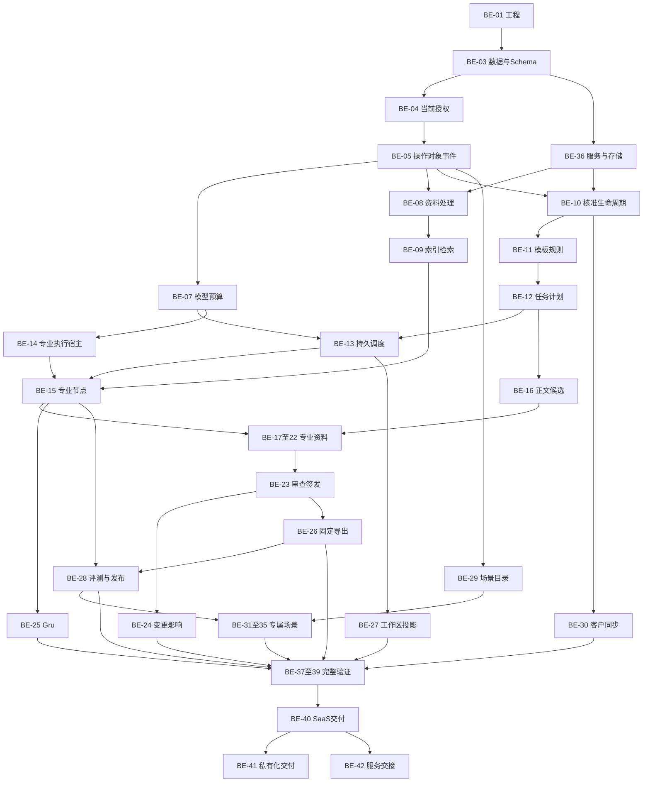

# 后端实施计划

## 1. 范围、依据与记录

编制日期：2026-10-13；依据当前`main`、提交`2fb17df`及全部未提交内容。后端责任包括Java业务服务、数据库及迁移、对象和索引存储、Python模型与文档处理、Temporal Worker、Harness专业执行、运行治理、验证和部署交接。

`BE-xx`表示`IMP-xx`中的后端执行项，不增加原业务工单数量。原42项任务状态继续由[实施任务计划](../实施任务计划.md)§4.2维护；原57项AC、17项NFR、18项EDGE、30项SEC和12项EVAL保留完整。本计划安排剩余工作，没有改变既有任务及验收状态。前端责任见[前端实施计划](前端实施计划.md)。

每项`development_record`为`docs/development/IMP-xx.md`，同号前后端共同引用该主记录；尚不存在的记录在开始该项实施时建立，并登记[开发记录索引](development/index.md)。主记录维护当前实现、实际断言、版本、环境、证据和完整剩余内容，共享记录顺序更新。

全部执行项继承以下上下文、修改范围与完成条件，再读取各项指定章节：

- 需求：[PRD](../PRD.md)§8—13、[实施任务计划](../实施任务计划.md)§2—6、[需求完整性核对](requirements-completeness-review.md)、对应当前开发记录。
- 设计：[HLD](../HLD.md)、[LLD-后端](../LLD-后端.md)、[接口补充设计](../backend-design/接口补充设计.md)、[LLD-数据](../LLD-数据.md)、[LLD-Agent](../LLD-Agent.md)、[LLD-前端](../LLD-前端.md)中的实际调用方。
- 当前源码：`business/`、`contracts/`、`model-gateway/`、`document/`、`professional-executor/`、`agent-design/`、`backend-design/`、`data-design/`、`scripts/`和`tests/`；不存在的运行或部署目录只在其明确任务中建立。
- 环境与输入：[实施环境](implementation-environment.md)、[实施输入](implementation-inputs.md)、[工程来源](engineering-baseline.md)、[开发交接](HANDOFF-2026-10-11.md)、当前实际配置和服务身份；秘密值不写入文档、日志或命令参数。
- 验证：[测试与评测方案](../测试与评测方案.md)、[安全检查方案](../安全检查方案.md)及原AC/NFR/EDGE/SEC/EVAL矩阵。使用真实服务、实际库及获授权真实资料，不创建mock或虚假业务结果；历史SIMULATION证据只说明原运行范围。

## 2. 后端产物与接口责任

后端提供实际可调用且可重读的业务能力，包括最终授权、固定版本、持久状态、处理及生成结果、费用、审查签发、删除证明及恢复。前端消费公开接口；内部模型流、服务身份、执行目录与供应商秘密保留在服务端。

| 执行项 | 允许修改范围 |
| --- | --- |
| BE-01 | 各正式模块工程与依赖文件、构建脚本及同号文档 |
| BE-03 | `business/medical-contracts/`、`business/medical-data/`、`contracts/`、共同Schema、迁移及跨语言检查 |
| BE-04 | `business/medical-identity/`、相应persistence、当前身份配置与检查 |
| BE-05、BE-06、BE-10—BE-12、BE-16、BE-23、BE-24、BE-27、BE-29、BE-30 | 对应`business/medical-persistence/`、实际需要的原RuoYi模块、相应Schema、数据迁移和业务检查；存储执行器在其职责模块内维护 |
| BE-07 | `model-gateway/`、对应业务预算及模型persistence、共享协议与检查 |
| BE-08、BE-09 | 来源及检索persistence、`document/`、实际处理和索引Worker、存储客户端与检查 |
| BE-13、BE-14 | `business/medical-workflow/`、运行persistence、`professional-executor/`、实际Python宿主及专业Activity、内部协议和检查 |
| BE-15、BE-17—BE-22、BE-25、BE-28、BE-31—BE-35 | 对应业务persistence、`professional-executor/`及正式专业运行模块、必要文档处理、Schema和检查 |
| BE-26 | 导出persistence、`document/`、实际固定资源与执行命令、格式检查 |
| BE-36、BE-40—BE-42 | 当前运行脚本、对应环境及部署配置、监控备份和恢复检查、操作交接文档 |
| BE-37—BE-39 | 对应`tests/`、`scripts/`、实际评测和安全检查配置、报告及同号文档 |

全部执行项同时维护相应主记录。具体文件、identifier及真实运行模块在开始同号任务时按当前代码登记，保留全部未提交内容；前端源码由前端责任项维护。

| 产物 | 后端责任 | 实际使用方与完成检查 |
| --- | --- | --- |
| 数据和迁移 | 同企业外键、稳定身份、索引、版本、事务、独立迁移权限 | Java/Python实际查询、保存重读及历史兼容 |
| 公开接口 | 固定Schema、动作及用途、当前授权、CAS、错误、幂等与查询 | 同号FE项实际操作及结果重读 |
| 内部接口 | 运行身份、mTLS/令牌、逐动作授权、工具参数、租约及产物 | 实际Worker、Harness与专业节点消费 |
| 持久处理 | 有界Worker、输入固定、结果提交、Outbox及消费者回执 | 来源、索引、任务、正文或删除项达到真实终态 |
| 模型调用 | 原子预留、begin-send、供应商回执、ModelResult及结算 | 实际角色使用已保存结果；未知调用按原身份核对 |
| 审查及成品 | 同版检查、问题、人工决定、再次认证、签发与ExportManifest | 固定正文、文件、内部材料、来源及历史一致 |
| 生命周期 | 当前引用与权利、逐存储删除、查询确认、备份期限及治理清单 | 全部确认后PURGED；恢复先处理撤权及删除记录 |

Schema和接口定义由对应后端任务维护，BE-03负责共同发布与兼容核验。前端共享消费文件由前端维护。BE-03维护迁移编号，BE-36维护数据库、端口、进程、对象前缀和构建目录的使用登记；共享资源缺少隔离证明时顺序执行。

## 3. 执行顺序与完成节点

| 顺序 | 执行项 | 完成结果 |
| --- | --- | --- |
| 1 | BE-01、BE-03、BE-04、BE-05、BE-06、BE-36的必需产物 | 当前环境、代码及既有公共能力可使用，接口和共享资源归属明确 |
| 2 | BE-10当前剩余内容及其必需存储配置 | 六类存储删除执行、Worker、状态和回执形成完整业务结果 |
| 3 | BE-08、BE-09、BE-11、BE-12 | 上传后来源实际处理、索引、核准、模板及计划具备完整持久能力 |
| 4 | BE-07、BE-13、BE-14、BE-15 | 获准模型调用、费用、实际调度及专业角色执行形成可重读结果 |
| 5 | BE-16、BE-17—BE-22、BE-23、BE-24、BE-26、BE-27 | 全部专业文稿、当前检查、人工签发及固定成品可完成 |
| 6 | BE-25、BE-28、BE-29 | Gru、固定配置评测、运营及正式能力发布可完成 |
| 7 | BE-30—BE-35 | 客户连接与五类场景按独立规格完成真实流程 |
| 8 | BE-37—BE-42及BE-36完整范围 | 完整集成、安全、非功能、SaaS、私有化和服务交接完成 |

BE-10沿用当前交接指定的完成重点；处理Worker属于BE-08，索引Worker属于BE-09。BE-10只等待当前删除动作需要的目标存储、实际引用与保存策略。某项外部输入缺少时，记录它影响的动作并继续其他已定义代码。

BE-07的模型配置、BE-28的配置保存和发布前评测入口、BE-36的服务与存储准备均随其实际使用方提前提供。正式发布仍需完整专业执行及评测证据。代码阶段完成与正式业务验收分别登记，独立功能使用已验证产物。



图中合并节点用于阅读，逐项依赖以第4节为准。正式采用需要发布版本；CP-02/EV-01的受控发布前评测按原设计执行，不以已发布版本作为该评测的前置条件。由此保留评测、发布和正式使用之间正确的依赖。

## 4. 后端执行项

每项`depends_on`列后端实现依赖，要求的是指定产物；原始全部验收责任继承同号IMP。每项执行第6节共同验收，保存到同号主记录。未知决定、真实资料及目标环境作为运行或发布条件单独管理。

### BE-01 正式工程、组件与制品

- 依据：IMP-01、IC-01；各模块工程文件、锁文件、当前主记录。`depends_on`：无。
- 实施：核查现有Java多模块、Python包、TypeScript执行器和正式依赖来源；补齐组件载入、安装制品与源码一致、构建及执行命令和固定版本登记。
- 交付：可供BE-03—42使用的实际工程、依赖和不可覆盖制品，静态资源发布方式交FE-01。
- 验收：对应组件编译及正常依赖安装通过；安装制品可以被实际应用载入，全部源码、制品和版本可核查；工程通过不代替业务完成。

### BE-03 共享Schema、跨语言类型与完整迁移

- 依据：IMP-03、IC-03、FR-01—09、NFR-07；LLD-数据§4/6.6、LLD-后端§3、`contracts/catalogue.json`和迁移目录。`depends_on`：BE-01。
- 实施：保留现有结构及040—045迁移，核验当前已执行集合；补齐各业务要求的字段、约束、同企业复合外键、索引、查询列和跨语言类型；统一分配新迁移编号及发布摘要。
- 交付：实际数据库结构、Schema及Java/Python/TypeScript表示，供所有业务及FE-03消费；各业务任务维护具体定义，BE-03维护发布与兼容。
- 验收：真实迁移和重读正确；运行账号无DDL权限；历史身份与数据保持；错误枚举、引用、精确数值和各消费者一致；执行迁移前保存并核验实际备份。

### BE-04 独立身份、企业项目与内部执行授权

- 当前增量：RunTokenAuthority提供持久jti、原签名摘要及当前Policy/mTLS服务绑定，步骤领取及续租、令牌签发和续期、资源/动作/用途与原动作参数检查；053及实际验证由[RUN-TOKEN-AUTHORITY-01](development/RUN-TOKEN-AUTHORITY-01.md)维护。正式运行创建、内部HTTP、终态回执和生产调度继续本项及BE-13完整要求。

- 依据：IMP-04；AC-01/02/16、IC-04；LLD-后端§2、接口补充设计§4.2—4.15。`depends_on`：BE-03。
- 当前与实施：保留本地账户、企业、岗位、成员和项目接口；完成全部实际治理路径、持久运行主体、当前逐动作授权、令牌签发及续期、mTLS信任、旧代际拒绝和身份终态回执；可选OIDC按对应输入完成。
- 交付：BE-08/13/14/15的真实运行准入与权限服务，FE-04的完整会话及治理能力。
- 验收：真实授权主体完成企业和项目操作；撤销立即约束新准入；两企业隔离；令牌与证书身份匹配，旧主体或租约不能提交；重新登录重读当前身份和权限。

### BE-05 幂等、固定对象、审计与持久事件

- 依据：IMP-05；IC-05、NFR-02/06；LLD-后端§2.4/4.1/6.1、BX-02—04/31/37、OP-01—03。`depends_on`：BE-03、BE-04。
- 当前与实施：复用现有对象读取和上传、原操作、审计及Outbox；完成全部领域生产者与消费者、受限传输、下载分页、读取回执、通知与已读决定、未知写入核查和跨阶段恢复。
- 交付：BE-08/16/26的对象及上传能力、BE-13/27的事件和投递能力；FE-05消费公开查询及通知。
- 验收：同键同参重读原结果、异参拒绝；操作、领域写入、审计和Outbox同事务；固定对象版本及字节摘要一致；真实中断恢复不产生重复业务结果；消费者回执可以重读。

### BE-06 原管理模块、绑定与项目汇总

- 依据：IMP-06、IC-06、AC-01/02/16；LLD-后端§4.6及接口补充设计的管理绑定。`depends_on`：BE-01、BE-04、BE-05。
- 实施：完成十八原管理模块的身份、企业范围、动作、Schema和环境绑定；提供真实工作台、项目及待办汇总；定时任务限于登记业务类型，诊断数据保持获准范围。
- 交付：FE-06所需的原模块查询及操作、管理绑定清单、准确数量与汇总；现有框架接口直接复用。
- 验收：十八模块分别完成合法查询及适用写入；越权与生产开发工具请求被拒绝；汇总计数与明细来自同一授权集合；绑定变更在实际请求生效。

### BE-07 模型配置、原子预算、发送、保存与结算

- 依据：IMP-07；AC-03/04/24/28、IC-07、NFR-10；LLD-后端§6.2、LLD-Agent§4.3/4.4、CP-08—11、BD-01—06、RN-06、IA-07及IN-09。`depends_on`：BE-03、BE-04、BE-05。
- 当前与实施：保留供应商适配和精确金额、预算及历史；完成模型/价格/Tokenizer/秘密版本、验证和启用；企业及父运行原子预留、begin-send、完整调用保存、终态ModelResult、供应商回执核对、未知占用、结算与追加批准。
- 交付：实际模型服务与用量给BE-09/14/15/25/35，配置和费用给FE-07/27/28；不同生成、Embedding、Rerank和OCR用途分别核查。
- 验收：真实获准调用被消费者实际使用；并发预留不超批准金额、Token、次数、时限及研究轮次；相同动作不重复发送；未知结果保留预留并按原身份核对；实际费用完整登记后重读。

### BE-08 来源处理Worker、七格式持久解析与阅读

- 当前代码：已登记来源的持久解析Worker及KN-03上传完成消费者已经连接固定命令、租约代际、分段重组、真实扫描和格式核验、原件检查点及恢复、来源登记、同归属去重、终态结果和回执。SourceRightsService提供完整权利审查及人工决定、实际授权Artifact及全部来源关系、固定S3版本和完整字节证明、CAS、原操作、审计、Outbox和回执重读；SourceUploadStatusService提供KN-04实际接收、解析、索引、核准、当前权利及原作业失败读取，原上传Schema、配置和202身份保持。当前五项原生检查、二十项Java组件及迁移检查、二十项完整迁移检查通过；十九份源码的官方DOCX解析包保持原对象及固定版本，真实恢复重读通过。050已应用，实际数据库286项登记，原来源、权利及283项checksum保持；当前固定制品已部署，三个消费者及权利审批保持关闭。合法客户权利审批、获准业务发布绑定、完整客户上传及七格式持久处理、复杂内容/OCR与实际中断恢复继续由IMP-08完整验收。
- 依据：IMP-08；AC-05/06/29/30、IC-08、NFR-05/12；LLD-数据§3、LLD-后端§5.1/6.1、KN-01—08。`depends_on`：BE-05、BE-06、BE-07。
- 当前与实施：连接已有上传完成命令、扫描和七格式解析组件；实现实际Worker领取续期与代际、原件重组及去重、来源/权利/解析版本、节点与Locator持久化、处理回执、四类状态、失败队列和恢复；完整处理图片、公式、复杂表格及适用OCR。
- 交付：可核验来源及解析结果给BE-09/10/12/15；原件与历史阅读、逐文件终态给FE-08。无模型格式使用既有确定性处理产物，OCR分别满足模型许可。
- 验收：真实七格式逐项上传到处理、保存、重读和定位；旧Worker提交拒绝；断线和重放保持原身份；重复不会扩大授权；某文件失败不改变成功文件；接收202不会登记来源就绪。

### BE-09 完整索引、内部检索、历史引用与网络采集

- 依据：IMP-09；AC-05/30/32/33、IC-09；LLD-数据§5、LLD-Agent§2.3、KN-14/15/19。`depends_on`：BE-07、BE-08。
- 当前与实施：复用FULLTEXT与固定结果集合；SourceIndexWorker/Access/Manifest/Policy/Configuration/Mapper及独立状态读取已连接固定解析、逐片段/S3核验、原事件及索引身份、租约、READY/FAILED和消费者回执。SourceExactController/Service/Schema/Policy/Mapper已经连接五种结构化字段、完整原值与人工别名核准、当前/固定字段读取、字节等值查询、完整命中合并、结果保存和逐页复查；来源关系与ReferenceHold保存后重读。052已应用，当前292项登记，原记录及287项checksum保持；二十二项Java/MySQL/S3组件及二十项迁移结构检查通过，本地接口与制品已经核验，客户业务仍为PENDING。继续完成Qdrant及DENSE/HYBRID索引、固定Embedding及适用Rerank、完整通道及数量/摘要核对、正式任务快照和内部工具入口、独立重建及历史引用、非空作业恢复和完整客户验收。
- 网络实施：完成查询词与原件外发许可、批准域名、候选原件保存、采集时间证明、来源与权利登记，核准由BE-10执行。
- 交付：同一检索业务方法供公开页面与Agent工具使用，提供固定证据包、通道和重排回执、覆盖及缺失要求。
- 验收：真实资料完成索引、查询及原文定位；部分写入不进入READY；必需通道失败直接报告；分页与撤权复查；旧任务重建后仍读取正确固定位置；网络候选核准前不正式采用。

### BE-10 资料核准、完整来源关系及生命周期执行

- 依据：IMP-10；AC-05/06/31/34/36/57、IC-10、NFR-15；LLD-数据§6.5、LLD-后端§5.1、KN-05—13/16—22及BX-33。`depends_on`：BE-05、BE-36。
- 必需产物：沿用BE-08已经提供的上传身份、持久来源及原件读取，BE-36提供本项实际目标存储配置；解析Worker的剩余实现不作为删除执行器的启动条件。需要新的解析或索引结果时，分别消费BE-08/09的真实产物。
- 当前与实施：保留目录、核准、项目适用、资料集、文件夹标签收藏、引用查询和删除作业接口；补齐完整来源图、共享及引用保护、实际成果转存与客户权限使用、各治理动作保存后的重读及恢复。
- 删除实施：使用成熟存储客户端实现ORIGINAL、PARSED、FULLTEXT、VECTOR、CACHE、DIAGNOSTIC六类执行器；连接实际Qdrant、备份及诊断存储。Worker领取固定目标，逐次核查当前策略、引用及许可，实际删除后查询确认、备份期限确认并提交固定目标摘要与双重修订回执。
- 交付：逐项删除、查询、备份与治理证明，全部确认后重查引用并提交COMPLETED及PURGED；资料治理及状态供FE-10使用。处理结果继续由BE-08负责，索引结果由BE-09负责，成果来自BE-26。
- 验收：六类真实目标分别删除与确认，重复执行无额外影响；引用或保留指令存在时拒绝；未知保存策略不得永久清理；恢复重新验证原件及权利；旧资料集及任务快照保持原版本；全部回执不齐不得PURGED。

### BE-11 模板、受限规则、适用决定与采用

- 依据：IMP-11；AC-18/45/46/50/57、IC-11；PRD§8.3.5/8.5、TP-01—06、接口补充设计§4.17—4.20。`depends_on`：BE-10。
- 当前与实施：保留定义保存、核准及适用查询；完成十三文档类型、十一字段、稳定目录节点、重复行、条件三态、附件和版式；实现TP-03/04规则保存核准、目录人工适用决定、完整固定版本发布及后续采用。
- 交付：任务、专业生成、检查和导出实际读取的核准模板及规则；FE-11/12显示完整字段、条件及依据。
- 验收：真实模板保存、核准、读取及任务采用一致；规则只执行获准受限表达式；UNKNOWN保持待确认；无标准全文权利时相应条款无法核准；更新产生完整影响。

### BE-12 任务输入、四种快照、计划及人工决定

- 依据：IMP-12；AC-07/08/18/31/37、IC-12；TK-01—06、LLD-后端§5.2、LLD-Agent§3.6。`depends_on`：BE-05、BE-06、BE-11。
- 当前与实施：保留草稿、创建、快照、计划保存确认与退回；完成正式发布配置准入、完整责任与资格、稳定研究问题、输入建议、影响确认、新快照及计划决定和实际执行消费者连接。
- 交付：固定TaskRevision、ScopeSnapshot和PlanRevision给BE-13/15/16，FE-12取得完整读取和恢复入口；计划草稿不要求已确认计划，正式任务按实际发布资格准入。
- 验收：真实获授权资料与模板创建唯一任务；四种范围与网络限制生效；原请求恢复、CAS和异参冲突正确；缺项可保存或拒绝符合原规则；确认后运行读取同一输入及计划。

### BE-13 持久RunActivities、实际Worker与完整运行控制

- 依据：IMP-13；AC-04/20/21/39/41/44、IC-13；LLD-后端§5.2/5.7/6、LLD-Agent§4.5、RN-01—06和IN-01/07/12。`depends_on`：BE-07、BE-12。
- 当前与实施：复用Workflow、DAG、投递、Signal、快照和取消请求；实现生产RunActivities、Worker启动注册、execution_registry/task_run/run_step/run_principal持久写入、当前动作许可、令牌续期、Outbox及消费者回执。
- 控制实施：完整运行启动、人工等待及继续、新尝试、恢复核对、取消与完成竞争；全部调用终态、进程退出和无继续派发能力得到证明后提交CANCELLED。
- 交付：实际可执行的任务及SYSTEM_JOB调度、持久历史、控制回执和快照，供BE-08/10/14/15及FE-27使用。
- 验收：真实Temporal及Worker完成依赖调度和结果提交；人工等待结束Activity；重复Signal和旧租约拒绝；恢复使用原成果及回执；未知收费不重新发送；必需失败不整体完成。

### BE-14 Python宿主、ProfessionalActivity与Harness工具

- 依据：IMP-14；AC-23/24/26/27/28、IC-14、AT-01—10；LLD-Agent§1—6、IA/IN接口。`depends_on`：BE-05、BE-07。
- 当前与实施：保留专业TypeScript插件和固定SDK/runtime；完成有界Python宿主、生产ProfessionalActivity、独立home/目录/session/进程、所有角色及工具、IA/IN业务接口、当前授权、模型结果保存消费、取消及退出证明。
- 交付：实际专业执行入口给BE-13/15/25；真实插件树、工具清单、模型路由和版本给BE-28。主机与正式发行兼容资格独立验证。
- 验收：实际SDK加载批准角色；每项工具经服务端许可；没有未批准Shell、SQL、安装、网络直连或自主创建子任务；参数匹配保存模型结果；取消和旧租约不能继续派发；进程退出可核验。

### BE-15 规划、研究、生成、独立检查与组装

- 依据：IMP-15；AC-18/19/20/25/39、IC-15；LLD-Agent§3.4—3.6/4.1/7、N00—N09、AS-01—15、V01—V11、H01—H09。`depends_on`：BE-09、BE-12、BE-13、BE-14。
- 实施：完整规划、证据准备、严格字段、章节候选、独立来源支持和字段核验、总稿组装、正文复验及交接；保存八类专业产物及实际身份映射，集合完整性独立核查。
- 交付：PlanCandidate、EvidenceBundle、FieldCheckResult、SectionDraft、ReviewFindings、AssemblyManifest等固定制品，交BE-12/16/17—23/25/27/28及其页面使用方。
- 验收：获准发布前评测运行使用真实原件和模型，所有适用角色产物保存重读；缺证据进入人工等待，服务错误明确失败；固定集合、Claim anchor、附件与版本一致；达到上限或无新增有效证据时终止新派发。

### BE-16 同版正文、候选比较与明确采用

- 依据：IMP-16；AC-22/38、IC-16；DC-01—03、BX-05/07/08、DocumentBody及其投影、LLD-后端§5.4。`depends_on`：BE-05、BE-06、BE-12。
- 当前与实施：保留正文上传读取修订、稳定节点和投影；完成图片/公式资源及读取、历史目录、服务器候选和三版本比较、部分节点采用、完整选区及版本检查。
- 交付：同版正文、目录、字段、EvidenceLink及FactUsage给FE-16/17—23；实际候选来自BE-15，采用后触发当前正文检查。
- 验收：真实复杂文稿保存重读，Unicode位置与原值一致；CAS冲突不覆盖新版本；明确采用生成唯一新修订；未影响节点不改变；旧检查与人工确认准确失效；签发版本不可写入。

### BE-17 产品技术要求及方法覆盖

- 依据：IMP-17；AC-09/10/47/48/49、IC-17；PTR-01—08、Metric/Method、AS-05/06及V04/06。`depends_on`：BE-11、BE-15、BE-16。
- 实施：八组专属字段、全部型号及软件配置、指标×型号×条件、方法、标准年代号、单位精度、术语及来源；确定性检查覆盖全部适用组合，生成只消费获授权原值。
- 交付：专属正文、字段及问题给FE-17和BE-23，专属成品格式给BE-26。
- 验收：真实多型号PTR完整保存重读；每项适用组合有核准方法及依据；缺项和冲突阻止确认；编号阶段正确；换算仅使用批准公式并保留原始值。

### BE-18 注册目录、监管综述与质量体系

- 依据：IMP-18；AC-45、IC-18；PRD§8.5.2/8.5.4/8.5.5、六章38节点。`depends_on`：BE-11、BE-15、BE-16。
- 实施：监管信息、产品列表、沟通与声明、九组综述及全部质量体系节点；固定子文稿版本、真实程序记录、附件集合、责任和适用性检查。
- 交付：监管目录、综述、质量体系及总稿四类独立结果与来源给FE-18/BE-23/26。
- 验收：真实注册包目录及条件子节点完整，6.1/6.2身份正确；设计开发、采购、生产服务及监视测量设备均有对应要求；声明由授权人员确认，实际记录不得由模型生成。

### BE-19 非临床研究、基本原则与风险

- 依据：IMP-19；AC-50/51/52、IC-19；PRD§8.5.5、V05/07/08。`depends_on`：BE-11、BE-15、BE-16。
- 实施：条件研究、方案/原始数据/真实结果、基本原则五列、风险控制实施及有效性、剩余风险和警示关系；完整证据与三态条件检查。
- 交付：独立研究、风险及基本原则文稿、固定附件和问题给FE-19/BE-23。
- 验收：仅有方案不能登记研究完成；每项符合性及风险控制关联实际证据；无标准全文保持未核验；真实研究或警示变化产生新修订和检查。

### BE-20 临床评价与免评价

- 依据：IMP-20；AC-53、IC-20；PRD§8.5.6、V05/07。`depends_on`：BE-11、BE-15、BE-16。
- 实施：两种独立核准路径、报告目录、产品比较、文献纳入排除、临床附件、人员资质及免评价目录版本；生成基于当前批准路径。
- 交付：路径、真实附件、比较证据和专业检查给FE-20/BE-23。
- 验收：分别使用真实获准项目完成计划、生成、检查和人工采用；免评价目录及境内已注册器械比较完整；缺少依据阻止确认；路径变化建立新版本和影响。

### BE-21 说明书与独立标签

- 依据：IMP-21；AC-49/54、IC-21；IFU-01—14、PRD§8.5.7。`depends_on`：BE-11、BE-15、BE-16。
- 实施：说明书十四组、条件警示、重复使用、独立标签、最小销售单元、进口原文中文、申请阶段；型号、主体、期限、用途、风险及编号跨文件检查。
- 交付：两个独立文稿及一致性问题给FE-21/BE-23/26。
- 验收：真实适用字段和警示具备依据；清洁次数、电源辐射等条件完整；拟申请及正式编号分别校验；任务身份不能进入官方编号。

### BE-22 IVD、变更与延续

- 依据：IMP-22；AC-46、IC-22、BR-19/20；PRD§8.5.8、LLD-Agent§6.2。`depends_on`：BE-11、BE-15、BE-16。
- 实施：每种路径的独立核准模板、原证、变更历史、标准更新、继续研究、前后差异、原因、型号、风险验证、临床及关联文件完整检查。
- 交付：兼容模板、完整计划和专属正文给BE-12/23/26及FE-22。
- 验收：三种路径分别使用获授权真实项目；不兼容模板拒绝，缺专属输入阻止正式生成；路径变化形成新修订；原任务输入及签发保持不变。

### BE-23 当前正文检查、人工审查、再次认证与签发

- 依据：IMP-23；AC-09/10/11/19/25/48、IC-23；RV-01—09、SG-01—09、BX-06/09—16、Selection、N07/V10。`depends_on`：BE-15、BE-16。
- 实施：当前Document检查、完整集合及逐引用核验、问题分派解决、文字图片表格标注、回复与人工重新定位、批次决定、退回和审查确认、岗位分离、再次认证及一次性回执、最终同版签发事务。
- 交付：当前门槛明细、问题位置、决定、不可变签发与历史给FE-23/BE-26，专业规则来自BE-17—22。
- 验收：真实文稿完整检查到再次登录读回签发；旧检查、过期选区、UNKNOWN、关键问题、撤权及竞争更新均拒绝；批次失败没有部分决定；重复签发返回原记录；签发前重新核查全部摘要及水位。

### BE-24 共享事实、依据更新与当前撤权传播

- 依据：IMP-24；AC-35/40/54/55/57、IC-24、NFR-13；FactUsage、DependencyAccessSet、DC-04/05、TP-06。`depends_on`：BE-10、BE-11、BE-16、BE-23。
- 实施：共享事实版本、全部实际使用节点和影响集合、确认失效与治理水位；传播来源/模板/正文变化，当前主数据库准入覆盖索引、缓存、SSE、原件、历史、候选、摘要、导出及模型发送。
- 交付：完整影响清单及可确认状态给FE-24/BE-12/13，撤权规则被所有实际使用方消费。
- 验收：真实事实或依据更新覆盖全部使用位置；未影响内容与旧签发保持；撤权后新准入无越权返回；异步影响尚未消费不能通过旧水位；集合不完整不得确认完成。

### BE-25 Gru、建议采用、摘要及习惯

- 依据：IMP-25；AC-37/38/43、IC-25；GR-01—08、FRONT-I03/I07/I14、LLD-Agent§2。`depends_on`：BE-15、BE-16、BE-23。
- 实施：固定目标会话及消息、四种范围和选区、QUERY/RETRIEVE/CHECK/PROPOSE_EDIT、建议与一次人工决定、CAS修订、会话目录快照和流、取消、导出、来源摘要与习惯保存删除。
- 交付：持久消息、真实建议及执行结果、来源和习惯版本给FE-25；预算及工具准入继续使用BE-07/14。
- 验收：真实对话及资料完成查询、检查、明确采用；切换页面不改变原目标；冲突保留建议；一次采纳唯一新正文；删除习惯影响实际下一ContextManifest；全部历史和导出重查权限。

### BE-26 固定成品、独立核验与恢复续办

- 依据：IMP-26；AC-34/42/47/56、IC-26、NFR-17；EX-01—05、KN-18、C09、N08/V09。`depends_on`：BE-08、BE-10、BE-23。
- 当前与实施：保留Renderer和公开导出执行、状态及下载；完成目录页码、附件顺序、专属版式、受理渠道核准、签发创建及绑定、服务重启自动续办，完整成果关系和并发转存。
- 交付：固定ExportManifest、各格式尝试、文件与核验制品、字体和转换程序版本给FE-26及BE-10；正式正文与内部材料分别固定同版。
- 验收：真实DOCX/PDF/内部Markdown生成并重新读取；正文、表格、公式、图片、单位、附件及字体资源准确；重复下载字节一致；单项失败不覆盖原成功对象；恢复沿用原清单；未核准渠道不登记可提交。

### BE-27 工作区投影、持久事件与人工处理

- 依据：IMP-27；AC-08/21/39/40/41/44、IC-27；S01/S06/S09/S18、RN-02—05及PublicEvent。`depends_on`：BE-06、BE-13、BE-15。
- 实施：完整任务、问题、协作、角色产物、研究记录、待办及成果的一致投影；事件游标、逐帧授权、并发写入、失效游标及快照恢复，人工继续结果和候选引用。
- 交付：当前权威快照及公开SSE给FE-27；持久运行控制由BE-13维护，不建立第二份页面业务状态。
- 验收：真实步骤及人工决定更新后快照准确；Last-Event-ID恢复原流；取消、预算与未知调用状态来自持久事实；公开事件无内部模型正文或秘密；越权连接及时拒绝。

### BE-28 配置评测、运营、反馈与能力发布

- 依据：IMP-28；AC-03/12/13/27、IC-28、EVAL-01—12；CP-01—06、EV-01—07、LLD-Agent§6/7。`depends_on`：BE-15、BE-23、BE-26、BE-27。
- 前置产物：配置草稿、能力审核定义、CP-02/EV-01的发布前评测准入与固定输入在实际使用方需要时提前提供；该能力不要求已正式发布，必要运行消费者完成后实际执行评测。
- 完整实施：真实样本和独立专家预期、评分和同样本比较、完整分母与缺项、运营及审计筛选和报表导出、反馈审核及关联修订；完整发布清单、范围、依赖摘要、当前批准、停用恢复与采用追踪。
- 交付：可核查评测报告及批准发布版本给BE-12/29/31—35，真实配置和统计给FE-28；专业配置与价格凭据由BE-07/14维护。
- 验收：固定样本和评分规则实际运行；缺样本或零分母返回证据不足及空值；固定评测被正式发布事务消费；依赖变化失效、停用后新采用拒绝；当前正式任务读取同一已发布版本。

### BE-29 场景规格、发布准入与正式采用

- 依据：IMP-29；AC-14/15、IC-29；CP-07、PRD§8.7。`depends_on`：BE-05、BE-06。
- 当前与实施：保留元数据查询和规划状态；完成独立规格保存读取、版本及适用性、当前发布决定与范围、正式任务入口、固定场景版本和正式成果控制。
- 交付：真实目录及正式入口给FE-29/BE-12；五类专属处理由BE-31—35维护，发布资格由BE-28提供。
- 验收：无完整规格和发布准入时task_entry为空；规划说明不生成正式成果；获准场景进入固定版本任务，旧版本及当前权限核查完整。

### BE-30 客户B/S连接与真实同步

- 依据：IMP-30；AC-17、IC-30、SEC-28、PLN-D07；CT-01—03。`depends_on`：BE-06、BE-07、BE-10。
- 实施：连接配置、秘密引用、客户版本、身份映射、资料归属和网络授权；完整实际接口适配、固定同步游标、重复请求、映射冲突、逐项结果及失败恢复。
- 交付：真实验证、同步回执和状态给FE-30；新资料进入待核验处理及核准流程，不自动取得专业许可。
- 验收：获授权客户系统完成连接、同步及双端重读；重复不重复建立资料；拒绝无权请求；真实冲突及中断可以按原操作恢复。客户规格未知时只实施已定义公共管理。

### BE-31 法规比较

- 依据：IMP-31；AC-14、IC-31、PRD§8.7、PLN-D08。`depends_on`：BE-09、BE-28、BE-29。
- 实施：取得该场景独立输入、规则、输出和审核规格；实现固定法规版本、比较范围、变化识别、两侧证据、当前适用性、人工决定及正式成果。
- 交付：完整比较结果及原文引用给FE-31，保留来源权利及版本。
- 验收：真实法规资料完整比较并重读；每项变化有两侧证据；缺证据或待审结论不能作为正式成果；规格和当前发布版本一致。

### BE-32 报告生成

- 依据：IMP-32；AC-14、IC-32、PRD§8.7、PLN-D08。`depends_on`：BE-26、BE-28、BE-29。
- 实施：取得独立报告用途与规格；固定输入和模板，完成受限生成、确定性及来源检查、人工采用、正式报告和导出。
- 交付：持久候选、审查及固定文件给FE-32，复用已实现运行和导出能力。
- 验收：获授权真实输入生成完整报告，按专属规则审核、采用及导出重读；用途、内容与成品版本一致。

### BE-33 翻译

- 依据：IMP-33；AC-14、IC-33、PRD§8.7、PLN-D08。`depends_on`：BE-26、BE-28、BE-29。
- 实施：取得语言、术语、媒介、格式及审核规格；固定原件和译文版本，完成受限翻译、确定性字段和术语检查、人工修订与成品。
- 交付：原译文对应关系、位置、问题与固定文件给FE-33。
- 验收：真实原件按完整规则翻译；原值、术语和格式保持；问题由实际审核解决；译文与原件身份可重读，不以生成成功代替人工审核。

### BE-34 市场分析

- 依据：IMP-34；AC-14、IC-34、PRD§8.7、PLN-D08。`depends_on`：BE-09、BE-28、BE-29。
- 实施：取得独立资料范围、时间、统计口径、研究规则、输出和审核规格；完成受限研究、真实证据、分析、上限及停止、人工审核与正式成果。
- 交付：固定研究输入、证据和结论给FE-34，联网请求遵守当前批准用途。
- 验收：真实资料支持各项结论；口径及证据局限完整；达到上限或无有效新增证据停止新调用；审核及正式成果可以重读。

### BE-35 多模态问答

- 依据：IMP-35；AC-14、IC-35、PRD§8.7、PLN-D08。`depends_on`：BE-08、BE-28、BE-29。
- 实施：取得支持媒介、问题边界、定位、模型许可、无答案冲突和人工采用规格；固定原件与处理版本，完整受限问答、引用、原始定位及审核。
- 交付：可核验回答及真实媒介位置给FE-35，模型调用和外发经BE-07。
- 验收：获授权真实媒介回答有对应原始证据；无答案或冲突保留实际状态；越权与不支持媒介拒绝；完整规格与正式发布版本固定。

### BE-36 服务、存储、监控、备份与恢复准备

- 当前执行：2026-10-13 的实际 MySQL/Redis/SeaweedFS/Qdrant/Temporal、私有备份及诊断存储、当前应用与207张数据表的隔离数据库恢复由[IMP-36](development/IMP-36.md)维护；正式保存期限、完整副本目录、生产监控与全组件恢复继续本项要求。BE-10 的删除 Worker、租约与六类执行器由[IMP-10](development/IMP-10.md)维护，客户永久删除保持未验收。
- 依据：IMP-36；IC-36、NFR-02/06/07/15；HLD§7、LLD-后端§7、LLD-数据§6.5/6.6、LLD-Agent§5.4/6.3。`depends_on`：BE-01、BE-03。
- 实施：恢复前确认现有进程、端口、目标身份和容量；配置实际MySQL、Redis、SeaweedFS、Qdrant、Temporal及Worker，固定SDK和转换程序；提供TLS、秘密引用、诊断及备份存储、健康、trace、指标、告警和制品清单。
- 交付：各业务当前需要的环境及存储先行具备；正式容量、SLO、保存期、RTO/RPO和维护责任依批准目标登记；前端消费FE-36所需公开安全状态。
- 验收：真实服务和账号权限符合职责；备份摘要及实际恢复核验，删除及撤权清单先恢复再开放服务；固定制品、配置和进程可核查；未知策略不使用客户默认值。

### BE-37 注册主流程与18项边界集成验证

- 依据：IMP-37；IC-37、AC-01—57完整保留，本项负责55项，AC-14由BE-31—35负责、AC-17由BE-30负责；EDGE-01—18。`depends_on`：BE-17、BE-18、BE-19、BE-20、BE-21、BE-22、BE-24、BE-25、BE-26、BE-27、BE-28、BE-29。
- 实施：真实角色与资料执行企业授权、上传解析、核准、索引检索、模板与计划、生成及独立检查、正文采用、审查签发、导出及转存；完整覆盖原竞争与恢复矩阵。
- 交付：各项可复现业务证据、下游使用和组合结果；FE-37提供真实页面消费，独立场景和连接报告并入全范围。
- 验收：持久化后重读、合法成功与拒绝配对、业务终态和费用完整；未验证内容保留明确状态；各项证据绑定当前代码及环境，不能按测试数量计算业务完成。

### BE-38 30项安全配对与制品检查

- 依据：IMP-38；IC-38、SEC-01—30、NFR-03/11/13。`depends_on`：BE-24、BE-25、BE-26、BE-28、BE-36。
- 实施：按全部原安全用例核查身份、租户和项目、当前授权、秘密、外发、模型指令、工具、运行隔离、文件和网络、签发及下载；完成当前制品、依赖和合法成功配对。
- 交付：原始实际拒绝及合法业务结果、完整覆盖和修复复验报告；浏览器责任由FE-38提供。
- 验收：禁止行为拒绝且合法行为完整成功；秘密和受限内容无越权返回；实际攻击样本及用途获准；全部SEC用例保留，必要证据缺少不能登记安全通过。

### BE-39 17项非功能、兼容与恢复验证

- 依据：IMP-39；IC-39、NFR-01—17。`depends_on`：BE-36、BE-37、BE-38。
- 实施：真实批准负载、服务与模型故障、未知调用、历史重放、跨版本和备份恢复、七格式、来源定位、预算、撤权、清理、专业完整性及成品质量；FE-39提供前端适用数据。
- 交付：全部原NTEST的实际断言、计量、分母、原始记录及批准阈值关联；未批准阈值保持UNKNOWN。
- 验收：当前原输入及成果可恢复且无重复费用；各项批准指标满足；字段方法和适用节点覆盖完整；成品内容核验通过，视觉检查未获授权时保持该项NOT_RUN。

### BE-40 SaaS发布与岗位使用交接

- 依据：IMP-40；IC-40、PRD§13、R08。`depends_on`：BE-37、BE-38、BE-39。
- 实施：全部发布范围功能及报告、当前制品和配置、实际迁移与备份、TLS及域名、秘密、监控告警、发布操作和服务恢复说明、岗位操作及接收清单。
- 交付：批准目标上的完整实际运行与版本，配合FE-40交付页面资源及说明；当前请求只编制计划，发布操作使用对应目标授权。
- 验收：目标环境真实登录、核心业务和权限通过，当前数据及历史可重读；恢复后身份、签发、来源、费用和未完成运行一致；接收责任明确且操作可执行。

### BE-41 私有化部署、升级与维护

- 依据：IMP-41；IC-41、PLN-D09、PRD§8.8。`depends_on`：BE-40。
- 实施：取得真实客户环境、模型出口和维护权限；完整配置产品组件、离线依赖及固定制品、迁移、秘密、监控、备份恢复和升级兼容；保留原功能范围。
- 交付：真实客户环境与运行维护说明，FE-41配置访问及资源。
- 验收：实际客户核心流程、安全隔离、旧任务和升级恢复通过；客户维护人员能够核查版本、备份及恢复；SaaS结果不自动关闭私有化验收。

### BE-42 配套服务、授权与责任交接

- 依据：IMP-42；IC-42、R08、PLN-D09、产品方向与商业假设中的服务责任。`depends_on`：BE-40。
- 实施：取得服务范围、授权岗位和人工专业审查责任；提供真实服务流程、权限、操作记录、异常升级、交接说明及接收记录。
- 交付：服务人员实际可执行的业务及审计，配合FE-42提供操作入口与说明。
- 验收：真实服务项目和岗位完成对应业务；责任、专业批准、成果及审计可核查；软件发布与服务交接分别保留完整验收。

## 5. 原42项工单与后端责任映射

| 原工单 | 后端执行责任 |
| --- | --- |
| IMP-01 | BE-01 |
| IMP-02 | 输入登记已有实现；各项直接引用当前输入和未知决定，不重复建立输入任务 |
| IMP-03 | BE-03 |
| IMP-04 | BE-04 |
| IMP-05 | BE-05 |
| IMP-06 | BE-06 |
| IMP-07 | BE-07 |
| IMP-08 | BE-08 |
| IMP-09 | BE-09 |
| IMP-10 | BE-10 |
| IMP-11 | BE-11 |
| IMP-12 | BE-12 |
| IMP-13 | BE-13 |
| IMP-14 | BE-14 |
| IMP-15 | BE-15 |
| IMP-16 | BE-16 |
| IMP-17 | BE-17 |
| IMP-18 | BE-18 |
| IMP-19 | BE-19 |
| IMP-20 | BE-20 |
| IMP-21 | BE-21 |
| IMP-22 | BE-22 |
| IMP-23 | BE-23 |
| IMP-24 | BE-24 |
| IMP-25 | BE-25 |
| IMP-26 | BE-26 |
| IMP-27 | BE-27 |
| IMP-28 | BE-28 |
| IMP-29 | BE-29 |
| IMP-30 | BE-30 |
| IMP-31 | BE-31 |
| IMP-32 | BE-32 |
| IMP-33 | BE-33 |
| IMP-34 | BE-34 |
| IMP-35 | BE-35 |
| IMP-36 | BE-36 |
| IMP-37 | BE-37 |
| IMP-38 | BE-38 |
| IMP-39 | BE-39 |
| IMP-40 | BE-40 |
| IMP-41 | BE-41 |
| IMP-42 | BE-42 |

## 6. 验证、阻塞与完成条件

### 6.1 每项共同验收

1. 对应Data、Backend、Agent、Frontend、Integration节点逐项记录SATISFIED/PENDING/NOT_APPLICABLE及依据。数据库与Schema已有有效产物时直接复用；无模型职责的管理业务不建立模型步骤。
2. 写入同时核查当前主体、企业及项目、动作与用途、完整依赖、版本和租约；领域写入、原操作、审计及Outbox保持同一事务。固定对象与模型外部动作使用原身份及持久回执。
3. 使用实际服务和获授权真实输入完成合法成功、拒绝、重复、并发、撤权、失败及适用恢复；保存后重新读取。异步接收与业务完成分别判定，错误在发生位置报告。
4. 配置由指定业务实际读取，结果由真实下游消费；当前使用方包括Worker、工具、专业节点及同号FE项。仅Schema、编译或安全拒绝通过不能独立完成业务任务。
5. 验证命令、断言、代码及未提交摘要、配置、数据、环境和原始结果保存到项目已忽略的中间目录；更新主记录、索引、Schema/LLD及所有受影响消费者。
6. 每次修改执行直接相关检查；已有检查通过且输入及环境没有变化时不重复运行。完整构建和部署按业务组合集中执行，共享目录中的检查必须达到终态才能进入下一次。
7. 本端全部代码及必要集成完成可登记本端IMPLEMENTED；父工单的前后端全部责任具备后才能更新原IMP状态，全部必需验收通过后才登记ACCEPTED。

### 6.2 已核实的工程及组件命令

以下入口已在当前源码核查，实际执行前读取脚本的动作、参数和输入许可。本次计划编制没有执行应用构建、迁移、收费模型调用或业务测试。

```bash
.lld-data-work/venv/bin/python scripts/check_migration.py --check build --execution <新的执行编号>
.lld-data-work/venv/bin/python scripts/check_python.py --check test --execution <新的执行编号>
.lld-data-work/venv/bin/python scripts/check_typescript.py --check typecheck --execution <新的执行编号>
.implementation-work/document-venv/bin/python scripts/check_document_native.py --execution <新的执行编号> --installed
.implementation-work/document-venv/bin/python scripts/check_document_export.py --execution <新的执行编号> --installed
.lld-data-work/venv/bin/python scripts/check_task_workflow.py --execution <新的执行编号>
.lld-data-work/venv/bin/python scripts/check_professional_executor.py --execution <新的执行编号>
```

`<新的执行编号>`是运行时必填占位，每组检查保存独立目录。部分已有组件检查使用历史SIMULATION输入，恢复实施时须读取并核查实际断言及当前输入要求；未符合真实输入要求的检查不能作为本计划业务通过证据。完整模型真实账单、处理及删除Worker、专业节点、签发和各专属场景的验证入口在同号实现任务中补齐并登记，不填写不存在的命令。

已有`local_runtime.py start/migrate/application`、`local_object_storage.py`和`local_temporal.py`属于实际运行入口；先核查目标身份、当前进程、备份和容量，再按授权及资源登记执行。服务、配置或存储缺少时只影响实际消费它的动作。

### 6.3 关键风险与恢复责任

| 业务 | 风险 | 必需恢复与复验 |
| --- | --- | --- |
| 迁移和数据 | 新结构改变旧身份或无法重读 | BE-03保存原数据备份、核验完整结构和消费者；数据恢复遵循获准操作及原始证据 |
| Worker和运行 | 旧租约写入、重复派发或重复外部副作用 | BE-08/13核查代际与原回执，恢复原持久任务，拒绝旧提交 |
| 模型费用 | 断线结果未知、重复发送或预留被提前释放 | BE-07沿用原调用核对并保留占用；重读实际供应商及结算记录 |
| 正文和签发 | 并发修订、旧检查或旧认证回执被采用 | BE-16/23在当前版本CAS及最终事务重验，保留已签发固定内容 |
| 删除和备份 | 引用保护、保存期或某类目标尚未确认 | BE-10保留PURGE_PENDING和逐项证据，复查实际目标、备份期限及当前引用 |
| 发布和历史 | 新制品无法解释旧任务或恢复权限失效 | BE-36/39验证历史重放和实际恢复，恢复治理清单后才开放读取及运行 |

### 6.4 外部输入与可继续工作

| 决定或输入 | 影响的具体动作 | 可继续实施的内容 | 解除条件 |
| --- | --- | --- | --- |
| PLN-D02、D1/D2/D4/D6 | 专业生成、真实定位、专家检查与业务质量验收 | 全部已定义处理、字段、状态和检查逻辑 | 获授权真实原件、核准模板及独立预期 |
| PLN-D03、D3 | 正式客户权限、再次认证和签发 | 当前本地身份、完整权限与签发服务代码 | 正式企业岗位、专业责任与认证策略 |
| PLN-D04、D5 | 对应模型实际发送、收费及Embedding/Rerank/OCR | 配置、预留、保存、核对和结算代码 | 固定配置、价格、预算、真实输入与外发许可 |
| PLN-D05、D8 | 依赖具体服务的运行、负载与发布 | 其余业务及当前获准环境的代码 | 实际服务、批准容量及目标环境 |
| PLN-D06 | 永久删除、备份期限与原件外发 | 六类执行器及完整治理逻辑 | 当前权利、分类、保存与备份策略 |
| PLN-D07 | 客户真实连接和同步 | 已定义连接配置与公共管理 | 完整客户接口、身份映射、网络及读写授权 |
| PLN-D08 | 五类场景专属算法与正式成果 | 目录、公共执行能力与已有完整规格的场景 | 每类完整输入、规则、输出、审核和真实样本 |
| PLN-D09 | 私有化及服务实际交接 | 固定制品、部署说明与已明确服务代码 | 客户环境、维护权限、服务责任和接收条件 |

当前需要消费的共享能力已经满足时直接进入BE-10六类执行器及实际Worker；不足时只补齐它所需的BE-03/04/05/36产物。处理与索引任务按BE-08/09推进，不能把它们列为BE-10已经完成的功能。开发、真实验证、正式发布分别记录；日期和人员安排在资源确定后填写，完成判定使用真实业务结果。
