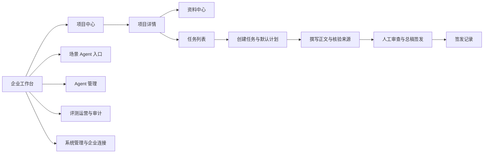

# 医疗器械企业 Agent 平台交互原型说明

版本：2026-09-27，`DRAFT`。能力类型：`DESIGN`。业务验收：`NOT_RUN`。

## 设计依据与边界

当前目标设计包含七类场景的输入与成功成果、十三种文档的章节规则、任务依据、质量检查、项目授权、模板和规则审核、法规影响、多维评测、反馈改进及企业连接。页面路径、人工动作和数据说明见 [目标产品完整设计](./ui-delivery/final-product-design.md)。页面可操作不代表正式服务已经接入。

- 依据：[PRD.md](./PRD.md) V1.2.0、[客户需求初次沟通.md](./客户需求初次沟通.md)、[产品方向与商业假设.md](./产品方向与商业假设.md)。范围覆盖 `FR-01` 至 `FR-09`、`AC-01` 至 `AC-44`。
- 客户曾展示初步界面方案，现有文件只有录音及其口头整理，没有画面文件与评审意见。以下页面结构与视觉方向属于 `INFERRED`，客户现有界面的对照审查为 `NOT_RUN`。
- 当前使用场景按浏览器中的企业工作台设计，视口包含桌面、窄屏与移动浏览器。移动浏览器用于查询、问题定位及必要的人工处理；长文逐章编辑以桌面视口呈现。专用手机应用及具体前端工程尚无客户决定。
- 原型设计稿见 [设计稿.html](./设计稿.html)。页面已加入仿真项目、资料、任务、评测与管理记录，并在全局标记「设计演示」。记录名称、身份、版本、数值和结果均为虚构内容，只用于展示筛选、分页和操作反馈；不代表客户资料、法规事实、模型效果或正式审查结果。页面不连接企业资料、模型、法规服务或签发服务。
- `EXPLICIT`：按项目组织资料、选用已核准版本、受控生成、来源核验、人工修改或退回、授权签发。`INFERRED`：导航层级、页面布局、岗位分工细项、关键问题判定方式。`UNKNOWN`：客户现有界面、真实资料、逐产品模板、关键问题等级、签发身份核验、预算值、移动端使用范围。

## 信息结构与导航

企业空间选择器始终显示当前企业；项目选择器只显示获授权项目。最左侧导航的三个分组采用相同结构：核心功能包含「工作台」「项目中心」「资料中心」；平台管理包含「Agent 管理」「评测与运营」；系统管理直接显示全部 18 个管理功能及「企业空间与连接」。工作台展示六个场景 Agent 入口，注册文档 Agent 进入任务创建，其余入口按实际发布状态控制。项目详情集中显示五个办理环节：项目建档、资料准备与核准、任务与章节规划、生成与来源检查、人工审查与签发。任务页面只显示三个文档处理步骤：创建任务、撰写与核验、审查与签发。选中项目后更新进度和项目属性；正式实现须从项目记录读取已完成环节。资料中心独立访问时不显示项目办理进度。页面主区域保留单行标题及必要操作；任务内显示任务编号、当前版本和状态。直接打开任务链接时先核验身份、企业和项目权限；拒绝页不展示受保护对象的名称与内容。

### 工作方式与交互选择

采用三个连续的任务页面承载注册文档处理。创建任务时确认项目和目标文档，系统展示默认模板、章节计划、资料范围和审查责任人，补充说明为选填。撰写页面以正文为中心，直接编辑内容，拖选文字后改写、添加批注或询问 Gru；章节证据默认收起，申请资料清单位于右侧。审查页面显示只读全文及正文图片，支持选区标注、定位与回复；签发动作保持收起。顶部常驻 Gru 对话助手可以在全部页面打开，保持当前工作页面和会话记录。

工作台以待处理事项为主要内容，显示负责人、截止日期、等待时间及处理原因。「待我处理」「等待他人」「运行任务」「待签发」指标可以直接筛选队列。场景 Agent 和最近项目位于右侧，注册文档入口显示当前发布版本。项目详情集中显示项目摘要、办理进度、任务、资料准备及协作人员，任务行进入对应文档与版本。

资料中心使用左侧范围、常用视图和文件夹，右侧为资料列表与多文件阅读标签。范围包括全部授权资料、当前项目、企业公共资料、我的上传；常用视图包括全部资料、收藏、最近阅读、待核准、已停用和回收站。项目资料、法规与标准、模板、检查规则作为分类目录，允许建立子文件夹。列表包含分页、复选框、维护人、标签、引用数量及操作入口。点击文件打开阅读标签，返回列表保留原查询和页码。阅读器包含正文与属性、引用关系、版本记录和操作记录。

资料中心参考 [Obsidian 文件浏览器](https://obsidian.md/help/plugins/file-explorer) 的分类树和当前文件定位、[Obsidian Bases 视图](https://obsidian.md/help/bases/views) 的列表筛选、[Obsidian 属性](https://obsidian.md/help/properties) 的结构化元数据，以及 [Obsidian 反向链接](https://obsidian.md/help/plugins/backlinks) 的被引用关系。医疗器械场景还需显示来源原文、适用范围、项目版本和人工核准记录，相关正式数据由企业授权资料提供。

### 屏幕清单

下表中的编号用于需求追踪，不作为界面中的用户数据。设计稿使用文字路由名称；以下屏幕编号供后续实现和验收引用。

| screen_id | 页面、主要角色及入口 | 核心内容与退出 | 对应需求 |
| --- | --- | --- | --- |
| S01 | 工作台；注册、服务、管理人员登录后 | 当日待办、重点项目、任务进度及六个场景 Agent 入口；从待办进入来源核验、章节审查或总稿 | FR-01、FR-04、FR-07；AC-01、AC-07、AC-14、AC-15 |
| S02 | 系统管理；企业及平台管理人员经左侧功能菜单进入 | 组织与权限、运行监控、开发工具共 18 个功能入口位于最左侧；各功能显示范围说明、查询条件、记录列表、分页与对应动作 | FR-01、FR-08；AC-01、AC-02、AC-16 |
| S03 | 项目中心；注册人员从工作台进入 | 项目名称、产品信息、器械类别、注册路径、阶段、资料状态、任务进度、最近更新；列表筛选与分页，进入获授权项目 | FR-01、FR-04；AC-07、AC-08 |
| S04 | 资料中心；注册、研发、知识审核人员 | 范围、文件夹、资料集、资料列表与阅读标签；逐文件上传、解析与检索状态；全文查询及回收站 | FR-03；AC-05、AC-06、AC-29、AC-31、AC-32、AC-36 |
| S05 | 资料详情与版本核准；有相应权限人员从 S04 或引用进入 | 原件与解析内容、稳定位置、版本、使用关系、核准清单及人工决定；网络候选与成果转存来源 | FR-03、FR-05；AC-05、AC-06、AC-30、AC-33 至 AC-35 |
| S06 | 项目任务列表；注册、服务人员从 S18 进入 | 状态、负责人、最近步骤、待人工处理数、失败原因；进入配置或任务 | FR-04；AC-07、AC-08 |
| S07 | 创建任务与默认计划；注册人员从 S06 新建 | 确认项目、目标文档、资料范围及联网模式；展示模板、章节、研究问题、证据要求和责任人；进入 S09 | FR-04、FR-09；AC-07、AC-08、AC-18、AC-37 |
| S09 | 文档撰写与来源核验；注册、研发、知识审核人员从任务或待办进入 | 章节目录、正文与引用；右侧来源、研究计划、运行和成果；选区改写、补证、局部修订；进入 S11 | FR-03、FR-05、FR-09；AC-10、AC-19 至 AC-26、AC-38 至 AC-44 |
| S11 | 人工审查与总稿签发；注册、研发、知识审核及签发人员进入 | 只读总稿、选区标注、问题审阅、退回、审查确认、签发前核验与演示签发；修改和补证返回 S09 | FR-05、FR-09；AC-09 至 AC-11、AC-20 |
| S13 | Agent 管理；平台管理人员从导航进入 | Agent 配置与模型 API 配置；流程、能力与专业角色、模型预算、评测发布、任务记录；连接与版本操作 | FR-02；AC-03、AC-04、AC-27、AC-28 |
| S15 | 评测与运营；管理、评测人员从导航进入 | 固定任务版本的人工评分、相同样本比较、任务运营与审计；统计、列表、导出共用筛选范围 | FR-06；AC-12、AC-13 |
| S16 | 企业空间与连接；企业或平台管理人员从管理入口进入 | 企业服务状态、数据边界、连接授权、验证结果、同步错误；返回管理入口 | FR-08；AC-16、AC-17 |
| S17 | 通用拒绝与恢复页；深链或操作异常进入 | 拒绝原因类别、可执行处理、返回安全入口；不回显越权对象内容 | FR-01 至 FR-09；AC-02、AC-16、AC-23 |
| S18 | 项目详情；注册人员从获授权项目记录进入 | 项目摘要、办理进度、资料与证据数量、任务、待审决定及成员授权；进入相应处理页 | FR-01、FR-04；AC-01、AC-07、AC-08 |

### 建档、任务与审查入口

#### 演示数据与交互边界

页面全局标记「设计演示」。预置项目、资料、人员及任务用于展示操作路径；不代表客户资料、法规事实或模型表现。浏览器会话保存各任务的正文、引用、版本、批注和决定。刷新页面恢复预置内容。上传由用户选择的本地文件后，可以读取 TXT、Markdown 正文；其他格式保留原件并等待文档服务解析。页面不连接企业系统、模型或正式电子签发服务。

#### 项目与任务上下文

项目中心保留名称查询、阶段筛选和分页。选择项目进入详情后，任务列表、资料准备及任务创建共用当前项目。每项任务独立记录目标文档、负责人、正文版本、来源快照及配置版本；从工作台或引用关系进入任务时恢复所属项目。未准备资料的项目显示待补资料，不引用其他项目的内容。全局模块顶栏显示企业范围，任务页面显示项目与文档版本。

#### 创建与默认配置

任务创建只需确认项目、目标文档和选填说明。章节计划随文档类型更新；模板、审查人员、器械类别和预算取自已发布配置。默认配置可以展开查看，并进入 Agent 管理检查。模板未核准、缺少发布版本、器械类别不适用、项目暂停或归档时，创建动作说明具体原因。缺少项目资料时可以建立待补资料任务，上传并核准后重新检查。

#### 正文、引用与人工审查

撰写与人工审查共用同一份文档。标题右侧显示版本记录，下方通过相连步骤导航切换创建任务、撰写与核验、审查与签发。中心连续显示正文与编入文稿的图片，目录位于右侧辅助区域。撰写页面的章节证据默认收起，展开后查看文件版本、原文位置和原件；返回后恢复章节及展开状态。审查页面提供全文阅读，拖选文字或选择图片后浮现标注按钮，意见关联原文位置，支持定位、回复和解决。

正文可以直接编辑，鼠标拖选后提供替换文字与添加批注。首次修改建立修订版本，显示尚未保存；保存后写入会话版本记录。正文修改清除当前审查确认与来源核验，批注保留引用内容；文字变化导致批注位置需要检查时明确提示。新增批注清除总稿审查确认，解决批注必须记录处理说明。

人工操作依次包括保存正文、逐章核对引用、处理批注、确认当前版本审查、签发人员核对并确认签发。未保存、来源未核验、资料更新、资料未核准、批注未解决及已退回状态均阻止签发。请求补证和退回要求目标章节、接收人及理由，负责人和待办状态同步更新。岗位切换只演示动作差异，真实权限由后续服务端核验。

签发版本保持只读；继续修改需要创建修订版本。资料更新保留历史引用，不改变已签发记录；待审任务清除旧确认并显示受影响引用。版本记录可查看历史正文及相关动作。文稿导出生成 Markdown 文件，包含文档版本、审查状态与逐章来源。

#### 资料上传、版本与核准

上传表单包含文件、归属、类别、版本与来源说明。重复资料可以停止提交或作为同名资料的新版本，重复版本名称禁止提交。上传队列区分正文已读取、等待核准和等待解析；未解析资料无法核准。核准要求确认原文位置、适用范围并填写意见。核准结果更新对应版本，引用关系按任务和章节列出当前使用情况。历史来源和最新资料分别保留，打开旧引用时不会指向最新原件。

资料管理支持新建笔记、修改属性、收藏、标签、文件夹移动、正文导出与清单导出。笔记与正文修改保存为待核准版本。属性记录维护人、来源、器械类别、生效日期及复核日期；法规另含发布机关、文件编号、原文地址、发布日期和引用条款；模板另含目录要求及资料来源映射。修改来源和适用信息后，需要重新核准。法规来源信息不完整时，核准入口显示缺少字段并进入属性维护。

批量操作包括移动文件夹、追加标签、清单导出、加入回收站及恢复。移动文件夹保持企业与项目归属；不同类别资料不能跨类别批量移动。被任务或配置引用的资料禁止加入回收站，停用前显示待审引用影响并要求原因。已签发任务保留历史版本；待审任务重新核验。回收站恢复后进入待核准。空文件夹可以删除，包含资料或子目录时保留并说明原因。

#### 随时介入的 Gru 对话助手

顶部 Gru 入口与 `Cmd/Ctrl + J` 在全部 14 个页面可用。入口、面板标题、欢迎区域及助手回复使用同一拟人男性形象；回复署名为 Gru，对话导出文件名为 `Gru 对话记录.json`。打开后显示右侧非模态对话面板，支持展开阅读区、关闭、新建、历史会话与导出。关闭面板保留会话；页面跳转不清空记录。输入区域支持 Enter 发送、Shift + Enter 换行，以及对话提问、检索资料、检查当前任务、提出修改要求四种处理方式。

每次会话明确显示项目、文档版本、当前章节、资料数量及正文选区。可以选择本次对话使用的资料。进入其他页面后，面板保留原范围并提示页面变化；点击“围绕当前页面新建对话”后使用新的上下文。历史消息保持原引用内容。访问受限页面不返回任务与资料信息。

页面数据查询从当前资料和任务状态计算摘要、待办及引用，消息标记“页面数据查询”。资料引用包含名称、版本、位置与原文摘录，可直接打开对应版本。当前原型未连接模型；需要生成回答或修订时明确显示连接状态并保留问题，不生成模型输出或质量结论。

从正文选区可以直接询问 Gru。提出修改要求后，支持人工填写拟替换内容，在对话中比较修改前后正文。确认写入时校验文档版本、当前内容和签发状态，再写入目标章节并清除旧核验结果；正文显示尚未保存。版本变化时禁止采用旧预览，已签发内容需要创建修订版本。核准、停用及签发请求进入对应记录的确认动作。

#### Agent 配置与评测

Agent 管理顶部提供 Agent 配置与模型 API 配置两个分区。Agent 配置按版本组织五个页面区域：流程与默认配置、能力与专业角色、模型与预算、评测与发布、任务记录。已发布配置保持只读，创建草稿后可以调整模板、规则、人员、器械类别及预算。保存配置后清除该草稿的自检和评测结果。发布要求模板与规则已核准、能力依赖可用、模型连接可用、字段自检通过、固定样本逐项评分，并确认发布范围。当前演示配置明确使用演示连接。新任务采用新发布配置，既有任务保留创建时版本。停用需要填写原因；没有可用版本时，工作台停止创建入口。

模型 API 配置列表支持新增、名称查询、状态筛选、每页条数和分页；初始状态为空。新增表单登记名称、提供方、协议、Model ID、Base URL、鉴权、API Key 或凭据引用、调用限制、预算及授权范围。缺少必填字段、名称重复、地址包含身份凭据或查询参数、数值超限、指定项目未选择时保留输入并显示错误。编辑增加版本；历史快照不保留密钥。

详情提供设置凭据、验证连接、停用、恢复、清除凭据、删除及历史查看。停用、恢复、清除和删除需要原因与确认；被 Agent 引用时禁止删除。更新配置或凭据后，连接及关联草稿需要重新检查。只有已验证且启用的新增连接可以进入 Agent 模型选择。Gru 的连接配置入口打开同一分区。

当前配置与凭据仅在页面会话内保存，刷新后清除。连接验证服务尚未接入，验证页面明确显示请求未发送、认证与模型未验证、延迟和费用未产生。未提供真实密钥，正式调用、凭据服务解析、预算执行与企业授权由后续工程验证。

评测与运营包含质量评测、版本比较、任务运营及审计记录。样本固定任务正文版本与知识版本；人工记录各配置版本的输出、分数、采纳或退回决定及依据。版本比较使用相同样本，评分未完成、同版本比较或没有样本时不给出质量变化判断。器械类别与日期筛选同时作用于当前统计、列表和导出。正式模型调用与费用显示尚未接入，不从演示操作推断模型效果。

### 列表与系统管理

项目中心提供 12 条设计演示项目记录，支持项目名称或产品名称搜索、项目阶段筛选、每页条数选择及翻页。资料中心提供项目资料、法规来源登记、模板与检查规则的仿真记录，支持四类切换、名称或版本或来源搜索、状态筛选与分页。仿真来源登记只展示界面流程，不提供或替代真实法规条文。查询条件变化时从第一页重新计算，切换资料类别时清除旧类别的查询条件。正式接入时由服务端按企业、项目、权限、类别、查询条件和页码返回数据及总数。

系统管理参考 [若依官方功能清单](https://doc.ruoyi.vip/ruoyi-vue/document/kslj.html) 的功能范围，在最左侧导航组织以下入口：

| 分组 | 功能入口 | 页面内容与管理动作 |
| --- | --- | --- |
| 系统管理 | 用户管理、角色管理、菜单管理、部门管理、岗位管理、字典管理、参数管理、通知公告 | 按功能显示字段、查询和分页；有创建动作的入口打开对应字段表单；权限范围及企业隔离在详情区说明 |
| 系统监控 | 在线用户、定时任务、操作日志、登录日志、服务监控、缓存监控、连接池监视 | 查看状态摘要、记录字段和分页；定时任务显示创建表单；会话与运行信息按管理权限读取 |
| 开发工具 | 代码生成、系统接口、表单构建器 | 查看来源、接口与表单记录；可进入代码导入或表单创建的设计表单；正式操作仍需服务端授权 |

各管理功能切换时更换标题、说明、字段、操作和查询上下文。创建表单对必填字段执行浏览器校验；设计稿中的提交反馈明确说明没有保存结果。若依是否为客户生产环境中的准确框架及其启用模块，仍以客户系统资料为准。

## 页面状态及动作

每个页面均须覆盖加载、空列表、可用、部分数据、服务错误、权限拒绝、长内容和窄屏。加载时保留标题及当前位置；空列表说明创建条件；错误给出重试或返回；权限拒绝不显示受保护内容。所有提交动作显示「提交中」，收到服务端确认才显示「已保存」；断网显示「未保存」。刷新后重新读取服务端状态与当前授权。返回章节时恢复章节编号、滚动位置、问题筛选及来源定位；更换企业或项目时清除当前对象上下文和未提交的敏感输入，并提示用户确认。

| 页面范围 | 业务状态与界面反馈 | 可执行动作和限制 |
| --- | --- | --- |
| S01、S03、S06、S18 | 无授权项目、待配置、使用中、暂停、归档；任务待办按责任人与状态筛选 | 暂停项目禁止新建任务；归档项目仅授权查询；空态引导申请授权或建立项目；页面位置不推断业务完成状态 |
| S02、S16 | 管理记录为空、查询无结果、表单缺项、未邀请、邀请中、有效、停用；监控未连接、连接未配置、待验证、成功、失败、`BLOCKED` | 管理功能按权限显示；表单缺项保留在当前弹层；授权变更后重新读取；未收到连接验证结果时不显示连接成功；越权操作转 S17 |
| S04、S05 | 待核验、已核准、已停用、解析失败、原文定位失效、版本冲突 | 正式任务仅选择适用且已核准的就绪版本；缺少对应格式的稳定原文位置时阻止引用；更新保留历史关联 |
| S07 | 未填写、校验中、待补资料、版本冲突、提交中、已创建、断网未提交 | 显示逐项缺失位置及补充入口；重复提交查询原任务编号；未确认的法规适用性阻止正式提交 |
| S09 | 未运行、运行中、证据待补、草稿待检查、待人工审查、运行失败、预算耗尽、输入超限、未保存 | 逐模块显示引用来源、版本与位置；来源失效或字段冲突保持待核验；运行中显示当前步骤、已完成章节与费用；失败保留既有产物 |
| S11 | 待人工审查、待签发、已签发、已退回、关键问题未处理、签发权限不足 | 阅读完整图文并标注；意见定位原文、回复与解决；修改返回撰写页面；正式签发前检查授权、版本和处理状态 |
| S01、S13、S15 | Agent 草稿、待发布、已发布、已停用；场景规划中、已发布；样本不足、统计失败 | 规划中场景无正式任务入口；样本不足显示 `INSUFFICIENT_EVIDENCE`；运营指标可查看原始任务与评分记录 |

### 人工审查动作

| 动作 | 入口、必要输入与权限 | 提交反馈和结果 |
| --- | --- | --- |
| 确认任务与默认计划 | S07；注册人员确认项目和目标文档，展开查看系统默认章节、资料范围及责任人 | 创建任务后进入可编辑正文；正式系统记录计划版本、任务编号和创建人；缺少必需项则逐项提示 |
| 核准资料或知识版本 | S05；注册或知识审核人员按授权核对原文、来源、适用范围和实施信息 | 记录核准人和版本；不完整来源保持待核验，受影响任务显示提示 |
| 查看来源 | S09 各正文模块的引用、S11 总稿引用；需要对应项目读取权限 | S09 显示来源；S11 跳转 S09/S05 并恢复固定版本、位置和焦点；不可访问时显示待核验原因 |
| 核验严格字段 | S09 来源面板；研发核对技术字段，注册人员核对注册内容 | 并列显示草稿值、权威来源值、单位和条件；决定记录人员及时间；S11 读取结果并可返回 S09 处理 |
| 修改正文与添加批注 | S09 直接编辑与选区修改；S11 只读全文与选区标注 | 撰写提供替换、批注和 Gru；审查选区仅提供批注，保留原文位置及处理状态；正文修改使当前审查确认失效 |
| 处理问题 | S11；审查者查看问题位置、依据、责任人及历史 | 可选择确认修订、保留待核验、请求补证或退回；处理结论附理由与版本，未处理关键问题仍阻止待签发 |
| 退回章节或总稿 | S11；审查者必须填写原因、目标章节和接收人 | 记录 `review_returned`，任务进入已退回；责任人可见原因和目标位置；旧版保持可查 |
| 请求局部重新处理 | S09；注册人员预览受影响章节、依赖章节和费用；S11 返回 S09 | 确认后建立新尝试及受影响章节新版本，未受影响章节保持原版本，重新执行跨章检查 |
| 提交签发与签发 | S11；注册人员提交，企业授权签发人员核对总稿、问题、来源及版本 | 关键问题或授权不满足时明确阻止；签发成功后可重新读取签发版本、签发人和时间；重复请求返回原结果 |
| 提交反馈 | S11；获授权人员说明问题与建议 | 按 PRD BR-14 提交知识或规则变更，保留来源任务与原始依据，经人工核准形成可用版本 |

## 核心流程与恢复

1. **建档与授权**：企业管理人员授予项目动作权限；注册人员确认产品属性、注册路径和项目阶段；研发人员上传资料；有权限人员核准适用版本。权限拒绝、损坏文件和引用位置缺失分别显示具体原因。
2. **创建任务**：注册人员在 S07 确认项目和目标文档；系统展示默认模板、资料范围、章节计划与责任人。正式创建时校验适用性、权限、缺项与预算，生成唯一任务编号及版本快照。重复提交返回原任务；冲突要求重新读取。
3. **撰写与来源核验**：S09 将可编辑正文置于中心，每个模块标注引用来源。右侧显示来源位置、运行状态、费用与恢复入口；证据不足只暂停相关章节。模型超时、预算耗尽与输入超限显示最近完成步骤、已产生费用及授权处理入口。
4. **人工审查与总稿签发**：S11 显示只读总稿、问题、标注、退回和签发前核验；正文修改与补证返回 S09。无来源或事实不受证据支持的内容保持待核验；章节更新后重新检查相关内容和跨章一致性。签发人员核对目录、版本、问题和岗位权限。关键问题规则与授权岗位有待客户决定，设计稿只展示演示操作反馈。
5. **审计与评测**：授权人员从 S15 追溯任务、调用、问题处理和签发。模拟样本显示性质，不产生真实质量改善结论。

| 异常 | 页面内处理与恢复位置 |
| --- | --- |
| 断网或服务超时 | 保留未提交编辑并标记未保存；恢复连接后先查询服务端版本及原请求结果，再允许重试。 |
| 并发修改 | 显示当前版本与新版本的差异入口；用户重新读取后决定保留或重新提交，不覆盖已保存内容。 |
| 资料或法规版本变化 | 已有任务继续显示原快照；待审任务显示受影响章节，授权人员发起新版本处理。 |
| 越权或资料内指令 | 服务端拒绝对应动作，S17 展示安全的拒绝说明；任务目标与项目范围保持原值。 |
| 取消或退回 | 已取消结果只读；已退回任务保留目标章节、原因、责任人和旧版本，修订后进入新版本检查。 |

## 设计检查与待确认事项

`FR-01` 至 `FR-09` 均有页面入口；`AC-01` 至 `AC-44` 的正常、拒绝和异常路径可在本说明的页面与状态中定位。本说明属于设计要求，新增交互尚未在 HTML 中实现；真实权限、持久化、模型调用、来源定位、导出及签发的运行结果均为 `NOT_RUN`。客户现有界面没有提供，视觉对照审查为 `NOT_RUN`。

## Agent 与资料管理的目标交互

依据 PRD V1.2.0，日期为 2026-09-27。本节规定正式产品目标行为，设计状态为 `INFERRED`；既有 HTML 的演示行为仍按前文记录。页面入口与导航保持现有结构，新增能力集中在 S04、S05、S07、S09、S13、S18 和 Gru。

### 资料中心、资料集与版本详情

| 入口 | 操作与可见结果 | 异常、空态与权限 |
| --- | --- | --- |
| S04 资料集视图 | 新建资料集，填写归属、用途、适用环节、维护人；按文件版本添加成员；显示成员清单、缺项及版本记录 | 没有成员时显示待补资料；来源不可访问或未核准分别提示；发布新的成员清单不替换任务快照 |
| S18 项目资料区域 | 查看项目资料集、企业公共资料引用、会话附件及任务成果；从缺项进入上传或选择已核准资料 | 浏览项目不自动授权企业全部资料；归档项目禁用上传、转存和新运行，保留授权阅读 |
| S04 上传队列 | 多文件选择后按文件显示上传、解析、检索三个处理状态和核准状态；可查看解析问题、重试失败项、进入详情 | 成功与失败数量分别显示；同内容返回已有版本；同名不同内容要求选择新资料或新版本；不覆盖原件 |
| S05 原件与解析标签 | 查看目录、正文、表格、对应位置及解析版本；从 OCR 问题进入原件核查；查看新旧处理版本 | 按 PDF 页码、文本标题与位置、表格行列、演示文件页序定位；无法定位不编造位置，部分解析失败不能核准 |
| S04 全文查询 | 选择资料集和文件版本，输入问题；结果展示原文摘录、位置、版本和核准状态；点击进入 S05 命中位置 | 没有结果显示范围和查询条件；索引失败显示处理错误；两个状态均不自动扩大范围 |
| S05 使用关系 | 按资料集、Agent 配置、任务章节、成果列出引用；查看源文件与派生成果；停用前预览影响 | 待审引用进入重新核验；权限撤销后受限引用内容不可见；已有签发记录保留但仍校验访问授权 |
| S05 保存与生命周期 | 会话附件或成果保存到项目时填写目标、类别、来源、适用范围、维护人及核准责任人 | 保存为待核验；引用中的资料只能停用；无引用资料可进入回收站，恢复后待核验；永久清理须满足保存策略 |

核准按钮给出可逐项检查的条件：原文与来源可核查、解析完整、检索就绪、适用信息完整、核准权限有效。每项条件可以直接进入对应资料位置或属性字段。资料列表默认显示处理状态与核准状态，避免“上传成功”被理解为“可供正式生成”。

### Agent 配置与任务资料范围

S13 的 Agent 配置具有七个区域：默认配置、专业角色、Skill 与工具、模型预算、研究上限、评测发布、任务记录。专业角色展示职责、输入、产出、Skill 版本、工具动作及授权状态。修改配置形成草稿，并清除对应评测状态；已发布配置只读。Skill 与工具登记分别进入待审核、待验证，正式服务完成核验前阻止发布。

S07 默认显示“指定核准资料”，带出适用资料集与成员版本，联网关闭。来源模式可选择指定网络来源、资料与网络共同研究；切换后显示具体网址或允许域名、公开检索词、候选资料核准说明。仅对话或选区处理在 Gru 中提供，显示“未检索资料”。清空选择、关闭联网和恢复默认使用不同按钮；提交时显示实际生效范围与不可用项。

Gru 输入区域增加资料选择入口，已发送消息保留本次范围快照。点击附件显示“仅用于本会话”及“保存到项目资料”；附件完成解析不会自动成为正式依据。消息中的修改建议提供目标版本、引用变化、受影响章节和采纳预览；用户确认后校验版本再写入。页面变化只提示上下文变化，原会话继续使用原项目；运行中追加要求显示待处理，不静默修改当前执行。

### 研究执行、人工补证与成果

S09 的“研究工作区”通过问题、协作、记录、成果四个分区持续展示任务过程。问题可展开固定原文、定位章节、人工补证或交给 Gru；协作展示专业角色、前置职责及交付内容。成果在当前页面展开章节、生成 Markdown 和下载固定记录，保留当前文稿位置。S11 保持全文只读与标注，审查签发区域按需展开；研究和正文修改导航至 S09。运行的实际耗时、费用与远端状态等待服务返回；复杂案例中的协作状态明确标记为演示。

“交给 Gru”建立关联问题、章节、文稿版本和来源的对话。发送要求后，可确认登记为待处理输入；该操作进入同一任务的工作记录，正文保持原值，重复点击进入已登记记录。直接修订继续使用原有版本比较与写入确认。人工补证记录处理意见；确认已核验时检查选定证据与前置问题，未完成的阻断问题继续阻止审查确认。

资料中心顶部按接收与解析、核查、组织、使用呈现数量与入口。资料详情显示下一步及关联任务，完成核准后可以加入资料集，再从关联任务继续核查。当前数据包括 32 份资料、7 项任务和3个资料集；复杂演示内容与授权范围见 [复杂案例数据说明](./ui-delivery/complex-scenario-data.md)。

## 申请资料与文中证据

项目中心、所属项目、文档任务列表、任务详情之间提供可点击的层级导航。项目详情的层级导航与操作按钮共用一栏，项目名称作为主标题。全局顶部显示 Gru、企业、项目及用户入口。返回按钮依据任务入口返回项目详情或任务列表，保留状态筛选。浏览器前进、后退恢复页面与任务上下文；未保存正文保留在当前会话。项目办理进度中的撰写与核验、审查与签发分别进入对应状态的任务列表。

已有任务使用任务配置、撰写与核验、审查与签发三个步骤，配置页面读取同一任务，显示项目、文档类型、负责人、版本与模板。新建入口提供 13 种文档类型，共用正文编辑、右侧目录、章节引用、标注、版本记录与签发流程。新增类型依据对应字段目录创建空白草稿，正文与来源需要人员补充；模板使用已核准资料并记录适用依据。缺少必要内容时签发保持禁用。

项目详情和撰写页面右侧可展开六类申请资料清单，显示 38 个官方二级节点。支持分类和缺项筛选；每项填写适用性、决定依据、责任人，并选择多份固定版本资料。未决定适用性或尚无已核准证据时不能完成适用项目的人工核查。暂停或归档项目保持只读。

PRD V1.3.0 的 11 类文档、57 个初始字段组作为审查数据结构保留。正文工作区通过章节、引用和标注处理文档。工作台与资料中心提供真实公开资料入口，直接进入撰写或审查地址时显示同一公开参考文稿。官方表格图可定位资料中心及原始 Word，内部审查 JSON 可下载。详细交互见 [文档阅读设计](./ui-delivery/document-reading-design.md)。

复杂案例为八个章节的产品描述文稿，初始包含 19 项文字或图表证据。正文引用可打开右侧预览、查看资料中心固定原件、返回对应章节。图表引用含完整原页、图注、版本及页码；插入时校验实际存在的页面。编辑同一文件默认保留历史版本，采用最新版本需明确选择。附加引用可移除，主要来源通过编辑修改。

每项引用独立确认。来源未核准、来源版本变化、正文未保存或图文引用未核查，均阻止相应核验动作。修改正文或引用后清除当前审查确认。导出使用自包含 HTML，保留图片、正文和出处；同一导出记录不会随后续编辑变化。产品技术要求与注册目录分别采用适用结构，完整依据见 [注册资料研究](./ui-delivery/registration-research.md)。

| 状态 | 界面反馈 | 可执行动作 |
| --- | --- | --- |
| 等待补证 | 问题、所需资料、责任人、受影响章节 | 上传、选取已核准资料、提交候选核准、修改计划；新输入形成新版本 |
| 子任务失败 | 失败角色、问题、已完成产物与实际用量 | 查看原因、补充输入或获授权继续；必需结果未完成时不显示总稿完成 |
| 研究或修订上限 | 已用次数、费用、在途用量、未完成条件 | 授权追加预算或调整计划后继续；追加决定需记录原因 |
| 取消中 | 已停止派发、在途调用及最后成功步骤 | 查看执行状态；状态未确认时不显示已取消；离开页面不等同取消 |
| 成果可用 | 成果类型、文档版本、审查状态、原始来源关系 | 阅读、比较、导出 DOCX/PDF/Markdown、保存到项目资料 |
| 导出失败或版本冲突 | 失败格式或冲突目标及版本 | 重试指定导出或重新读取目标；已有成功成果保留 |

成果转存成功后提供新资料版本入口及待核验状态；原文稿保持原状态。导出表单明确当前版本和审查标识，历史导出始终固定原版本。写作习惯在 Gru 设置中由用户主动保存、查看和删除；项目事实及核准决定不进入个人通用记忆。

新增交互验收映射：S13 对应 AC-27、AC-28；S04/S05/S18 对应 AC-29 至 AC-36；S07 与 Gru 对应 AC-37、AC-38；S09/S11 与 Gru 对应 AC-39 至 AC-44。验收资料必须使用获授权真实文件，全部业务运行状态为 `NOT_RUN`。

当前实现与完整要求的逐项差距见 [PRD V1.2.0 覆盖表](./ui-delivery/prd-v12-coverage.md)。资料中心六个分区可以切换；资料集的成员、资料要求与证据关联共同生成新版本。批量上传读取真实文件，正文全文检索限定选定资料集，空范围不执行查询；会话附件及任务成果转存后进入待核验。Markdown 导出记录保存固定文本，DOCX/PDF 转换、语义索引、网络获取及远端运行明确显示服务未接入。

GPT Researcher 与 DeerFlow 的参考范围、若依 Vue3 通用组件复用要求见 [组件复用检查](./ui-delivery/component-reuse-audit.md)。当前交付为 HTML 原型；正式 Vue 工程目录与接入验证仍待提供。

客户评审需给出：现有界面文件及反馈；逐产品模板和真实资料授权；注册、研发、知识审核及签发岗位的动作范围；关键问题等级和签发门槛；移动端使用范围；浏览器、文件与系统连接环境。获得决定后更新本说明中的 `INFERRED` 与 `UNKNOWN` 项，并逐项执行 PRD 中的业务验收。
