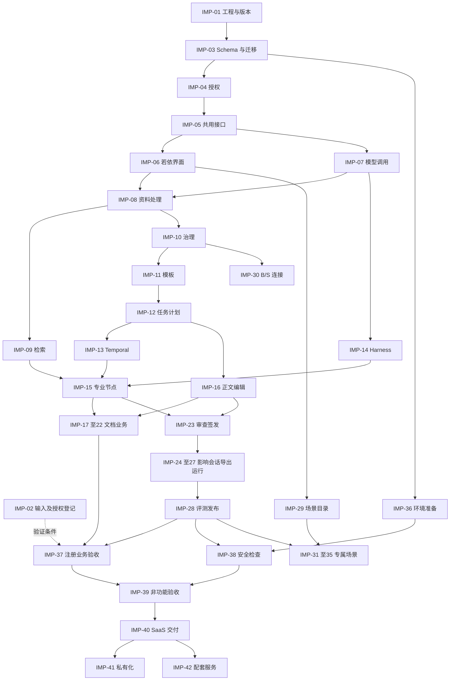

# 医疗器械企业 Agent 平台实施任务计划

2026-10-13后端继续依据[后端实施计划](docs/后端实施计划.md)执行，使用实际服务、受控配置及获授权真实输入。删除Worker与六类执行器由[IMP-10](docs/development/IMP-10.md)维护；当前实际服务、私有备份及诊断配置、264项迁移和207张表的真实隔离数据库恢复由[IMP-36](docs/development/IMP-36.md)维护。当前状态表为18项IN_PROGRESS、1项IMPLEMENTED、23项TODO、零项ACCEPTED；正文由[IMP-16](docs/development/IMP-16.md)维护，任务及计划由[IMP-12](docs/development/IMP-12.md)维护。执行条件读取§6.4，任务状态由§4.2维护；代码与必要集成通过后登记IMPLEMENTED，正式验收独立登记，全部后端范围继续原要求。

2026-10-08执行要求由用户调整为优先完成全部功能开发。全部42项工单及P0/P1/P2范围保持完整，按照当前业务依赖连续补齐Data、Backend、Agent、Frontend代码；完整代码具备时登记IMPLEMENTED，全部必需验收通过后登记ACCEPTED。开发期间执行直接相关的BDD/TDD、编译、类型和必要实际服务检查；全量构建、统一部署及完整验收集中执行。某项检查失败只影响对应功能，其他已定义且前置具备的开发继续进行；相同代码和环境没有新依据时不重复全量运行，不以重复观察代替功能开发。当前IMP-12已提供完整AgentReleaseManifest表示及绑定，28项清单、19项原Java共享检查、Python12项和TypeScript严格类型/30项通过；发布状态、实际评测、权利及任务写入继续其原责任。最新CURRENT-RUN-TOKEN-POLICY-BUILD-FINAL-01原5922已失败终止，466项Java中一项上传恢复断言失败，新应用制品未生成；该问题由IMP-08维护，完整验收保持未通过。

2026-10-08当前BACK-CURRENT-RUN-TOKEN-POLICY-01已经提供RunTokenPolicyStore及共享ProtectedConfigurationFile；60项当前配置/签名与141项完整身份关联检查通过，原TLS、Servlet及22份公开证书/CRL签名证据已独立核验，唯一[IMP-04](docs/development/IMP-04.md)维护当前源码和原始回执。新组件的完整应用构建及新部署继续验证；下方448项与PID16562证据只对应其原源码范围。生产配置发布、私钥保护、持久运行归属、当前动作许可及完整Worker继续原要求，工单数量和全部验收状态保持。

2026-10-08运行令牌签名的42项实际RSA检查、上传许可的73项实际服务检查及原32次停止发送期限通过，唯一[IMP-04](docs/development/IMP-04.md)/[IMP-05](docs/development/IMP-05.md)维护各自原证据。RUN-TOKEN-UPLOAD-TASK-PLAN-BUILD-FINAL-02原8916已成功终止，448项Java、前端strict及生产构建通过，inputs_unchanged=true；当前161张企业表的全部隔离断言保持。036实际迁移与完整备份、原237项不变及十二项新增至249由唯一[IMP-03](docs/development/IMP-03.md)维护；十二张表的完整结构核验通过，由唯一[IMP-12](docs/development/IMP-12.md)维护。新制品PID16562、部署2c11fbe2-b5c6-4396-86d5-468ce769d029已通过八项入口、全部HTTP静态字节与六项原操作，由唯一[IMP-06](docs/development/IMP-06.md)维护。本聊天接管原获授权聊天暂停后的完整IMP-12及Agent发布准入；[IMP-13](docs/development/IMP-13.md)的完整Workflow与Worker继续原要求。当前12项IN_PROGRESS、1项IMPLEMENTED、29项TODO、零项ACCEPTED；全部42项工单与57业务/17非功能/18边界/12EVAL/30SEC保持完整。下方检查只证明各自原输入与部署范围。

日期：2026-10-08；版本：V1.1.0；研发任务：T10/T11；规划责任技能：haonan-s007-planner；实施责任技能：haonan-s008-coder；当前模式：AUTHORIZED_BACKLOG / CONTINUOUS_DELIVERY。本次按用户“更新计划，并且提高业务功能优先级”的要求进行 REPLAN。当前42项工单为12项 IN_PROGRESS、1项 IMPLEMENTED、29项 TODO；完整业务验收和发布尚未完成。执行优先级、具体前置能力和当前交接读取 §4.4—4.6，任务状态仍由 §4.2 唯一维护。

## 1. 依据、当前工程与授权

2026-10-08 BACK-SERVICE-CERTIFICATE-01与项目适用模板页面已进入SERVICE-CERTIFICATE-TEMPLATE-BUILD-FINAL-01完整构建，402项Java、前端strict和生产构建通过，回执45d43d5ed9d3018baa5c8bc7c5476805ba4b3a65270c3cc72b0f88582f56e758，十九份运行JSON及完整JUnit独立保存。当前PID74481、Jar45c1e27eeb284798b4e1b059bb9f351714e905dc2b0f725448e7534b84135d5e的225份HTTP静态字节、六项页面入口和六项原操作通过，由唯一[IMP-06](docs/development/IMP-06.md)维护；[IMP-04](docs/development/IMP-04.md)维护实际TLS/Servlet身份组件及签名证据。[IMP-11](docs/development/IMP-11.md)维护原后端环境的二十四项DOM与完整模板合法查询/分页/任务采用范围。当前记录和组合入口为SERVICE-CERTIFICATE-TEMPLATE-RECORDS-FINAL-01及SERVICE-CERTIFICATE-TEMPLATE-20261008-release-evidence.json，结果读取实际文件；下方集合保留原输入范围。并行上传页面继续完整多文件及原请求恢复，来源后端继续信任配置发布、短期运行令牌、持久运行归属、Temporal、来源终态/去重引用及全部后续业务。42项工单状态仍由§4.2维护，11项IN_PROGRESS、1项IMPLEMENTED、30项TODO、零项ACCEPTED。

2026-10-08来源完成命令的SOURCE-COMPLETION-LEASE-01当前实际HTTP及完整400项Java、前端strict和生产构建通过，回执分别为af8bf2bb7cb5fd9e95f8f635dc35bdeddf953ca00542f846d7e1e241164b506e及e67ade702483141b82417d2c4388debabef8e21f6fa16f9f76afe785fa157eae，inputs_unchanged=true。30秒数据库租约、六次领取、续租、旧修订/owner拒绝、固定原命令/202响应、当前撤权及范围清理保持。当前PID61813部署核验222份HTTP静态字节、五项入口及六项原操作，由唯一[IMP-06](docs/development/IMP-06.md)维护；原业务计数零、237项迁移及两个对象卷可写。当前记录与九份组合入口为SOURCE-COMPLETION-LEASE-RECORDS-FINAL-01及SOURCE-COMPLETION-LEASE-20261008-final-evidence.json，结果读取实际文件。唯一[IMP-08](docs/development/IMP-08.md)维护租约实现与完整来源业务；Worker服务身份、Temporal、结果提交/失败队列及全部最终来源业务继续原要求，下方DELIVERY及其他集合保持原输入范围，工单状态保持§4.2。

### 1.1 当前依据

| 依据 | 采用范围 | 输入状态 |
| --- | --- | --- |
| [PRD.md](./PRD.md) V1.3.0 | R01—R08、FR-01—FR-09、BR-01—BR-23、AC-01—AC-57、NFR-01—NFR-17；第二类和第三类项目、十三种文档入口 | SATISFIED：需求可读取；文档仍为 DRAFT，客户批准单独记录 |
| [HLD.md](./HLD.md) V1.2.0、[架构审查记录.md](./架构审查记录.md) | C01—C12、ADR-001—ADR-007、Java/Python 分工、SSO、MySQL、Temporal、模型 API | SATISFIED：设计依据；组件版本与环境兼容为 PENDING |
| [LLD-数据.md](./LLD-数据.md)、[LLD-后端.md](./LLD-后端.md)、[LLD-Agent.md](./LLD-Agent.md)、[LLD-前端.md](./LLD-前端.md) | 来源身份、数据实体、接口、状态、专业节点、页面组件和实际使用方 | SATISFIED：使用当前文件及后端补充设计；版本以检查报告中的 SHA-256 固定 |
| [接口补充设计](./backend-design/接口补充设计.md)、[OpenAPI](./backend-design/interfaces.openapi.yaml)、[共享 Schema](./backend-design/interfaces.schema.yaml)、[详情 Schema](./backend-design/resource-details.schema.yaml) | FRONT-I01—FRONT-I14、IA-01—IA-10、正文/选区/事件/管理模块；补充接口与原后端接口共同覆盖实现范围 | SATISFIED：定义可用；实际接口为 PENDING |
| [数据 Schema](./data-design/dataset.schema.json)、[核心 DDL](./data-design/core.sql)、[Agent 产物](./agent-design/artifacts.schema.json)、[模型事件](./agent-design/model-stream.schema.json) | EvidenceRef、七种定位、18 张核心表、八类专业产物、八类内部模型事件 | SATISFIED：设计制品；完整生产迁移需同时纳入后端 §3 和补充设计 §4 |
| [交互原型说明.md](./交互原型说明.md)、[界面规范.md](./界面规范.md)、[文档阅读设计](./ui-delivery/document-reading-design.md)、[组件复用检查](./ui-delivery/component-reuse-audit.md) | 十四屏幕、S09 编辑、S11 全文只读审查、Gru、若依组件复用、三步文稿导航 | SATISFIED：文字与原型依据；正式组件引用为 PENDING |
| [设计审查记录.md](./设计审查记录.md)、[测试与评测方案.md](./测试与评测方案.md)、[安全检查方案.md](./安全检查方案.md) | CONDITIONALLY_APPROVED 的规划范围；57 项业务、17 项非功能、18 项边界、12 项评测、30 项安全检查 | SATISFIED：方案；REV-06—REV-09 对应输入继续保留 |
| [项目研发规划.md](./项目研发规划.md) T10—T13、[产品方向与商业假设.md](./产品方向与商业假设.md) | 当前计划属于 T10；T11 编码、T12 验收、T13 发布交接继续使用独立任务 | SATISFIED：研发任务身份；当前功能和技术依据采用上列最新文件 |

当前目录包含设计文档、Schema、SQL、HTML 原型、原型 JavaScript/CSS、真实公开资料及设计检查脚本。用户已要求在当前文件夹新建本地 Git 仓库，当前分支 main。正式 Java 工程位于 business/，Vue 工程位于 web/；来源提交、许可及组件引用见 [正式工程登记](./docs/engineering-baseline.md)。Python 与其余产品模块按对应工单建设。现有原型属于 PROTOTYPE，设计样例不进入实施测试。`data-design/sample_dataset.json` 属于已有真实公开来源的本地定位检查数据，其生产资格和外发许可保持原登记状态。

### 1.2 工程与执行边界

Java 业务服务维护 C02—C08/C10 和 MySQL 事务；Java Temporal Worker 维护 C11；Python 维护 C09/C12 和 C07 模型协议适配；DeepSeek Harness 官方 Python SDK 调用独立 medical-agent profile，TypeScript 插件维护受限业务工具。浏览器使用 RuoYi-Vue3、Element Plus、现有 Router、Pinia、Axios request 和通用组件。正式工程目录在 IMP-01 和 engineering-baseline.md 登记，已有工程结构直接继承。

工单使用项目内目录 `business/`、`runtime/`、`document/`、`web/`、`contracts/`、`deploy/`、`tests/`、`docs/`；物理路径与逻辑名称一致，具体职责见 engineering-baseline.md。business/ 和 web/ 已取得正式源码；其他目录的实现与验收按对应工单分别登记。构建启动工具位于 scripts/，属于 IMP-01 工程配置。现有设计资产只在对应责任范围更新，用户现有内容以实施开始时重新读取的版本为准。

当前执行者顺序处理共享文件、数据库迁移、索引和端口；本计划未授权委派、创建其他会话或同时修改同一资源。依赖图表示技术关系。取得实施授权后，S008 按就绪项持续执行，必要输入缺失仅暂停受影响动作。模型付费调用、客户数据外发、远端安全检查和目标发布按其具体授权记录执行。

临时检查文件保存在 `.planning-work/`，已加入 `.gitignore`。企业、成员岗位、项目和任务按 §4.6 的用户授权使用 SIMULATION 数据，连接实际服务与正式接口。资料与专业批准保持各自来源要求；禁止模拟服务、替代模型响应或自行编写成熟文件格式解析器。库直接 import；错误立即在发生位置报告；未知外部调用保留原调用及费用预留。恢复代码使用文件编辑工具，运行恢复使用已验证制品和批准数据恢复流程。

### 1.3 前端依据及验证方式

前端工单共同读取 [设计稿.html](./设计稿.html)、[tokens.json](./ui-delivery/tokens.json)、[屏幕清单](./ui-delivery/screen-design-map.csv)、[组件状态清单](./ui-delivery/component-state-map.csv)及文档阅读设计。现有完整页面截图路径未取得，不创建替代截图。用户禁止主动使用视觉功能，图像生成、截图、视频和图像比较保持 NOT_RUN；以 DOM、计算样式、键盘、IME、接口和下载检查验证获准部分。

全部页面覆盖 loading、empty、ready、partial、error、denied；采用界面规范中的桌面、窄屏与 Gru 展开布局。S09 保持连续正文、右侧目录和申请清单、默认收起的证据与运行区域；S11 只读同版全文、标注、审查和签发。普通控件和 Editor 复用 FRONT-R01—FRONT-R13；专用编辑依赖依据正式 Editor 与成熟扩展的能力核查确定。视觉未验证时不得登记相似度或完整视觉通过。

## 2. 必要输入与决定

本表维护实施期间新增的输入跟踪 ID；既有决定继续引用原编号。EXPLICIT 表示有明确来源，不能自动解释为客户业务批准。各任务的决定编号引用本表；相应输入分项提供后，逐项记录来源、批准岗位、版本、有效范围和重新评估条件。

| decision_id | 来源类型 / 状态 | 当前依据与必要输入 | 影响与解除条件 | 责任及验证 |
| --- | --- | --- | --- | --- |
| PLN-D01 | EXPLICIT / PARTIAL | FRONT-D01/02、BACK-O01、REV-07；根仓库、官方 Java/Vue 固定源码、组件路径与构建已取得；Python/SDK 制品及维护岗位待完成 | IMP-01、03—42 按实际就绪工程绑定；未运行服务、SDK 与责任登记继续核查 | 平台及各端负责人；运行各原生构建并登记版本与许可 |
| PLN-D02 | UNKNOWN / NEEDS_INPUT | REV-06、OPEN-D01/02、AG-O01；二类/三类、七格式、十三文档及专家标注 | 资料处理、生成、检查及业务评测；按测试 D1/D2/D4/D6 分组取得真实原件、摘要、用途和标注 | 客户注册、研发、数据、质量岗位；检查原件、权利和独立专家预期 |
| PLN-D03 | EXPLICIT / PARTIAL | BACK-LOCAL-01：用户确认本地运行采用系统独立账户；真实本机所有者的登录和注销已经运行。REV-07、BACK-O02、UI-03 的客户企业成员、岗位、域名和签发策略继续待定；外部 OIDC 保留可选接入 | 本地登录不依赖外部 SSO；两企业权限、资料核准、再次认证和签发仍需 D3 及批准策略 | 本地身份由实际操作系统所有者提供；客户身份、安全及注册岗位核验企业授权和签发 |
| PLN-D04 | EXPLICIT / PARTIAL | AG-O02/03、BACK-O04/07；模型 API 方式明确，DeepSeek 密钥已配置，2026-10-04实际连接检查通过；来源为 docs/deepseek-configuration.md 与 IMP-07 | C07供应商接入继续消费现有配置；生成、Embedding、适用 Rerank/OCR 各自的发布版本、价格、Tokenizer、外发许可、限额、预算和查询取消语义按用途补齐。缺少其中一项仅阻止对应调用及验收，配置和调用事务代码继续实施 | 平台与资料负责人；真实调用、费用及终止回执；不重复索取已有密钥，不记录秘密值 |
| PLN-D05 | EXPLICIT / PARTIAL | BACK-LOCAL-01：实际本地MySQL8.4.3、Redis7.4.8、当前完整构建的独立应用及SeaweedFS对象服务已运行；REV-07/08、OPEN-D04/06的生产环境、Temporal、Qdrant和生产秘密服务继续按工单建设与核验 | 2026-10-07当前339项Java构建、222份静态部署字节、原件恢复及四项S3检查通过；对象可用27371999232字节、5.474803%，两个卷ReadOnly=false。生产区域、容量、SLO、RTO/RPO、浏览器和维护责任另行批准；环境问题仅暂停实际依赖该环境的动作 | 运维与平台负责人；原始回执读取IMP-05/06，继续实际服务兼容、负载及完整恢复演练；历史制品保存与清理遵守已有授权 |
| PLN-D06 | UNKNOWN / NEEDS_INPUT | REV-08、BACK-O08、OPEN-D03；来源权利、保存期、保留指令及备份处理 | 外发、清理、恢复和历史访问；批准分类及逐存储策略，核对标准全文许可 | 客户资料、安全和数据负责人；实际治理回执；未知期限禁止永久清理 |
| PLN-D07 | UNKNOWN / NEEDS_INPUT | REV-09、BACK-O09；客户 B/S 的接口、身份映射和资料归属 | IMP-30、AC-17；取得 D7、网络范围、读写授权和真实重复请求核对方式 | 客户系统及连接负责人；本地与远端分别重读 |
| PLN-D08 | UNKNOWN / NEEDS_INPUT | PRD §8.7、REV-09；五类场景各自的输入、规则、输出和审核 | IMP-31—35、AC-14；每类独立批准规格及真实验收集合；其他场景保持规划状态 | 产品和对应领域负责人；S002/S005/S006 完成专属定义，S009 验证 |
| PLN-D09 | UNKNOWN / NEEDS_INPUT | PRD §8.8、R08；私有化环境与配套服务责任 | IMP-41/42；确认客户环境、维护权限、服务岗位、交接流程和验收目标 | 客户、运维、服务负责人；环境运行和实际服务项目验收 |
| PLN-D10 | INFERRED / PROPOSED | HLD ADR-001—007、AG-D01—05、FRONT-D03/04/06；设计审查允许规划 | 采用既定设计组织工单；实际组件组合、Editor 扩展和 SDK/runtime 制品由 IMP-01/06/14 核实 | S004/S005/S006；取得真实制品与兼容检查，变化时更新受影响设计 |

REV-01—REV-05 的状态继续为 RESOLVED_DESIGN，FRONT-I01—FRONT-I14 和 IA-01—IA-10 已有设计定义，实施工单负责实现与运行证据。未知阈值和客户输入不得填为已确认。当前没有交付日期或人日承诺；取得团队容量和真实工程后由 S007 更新排期，全部未验收需求继续保留。

执行决定 PLN-P01：来源 EXPLICIT，状态 CONFIRMED，依据为2026-10-07用户要求提高业务功能优先级。影响全部42项工单的调度顺序与验证组织，采用 §4.4—4.6；原始需求、业务规则、安全条件和外部操作权限保持各自依据。用户调整业务优先级、具体前置能力变化或当前业务出现阻塞时重新评估。S007维护本计划，S008消费当前交接，S009核查业务结果；PLN-P01不替代PLN-D01—10中的具体输入。

## 3. 需求与验收责任

### 3.1 原始范围

| 范围 | 原始用户结果与角色 | 功能 | 负责工单 |
| --- | --- | --- | --- |
| R01 | 企业管理员授权，注册及研发人员使用获准项目 | FR-01 | IMP-04、06、24、37、38 |
| R02 | 平台人员配置能力和模型，任务使用固定发布版本 | FR-02、FR-09 | IMP-07、13—15、27、28、37、38 |
| R03 | 资料人员处理、核准、检索、维护来源和版本 | FR-03 | IMP-08—11、24、26、37—39 |
| R04 | 注册人员建立任务、确认范围计划、处理待办并继续 | FR-04、FR-09 | IMP-12、13、15、25、27、37 |
| R05 | 研发及注册人员编辑和核验，授权岗位审查签发并导出 | FR-05、FR-09 | IMP-16—27、37—39 |
| R06 | 评测和管理人员比较真实结果、费用及采用记录 | FR-06 | IMP-28、37、39 |
| R07 | 对应岗位使用分别批准的法规比较、报告、翻译、市场分析和多模态问答 | FR-07 | IMP-29、31—35；每类保持完整条件任务 |
| R08 | 企业使用 SaaS；系统人员核验 B/S 连接；客户取得私有化或配套服务 | FR-08 | IMP-04、30、36、38—42；条件需求保留 |

### 3.2 业务验收总表

下表 57 行是业务验收的唯一当前状态来源。入口、角色、Given/When/Then、异常动作、重新读取及下游结果完整继承测试方案同号 TEST，用例内容不得由实现结果改写。实现责任列包含主要交付方；共同基础工单由依赖图追溯。验收责任任务必须核对该行全部适用分支。IC 编号只关闭单项实施交付，不能关闭对应 AC。

| acceptance_id | commitment_id | 用户结果 | 实现责任 | 验收责任 | check_id | status |
| --- | --- | --- | --- | --- | --- | --- |
| AC-01 | FR-01 | 授权后进入项目、创建任务并查询授权 | IMP-04,IMP-12 | IMP-37 | TEST-01 | NOT_RUN |
| AC-02 | FR-01 | 企业间资料、任务、导出和检索隔离且可审计 | IMP-04,IMP-24,IMP-28 | IMP-37 | TEST-02 | BLOCKED |
| AC-03 | FR-02 | 发布固定 Agent，实际调用、计费和停用生效 | IMP-07,IMP-14,IMP-28 | IMP-37 | TEST-03 | BLOCKED |
| AC-04 | FR-02 | 超时及预算不足保留成果、原因和真实用量 | IMP-07,IMP-13,IMP-27 | IMP-37 | TEST-04 | BLOCKED |
| AC-05 | FR-03 | 核准资料在任务中固定版本并定位 | IMP-08,IMP-09,IMP-10 | IMP-37 | TEST-05 | NOT_RUN |
| AC-06 | FR-03 | 缺原文、实施信息或定位时阻止正式引用 | IMP-08,IMP-10,IMP-23 | IMP-37 | TEST-06 | BLOCKED |
| AC-07 | FR-04 | 创建唯一任务和完整输入快照 | IMP-12 | IMP-37 | TEST-07 | NOT_RUN |
| AC-08 | FR-04 | 缺项待办、补证核准和新计划继续 | IMP-12,IMP-15,IMP-27 | IMP-37 | TEST-08 | NOT_RUN |
| AC-09 | FR-05 | 二类注册全过程审查、再次认证、签发和重读 | IMP-17,IMP-23,IMP-26 | IMP-37 | TEST-09 | BLOCKED |
| AC-10 | FR-05 | 型号参数或依据冲突提供两侧证据并阻断 | IMP-17,IMP-23 | IMP-37 | TEST-10 | BLOCKED |
| AC-11 | FR-05 | 退回、责任待办、修订和历史意见可查 | IMP-23,IMP-27 | IMP-37 | TEST-11 | NOT_RUN |
| AC-12 | FR-06 | 同真实样本比较版本、评分和采用 | IMP-28 | IMP-37 | TEST-12 | BLOCKED |
| AC-13 | FR-06 | 无真实样本时显示证据不足与空分数 | IMP-28 | IMP-37 | TEST-13 | NOT_RUN |
| AC-14 | FR-07 | 五类场景分别按专属规格发布并固定版本 | IMP-29,IMP-31,IMP-32,IMP-33,IMP-34,IMP-35 | IMP-31,IMP-32,IMP-33,IMP-34,IMP-35 | TEST-14 | BLOCKED |
| AC-15 | FR-07 | 未定义场景保持规划状态且无法产生正式成果 | IMP-29 | IMP-37 | TEST-15 | NOT_RUN |
| AC-16 | FR-08 | 两企业各自查询生成统计导出且交叉请求拒绝 | IMP-04,IMP-24,IMP-28 | IMP-37 | TEST-16 | BLOCKED |
| AC-17 | FR-08 | B/S 连接取得真实同步、归属和远端重读结果 | IMP-30 | IMP-30 | TEST-17 | BLOCKED |
| AC-18 | FR-09 | 完整章节依赖、证据与责任经人工确认才运行 | IMP-11,IMP-12,IMP-15 | IMP-37 | TEST-18 | NOT_RUN |
| AC-19 | FR-09 | 每项事实可读原文且严格字段一致 | IMP-09,IMP-15,IMP-17,IMP-23 | IMP-37 | TEST-19 | BLOCKED |
| AC-20 | FR-09 | 缺证章节待处理且保留独立章节结果 | IMP-13,IMP-15,IMP-23 | IMP-37 | TEST-20 | NOT_RUN |
| AC-21 | FR-09 | 中断恢复复用原成果与调用回执 | IMP-07,IMP-13,IMP-27 | IMP-37 | TEST-21 | BLOCKED |
| AC-22 | FR-09 | 局部修订保留未受影响正文和引用 | IMP-16,IMP-24 | IMP-37 | TEST-22 | NOT_RUN |
| AC-23 | FR-09 | 工具逐次授权且越权内容无法进入输出 | IMP-04,IMP-14,IMP-15 | IMP-37 | TEST-23 | BLOCKED |
| AC-24 | FR-09 | 达预算或上下文上限停止并保留证据 | IMP-07,IMP-14,IMP-27 | IMP-37 | TEST-24 | BLOCKED |
| AC-25 | FR-09 | 原文不支持事实时阻断确认 | IMP-15,IMP-23 | IMP-37 | TEST-25 | BLOCKED |
| AC-26 | FR-09 | 资料中的指令无法改变目标和权限 | IMP-14,IMP-15 | IMP-37 | TEST-26 | BLOCKED |
| AC-27 | FR-02 | 能力全部依赖固定且变更要求重新评测 | IMP-14,IMP-28 | IMP-37 | TEST-27 | BLOCKED |
| AC-28 | FR-02 | 工具外写和秘密访问遵守授权 | IMP-04,IMP-07,IMP-14 | IMP-37 | TEST-28 | BLOCKED |
| AC-29 | FR-03 | 多文件独立处理、重复复用、失败项单独重试 | IMP-08 | IMP-37 | TEST-29 | BLOCKED |
| AC-30 | FR-03 | 七格式定位及重建后历史引用正确 | IMP-08,IMP-09 | IMP-37 | TEST-30 | BLOCKED |
| AC-31 | FR-03 | 资料集更新保留旧成员快照 | IMP-10,IMP-12 | IMP-37 | TEST-31 | NOT_RUN |
| AC-32 | FR-03 | 空范围、无结果、失败和撤权分别处理 | IMP-09,IMP-24 | IMP-37 | TEST-32 | BLOCKED |
| AC-33 | FR-03 | 网络采集保留原件时间且核准后才可采用 | IMP-09,IMP-10 | IMP-37 | TEST-33 | BLOCKED |
| AC-34 | FR-03 | 成果转存唯一待核验来源并保持无环关系 | IMP-10,IMP-26 | IMP-37 | TEST-34 | NOT_RUN |
| AC-35 | FR-03 | 撤权影响检索、模型、缓存、历史和导出 | IMP-04,IMP-24 | IMP-37 | TEST-35 | BLOCKED |
| AC-36 | FR-03 | 引用与归档保护、回收恢复及保存策略生效 | IMP-10,IMP-36 | IMP-37 | TEST-36 | BLOCKED |
| AC-37 | FR-04 | 四种来源模式、空选择和联网范围固定 | IMP-09,IMP-12,IMP-25 | IMP-37 | TEST-37 | NOT_RUN |
| AC-38 | FR-04 | Gru 原目标固定、版本冲突保留建议 | IMP-16,IMP-25 | IMP-37 | TEST-38 | NOT_RUN |
| AC-39 | FR-09 | 专业任务依赖正确、必需失败不能整体成功 | IMP-13,IMP-15,IMP-27 | IMP-37 | TEST-39 | BLOCKED |
| AC-40 | FR-09 | 人工核准新资料及影响后按新快照继续 | IMP-10,IMP-12,IMP-24,IMP-27 | IMP-37 | TEST-40 | NOT_RUN |
| AC-41 | FR-09 | 刷新保持同运行、取消取得终止证明 | IMP-07,IMP-13,IMP-27 | IMP-37 | TEST-41 | BLOCKED |
| AC-42 | FR-09 | 固定版本多格式导出且重复下载一致 | IMP-26 | IMP-37 | TEST-42 | BLOCKED |
| AC-43 | FR-09 | 摘要可追原件、删除习惯影响新调用 | IMP-14,IMP-25 | IMP-37 | TEST-43 | BLOCKED |
| AC-44 | FR-09 | 无新增证据或达上限停止且父额度不重置 | IMP-07,IMP-13,IMP-15,IMP-27 | IMP-37 | TEST-44 | BLOCKED |
| AC-45 | FR-05 | 六章38节点完整、责任资料适用状态可查 | IMP-11,IMP-18 | IMP-37 | TEST-45 | BLOCKED |
| AC-46 | FR-05 | IVD、变更、延续采用兼容核准模板 | IMP-11,IMP-22 | IMP-37 | TEST-46 | BLOCKED |
| AC-47 | FR-05 | PTR 八组字段、多型号软件及专属格式完整 | IMP-17,IMP-26 | IMP-37 | TEST-47 | BLOCKED |
| AC-48 | FR-05 | 指标方法、年代号及条件缺项阻断确认 | IMP-17,IMP-23 | IMP-37 | TEST-48 | BLOCKED |
| AC-49 | FR-05 | 拟申请编号按模板留空、正式阶段核对证书 | IMP-17,IMP-21,IMP-23 | IMP-37 | TEST-49 | NOT_RUN |
| AC-50 | FR-05 | 未知条件保留、不适用具备依据且节点保留 | IMP-11,IMP-19,IMP-23 | IMP-37 | TEST-50 | NOT_RUN |
| AC-51 | FR-05 | 研究方案和真实结果分别管理 | IMP-19,IMP-23 | IMP-37 | TEST-51 | BLOCKED |
| AC-52 | FR-05 | 五列基本原则与风险控制证据完整 | IMP-19,IMP-23 | IMP-37 | TEST-52 | BLOCKED |
| AC-53 | FR-05 | 临床与免评价路径分别核验目录及对比证据 | IMP-20 | IMP-37 | TEST-53 | BLOCKED |
| AC-54 | FR-05 | IFU十四组及标签警示与跨文件信息一致 | IMP-21,IMP-24 | IMP-37 | TEST-54 | BLOCKED |
| AC-55 | FR-05 | 共享事实变更覆盖所有实际使用位置 | IMP-24 | IMP-37 | TEST-55 | NOT_RUN |
| AC-56 | FR-05 | 正文与内部材料独立同版、成品内容格式正确 | IMP-26 | IMP-37 | TEST-56 | BLOCKED |
| AC-57 | FR-05 | 新依据影响模板及待审文件、历史保持原版 | IMP-10,IMP-11,IMP-24 | IMP-37 | TEST-57 | NOT_RUN |

### 3.3 非功能与专项检查

全部 NFR 初始状态为 NOT_RUN；执行时按实际数据和环境将具体分支登记 BLOCKED。NFR 的性能数值、保存期、设备矩阵及恢复目标由 PLN-D02—D06 分别提供。下表逐行直接继承测试方案同号 NTEST 的方法、预期和数据条件。

| acceptance_id | 用户结果 | 实现责任 | 验收责任 | check_id | status |
| --- | --- | --- | --- | --- | --- |
| NFR-01 | 批准负载下的响应、吞吐和失败率可核对 | IMP-07,IMP-09,IMP-27,IMP-36 | IMP-39 | NTEST-01 | NOT_RUN |
| NFR-02 | 故障恢复不丢失已保存状态且不重复执行 | IMP-05,IMP-07,IMP-13 | IMP-39 | NTEST-02 | NOT_RUN |
| NFR-03 | 身份、企业项目、秘密与外发边界有效 | IMP-04,IMP-07,IMP-14 | IMP-38 | NTEST-03 | NOT_RUN |
| NFR-04 | 键盘、焦点、文字错误和语义控件可用 | IMP-06,IMP-16,IMP-23,IMP-25 | IMP-39 | NTEST-04 | NOT_RUN |
| NFR-05 | 批准浏览器、七格式与转换器兼容 | IMP-06,IMP-08,IMP-26 | IMP-39 | NTEST-05 | NOT_RUN |
| NFR-06 | 任务到调用、审查和成品的审计可查 | IMP-05,IMP-28,IMP-36 | IMP-39 | NTEST-06 | NOT_RUN |
| NFR-07 | 新旧版本共存、历史任务及数据恢复正确 | IMP-03,IMP-13,IMP-36 | IMP-39 | NTEST-07 | NOT_RUN |
| NFR-08 | 生成、检查、人工等待后保持上下文与费用 | IMP-13,IMP-15,IMP-27 | IMP-39 | NTEST-08 | NOT_RUN |
| NFR-09 | 原件、定位、支持关系分别取得证据 | IMP-08,IMP-09,IMP-23 | IMP-39 | NTEST-09 | NOT_RUN |
| NFR-10 | 调用、Token、费用及停止上限实际生效 | IMP-07,IMP-13 | IMP-39 | NTEST-10 | NOT_RUN |
| NFR-11 | 真实资料中的指令无法扩大工具权限 | IMP-14,IMP-15 | IMP-38 | NTEST-11 | NOT_RUN |
| NFR-12 | 资料四项处理状态和历史定位一致 | IMP-08,IMP-09,IMP-10 | IMP-39 | NTEST-12 | NOT_RUN |
| NFR-13 | 撤权立即影响新读取和调用准入 | IMP-04,IMP-24 | IMP-38 | NTEST-13 | NOT_RUN |
| NFR-14 | 刷新取消、并发修订和导出保持同版 | IMP-13,IMP-16,IMP-26,IMP-27 | IMP-39 | NTEST-14 | NOT_RUN |
| NFR-15 | 转存、引用保护、恢复和备份治理一致 | IMP-10,IMP-36 | IMP-39 | NTEST-15 | NOT_RUN |
| NFR-16 | 目录字段、附件、方法和跨文件关系完整 | IMP-11,IMP-17,IMP-18,IMP-19,IMP-20,IMP-21,IMP-22,IMP-24 | IMP-39 | NTEST-16 | NOT_RUN |
| NFR-17 | 实际 DOCX/PDF 和内部材料符合固定版本要求 | IMP-26 | IMP-39 | NTEST-17 | NOT_RUN |

| 检查集合 | 实现与复验责任 | 完成条件 |
| --- | --- | --- |
| EDGE-01—EDGE-18 | IMP-37；IMP-05/07/08/09/13/14/16/23/24/26/27 处理对应实现 | 按测试方案逐项运行真实并发、中断、旧版本、游标、租约和重复发送；完整保留未运行项 |
| SEC-01—SEC-30 | IMP-38；SEC-28 的 B/S 实际分支随 IMP-30 验证 | 每项拒绝与合法路径配对；记录准入、响应、实际副作用、审计和当前版本 |
| EVAL-01—EVAL-12 | IMP-28，IMP-37 复核 | 固定真实样本、专家预期、费用和采用记录；阈值未知或零分母不得报告达标 |
| AS-01—AS-15、V01—V11 | IMP-14/15/17—26；IMP-37/38 复核 | 结构检查、集合完整、原件支持、严格字段、当前正文和业务采用分别验收 |
| FRONT-Q01—FRONT-Q18、BACK-Q01—BACK-Q23、AG-Q01—AG-Q14、AG-I01—AG-I06 | IMP-37，安全和环境部分交 IMP-38/39 | 逐项映射到同一真实运行和各自断言；文档结构检查不能替代实际集成 |
| SG-01—SG-09、DQ-01—DQ-12 | IMP-08—11/17—26；IMP-37/38 复核 | 关键问题、当前水位、权利、字段及输出完整；任何必需项失败保持未验收 |

## 4. 任务总表与真实依赖

### 4.1 工单字段约定

下表和第5节共同组成每项完整工单。`task_id` 稳定，`depends_on` 仅表示实现产物依赖；在后续业务验收完成前可消费已验证的接口、类型、迁移或组件，但必须在开发记录列出提供方、版本、验证入口及未验收范围。表内 IC-xx 是该任务的局部交付验收；其全部断言见同号任务。原始 AC/NFR 的最终责任来自第3节。JSON 快照只导出明确的验收依赖，不自动把所有共享 AC 附加到基础任务。

`development_record` 固定为 `docs/development/<task_id>.md`；实施开始时由责任执行者创建，当前仅预约路径。每项记录必须填写本次检索、当前代码和设计、实现路径与 identifier、完整未完成项、具体命令、实际断言、输入和制品摘要、环境与原始证据、下游使用、风险与恢复。索引见 [docs/development/index.md](./docs/development/index.md)，索引不维护另一套完成状态。

全部任务共用 PRD、HLD、设计审查、测试、安全方案、相关四份 LLD 及上游任务实际产物；第5节列出必读的具体章节和制品。涉及前端必读 §1.3 的全部依据。验证命令绑定规则见 §6；未知正式工程脚本不得填写成已可运行。记录、索引、受影响 LLD/Schema、测试方案和实际调用方同步完成属于每项 DoD。

### 4.2 工单登记

`-` 表示无该类前置。`decisions` 表示必须逐项核查的决定，具体阻断动作见第2节。当前状态以下表为准，缺少输入的功能保留完整承诺。IC-01 的 Java/Vue 原生构建已通过，其他组件及完整服务兼容仍待验证；IC-02 本地登记检查通过，完整授权与专家输入核查尚未通过；其他 IC 验收为 NOT_RUN。当前证据和恢复入口见 [实施续接记录](./docs/implementation-continuation.md)。

| task_id | 任务名称 | depends_on | allowed_paths | decisions | check_id | state |
| --- | --- | --- | --- | --- | --- | --- |
| IMP-01 | 正式工程与版本登记 | - | business,web,scripts,docs,contracts | PLN-D01,PLN-D05,PLN-D10 | IC-01 | IN_PROGRESS |
| IMP-02 | 真实输入、岗位和参数登记 | - | docs,tests | PLN-D02,PLN-D03,PLN-D04,PLN-D05,PLN-D06,PLN-D07,PLN-D08,PLN-D09 | IC-02 | IMPLEMENTED |
| IMP-03 | 共享 Schema 与完整迁移 | IMP-01 | business,contracts,tests,docs | PLN-D01,PLN-D05 | IC-03 | IN_PROGRESS |
| IMP-04 | 独立身份、企业和项目授权 | IMP-03 | business,web,tests,docs | PLN-D03 | IC-04 | IN_PROGRESS |
| IMP-05 | 幂等、对象读取、事件与审计基础 | IMP-03,IMP-04 | business,contracts,tests,docs | PLN-D05,PLN-D06 | IC-05 | IN_PROGRESS |
| IMP-06 | 若依组件、页面框架及管理模块接入 | IMP-01,IMP-04,IMP-05 | web,business,tests,docs | PLN-D01,PLN-D03,PLN-D10 | IC-06 | IN_PROGRESS |
| IMP-07 | 模型配置、预算、调用与结算 | IMP-03,IMP-04,IMP-05 | business,runtime,model-gateway,web,tests,docs | PLN-D04,PLN-D05,PLN-D06 | IC-07 | IN_PROGRESS |
| IMP-08 | 批量上传、七格式解析和原件阅读 | IMP-05,IMP-06,IMP-07 | business,document,web,tests,docs | PLN-D02,PLN-D04,PLN-D05,PLN-D06 | IC-08 | IN_PROGRESS |
| IMP-09 | 完整索引、授权检索与网络候选 | IMP-07,IMP-08 | business,runtime,web,tests,docs | PLN-D02,PLN-D04,PLN-D06 | IC-09 | IN_PROGRESS |
| IMP-10 | 核准、资料集、来源关系与生命周期 | IMP-08 | business,web,tests,docs | PLN-D02,PLN-D03,PLN-D06 | IC-10 | IN_PROGRESS |
| IMP-11 | 模板目录、字段及适用条件 | IMP-10 | business,contracts,web,tests,docs | PLN-D02,PLN-D03 | IC-11 | IN_PROGRESS |
| IMP-12 | 项目任务、来源快照与计划决定 | IMP-05,IMP-06,IMP-11 | business,web,tests,docs | PLN-D02,PLN-D03,PLN-D04 | IC-12 | IN_PROGRESS |
| IMP-13 | Temporal 调度、等待、取消与恢复 | IMP-07,IMP-12 | business,runtime,tests,docs | PLN-D04,PLN-D05 | IC-13 | IN_PROGRESS |
| IMP-14 | Harness profile、工具与内部适配 | IMP-05,IMP-07 | runtime,contracts,tests,docs | PLN-D01,PLN-D04,PLN-D05,PLN-D10 | IC-14 | TODO |
| IMP-15 | 规划、研究、生成和独立检查节点 | IMP-09,IMP-12,IMP-13,IMP-14 | business,runtime,tests,docs | PLN-D02,PLN-D04 | IC-15 | TODO |
| IMP-16 | 同版正文、候选比较及连续编辑 | IMP-05,IMP-06,IMP-12 | business,web,contracts,tests,docs | PLN-D02,PLN-D10 | IC-16 | IN_PROGRESS |
| IMP-17 | 产品技术要求及指标方法 | IMP-11,IMP-15,IMP-16 | business,runtime,web,tests,docs | PLN-D02,PLN-D03 | IC-17 | TODO |
| IMP-18 | 注册目录、监管综述及质量体系 | IMP-11,IMP-15,IMP-16 | business,runtime,web,tests,docs | PLN-D02,PLN-D03 | IC-18 | TODO |
| IMP-19 | 非临床研究、基本原则与风险 | IMP-11,IMP-15,IMP-16 | business,runtime,web,tests,docs | PLN-D02,PLN-D03,PLN-D06 | IC-19 | TODO |
| IMP-20 | 临床评价与免评价资料 | IMP-11,IMP-15,IMP-16 | business,runtime,web,tests,docs | PLN-D02,PLN-D03 | IC-20 | TODO |
| IMP-21 | 说明书与独立标签样稿 | IMP-11,IMP-15,IMP-16 | business,runtime,web,tests,docs | PLN-D02,PLN-D03 | IC-21 | TODO |
| IMP-22 | IVD、变更和延续路径 | IMP-11,IMP-15,IMP-16 | business,runtime,web,tests,docs | PLN-D02,PLN-D03 | IC-22 | TODO |
| IMP-23 | 当前正文检查、人工审查与签发 | IMP-15,IMP-16 | business,runtime,web,tests,docs | PLN-D02,PLN-D03 | IC-23 | TODO |
| IMP-24 | 共享事实、依据更新与撤权影响 | IMP-10,IMP-11,IMP-16,IMP-23 | business,runtime,web,tests,docs | PLN-D02,PLN-D03,PLN-D06 | IC-24 | TODO |
| IMP-25 | Gru、显式采纳、摘要和习惯 | IMP-15,IMP-16,IMP-23 | business,runtime,web,tests,docs | PLN-D02,PLN-D04 | IC-25 | TODO |
| IMP-26 | 固定成品导出与成果转存 | IMP-08,IMP-10,IMP-23 | business,document,web,tests,docs | PLN-D02,PLN-D05,PLN-D06 | IC-26 | IN_PROGRESS |
| IMP-27 | 运行工作区、公开流与人工继续 | IMP-06,IMP-13,IMP-15 | business,web,tests,docs | PLN-D02,PLN-D04 | IC-27 | IN_PROGRESS |
| IMP-28 | 评测、运营、反馈与能力发布 | IMP-15,IMP-23,IMP-26,IMP-27 | business,runtime,web,tests,docs | PLN-D02,PLN-D04,PLN-D05 | IC-28 | TODO |
| IMP-29 | 场景目录与未定义场景控制 | IMP-05,IMP-06 | business,web,tests,docs | PLN-D08 | IC-29 | IN_PROGRESS |
| IMP-30 | 客户 B/S 连接与真实同步 | IMP-07,IMP-10,IMP-06 | business,web,tests,docs | PLN-D07 | IC-30 | TODO |
| IMP-31 | 法规比较场景 | IMP-09,IMP-28,IMP-29 | business,runtime,web,tests,docs | PLN-D02,PLN-D08 | IC-31 | TODO |
| IMP-32 | 报告生成场景 | IMP-26,IMP-28,IMP-29 | business,runtime,web,tests,docs | PLN-D02,PLN-D08 | IC-32 | TODO |
| IMP-33 | 翻译场景 | IMP-26,IMP-28,IMP-29 | business,runtime,web,tests,docs | PLN-D02,PLN-D08 | IC-33 | TODO |
| IMP-34 | 市场分析场景 | IMP-09,IMP-28,IMP-29 | business,runtime,web,tests,docs | PLN-D02,PLN-D08 | IC-34 | TODO |
| IMP-35 | 多模态问答场景 | IMP-08,IMP-28,IMP-29 | business,runtime,web,tests,docs | PLN-D02,PLN-D04,PLN-D08 | IC-35 | TODO |
| IMP-36 | 环境、监控、制品与恢复准备 | IMP-01,IMP-03 | deploy,docs,tests | PLN-D05,PLN-D06 | IC-36 | IN_PROGRESS |
| IMP-37 | 注册业务与边界集成验收 | IMP-17,IMP-18,IMP-19,IMP-20,IMP-21,IMP-22,IMP-24,IMP-25,IMP-26,IMP-27,IMP-28,IMP-29 | tests,docs | PLN-D02,PLN-D03,PLN-D04 | IC-37 | IN_PROGRESS |
| IMP-38 | 安全配对与制品检查 | IMP-24,IMP-25,IMP-26,IMP-28,IMP-36 | tests,docs | PLN-D02,PLN-D03,PLN-D04,PLN-D05,PLN-D06 | IC-38 | TODO |
| IMP-39 | 非功能、兼容与恢复验收 | IMP-36,IMP-37,IMP-38 | tests,docs | PLN-D02,PLN-D04,PLN-D05,PLN-D06 | IC-39 | TODO |
| IMP-40 | SaaS 发布与使用交接 | IMP-37,IMP-38,IMP-39 | deploy,docs | PLN-D03,PLN-D04,PLN-D05,PLN-D06 | IC-40 | TODO |
| IMP-41 | 私有化部署与维护交接 | IMP-40 | deploy,docs,tests | PLN-D05,PLN-D06,PLN-D09 | IC-41 | TODO |
| IMP-42 | 配套服务与责任交接 | IMP-40 | docs,tests | PLN-D03,PLN-D06,PLN-D09 | IC-42 | TODO |

### 4.3 执行顺序与跨层交接

2026-10-13的两端执行责任见[前端实施计划](docs/前端实施计划.md)和[后端实施计划](docs/后端实施计划.md)。两份计划映射原42项工单，提供具体实施内容、依赖产物、交接和验收；`FE-xx/BE-xx`表示同号工单内的职责，状态继续由§4.2维护，主记录继续使用`docs/development/IMP-xx.md`。当前授权为编制计划，实际开发与运行遵循当前用户授权及约束。

当前执行交接为 IMP-12 的项目任务入口，具体范围见 §4.6。在当前业务需要的前置能力具备时，按 §4.4 的优先级及表内顺序选择工作；某项能力缺少时，在其原责任工单补齐该能力并返回当前业务。§4.2 的 DAG 记录完整工单间的产物关系，局部开发使用 §4.5 的具体接口、类型和状态条件判断就绪情况。前置工单尚未整体 ACCEPTED 时，可以消费已验证产物；当前业务必需的授权、数据一致性、费用控制和安全检查必须执行。

当前执行者按照业务依赖连续推进全部功能开发。选择下一动作时，处理当前代码开发必需的前置能力，随后处理就绪的P0、P1及P2业务。已有检查失败登记对应功能和证据；仅在当前开发依赖该行为时进入修复，其他可执行开发继续进行。完整构建和部署集中执行，原检查达到终态以后才能使用共享构建目录；没有源码、配置或实际环境变化依据时不重复运行同一检查。真实输入缺少时，记录受影响的具体操作和验收，再推进该功能其余已定义实现或其他就绪业务。五类专属场景、B/S、私有化和配套服务各自的条件独立判断。



图中合并节点用于阅读，完整边以 §4.2 为准，执行优先级以 §4.4 为准。每个业务工单内部执行五项交接：Data 定义或迁移 → Backend API/权限/状态 → Agent 使用后端能力 → Frontend 消费固定类型与 Token → Integration 操作与重新读取。设计、代码和运行分别核查，实际节点标记 SATISFIED / PENDING / NOT_APPLICABLE 并引用当前产物；无模型职责的节点说明依据。前端类型与控件组合可以在 Schema 明确后实现，其真实绑定和业务验收等待接口。

工程层 IC 检查在受控测试环境使用真实原件、实际服务和固定配置验证；CP-02/EV-01 支持发布前固定配置评测。IMP-15 的节点验证采用获准评测运行，正式任务选择器仍只允许已发布版本。IMP-28 完成发布后，IMP-37 使用真实业务角色重新运行完整流程，避免把预发布评测状态当作正式使用资格。

### 4.4 业务交付顺序

下表 BIZ 编号是原工单内业务结果的执行索引，任务总数仍为42。每行继承负责工单第5节中的必需上下文、Data/Backend/Agent/Frontend/Integration、修改目录、决定、风险和完整 DoD；实现与证据写入对应 `docs/development/IMP-xx.md`，索引继续引用同一记录。表内验收是当前动作重点，负责工单在 §3 中的全部验收责任继续有效。局部结果完成不会自动关闭父工单或整个 AC。

P0 为注册核心业务及其必需验证；P1 为其他已承诺产品能力、完整框架、环境和交付；P2 为依赖专属定义或客户条件的扩展场景。安全、授权和费用问题只要阻止当前业务正确运行，立即随当前业务处理。已经具备前置能力的后续页面、接口和算法可以独立实施；表内排列不要求等待前面所有业务整项验收。

| delivery_id | priority | 用户操作与完成结果 | 负责工单 | 需要消费的前置能力 | 对应验收 |
| --- | --- | --- | --- | --- | --- |
| BIZ-01 | P0 | 从项目进入任务列表，过滤、分页并查看当前有权读取的任务与缺项；刷新和切换项目保持正确范围 | IMP-12,IMP-04,IMP-06 | 当前会话、project.task.read、同范围任务计数、BX-01和TK-02；合法任务数据是成功路径验收输入 | AC-07,AC-08,IC-12 |
| BIZ-02 | P0 | 企业管理员完成成员及项目授权，注册人员创建、修改并重新打开自己的项目 | IMP-04,IMP-06 | 已有独立账户、EnterpriseAccess、PJ接口及操作查询；企业与岗位按 §4.6 的用户授权登记，当前使用 SIMULATION 记录 | AC-01,AC-02,AC-16,IC-04 |
| BIZ-03 | P0 | 上传真实资料，查看逐文件处理状态、定位问题并读取固定原件；七格式分别验证 | IMP-05,IMP-08 | 受限上传、ObjectRef、对象服务可写、KN-01—09、C09成熟解析组件；仅适用OCR分支需要相应模型能力 | AC-05,AC-06,AC-29,AC-30,IC-08 |
| BIZ-04 | P0 | 核准资料、选择项目适用版本、维护资料集并查看来源关系及生命周期结果 | IMP-10 | 已处理来源版本、当前权利、核准与适用接口、资料集成员；真实核准权限是业务验收前置 | AC-31,AC-34,AC-36,AC-57,IC-10 |
| BIZ-05 | P0 | 选择文档类型、查看完整字段与适用条件并使用固定核准模板 | IMP-11 | TemplateProtocol、完整目录、核准版本及项目属性；十三入口和各申请路径分别验证 | AC-18,AC-45,AC-46,AC-50,AC-57,IC-11 |
| BIZ-06 | P0 | 创建任务，固定四种来源范围，保存并修订计划，人工确认后取得可运行状态 | IMP-12 | TK-01—06、ScopeSnapshotManifest、任务与计划保存结构、模板和来源查询；Agent计划候选由IMP-15连接 | AC-07,AC-08,AC-18,AC-31,AC-37,IC-12 |
| BIZ-07 | P0 | 打开同版正文、连续编辑、保存重读并比较和明确采纳候选；并发冲突保留输入 | IMP-16 | 任务身份、DocumentBody、正文CAS、受限内容读取及成熟Editor；人工编辑代码可在生成节点完成前实现 | AC-22,AC-38,IC-16 |
| BIZ-08 | P0 | 配置实际模型，设置预算，执行获准调用并核对调用结果与费用 | IMP-07 | 已有DeepSeek配置和供应商适配器、CP/IN/IA、价格版本、原子预留及发送准入；费用和外发许可仅约束实际调用 | AC-03,AC-04,AC-24,AC-28,IC-07 |
| BIZ-09 | P0 | 在授权来源内检索并打开对应原文；联网候选按当前配置和权利处理 | IMP-09 | 固定解析与核准版本、FULLTEXT、Qdrant、批准Embedding及适用Rerank、当前范围交集 | AC-05,AC-30,AC-32,AC-33,IC-09 |
| BIZ-10 | P0 | 启动任务，查看公开进度，处理人工等待并继续或取消；恢复读取原运行 | IMP-13,IMP-14,IMP-27 | 固定任务计划、Temporal、受限Harness、IA工具、调用台账及公开事件；预发布评测使用CP-02/EV-01 | AC-20,AC-21,AC-23,AC-26,AC-27,AC-39,AC-41,AC-44,IC-13,IC-14,IC-27 |
| BIZ-11 | P0 | 依据真实来源生成候选、独立核验并进入正文；技术要求、注册目录、研究、临床、说明书标签和独立申请路径逐项交付 | IMP-15,IMP-17,IMP-18,IMP-19,IMP-20,IMP-21,IMP-22 | 授权检索、固定模板/计划、真实模型运行、正文采纳和各路径规则；每种文档分别记录业务结果 | AC-18,AC-19,AC-25,AC-45,AC-46,AC-47,AC-48,AC-49,AC-50,AC-51,AC-52,AC-53,AC-54,IC-15 |
| BIZ-12 | P0 | 处理当前正文问题与来源变化，人工审查、退回、再次认证并签发固定版本 | IMP-23,IMP-24 | 正文版本及检查结果、共享事实引用、当前来源与权限、岗位分离和签发策略 | AC-09,AC-10,AC-11,AC-35,AC-40,AC-55,AC-57,IC-23,IC-24 |
| BIZ-13 | P0 | 导出与签发版本一致的完整成品，重新读取文件并按授权转存成果 | IMP-26 | 固定正文/签发版本、ExportManifest、成熟转换组件、授权下载和资料转存 | AC-09,AC-34,AC-42,AC-47,AC-56,IC-26 |
| BIZ-14 | P0 | 比较实际配置评测结果，发布获准注册能力，并完成主流程、边界、安全与非功能验收 | IMP-28,IMP-29,IMP-37,IMP-38,IMP-39 | CP-02/EV-01的评测运行在BIZ-10/11开发时接入；正式业务需要发布版本，阈值与专家结果按原输入取得；发布前完成全部必需检查 | AC-12,AC-13,AC-15,IC-28,IC-29,IC-37,IC-38,IC-39 |
| BIZ-15 | P1 | 在Gru中围绕当前项目处理问题，明确采纳建议，查看摘要和习惯的实际使用 | IMP-25 | 当前任务、来源权限、候选及采用接口、实际模型与预算 | AC-37,AC-38,AC-43,IC-25 |
| BIZ-16 | P1 | 完成剩余管理模块、工程兼容、监控、备份恢复及维护能力 | IMP-01,IMP-02,IMP-03,IMP-06,IMP-36 | 直接影响P0的接口、迁移、组件和运行资源随该业务补齐；其他完整要求在本项执行 | IC-01,IC-02,IC-03,IC-06,IC-36 |
| BIZ-17 | P1 | 在批准SaaS环境发布完整范围并完成各岗位使用交接 | IMP-40 | 本次发布范围全部功能及业务/安全/非功能验收、部署授权、恢复与接收条件；P1能力纳入其原发布范围 | IC-40 |
| BIZ-18 | P2 | 连接客户B/S，完成真实同步、重复核对和双方重新读取 | IMP-30 | PLN-D07的真实接口与授权、业务身份及资料映射 | AC-17,IC-30 |
| BIZ-19 | P2 | 分别完成法规比较、报告、翻译、市场分析和多模态问答 | IMP-31,IMP-32,IMP-33,IMP-34,IMP-35 | PLN-D08中各场景的独立定义、真实资料、规则和验收；五类各自实施，不合并完成状态 | AC-14,IC-31,IC-32,IC-33,IC-34,IC-35 |
| BIZ-20 | P2 | 完成客户私有化环境运行、维护与配套服务交接 | IMP-41,IMP-42 | PLN-D09、完整业务制品、客户环境、维护及服务责任分别确认 | IC-41,IC-42 |

### 4.5 具体能力交接与阻塞处理

完整工单保持原责任，当前业务只等待确实消费的产物。每次使用前在原开发记录登记：提供工单、identifier与文件、版本/摘要、当前验证入口、消费位置、尚未验证的范围。旧回执只用于其原输入与环境，当前修改按实际影响范围复验。

| 当前业务 | 直接使用的能力 | 已有依据 | 必须继续实现或核验的内容 |
| --- | --- | --- | --- |
| 项目任务入口 | 当前身份、项目动作许可、TaskController、TaskService、tasks.ts及tasks.vue | docs/development/IMP-04.md、IMP-06.md、IMP-12.md；GET项目任务及任务详情已编码 | project.task.read与计数关联、页面操作及合法任务读取；不等待其他管理模块完整验收 |
| 上传与解析 | DocumentUploadIssuance、DocumentUploadTransferService、S3ObjectReader、固定ObjectRef | docs/development/IMP-05.md；对象及部分上传能力已编码 | 完整KN上传提交/状态、对象可写、C09解析与原件页面；有模型参与的格式步骤独立满足C07条件 |
| 任务创建与计划 | ScopeSnapshotManifest、TaskPlan规则、032/033结构、模板及来源查询 | docs/development/IMP-10.md、IMP-11.md、IMP-12.md | TK创建/保存事务、完整快照、稳定问题身份、人工决定及页面；来源缺项按原规则保存或拒绝，不能推定核准 |
| 正文编辑 | 任务/文档身份、DocumentBody及读取、CAS、候选比较 | backend-design/接口补充设计.md、LLD-前端.md及IMP-05/12已有产物 | IMP-16完整正文写入、投影和页面；生成候选接入时补充实际消费验证 |
| 生成及运行 | CP配置、预算预留、固定调用、IA工具、Temporal/Harness与检索 | docs/development/IMP-07.md、LLD-Agent.md及IMP-09/13/14的设计 | 部署运行组件、完整调用和专业节点；直接使用已有密钥配置，未确认的预算/用途不执行收费或外发 |
| 审查签发与导出 | 同版正文、当前检查、来源权利、签发身份、固定导出清单 | IMP-16/23/24/26的完整定义 | 合法审查/签发/下载与文件内容重读；真实岗位、版式和资料条件逐项核验 |

阻塞分为四类，并且必须指向具体动作：实现前置缺少时由原责任工单补齐；真实验收输入缺少时保持对应验收BLOCKED并继续已定义代码；外部调用条件缺少时暂停该次连接、收费或外发；发布条件缺少时保留制品准备并暂停目标发布。每项阻塞记录需要的输入、当前证据、解除条件和仍可执行的动作。已有本地身份、DeepSeek配置和本地服务沿用现有依据，运行状态在消费时核验。

局部能力状态使用原主记录中的代码实现、运行验证和业务验收三个独立字段，取值分别引用实际证据。工单全部实现具备时登记 IMPLEMENTED；完整必需验收通过时登记 ACCEPTED。待真实验收的代码不登记为已验收，也不阻止其他业务使用已验证的内部产物。进度报告列出新增可操作的业务结果、具体剩余动作和阻塞；测试数量与文档数量独立报告。

### 4.6 当前执行交接

- 当前执行项：BIZ-02，主记录 `docs/development/IMP-04.md`，标识 BIZ02-SIMULATION-01、BIZ02-ROLE-SIMULATION-01、BIZ02-MEMBER-SIMULATION-01。项目创建、属性修订、四种状态决定与重新读取已取得正式 HTTP 和十项开发/生产浏览器证据；岗位发布、历史读取、修订、撤销及原操作恢复已取得正式 HTTP 和十四项开发/生产浏览器证据。成员邀请、接受、独立授权授予及撤销、成员停用和岗位撤销后的授权传播已通过正式 HTTP 与实际项目/任务消费者检查；完整成员治理页面及客户验收继续原范围。BIZ-01 的项目任务入口、读取许可、同范围数量、过滤分页、详情和缺项展示已取得正式 HTTP 与十二项开发/生产浏览器证据，由 IMP-12 维护。
- 必需读取：本计划IMP-04、PRD §8.1、LLD-后端ID/PJ及接口补充设计成员治理、岗位与项目定义、LLD-前端S03/S18、当前IMP-04/06/12记录；界面依据沿用 §1.3。
- Data：复用完整企业成员、身份、授权、项目及不可变属性结构；Backend：核查当前许可、水位、原请求、同步审计和 Outbox；Agent：成员与项目操作不调用模型；Frontend：复用现有页面及原组件，写入后查询原操作和重新读取当前资源；Integration：实际登录、明确许可、成功与拒绝配对、重放/冲突/撤权及结果重读。
- 现有TaskController已经提供两项GET读取；TK-01创建、来源快照保存与计划决定仍归BIZ-06。当前读取检查通过后，继续BIZ-02—06中前置具备的具体业务动作。
- 用户于2026-10-07明确授权企业、成员岗位、项目和任务使用虚拟数据。当前成功路径使用标注 SIMULATION 的记录连接实际数据库与正式接口；记录虚拟数据验收范围，客户资料与专业批准继续引用各自明确来源。相关当前证据由 IMP-12 主记录维护。
- BIZ-03 的 DOCUMENT-NATIVE-PARSE-01 已提供七格式只读解析组件，当前十二项文件处理与正式安装制品检查通过；五个DOCX表格保留原正文顺序，固定Locator与原文摘要保持一致。源码、固定依赖、实际原文位置及配置摘要读取唯一 IMP-08 记录。上传、Worker 结果提交、持久化、原件阅读和完整复杂内容处理继续实施，父工单保持 IN_PROGRESS。
- FRONT-MEMBER-ACCEPT-01已提供正式本人邀请接受、实际成员重读、明确企业选择及两个写入动作的原请求恢复；开发/生产二十二项Chrome检查通过。BACK-MEMBER-GOVERNANCE-READ-01、FRONT-MEMBER-MANAGEMENT-01提供成员、授权和邀请的完整受限读取及邀请、独立授予、撤销和停用；开发/生产十六项读取和二十四项写入检查通过。原操作NOT_FOUND保持原键，中断、刷新和同参重放重新读取实际目标，异参拒绝，普通成员不取得写入入口，新邀请账户接受后实际项目/任务读取200。当前CURRENT-APPLICATION-RESTORE-SHARED-02通过165项Java、131项Chrome、strict类型检查和生产构建，29个同源入口核查通过；9700项输入、301项产物及当前字节证明读取唯一IMP-04/06。SIMULATION与完整客户验收分别登记，父工单状态继续按§4.2维护。
- 当前SOURCE-PART-BUILD-FINAL-01完整clean verify通过350项检查；公开创建、声明读取、原件分段固定S3版本、AES256、重复回执、进度重读和公开拒绝配对已取得实际HTTP证据，使用获准SIMULATION企业与项目，不产生专业核准。MySQL实际237项迁移、153张企业业务表，当前分段没有新增迁移。新Jar43721f45401529cf5a075af23496720a7936ee50b79b5c694e7c86118c914130已在原本地环境运行，PID83402、部署f4e965b6-7d6c-45ea-8779-01bda86022b5；222份静态HTTP字节、五项页面入口和六项原操作检查通过。原创建构建、部署与共享组合为STALE，仅保留原输入范围；当前证据由IMP-03/06/08维护。BACK-SOURCE-UPLOAD-01继续KN-02完整Idempotency-Key绑定、分段原操作/审计/Outbox、WRITING恢复、公开并发/中断/传输中撤权，KN-03扫描/格式/去重/处理、KN-04四类状态/失败/恢复、共享发布、页面队列及Worker提交。BIZ-04核准/资料集、BIZ-05固定模板及BIZ-06创建/快照/计划保存继续原要求。客户资料、专业批准、生产阈值和外部环境只影响相关动作，完整生产发布与交接继续验收。
- 原始42工单、57业务、17非功能、18边界、12EVAL、30SEC完整保留。当前重新规划只更新调度与交接，验收状态不因计划修改而变化。
- BACK-SOURCE-UPLOAD-01继续KN-02原请求事务，实际SOURCE-PART-OPERATION-FINAL-03通过原响应字节、原操作查询、键冲突、无效键及各一项审计/Outbox检查，回执45263f963907d9584d5544c3b43a5d38a3fa80a10b2481b1951b1d466e0112fa。当前SOURCE-PART-OPERATION-BUILD-FINAL-01完整350项全部通过，回执b54c6eac69085f14a3292b00a1327c5861a92756e089453e645be9021d9a077f；新制品f53e25600bfc91b3655eaa9ba1e4796c32fc9a12abdab64bc667c186e04b9663已在PID87720、部署271a8134-01aa-4de2-b973-1bd1aec2deef运行。222份静态HTTP字节、五项入口和六项原操作检查通过，由唯一IMP-06维护。此前分段构建与五份组合整体为STALE，仅保留原范围；PROCESSING的202响应、WRITING未知结果恢复、公开并发/中断/传输中撤权、KN-03/04和页面继续必需范围，父工单保持IN_PROGRESS。

## 5. 功能工单

2026-10-08当前SOURCE-COMPLETION-DELIVERY-01在原KN-03企业事务保存原事件和唯一消费者投递，初始PENDING、无租约或消费回执；重复请求重读稳定身份。独立实际HTTP与完整400项Java、前端strict及生产构建通过，回执分别为a6d648a588feaeeb330978dd41231ec35d4a0d691820e9815258e3c080aaf47b和98f3abf21a85ff41bde9130441ae428740150c4ab4276b5a8250c762c293c671、inputs_unchanged=true。当前PID53689制品的222份HTTP静态字节、五项入口及六项原操作分别通过，由唯一IMP-06维护；原拒绝、响应、对象、容量/期限/中断恢复及清理断言保持。当前记录与九份字节组合入口为SOURCE-COMPLETION-DELIVERY-RECORDS-FINAL-01及SOURCE-COMPLETION-DELIVERY-20261008-final-evidence.json，结果以实际文件为准，下方较早构建及组合只保持原输入范围。唯一IMP-08维护业务，Worker、来源结果、页面及全部后续业务继续完整要求，42工单仍为11项IN_PROGRESS、1项IMPLEMENTED、30项TODO、零项ACCEPTED。

2026-10-08当前C09完成SOURCE-NATIVE-SCAN-PARSER-01本地处理调用，唯一IMP-08维护NativeParser.scan_and_parse、ClamAVScanner和固定发布配置。正式安装制品五项扫描/解析检查及十二项七格式回归通过，三个官方数字签名、真实原件扫描、原文位置、私有快照清理和拒绝配对分别核验；400项Java及PID47930部署保持对应范围。当前记录与九份字节核验入口为IC-02-LOCAL-20261008-SOURCE-COMPLETION-SCANNER-RECORDS-FINAL-01及SOURCE-COMPLETION-SCANNER-20261008-final-evidence.json，结果以实际文件为准。Worker、完整公开来源接收、业务授权和结果持久化、SourceVersion/RightsRevision、页面及全部后续业务继续完整验收；source_upload_complete=false、processing_consumer_complete=false，42工单状态保持11项IN_PROGRESS、1项IMPLEMENTED、30项TODO、零项ACCEPTED。

2026-10-08当前BACK-SOURCE-UPLOAD-01的来源完成输入和原命令接收由唯一IMP-08维护，SOURCE-COMPLETION-COMMAND-BUILD-FINAL-01完整400项Java、前端strict及生产构建通过，回执3fa07e3cbecec98599944262cafed46c8f9c7e16a7712d6154208ca0fe867fa1、inputs_unchanged=true。304项持久化包括十九项完成输入检查，六项来源实际HTTP、70项共享接收和10项缓存/当前身份共同通过；202保存PROCESSING原操作、完整固定命令和唯一审计/Outbox，原响应重放、保存后重读和版本/摘要/权限/CSRF等拒绝保持。原20/60秒容量、429、200、停止输入30114ms清理、相同请求继续、固定对象、唯一事件、取消/并发/撤权与响应中断恢复保持原要求。当前Jar48c61f2e71e7d959683451548ad7c7d6b41bcd856e85809ef0ac73d997125d2e在PID47930运行，222份HTTP静态字节、五项入口和六项原始操作通过，由唯一IMP-06维护部署；完整JUnit与十七项运行JSON独立保存。SQL-PARSE-CACHE-01由唯一IMP-04维护。记录与当前组合字节核验分别使用IC-02-LOCAL-20261008-SOURCE-COMPLETION-COMMAND-RECORDS-FINAL-01及SOURCE-COMPLETION-COMMAND-20261008-final-evidence.json，以实际结果为准；下方较早结果只证明原输入范围。source_upload_complete=false、processing_consumer_complete=false；Worker、完整原对象发送/未知响应恢复、扫描/格式/加密/损坏、归属去重、来源版本及权利版本、解析持久化、KN-04、页面和全部后续业务继续必需验收。42工单仍为11项IN_PROGRESS、1项IMPLEMENTED、30项TODO、零项ACCEPTED；全部57业务/17非功能/18边界/12EVAL/30SEC、P0/P1/P2、目标部署、监控、备份恢复和岗位交接保持完整要求。

2026-10-08当前BACK-SOURCE-UPLOAD-01的SOURCE-PART-WRITING-BUILD-FINAL-01完整352项Java、39项共享接收及前端构建通过，回执9e8a25ce0cef7cd817262b221e9c97868fc33accc45a76ce6e02b6483081c4e1，inputs_unchanged=true。实际HTTP验证原S3响应中断后的同键恢复、原操作与对象身份、异参拒绝、进度和清理，以及原取消/并发/权限。当前Jar632ae314cc1aa8aaa870e402ebabec68608f0847c8d33c10041ee769f45a12b1已在PID7855运行，222份HTTP静态字节、五项入口和六项原操作通过，由唯一IMP-06维护。当前证据读取唯一IMP-08；下方351项及以前组合只保持原输入范围，整体STALE。全部WRITING条件、名额/期限、DOCUMENT_BODY共享消费、KN-03/04、页面、Worker及全部后续业务与部署交接继续原要求，全部42工单状态保持11项IN_PROGRESS、1项IMPLEMENTED、30项TODO、零项ACCEPTED。

当前BACK-SOURCE-UPLOAD-01由SOURCE-PART-PROCESSING-BUILD-FINAL-04完整351项Java、前端strict及生产构建共同验证，回执22601167e092857bceab9a97f71bc3586c6429d07ce336afd9c4b49c57dd7888。实际HTTP通过接收中重复202、已完成并发200及固定原响应、原操作查询、真实连接终止后清理与原键继续、固定对象和在途撤权403及零对象；共享输入和Redis39项包含保持客户端连接时取消服务端处理。新制品f093080420e0350f57aaf77c108792292e688863a0dcda33c85729b6c87e5c2b已在原本地PID1490运行，222份静态HTTP字节、五项入口和六项原操作通过，由唯一IMP-06维护。原03及此前构建仅保持各自原输入范围，整体为STALE。完整WRITING未知结果恢复、全部名额/期限条件、DOCUMENT_BODY共享消费、KN-03/04、页面和Worker继续原验收，父工单IN_PROGRESS；全部42工单与57业务/17非功能/18边界/12EVAL/30SEC、P1/P2及部署交接保持原要求。当前证据由唯一IMP-08维护。

每项编码工单责任为 haonan-s008-coder，验证由 haonan-s009-test 承担；专业设计、领域确认、安全、环境和文档岗位按下列条目参与。人员姓名尚未提供，不能替代指定岗位。单项实施前先写入对应 BDD 及真实输入引用，完成 Data/Backend/Agent/Frontend 的适用动作后运行 Integration；任一必需断言未通过保持未验收。

### IMP-01 正式工程与版本登记

- 上下文：HLD §3、§7.3；LLD-前端 §1.2/1.4；LLD-Agent §1.2/8.4；基础框架评价及 REV-07。
- 实施：登记实际若依 Java/Vue 工程位置、提交和用户已有修改；核查 Java、Python、Node、锁文件及组件路径；登记业务、SSO、Temporal 数据库各自兼容版本，SDK/runtime/profile 制品来源和维护责任；建立逻辑目录映射、环境记录及命令目录。
- 层级：Data/Backend/Frontend已有正式工程及固定版本输入；Python共享制品已有隔离运行证据，Agent的正式Worker及SDK/runtime继续核查。Integration的Java/Vue原生构建已经通过，完整服务组合及目标环境兼容继续验证；全部输入和结果沿用本任务主记录。
- 当前实现：本地根仓库、正式Java/Vue及Python共享制品已经建立。WEB-DEPENDENCY-01使用固定ECharts、SVG组件和SVGO维护现有组件；完整锁文件的官方npm audit报告零项已知安全问题。正式前端原生构建及六项真实Chrome开发/生产兼容检查通过，包含现有90份图标、图标选择的筛选与重置、实际Redis命令统计和内存图表的尺寸调整与资源释放；全部源码、运行工具、服务身份及构建产物字节绑定。正式产品页面、全部组件和服务兼容以及完整安全验收继续实施，IMP-01保持IN_PROGRESS。
- IC-01：所有实际路径、版本、许可、运行身份和构建结果可核查；可重复执行的构建/检查命令登记到 `docs/commands.md`。责任 S008/S011，S006 核查范围。
- 风险与恢复：现有工程适配前读取当前文件及修改；构建隔离于生产；不自动升级框架。开发记录 `docs/development/IMP-01.md`。

### IMP-02 真实输入、岗位和参数登记

- 上下文：测试方案 §1.1/3、PRD §8.5/11/12、全部 OPEN/REV 条件及第2节。
- 实施：按 D0—D8 登记真实资料和用途；二类/三类、七格式、各申请路径、十三文档、冲突和历史审查分别登记；专家独立标注严格字段与事实支持；记录两企业账号及岗位、模型预算、保存期、SLO 和客户连接等输入状态。
- 层级：Data 为原件和标注登记，PENDING；Backend/Agent/Frontend 的实现 NOT_APPLICABLE，本项不产生业务接口；Integration 为授权与原件摘要核查，PENDING。
- IC-02：输入清单可逐项追溯，UNKNOWN/BLOCKED 有责任和解除条件；不得伪造缺失资料。单项数据授权齐备即可供相应任务使用；完成清单登记不表示全部输入已具备。责任 S009、客户注册和数据岗位。
- 风险与恢复：资料不自动外发；只保存受限原件引用和秘密配置名称。开发记录 `docs/development/IMP-02.md`。

### IMP-03 共享 Schema 与完整迁移

- 原管理结构复用：BACK-RUOYI-MANAGEMENT-DATA-01的034迁移直接采用原十张管理表的完整字段、默认值和索引，真实MySQL已应用236项changeset及全部二十张框架表。原DDL和全部迁移十六项、原数据模块一项、实际MySQL两项通过；迁移前完整备份及全部179张既有表/226项原迁移校验一致。原Mapper和Service关联验证读取IMP-06，唯一结构记录docs/development/IMP-03.md；完整IC-03、恢复与客户业务继续未验收。

- 上下文：LLD-数据 §4/6；LLD-后端 §3；补充设计 §4；全部数据/API/Agent Schema 和 `data-design/core.sql`。
- Data：135张企业表及13张平台表的完整迁移、复合外键、索引、Outbox、预算及引用结构进入制品；十四项结构检查及四项独立CLI检查通过，真实MySQL已执行176项changeset。平台身份、本地账户/会话/操作/审计、持久注销、成员身份/路由、上下文、邀请/接受路由及批准角色版本按对应后端和补充设计保存，现有UUID与约束已经重读。历史迁移、恢复、不可变保护及领域事务继续执行。Backend：五份唯一Schema的216项DTO和绑定保持完整，公共17项复用；共享26项及全工程65项Java原生检查通过，覆盖字段、枚举、继承、联合分支、事件、产物、登记往返、Envelope、数值及错误。Agent：Python/TypeScript保持216定义、68错误、56实际标量及规范摘要，Pydantic 2.13.5的登记13、模型25、资源27、接口102及产物49项完整字段保留；31项检查及实际wheel隔离检查通过。Frontend：对应类型和绑定通过严格检查与26项运行检查，完整引用、条件、Unicode及原始表示继续保持。IMP-03维护详细证据；AS-01—AS-15、业务服务/页面消费、领域事务及完整IC-03继续实施，设计要求全部保留。
- Integration / IC-03：目标 MySQL 真实执行迁移和约束检查；用已有真实文档验证 UUID、Decimal、UTC、code point、大整数和规范摘要跨语言往返；所有 `$ref` 可解析、错误字段拒绝。各业务 Schema 由原责任文档维护，生成产物不得成为第二来源。
- 风险与恢复：兼容增加结构，迁移前保存受控备份；失败停止批次，按实际恢复点核查主键、正文及引用；正式历史数据未取得时保持历史迁移 NOT_RUN。开发记录 `docs/development/IMP-03.md`。

### IMP-04 独立身份、企业和项目授权

- 原项目分页复用：BACK-PROJECT-PAGINATION-01使用已有PageHelper处理项目、待办及项目变更影响中的任务和运行列表，原游标、授权筛选、同范围数量、企业协调行锁、项目记录锁和complete保持完整。七项真实数据库及原项目Schema检查通过；当前源码与证据读取唯一docs/development/IMP-04.md，新代码尚未发布，客户业务保持未验收，工单IN_PROGRESS。

- 原账户分页复用：BACK-RUOYI-ACCOUNT-PAGINATION-01使用已有MyBatis/PageHelper读取原账户身份扩展View。原limit/cursor、当前会话与PLATFORM_ADMIN核验、原账户写入及完整企业准入保持完整；三项真实账户分页与全部35项身份检查通过，修改后的全部构建和实际HTTP继续执行，唯一记录docs/development/IMP-04.md，保持IN_PROGRESS。

- 原数据范围复用：BACK-RUOYI-DATA-SCOPE-01直接加载DataScopeAspect和Spring AOP配置，原用户、部门、角色查询及原服务内部核查继续使用框架实现。实际会话、无角色拒绝和客户端范围参数清除由RuoYiNativeIdentityIT执行，源码、制品与真实MySQL/Redis证据读取唯一IMP-04；全部十八管理模块及客户业务继续按原要求验收。
- 原密码锁定复用：BACK-RUOYI-RETRY-AUTHORITY-01由原SysPasswordService统一执行重试、锁定及解除，元数据保存审核信息。完整292项Java、五项真实框架检查、31项账户回归和实际部署字节核查通过，唯一主记录IMP-04维护证据；完整企业、项目与客户业务验收保持原范围和状态。

- 原管理身份接入：BACK-RUOYI-NATIVE-IDENTITY-01使用原LoginUser、SecurityUtils及PermissionService；医疗扩展只保存原业务UUID、凭据版本、摘要、平台角色和锁定快照。当前请求经过原账户与会话核验，再由原服务读取当前角色和菜单权限；原用户名用于管理组件，业务UUID用于明确Spring Session索引。实际本机账户会话使用原注销处理完成版本更换，公开Schema和数据结构保持完整。构建、真实身份/Redis及全部受影响回归由唯一IMP-04记录；十八模块及全部客户业务继续按原要求验收，任务保持IN_PROGRESS。

- 原账户验证复用：BACK-RUOYI-AUTHENTICATION-01直接使用UserDetailsServiceImpl及原SysPermissionService/角色/菜单服务，030追加原权限表结构；业务UUID、版本、当前会话和企业准入保持完整。当前代码、构建及真实运行结果由唯一IMP-04维护，全部客户业务及工单状态保持原要求。

- 原密码服务复用：BACK-RUOYI-PASSWORD-01直接使用SysPasswordService、RedisConfig、SpringUtils及AuthenticationContextHolder，五次失败、十分钟期限及成功清除由原框架执行。身份元数据保存实际计数与期限快照；原UUID、版本、Cookie、CSRF、会话撤销及业务授权保持完整。构建和真实HTTP/Redis/数据库结果读取IMP-04，全部其他管理能力及客户业务继续验收，工单保持IN_PROGRESS。

- 框架账户复用：BACK-RUOYI-ACCOUNT-01 按用户明确要求直接调用原 ISysUserService，复用账户读取、新增、资料、状态和密码更新。RuoYiAccountConfiguration 加载原 SysUserServiceImpl 及 Mapper XML；sys_user 保存唯一账户资料，platform_local_identity_metadata 保持原 UUID、版本、审计和业务关联，兼容 View 供既有业务读取。当前219项迁移及256项完整 Java 检查通过，全部149张企业表继续执行授权；实际本地运行检查和完整未验收范围由 IMP-04 维护。已有接口、幂等、撤权、会话和完整业务要求保持，任务仍为 IN_PROGRESS。

- 原账户动作复用：BACK-RUOYI-ACCOUNT-ACTIONS-01将LOCAL-02—06的账户写入直接交给原SysUserController和SysProfileController，执行原方法权限、范围、校验、密码和日志；医疗适配保存UUID、平台角色、版本、会话撤销、幂等和同步审计。原SecurityUtils读取已配置的BCrypt组件，local工作因子12保持。真实本人密码写入、拒绝、重放及关联工程检查由唯一IMP-04维护；合法管理员动作、原页面、其余模块及客户业务继续验收，状态IN_PROGRESS。

- 上下文：HLD ADR-006；后端 §2、ID/PJ；前端 §2.1/6.2；安全 SEC-01—06。
- Data：身份映射、邀请、成员、动作授权、项目属性和水位。Backend：OIDC Code+PKCE、Cookie、CSRF、注销、禁用、企业切换和逐对象鉴权；内部 mTLS/短期身份。Agent：只接收受限执行身份，不负责认证，模型实现 NOT_APPLICABLE。Frontend：S03/S18/S17 接入现有权限和会话模块。
- 当前实现：medical-identity及medical-persistence已经进入MedicalApplication，以真实本机所有者、MySQL 8.4.3和Redis 7.4.8运行独立账户登录、首次设置、BCrypt、会话、CSRF、Origin及注销。LOCAL-01—06共同保存账户操作、会话撤销、原响应和审计；已有三十一项真实HTTP/数据库检查验证本人密码变更、旧会话拒绝、新密码登录、原响应重放、异参、最后管理员保护、独立HMAC、锁定与恢复。当前本人完整身份、空成员/动作及上下文、稳定context_id和企业选择拒绝已经取得证据；ID-04保留成员、账户/会话、水位、版本、操作/审计及Outbox的同事务核查。当前86项Java原生检查通过；140张企业表没有跳过规则，查询缓存和SQL日志关闭。其他回归按当前程序和输入重新核查。真实新增人员、合法企业选择、重放、并发、撤权、完整项目授权、两企业隔离及正式S03/S17/S18继续验收。可选OIDC的当前目录、会话、Token、持久注销及恢复代码保留，真实发行者/签名/轮换/并发/恢复未验收；完整IC-04保持IN_PROGRESS。
- Integration / IC-04：真实两企业身份分别登录、授权、建立项目、读取、禁用和退出；同企业跨项目、跨企业和旧上下文请求拒绝；合法创建后新请求可读取；企业管理员和平台岗位不自动获得业务原文。
- 企业登记与审查：LOCAL-REG-01—06提供真实申请、本人读取、平台审查列表/详情、APPROVE/REJECT、明确首位管理员治理和共同提交。当前185项迁移及86项原生检查通过；ROLE-01—04提供岗位列表/历史、发布及撤销，022保存岗位head、批准依据和正式授权来源。ID-08保存并重读原岗位/邀请授权关联，版本撤销共同终止关联PENDING邀请并撤销ACTIVE授权、更新水位和上下文、保存原响应/审计/Outbox。原始真实运行及回归证据读取IMP-04。真实客户申请、批准/拒绝成功、合法岗位/邀请、重放、并发、拒绝以后修订重提及正式Vue页面继续实施和验收，本项状态保持IN_PROGRESS。
- 项目服务：BACK-PROJECT-SERVICE-01及PJ-01—06提供创建PENDING项目、授权范围内列表/详情、属性修订、状态决定和真实待办读取。023实际保存project_record及project_state_decision；未知属性保留UNKNOWN，创建不自动授予业务权限；profile与项目revision采用CAS，版本、依据、原许可、原响应、审计和Outbox在同一事务保存及重读。六项项目HTTP/数据库检查通过，九项企业/项目关联完整；合法客户成功、重放、并发、暂停/恢复的实际运行消费及正式S03/S18继续验收。
- 企业选择页面：账户入口读取真实本人候选、ID-03及CSRF，用户明确选择以后通过ID-04提交原版本/原键并重读当前上下文。候选元数据不依赖旧企业的授权水位，业务上下文被拒绝时保留错误并供用户明确重新选择；不授予业务动作。候选HTTP一组、实际Chrome DOM四组及数据库一组通过，包含未知查询/Header、重复读取、空成员禁止提交、刷新、真实连接中断恢复和注销。当前企业、成员及ID-04操作在前后MySQL读取均为零；真实企业成功、旧水位恢复、重放、跨标签页及并发继续验收。
- 成员认证绑定：166—173项DDL保存明确mode及实际local_user_id；readBinding及matches(View)使用同一四字段Schema，实际数据库关联及Java真实登录比较的原始检查由IMP-04维护。174/175项保存邀请和本人路由，176项保存批准角色版本；原始七项数据库元数据检查绑定相应源码和日期，客户记录均为零。ID-07/08当前服务读取实际批准角色、完整身份及原管理授权，使用独立认证加密保存创建原响应，接受共同保存成员、正式授权、路由、版本、水位、审计及Outbox。ROLE-01—04已提供批准岗位的发布和撤销治理；合法邀请创建/接受、重放、期限、撤权、并发及正式界面继续取得真实证据。当前数据库185项迁移和86项原生Java检查通过；其他HTTP、浏览器、组件及数据检查按当前程序和各自回执适用范围核查，不据此关闭完整ID-07—09或IC-04。
- 权限决定：BACK-PERMISSION-01及ID-09已编写完整GRANT、REVOKE和DISABLE_MEMBER服务、封闭Schema、当前条件及委派、真实企业身份、对象归属、不可变依据、版本、幂等结果、同步审计及Outbox。操作人员的完整认证绑定、成员和当前水位在同一事务重查；权限变更共同增加权限水位及本人上下文版本。五项真实无企业管理员检查通过拒绝、重复不创建记录、必需Header及CSRF/Origin；合法授予、撤销、成员停用、重放、并发及正式前端继续使用获授权企业与人员验收，不将拒绝分支登记为完整业务通过。
- 风险与恢复：授权及水位同事务；恢复会话服务后重新认证并重放撤销记录。开发记录 `docs/development/IMP-04.md`。

### IMP-05 幂等、对象读取、事件与审计基础

- 当前等待准入：BACK-UPLOAD-WAIT-ADMISSION-01采用原完整当前授权、明确服务器检查间隔及独立检查线程，停止发送后技术撤权、实际Redis配置版本及容量变化会终止原等待并清理本次文件和双名额。原总期限持续独立计时，当前十五项Servlet检查8.839秒通过。当前完整制品247项及PID54071六项实际HTTP通过，唯一上传记录IMP-05，当前制品记录IMP-11；公开入口、配置发布、专业文稿及完整IC-05继续实施。

- 当前源码与运行：UPLOAD-SERVLET-INPUT-NATIVE-01完整240项原生通过；当前不可变制品、实际PID47704、独立登录HTTP200、六项实际账户/原操作/权限3.873秒及341/275项输入与8/1项产物SHA已经核查，本地应用已启动。captureRequest/receiveRequest连接Spring Servlet非阻塞输入、完整原范围与摘要、明确有界缓冲、独立receiver/deadlines和原总期限；停止/持续缓慢发送、真实客户端取消、技术撤权、输入与配置冲突、NonBlocking消费拒绝及私有文件/名额清理十二项检查通过。TransferConcurrency及原接收/分片恢复/完整重组/发送/完成恢复使用实际企业和用户的同一Lease；Get/Head/Put采用原剩余量与既有SDK上限共同限制。complete取得名额后才进入COMPLETING，容量不足保持原状态；原Header、0600文件、完整依据、同事务许可/会话/绑定/幂等/审计/Outbox及原响应重放保持完整，未知响应只明确核查原对象。公开Servlet注册和上传/查询/恢复/完成入口、统一错误投影、浏览器操作、等待期间撤权通知、发送阶段持久协调、正式配置发布/批准及排空后更换、专业领域选择、DocumentBody专业语义/Artifact登记、SOURCE/AGENT及全部客户业务仍未验收。工程参数不表示生产阈值或正式恢复通过；共享Schema由IMP-03维护，唯一当前证据读取IMP-05，较早集合保留原范围。状态继续IN_PROGRESS，全部42工单及业务、安全、非功能和交接范围保持完整。

- 当前上传授权：BACK-UPLOAD-AUTHORIZATION-01提供完整封闭Schema/RFC8785、服务器固定来源/领域/上游要求及原绑定完整核查。UploadAuthorizationAuthority读取文稿头全部字段与实际项目状态，核对当前主体/企业/水位、原版本/签发状态、document.write、固定发布Schema与全部依赖；原绑定额外核对上下文、上传/许可状态及期限。五项实际MySQL/Schema/拒绝检查通过；当前新制品与运行继续验证。完整许可创建、实际传输、领域登记、公开/内部认证、幂等操作/审计/Outbox及客户成功仍未验收，IC-05保持IN_PROGRESS，唯一记录为docs/development/IMP-05.md。

- 当前上传持久化：BACK-UPLOAD-TRANSFER-01提供UploadTransferProtocol/Mapper/Store、UploadTransferObjects及全部读取、保存、分页和原版本更新。九项实际MySQL/原件/数学边界及准入检查通过；全部字段、当前主体/事务、原许可和来源、固定分片write_id及完整对象版本保持原要求。完整原生制品与当前运行继续核查。authorization_manifest封闭Schema、全部领域授权、实际传输、SOURCE/Artifact登记、幂等操作/审计/Outbox、公开及内部入口继续实施，合法客户写入和IC-05仍未验收，唯一记录为docs/development/IMP-05.md。

- 当前上传结构：BACK-UPLOAD-STORAGE-01追加026六项迁移，累计198项、146企业业务表和17平台表；三张表使用十一组完整复合外键关联原来源/许可、主体、运行和依赖。十项真实MySQL检查通过，连续范围、原对象五字段、类型/版本冲突及缺少执行身份拒绝均核查，客户记录保持零。完整许可服务、分片保存/恢复、完成登记及实际客户流程继续实施；唯一记录为IMP-05，状态保持IN_PROGRESS。

- 当前对象写入：BACK-OBJECT-WRITE-01提供完整上传对象的私有快照、条件写入、固定版本与完整字节核验及原写入恢复，逐次实际I/O重新准入。完整168项原生包含九项实际S3原件/并发/恢复/技术权限/冲突检查，当前新制品六项原操作及两组真实登录DOM通过，全部源码和产物SHA核查相等，证据读取IMP-05；许可、分片、领域登记和真实客户成功继续完整实施，状态保持IN_PROGRESS。

- 当前独立依赖核验：BACK-DEPENDENCY-ACCESS-AUTHORITY-01读取已有清单主体、原版本和完整成员，使用实际清单根版本核验全部上游。DependencySourceAuthority与Artifact读取共同核查来源及36类实际领域授权；完整159项原生包含四项独立依赖检查，当前新制品六项原操作及两组真实登录DOM通过，证据读取唯一IMP-05。合法客户清单、受限上传及登记写入继续按原IC-05验收，状态保持IN_PROGRESS。

- 当前完整内容消费与回执：BACK-ARTIFACT-CONTENT-READ-01连接ArtifactContentService、完整授权摘要、实际分页重组和ContentReadMapper。固定主资源/Schema/来源，逐阶段核查当前主体、企业/项目、权限/治理水位和全部依赖；每页保存header/range/审计并完整重读。完整结果使用前重新准入，MODEL_SEND继续要求C07独立外发路径。当前五项实际只读MySQL检查、完整155项原生及新制品适用运行检查通过；客户成功、公开发送、内部TaskToken/lease和受限上传仍按原IC-05验收。

- 当前派生版本读取：BACK-VERSION-RESOURCE-AUTHORITY-01实施VersionResourceAuthority/Protocol/Mapper，并接入ArtifactSourceAuthority。36类实际领域实体关联版本和资源UUID，核查当前动作许可、版本归属与独立摘要、会话身份，以及各上游制品的固定领域资源/Schema要求；版本使用项目和实体项目不同还需project.read。查询、原生制品及运行证据由唯一IMP-05维护。读取回执、共享决定、完整内容入口、上传及全部客户业务验收继续实施，IC-05保持IN_PROGRESS。

- 当前来源读取：BACK-SOURCE-READ-AUTHORITY-01实施SourceReadAuthority、SourceRightsSchema、SourceReadMapper、DependencyLineage及ArtifactSourceAuthority。固定来源、原解析/范围/核准/适用版本，核查当前读取许可、用途、分类、环境、区域、提供方、期限、生命周期和会话；正式使用额外核查完整处理与当前核准。每次重新核查主资源/制品和全部上游关系，不扩大原来源集合。完整领域映射、共享决定、读取回执、内容传输、上传及IC-05仍未验收。

- Artifact登记与读取范围：BACK-ARTIFACT-REGISTRY-01追加025，保存artifact_content_binding、dependency_access_manifest及content_read_range，原001—024保持完整。制品、依赖原清单、资源/Schema及原读取回执使用完整企业和project_key复合关联；明确空依赖与缺少清单分别处理，实际范围采用[start_byte,end_byte)。原生解析、真实MySQL迁移与当前运行检查由唯一IMP-05维护；完整业务授权、来源传递关系、上传和公开/内部读取仍需完成，IC-05保持IN_PROGRESS。

- 对象持久化转换：BACK-OBJECT-PERSISTENCE-01提供StoredObjectReferences与S3ObjectReader.readStored，按现有DDL保存精确数值JSON并核查原五字段和标量完全一致，随后使用原固定版本及当前准入读取实际字节。七项真实MySQL与对象服务检查覆盖原件全部字段比较、精确大小、固定读取、冲突、封闭结构、重复/多根JSON、原生U64上限及Unicode拒绝；完整原生制品和受影响运行回归继续取得新证据。当前检查只读实际数据库表达式，没有建立替代客户数据；001—024和公开Schema保持原字段，完整Artifact许可、依赖、Schema及业务读取回执继续实施，IC-05保持IN_PROGRESS。

- 完整内容消费：BACK-OBJECT-ASSEMBLY-01提供ObjectContentAssembly及ObjectContentPaging.readComplete，读取前核查完整字节容量，按原固定版本逐页核查实际字节、连续范围、完整摘要和当前准入，全部核验后返回完整内容。14项真实原件分页检查通过，覆盖原六项以及实际完整消费、容量、权限撤销、遗漏/重复/顺序、元数据、字节损坏和完整结果保护；当前原生构建、实际程序和受影响工程回归继续取得新证据。企业许可、资源/Schema、来源依赖、业务读取回执和公开/内部Artifact入口继续实施，完整IC-05保持IN_PROGRESS，技术内容容量不表示模型上下文或生产阈值已批准。

- 具体资源与登记读取：BACK-RESOURCE-READ-AUTHORITY-01使用ResourceReadAuthority和PermissionAuthority.requireResource，核查真实主资源归属及当前主体/动作有效授权。ArtifactRegistry.requireRegistration核查主资源与制品两类许可、固定Schema、对象五标量、完整依赖JSON/成员和版本登记；DependencyManifestSchema使用成熟Schema及RFC8785核验。登记结果只供后续来源授权处理，来源权利和读取回执继续实施；合法业务成功仍未验收。完整IC-05保持IN_PROGRESS。
- 发布Schema核验：BACK-ARTIFACT-SCHEMA-01使用SchemaCatalogue.requirePublished/bindPublished，根据固定schema_ref及原文件SHA核查当前发布身份；完整UTF8 JSON采用原Schema与RFC8785规则，拒绝未知引用、摘要冲突、重复字段、多根正文及其他编码。实际D0数据和原发布定义用于技术检查，企业许可、完整来源依赖及读取回执仍由Artifact服务核验。完整IC-05保持IN_PROGRESS。

- 内容分页：BACK-OBJECT-PAGING-01实现ObjectContentPaging，使用固定原件版本、BASE64实际字节、RFC8785对象/范围摘要及成熟Nimbus JWE dir/A256GCM。PAGING-GREEN-03六项真实原件重组、重复范围、不同绑定/容量、目录权限撤销、标签认证、实际密钥/期限及封闭游标检查通过；完整原生构建和共享运行回归继续核查当前源码。企业/项目/来源许可、Artifact资源/Schema绑定、读取回执、受限上传及正式BX-37/IA-01入口仍须完成，完整IC-05保持IN_PROGRESS。主记录及当前证据由IMP-05维护，测试有效期和容量不能作为生产批准。

- Java对象读取：BACK-OBJECT-READ-01已实现原ObjectRef五字段构造校验及S3ObjectReader/VerifiedObject内部能力，使用固定AWS SDK 2.55.11和成熟CircuitBreaker。OBJECT-READ-GREEN-02原生104项通过，实际两份D0原件以原不可变版本完成多个范围读取、完整SHA及元数据冲突拒绝、边界与关闭清理检查。每次发送和内容阶段调用原Admission；企业许可、完整DependencyAccessSet、coverage、读取回执、公开及内部业务入口仍继续实施，完整IC-05保持IN_PROGRESS。新Java运行制品和受影响回归由唯一IMP-05及环境登记维护；原有集合保持原始输入范围。

- 本地对象存储前置：BACK-OBJECT-STORAGE-01已安装固定SeaweedFS 4.48及Boto3 1.43.108，真实私有桶已启用对象版本、SSE-S3 AES256及仅所有者ACL。两份D0公开原件的固定版本、完整字节/SHA、分段读取与匿名拒绝四项检查通过；同一制品及服务身份重启后的原版本重读通过，十个监听均为127.0.0.1。完整业务授权、上传会话、审计、内部传输及生产KMS仍保持未验收；统一回归新增IC-05-OBJECT-STORAGE，原始结果与当前部署读取唯一IMP-05记录。

- 当前实施：BACK-OPERATION-READ-01提供BX-31原主体查询和OP-01明确授权的安全状态读取，沿用当前企业事务、认证绑定及水位。024实际增加期限/批准版本及完整企业外键；没有批准期限时继续保存原记录。90项Java原生及六项真实HTTP/数据库检查通过；合法企业FOUND/NOT_FOUND/EXPIRED、管理授权、撤权和并发尚未验收，完整上传、下载、分页、事件及内部传输保持全部原要求。当前程序与后续回归读取docs/development/IMP-05.md及docs/implementation-environment.md，其他集合保持原始日期和适用范围。

- 上下文：后端 §2.4/4.1/4.8/6.1；补充设计 §1/2.1/2.4/4.1；FRONT-I02/I11/I13/I14。
- Data：operation_record、artifact/grant、content_read_receipt、Outbox、stream、notification、audit。Backend：统一 Header/错误、同键同参重读、BX-31、分片上传/摘要、完整分页和 coverage、授权下载、事件持久化。Agent：IA-01/08 与 IN-13—15 的传输和宿主登记能力；专业语义由 IMP-15 实现。Frontend：共用 request/下载及生成类型；不新增平行传输体系。
- Integration / IC-05：合法上传重读原字节、重复完成同记录、过期/异参拒绝；分页合并完整；持久事件和业务对象版本独立；候选 delta 不推进持久游标；提交后断网可查询原 operation。记录 EDGE-01/03/17 的实际结果。
- 风险与恢复：事务与事件同时保存；恢复只查询原对象和回执；格式解析使用成熟库。开发记录 `docs/development/IMP-05.md`。

### IMP-06 若依组件、页面框架及管理模块接入

- 原管理请求：FRONT-RUOYI-REQUEST-01直接扩展原utils/request，api/system、api/monitor、原CRUD和分页保持原入口。同源/api、当前Cookie/CSRF、原响应及身份核验由已有组件提供；Vite开发与生产预览调用原server.close()。当前156项Java及38组实际Chrome通过，原管理权限仍为真实空集合；唯一docs/development/IMP-06.md维护实际范围和回执。合法管理员写入、完整账户关联、同步审计/幂等、头像、十八模块、客户业务及常驻发布继续完整验收，IMP-06保持IN_PROGRESS。

- 原个人信息页面：FRONT-RUOYI-PROFILE-01的/account直接使用原system/user/profile/index、userInfo、userAvatar及resetPwd。getUserProfile/updateUserProfile通过原SysProfileController读取与保存，LOCAL-07保持主体、原字段、账户版本、幂等、同步审计及有效会话。当前156项Java和开发十六项/生产十五项Chrome及MySQL重读通过，唯一docs/development/IMP-06.md维护实际回执；头像上传、全部管理模块、客户业务和常驻发布仍须完整验收，工单IN_PROGRESS。

- 原密码组件：FRONT-RUOYI-PASSWORD-01直接使用原system/user/profile/resetPwd.vue、usePasswordRule和updateUserPwd；医疗账户元数据提供真实OwnAccount，既有LOCAL-06执行原Controller及版本/幂等/审计/会话事务。当前156项关联Java和开发十五项/生产十四项Chrome通过，实际密码变化、旧会话、新登录、原操作重放及数据库原响应核查由唯一docs/development/IMP-06.md维护。原个人资料、头像、全部管理模块、客户业务和常驻制品发布继续完整验收，工单IN_PROGRESS。

- 原登录页面：FRONT-RUOYI-LOGIN-01直接使用原views/login.vue、Element Plus表单与user.login，/access和medical构建的/login共享组件；Cookie、CSRF、原账户认证和当前医疗身份继续采用已有服务。实际本人登录、必需字段、当前权限、刷新、注销和秘密清除由唯一docs/development/IMP-06.md维护；当前122项Java及开发十项/生产九项Chrome通过。原个人信息、全部管理模块、合法管理员动作、客户权限和常驻制品发布继续完整验收，工单IN_PROGRESS。

- 原角色管理：BACK-RUOYI-NATIVE-ROLE-01直接注册原SysRoleController全部十五项动作及原TokenService，角色CRUD、授权、数据范围、导出与分页保持原实现。真实本地服务已配置独立受保护框架密钥，当前Cookie请求继续重新读取原角色与菜单权限；正式原组件、实际配置和关联验证由唯一docs/development/IMP-06.md维护。合法角色写入、撤权、并发、企业/项目许可、环境清单、同步审计、幂等、原页面及全部十八模块继续完整验收，工单IN_PROGRESS。

- 原Controller正式注册：BACK-RUOYI-NATIVE-CONTROLLERS-01直接注册原用户、部门、菜单、岗位、字典类型/项、参数、公告、操作日志和登录日志十个Controller；Spring MVC统一/api前缀，原方法权限、Service、Mapper、分页、DataScope及操作日志保持原实现。辅助动作通过原PermissionService核查明确权限，全局管理入口要求当前平台管理身份。实际正式HTTP及原表内容检查读取唯一docs/development/IMP-06.md；全部十八模块、正式页面、环境清单、企业及项目授权、同步审计、幂等、完整账户扩展关联和客户业务继续保持全部验收要求，工单IN_PROGRESS。

- 原服务完整注册：BACK-RUOYI-MANAGEMENT-SERVICES-01直接注册原system全部十三项Service，原初始化、Mapper和成熟Spring组件继续使用原实现。真实Spring/MySQL/Redis检查与原Mapper关联回归由唯一docs/development/IMP-06.md维护；完整Controller、环境/动作绑定、企业授权、同步审计、原页面及十八模块业务仍须验收，工单保持IN_PROGRESS。

- 原管理方法权限：BACK-RUOYI-METHOD-SECURITY-01直接使用原Spring Method Security和原PermissionService，管理Controller的PreAuthorize保持原表达式；实际Cookie调用原SysUserController验证当前权限。完整十八模块、企业范围、实际接口绑定、同步审计与原副作用要求保持完整，工单IN_PROGRESS，证据由唯一docs/development/IMP-06.md维护。

- 原管理菜单读取：BACK-RUOYI-NAVIGATION-01通过现有本地会话调用原SysPermissionService及ISysMenuService，取得真实角色、权限和完整RouterVo；Vue使用原Pinia及filterAsyncRouter，身份失效清除旧结果。医疗业务动作继续使用原Session.action_summary；BX-25完整环境、接口、权限、审计和副作用绑定以前，转换结果不注册为管理入口。真实本人原角色/菜单为空，与原服务一致；完整十八模块与客户成功继续验收，工单IN_PROGRESS，证据由唯一docs/development/IMP-06.md维护。

- 企业人工审查入口：FRONT-ENTERPRISE-REVIEW-01使用原Layout、Router、Pinia、request、Ajv和Element Plus连接LOCAL-REG-04—06，提供三种状态分页、完整固定申请与决定、每项治理动作的全部条件与期限、人工批准/拒绝、原key恢复核查及明确清除。身份失效、未保存离开和同组件申请变更保持完整处理；合法客户申请、决定、并发、撤权及后续企业操作继续按原要求验收，状态IN_PROGRESS，证据由唯一IMP-06维护。

- 企业登记入口：FRONT-ENTERPRISE-REGISTRATION-01使用原Layout、Router、Pinia、request及Element Plus连接LOCAL-REG-01—03，提供全部真实申请字段、有效账户候选、本人分页和完整原申请详情。原请求只保存键及摘要，完整原参数重放与保存后重读保持既有要求。当前独立本地平台管理员准入与企业正文许可保持分别核查；审查继续连接原完整入口，正式审查页面和全部客户业务保持未验收。源码和真实检查读取唯一IMP-06，工单状态保持IN_PROGRESS。

- 项目JSON数值：PJ共用Axios入口通过成熟组件解析原始文本、验证全部重复字段、保留完整数值和原始表示，提交和详情采用同一成熟编码组件；真实无企业项目拒绝、数学边界及正式构建由IC-06-SESSION-BROWSER验证。数值算法证据不代表合法项目业务通过；完整项目写入及业务验收继续实施。

- 项目写入入口：FRONT-PROJECT-WRITE-01在原Router与Layout提供/projects/new、属性修订和状态决定，使用原PJ-02/04/05 Schema及BX-31/OP-01核查原请求。技术元数据保存原主体、目标、正文摘要、版本及请求键；客户输入保持内存，结果未知时保留原操作，不自动建立新请求。完成响应核查影响集合、水位和实际操作，并重新读取当前获授权项目。真实无企业账户的开发八组与生产六组检查通过，其余正向客户写入、完整管理模块、并发及撤权继续验收；当前工单状态保持IN_PROGRESS，证据读取docs/development/IMP-06.md。

- 当前实施：正式Vue复用原Router、Pinia user/permission、Axios及Layout，提供Cookie登录、本人候选、企业明确选择、获授权项目读取及/account本人账户入口。LOCAL-06在两种真实入口分别通过五组密码确认、UTF-8限制、错误密码拒绝、原请求恢复、密码变更/旧会话撤销/新登录/原响应重放/注销检查；MySQL原响应和唯一审计重新核查，客户业务数量保持零。S03/S18项目写入、全部管理模块、十四屏幕及十八模块、合法企业与项目成功、并发和完整可访问性继续实施；IC-06保持未验收，依据及原始回执由docs/development/IMP-06.md维护。

- 上下文：前端 §1—3、FRONT-R01—R13；补充设计 FRONT-I09/BX-25；全部 Token 和屏幕清单。
- Data：复用 management_binding_release；Backend：建立十八模块的动作绑定机制，身份和项目动作绑定前置任务提供的实际 endpoint、Schema、权限和环境；其余动作在对应业务任务完成时接入。Agent：NOT_APPLICABLE，管理页面不需要模型。Frontend：保留既有布局、Router、Pinia、request、Editor、上传及列表组件，登记实际 import；接入十四屏幕导航、Gru 入口、拒绝状态和 Token。
- Integration / IC-06：以真实身份和项目接口验证绑定、查询、允许与拒绝，未接入动作不能执行；开发工具无法在生产获得执行权；十四屏幕入口与当前实际服务状态对应；键盘、IME、焦点、各批准视口和计算样式通过适用检查。全部十八模块的业务动作随所属工单验证，IMP-37 核对完整集合；本项不能仅用按钮存在关闭任务。
- 风险与恢复：已有组件使用 props/slots/events 扩展；Editor 特有要求按 FRONT-D03 核查并记录成熟扩展选择；用户输入不进入浏览器持久存储。开发记录 `docs/development/IMP-06.md`。

### IMP-07 模型配置、预算、调用与结算

BACK-BUDGET-HISTORY-01已编码BD-05/06和正式批准历史页面，支持当前范围内分页、指定原批准完整读取、原批准导航、原manifest及定义/依据/摘要核查；不修改原迁移、累计费用、运行关联或批准记录。真实接口和正式页面均取得有效BDD Red。原生最终构建及新制品回归继续取得证据；合法客户历史、并发批准和撤权仍未验收，IC-07保持IN_PROGRESS。

FRONT-BUDGET-MANAGEMENT-01已编码正式预算列表、账户及固定批准详情、创建和追加批准表单，全部字段继承BD-01—04和budgets.schema.json。复用正式Router/Pinia/Axios/Element Plus，ENTERPRISE/PROJECT/BUDGET范围、六项限制、原请求键与版本、BX-31/OP-01查询、实际回执及当前资源重读保持完整。有效BDD Red实际登录正常，预算入口缺少导致页面标题等待失败；BUDGET-FRONT-GREEN-01实际strict、构建及开发十组/生产七组通过，结果限真实无企业账户。受影响共享回归采用FULL-REGRESSION-20261004-BUDGET-FRONT-FINAL-01，当前源码结果由新回执核查。完整模型配置、调用、预留与结算、真实客户成功、并发及撤权验收继续实施；IC-07保持IN_PROGRESS。

2026-10-04实施状态：C07 Python供应商适配器、DeepSeek密钥位置和真实连接验证入口已经编码。MODEL-PRICING-02提供四类用量的金额计算、完整输入类别的预算上界和明确舍入规则，原生28项检查通过；实际wheel安装检查结果及来源由docs/development/IMP-07.md维护。数学输入没有建立供应商回执或价格批准。密钥已经配置，真实/models连接通过，范围为PROVIDER_CONNECTION_ONLY；完整模型配置管理、原子预算、发送准入、结果持久化、未知状态核对、真实结算和S13页面继续实施，IC-07保持未验收。

BACK-BUDGET-MANAGEMENT-01已经编码BD-01—04及封闭批准定义，支持范围列表/读取、预算创建和追加批准、当前ENTERPRISE/PROJECT/BUDGET许可、依据及摘要、双版本CAS、原请求重放、累计金额/计数保留、同事务治理水位/会话、审计和Outbox保存及重读。IC-03-JAVA-20261004-BUDGET-02实际95项原生检查通过，其中五项预算Schema/金额/U64检查及16条SQL字段核查通过。当前制品已经启动；新程序的受影响共享回归使用FULL-REGRESSION-20261004-BUDGET-FINAL-01，结果读取实际回执。客户预算成功、企业及父运行原子预留、研究/修订累计准入、一次发送、未知调用和真实结算仍需完成，不能据此登记完整IC-07通过。

- 上下文：后端 CP-08—11、IN-08—11、§6.2/6.3；补充 IA-06/07/09/10、BX-23/24/32；Agent §4.3/4.4 和模型流 Schema。
- Data：模型配置、秘密引用、ContextManifest、父/企业预算、action/invocation/receipt。Backend：原子预留、begin-send、核对与取消、当前外发权限。Agent：Python 供应商适配和八类标准模型事件，工具参数完整结束后才解释；保存并重读 ModelResult 后发 finish。Frontend：S13 模型表单、真实验证、限额与待结算状态。
- Integration / IC-07：真实连接验证与获准调用；费用、Token、价格和预算可核对；同动作只有一次收费发送；UNKNOWN 保留预留；并发边界不超额；取消取得真实证明；秘密未进入浏览器、上下文、日志或成果。
- 风险与恢复：未知结果查询原调用；轮换凭据使旧验证失效；未批准上限或数据条款禁止启用。开发记录 `docs/development/IMP-07.md`。

### IMP-08 批量上传、七格式解析和原件阅读

- 上下文：数据 §2—4.3、DQ-01—03；后端 KN-01—09、IN-06；前端 S04/S05；测试 §3.4。
- Data：逐文件原件、解析、节点、问题和定位版本。Backend：限定上传、同授权归属去重、四项独立状态、版本查询。Agent：解析和必要 OCR 通过 C09/C07，采用 Docling 及各格式成熟库，模型推理只经批准 API。Frontend：复用上传组件和阅读器，逐文件进度、历史引用、原件与转换预览身份分别显示。
- Integration / IC-08：七格式逐项真实文件核验原文、表格、图片/公式及 locator；断网后读原上传、仅重试失败文件；部分解析不能核准；新 parse_version 不改变旧 EvidenceRef。现有本地资料只证明其实际格式和检查范围。
- 风险与恢复：隔离进程只读原件，限制目录、网络、宏、时间和内存；重新处理创建新版本并保留失败范围。开发记录 `docs/development/IMP-08.md`。

### IMP-09 完整索引、授权检索与网络候选

- 上下文：数据 §5；HLD §6.6；后端 KN-14/19、IN-03/04；补充 IA-05；Agent §2.3。
- Data：固定分块、Embedding/维度、index manifest 和检索结果集合。Backend：MySQL FULLTEXT ngram、精确字段与 Qdrant 候选统一经 C03 当前主库复验；C10 执行获准查询词与网络范围，保存候选原件。Agent：只通过受限工具读取，分页复用原 retrieval/action。Frontend：S04 检索验证及网络候选、S05 固定命中位置。
- 2026-10-11当前进度：已经实现S04获授权项目FULLTEXT检索、固定结果集合、每页当前许可复验、空结果和原文位置展示；正式任务快照、固定检索配置、Qdrant、索引Worker、网络候选及客户资料验收继续开发。
- Integration / IC-09：真实限定集合查询和原文打开；空范围、无结果、撤权、索引/Embedding 中断各有明确终态；必需 HYBRID 通道失败不改变模式；完整索引清单才 READY；批准查询实际内容可核查，网络候选待核准。
- 风险与恢复：旧版本保持可读，索引重建使用新身份；外部未知调用按 IMP-07 核对，不能重复产生 Embedding 费用。开发记录 `docs/development/IMP-09.md`。

### IMP-10 核准、资料集、来源关系与生命周期

- 2026-10-11当前进度：已经实现KN-05资料列表、常用视图、处理队列、任务成果目录、KN-06固定资料版本详情、KN-07原件与解析内容读取、KN-08重新处理请求、KN-09人工核准、KN-10项目适用决定、KN-16资料引用与影响、KN-17停用/回收/恢复/永久清理申请、删除作业与逐项回执、KN-20至KN-22文件夹/标签/收藏维护及S04/S05页面；六类存储删除执行、备份到期处理和成果来源关系继续开发，处理Worker执行与结果提交由IMP-08继续实施。

- 当前正式资料集入口：FRONT-COLLECTION-VERSIONS-01连接KN-11—13，直接复用原Layout、Router、Pinia、Axios、Ajv和Element Plus成员表单及分页。明确企业/项目归属，完整固定成员、原版本摘要、CAS修订、历史水位、原操作核查、未保存离开及身份失效清理保持完整；实际工程结果及客户未验收范围读取唯一docs/development/IMP-10.md。资料集新后端尚未部署，工单保持IN_PROGRESS。

- 当前资料集实现：BACK-COLLECTION-VERSIONS-01包含KN-11创建、KN-12完整成员版本修订及KN-13历史读取。原PageHelper/MyBatis、企业事务及当前来源/版本许可直接复用；专业清单、全部成员/上游、CAS、操作/审计/Outbox和重读已编码。原输入范围308项Java及当前共享表示通过，账户框架分页修改后的完整构建、新部署与客户成功未验证；唯一记录docs/development/IMP-10.md，保持IN_PROGRESS。

- 上下文：数据 §4.4—4.6/6.5；后端 KN/TP 及 §5.1/5.5；补充 BX-33/34/36；前端 S04/S05/S18。
- Data：核准决定、资料集成员版本、文件夹标签、lineage、reference_hold、deletion_job/item。Backend：人工核准及项目适用、更新影响、引用保护、无环关系、归档、回收恢复和逐存储删除。Agent：仅提交知识建议，人工核准 NOT_APPLICABLE 于模型。Frontend：使用关系、核准队列、资料集和逐文件治理结果。
- Integration / IC-10：合法核准后可选择资料；资料集更新不改变旧任务成员；组织移动不改授权；重复转存只有一项待核验来源；并发循环和引用删除拒绝；合法回收恢复为待核验；未知保存期禁止永久清理。
- 风险与恢复：全部上游依赖保留，删除及备份回执未齐不登记 PURGED；恢复先重放治理清单。开发记录 `docs/development/IMP-10.md`。

### IMP-11 模板目录、字段及适用条件

- 当前适用查询：BACK-TEMPLATE-APPLICABILITY-01连接TP-05，固定当前项目属性和完整核准模板，原Spring SpEL执行受限条件，原PageHelper处理全部可用模板分页。原TemplateVersionStore、TemplateDependencyAuthority、VersionResourceAuthority、SourceReadAuthority和企业事务共同核验完整内容、全部来源及当前许可；未知和缺项明确返回，目录、字段和附件保持完整。当前114项工程与实际HTTP检查通过，唯一开发记录docs/development/IMP-11.md；客户成功、人工适用决定、任务创建及项目采用继续验收，工单保持IN_PROGRESS。

- 当前创建入口：FRONT-TEMPLATE-CREATE-01在原Vue工程连接TP-01，复用原Element Plus、Router、Pinia、request及Ajv。完整VersionInput的八组定义分别编辑，企业定义导入只进入内存；原固定版本、全部依据、正文摘要、草稿回执及原操作身份保持完整。当前客户保存、重放、恢复、撤权及完整专业字段交互与项目采用仍需原业务验收，唯一主记录docs/development/IMP-11.md，工单保持IN_PROGRESS。

- 当前正式人工审查页面：FRONT-TEMPLATE-APPROVAL-01连接当前完整审查Preview和TP-02，目录、字段、重复行、附件、条件、跨文档规则、版式和依赖全部保留；Element Plus、Router、Pinia、request和Ajv直接复用。浏览器只保存原请求身份及摘要，响应中断通过原操作查询核查；客户正向、完整BX-35、模板创建页面及项目采用继续实施，唯一主记录docs/development/IMP-11.md。

- 当前人工决定：BACK-TEMPLATE-APPROVAL-01连接TP-02及approval-baseline，固定内容版本、治理修订和完整检查清单，调用原依赖/来源/权利服务，CAS推进状态，原企业事务保存决定、原操作、审计和Outbox并重读。031追加完整人工决定表；客户正向、重放、并发、撤权、固定制品读取及项目采用分别按原业务验收，唯一主记录docs/development/IMP-11.md，工单保持IN_PROGRESS。

- 原共享发布Catalogue：BACK-TEMPLATE-SCHEMA-PUBLICATION-01登记完整模板定义与操作Schema固定URN和文件摘要，三语言使用既有成熟校验器，两个模板消费者直接复用共享Catalogue。当前证据及完整TP-02/BX-35、项目采用和正式页面范围读取唯一IMP-11，工单保持IN_PROGRESS。

- 当前公开保存：BACK-TEMPLATE-CREATE-01连接TP-01、完整定义存储、真实依赖遍历与当前授权、原操作/审计/Outbox及同参数重放；使用现有Spring、MyBatis、Jackson/networknt和JGraphT。服务器制品类型配置与来源用途明确，客户许可和核准不能由请求声明。实际验证及完整剩余范围由唯一docs/development/IMP-11.md维护，工单保持IN_PROGRESS。

- 当前定义：BACK-TEMPLATE-DEFINITION-01提供封闭模板输入、十三文档类型、十一字段类型、重复行、附件、条件、跨文档规则及版式的完整定义与关联校验，直接复用已有框架和成熟依赖。输入不能声明批准和产品默认值，实际附件只能关联原件，UNKNOWN保持独立。主记录为docs/development/IMP-11.md；模板保存、核准发布、真实依赖核验、项目任务消费及正式页面继续实施，IC-11保持未验收。

- 当前目录：BACK-REGISTRATION-DIRECTORY-01提供非IVD首次注册的完整六章38个二级节点，编号、标题、父节点、顺序及实际来源SHA进入唯一REFERENCE_ONLY资源。Jackson和JGraphT由现有工程直接复用；原文逐项比对及目录缺项/标题/归属冲突四项通过。当前完整247项原生及PID54071六项HTTP通过，351/278项输入及8/1项产物SHA相等，唯一记录docs/development/IMP-11.md。目录尚未连接模板核准、项目任务及正式页面；十三入口、十一类字段、附件、条件三态、依据影响和完整IC-11继续实施，工单保持IN_PROGRESS。

- 上下文：PRD §8.3.5/8.5；数据 §4.7；后端 TP；补充 BX-35/36；前端 §4/5。
- Data：模板、RequirementNode、十一类字段、重复行、附件、条件三态、适用决定和版式版本。Backend：完整目录集合、条件与必需关系检查、模板发布和依据影响。Agent：读取已核准完整模板，不授予删除必需节点的权限。Frontend：S07/S18/S09 目录、资料要求、条件决定及稳定位置。
- Integration / IC-11：十三种入口有独立 document_type 与核准模板；非 IVD 首次六章38节点集合完全一致；未知保持 UNKNOWN；不适用有理由、依据、人员和时间；完整读取覆盖后才允许确认。
- 风险与恢复：模板更新建立新版本，历史文稿保留原值；各路径核准分别验收，不从通用模板推定适用。开发记录 `docs/development/IMP-11.md`。

### IMP-12 项目任务、来源快照与计划决定

- 当前来源选择：BACK-SCOPE-SELECTION-01通过原MyBatis-Plus、SourceReadAuthority、ResourceReadAuthority、DependencyLineage及VersionResourceAuthority处理四种模式的本地候选和固定资料集成员，并调用IMP-10的CollectionAuthority完整核查专业清单及实际成员。显式空范围保持空值，完整关系与成员超过容量立即拒绝；多个可用解析、索引或者适用决定、成员缺少及固定解析冲突明确返回SOURCE_NOT_READY。当前源码与原部署范围读取唯一docs/development/IMP-12.md和IMP-10.md。批准检索策略、Agent范围交集、网络批准、缺项计算、保存事务及完整公开TK-01继续实施，工单保持IN_PROGRESS。

- 当前快照清单：BACK-SCOPE-MANIFEST-01发布固定ScopeSnapshotManifest和ScopeSnapshotMember，直接复用原SourceScope、Jackson、networknt及RFC8785。任务读取和文稿上传依据共同核查完整清单、物理成员、项目属性版本、授权水位及原件/权利版本；空显式选择保持空值。完整构建298项与共享语言检查通过，唯一当前运行证据读取docs/development/IMP-12.md。没有新增迁移，原226项保持；四种范围实际选择、快照创建与获授权客户成功继续实施，工单保持IN_PROGRESS。

- 当前任务读取：BACK-TASK-READ-01连接TK-02，直接复用原TaskDetail、Requirement、企业事务、当前主体参数、MyBatis-Plus及同一授权判断。完整核查固定输入、快照和已确认计划，文稿、运行、待办和处理动作按当前许可返回；033追加完整缺项及数组摘要，实际MySQL已应用226项迁移。当前工程证据由唯一docs/development/IMP-12.md维护；客户创建、获授权成功读取、四种来源范围、计划决定和正式页面继续实施，工单保持IN_PROGRESS。

- 当前计划校验：BACK-TASK-PLAN-01复用CommonBindings.SOURCE_SCOPE、ArtifactBindings.PLAN_CANDIDATE、共享DocumentType与JGraphT，提供封闭任务/计划输入、完整节点覆盖、当前章节/问题归属、固定规则引用、独立依赖图及确认缺项检查。Schema发布、当前制品和真实工程结果读取唯一docs/development/IMP-12.md；完整公开保存、来源快照、人工计划决定、实际规则/成员核查及正式页面继续实施，IC-12未验收。
- 当前版本结构：BACK-TASK-STORAGE-01通过032追加完整创建输入、独立来源范围及完整PlanCandidate保存结构，绑定原任务、计划、模板、快照、内容摘要、操作、人员与授权水位。真实MySQL执行225项迁移，原生289项和六项实际存储结构检查通过；当前证据读取唯一docs/development/IMP-12.md。公开业务保存、稳定研究问题身份、关系投影、人工决定和后续采用继续实施，工单保持IN_PROGRESS。
- 当前来源组件：BACK-TASK-SOURCE-CANDIDATE-01复用原SourceReadAuthority、SourceRightsSchema、requireReady和MyBatis-Plus企业拦截器，在创建快照之前核查完整固定版本并锁定读取，返回前重新核查当前许可及权利。当前292项Java、31项账户运行和部署字节验证通过，证据读取唯一docs/development/IMP-12.md；获授权候选成功、四种范围选择、实际快照保存及完整TK接口继续实施，IC-12未验收。

- 上下文：PRD §8.4/8.9；后端 PJ/TK/RN、§5.2；补充 SourceScope/PLAN_DRAFT；前端 S01/S03/S06/S07/S18。
- Data：项目属性、TaskRevision、ScopeSnapshot、PlanCandidate/PlanRevision、研究问题、负责人和待办。Backend：唯一创建、缺项状态、来源范围交集、四种来源模式、计划 DAG 和人工确认；PLAN_DRAFT 不依赖已确认计划。Agent：规划节点通过 IA-02 提交候选，算法在 IMP-15。Frontend：完整配置、任务列表、版本和缺项定位。
- Integration / IC-12：真实项目创建并重读唯一任务、快照和责任；同键异参拒绝；模板不兼容和计划循环拒绝；未确认计划不可运行；关闭联网和清空范围在实际请求生效。
- 风险与恢复：计划变化产生新输入及影响，原快照不改写；未收到创建响应使用 BX-31 核对。开发记录 `docs/development/IMP-12.md`。

### IMP-13 Temporal 调度、等待、取消与恢复

- 上下文：HLD ADR-002/007；后端 §5.2/5.7/6；Agent §4.5/5；IN-01/07/12。
- Data：execution_registry、run/step、租约、动作来源、待办及幂等 Signal。Backend：C11 根据已确认 DAG 派发、等待、继续和竞争终态；SYSTEM_JOB 与 TASK 分支分别校验。Agent：有界 Python Activity 领取身份、提交产物引用并结束；人工等待释放进程。Frontend：提供快照与事件给 IMP-27，页面实现 NOT_APPLICABLE 于本项。
- Integration / IC-13：真实 Worker/Temporal 验证依赖顺序、独立步骤、必需失败、重复 Signal、旧租约和历史重放；恢复原回执无重复费用；取消先保存并停止新派发，终止证明齐备才 CANCELLED。
- 风险与恢复：无模型副作用的传输重试采用批准次数和时限；未知收费请求不重发；旧 Worker 与历史版本兼容。开发记录 `docs/development/IMP-13.md`。

### IMP-14 Harness profile、工具与内部适配

- 上下文：Agent §1—3/4.2/4.3/5/6、AG-T01—03、AG-I04/05；补充 IA/IN 和独立 Schema。
- Data：使用固定 manifest、session、lease 与 action，业务持久化归属后端。Backend：受限 IA-01—10/IN-02/13—15 的接收方沿用前置模块。Agent：取得实际配套 SDK/runtime wheel，构建 medical-agent profile 和 TypeScript 插件；AT-01—10、最终 guard、模型事件与 SDK 生命周期完整接入。Frontend：NOT_APPLICABLE，内部模型流不发送浏览器。
- Integration / IC-14：重读实际工具列表和插件树，只有角色允许能力；没有 Shell/SQL/安装/外网直连/生产库权限；真实流与 ModelResult 一致；无效参数立即失败；进程退出、取消和 lease 变化可核查。
- 风险与恢复：各步骤独立进程、目录和 session；发行摘要未取得不启用；SDK 版本变化重新验证，不从上游源码版本推定发行成功。开发记录 `docs/development/IMP-14.md`。

### IMP-15 规划、研究、生成和独立检查节点

- 上下文：Agent §3.4—3.6/4.1/7，N00—N09、AS-01—15、V01—11；产物 Schema；PRD §10。
- Data：PlanCandidate、EvidenceBundle、FieldCheckResult、SectionDraft、ReviewFindings、AssemblyManifest、HandoffRecord 等八类 Schema 产物及身份映射。Backend：IA-02/03/04/08、IN-05 接收完整对象并复算范围。Agent：规划、证据准备、严格字段、候选撰写、独立来源检查、组装、正文复验及采用事件；Writer 自报集合不能替代检查分母。Frontend：通过现有候选/问题 API 供 IMP-16/23/27 使用。
- Integration / IC-15：获准评测运行读取真实原件、保存并重新读取各适用角色产物；Schema 与集合、Claim anchor、附件、固定版本一致；缺证据等待，服务失败明确失败；完整候选可进入人工采用，不能仅展示 JSON 关闭任务。
- 风险与恢复：严格原值由证据确定；容量超限不删必需证据；无新增有效证据及批准上限停止；回执复用前重查来源和权限。开发记录 `docs/development/IMP-15.md`。

### IMP-16 同版正文、候选比较及连续编辑

- 上下文：HLD ADR-005；补充 §2.1/2.2；前端 §4/5.3/6；FRONT-I02/I03/I14。
- Data：DocumentBody AST、稳定节点/行列、FieldValue/EvidenceLink/FactUsage 同版投影。Backend：受限上传、正文 CAS、完整读取与 BX-05/07/08 比较。Agent：候选独立于正文，通过明确采纳保存新版本。Frontend：复用 Editor/成熟扩展，S09 连续图文、章节定位、选区、差异、dirty/editGeneration 和返回位置。
- Integration / IC-16：真实含中文、emoji、组合字符、表格、公式和图片正文保存后重读；code point 和原样摘要一致；保存期间继续编辑不被旧响应清除；并发冲突保留输入；未受影响节点字节保持。输入类型缺真实样本时分别受阻。
- 风险与恢复：正文 head 和派生数据同事务；失败保留本地未提交内容，重读当前版本后由用户决定；不模糊迁移旧选区。开发记录 `docs/development/IMP-16.md`。

### IMP-17 产品技术要求及指标方法

- 上下文：PRD §8.5.3、PTR-01—08、AC-47—49；数据 Metric/Method；Agent AS-05/06、V04/06。
- Data：全部型号配置、软件版本、指标×型号×条件、方法、年代号、术语附录和来源。Backend：类型、Decimal、单位精度、条件及方法覆盖确定性检查。Agent：按权威原值填写、生成有依据叙述并提交缺项。Frontend：同版正文及适用表格，问题定位至字段/行；拟申请编号语义明确。
- Integration / IC-17：真实多型号 PTR 的八组内容逐项保存、读取、检查和人工采用；每项适用组合有方法依据；数值和编号不生成；缺项阻止确认；格式约束交给 IMP-26 并由 AC-47/56 复验。
- 风险与恢复：换算必须使用批准公式并保留原值；方法或事实变化建立新修订并清除相关检查。开发记录 `docs/development/IMP-17.md`。

### IMP-18 注册目录、监管综述及质量体系

- 上下文：PRD §8.5.2/8.5.4/8.5.5；前端 S18/S09 及十三入口。
- Data：监管信息、产品列表、沟通记录与声明、九组综述、全部质量体系节点和真实程序记录，资料总稿固定子文档版本。Backend：目录和附件集合、责任、未知条件及覆盖检查。Agent：汇编核准资料与缺项，不生成已执行的质量记录。Frontend：完整申请清单、正文、证据和责任入口。
- Integration / IC-18：真实注册包六章38节点及条件子节点可读，6.1/6.2 身份正确；设计开发、采购、生产服务、监视测量设备各有节点；监管目录、综述、质量体系和总稿四类入口有独立结果及来源。
- 风险与恢复：声明和真实证明由授权人员确认；新增来源形成新资料/正文版本，原子更新资料包引用。开发记录 `docs/development/IMP-18.md`。

### IMP-19 非临床研究、基本原则与风险

- 上下文：PRD §8.5.5、AC-50—52；Agent V05/07/08；数据附件与关系定义。
- Data：全部条件性研究、方案/原始数据/结果、基本原则五列、风险/控制/实施/有效性/剩余风险/警示关系。Backend：三态适用、真实附件身份、证据集合和符合性门槛。Agent：只能整理实际研究或提出待审方案。Frontend：研究、风险、基本原则各独立文档入口与待补证位置。
- Integration / IC-19：实际仅有方案的项目不能变为研究完成；五列与每项客观证据可定位，风险控制关联真实有效性资料；未知条件不转为不适用；标准全文未取得的条款保持未核验。
- 风险与恢复：拒绝生成试验数值、证明、签名或印章；新报告重新核验对应结论及警示。开发记录 `docs/development/IMP-19.md`。

### IMP-20 临床评价与免评价资料

- 上下文：PRD §8.5.6、AC-53；数据模板与附件；Agent V05/07。
- Data：核准路径、报告各组内容、产品对比、文献纳入排除、临床试验附件、人员资质和免评价目录版本。Backend：按路径检查全部必需字段、对比及真实附件。Agent：基于授权来源形成候选，不自行选择项目适用路径。Frontend：同版阅读、路径依据、缺项和附件定位。
- Integration / IC-20：临床评价及免评价分别使用真实获准项目完成计划、生成、检查、人工采用和重读；免评价目录比对、已注册境内器械对比及差异证据全部存在；缺依据时阻止确认。
- 风险与恢复：目录或路径变化计算完整影响；原件、伦理和数据库等证明只接收实际材料。开发记录 `docs/development/IMP-20.md`。

### IMP-21 说明书与独立标签样稿

- 上下文：PRD §8.5.7、IFU-01—14、AC-49/54；前端文档字段和条件交互。
- Data：说明书十四组、条件警示、重复使用、独立标签字段、最小销售单元、进口原文/中文对应和申请阶段。Backend：主体、型号、期限、编号、用途与风险警示一致性检查。Agent：依据核准资料填写候选。Frontend：说明书和标签独立入口，保留原文与样稿版本。
- Integration / IC-21：真实产品所有适用字段、清洁和次数、电源/辐射等警示有证据；拟申请与正式上市编号分别校验；任务编号不会进入官方编号；保存重读及跨文件问题可定位。
- 风险与恢复：变更用途或期限重新核验全部使用位置；没有事实的内容保持待补证。开发记录 `docs/development/IMP-21.md`。

### IMP-22 IVD、变更和延续路径

- 上下文：PRD §8.5.8、AC-46、BR-19/20；数据模板与项目属性；Agent §6.2。
- Data：每种申请路径的独立核准模板、原证、历次变更、标准更新、继续研究和差异资料。Backend：拒绝不兼容模板；完整变更前后、原因、型号、风险、验证、临床及关联文件检查。Agent：只按当前核准路径规划与汇编。Frontend：S07 路径匹配及变更/延续文档入口，UNKNOWN 明确可见。
- Integration / IC-22：IVD、变更、延续分别用获准真实项目验证目录、原证和历史，读取完整缺项清单；未取得专属模板时正式生成受阻；不能将首次非 IVD 通过结论沿用为该项通过。
- 风险与恢复：路径和依据变化建立新版本及影响决定；原任务输入与签发文稿保持不变。开发记录 `docs/development/IMP-22.md`。

### IMP-23 当前正文检查、人工审查与签发

- 上下文：后端 §5.3/5.4、SG-01—09；补充 BX-06/09—16、Selection；Agent N07/V10；前端 S11。
- Data：DOCUMENT/CANDIDATE check、独立完整检查集合、引用核验、标注回复、批次决定、再次认证与签发记录。Backend：采纳新正文后创建 CHECK_DOCUMENT；当前版本与各水位共同核验；多目标决定整批提交；签发事务消费一次性有效回执。Agent：独立检查只提供问题和依据，人工确认/签发 NOT_APPLICABLE 于模型。Frontend：S11 只读全文和文字/图片/表格标注、回复、退回、重新定位、再次认证与签发。
- Integration / IC-23：真实文稿保存→复验→逐引用核验→审查→再次认证→签发→重新登录读回；旧 check_ids、过期选区、未知条件、关键问题、撤权和并发新增问题均拒绝；回复不自动解决标注，整批失败不产生部分决定。
- 风险与恢复：签发固定全部摘要和版本；失败不消费回执，重复请求读取原记录；未满足岗位策略保持受阻。开发记录 `docs/development/IMP-23.md`。

### IMP-24 共享事实、依据更新与撤权影响

- 上下文：数据 §4.5/4.6、FactUsage/DependencyAccessSet；后端 §2.3/5.4；PRD BR-16/23；前端 §6.2。
- Data：共享事实版本、全部实际使用节点、影响集合、确认失效与治理水位。Backend：按实际依赖传播、分页完整性、同事务更新；当前主库准入覆盖缓存、SSE、原件、候选、摘要、导出和模型发送。Agent：只处理获准新输入涉及节点及依赖，保留其他原文。Frontend：变更影响确认、重新核验提示、企业切换清理与 requestGeneration。
- Integration / IC-24：真实事实/法规/标准新版本列出全部受影响文档位置；未影响字节和引用相同；旧签发内容不变；撤权后的新读取/发送/签发拒绝，已准入外发按实际记录保留；异步影响事件未消费也不能通过旧水位。
- 风险与恢复：影响清单不完整禁止确认完成；恢复版本必须重放授权和治理清单。开发记录 `docs/development/IMP-24.md`。

### IMP-25 Gru、显式采纳、摘要和习惯

- 上下文：PRD §8.4.1/10.3；后端 GR；补充 FRONT-I03/I07/I14；Agent §2；前端 §6.3。
- Data：会话、消息、选区和来源快照、pending_action、摘要及用户习惯版本。Backend：固定原目标、一次决定、CAS、会话目录/快照/流、消息取消、导出和习惯删除。Agent：查询、研究、检查与修改建议使用受限上下文；摘要保留原件，习惯无项目事实权限。Frontend：全局 Gru、历史、来源模式、确认卡片、部分采纳、中文输入法与上下文变化提示。
- Integration / IC-25：实际会话切换页面/项目后原目标不变；旧建议冲突保留；一次采纳产生唯一新正文并复验；删除习惯后的实际 ContextManifest 不再包含该内容；会话原文、附件和导出均重新鉴权。
- 风险与恢复：消息失败按原 action 查询，未保存选区不用于签发；当前执行不静默吸收新要求。开发记录 `docs/development/IMP-25.md`。

### IMP-26 固定成品导出与成果转存

- 上下文：PRD §8.5.3/8.5.8/8.9.1；后端 EX/KN-18、§5.5；数据 §6.4；Agent N08/V09。
- Data：ExportManifest/export_item、固定正文/模板/引擎/字体/证据和审查版本、转存关系。Backend：用途与当前权限、逐格式任务、授权下载和转存决定。Agent：导出由 C09 成熟库和受控 LibreOffice 完成，模型生成文件内核 NOT_APPLICABLE。Frontend：S09 成果、S11 允许的导出入口，状态与下载记录明确。
- Integration / IC-26：真实 DOCX、PDF、内部 Markdown 分别生成和读取；重复下载字节一致；单格式失败不影响其他成功格式；PTR 专属格式、目录页码、表格公式、图示单位附件和引用逐项核对；内部材料独立同版；成果转存为唯一待核验来源且保持完整无环上游。
- 风险与恢复：失败重试创建新 attempt，成功对象不可覆盖；受理渠道未知保持待核验；视觉版面未获准时保留相应未验收项。开发记录 `docs/development/IMP-26.md`。
- 2026-10-11当前进度：已经增加S04任务成果目录、当前`artifact.read`复查和KN-18成果转存。EX-01—04已经接入固定输入、逐格式执行、状态保存、文件与核验制品登记、授权下载、失败新尝试、当前版本导出记录及页面操作；实际DOCX、PDF与内部Markdown核验通过。目录页码、渠道核准、视觉版面、签发创建、服务重启自动续办以及客户权限和真实来源图继续开发与验收。

### IMP-27 运行工作区、公开流与人工继续

- 上下文：后端 RN/OP、§4.8；补充 FRONT-I01/I11/I13；前端 §4.3/6.1/6.5；测试 EDGE-03/10—12。
- Data：复用固定 run/step、待办、费用和持久事件；无第二套页面业务状态。Backend：一致快照与 StreamCursor、逐帧授权、取消和继续结果。Agent：提供实际角色产物与等待原因。Frontend：S01/S06/S09/S18 的任务、问题、协作、记录和成果；WAITING_INPUT 展示原因和责任，候选增量仅预览。
- Integration / IC-27：真实分段 SSE、重复投递、断线、游标过期及 delta 缺片；重读快照/候选后正确恢复；刷新同 run，关闭页面不取消；重复停止同请求；补证核准并确认新输入后继续，UNKNOWN 费用可查。
- 风险与恢复：按 stream 身份去重，按资源 revision 更新；释放监听和连接；用户取消需显式业务动作。开发记录 `docs/development/IMP-27.md`。

### IMP-28 评测、运营、反馈与能力发布

- 上下文：后端 CP/EV、§5.6；补充 FRONT-I08/I10；Agent §6/7；测试 EVAL-01—12；前端 S13/S15。
- Data：配置草稿、核准能力、评测批次、评分修订、采用反馈、费用、审计和发布范围。Backend：CP-02/EV-01 固定配置进入评测，依赖变更使评测失效；评测通过与业务审核后发布；报表与导出固定筛选、水位和指标版本。Agent：真实版本比较与 Promptfoo/Ragas 评分器，确定性检查和专家裁决独立。Frontend：七个配置标签、版本比较、分子分母、评分与反馈处理。
- Integration / IC-28：两个实际配置使用同一冻结真实集合，保存全部失败/争议与专家结果；零分母为 null/INSUFFICIENT_EVIDENCE；发布后新任务、C12 和 C07 实际读取同一清单；停用阻止新调用，旧记录可审计；反馈只有对应修订/评测证据才能完成。
- 风险与恢复：不以模型自评代替业务采用；费用未知不填零；配置更新使用新草稿/版本。开发记录 `docs/development/IMP-28.md`。

### IMP-29 场景目录与未定义场景控制

- 上下文：PRD §8.7、AC-14/15；后端 CP-07；前端 S01。
- Data：场景版本、规格、范围、输入输出及审核引用。Backend：按当前授权与发布门槛提供可运行入口；缺规格明确规划状态。Agent：未定义场景不得调用正式产出流程。Frontend：显示业务用途、状态和缺项，入口由服务端返回。
- Integration / IC-29：真实目录记录可重读，未定义场景从页面、公开 API 和 Gru 都不能产生正式成果；已核准注册场景正常可用；目录不使用固定演示数量。
- 风险与恢复：发布范围变化需重新验证；五类专属流程各自保留 IMP-31—35。开发记录 `docs/development/IMP-29.md`。

### IMP-30 客户 B/S 连接与真实同步

- 上下文：PRD §8.8、AC-17；后端 CT-01—03；补充 FRONT-I08；安全 SEC-28。
- Data：映射版本、真实外部 ID、同步游标及每项结果。Backend：批准端点与双侧权限、幂等同步、错误及未知远端结果核对。Agent：NOT_APPLICABLE，连接不得授予模型外写权限。Frontend：S16 配置、真实验证、范围、时间和错误。
- Integration / IC-30 与 AC-17：在客户获准 B/S 完成连接、同步、重复、无权请求及两端重新读取；目标资料为待核验，成功保存后更新游标。PLN-D07 未解除仅允许实现已明确的连接管理公共能力。
- 风险与恢复：未知远端结果不重复写入；记录原游标与处理项，恢复按实际回执继续。开发记录 `docs/development/IMP-30.md`。

### IMP-31 法规比较场景

- 上下文：PRD §8.7、FR-07/AC-14；PLN-D08；已有 C03/C06/C08 规则。
- 设计前置：S002/S005/S006 定义并批准比较对象、版本生效、差异分类、项目适用、审核与真实标注；所需标准全文许可独立取得。
- Data/Backend/Agent/Frontend：固定两侧版本和差异定位；限定授权读取与场景运行；模型解释有两侧原文依据；提供比较、人工确认和结果重读。全部 PENDING；未定义字段保持阻断，不推断业务规则。
- Integration / IC-31、TEST-14 的法规比较分支：专属真实样本完成获准流程与拒绝路径，固定场景版本、原文、审核和下游使用；相关规格全部 AC 有结果。其他四类通过不能替代本项。
- 风险与恢复：新依据不覆盖旧比较和项目决定。开发记录 `docs/development/IMP-31.md`。

### IMP-32 报告生成场景

- 上下文：PRD §8.7、FR-07/AC-14；PLN-D08；现有正文、来源与导出规范。
- 设计前置：S002/S005/S006 确认独立报告用途、模板、事实来源、必需章节、检查及签认责任；与注册文档的业务归属逐项明确。
- Data/Backend/Agent/Frontend：固定报告输入和模板；实现受限创建、状态、人工采用及导出；按专属规则生成与独立检查；完整报告入口和异常状态。全部 PENDING。
- Integration / IC-32、TEST-14 的报告分支：真实输入产生可核查报告和固定成品，来源、人工处理、重新读取及实际用途符合独立规格；缺模板不能正式运行。
- 风险与恢复：正文和成品版本不可变，未取得规则保留完整前置任务。开发记录 `docs/development/IMP-32.md`。

### IMP-33 翻译场景

- 上下文：PRD §8.7、FR-07/AC-14；PLN-D08；来源版本与成品规则。
- 设计前置：S002/S005/S006 确认语言范围、术语来源、原译文关系、型号数字单位、版式、人工复核及真实预期样本。
- Data/Backend/Agent/Frontend：固定原件、术语及译文版本；权限和审核状态；受限翻译与确定性字段检查；原译文阅读、人工修订及成品入口。全部 PENDING。
- Integration / IC-33、TEST-14 的翻译分支：获准真实原件完成专属语言及格式验收，数字型号与证据可核对，复核结果和导出重读一致；不把通用聊天当作正式译文。
- 风险与恢复：每次修改建立新译文版本，保留原件和审查关系。开发记录 `docs/development/IMP-33.md`。

### IMP-34 市场分析场景

- 上下文：PRD §8.7、FR-07/AC-14；PLN-D08；网络候选、研究上限和评测规则。
- 设计前置：S002/S005/S006 确认市场范围、期间、信息来源、计算口径、引用要求、复核岗位和真实样本；公开查询词与保存使用许可分别核准。
- Data/Backend/Agent/Frontend：固定查询范围、来源时间、指标定义及报告版本；受控采集和预算；依证据研究与计算；展示原始分母、来源、缺项和审查。全部 PENDING。
- Integration / IC-34、TEST-14 的市场分析分支：真实获准研究形成符合专属规格的可复核结果，无来源指标保持未知，停止条件和人工采用可查。
- 风险与恢复：新来源产生新结果版本，外部失败不扩大搜索或补造数值。开发记录 `docs/development/IMP-34.md`。

### IMP-35 多模态问答场景

- 上下文：PRD §8.7、FR-07/AC-14；PLN-D08；文件定位、模型许可和工具边界。
- 设计前置：S002/S005/S006 确认支持媒介、问题边界、定位方式、无答案/冲突状态、模型发送许可、人工采用及真实标注。
- Data/Backend/Agent/Frontend：固定媒介原件与处理版本；受限问题、模型和引用接口；按批准媒介能力问答、保留原始定位；提供问题、依据及待核验状态。全部 PENDING。
- Integration / IC-35、TEST-14 的多模态分支：每种批准媒介用真实资料验证答案、位置、拒绝、未知和下游使用；媒介缺项不登记支持。当前规划不主动调用视觉功能。
- 风险与恢复：模型不能解释无法读取的材料；新处理版本不改变历史引用。开发记录 `docs/development/IMP-35.md`。

### IMP-36 环境、监控、制品与恢复准备

- 上下文：HLD §7、数据 §6.5/6.6、后端 §7、Agent §5.4/6.3；PLN-D05/06。
- Data：业务、SSO、Temporal 数据及 Qdrant/对象/秘密的独立身份、迁移和备份。Backend/Agent：容器、私有网络、受控出口、Worker 队列、资源与超时、运行清单和健康检查。Frontend：获准入口和部署配置，页面功能 NOT_APPLICABLE。Integration：建立实际可恢复环境及完整追踪。
- IC-36：版本、许可、镜像/SDK/插件/字体摘要可重读；秘密按组件隔离；真实组件健康请求和迁移操作进入日志、指标与 trace；备份含恢复点和治理清单，验证配置读取与生效；实际部署命令登记。业务 task/run/step/invocation 的完整关联随 IMP-39 的 NFR-06 验证。
- 风险与恢复：无生产目标不发布；恢复前验证删除、撤权、禁用和停用清单；运维与 S011 负责。开发记录 `docs/development/IMP-36.md`。

### IMP-37 注册业务与边界集成验收

2026-10-03执行状态：已启动全部需求清单核对和可运行功能回归；完整57项 AC、17项 NFR、18项边界、30项安全和12项 EVAL 均保留。工程、数据库、本地账户与浏览器运行证据见 `docs/testing/full-functional-report.md`；主记录为 `docs/development/IMP-37.md`。核心业务实现及真实输入仍有前置条件，完整IC-37继续保持未验收。

- 上下文：测试方案 TEST-01—57、EDGE-01—18、全部 LLD QA；读取前置任务各自开发记录与当前制品。
- 实施：S009 使用真实服务从 S03/S18 建档，经 S04/S05 处理与核准、S07 计划、S09 生成编辑复验、S11 审查签发、实际成品读取，覆盖二类/三类及全部适用文档/申请路径；逐项执行授权与拒绝、并发、断线、取消、来源变更、无证据和下游使用。
- IC-37：本任务负责的55项 AC 全部有匹配版本的原始断言和证据；AC-14 五类与 AC-17 由指定任务独立负责；完整57项总表不得删减。对无法取得真实条件的分支保留 BLOCKED，不能将注册主流程成功推定为全范围通过。
- 层级：Data/Backend/Agent/Frontend 实现引用前置任务；Integration 执行真实业务与边界复验。失败交原任务 S008 修复并更新同一记录，然后复验原失败与受影响路径。
- 风险与恢复：不使用原型数据、网络替代响应、修改断言或删除失败样本；视觉检查不执行。开发记录 `docs/development/IMP-37.md`。

### IMP-38 安全配对与制品检查

- 上下文：安全方案全部 TH/SEC、测试相关 AC/NFR、各开发记录与实际部署范围。
- 实施：S010 按批准目标运行30项允许/拒绝配对，覆盖身份、企业项目、当前水位、SSRF、真实资料指令、工具、秘密、签发、解析隔离、预算、回执、备份和输出；运行固定范围的 Gitleaks、SonarQube、依赖/镜像和获准 ZAP/Promptfoo 检查。
- IC-38 与 NFR-03/11/13：全部当前发布范围的必需安全断言通过，合法业务同时成功；SEC-28 的实际 B/S 分支交 IMP-30，未接入时保持受阻且禁止发布该连接；发现须有真实复现和当前版本证据。
- 层级：Data/Backend/Agent/Frontend 均为验证对象；Integration 执行跨组件安全配对；不在本任务擅自修改业务实现或批准外部目标。动态检查缺许可仅阻断对应动作，静态检查继续。
- 风险与恢复：报告只保留受限引用和脱敏定位；测试前确认真实恢复环境和运行限额。开发记录 `docs/development/IMP-38.md`。

### IMP-39 非功能、兼容与恢复验收

- 上下文：全部 NTEST、测试 §3/4/6、HLD NFR 与恢复设计、IMP-37/38 当前结果。
- 实施：S009/S011 在批准账户规模和独立并发条件下运行负载；检查七格式与浏览器、键盘/IME、可观测性、各类上限、来源支持、治理、固定成品、新旧版本共存及真实恢复。按 NFR 分别保存分母、分位值、失败和配置。
- IC-39 与本任务14项 NFR：逐项满足批准门槛；未知 SLO、RTO/RPO、质量阈值、浏览器或视觉版面条件保持未验收。业务正确性断言不得通过吞吐或类型检查替代。
- 层级：Data/Backend/Agent/Frontend 均为真实验证对象；Integration 覆盖批准运行条件下的完整链路；恢复覆盖数据库、对象、SSO、Temporal、索引和治理清单。缺少正式历史数据时历史恢复分支继续受阻。
- 风险与恢复：负载及中断只在获准环境；无未核对收费动作才能开展可能重复触发的检查。开发记录 `docs/development/IMP-39.md`。

### IMP-40 SaaS 发布与使用交接

- 上下文：PRD §13、HLD §7、业务/安全/非功能实际报告及当前任务状态；责任 S006/S011/S012。
- 实施：固定待发布范围、目标环境、全部制品与配置；复核当前证据和未知事项；在具体发布授权内执行迁移、制品部署、配置生效和真实角色业务检查；交付管理员、注册、研发、审核、签发及运维使用说明。
- IC-40：本次范围内所有必需验收 PASS 且证据与实际制品一致，受影响旧任务可查询，监控/恢复与接收岗位验证完成。SaaS 核心范围引用 PRD §3；B/S、其他场景、私有化及配套服务仍在原任务保留，不能宣称全部42项完成。
- 层级：复用已经验收的 Data/Backend/Agent/Frontend；Integration 为目标环境实际使用和交接。发布权限与目标未具备时停留可审查的制品及部署记录。
- 风险与恢复：采用已验证上一制品和批准数据恢复步骤；恢复后重新核查身份、签发、来源、费用与未完成运行。开发记录 `docs/development/IMP-40.md`。

### IMP-41 私有化部署与维护交接

- 上下文：R08、PRD §8.8、HLD §7；PLN-D09 的客户环境和维护决定。
- 实施：S011/S012 取得客户资源、区域、网络/SSO/模型 API、秘密、存储、备份、支持及升级责任；使用固定业务制品完成完整配置、迁移、运行、恢复和维护交接。部署适配如改变业务实现，登记关联 S008 任务及原 AC。
- IC-41：客户实际环境中的合法业务、拒绝、模型调用、固定成品和恢复均有可核查结果，运维人员按说明执行；API 不可达的能力保持不可用，不能改为未经批准的运行方式。
- 层级：Data/Backend/Agent/Frontend 全部组件按客户环境重验；Integration 检查客户实际部署中的完整业务及恢复；业务需求和权限规则继续完整保留。缺少环境只阻断本项及其验收。
- 风险与恢复：客户数据不复制到未授权环境；升级和恢复按客户批准目标执行。开发记录 `docs/development/IMP-41.md`。

### IMP-42 配套服务与责任交接

- 上下文：R08、产品方向与商业假设、PRD §8.8/11；PLN-D09 的服务范围与人员责任。
- 实施：确认服务岗位、服务项目访问、资料接收、处理边界、专业审核、最终企业签发、工时费用口径、支持和交接记录；在真实授权项目中演练完整服务流程。新增产品功能经 S002/S005 定义后进入相应实施任务，不推断额外菜单或收费功能。
- IC-42：真实服务项目的授权、产物、专业审核、签发责任、服务记录、数据处理和接收结果逐项可查；撤销服务人员权限后业务资料无法继续访问。
- 层级：复用已有 Data/Backend/Agent/Frontend，新的界面实现暂为 NOT_APPLICABLE，是否需要由专属服务规格决定；Integration 为实际服务流程验收。
- 风险与恢复：服务账号无跨项目默认权限，交接时撤销临时授权并保留必要审计。开发记录 `docs/development/IMP-42.md`。

## 6. 验证命令、记录与完成条件

### 6.1 命令登记规则

当前可以执行的计划检查命令：

```bash
.lld-data-work/venv/bin/python .planning-work/validate_plan.py
.lld-data-work/venv/bin/python /Users/liuhaoxian/.agents/skills/haonan-s000-pmp/scripts/validate_delivery.py .planning-work/delivery-ledger.json
```

正式工程命令由 IMP-01 在 `docs/commands.md` 登记 `command_id、实际工作目录、原生构建/测试入口、所需环境变量名称、输入版本、产物位置、授权范围`。实施工单开始时将下面适用集合解析成实际命令，写入其唯一开发记录并真实运行；命令登记缺失不能报告已测试。

| command_id | 框架与运行对象 | 适用任务及检查 |
| --- | --- | --- |
| CMD-DATA | 正式迁移工具、目标 MySQL、JSON Schema、实际对象与查询 | IMP-03/08—12/16—26；复合键、CAS、不可变版本、原件及引用重读 |
| CMD-API | 原工程 Java 构建、JUnit 5、REST Assured、Testcontainers 真实组件 | 后端工单；允许/拒绝、事务、幂等、并发、分页及下游读取 |
| CMD-AGENT | 固定 Python/TypeScript 构建、Pytest、Schema 与真实 Harness/模型 | IMP-07/09/13—15/17—25/28/31—35；真实调用、语义检查、回执与采用 |
| CMD-WEB | 原若依构建、Vitest、Vue Test Utils、Playwright DOM/网络/下载 | 全部前端工单；真实后端、IME、冲突、上下文、资源清理；关闭截图视频 |
| CMD-EVAL | 固定 Promptfoo/Ragas、专家审核与原始业务评分 | IMP-28/31—35/37；十二类指标、真实分子分母、独立检查和费用 |
| CMD-SEC | 安全方案固定版本工具和配对请求 | IMP-38；受控范围、真实合法与拒绝、完整原始回执 |
| CMD-OPS | 批准环境的部署、监控、负载及备份恢复入口 | IMP-36/39—41；配置读取生效、历史重放和治理恢复 |

每项结果包含 task_id、IC/AC/NFR/check_id、角色、入口、实际输入、动作、预期、断言、运行命令、当前代码/未提交摘要、数据/配置/模型版本、环境、原始报告和下游结果。状态为 NOT_RUN/BLOCKED/PASS/FAIL/STALE，能力按实际 REAL/READONLY/PROTOTYPE/DESIGN 登记。PASS 必须有全部必需证据；用户限制的视觉检查独立保持 NOT_RUN。

### 6.2 状态、风险与知识维护

任务状态唯一来源为 §4.2，原始业务验收状态唯一来源为 §3；IC 状态初始 NOT_RUN，实施时在同号工单添加实际证据后更新。检查脚本生成 `.planning-work/delivery-ledger.json` 作为只读计划快照，使用 S000 校验器核对全部映射和 DAG；该快照不接受手动状态更新。计划/输入改变后重新生成并验证，不复用过期报告。

每项任务完成前必须保存自己的 `development_record`，将预约索引条目改为可读取的记录链接；S012 检查当前实现、文档和消费者关系，S006 检查需求覆盖。代码尚未运行、上游只提供设计、客户尚未批准或缺少原始证据时分别记录，不能通过修改文案将任务改为 ACCEPTED。

共享文件责任：Schema/API 由后端维护并通知 Python/TypeScript/前端消费者；来源与数据语义由数据负责人维护；Agent 内部节点由 Agent 负责人维护；Token 由界面负责人维护；任务状态与索引由当前执行者维护。数据库迁移编号、共享环境、端口、对象前缀和生成文件由 IMP-01/03/36 登记唯一责任；未取得资源隔离证明时顺序执行。

本次计划检查范围包括需求集合、ID 唯一、责任任务、全部依赖存在且无循环、逐任务字段、预约记录路径、原始用例对应、文档链接及输入 SHA-256。结果保存在 [计划检查报告](./.planning-work/validation.json)。检查结果只证明计划结构与映射，业务、模型、安全动态、性能、数据库运行及发布均为 NOT_RUN。

### 6.3 业务优先的验证与记录

每个业务结果先运行直接证明该操作的检查，涉及保存必须重读，涉及模型必须核验真实调用及采用，涉及导出必须读取实际文件。修改授权、事务、共享Schema或运行生命周期时，继续覆盖全部实际受影响的消费者。用例选择与扩大范围的理由记录在原开发记录中；完整业务验收、安全和非功能要求保持原门槛。

局部修改通过直接检查与受影响回归后，继续下一业务动作。完整回归在完整业务集成、共享修改确实影响全范围或发布准备时执行；只修改计划、索引和说明时运行相应结构与引用检查。源码、数据或环境没有变化且没有新增疑点时，沿用其适用范围内的有效证据。

证据输入包含实际影响断言的源码、共享定义、配置和环境，不为无调用关系的模块建立依赖。每组结果保存独立报告，防止其他JUnit运行覆盖当前报告；状态变化由当前真实字节和环境判断。历史制品保存当前运行和恢复所需版本，归档与清理按已有授权处理，不因空间问题降低存储保护。任何运行资源不足都要说明受影响业务动作，并继续不依赖该资源的工作。

每次交接只更新原主记录、必要索引和当前执行位置。主记录直接维护当前实现和未完成项，原始日志及回执独立保存。报告采用“业务结果、当前验证、具体剩余、下一动作”的内容组织，不以构建次数代替功能完成，也不凭工单数量计算代码完成百分比。

### 6.4 当前开发目标与检查终止条件

依据2026-10-09用户最新授权，全部开发和集成验证使用明确标记的SIMULATION数据，目标期限为2026-10-10上午09:00（Asia/Shanghai）。范围包括企业、成员岗位、项目、任务、专业资料、模板、来源权利、审批和模型结果；连续完成全部42项已定义功能的代码及必要集成，每项保留页面、接口和持久化。模拟模型结果采用明确的模拟提供方，不登记为真实模型调用或客户正式验收。客户批准、正式资料和生产环境单独记录，资料不足不阻止已定义功能开发。全部业务、安全、性能、恢复和交接要求继续有效。

开发批次以完整业务操作为单位。当前批次覆盖IMP-12的任务创建、四种来源范围保存、计划保存与人工确认/退回，以及这些操作需要的Agent配置和发布管理；每项同时完成公开接口、持久化、页面、权限、冲突处理及原操作恢复。内部读取和授权组件并入所属业务批次，组件检查结束后直接连接实际使用方。业务批次的代码具备后，按现有依赖继续运行调度、Agent执行、正文编辑、审核签发、导出，再完成其余管理及条件功能。全部42项仍使用§4.2的唯一任务状态，不根据内部组件数量计算完成进度。

每次续接明确正在开发的业务操作、尚缺的代码与下一个可执行动作。检查已结束且没有新的实现变化时，直接继续功能开发；没有运行句柄时不执行观察调用。外部批准、客户资料及外部系统缺少时，记录对应接口的输入要求和待验收范围，继续实施已有定义的处理逻辑与其他功能。保持当前拒绝条件，不以默认批准、替代输出或放宽权限取得完成状态。

每项检查启动前确定检查范围、原执行身份和明确超时。运行中使用同一执行身份取得结果，不重复启动相同检查；观察调用结束不构成重新执行的理由。达到检查超时后终止本次检查及其所属验证子进程，保存实际失败或超时结果，继续能够独立实施的功能。常驻业务服务按照自己的生命周期维护，检查超时不授权终止无关服务。

失败后的再次执行必须对应已完成的代码修复、配置修复、输入补充或环境恢复，并明确新的验证依据。相同代码、配置和环境下不重复执行相同失败集合，也不重复观察已经结束的执行。受影响功能继续修复；其他独立功能无需等待该项验收。

开发期间按业务行为执行正确性、权限、数据一致性、费用及受影响检查。代码和必要集成通过即可登记IMPLEMENTED，完整验收通过登记ACCEPTED。完整构建和部署集中执行。每项任务仅在唯一主记录保存当前实现、验证结果、剩余问题和原始日志引用；其他文档仅保留入口及当前安排。进度说明新增完成的用户操作、剩余功能和具体阻塞。
